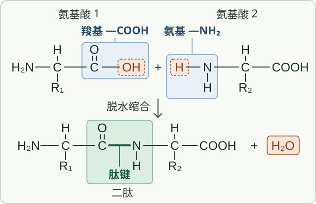

## 知识点 四类有机物的比较 {#organic-compounds .note-heading .note-heading--knowledge data-note-type="knowledge"}

| 比较项目 | 糖类 | 脂质 | 蛋白质 | 核酸 |
| --- | --- | --- | --- | --- |
| 组成元素 | C、H、O | 主要是 C、H、O 磷脂还含 P，部分含 N | 主要是 C、H、O、N | C、H、O、N、P |
| 种类 | 单糖、二糖、多糖 | 脂肪、磷脂、固醇 | 结构蛋白、功能蛋白等 | DNA、RNA |
| 组成单位 或成分 | 二糖、多糖由单糖 （如葡萄糖）组成 | **脂肪**由甘油和 脂肪酸组成 | 氨基酸 | 核苷酸 |
| 生理作用 | ① 提供能量 ② 参与构成细胞结构 ③ 参与组成核酸 | ① 脂肪储能 ② 磷脂参与构成生物膜 ③ 部分脂质参与调节 　 代谢和生殖 | ① 构成细胞结构 ② 催化 ③ 运输 ④ 调节 ⑤ 免疫 | ① 储存和传递遗传信息 ② 在遗传、变异和蛋白质 　 合成中发挥作用 |

脂肪、磷脂和固醇的结构不同。表中的甘油和脂肪酸是脂肪的组成成分。

糖类、脂肪和蛋白质的代谢相互联系，在一定条件下可发生转化；核酸通过遗传信息指导蛋白质的合成。

## 知识点 氨基酸的脱水缩合 {#dehydration .note-heading .note-heading--knowledge data-note-type="knowledge"}

一个氨基酸分子的**羧基**（$\ce{-COOH}$）与另一个氨基酸分子的**氨基**（$\ce{-NH2}$）相连接，同时脱去一分子水，这种结合方式叫作**脱水缩合**。连接两个氨基酸残基的化学键叫作**肽键**，结构可写作 $\ce{-CO-NH-}$。

| 过程 | 变化 |
| --- | --- |
| 脱水 | 羧基脱去 $\ce{-OH}$，氨基脱去一个 $\ce{H}$，共同形成一分子 $\ce{H2O}$ |
| 形成肽键 | 羧基的碳原子与氨基的氮原子相连，形成 $\ce{-CO-NH-}$ |
| 形成二肽 | 两个氨基酸脱水缩合形成二肽，同时生成一分子水 |

$R_1$、$R_2$ 表示侧链基团；R 基的不同决定氨基酸的种类不同。

$$
\text{氨基酸}
\xrightarrow{\text{脱水缩合}}
\text{肽链}
\xrightarrow{\text{盘曲、折叠}}
\text{具有一定空间结构的蛋白质}
$$

### 考点 肽键数与脱水数 {#peptide-count .note-heading .note-heading--exam data-note-type="exam"}

$n$ 个氨基酸脱水缩合形成**一条不含环的肽链**，产物称为 $n$ 肽。

| 数量关系 | 结果 |
| --- | --- |
| 肽键数 | $n-1$ |
| 脱去的水分子数 | $n-1$ |

一条肽链中，每相邻两个氨基酸残基之间形成一个肽键，所以肽键数比氨基酸数少 $1$。

## 知识点 有机物的水解与氧化分解 {#hydrolysis-and-oxidation .note-heading .note-heading--knowledge data-note-type="knowledge"}

| 有机物 | 初步水解产物 | 彻底水解产物 |
| --- | --- | --- |
| 淀粉 | 麦芽糖等 | 葡萄糖 |
| 脂肪 | — | 甘油和脂肪酸 |
| 蛋白质 | 多肽 | 氨基酸 |
| DNA | 4 种脱氧核苷酸 | 磷酸、脱氧核糖、4 种含氮碱基（A、G、C、T） |
| RNA | 4 种核糖核苷酸 | 磷酸、核糖、4 种含氮碱基（A、G、C、U） |

比较 DNA 与 RNA 的核苷酸组成时，可以区分五碳糖和碱基。DNA 含脱氧核糖和 T，RNA 含核糖和 U。

| 有机物 | 彻底氧化分解的主要产物 |
| --- | --- |
| 糖类、脂肪 | $\ce{CO2}$ 和 $\ce{H2O}$ |
| 蛋白质 | $\ce{CO2}$、$\ce{H2O}$ 和含氮产物 |

蛋白质分解产生的氨基酸进一步代谢时，氮最终形成含氮代谢产物。

<!--
知识核对资料（2026-11-14 查阅）
- OpenStax《Biology 2e》3.3 Lipids、3.4 Proteins、3.5 Nucleic Acids
- 《Molecular Biology of the Cell》第 4 版，How Cells Obtain Energy from Food
-->
