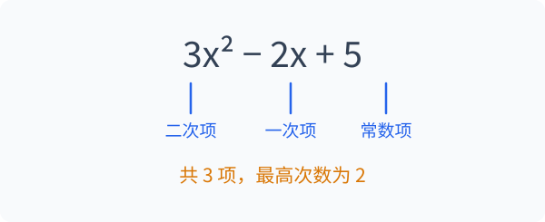
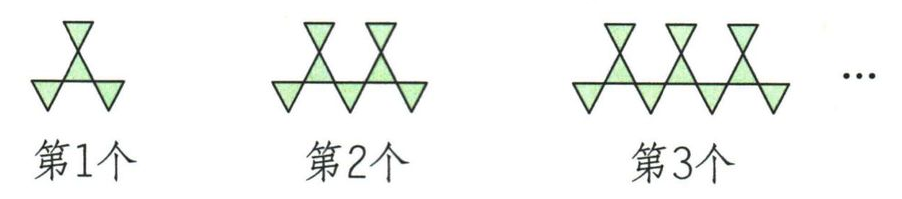
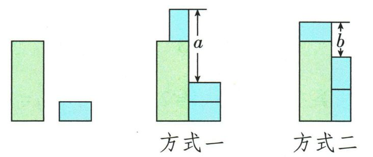

把数量关系写成式子，再把式子按项整理。整式加减的依据仍是运算律：括号控制整体，同类项确定哪些部分能合并，字母的意义与取值范围则始终由原题决定。

<nav class="handbook-nav" aria-label="本章分区">
  <a class="handbook-jump is-knowledge" href="#knowledge">01 · 知识点概念、关系与适用条件</a>
  <a class="handbook-jump is-exam" href="#exam">02 · 考点题目分类和例题</a>
  <a class="handbook-jump is-pitfall" href="#pitfalls">03 · 坑点辨析错因，检查遗漏</a>
</nav>

## 【知识点】理解概念 {#knowledge .handbook-section .is-knowledge}

### 1. 代数式 {#expression .knowledge-title}

用运算符号把数或字母连接起来的式子，叫作==代数式==，如 $3x+2$。单独一个数或字母也是代数式

| 原来的写法 | 通常简写 |
| --- | --- |
| $3\times x$ | $3x$ |
| $a\times b$ | $ab$ |
| $1\times x$、$(-1)\times x$ | $x$、$-x$ |
| $x\div y$ | $\frac xy$（$y\ne0$） |

### 2. 单项式、多项式与整式 {#polynomial .knowledge-title}

| 概念 | 含义 | 例子 |
| --- | --- | --- |
| 单项式 | 数与字母的积，字母指数为非负整数 | $-3x^2y$ |
| 系数 | 单项式中的数字因数，包含符号 | $-3x^2y$ 的系数为 $-3$ |
| 单项式的次数 | 所有字母的指数之和 | $x^2y$ 的次数为 $3$ |
| 多项式 | 几个单项式的和 | $3x^2-2x+5$ |
| 多项式的次数 | 各项次数中的最大值 | $3x^2-2x+5$ 的次数为 $2$ |

单项式与多项式统称==整式==。例如 $\frac x3$ 是整式，$\frac3x$、$\sqrt x$ 不是整式

### 3. 同类项与合并同类项 {#like-terms .knowledge-title}

所含字母相同，而且相同字母的指数也相同的项，叫作==同类项==

$3x^2y$ 与 $-2yx^2$ 是同类项，$3x^2y$ 与 $3xy^2$ 不是

合并时，系数相加，字母及其指数不变

$$3x^2y-2x^2y=(3-2)x^2y=x^2y$$

### 4. 去括号、排列与求值 {#brackets-value .knowledge-title}

- 括号前是 $+$：去括号后各项不变号，如 $a+(b-c)=a+b-c$
- 括号前是 $-$：去括号后各项都变号，如 $a-(b-c)=a-b+c$
- 整式加减：先去括号，再合并同类项
- 按某个字母的指数从大到小排列，叫降幂排列；反过来叫升幂排列

求代数式的值，就是用数替换字母。例如 $x=2$ 时，$3x+1=3\times2+1=7$

## 【考点】识别与处理 {#exam .handbook-section .is-exam}

### 1. 读清数量关系和运算对象 {#exam-language .exam-title}

先写“待求量等于什么”，再把相应数量换成字母。特别分清“平方和” $a^2+b^2$ 与“和的平方” $(a+b)^2$；相加减的量要同类，数量和费用不能直接相减。
<article class="handbook-example" aria-labelledby="example-1">

#### 例题 01 速度与购买总价 {#example-1 .example-heading}

题目

（1）王红5 h走的路程为 $s$ km，她的平均速度是多少 km/h？

（2）每本笔记本 $m$ 元，每支笔 $n$ 元，王刚买5本笔记本和2支笔，共花多少元？

答案与解析

解析

（1）平均速度=总路程÷总时间，得到 $\frac s5$ km/h，不是 $5s$。

（2）笔记本费用为 $5m$ 元，笔的费用为 $2n$ 元，两项费用相加为 $(5m+2n)$ 元。实际路程和价格不取负，单位必须对应整个和。

本题结论

$\frac s5$ km/h；$(5m+2n)$ 元。

</article>

<article class="handbook-example" aria-labelledby="example-2">

#### 例题 02 数量与单价必须对应 2022·湖南长沙，缩写情境 {#example-2 .example-heading}

题目

学校为读书活动购买甲、乙两种读本共100本，甲种每本10元，乙种每本8元。设购买甲种 $x$ 本，购买乙种读本的费用为（　）。

A. $8x$ 元

B. $10(100-x)$ 元

C. $8(100-x)$ 元

D. $(100-8x)$ 元

答案与解析

解析

乙种数量为 $100-x$ 本，乙种单价为8元，所以费用为 $8(100-x)$ 元。$x$ 是0至100的整数。

A把甲数量用于乙；B用了甲单价；D把本数100与费用 $8x$ 直接相减，数量类型不一致。

本题结论

C。

</article>

### 2. 整数模型保留参数范围 {#exam-integers .exam-title}

奇偶性要求对象为整数：偶数可写 $2k$，奇数可写 $2k-1$ 或 $2k+1$，其中 $k$ 为整数。连续奇数或连续偶数相差2。多位数则先写每位数字，再乘位权；十进制数字取0至9的整数，最高位不能为0。
<article class="handbook-example" aria-labelledby="example-3">

#### 例题 03 连续奇数与偶数 {#example-3 .example-heading}

题目

若 $n$ 表示自然数，请用 $n$ 表示两个连续奇数和三个连续偶数。

答案与解析

解析

可分别写成 $2n-1,2n+1$ 和 $2n-2,2n,2n+2$。前一组各与偶数差1，后一组各为2的整数倍；每组相邻两项之差均为2。

题目未要求这些数全部为正，不另加正数限制。也可换用其他满足相同间隔和奇偶性的表示，答案不唯一。

本题结论

$2n-1,2n+1$；$2n-2,2n,2n+2$，答案不唯一。

</article>

<article class="handbook-example" aria-labelledby="example-4">

#### 例题 04 三位数不是三个数字的乘积 {#example-4 .example-heading}

题目

一个三位数，百位数字为 $a$，十位数字比百位小1，个位数字比十位多3。用含 $a$ 的代数式表示这个三位数。

答案与解析

解析

先分清各位：

| 数位 | 百位 | 十位 | 个位 |
| --- | --- | --- | --- |
| 数字 | $a$ | $a-1$ | $(a-1)+3=a+2$ |
| 位权 | 100 | 10 | 1 |

整个数为 $100a+10(a-1)+(a+2)=111a-8$。数字范围要求 $a$ 为1至7的整数；这样最高位非零，另外两位也在0至9之间。

本题结论

$111a-8$，$a\in\{1,2,3,4,5,6,7\}$。

</article>

### 3. 从重复结构写出第几个图形 {#exam-pattern .exam-title}

先固定计数对象，再找每次新增的部分。从第1个开始计数，第 $n$ 个只经历 $n-1$ 次增加。代入前几项可以检查起点，但持续成立的依据应来自题给构造，而不是只凭几个数猜。
<article class="handbook-example" aria-labelledby="example-5">

#### 例题 05 固定部分与重复增加的部分 {#example-5 .example-heading}

题目

一组图案由边长相等的正三角形摆成，第1个有4个三角形，第2个有7个，第3个有10个。按图示规律继续摆放，第 $n$ 个有多少个这样的小三角形？

答案与解析

解析

第1个有4个，以后每次增加上方、中间、右下方3个小三角形。第 $n$ 个增加了 $n-1$ 次，所以数量为 $4+3(n-1)=3n+1$。

也可把最左下方的1个固定，其余每组三个，第 $n$ 个有 $n$ 组，得到 $1+3n$。两种数法都不重复计数；$n$ 为正整数。

本题结论

$3n+1$ 个，$n$ 为正整数。

</article>

### 4. 先定变量，再识别系数、次数和项数 {#exam-classify .exam-title}

把单项式拆成“有符号系数×字母积”，把多项式拆成“带符号的各项之和”。除以非零常数只改变系数，不会自动把式子变成分式；变化字母作分母则不同。
<article class="handbook-example" aria-labelledby="example-6">

#### 例题 06 单项式与多项式的组成 知识清单例题·合组 {#example-6 .example-heading}

题目

（1）求 $-\frac{4\pi x^3y}5$ 的系数和次数。

（2）指出 $3x^2-6x-7$ 的各项、项数、常数项、一次项、次数及名称。

答案与解析

解析

（1）$\pi$ 是固定常数，系数为 $-\frac{4\pi}5$，字母指数和为 $3+1=4$。

（2）各项为 $3x^2,-6x,-7$，共3项；常数项 $-7$，一次项 $-6x$；各项次数为2、1、0，最高为2，因此是二次三项式。

本题结论

（1）$-\frac{4\pi}5$，4；（2）$3x^2,-6x,-7$，3项，常数项 $-7$，一次项 $-6x$，二次三项式。

</article>

<article class="handbook-example" aria-labelledby="example-7">

#### 例题 07 常数分母不排除整式 {#example-7 .example-heading}

题目

指出下列各式中哪些是单项式、哪些是多项式、哪些是整式：

$-x$，$\frac{a+b}3$，$10$，$6xy+1$，$\frac1x$，$\frac17m^2n$，$\frac2{x^2+x}$，$\frac{2\pi r}3$。

答案与解析

解析

单项式有 $-x,10,\frac17m^2n,\frac{2\pi r}3$。其中分母3、7都是固定常数，$\pi$ 也是常数。

多项式有 $\frac{a+b}3=\frac13a+\frac13b$ 和 $6xy+1$。

$\frac1x$ 与 $\frac2{x^2+x}$ 的分母含变化字母，不是整式。其余六式都是整式。

本题结论

单项式4个，多项式2个；除 $\frac1x$、$\frac2{x^2+x}$ 外，其余都是整式。

</article>

### 5. 次数与项数分别约束参数 {#exam-parameters .exam-title}

次数由字母指数决定，项是否存在还受系数是否为0控制。题给“几次几项”时，先找哪一项能提供最高次数，再检查合并后实际保留几项，最后把参数代回核验。
<article class="handbook-example" aria-labelledby="example-8">

#### 例题 08 四次单项式还要求系数非零 {#example-8 .example-heading}

题目

已知 $(a-3)mn^{b+1}$ 是关于 $m,n$ 的四次单项式，求 $a$ 的取值范围和 $b$ 的值。

答案与解析

解析

变化字母只有 $m,n$，次数为 $1+(b+1)=b+2$，所以 $b+2=4$，得 $b=2$。

系数 $a-3$ 不能为0，否则整个式子成为0，不再满足四次的要求。因此 $a\ne3$。

本题结论

$a\ne3,b=2$。

</article>

<article class="handbook-example" aria-labelledby="example-9">

#### 例题 09 六次与四项各给一个条件 {#example-9 .example-heading}

题目

已知 $-\frac16xy^{m+1}+x^3y-2x^3+(n+1)x+3$ 是关于 $x,y$ 的六次四项式，求 $m-n$。

答案与解析

解析

除首项外，其他项最高为四次，所以六次必须由首项提供：$1+(m+1)=6$，得 $m=4$。

这时五项没有同类项，首项、$x^3y$、$-2x^3$ 和常数3均非零。要剩四项，只能使 $(n+1)x$ 消失，即 $n+1=0$，得 $n=-1$。故 $m-n=4-(-1)=5$。

本题结论

5。

</article>

### 6. 按指定字母排列，而非按总次数 {#exam-order .exam-title}

先标出每项中指定字母的指数，再移动整个带符号的项。升幂从小到大，降幂从大到小；其他字母的指数在本次排序中不参与比较。
<article class="handbook-example" aria-labelledby="example-10">

#### 例题 10 按x升幂排列 由原书示例改编 {#example-10 .example-heading}

题目

将 $3x^2y-\frac12xy^3-1+2x^3y^2-x^4y^4$ 按 $x$ 的升幂排列。

答案与解析

解析

原五项的 $x$ 指数依次为2、1、0、3、4。按0、1、2、3、4排列，常数 $-1$ 在前，$-\frac12xy^3$ 随后，各项符号不变。

本题结论

$-1-\frac12xy^3+3x^2y+2x^3y^2-x^4y^4$。

</article>

### 7. 逐字母核对，再合并系数 {#exam-like .exam-title}

同类项要比对应字母的每一个指数。若两个非零单项式的和仍为单项式，可据同类关系反求指数；计算时只合系数，不能把加法错用成幂的乘法。
<article class="handbook-example" aria-labelledby="example-11">

#### 例题 11 由和的结构反求指数 {#example-11 .example-heading}

题目

单项式 $-x^{a+1}y^3$ 与 $\frac12y^bx^2$ 的和仍是单项式，则 $a,b$ 分别为（　）。

A. 2，3

B. 1，2

C. 1，3

D. 2，2

答案与解析

解析

原系数为 $-1$ 与 $\frac12$，均非零。要合成一个单项式，字母乘积必须相同，所以 $a+1=2,b=3$，得 $a=1,b=3$。

合并后系数为 $-1+\frac12=-\frac12$，确实仍为单项式。只要求总次数相同不够。

本题结论

C。

</article>

<article class="handbook-example" aria-labelledby="example-12">

#### 例题 12 保留没有同类伙伴的项 {#example-12 .example-heading}

题目

合并同类项：$xy^2-5y^3-2y^2x+x^2y+5y^3$。

答案与解析

解析

$xy^2$ 与 $-2y^2x$ 同类，$-5y^3$ 与 $5y^3$ 同类，$x^2y$ 单独保留：

$$\begin{aligned}
\text{原式}&=(1-2)xy^2+(-5+5)y^3+x^2y\\
&=-xy^2+x^2y.
\end{aligned}$$

第二组消为0，不代表不同类的 $x^2y$ 也应删掉。

本题结论

$-xy^2+x^2y$。

</article>

### 8. 保住整个减数，再逐层去括号 {#exam-brackets .exam-title}

先用括号明确减去的整个多项式。多层括号优先由里向外，每处理一层，都保留尚未使用的外层负号或因数；最后合并同类项。
<article class="handbook-example" aria-labelledby="example-13">

#### 例题 13 整式的差与多重括号 知识清单例题·合组 {#example-13 .example-heading}

题目

（1）求 $5a^2-2ab+4$ 与 $5a^2-4ab$ 的差。

（2）化简 $(3a-2a^2)-[5a-\frac13(6a^2-9a)-4a^2]$。

答案与解析

解析

（1）$(5a^2-2ab+4)-(5a^2-4ab)=5a^2-2ab+4-5a^2+4ab=2ab+4$。

（2）先去内层：$-\frac13(6a^2-9a)=-2a^2+3a$，中括号变成 $8a-6a^2$。

再去外层：$3a-2a^2-(8a-6a^2)=3a-2a^2-8a+6a^2=4a^2-5a$。

本题结论

（1）$2ab+4$；（2）$4a^2-5a$。

</article>

<article class="handbook-example" aria-labelledby="example-14">

#### 例题 14 从和中减去整个已知加数 2024·四川德阳 {#example-14 .example-heading}

题目

一个多项式加上 $y^2+3xy-4$，结果为 $3xy+2y^2-5$，求这个多项式。

答案与解析

解析

所求式=和−已知加数：

$$(3xy+2y^2-5)-(y^2+3xy-4)=3xy+2y^2-5-y^2-3xy+4=y^2-1.$$

把 $y^2-1$ 与已知加数相加，得到 $3xy+2y^2-5$，与题意一致。

本题结论

$y^2-1$。

</article>

### 9. 选择直接代入或整体代入 {#exam-value .exam-title}

全部字母值已知且式子短，可直接代入；有同类项先化简；只给一个关系时，尝试把目标写成该关系中的整体。负数代入加括号，不能连原系数和常数一起改变。
<article class="handbook-example" aria-labelledby="example-15">

#### 例题 15 数值代入与关系代入 知识清单例题·合组 {#example-15 .example-heading}

题目

（1）若 $x=\frac12,y=-2$，求 $4x-3y-5$ 的值。

（2）已知 $2a-b=5$，求 $3a-b+4a-2b-a$ 的值。

答案与解析

解析

（1）$4\times\frac12-3\times(-2)-5=2+6-5=3$。

（2）先合并为 $6a-3b=3(2a-b)$，再代入整体5，得15。条件没有分别确定 $a,b$，但已足以确定目标。

本题结论

3；15。

</article>

<article class="handbook-example" aria-labelledby="example-16">

#### 例题 16 由一次取值恢复已知整体 {#example-16 .example-heading}

题目

当 $x=1$ 时，$ax^3+bx+1$ 的值为5。求当 $x=-1$ 时，$\frac12ax^3+\frac12bx+1$ 的值。

答案与解析

解析

由 $x=1$ 得 $a+b+1=5$，即 $a+b=4$。

当 $x=-1$ 时，目标为 $-\frac12a-\frac12b+1=-\frac12(a+b)+1=-2+1=-1$。末尾的1不在前两项的 $\frac12$ 系数作用范围内。

本题结论

$-1$。

</article>

<article class="handbook-example" aria-labelledby="example-17">

#### 例题 17 直接替换一个差 2024·江苏苏州 {#example-17 .example-heading}

题目

若 $a=b+2$，求 $(b-a)^2$。

答案与解析

解析

$a-b=2$，所以 $b-a=-2$。将整个差代入，$(b-a)^2=(-2)^2=4$，无需分别求 $a,b$。

本题结论

4。

</article>

### 10. “不含”与“无关”要看全部相关系数 {#exam-independent .exam-title}

先去括号并合并同类项。“不含某项”要求该项系数为0；“与某字母取值无关”要求所有含该字母的项都消去，不是给这个字母临时取0。
<article class="handbook-example" aria-labelledby="example-18">

#### 例题 18 不含ab项与不含x的各次项 知识清单例题·合组 {#example-18 .example-heading}

题目

（1）关于 $a,b$ 的多项式 $5(a^2-2ab+b^2)-(a^2+mab-b^2)$ 中不含 $ab$ 项，求 $m$。

（2）若 $x^2+mx+8y-(nx^2-2x+4y+3)$ 的值与 $x$ 的取值无关，求 $m+n$。

答案与解析

解析

（1）化简为 $4a^2-(10+m)ab+6b^2$。令 $-(10+m)=0$，得 $m=-10$。

（2）化简为 $(1-n)x^2+(m+2)x+4y-3$。$x^2$ 与 $x$ 的系数都必须为0，所以 $n=1,m=-2$，$m+n=-1$。代回后只剩 $4y-3$，确实与 $x$ 无关。

本题结论

（1）$m=-10$；（2）$m+n=-1$。

</article>

### 11. 看错运算，要先还原误算关系 {#exam-recover .exam-title}

误算结果不是未知式本身。先写清它来自哪种运算，再用“和与加数”或“被减数、减数与差”的关系恢复目标，不能只把整个错误答案改一个符号。
<article class="handbook-example" aria-labelledby="example-19">

#### 例题 19 把差误看成和 {#example-19 .example-heading}

题目

已知多项式 $B=3x^2-5x+1$，原题要求 $A-B$。张明把 $A-B$ 看成 $A+B$，算得 $5x^2+3x-7$。求原题的正确结果。

答案与解析

解析

设误算结果 $S=5x^2+3x-7$，则 $A+B=S$，所以 $A=S-B=2x^2+8x-8$。

正确目标还要再减一次 $B$：

$$(2x^2+8x-8)-(3x^2-5x+1)=-x^2+13x-9.$$

也可直接用 $A-B=(A+B)-2B=S-2B$。少减一次 $B$，得到的只是 $A$。

本题结论

$-x^2+13x-9$。

</article>

### 12. 从两种摆法中消去共同长度 {#exam-length .exam-title}

把同一总高度从两侧分别表示。卡片旋转后长宽不变，但竖直边可能由长变成宽；按图列出两组关系，再作差消去共同量，不用从图片像素猜长度。
<article class="handbook-example" aria-labelledby="example-20">

#### 例题 20 小卡片长与宽的差 {#example-20 .example-heading}

题目

有1张大长方形卡片、3张相同的小长方形卡片，按图中两种方式摆放。用含 $a,b$ 的代数式表示小长方形的长与宽的差。

答案与解析

解析

设小卡片长为 $x$、宽为 $y$，大卡片长为 $m$。方式一总高度：$a+2y=x+m$；方式二总高度：$b+2x=y+m$。

第一式减第二式，得 $a-b+2y-2x=x-y$。两边加上 $2x-2y$，得到 $a-b=3(x-y)$。

因此 $x-y=\frac{a-b}3$。$a,b$ 是标出的空段，不是小卡片本身的边；长度关系还说明 $a\ge b$。

本题结论

$\frac{a-b}3$。

</article>

## 【坑点】辨析易错 {#pitfalls .handbook-section .is-pitfall}

### 1. 写法不规范，不等于数值必然不同 {#pit-writing .pitfall-title}

书写规范帮助读者看清运算对象，但判断时要与数值问题分开。系数 $-1$ 通常省略1，数字因数放在字母前；含字母的除法仍应检查除数非零。
<article class="handbook-example is-pitfall" aria-labelledby="pitfall-1">

#### 辨析 01 判断通常书写规范 {#pitfall-1 .example-heading}

题目

下列写法中，哪些符合通常的代数式书写规范？

① $y\times9$；② $x\div y$；③ $-1a$；④ $a7$；⑤ $a+b$；⑥ $\frac dc$；⑦ $3\frac12ab$；⑧ $-\frac14a$。

答案与解析

解析

①通常写 $9y$；②写 $\frac xy$；③写 $-a$；④写 $7a$；⑦带分数先化为 $\frac72$，写 $\frac72ab$。⑤⑥⑧规范，其中⑥有意义还要求 $c\ne0$。

①明确写了乘号，值仍与 $9y$ 相同；不能把“不规范”扩大成“必然不同值”。

本题结论

⑤⑥⑧。

</article>

### 2. 同字母、同总次数，都不足以判断同类 {#pit-like .pitfall-title}

同类关系比较每个字母的指数，不比较系数大小或总次数。共同结构相同才能逆用分配律；某一次代入恰好相等，也不能证明两项同类。
<article class="handbook-example is-pitfall" aria-labelledby="pitfall-2">

#### 辨析 02 逐条辨别同类项 {#pitfall-2 .example-heading}

题目

下列说法中哪些正确？

① 99与 $-2025$ 不是同类项；
② $3a$ 与 $a^3$ 是同类项；
③ $2x^2y$ 与 $2xy^2$ 是同类项；
④ $-2.5ab^2$ 与 $7b^2a$ 是同类项。

答案与解析

解析

①错误，两者都是常数项；②错误，$a$ 的指数分别为1和3；③错误，$x,y$ 对应指数分别为2、1与1、2；④正确，都是 $a^1b^2$，字母排列次序和系数不同不影响同类关系。

本题结论

只有④正确。

</article>

### 3. 完整因数必须乘到每一项 {#pit-brackets .pitfall-title}

漏乘系数、只变首项符号，都是没有执行完整分配律。先把括号前的带符号因数写清，再逐项相乘，外层未处理的负号不能提前丢掉。
<article class="handbook-example is-pitfall" aria-labelledby="pitfall-3">

#### 辨析 03 检查去括号的每一项 {#pitfall-3 .example-heading}

题目

下列等式哪些错误？

① $a-(b+c)=a-b-c$；
② $a+(b-c)=a+b-c$；
③ $2(a-b)=2a-b$；
④ $-(a-2b)=-a+2b$；
⑤ $-3(a-b)=-3a-3b$。

答案与解析

解析

①②④正确。③漏乘第二项的2，应为 $2a-2b$；⑤第二项为 $(-3)\times(-b)=+3b$，应为 $-3a+3b$。

本题结论

③⑤错误。

</article>

### 4. 固定常数不计入变化字母的次数 {#pit-constant .pitfall-title}

$\pi$ 是常数，$2^3$ 也是常数因子。$2^3a^2b^3$ 的次数为 $2+3=5$，不是8；$-2a^2b$ 的次数为 $2+1=3$；$-5ab$ 的系数为 $-5$，不能漏负号。

若题目说“关于 $x,y$”，参数 $a$ 可以属于系数；例如 $-3ax^2y$ 关于 $x,y$ 的系数是 $-3a$。但 $a=0$ 会使整项消失，因此指定次数时还必须检查系数非零。
