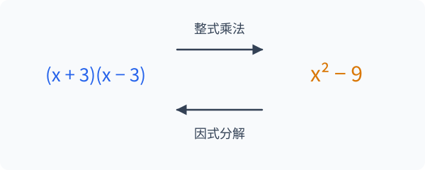

整式乘法把积展开为和，因式分解反过来寻找能产生这些项的乘积。判断是否分解完成，要看整个式子的结构，并把结果展开回验。

<nav class="handbook-nav" aria-label="本章分区">
  <a class="handbook-jump is-knowledge" href="#knowledge">01 · 知识点概念、关系与适用条件</a>
  <a class="handbook-jump is-exam" href="#exam">02 · 考点题目分类和例题</a>
  <a class="handbook-jump is-pitfall" href="#pitfalls">03 · 坑点辨析错因，检查遗漏</a>
</nav>

## 【知识点】理解概念 {#knowledge .handbook-section .is-knowledge}

### 1. 因式分解 {#definition .knowledge-title}

把一个多项式化成几个整式的积，叫作==因式分解==

例如 $x^2-9=(x+3)(x-3)$。分解后展开，应能得到原式

### 2. 提公因式法 {#common-factor .knowledge-title}

各项共有的因式，叫作==公因式==。提公因式就是逆用分配律

$$ab+ac=a(b+c)$$

例如 $6x^2+9x=3x(2x+3)$，其中 $3x$ 是公因式

1. 系数取最大公约数
2. 字母取各项共有的字母
3. 指数取共有字母的最低指数

### 3. 公式法、分组法与十字相乘 {#methods .knowledge-title}

| 方法 | 例子 |
| --- | --- |
| 平方差公式 | $x^2-9=(x+3)(x-3)$ |
| 完全平方公式 | $x^2+6x+9=(x+3)^2$ |
| 分组分解 | $ax+ay+bx+by=(a+b)(x+y)$ |
| 十字相乘 | $x^2+5x+6=(x+2)(x+3)$ |

十字相乘中，$2+3=5$、$2\times3=6$，分别对应一次项系数和常数项

通常先看能否提公因式，再看能否套公式；分解后继续检查各因式

## 【考点】识别与处理 {#exam .handbook-section .is-exam}

### 1. 判断是否真正完成因式分解 {#exam-definition .exam-title}

按“方向、整体、因式范围、恒等”依次检查。出现括号并不意味着分解完成；右侧只要还有一个在乘积之外的加减项，就还不是全式的乘积形式。
<article class="handbook-example" aria-labelledby="example-1">

#### 例题 01 四种变形逐一核对 知识清单例题 {#example-1 .example-heading}

题目

下列变形是因式分解的是哪些？

① $3x+3y-5=3(x+y)-5$；
② $(x+1)(x-1)=x^2-1$；
③ $x^2-9=(x+3)(x-3)$；
④ $x+y=x(1+\frac yx)$，$x\ne0$。

答案与解析

解析

①右侧整体仍是差，不是乘积。②是把积展开为多项式，方向相反。③整体变为两个整式的积，展开相等，符合定义。④的因式 $1+y/x$ 不是整式，还增加了 $x\ne0$ 的限制。

本题结论

只有③。

</article>

### 2. 先提全，再逐项确定余式 {#exam-common .exam-title}

先找共同系数、共有字母与最低指数；若有相反整体，先统一形式。提出后，原来每一项都要留下对应余项，尤其不能漏掉1或 $-1$。最后展开回验。
<article class="handbook-example" aria-labelledby="example-2">

#### 例题 02 共同因式可以是一个完整多项式 知识清单例题 {#example-2 .example-heading}

题目

写出各式通常提取的公因式：

（1）$12a^3b^2d-8a^2bc$；（2）$4a(x+y)^2-2(y+x)^2$。

答案与解析

解析

（1）12与8的最大公约数为4；共有字母 $a,b$ 的最低指数分别为2、1。$d,c$ 不是各项共有，故取 $4a^2b$。

（2）$y+x=x+y$，两项都有 $(x+y)^2$，数系数取2，得 $2(x+y)^2$。$a$ 只在第一项，不提到外面。

本题结论

$4a^2b$；$2(x+y)^2$。

</article>

<article class="handbook-example" aria-labelledby="example-3">

#### 例题 03 负号、常数余项都保留 知识清单例题·合组 {#example-3 .example-heading}

题目

分解因式：

（1）$-a+a^2$；（2）$9x^3+6x^2y-3x$；（3）$6a^3b^2-4ab^2-2a^2b^3$。

答案与解析

解析

（1）提 $-a$，原两项分别剩1、$-a$，得 $-a(1-a)$。

（2）提 $3x$，三项分别剩 $3x^2,2xy,-1$，得 $3x(3x^2+2xy-1)$。最后的 $-1$ 乘回 $3x$ 才能恢复 $-3x$。

（3）提 $2ab^2$，余项依次为 $3a^2,-2,-ab$，得 $2ab^2(3a^2-2-ab)$。这些分解都是恒等式，不需要把 $a,b,x$ 限制为非零。

本题结论

$-a(1-a)$；$3x(3x^2+2xy-1)$；$2ab^2(3a^2-2-ab)$。

</article>

<article class="handbook-example" aria-labelledby="example-4">

#### 例题 04 统一相反整体后再提出 知识清单例题 {#example-4 .example-heading}

题目

分解因式：

（1）$75a^3b^5-25a^2b^4$；（2）$-4m^3+16m^2-26m$；

（3）$m(a-3)+2(3-a)$；（4）$6a(b-a)^2-2(a-b)^3$。

答案与解析

解析

（1）提 $25a^2b^4$，得 $25a^2b^4(3ab-1)$。

（2）提 $-2m$，得 $-2m(2m^2-8m+13)$。括号 $=2(m-2)^2+5>0$，不能再分为关于 $m$ 的两个实一次因式。

（3）先写 $3-a=-(a-3)$，原式 $=m(a-3)-2(a-3)=(a-3)(m-2)$。

（4）$(b-a)^2=(a-b)^2$，所以

$$6a(a-b)^2-2(a-b)^3=2(a-b)^2[3a-(a-b)]=2(a-b)^2(2a+b).$$

平方消去了整体负号，但余式中的 $-(a-b)$ 仍须逐项变号。

本题结论

$25a^2b^4(3ab-1)$；$-2m(2m^2-8m+13)$；$(a-3)(m-2)$；$2(a-b)^2(2a+b)$。

</article>

### 3. 先提公因式，再逐层套公式 {#exam-formulas .exam-title}

先检查全式的公因式，再看余式能否匹配平方差或完全平方。把反复出现的多项式当作一个整体，可以减少展开，但最后要恢复整体，并检查每个因式是否还可分解。
<article class="handbook-example" aria-labelledby="example-5">

#### 例题 05 外因式和内层结构同时检查 知识清单例题·合组 {#example-5 .example-heading}

题目

分解因式：

（1）$\frac14x^2+\frac12x+\frac14$；（2）$3a^4-3b^4$。

答案与解析

解析

（1）先提 $\frac14$，余式为 $x^2+2x+1=(x+1)^2$，得 $\frac14(x+1)^2$。

（2）先提3，再连续使用平方差：

$$3(a^4-b^4)=3(a^2+b^2)(a^2-b^2)=3(a^2+b^2)(a+b)(a-b).$$

$a^2+b^2$ 是平方和，不再套平方差。

本题结论

$\frac14(x+1)^2$；$3(a^2+b^2)(a+b)(a-b)$。

</article>

<article class="handbook-example" aria-labelledby="example-6">

#### 例题 06 多层完全平方与平方差 知识清单例题 {#example-6 .example-heading}

题目

分解因式：

（1）$x^3-16x$；（2）$-4x^3y-8x^2y-4xy$；

（3）$(a^2+4)^2-16a^2$；（4）$(x^2+6x)^2+18(x^2+6x)+81$。

答案与解析

解析

（1）$x(x^2-16)=x(x+4)(x-4)$。

（2）提 $-4xy$ 后余 $x^2+2x+1$，故为 $-4xy(x+1)^2$。

（3）以 $a^2+4$ 和 $4a$ 为两个整体，平方差得到

$$(a^2+4+4a)(a^2+4-4a)=(a+2)^2(a-2)^2.$$

（4）先令 $M=x^2+6x$，则原式 $=M^2+18M+81=(M+9)^2$。恢复 $M$：

$$(x^2+6x+9)^2=[(x+3)^2]^2=(x+3)^4.$$

内层和外层的平方都要保留。

本题结论

$x(x+4)(x-4)$；$-4xy(x+1)^2$；$(a+2)^2(a-2)^2$；$(x+3)^4$。

</article>

<article class="handbook-example" aria-labelledby="example-7">

#### 例题 07 先展开，才能看见完全平方 2024·山东威海 {#example-7 .example-heading}

题目

分解因式：$(x+2)(x+4)+1$。

答案与解析

解析

原式中乘积外还有 $+1$，尚未完成分解。展开并合并同类项：

$$(x+2)(x+4)+1=x^2+6x+9=(x+3)^2.$$

中项 $6x=2\cdot x\cdot3$、末项 $9=3^2$，完整匹配完全平方。

本题结论

$(x+3)^2$。

</article>

### 4. 分组要为下一步制造共同结构 {#exam-group .exam-title}

四项式可考虑两两分组，也可把三项组成完全平方。选择分组的依据不是纸面位置，而是组内分解以后，组间能否继续成为乘积。重排时符号跟着原项走，提负括号后逐项回验。
<article class="handbook-example" aria-labelledby="example-8">

#### 例题 08 两两分组与一三分组 知识清单例题 {#example-8 .example-heading}

题目

分解因式：（1）$ma-mb-na+nb$；（2）$x^2+y^2-z^2-2xy$。

答案与解析

解析

（1）前两项提 $m$，后两项提 $-n$：

$$m(a-b)-n(a-b)=(a-b)(m-n).$$

（2）把可组成完全平方的三项放一起：

$$(x^2-2xy+y^2)-z^2=(x-y)^2-z^2=(x-y+z)(x-y-z).$$

只写出两个括号的和，还不能称分解完成；最后仍要整体成为积。

本题结论

$(a-b)(m-n)$；$(x-y+z)(x-y-z)$。

</article>

### 5. 十字相乘：常数看积，中项看和 {#exam-cross .exam-title}

对于 $x^2+px+q$，可先列 $q$ 的整数因子对，再检查其和是否为 $p$。$q>0$ 时两数同号，$q<0$ 时两数异号；再由和的符号判断具体配对。最后展开核验一次项与常数项，不能只核乘积。
<article class="handbook-example" aria-labelledby="example-9">

#### 例题 09 同时满足两个条件的因子对 知识清单例题 {#example-9 .example-heading}

题目

分解因式：（1）$x^2+3x+2$；（2）$m^2-6m-7$。

答案与解析

解析

（1）找积为2、和为3的两数，1与2满足，所以得 $(x+1)(x+2)$。

（2）找积为 $-7$、和为 $-6$ 的两数，$-7$ 与1满足，所以得 $(m-7)(m+1)$。两数异号还不够，和必须与 $-6$ 一致。

本题结论

$(x+1)(x+2)$；$(m-7)(m+1)$。

</article>

<article class="handbook-example" aria-labelledby="example-10">

#### 例题 10 四种符号组合 知识清单例题 {#example-10 .example-heading}

题目

分解因式：

（1）$x^2+5x+6$；（2）$x^2+5x-6$；（3）$x^2-5x+6$；（4）$x^2-5x-6$。

答案与解析

解析

| 题号 | 两数 | 积 | 和 | 分解结果 |
| --- | --- | --- | --- | --- |
| （1） | 2、3 | 6 | 5 | $(x+2)(x+3)$ |
| （2） | 6、$-1$ | $-6$ | 5 | $(x+6)(x-1)$ |
| （3） | $-2$、$-3$ | 6 | $-5$ | $(x-2)(x-3)$ |
| （4） | $-6$、1 | $-6$ | $-5$ | $(x-6)(x+1)$ |

每一行都同时核对积和和。正常数并不意味着两数都正，也可能两数都负。

本题结论

依次为 $(x+2)(x+3)$、$(x+6)(x-1)$、$(x-2)(x-3)$、$(x-6)(x+1)$。

</article>

### 6. 分解后整体求值或简算 {#exam-value .exam-title}

给出关系而非单个变量的值时，先把目标式分解，看看能否出现已知的积、和或差。数值简算同样可把重复乘数提出，或把完全平方、平方差反向识别出来。
<article class="handbook-example" aria-labelledby="example-11">

#### 例题 11 把已知积与差保留下来 知识清单例题 {#example-11 .example-heading}

题目

已知 $m-4n=-3$、$mn=4$，求 $-m^3n+8m^2n^2-16mn^3$ 的值。

答案与解析

解析

先提共同因式 $-mn$，注意各余项符号：

$$-mn(m^2-8mn+16n^2)=-mn(m-4n)^2.$$

两个整体恰为已知量，所以原式 $=-4\times(-3)^2=-36$。无需解出 $m,n$。

本题结论

$-36$。

</article>

<article class="handbook-example" aria-labelledby="example-12">

#### 例题 12 把运算量降下来 知识清单例题 {#example-12 .example-heading}

题目

简便计算：

（1）$7.6\times206+4.3\times206-1.9\times206$；

（2）$202^2+202\times196+98^2$；（3）$147^2-145^2$。

答案与解析

解析

（1）提共同因数206，得 $206(7.6+4.3-1.9)=206\times10=2060$。

（2）$202\times196=2\times202\times98$，中项是二倍积，所以原式 $=(202+98)^2=300^2=90000$。

（3）平方差：$(147+145)(147-145)=292\times2=584$。

本题结论

2060；90000；584。

</article>

## 【坑点】检查遗漏 {#pitfalls .handbook-section .is-pitfall}

### 1. 出现乘积不等于分解彻底 {#pit-complete .pitfall-title}

$3a^4-3b^4$ 先分成 $3(a^2+b^2)(a^2-b^2)$ 后，因式 $a^2-b^2$ 仍可继续分解。另一方面，不能把平方和 $a^2+b^2$ 错当平方差。每个因式分别检查，而不是见到括号就停。
<article class="handbook-example is-pitfall" aria-labelledby="pitfall-1">

#### 辨析 01 既不能漏公因式，也不能改符号 2024·云南 {#pitfall-1 .example-heading}

题目

分解因式 $a^3-9a$，正确的是（　）。

A. $a(a-3)(a+3)$

B. $a(a^2+9)$

C. $(a-3)(a+3)$

D. $a^2(a-9)$

答案与解析

解析

先提 $a$，再平方差：$a(a^2-9)=a(a-3)(a+3)$，A正确。

B展开为 $a^3+9a$，符号错；C漏公因式，展开为 $a^2-9$；D展开为 $a^3-9a^2$，第二项的指数错。个别取值碰巧相等不能证明恒等。

本题结论

A。

</article>

### 2. 余项1和外面的分数不能消失 {#pit-factors .pitfall-title}

- $9x^3+6x^2y-3x$ 提 $3x$ 后最后一项是 $-1$，不是0；漏掉它就无法乘回原来的 $-3x$。
- $\frac14x^2+\frac12x+\frac14=\frac14(x+1)^2$，不能把外面的 $\frac14$ 丢掉。这里是在改写一个式子的值，不是在方程两边同时乘4。
- 提负因式要处理每一项，例如 $-a+a^2=-a(1-a)$，不是 $-a(1+a)$。
- 找余项时用到除法，不代表原多项式增加了非零限制。正确分解要在原来的全部取值下成立。
