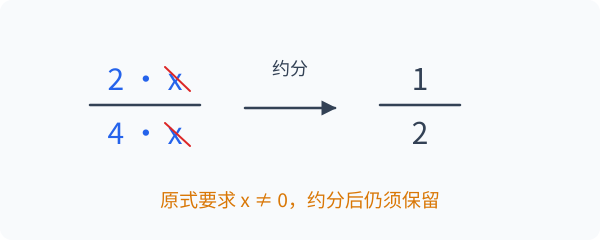

分式把分数的分子、分母扩展为整式。计算方法可以类比分数，但字母使“除数不能为零”成为贯穿全章的条件：化简改变写法，不会改变原式允许取什么值。

<nav class="handbook-nav" aria-label="本章分区">
  <a class="handbook-jump is-knowledge" href="#knowledge">01 · 知识点概念、关系与适用条件</a>
  <a class="handbook-jump is-exam" href="#exam">02 · 考点题目分类和例题</a>
  <a class="handbook-jump is-pitfall" href="#pitfalls">03 · 坑点辨析错因，检查遗漏</a>
</nav>

## 【知识点】理解概念 {#knowledge .handbook-section .is-knowledge}

### 1. 分式 {#definition .knowledge-title}

$A,B$ 是整式，$B$ 中含有字母，形如 $\frac AB$ 的式子叫作==分式==，如 $\frac3x$、$\frac{x+1}{x-2}$

| 所问情况 | 条件 |
| --- | --- |
| 有意义 | 分母 $B\ne0$ |
| 无意义 | 分母 $B=0$ |
| 值为 $0$ | 分子 $A=0$，同时分母 $B\ne0$ |

例如 $\frac{x-1}{x+2}$ 在 $x\ne-2$ 时有意义，在 $x=1$ 时值为 $0$

### 2. 分式的基本性质 {#basic-property .knowledge-title}

分子、分母同乘或同除一个非零的数或整式，分式的值不变

$$\frac AB=\frac{AC}{BC}\quad(B\ne0,C\ne0)$$

### 3. 约分与通分 {#reduce-common .knowledge-title}

- 约分：约去分子、分母的公因式，如 $\frac{2x}{4x}=\frac12$（$x\ne0$）
- 通分：把几个分式化为同分母，如 $\frac1{2x}=\frac3{6x}$、$\frac1{3x}=\frac2{6x}$（$x\ne0$）

分子、分母没有公因式可约的分式，叫作==最简分式==。约分前先分解因式，原分母不为零的限制始终保留

### 4. 分式的运算 {#operations .knowledge-title}

下表各原分母都不为 $0$，除法中的除式也不为 $0$

| 运算 | 法则 |
| --- | --- |
| 乘法 | $\frac AB\cdot\frac CD=\frac{AC}{BD}$ |
| 除法 | $\frac AB\div\frac CD=\frac AB\cdot\frac DC$ |
| 乘方 | $(\frac AB)^n=\frac{A^n}{B^n}$（$n$ 为正整数） |
| 同分母加减 | $\frac AB\pm\frac CB=\frac{A\pm C}B$ |
| 异分母加减 | 先通分，再把分子相加减 |

### 5. 负整数指数幂 {#negative-powers .knowledge-title}

负整数指数表示取倒数。$a\ne0$、$n$ 为正整数时

$$a^{-n}=\frac1{a^n}$$

例如 $2^{-3}=\frac1{2^3}=\frac18$

### 6. 小数的科学记数法 {#small-scientific .knowledge-title}

绝对值小于 $1$ 的非零数，小数点向右移几位，$10$ 的指数就是负几

$$0.000072=7.2\times10^{-5}$$

## 【考点】识别与处理 {#exam .handbook-section .is-exam}

### 1. 先找原分母的禁值 {#exam-domain .exam-title}

不必先约分，直接列原分母不等于0。分母为乘积，要求每个因式都非零；分母为平方加正数，可用非负性判断是否永远为正。几个分式同时出现，所有限制都须满足。
<article class="handbook-example" aria-labelledby="example-1">

#### 例题 01 三类分母分别判断 知识清单例题 {#example-1 .example-heading}

题目

当 $x$ 满足什么条件时，下列分式有意义？

（1）$\frac{1-x}{3x-2}$；（2）$\frac5{x^2+1}$；（3）$\frac{x^2+1}{(x-1)(x+2)}$。

答案与解析

解析

（1）$3x-2\ne0$，所以 $x\ne2/3$，分子是否为0不影响有意义。

（2）实数平方非负，$x^2+1\ge1>0$，所有实数都可以。

（3）$(x-1)(x+2)\ne0$，即 $x\ne1$ 且 $x\ne-2$。这里是“且”，任一因式为0都会使分母为0。

本题结论

$x\ne\frac23$；任意实数；$x\ne1,-2$。

</article>

<article class="handbook-example" aria-labelledby="example-2">

#### 例题 02 分母非零，分子为零 （1）2024·湖南长沙；（2）2024·山东济南·合组 {#example-2 .example-heading}

题目

（1）要使 $\frac6{x-19}$ 有意义，$x$ 须满足什么条件？

（2）若 $\frac{x-1}{2x}$ 的值为0，求实数 $x$。

答案与解析

解析

（1）原分母 $x-19\ne0$，得 $x\ne19$。

（2）先由分子 $x-1=0$ 得 $x=1$，再查此时分母 $2x=2\ne0$，故可取1。求分母等于0是在找禁值，不是在求分式的零值。

本题结论

（1）$x\ne19$；（2）$x=1$。

</article>

### 2. 求零值：列全候选，再筛分母 {#exam-zero .exam-title}

先解分子等于0，积为零至少一个因式为零，绝对值或平方条件可能有两个候选。再把每个候选代回原分母，只有分母非零的候选才保留。约掉的因式不能使禁值重新合法。
<article class="handbook-example" aria-labelledby="example-3">

#### 例题 03 积、绝对值和平方差的零值 知识清单例题·合组 {#example-3 .example-heading}

题目

（1）若 $\frac{(m-1)(m-3)}{m^2-3m+2}=0$，求 $m$。

（2）当 $x$ 取何值时，$\frac{x+2}{2x-3}$、$\frac{|x|-2}{x+2}$、$\frac{x^2-9}{x-3}$ 分别为0？

答案与解析

解析

（1）分子为0给出 $m=1$ 或3；分母 $=(m-1)(m-2)$，排除1、2。只剩 $m=3$，分母为2，符合要求。

（2）逐式核对：

| 分子给出的候选 | 原分母检查 | 保留值 |
| --- | --- | --- |
| $x=-2$ | $2(-2)-3=-7\ne0$ | $-2$ |
| $x=2,-2$ | $x+2\ne0$ 排除 $-2$ | 2 |
| $x=3,-3$ | $x-3\ne0$ 排除3 | $-3$ |

不能只看分子，也不能把 $0/0$ 当作0。

本题结论

（1）$m=3$；（2）依次为 $-2,2,-3$。

</article>

### 3. 基本性质用于清除系数的分母 {#exam-property .exam-title}

小数系数可同乘足够大的10的整数次幂；分数系数可同乘各系数分母的最小公倍数。乘的是完整分子与分母，每一项都应覆盖，且原分母不能为0。
<article class="handbook-example" aria-labelledby="example-4">

#### 例题 04 把各项系数化为整数 知识清单例题 {#example-4 .example-heading}

题目

不改变值，把各式分子分母的各项系数化为整数：

（1）$\frac{0.03x-0.2y}{0.08x-0.5y}$；（2）$\frac{m/2+n/3}{2m/5-2n/3}$。

答案与解析

解析

（1）整个分子分母同乘100，得 $\frac{3x-20y}{8x-50y}$，条件 $8x-50y\ne0$。

（2）2、3、5的最小公倍数为30，整个分子分母同乘30，得 $\frac{15m+10n}{12m-20n}$，条件 $12m-20n\ne0$。固定非零乘数不会增加禁值。

本题结论

$\frac{3x-20y}{8x-50y}$；$\frac{15m+10n}{12m-20n}$，分母均须非零。

</article>

### 4. 先分解，再约整个公因式 {#exam-reduce .exam-title}

记下原禁值后，把分子分母分别因式分解。约去共同因式的较少次数，相反因式先提出一个 $-1$。最后检查是否最简，并把原限制保留在结果后。
<article class="handbook-example" aria-labelledby="example-5">

#### 例题 05 约分不消除原禁值 知识清单例题·合组 {#example-5 .example-heading}

题目

约分：（1）$\frac{6a^2b^3c}{-8ab^2c^2}$；（2）$\frac{x^2-y^2}{x+y}$；（3）$\frac{a^2-4a+4}{a^2-4}$；（4）$\frac{m^2-3m}{9-m^2}$。

答案与解析

解析

（1）系数约成 $-3/4$，字母按指数相减，得 $-3ab/(4c)$。原式仍要求 $a,b,c\ne0$。

（2）分子 $=(x-y)(x+y)$，约去非零 $x+y$，得 $x-y$，仍要求 $x+y\ne0$。

（3）$\frac{(a-2)^2}{(a-2)(a+2)}=\frac{a-2}{a+2}$，只约一份 $a-2$；原条件 $a\ne\pm2$。

（4）$9-m^2=(3-m)(3+m)$，$m-3=-(3-m)$，所以

$$\frac{m(m-3)}{(3-m)(3+m)}=-\frac m{m+3},\qquad m\ne\pm3.$$

相反因式之比为 $-1$，不是1。

本题结论

$-\frac{3ab}{4c}$；$x-y$；$\frac{a-2}{a+2}$；$-\frac m{m+3}$，各自保留上述原条件。

</article>

<article class="handbook-example" aria-labelledby="example-6">

#### 例题 06 共有字母不等于有公因式 知识清单例题 {#example-6 .example-heading}

题目

下列分式中，哪些不是最简分式？

① $\frac{3x}{4x+3}$；② $\frac{x-y}{xy^2-x^2y}$；③ $\frac{2y}{3x}$；④ $\frac{x+y^2}{xy^3-x^2y}$。

答案与解析

解析

①分母中的常数3阻止整体提 $x$，不能直接约掉上下的 $x$。③系数互质，字母不同，没有公因式。

②分母 $=xy(y-x)=-xy(x-y)$，可约为 $-1/(xy)$，所以不是最简；原条件 $x,y\ne0,x\ne y$。

④分母 $=xy(y^2-x)$，分子 $x+y^2$ 与 $y^2-x$ 既不相同，也不互为相反式，没有可约的整体公因式。

本题结论

只有②。

</article>

### 5. 公分母取最高次，分子同步补乘 {#exam-common .exam-title}

逐个分解原分母，按“系数最小公倍数、各因式最高次数”组成公分母 $D$。对每个原分母 $B$，计算缺少的因式 $D/B$，再给整个分子同乘它。分子中的常数也要乘。
<article class="handbook-example" aria-labelledby="example-7">

#### 例题 07 独有因式也要收入公分母 知识清单例题 {#example-7 .example-heading}

题目

求 $\frac m{2m^2-2n^2}$ 与 $\frac1{3m^2-3mn}$ 的最简公分母。

答案与解析

解析

两个分母分别为 $2(m-n)(m+n)$ 与 $3m(m-n)$。系数取6，共同因式 $m-n$ 只需一次，独有的 $m$ 与 $m+n$ 也各需一次，得 $6m(m+n)(m-n)$。

第一个分母补乘 $3m$，第二个补乘 $2(m+n)$。两个原分式同时有意义，要求 $m\ne0,m\ne n,m\ne-n$。

本题结论

$6m(m+n)(m-n)$。

</article>

<article class="handbook-example" aria-labelledby="example-8">

#### 例题 08 三种通分结构 知识清单例题 {#example-8 .example-heading}

题目

通分：

（1）$\frac3{2a^2b}$ 与 $\frac{a-b}{ab^2c}$；

（2）$\frac{2x}{x-5}$ 与 $\frac{3x}{x^2-25}$；

（3）$\frac1{x+2}$、$\frac{4x}{x^2-4}$、$\frac2{2-x}$。

答案与解析

解析

（1）公分母 $2a^2b^2c$，补乘量依次为 $bc,2a$，得

$$\frac{3bc}{2a^2b^2c},\qquad\frac{2a^2-2ab}{2a^2b^2c},\quad a,b,c\ne0.$$

（2）公分母 $(x-5)(x+5)=x^2-25$，第一分式补乘 $x+5$，第二不变，得

$$\frac{2x^2+10x}{x^2-25},\qquad\frac{3x}{x^2-25},\quad x\ne\pm5.$$

（3）先将 $2/(2-x)$ 写成 $-2/(x-2)$，再统一到 $x^2-4$，得

$$\frac{x-2}{x^2-4},\qquad\frac{4x}{x^2-4},\qquad\frac{-2x-4}{x^2-4},\quad x\ne\pm2.$$

换相反分母方向产生的负号不能丢掉。

本题结论

各组通分结果如上，原条件保留。

</article>

### 6. 每个除式先整体翻转 {#exam-multiply .exam-title}

先检查原分母以及除式分子是否非零。把每个除号单独改为乘完整倒数，其他乘数不翻转；分解为因式后，才可跨乘数约分。
<article class="handbook-example" aria-labelledby="example-9">

#### 例题 09 乘法与除法的条件不同 知识清单例题 {#example-9 .example-heading}

题目

计算：（1）$\frac{ax^2}{b^2y}\cdot\frac{ay}{-bx^2}$；（2）$\frac{x^2-xy}{y}\div\frac{y-x}{xy}$。

答案与解析

解析

（1）分子分母相乘，得 $-a^2x^2y/(b^3x^2y)=-a^2/b^3$。原式要求 $b,x,y\ne0$，但 $a$ 可以为0。

（2）先乘除式的倒数：$\frac{x(x-y)}y\cdot\frac{xy}{y-x}$。相反因式之比为 $-1$，约去 $y$ 后得 $-x^2$。原分母要求 $x,y\ne0$，除式非零还要求 $x\ne y$。

本题结论

$-\frac{a^2}{b^3}$，$b,x,y\ne0$；$-x^2$，$x,y\ne0,x\ne y$。

</article>

<article class="handbook-example" aria-labelledby="example-10">

#### 例题 10 三个因子的乘除串 知识清单例题 {#example-10 .example-heading}

题目

计算：

（1）$\frac{8xy}{9a^2b}\div\frac{2x}{3b}\cdot\frac{3ab^2}{2x^3y}$；

（2）$\frac{x^2-1}{x^2-2x+1}\div\frac{x+1}{x-1}\cdot\frac{1-x}{1+x}$；

（3）$(xy-x^2)\div\frac{x^2-2xy+y^2}{xy}\cdot\frac{x-y}{x^2}$。

答案与解析

解析

（1）除式改乘 $3b/(2x)$，系数积商为 $8\times3\times3/(9\times2\times2)=2$，字母约后得 $2b^2/(ax^3)$，原条件 $a,b,x,y\ne0$。

（2）分解后为 $\frac{(x-1)(x+1)}{(x-1)^2}\cdot\frac{x-1}{x+1}\cdot\frac{1-x}{1+x}$，前两个因子乘积为1，得 $(1-x)/(1+x)$，原条件 $x\ne\pm1$。

（3）$xy-x^2=-x(x-y)$，因此

$$-x(x-y)\cdot\frac{xy}{(x-y)^2}\cdot\frac{x-y}{x^2}=-y.$$

原条件 $x,y\ne0,x\ne y$，负号与剩下的 $y$ 都要保留。

本题结论

$\frac{2b^2}{ax^3}$；$\frac{1-x}{1+x}$；$-y$，各自保留原条件。

</article>

### 7. 乘方覆盖分子分母的全部因子 {#exam-power .exam-title}

先圈定完整分子和分母，把指数分别作用于两个整体。分子含和差时用完全平方，分母含负号与数字时也完整乘方，不只处理字母。
<article class="handbook-example" aria-labelledby="example-11">

#### 例题 11 奇次幂与偶次幂 知识清单例题 {#example-11 .example-heading}

题目

计算：（1）$(\frac{x^2y}{-z^2})^3$；（2）$(\frac{x+y}{-2x})^2$。

答案与解析

解析

（1）分子为 $x^6y^3$，分母 $(-z^2)^3=-z^6$，得 $-x^6y^3/z^6$，$z\ne0$。

（2）分子 $(x+y)^2=x^2+2xy+y^2$，分母 $(-2x)^2=4x^2$，得 $(x^2+2xy+y^2)/(4x^2)$，$x\ne0$。

本题结论

$-\frac{x^6y^3}{z^6}$，$z\ne0$；$\frac{x^2+2xy+y^2}{4x^2}$，$x\ne0$。

</article>

### 8. 先统一分母，再处理分子整体 {#exam-add .exam-title}

相反分母先统一方向，异分母先通分。合并时每个多项式分子先保留括号；外减号作用于其中每一项。合并后再判断能否约分，分母不能相加减。
<article class="handbook-example" aria-labelledby="example-12">

#### 例题 12 相反分母与三项异分母 知识清单例题 {#example-12 .example-heading}

题目

计算：

（1）$\frac{a-3b}{a-b}-\frac{a+b}{b-a}$；

（2）$\frac{5c}{6a^2b}+\frac{7a}{8b^2c}-\frac b{12a^2c}$；

（3）$\frac{x^2+4x}{x^2+2x}+\frac{x^2-4}{x^2+4x+4}$。

答案与解析

解析

（1）$b-a=-(a-b)$，第二个减号与换向的负号相遇变成加号，分子 $a-3b+a+b=2(a-b)$，结果2，$a\ne b$。

（2）公分母为 $24a^2b^2c$，补乘量分别是 $4bc,3a^2,2b^2$，所以

$$\frac{20bc^2+21a^3-2b^3}{24a^2b^2c},\qquad a,b,c\ne0.$$

（3）先分解并约分，原式 $=\frac{x+4}{x+2}+\frac{x-2}{x+2}=\frac{2x+2}{x+2}$。原条件 $x\ne0,-2$；约去 $x$ 不会使0合法。

本题结论

2；$\frac{20bc^2+21a^3-2b^3}{24a^2b^2c}$；$\frac{2x+2}{x+2}$，各自保留原条件。

</article>

### 9. 混合运算分层处理 {#exam-mixed .exam-title}

先记录原禁值。括号或除式内有加减，先通分成整体；再算乘方、把除法化为乘法；最后回到外层加减。每层只使用该层允许的运算律，不跨越加减号约分。
<article class="handbook-example" aria-labelledby="example-13">

#### 例题 13 先平方再乘，最后相减 知识清单演算·改为例题 {#example-13 .example-heading}

题目

计算 $\frac{a^2+2a}{a^2-4}-\frac{a-2}{a}\cdot(\frac{2a}{a-2})^2$。

答案与解析

解析

原条件 $a\ne0,2,-2$。

1. 乘方：$(2a/(a-2))^2=4a^2/(a-2)^2$。
2. 乘除与约分：第一项为 $a/(a-2)$，第二个乘积为 $4a/(a-2)$。
3. 同分母相减：$[a-4a]/(a-2)=-3a/(a-2)$。

原条件包含 $a=-2$ 的禁值，虽然它不再出现在结果分母中，也必须保留。

本题结论

$-\frac{3a}{a-2}$，$a\ne0,2,-2$。

</article>

<article class="handbook-example" aria-labelledby="example-14">

#### 例题 14 三种混合运算 知识清单例题 {#example-14 .example-heading}

题目

计算：

（1）$\frac{x^2+2x+1}{x+2}\div\frac{x^2-1}{x-1}-\frac x{x+2}$；

（2）$\frac{a^2+3a}{a^2-3a}-\frac{a-3}{a}\cdot(\frac{2a}{a-3})^2$；

（3）$(\frac{x+2}{x^2-2x}-\frac{x-1}{x^2-4x+4})\div\frac{x-4}{x}$。

答案与解析

解析

（1）原条件 $x\ne-2,1,-1$。除法改乘倒数后，前两项的商为 $(x+1)/(x+2)$，再减 $x/(x+2)$，得 $1/(x+2)$。

（2）原条件 $a\ne0,3$。首项约为 $(a+3)/(a-3)$；平方后与前因子相乘为 $4a/(a-3)$，相减得 $(3-3a)/(a-3)$。

（3）原条件 $x\ne0,2$，除式非零还要求 $x\ne4$。括号通分为

$$\frac{(x+2)(x-2)-x(x-1)}{x(x-2)^2}=\frac{x-4}{x(x-2)^2}.$$

再乘 $x/(x-4)$，得 $1/(x-2)^2$。被约掉的0和4仍是禁值。

本题结论

$\frac1{x+2}$；$\frac{3-3a}{a-3}$；$\frac1{(x-2)^2}$，各自保留原条件。

</article>

### 10. 化简求值与逆求整式 {#exam-value .exam-title}

求值先筛原式允许的取值，再选择直接代入还是整体代入。给出 $x/y$ 可用 $x=ky$，或上下同除非零 $y^2$；给出差或二次关系，就把目标改写为那个整体。逆求分子时，先隔离含未知整式的一项，通分后再乘非零分母。
<article class="handbook-example" aria-labelledby="example-15">

#### 例题 15 一个比值，两种处理方法 知识清单例题 {#example-15 .example-heading}

题目

已知 $x/y=3$，求 $\frac{x^2+2xy-3y^2}{x^2-2xy+y^2}$。

答案与解析

解析

已知 $y\ne0,x=3y$，所以 $x-y=2y\ne0$，目标式有意义。

方法一：分解后代入。 分子 $=(x-y)(x+3y)$，分母 $=(x-y)^2$，约后为 $(x+3y)/(x-y)$。代 $x=3y$，得 $6y/(2y)=3$。

方法二：把比值直接作为整体。 上下同除 $y^2\ne0$，得

$$\frac{(x/y)^2+2(x/y)-3}{(x/y)^2-2(x/y)+1}=\frac{9+6-3}{9-6+1}=3.$$

条件固定的是比值，不是 $x,y$ 各自的唯一值。

本题结论

3。

</article>

<article class="handbook-example" aria-labelledby="example-16">

#### 例题 16 已知差时不必分别求两数 2024·北京 {#example-16 .example-heading}

题目

已知 $a-b-1=0$，求 $\frac{3(a-2b)+3b}{a^2-2ab+b^2}$。

答案与解析

解析

由条件得 $a-b=1$，保证分母 $(a-b)^2\ne0$。分子合并为 $3a-3b=3(a-b)$，所以原式 $=3/(a-b)=3$。

本题结论

3。

</article>

<article class="handbook-example" aria-labelledby="example-17">

#### 例题 17 从区间中筛出所有合法整数 知识清单例题 {#example-17 .example-heading}

题目

化简 $(1-\frac3{x+2})\div\frac{x^2-2x+1}{x^2-4}$，并在 $0\le x<4$ 中选取所有合适的整数代入求值。

答案与解析

解析

原分母要求 $x\ne-2,2$，除式分子 $(x-1)^2\ne0$ 还要求 $x\ne1$。

$$\frac{x-1}{x+2}\cdot\frac{(x-2)(x+2)}{(x-1)^2}=\frac{x-2}{x-1}.$$

区间中的整数为0、1、2、3，排除1、2，保留0、3。$x=0$ 时值为2；$x=3$ 时值为 $1/2$。不能只看化简式的分母而误选2。

本题结论

$\frac{x-2}{x-1}$，原条件 $x\ne-2,1,2$；合法整数0、3，对应值2、$\frac12$。

</article>

<article class="handbook-example" aria-labelledby="example-18">

#### 例题 18 二次关系整体替换 知识清单例题 {#example-18 .example-heading}

题目

先化简 $(\frac{x-1}{x}-\frac{x-2}{x+1})\div\frac{2x^2-x}{x^2+2x+1}$，再求 $x^2-2x-2=0$ 时的值。

答案与解析

解析

原条件 $x\ne0,-1,1/2$。括号通分后分子为 $(x-1)(x+1)-x(x-2)=2x-1$，所以

$$\frac{2x-1}{x(x+1)}\cdot\frac{(x+1)^2}{x(2x-1)}=\frac{x+1}{x^2}.$$

由已知关系得 $x^2=2(x+1)$，因此值为 $1/2$。把0、$-1$、$1/2$ 代入给定二次式均不为0，已知条件不会触及原禁值；无需先求两个具体根。

本题结论

$\frac{x+1}{x^2}$，原条件 $x\ne0,-1,\frac12$；值为 $\frac12$。

</article>

<article class="handbook-example" aria-labelledby="example-19">

#### 例题 19 从分式恒等关系逆求分子 2024·河北 {#example-19 .example-heading}

题目

已知 $A$ 为整式，$\frac A{xy+y^2}-\frac y{x^2+xy}$ 的计算结果为 $\frac{x-y}{xy}$，则 $A$ 为（　）。

A. $x$

B. $y$

C. $x+y$

D. $x-y$

答案与解析

解析

原分母要求 $x,y,x+y$ 均非零。移项并通分：

$$\frac A{y(x+y)}=\frac{x-y}{xy}+\frac y{x(x+y)}=\frac{(x-y)(x+y)+y^2}{xy(x+y)}=\frac{x^2}{xy(x+y)}.$$

两边乘非零 $y(x+y)$，得 $A=x$。这是对全部允许取值成立的整式关系，不是只代一个特殊值碰巧相等。

本题结论

A，$A=x$。

</article>

### 11. 整数指数先处理范围与符号 {#exam-integer-power .exam-title}

先确认完整底数有意义且非零。负指数转成倒数，也可在非零底数范围内直接按整数指数法则计算，指数相减遇负数须加括号。最后写成正整数指数或规范科学记数法。
<article class="handbook-example" aria-labelledby="example-20">

#### 例题 20 负整数指数综合运算 知识清单例题 {#example-20 .example-heading}

题目

计算：（1）$(a^2b^{-2})^{-3}$；（2）$(2ab^2c^{-3})^{-2}\div(a^{-2}b)^3$；（3）$(3\times10^{-5})^3\div(3\times10^{-2})^2$。

答案与解析

解析

（1）$a,b\ne0$，原式 $=(a^2/b^2)^{-3}=b^6/a^6$。

（2）$a,b,c\ne0$，先乘方得 $2^{-2}a^{-2}b^{-4}c^6\div(a^{-6}b^3)$。相除时，$a$ 指数为 $-2-(-6)=4$，$b$ 指数为 $-4-3=-7$，结果 $a^4c^6/(4b^7)$。约后仍保留所有非零条件。

（3）$27\times10^{-15}\div(9\times10^{-4})=3\times10^{-15-(-4)}=3\times10^{-11}=3/10^{11}$。

本题结论

$\frac{b^6}{a^6}$，$a,b\ne0$；$\frac{a^4c^6}{4b^7}$，$a,b,c\ne0$；$3\times10^{-11}$。

</article>

<article class="handbook-example" aria-labelledby="example-21">

#### 例题 21 数值相等还不够，系数也要规范 知识清单例题·改编 {#example-21 .example-heading}

题目

数据0.0000036用科学记数法表示为（　）。

A. $3.6\times10^{-5}$

B. $0.36\times10^{-5}$

C. $3.6\times10^{-6}$

D. $0.36\times10^{-6}$

答案与解析

解析

小数点右移6位得到3.6，因此原数为 $3.6\times10^{-6}$。A比原数大10倍；B数值虽相等，但系数0.36小于1；D比原数小10倍且系数不规范。

本题结论

C。

</article>

## 【坑点】检查边界 {#pitfalls .handbook-section .is-pitfall}

### 1. 基本性质不是上下做相同动作就行 {#pit-property .pitfall-title}

同乘或同除一个非零因式有 $C/C=1$ 的依据；同加、同减、分别平方没有这一依据。判断的是恒等变形，不是某些数值代入偶然相等。
<article class="handbook-example is-pitfall" aria-labelledby="pitfall-1">

#### 辨析 01 四个变形辨析 知识清单例题·改编，明确恒等与有意义范围 {#pitfall-1 .example-heading}

题目

下列从左到右的变形，哪些不是恒等变形？各式在所涉及分母均非零时讨论。

① $\frac nm=\frac{n-a}{m-a}$；② $\frac yx=\frac{y^2}{x^2}$；

③ $\frac{-a-b}{-a+b}=\frac{a-b}{a+b}$；④ $\frac nm=\frac{na}{ma}$，$a\ne0$。

答案与解析

解析

①上下同减 $a$，比值一般改变，例如 $n=2,m=3,a=1$，两边为 $2/3,1/2$。

②分别平方不等于上下同乘同一个量，例如 $y=1,x=2$，两边为 $1/2,1/4$。

③上下同乘 $-1$ 应得到 $(a+b)/(a-b)$，不是所写的倒置和差。

④上下同乘非零 $a$，符合基本性质，在原 $m\ne0$ 时成立。

本题结论

①②③。

</article>

### 2. 补乘时，整个分子都要跟着变化 {#pit-common .pitfall-title}

公分母正确，不代表通分过程正确。分母补乘 $x-2$ 时，分子2必须变成 $2(x-2)=2x-4$；少乘常数项同样改变了值。
<article class="handbook-example is-pitfall" aria-labelledby="pitfall-2">

#### 辨析 02 核验通分的四个说法 知识清单例题 {#pitfall-2 .example-heading}

题目

把 $\frac1{x-2}$、$\frac1{(x-2)(x+3)}$、$\frac2{(x+3)^2}$ 通分，下列说法哪些正确？

① 最简公分母为 $(x-2)(x+3)^2$；
② $\frac1{x-2}=\frac{(x+3)^2}{(x-2)(x+3)^2}$；
③ $\frac1{(x-2)(x+3)}=\frac{x+3}{(x-2)(x+3)^2}$；
④ $\frac2{(x+3)^2}=\frac{2x-2}{(x-2)(x+3)^2}$。

答案与解析

解析

原条件 $x\ne2,-3$。公分母取各因式最高次，①正确。第一个分母缺 $(x+3)^2$，第二个缺 $x+3$，分子同步补乘，②③正确。

第三个分母缺 $x-2$，分子应为 $2x-4$，而非 $2x-2$，④错误。

本题结论

①②③正确。

</article>

### 3. 减的是整个分子，不只第一项 {#pit-subtract .pitfall-title}

分数线把分子连成一整块。减去这一分式时，分子中的每一项都受外减号作用，先写括号再去括号可减少漏号。
<article class="handbook-example is-pitfall" aria-labelledby="pitfall-3">

#### 辨析 03 同分母减法 知识清单例题 {#pitfall-3 .example-heading}

题目

计算 $\frac4{x-2}-\frac{x+2}{x-2}$。

答案与解析

解析

$x\ne2$，合分子时写 $4-(x+2)=4-x-2=2-x$。由 $2-x=-(x-2)$，得 $-1$，仍要求 $x\ne2$。

错写 $4-x+2$ 是只把第一项变号；分母也不能相减成0。

本题结论

$-1$，$x\ne2$。

</article>

### 4. 除号还没处理，不能直接约相邻倒数 {#pit-order .pitfall-title}

约分只在正确的乘积结构中进行。除法尚未改为乘倒数时，先把右侧相邻分式约掉，相当于擅自添加括号。除式本身是和差，则先通分为一个整体，不对除数分配除法。
<article class="handbook-example is-pitfall" aria-labelledby="pitfall-4">

#### 辨析 04 同级乘除与整体除式 知识清单例题与演算·合组 {#pitfall-4 .example-heading}

题目

计算：

（1）$(1-\frac1{1-a})\div\frac a{a-1}\cdot\frac{a-1}a$；

（2）$\frac{x-1}x\div(x-\frac1x)$。

答案与解析

解析

（1）原条件 $a\ne0,1$。括号为 $a/(a-1)$，每个除式整体翻转，得

$$\frac a{a-1}\cdot\frac{a-1}a\cdot\frac{a-1}a=\frac{a-1}a.$$

不能先把原题后两项当作相乘后约为1，原题中间是除号。

也可以合法地整体改写：当 $B,C\ne0$ 时，$A\div B\cdot C=A\div(B\div C)$，因为两边都等于 $AC/B$。本题在原条件 $a\ne0,1$ 下可写为

$$(1-\frac1{1-a})\div\left[\frac a{a-1}\div\frac{a-1}a\right]
=\frac a{a-1}\div\frac{a^2}{(a-1)^2}
=\frac{a-1}a.$$

这里括号内必须是“除”，不能改成“乘”；括号的变化由等值运算律保证，而不是任意改变运算顺序。

（2）$x\ne0$，除式 $x-1/x=(x^2-1)/x$ 不能为0，所以还要求 $x\ne\pm1$。先合成完整除式，再乘倒数：

$$\frac{x-1}x\cdot\frac x{(x-1)(x+1)}=\frac1{x+1}.$$

不能把除以两个项的差改为分别除以两项。

本题结论

$\frac{a-1}a$，$a\ne0,1$；$\frac1{x+1}$，$x\ne0,1,-1$。

</article>

### 5. 负指数取倒数，不是取相反数 {#pit-exponent .pitfall-title}

先看括号确定底数，再看指数，最后处理外部负号。非零正数的倒数仍正，非零负数的倒数仍负；指数上的负号不会自动改变结果正负。
<article class="handbook-example is-pitfall" aria-labelledby="pitfall-5">

#### 辨析 05 负指数、零指数与外负号 知识清单例题 {#pitfall-5 .example-heading}

题目

（1）计算 $(\frac12)^{-3}$。

（2）$a=-3^2$，$b=-3^{-2}$，$c=(-\frac13)^{-2}$，$d=(-\frac23)^0$，用“小于”号连接它们。

答案与解析

解析

（1）$(1/2)^{-3}=1/(1/2)^3=8$。

（2）逐一看完整底数：$a=-9$，$b=-1/9$，$c=1/(-1/3)^2=9$，$d=1$。因此 $-9<-1/9<1<9$，即 $a<b<d<c$。所有零、负指数的底数在这里都非零。

本题结论

（1）8；（2）$a<b<d<c$。

</article>
