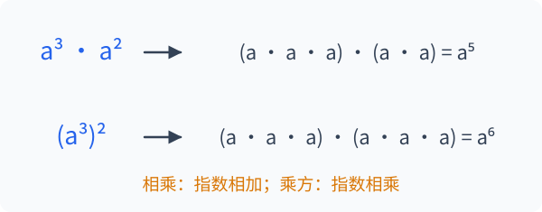

幂的运算先看结构：是同底数相乘，还是一个幂再次乘方？指数相加或相乘并不是两条可任选的口诀，而是两种不同的因子计数。以下先讨论正整数指数，再说明零指数的扩充。

<nav class="handbook-nav" aria-label="本章分区">
  <a class="handbook-jump is-knowledge" href="#knowledge">01 · 知识点概念、关系与适用条件</a>
  <a class="handbook-jump is-exam" href="#exam">02 · 考点题目分类和例题</a>
  <a class="handbook-jump is-pitfall" href="#pitfalls">03 · 坑点辨析错因，检查遗漏</a>
</nav>

## 【知识点】理解概念 {#knowledge .handbook-section .is-knowledge}

### 1. 幂的运算法则 {#laws .knowledge-title}

下表中 $m,n$ 为正整数，除法要求 $a\ne0$、$m>n$

| 运算 | 法则 | 例子 |
| --- | --- | --- |
| 同底数幂相乘 | $a^ma^n=a^{m+n}$ | $x^2x^3=x^5$ |
| 幂的乘方 | $(a^m)^n=a^{mn}$ | $(x^2)^3=x^6$ |
| 积的乘方 | $(ab)^n=a^nb^n$ | $(2x)^3=8x^3$ |
| 同底数幂相除 | $a^m\div a^n=a^{m-n}$ | $x^5\div x^2=x^3$（$x\ne0$） |

### 2. 零指数幂 {#zero-power .knowledge-title}

任何非零数的零次幂都等于 $1$

$$a^0=1\quad(a\ne0)$$

例如 $5^0=1$、$(-3)^0=1$；$0^0$ 在这里不作定义

::: info 为什么规定非零数的零次幂为 1

展开推导

$a\ne0$ 时，$a^3\div a^3=1$。按指数相减写成 $a^{3-3}=a^0$，因此规定 $a^0=1$

:::

## 【考点】识别与处理 {#exam .handbook-section .is-exam}

### 1. 先辨运算，再处理符号 {#exam-structure .exam-title}

先圈定完整底数，确定最外层是乘、除还是乘方；再判断负号是否在底数中。最后只对同类项合并系数，不把加法当成幂的乘法。含字母除数时，把非零条件保留到结果中。
<article class="handbook-example" aria-labelledby="example-1">

#### 例题 01 同底数相乘 知识清单例题 {#example-1 .example-heading}

题目

计算：（1）$x^3x^4$；（2）$(-a)^2(-a)^3$；（3）$-x^6(-x)^5$。

答案与解析

解析

（1）底数都是 $x$，指数相加，得 $x^{3+4}=x^7$。

（2）完整底数都是 $-a$，得 $(-a)^5=-a^5$。

（3）$(-x)^5=-x^5$，所以 $(-x^6)(-x^5)=x^{11}$。前一个负号在 $x^6$ 外，先把符号理清。

本题结论

$x^7$；$-a^5$；$x^{11}$。

</article>

<article class="handbook-example" aria-labelledby="example-2">

#### 例题 02 同底数相除 知识清单例题 {#example-2 .example-heading}

题目

计算：（1）$x^9\div x^6$；（2）$(-x)^6\div(-x)^3$；（3）$-a^6\div(-a)^4$。

答案与解析

解析

（1）$x\ne0$，得 $x^{9-6}=x^3$。

（2）$x\ne0$，完整底数为 $-x$，得 $(-x)^3=-x^3$。

（3）$a\ne0$，分母 $(-a)^4=a^4$，分子是 $-a^6$，所以商为 $-a^2$。化简后虽不再出现分母，原题的禁值仍保留。

本题结论

$x^3$、$-x^3$，均要求 $x\ne0$；$-a^2$，要求 $a\ne0$。

</article>

<article class="handbook-example" aria-labelledby="example-3">

#### 例题 03 幂的乘方与积的乘方 知识清单例题·第（3）问补充适用条件·合组 {#example-3 .example-heading}

题目

计算：

（1）$[(-x)^5]^6$；（2）$-(x^3)^4$；（3）$(y^2)^{n-1}$，$n$ 为大于1的整数；

（4）$(-x^3y^2)^2$；（5）$(3\times10^2)^3$。

答案与解析

解析

（1）$(-x)^{5\times6}=(-x)^{30}=x^{30}$。

（2）外部负号不在乘方范围内，得 $-x^{12}$。

（3）$n-1$ 为正整数，得 $y^{2(n-1)}=y^{2n-2}$。若另讨论 $n=1$，零指数还要求 $y\ne0$。

（4）每个因子都平方：$(-1)^2x^6y^4=x^6y^4$。

（5）$3^3(10^2)^3=27\times10^6=2.7\times10^7$，科学记数法还要调整系数。

本题结论

$x^{30}$；$-x^{12}$；$y^{2n-2}$；$x^6y^4$；$2.7\times10^7$。

</article>

<article class="handbook-example" aria-labelledby="example-4">

#### 例题 04 先统一底数，再计算 知识清单例题 {#example-4 .example-heading}

题目

计算：（1）$(x-y)^2(y-x)$；（2）$2^3\times8^2\div16$；（3）$x^2(2x)^3$。

答案与解析

解析

（1）$(x-y)^2=(y-x)^2$，所以原式 $=(y-x)^3$；也可写成 $-(x-y)^3$。

（2）$8=2^3$，$16=2^4$，原式 $=2^{3+6-4}=2^5=32$。

（3）先算 $(2x)^3=8x^3$，再乘 $x^2$，得 $8x^5$，不能漏掉系数2的立方。

本题结论

$(y-x)^3$；32；$8x^5$。

</article>

<article class="handbook-example" aria-labelledby="example-5">

#### 例题 05 混合运算不跨越加减号 知识清单例题 {#example-5 .example-heading}

题目

计算：（1）$a^3(a^3)^2$；（2）$(2\times10^2)^3(-10^3)^2$；（3）$(-2a)^6-(-3a^3)^2$。

答案与解析

解析

（1）先乘方，后同底数相乘：$a^3a^6=a^9$。

（2）第一部分 $8\times10^6$，第二部分 $10^6$，相乘得 $8\times10^{12}$。

（3）两个乘方分别为 $64a^6$、$9a^6$，中间是减号，合并系数得到 $(64-9)a^6=55a^6$，不是指数相减。

本题结论

$a^9$；$8\times10^{12}$；$55a^6$。

</article>

### 2. 法则逆用：把已知量变成整体 {#exam-reverse .exam-title}

逆用 $(ab)^n=a^nb^n$，可把同指数的两个幂合为一个积的幂；逆用 $a^{m+n}=a^ma^n$，可把指数拆成已知部分。逆用前仍须检查指数范围、底数和非零条件，不能只因变形能写出来就省掉条件。
<article class="handbook-example" aria-labelledby="example-6">

#### 例题 06 相同指数合并底数 知识清单例题 {#example-6 .example-heading}

题目

计算 $2^{2025}\times(-\frac12)^{2025}$。

答案与解析

解析

指数同为正整数2025，可逆用积的乘方：

$$2^{2025}\times(-\tfrac12)^{2025}=[2\times(-\tfrac12)]^{2025}=(-1)^{2025}=-1.$$

这样先算底数的积，不必展开两个大数。

本题结论

$-1$。

</article>

<article class="handbook-example" aria-labelledby="example-7">

#### 例题 07 将指数中的已知关系整体代入 （1）2023·四川德阳；（2）2023·四川乐山，改编·明确指数范围·合组 {#example-7 .example-heading}

题目

（1）设 $x$ 为正整数，$3^x=y$，则 $3^{x+1}$ 等于（　）。

A. $y$

B. $1+y$

C. $3+y$

D. $3y$

（2）设 $m,n$ 为正整数，$3m-n-4=0$，求 $8^m\div2^n$。

答案与解析

解析

（1）$3^{x+1}=3^x\cdot3=3y$，指数加1对应多乘一个3，不是结果加1。

（2）$8^m=2^{3m}$，已知 $3m-n=4>0$，所以 $8^m\div2^n=2^{3m-n}=2^4=16$。无需分别求 $m,n$。

本题结论

（1）D；（2）16。

</article>

### 3. 化成同底数或同指数比较 {#exam-compare .exam-title}

两个正数的幂，若能化成同一个大于1的底数，可比较正整数指数；若能化成同一个正整数指数，可比较正底数。这里只在这些条件下使用比较，底数在0与1之间时，指数越大反而越小。
<article class="handbook-example" aria-labelledby="example-8">

#### 例题 08 不算出大数也能比较 知识清单例题 {#example-8 .example-heading}

题目

比较：（1）$27^{25}$ 与 $3^{80}$；（2）$3^{444}$ 与 $4^{333}$。

答案与解析

解析

（1）$27^{25}=(3^3)^{25}=3^{75}$。底数3大于1，多乘5个3使数增大，所以 $3^{75}<3^{80}$。

（2）$3^{444}=(3^4)^{111}=81^{111}$，$4^{333}=(4^3)^{111}=64^{111}$。两个正底数以相同正整数指数乘方，$81>64$，故 $81^{111}>64^{111}$。

本题结论

$27^{25}<3^{80}$；$3^{444}>4^{333}$。

</article>

## 【坑点】辨析边界 {#pitfalls .handbook-section .is-pitfall}

### 1. 加法、乘法、乘方不能共用口诀 {#pit-operations .pitfall-title}

合并同类项改变系数，同底数相乘改变指数，幂的乘方则把指数相乘。校验一个可疑等式，可以先用小数值发现反例，但证明恒等式仍要靠运算法则。
<article class="handbook-example is-pitfall" aria-labelledby="pitfall-1">

#### 辨析 01 辨别四种运算 2024·云南 {#pitfall-1 .example-heading}

题目

下列运算正确的是（　）。

A. $x^3+5x^3=6x^4$

B. $x^6\div x^3=x^5$

C. $(a^2)^3=a^7$

D. $(ab)^3=a^3b^3$

答案与解析

解析

A是同类项相加，应为 $6x^3$；B在 $x\ne0$ 时应为 $x^{6-3}=x^3$；C应为 $a^{2\times3}=a^6$；D把每个因子都立方，正确。

本题结论

D。

</article>

### 2. 看似能代入，条件却可能不存在 {#pit-range .pitfall-title}

写着字母指数的题，必须说明指数允许取什么数。正整数幂的规则不能直接作为一般实数幂的定义。有些题按符号运算会得到一个数，却没有符合当前指数范围的取值，这时应先指出条件问题。
<article class="handbook-example is-pitfall" aria-labelledby="pitfall-2">

#### 辨析 02 同一底数的两个幂能否分别等于7和8 知识清单原题改编·条件辨析 {#pitfall-2 .example-heading}

题目

有一道题写：“已知 $a^m=7$、$a^n=8$，求 $a^{m-n}$。”如果把 $m,n$ 理解为正整数，题目条件能否成立？

答案与解析

解析

不能。若两式同时成立，则 $(a^m)^n=(a^n)^m$，从而 $7^n=8^m=2^{3m}$。左边只含素因数7，右边只含素因数2，对正整数 $m,n$ 不可能相等。

机械地相除会写出 $\frac78$，但这不能补救正整数条件的不相容。若把题目另行放到允许正底数实数指数的范围，并说明相应法则，才可作条件下的形式计算 $a^{m-n}=7/8$；那已超出本页的连乘推导范围。

本题结论

正整数指数下无符合条件的取值，不能把 $\frac78$ 当作这一条件下存在的例题答案。

</article>

<article class="handbook-example is-pitfall" aria-labelledby="pitfall-3">

#### 辨析 03 以10为底的幂与指数范围 知识清单原题改编·条件辨析 {#pitfall-3 .example-heading}

题目

有一道题写：“已知 $10^m=5$、$10^n=6$，求 $10^{2m+3n}$。”能否仅用本页的整数幂知识直接当作常规代入题？

答案与解析

解析

不能。10的正整数次幂至少为10；零次幂为1；即使以后引入负整数指数，其值也在0与1之间，因此整数 $m,n$ 均不能满足题设。

若已在其他学习阶段定义正底数的实数指数，并允许相应运算法则，则条件下可形式变形为 $(10^m)^2(10^n)^3=5^2\times6^3=5400$。这里保留这一计算说明题目的意图，但不能用它掩盖整数指数范围内不存在解的问题。

本题结论

不能作为整数幂范围内的常规例题；5400依赖另行说明的实数指数范围。

</article>
