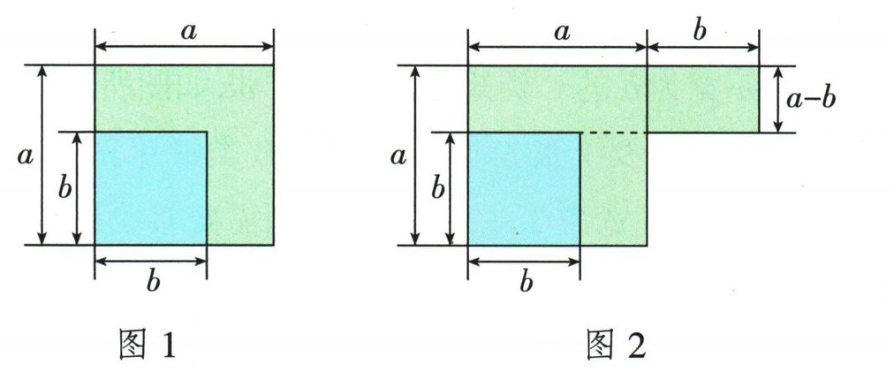
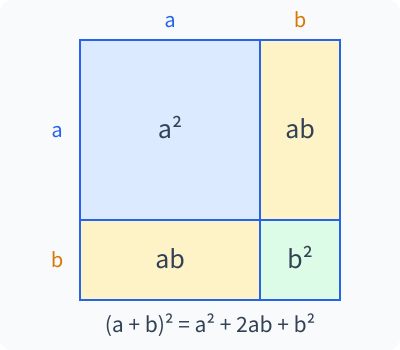
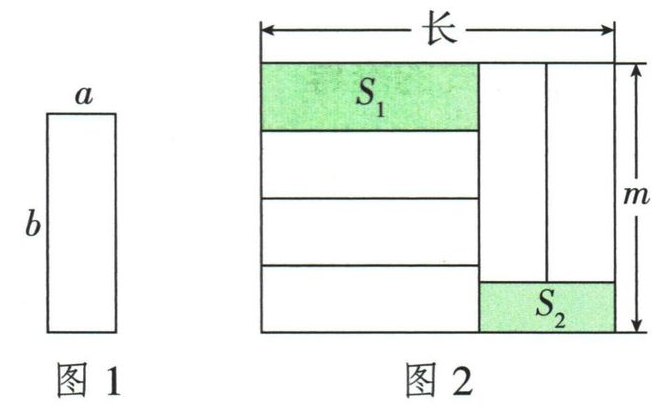
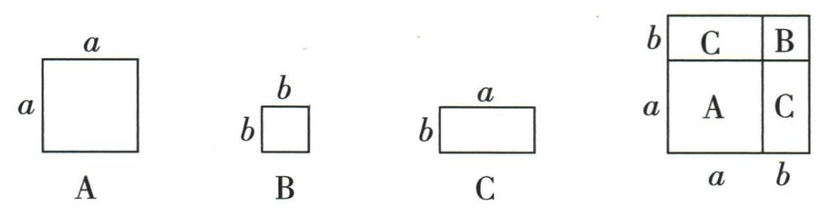

整式乘除依靠幂的运算和分配律。乘法公式则把常见的配对结构预先整理好：先识别完整的两个整体，再决定逐项展开还是直接用公式。

<nav class="handbook-nav" aria-label="本章分区">
  <a class="handbook-jump is-knowledge" href="#knowledge">01 · 知识点概念、关系与适用条件</a>
  <a class="handbook-jump is-exam" href="#exam">02 · 考点题目分类和例题</a>
  <a class="handbook-jump is-pitfall" href="#pitfalls">03 · 坑点辨析错因，检查遗漏</a>
</nav>

## 【知识点】理解概念 {#knowledge .handbook-section .is-knowledge}

### 1. 整式乘法 {#multiplication .knowledge-title}

| 运算 | 做法 | 例子 |
| --- | --- | --- |
| 单项式乘单项式 | 系数相乘，同底数字母指数相加 | $2x^2\cdot3xy=6x^3y$ |
| 单项式乘多项式 | 外面的一项乘里面每一项 | $2x(x+3)=2x^2+6x$ |
| 多项式乘多项式 | 每一项分别相乘，再合并同类项 | $(x+2)(x+3)=x^2+5x+6$ |

### 2. 整式除法 {#division .knowledge-title}

除式不为 $0$ 时，单项式相除，系数相除，同底数字母指数相减

$$6x^3y\div2xy=3x^2\quad(xy\ne0)$$

多项式除以单项式，各项分别相除，再相加

$$(6x^2+3x)\div3x=2x+1\quad(x\ne0)$$

### 3. 平方差公式 {#difference-squares .knowledge-title}

两数和乘两数差，等于这两数的平方差

$$(a+b)(a-b)=a^2-b^2$$

例如 $(x+3)(x-3)=x^2-9$

### 4. 完全平方公式 {#complete-square .knowledge-title}

$$(a+b)^2=a^2+2ab+b^2$$

$$(a-b)^2=a^2-2ab+b^2$$

首平方、尾平方，加上或减去两倍积。例如 $(x-3)^2=x^2-6x+9$

::: info 公式是怎样展开的

展开计算

$$\begin{aligned}(a+b)(a-b)&=a^2-ab+ab-b^2=a^2-b^2\\(a+b)^2&=a^2+ab+ab+b^2\end{aligned}$$

:::

### 5. 添括号与运算顺序 {#brackets-order .knowledge-title}

- 括号前加 $+$，括进去的各项不变号：$a+b-c=a+(b-c)$
- 括号前加 $-$，括进去的各项都变号：$a-b+c=a-(b-c)$
- 混合运算先乘方，再乘除，最后加减；有括号先算括号内

## 【考点】识别与处理 {#exam .handbook-section .is-exam}

### 1. 按项配对，算完再合并 {#exam-multiply .exam-title}

单项式相乘把系数、各字母分别整理；出现多项式则先列齐所有配对，不跳过负项。两项乘三项时，应先产生6个配对乘积，再合并。
<article class="handbook-example" aria-labelledby="example-1">

#### 例题 01 从单项式乘法到多项式乘法 知识清单例题·合组 {#example-1 .example-heading}

题目

计算：（1）$2ab^2(-3a^3bc^2)$；（2）$(-2x^2)(\frac12xy-1)$；（3）$(y+2)(y-4)$。

答案与解析

解析

（1）系数 $2\times(-3)=-6$，字母分别合并为 $a^4,b^3,c^2$，得 $-6a^4b^3c^2$。

（2）$(-2x^2)\times\frac12xy=-x^3y$，$(-2x^2)\times(-1)=2x^2$，得 $-x^3y+2x^2$。

（3）$y^2-4y+2y-8=y^2-2y-8$，交叉项先带符号列出。

本题结论

$-6a^4b^3c^2$；$-x^3y+2x^2$；$y^2-2y-8$。

</article>

<article class="handbook-example" aria-labelledby="example-2">

#### 例题 02 检查配对数量 知识清单例题 {#example-2 .example-heading}

题目

计算：（1）$(3x-1)(2x+1)$；（2）$(x+2)(x^2-2x+4)$；（3）$(3m-2n)^2$。

答案与解析

解析

（1）四个配对乘积为 $6x^2,3x,-2x,-1$，合并得 $6x^2+x-1$。

（2）六个配对乘积为 $x^3$、$-2x^2$、$4x$、$2x^2$、$-4x$、$8$，两组交叉项抵消，得 $x^3+8$。

（3）把平方看成两个相同括号相乘：$9m^2-6mn-6mn+4n^2=9m^2-12mn+4n^2$，也可直接用完全平方公式。

本题结论

$6x^2+x-1$；$x^3+8$；$9m^2-12mn+4n^2$。

</article>

### 2. 先算除式，再逐项求商 {#exam-divide .exam-title}

先写出除式不为零的条件。除式有乘方就先处理系数、符号、每个字母的指数，再逐项相除；某字母恰好约尽时，不把整个项删掉。
<article class="handbook-example" aria-labelledby="example-3">

#### 例题 03 单项式与多项式除以单项式 知识清单例题·合组 {#example-3 .example-heading}

题目

计算：

（1）$-3a^7b^4c\div(9a^4b^2)$；
（2）$(-0.5a^3b)^5\div(-\frac12a^3b)^2$；
（3）$(15x^2y-10xy^2)\div(5xy)$。

答案与解析

解析

（1）原除式要求 $a,b\ne0$。系数为 $-1/3$，字母指数相减，$c$ 保留，得 $-\frac13a^3b^2c$。

（2）$-0.5=-1/2$，完整底数相同，且 $a,b\ne0$，所以商为 $(-\frac12a^3b)^3=-\frac18a^9b^3$。

（3）$x,y\ne0$，逐项相除：$3x-2y$。除式 $5xy$ 对两项都起作用。

本题结论

$-\frac13a^3b^2c$；$-\frac18a^9b^3$，前两问均 $a,b\ne0$；$3x-2y$，$x,y\ne0$。

</article>

<article class="handbook-example" aria-labelledby="example-4">

#### 例题 04 除数的系数也要平方 2023·山东青岛 {#example-4 .example-heading}

题目

计算 $8x^3y\div(2x)^2$。

答案与解析

解析

原除式要求 $x\ne0$。先算 $(2x)^2=4x^2$，再相除：$8x^3y\div4x^2=2xy$。不是先除以 $2x$ 再把整个商平方。

本题结论

$2xy$，$x\ne0$。

</article>

### 3. 识别完整的平方差与完全平方 {#exam-formulas .exam-title}

先找两个完整整体。平方差中，相同部分平方减去相反部分平方；完全平方中，首末平方与带符号的二倍积三项都要写。多项式充当整体时，外层公式结束后再处理内层。
<article class="handbook-example" aria-labelledby="example-5">

#### 例题 05 相同部分不一定排在前面 知识清单例题·合组 {#example-5 .example-heading}

题目

计算：（1）$(3-2a)(-3-2a)$；（2）$(-\frac12x+y)(-y-\frac12x)$。

答案与解析

解析

（1）重排为 $(-2a+3)(-2a-3)$，相同部分为 $-2a$，相反部分为 $\pm3$，所以得 $(-2a)^2-3^2=4a^2-9$。

（2）重排为 $(-\frac12x+y)(-\frac12x-y)$，得 $(-\frac12x)^2-y^2=\frac14x^2-y^2$。

本题结论

$4a^2-9$；$\frac14x^2-y^2$。

</article>

<article class="handbook-example" aria-labelledby="example-6">

#### 例题 06 负整体的平方，末项仍为正平方 知识清单例题·合组 {#example-6 .example-heading}

题目

计算：（1）$(-a-2b)^2$；（2）$(4-3m)^2$；（3）$(-\frac13x-2y)^2$。

答案与解析

解析

（1）取整体 $-a,-2b$，中项 $2(-a)(-2b)=4ab$，得 $a^2+4ab+4b^2$。

（2）$4^2-2\cdot4\cdot3m+(3m)^2=16-24m+9m^2$。

（3）首平方为 $x^2/9$，二倍积为 $2(-x/3)(-2y)=4xy/3$，末平方为 $4y^2$，得 $x^2/9+4xy/3+4y^2$。

本题结论

$a^2+4ab+4b^2$；$16-24m+9m^2$；$\frac19x^2+\frac43xy+4y^2$。

</article>

<article class="handbook-example" aria-labelledby="example-7">

#### 例题 07 一层公式结束后，再处理里面 知识清单例题 {#example-7 .example-heading}

题目

计算：（1）$(a-2b+3c)^2$；（2）$(2a-3b+c)(2a+3b-c)$；（3）$(x+2)^2(x-2)^2$。

答案与解析

解析

（1）把 $a-2b$ 当整体，得 $(a-2b)^2+6c(a-2b)+9c^2$，继续展开为 $a^2-4ab+4b^2+6ac-12bc+9c^2$。

（2）写成 $[2a-(3b-c)][2a+(3b-c)]$，得 $4a^2-(3b-c)^2=4a^2-9b^2+6bc-c^2$。

（3）先逆用积的乘方，再平方差：$[(x+2)(x-2)]^2=(x^2-4)^2=x^4-8x^2+16$。

本题结论

$a^2-4ab+4b^2+6ac-12bc+9c^2$；$4a^2-9b^2+6bc-c^2$；$x^4-8x^2+16$。

</article>

### 4. 利用公式简算和整体关系 {#exam-whole .exam-title}

接近整百整千的数，可写成“整值加减小量”；连续三个数的乘积关系，可把中间数当整体。已知和、差、积、平方和中的某些量时，先选择能直接联结目标的公式，不必先分别求两个数。
<article class="handbook-example" aria-labelledby="example-8">

#### 例题 08 接近整百整千时改写底数 知识清单例题 {#example-8 .example-heading}

题目

简便计算：（1）$103\times97$；（2）$999^2$；（3）$2025^2-2024\times2026$。

答案与解析

解析

（1）$(100+3)(100-3)=100^2-3^2=9991$。

（2）$(1000-1)^2=1000000-2000+1=998001$。

（3）$2024\times2026=(2025-1)(2025+1)=2025^2-1$，所以原式为1。

本题结论

9991；998001；1。

</article>

<article class="handbook-example" aria-labelledby="example-9">

#### 例题 09 由平方关系求差，记得两个符号 知识清单例题 {#example-9 .example-heading}

题目

已知实数 $x,y$ 满足 $x^2+y^2=25$，$x+y=7$，求 $xy$ 和 $x-y$。

答案与解析

解析

由 $(x+y)^2=x^2+y^2+2xy$，得 $49=25+2xy$，所以 $xy=12$。

再由 $(x-y)^2=x^2+y^2-2xy$，得 $(x-y)^2=25-24=1$，所以 $x-y=\pm1$。$(x,y)=(4,3)$ 与 $(3,4)$ 都满足题设，不能擅自只取正号。

本题结论

$xy=12$，$x-y=\pm1$。

</article>

<article class="handbook-example" aria-labelledby="example-10">

#### 例题 10 相邻整体的差已经确定 知识清单例题 {#example-10 .example-heading}

题目

已知 $(a+2026)(a+2025)=5$，求 $(a+2026)^2+(a+2025)^2$。

答案与解析

解析

令 $A=a+2026$、$B=a+2025$，则 $AB=5$，$A-B=1$。由 $A^2+B^2=(A-B)^2+2AB$，得目标值 $=1^2+2\times5=11$。相邻两个整体的差不随 $a$ 改变，无需解 $a$。

本题结论

11。

</article>

<article class="handbook-example" aria-labelledby="example-11">

#### 例题 11 由积与差计算 （1）2024·四川凉山州；（2）2024·四川乐山·合组 {#example-11 .example-heading}

题目

（1）已知 $a^2-b^2=12$，$a-b=-2$，求 $a+b$。

（2）已知 $a-b=3$，$ab=10$，求 $a^2+b^2$。

答案与解析

解析

（1）平方差 $(a-b)(a+b)=12$，代入 $a-b=-2\ne0$，得 $a+b=12/(-2)=-6$。

（2）$a^2+b^2=(a-b)^2+2ab=9+20=29$，这里求平方和，不是和的平方。

本题结论

（1）$-6$；（2）29。

</article>

### 5. 不含某项，就是对应系数恒为零 {#exam-coefficients .exam-title}

先展开、合并，再把关于指定字母的多项式按次数整理。“不含某项”要求其系数为0，不能通过代入某个特殊的 $x$ 让项偶然消失。含几种待消去的次数，就分别列对应的系数条件。
<article class="handbook-example" aria-labelledby="example-12">

#### 例题 12 同时消去一次项和二次项 知识清单例题 {#example-12 .example-heading}

题目

若 $(2x-m)(x^2+3x-n)$ 的积中不含 $x$ 的一次项和二次项，求 $m,n$。

答案与解析

解析

展开并按 $x$ 整理：

$$2x^3+(6-m)x^2+(-2n-3m)x+mn.$$

因此 $6-m=0$、$-2n-3m=0$。先得 $m=6$，再得 $-2n-18=0$，所以 $n=-9$。

本题结论

$m=6$，$n=-9$。

</article>

### 6. 从图形的边长列面积，再判断变化 {#exam-area .exam-title}

先沿同一方向读出各段长度，明确空白或阴影区域的两条边；再列面积式。面积差不随某个长度变化，意味着化简后该长度的系数为0。拼片题要按题示的分割方式确定各类面积的个数，不能只凭一个特定数值的面积相等断言拼法唯一。
<article class="handbook-example" aria-labelledby="example-13">

#### 例题 13 变化的宽度，固定的面积差 知识清单例题·改编，明确正边长与摆放范围 {#example-13 .example-heading}

题目

把5个长为 $b$、宽为 $a$ 的相同小长方形（$b>a>0$），按图2放在宽为 $m$ 的大长方形中，相邻小长方形不重叠、不留空隙。图中阴影面积分别为 $S_1,S_2$。当 $m$ 在允许图示摆放的范围内变化时，$S_1-2S_2$ 始终不变，求 $a,b$ 的关系。

答案与解析

解析

左列宽为 $b$，3个横放小长方形占高 $3a$，所以 $S_1=b(m-3a)$。右列宽为 $2a$，竖放小长方形占高 $b$，所以 $S_2=2a(m-b)$。

$$S_1-2S_2=b(m-3a)-4a(m-b)=(b-4a)m+ab.$$

当 $m$ 变化而此式不变时，$m$ 的系数必须为0，得 $b=4a$。图示允许的非负剩余高度要求 $m\ge\max(3a,b)$；若两块阴影都具有正面积，应取严格大于。

本题结论

$b=4a$。

</article>

<article class="handbook-example" aria-labelledby="example-14">

#### 例题 14 按照图示的分割方式数纸片 2023·湖北随州，改编·拼接方式明确化 {#example-14 .example-heading}

题目

有边长分别为 $a,b$（$a>b>0$）的A、B类正方形纸片，长为 $a$、宽为 $b$ 的C类长方形纸片。图示边长 $a+b$ 的正方形由1张A、1张B和2张C组成。按照这种沿 $a,b$ 长度分段的拼接方式，拼成长 $3a+b$、宽 $2a+2b$ 的长方形，需要C类纸片多少张（　）？

A. 6

B. 7

C. 8

D. 9

答案与解析

解析

目标面积展开为

$$(3a+b)(2a+2b)=6a^2+6ab+2ab+2b^2=6a^2+8ab+2b^2.$$

按题示分段，$3a\times2a$ 区域用6张A；$b\times2b$ 区域用2张B；两个交叉区域分别用6张和2张C，共8张C。

这里依据的是图示分割结构，不是说对任意特殊数值的 $a,b$，仅凭总面积就能证明所有拼法都只有这一种片数。

本题结论

C，8张。

</article>

### 7. 混合运算与求值，先化简再选择代入 {#exam-mixed .exam-title}

先处理乘方与乘除，保留外层符号，再合并同类项。若目标式能化成已知整体，直接代入整体；若某个字母化简后消去，它的具体数值不影响结果，但原式定义域仍需检查。
<article class="handbook-example" aria-labelledby="example-15">

#### 例题 15 含乘法、除法和外层负号的化简 知识清单例题·合组 {#example-15 .example-heading}

题目

计算：

（1）$-[(x-1)(2x-1)]-(x+1)^2+1$；

（2）$5x^2(-3x)-3x(x^2-x)$；

（3）$(x+2)(x-2)-(x-3)(x+1)$；

（4）$(x+y-2)(x-y-2)-(x^3-4x^2)\div x$。

答案与解析

解析

（1）$-(2x^2-3x+1)-(x^2+2x+1)+1=-3x^2+x-1$。

（2）$-15x^3-(3x^3-3x^2)=-18x^3+3x^2$。

（3）$x^2-4-(x^2-2x-3)=2x-1$。

（4）原式要求 $x\ne0$。前一乘积为 $[(x-2)+y][(x-2)-y]=(x-2)^2-y^2$，后一商为 $x^2-4x$，相减得 $4-y^2$。虽结果不含 $x$，仍要求 $x\ne0$。

本题结论

$-3x^2+x-1$；$-18x^3+3x^2$；$2x-1$；$4-y^2$，第（4）问 $x\ne0$。

</article>

<article class="handbook-example" aria-labelledby="example-16">

#### 例题 16 直接代值与整体代值 知识清单例题·合组 {#example-16 .example-heading}

题目

（1）化简 $(x-2)(x+2)-x(x-1)$，并求 $x=3$ 时的值。

（2）已知 $x^2-2x=2$，求 $(x-1)^2+(x+3)(x-3)+(x-3)(x-1)$ 的值。

答案与解析

解析

（1）$x^2-4-(x^2-x)=x-4$，代入3得 $-1$。

（2）展开后为 $(x^2-2x+1)+(x^2-9)+(x^2-4x+3)=3x^2-6x-5$。写成 $3(x^2-2x)-5$，代入已知整体2，得1。

本题结论

（1）$x-4$，值为 $-1$；（2）1。

</article>

<article class="handbook-example" aria-labelledby="example-17">

#### 例题 17 抄错一个数，结果为何仍相同 知识清单例题 {#example-17 .example-heading}

题目

先化简

$$[2x(x^2y-xy^2)+xy(2xy-x^2)]\div(x^2y).$$

当 $x=2025,y=2026$ 时求值。若计算者把 $y=2026$ 抄成226，其结果会改变吗？

答案与解析

解析

原式要求 $x\ne0,y\ne0$。分子展开为 $2x^3y-2x^2y^2+2x^2y^2-x^3y=x^3y$，除以 $x^2y$ 得 $x$。

因此结果只与 $x$ 有关，值为2025。2026和226都非零，两次代入均在定义域内，结果相同；若把 $y$ 错抄为0，则原式无意义，不能仍按化简式作答。

本题结论

化简为 $x$，原条件 $x,y\ne0$；两次合法代入均为2025。

</article>

<article class="handbook-example" aria-labelledby="example-18">

#### 例题 18 化简后仍要检查原除式 2024·四川南充 {#example-18 .example-heading}

题目

先化简 $(x+2)^2-(x^3+3x)\div x$，再求 $x=-2$ 时的值。

答案与解析

解析

原式要求 $x\ne0$，$-2$ 符合条件。展开与逐项相除得

$$x^2+4x+4-(x^2+3)=4x+1.$$

代入 $-2$，得 $4\times(-2)+1=-7$。

本题结论

$4x+1$，$x\ne0$；值为 $-7$。

</article>

## 【坑点】检查结构 {#pitfalls .handbook-section .is-pitfall}

### 1. 完全平方不能漏掉二倍积 {#pit-square .pitfall-title}

$(A+B)^2$ 的两项乘两项展开有4个乘积，交叉的两个 $AB$ 合并为 $2AB$；漏中项就是漏了配对。积的乘方则要求每个因子都乘方，$(3a)^2=9a^2$，不能只让字母平方。
<article class="handbook-example is-pitfall" aria-labelledby="pitfall-1">

#### 辨析 01 四个等式中找出正确者 2024·湖北武汉 {#pitfall-1 .example-heading}

题目

下列运算正确的是（　）。

A. $a^2a^3=a^6$

B. $(a^3)^4=a^{12}$

C. $(3a)^2=6a^2$

D. $(a+1)^2=a^2+1$

答案与解析

解析

A应为 $a^{2+3}=a^5$；B指数相乘，正确；C应为 $9a^2$；D应为 $a^2+2a+1$，漏了中项。

本题结论

B。

</article>

### 2. 添负括号时，里面每一项都变号 {#pit-brackets .pitfall-title}

添括号是保持值不变的重组，括号前为负时，括进去的每项必须取相反数。添完后按分配律展开，逐项对照原式。
<article class="handbook-example is-pitfall" aria-labelledby="pitfall-2">

#### 辨析 02 添括号后回验 知识清单例题 {#pitfall-2 .example-heading}

题目

填入适当的式子：

（1）$a-2b+c+d=a-(\quad)$；

（2）$a-2b+c+d=a-2b+(\quad)$。

答案与解析

解析

（1）括号前是负号，要把 $-2b+c+d$ 写成 $-(2b-c-d)$，填 $2b-c-d$。展开后依次为 $-2b,+c,+d$。

（2）括号前为正，填 $c+d$，各项符号不变。

本题结论

（1）$2b-c-d$；（2）$c+d$。

</article>

### 3. “知二求二”不一定确定正负号 {#pit-sign .pitfall-title}

公式可以从和、差、积、平方和中的已知量推出另一些关系，但由 $U^2=c>0$ 求 $U$ 时有 $U=\pm\sqrt c$ 两种可能。只有额外的大小、顺序或几何条件才能排除其中一个，不能把求出的平方直接开成正根。
