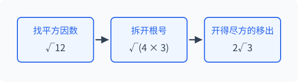
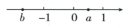

二次根式的计算不是把根号随意移进移出。先确定原式有意义的条件，再看平方因子、同类项和运算顺序，才能知道每一步变形是否成立。

<nav class="handbook-nav" aria-label="本章分区">
  <a class="handbook-jump is-knowledge" href="#knowledge">01 · 知识点概念、关系与适用条件</a>
  <a class="handbook-jump is-exam" href="#exam">02 · 考点题目分类和例题</a>
  <a class="handbook-jump is-pitfall" href="#pitfalls">03 · 坑点辨析错因，检查遗漏</a>
</nav>

## 【知识点】理解概念 {#knowledge .handbook-section .is-knowledge}

### 1. 二次根式 {#radical-definition .knowledge-title}

形如 $\sqrt a$（$a\ge0$）的式子叫作==二次根式==，如 $\sqrt2$、$\sqrt{x+1}$

根号内必须非负。例如 $\sqrt{x+1}$ 要求 $x\ge-1$；$\frac1{\sqrt{x+1}}$ 还要求分母非零，所以 $x>-1$

### 2. 二次根式的性质 {#root-square .knowledge-title}

| 性质 | 条件 | 例子 |
| --- | --- | --- |
| $(\sqrt a)^2=a$ | $a\ge0$ | $(\sqrt3)^2=3$ |
| $\sqrt{a^2}=|a|$ | $a$ 为实数 | $\sqrt{(-3)^2}=3$ |

### 3. 二次根式的乘除与化简 {#radical-product .knowledge-title}

$$\sqrt a\sqrt b=\sqrt{ab}\quad(a\ge0,b\ge0)$$

$$\frac{\sqrt a}{\sqrt b}=\sqrt{\frac ab}\quad(a\ge0,b>0)$$

化简时，把开得尽方的因数移出根号

含字母时注意 $\sqrt{x^2}=|x|$，例如 $\sqrt{9x^2}=3|x|$

### 4. 最简二次根式与加减 {#simplest-radical .knowledge-title}

被开方数不含分母，也不含能开得尽方的因数或因式，叫作==最简二次根式==

先化简，再合并被开方数相同的根式，只把系数相加减

$$\sqrt8+\sqrt{18}=2\sqrt2+3\sqrt2=5\sqrt2$$

分母有根式时，可以分子、分母同乘适当的非零式子，使分母有理化

$$\frac1{\sqrt2}=\frac{\sqrt2}{2},\qquad\frac1{\sqrt3+1}=\frac{\sqrt3-1}{2}$$

## 【考点】识别与处理 {#exam .handbook-section .is-exam}

### 1. 先列全限制，再求共同范围 {#exam-domain .exam-title}

逐个找到根号和分母，分别列出限制，再取共同部分。根号内还有分式时，要判断整个分式的正负，不能只要求分母非零。
<article class="handbook-example" aria-labelledby="example-1">

#### 例题 01 三种取值范围 {#example-1 .example-heading}

题目

求下列各式有意义时 $x$ 的取值范围：

1. $\sqrt{2-5x}$；
2. $\sqrt{\dfrac1{2x-4}}$；
3. $\dfrac{\sqrt{3-x}}{x-2}$。

答案与解析

解析

1. 要求 $2-5x\ge0$，解得 $x\le\frac25$。
2. 要求 $\frac1{2x-4}\ge0$。分子为正，分式不能等于0，因此分母必须为正，即 $2x-4>0$，得 $x>2$。
3. 同时要求 $3-x\ge0$ 与 $x-2\ne0$，所以 $x\le3$ 且 $x\ne2$。

本题结论

$x\le\frac25$；$x>2$；$x\le3$ 且 $x\ne2$。

</article>

<article class="handbook-example" aria-labelledby="example-2">

#### 例题 02 带参数的根式 2024·黑龙江绥化 {#example-2 .example-heading}

题目

式子 $\sqrt{2m-3}$ 有意义，则 $m$ 的取值范围是（　）。

A. $m\le\frac23$

B. $m\ge-\frac32$

C. $m\ge\frac32$

D. $m\le-\frac23$

答案与解析

解析

由 $2m-3\ge0$ 得 $m\ge\frac32$。这里只除以正数2，不改变不等号方向。

本题结论

C。

</article>

### 2. 区分根式的形式与字母条件 {#exam-form .exam-title}

看到根号先查根指数，再看被开方数是否非负。含字母的式子若没有给出限制，不能把“在一定条件下成立”当成“对所有实数都成立”。
<article class="handbook-example" aria-labelledby="example-3">

#### 例题 03 哪些式子一定是二次根式 知识清单例题·条件明确化 {#example-3 .example-heading}

题目

在实数范围内，不另加字母条件，下列哪些式子一定是二次根式？

① $\sqrt{\frac12}$；② $\sqrt{2x}$；③ $\sqrt{x^2+y^2}$；④ $\sqrt{-5}$；⑤ $\sqrt[3]5$；⑥ $\sqrt9$；⑦ $3$。

答案与解析

解析

①的被开方数为正；③中平方和非负；⑥是非负数的算术平方根，虽可化简为3，仍具有二次根式形式。②须额外满足 $x\ge0$；④在实数范围无意义；⑤是三次根式；⑦没有二次根式形式。

本题结论

①③⑥。

</article>

### 3. 看清平方所在位置，再确定符号 {#exam-square .exam-title}

先判断是 $(\sqrt A)^2$ 还是 $\sqrt{A^2}$。后者先写绝对值；遇到字母，用题设范围、数轴或原式有意义条件确定内部符号。
<article class="handbook-example" aria-labelledby="example-4">

#### 例题 04 六种开方与平方 {#example-4 .example-heading}

题目

化简：

① $\sqrt{3^2}$；② $(\sqrt3)^2$；③ $\sqrt{(-3)^2}$；④ $\sqrt{(a-3)^2}$；⑤ $(\sqrt{a-3})^2$；⑥ $\sqrt{(3-a)^2}$。

答案与解析

解析

①②③都等于3。④先平方后开方，结果为 $\lvert a-3\rvert$；⑤先开方，原式要求 $a\ge3$，再平方得 $a-3$；⑥等于 $\lvert3-a\rvert$。④⑥对任意实数 $a$ 都有意义。

本题结论

$3,3,3,\lvert a-3\rvert,a-3$（$a\ge3$）, $\lvert3-a\rvert$。

</article>

<article class="handbook-example" aria-labelledby="example-5">

#### 例题 05 原式条件决定去绝对值 {#example-5 .example-heading}

题目

化简 $\sqrt{(x+2)^2}+(\sqrt{x-2})^2$。

答案与解析

解析

第二项要求 $x-2\ge0$，所以 $x\ge2$，从而 $x+2>0$。

原式 $=\lvert x+2\rvert+(x-2)=(x+2)+(x-2)=2x$。

第一项本来对所有实数有意义，但两项一起出现时，必须遵守第二项的限制。

本题结论

$2x$，原式范围为 $x\ge2$。

</article>

<article class="handbook-example" aria-labelledby="example-6">

#### 例题 06 从数轴读取内部符号 {#example-6 .example-heading}

题目

实数 $a,b$ 在数轴上的位置如图，化简 $\sqrt{(a-b)^2}-\sqrt{b^2}+\sqrt{(a-1)^2}$。

答案与解析

解析

由图得 $b<-1<0<a<1$，所以 $a-b>0$、$b<0$、$a-1<0$。

原式 $=\lvert a-b\rvert-\lvert b\rvert+\lvert a-1\rvert=(a-b)-(-b)+(1-a)=1$。

本题结论

1。

</article>

<article class="handbook-example" aria-labelledby="example-7">

#### 例题 07 由化简结果反推范围 {#example-7 .example-heading}

题目

若 $\sqrt{x^2-4x+4}=2-x$，求 $x$ 的取值范围。

答案与解析

解析

左边 $=\sqrt{(x-2)^2}=\lvert x-2\rvert$。当 $x\le2$ 时，$\lvert x-2\rvert=2-x$；当 $x>2$ 时，右边为负，不可能等于非负的左边。端点 $x=2$ 两边均为0，也满足。

本题结论

$x\le2$。

</article>

<article class="handbook-example" aria-labelledby="example-8">

#### 例题 08 区间内的两个绝对值 2024·四川乐山 {#example-8 .example-heading}

题目

若 $1<x<2$，则 $\sqrt{(x-1)^2}+\lvert x-2\rvert$ 的值是（　）。

A. $-1$

B. $1$

C. $2x-3$

D. $3-2x$

答案与解析

解析

由 $x-1>0$、$x-2<0$，原式 $=(x-1)+(2-x)=1$。不能把两个绝对值都按同一符号去掉。

本题结论

B。

</article>

### 4. 分层计算乘除，提取平方因子 {#exam-multiply .exam-title}

带分数先化假分数；能直接乘成完全平方数的先合并，能提取平方因子的先分解。连乘连除属于同一级，按从左到右计算。
<article class="handbook-example" aria-labelledby="example-9">

#### 例题 09 乘积与平方因子 {#example-9 .example-heading}

题目

计算：

1. $\sqrt{2\frac12}\times\sqrt{1\frac35}$；
2. $\sqrt{(-5)^2\times3}$。

答案与解析

解析

1. $\sqrt{\frac52}\times\sqrt{\frac85}=\sqrt4=2$。
2. $\sqrt{(-5)^2}\sqrt3=\lvert-5\rvert\sqrt3=5\sqrt3$。

本题结论

$2$；$5\sqrt3$。

</article>

<article class="handbook-example" aria-labelledby="example-10">

#### 例题 10 连除与带分数 {#example-10 .example-heading}

题目

计算：

1. $\sqrt2\div\sqrt3\times\sqrt{\frac13}$；
2. $\sqrt{2\frac79}$。

答案与解析

解析

1. 从左到右，$\frac{\sqrt2}{\sqrt3}\times\frac1{\sqrt3}=\frac{\sqrt2}{3}$。不能把后两项误看成整个除数。
2. $\sqrt{\frac{25}9}=\frac53$，取非负值。

本题结论

$\frac{\sqrt2}3$；$\frac53$。

</article>

<article class="handbook-example" aria-labelledby="example-11">

#### 例题 11 判断与化成最简形式 知识清单例题·合组 {#example-11 .example-heading}

题目

（1）在各式有意义的条件下，判断下列哪些已经是一般的最简二次根式：$\sqrt{0.5}$、$2\sqrt{x^3y}$、$\sqrt{12}$、$\sqrt{x^2+y^2}$、$\frac{\sqrt{x+2}}3$。

（2）化简 $\sqrt{200}$、$\sqrt{1.4}$、$\sqrt{75a^2b}$，其中 $a>0,b>0$。

答案与解析

解析

（1）$\sqrt{0.5}=\sqrt{\frac12}$，被开方数含分母；$x^3y=x^2\cdot xy$，可提取平方因式；$12=4\times3$。后两式一般没有可提取的平方因式，且根号内没有分母，已经最简。不能把平方和中的各项分别开方。

（2）$\sqrt{200}=\sqrt{100\times2}=10\sqrt2$。

$\sqrt{1.4}=\sqrt{\frac{140}{100}}=\frac{\sqrt{140}}{10}=\frac{\sqrt{35}}5$。

$\sqrt{75a^2b}=\sqrt{25a^2\cdot3b}=5a\sqrt{3b}$，最后一步使用了 $a>0$。

本题结论

（1）$\sqrt{x^2+y^2}$、$\frac{\sqrt{x+2}}3$；（2）$10\sqrt2$、$\frac{\sqrt{35}}5$、$5a\sqrt{3b}$。

</article>

### 5. 先化简，再合并同类项 {#exam-add .exam-title}

先分别把根式化为最简形式，再按被开方数分组。不同组不能合并；某组的系数相加为0时，该组消去。
<article class="handbook-example" aria-labelledby="example-12">

#### 例题 12 化简后再判断同类 {#example-12 .example-heading}

题目

计算：

1. $\sqrt{12}-\frac{\sqrt3}{2}$；
2. $\sqrt8-2\sqrt{18}+\sqrt{24}$。

答案与解析

解析

1. $2\sqrt3-\frac12\sqrt3=\frac32\sqrt3$。
2. $2\sqrt2-6\sqrt2+2\sqrt6=-4\sqrt2+2\sqrt6$。$\sqrt2$ 与 $\sqrt6$ 不是同类项，不能继续相加。

本题结论

$\frac{3\sqrt3}{2}$；$-4\sqrt2+2\sqrt6$。

</article>

### 6. 按分母结构选择有理化因子 {#exam-rationalize .exam-title}

单根式乘同一根式，和差式尝试乘共轭式。先检查原分母与所乘因子非零，再将整个分子、整个分母一起相乘，最后约分。
<article class="handbook-example" aria-labelledby="example-13">

#### 例题 13 单根式与共轭式 {#example-13 .example-heading}

题目

将下列各式的分母有理化：

1. $\frac5{\sqrt3}$；
2. $\frac2{\sqrt{8ab}}$；
3. $\frac1{\sqrt7-\sqrt5}$。

答案与解析

解析

1. $\frac{5\sqrt3}{3}$。
2. 原式要求 $ab>0$。$\frac2{\sqrt{8ab}}=\frac1{\sqrt{2ab}}=\frac{\sqrt{2ab}}{2ab}$。条件是乘积为正，不必强行要求 $a,b$ 分别为正。
3. 共轭式 $\sqrt7+\sqrt5>0$，可同乘它：$\frac{\sqrt7+\sqrt5}{7-5}=\frac{\sqrt7+\sqrt5}2$。

本题结论

$\frac{5\sqrt3}3$；$\frac{\sqrt{2ab}}{2ab}$（$ab>0$）；$\frac{\sqrt7+\sqrt5}2$。

</article>

### 7. 外侧系数移入时保留符号 {#exam-inward .exam-title}

先看根式原有范围，再判断外侧系数正负。平方会抹去符号，因此负系数移入后，负号仍须留在根号外；系数含字母且正负不定时要分类。
<article class="handbook-example" aria-labelledby="example-14">

#### 例题 14 三个系数的不同处理 {#example-14 .example-heading}

题目

把根号外的因式适当移入根号内：

1. $2\sqrt3$；
2. $-a\sqrt a$；
3. $x\sqrt{xy}$。

答案与解析

解析

1. $2>0$，得 $\sqrt{2^2\cdot3}=\sqrt{12}$。
2. 原式要求 $a\ge0$，所以 $-a\le0$，得 $-\sqrt{a^3}$；$a=0$ 时同样成立。
3. 原式要求 $xy\ge0$。当 $x\ge0$ 时为 $\sqrt{x^3y}$；当 $x<0$ 时为 $-\sqrt{x^3y}$。两种情况下 $x^3y=x^2(xy)\ge0$，新根式都有意义。

本题结论

$\sqrt{12}$；$-\sqrt{a^3}$（$a\ge0$）；$x\ge0$ 时为 $\sqrt{x^3y}$，$x<0$ 时为 $-\sqrt{x^3y}$（原式均要求 $xy\ge0$）。

</article>

### 8. 比较根式，选择能消去根号的结构 {#exam-compare .exam-title}

正数可比较平方，负数可先比较绝对值再反向；两个平方根之差若有相同的有理化分子，可化成正分式比较分母。不要对任意正负数直接用“平方大则原数大”。
<article class="handbook-example" aria-labelledby="example-15">

#### 例题 15 三组大小比较 {#example-15 .example-heading}

题目

比较大小，并说明依据：

1. $3\sqrt2$ 与 $2\sqrt3$；
2. $-2\sqrt{11}$ 与 $-3\sqrt5$；
3. $\sqrt6-\sqrt5$ 与 $\sqrt3-\sqrt2$。

答案与解析

解析

1. 两数均正，平方分别是18与12，因此 $3\sqrt2>2\sqrt3$。也可比较比值 $\frac{3\sqrt2}{2\sqrt3}=\frac{\sqrt6}{2}>1$。
2. 正数 $2\sqrt{11}=\sqrt{44}<\sqrt{45}=3\sqrt5$，加负号后大小反向，所以 $-2\sqrt{11}>-3\sqrt5$。
3. 有理化得 $\sqrt6-\sqrt5=\frac1{\sqrt6+\sqrt5}$，$\sqrt3-\sqrt2=\frac1{\sqrt3+\sqrt2}$。两个分母均正，且前者更大，因此前一个分式更小。

本题结论

$>$；$>$；$<$。

</article>

### 9. 保持混合运算的层次 {#exam-mixed .exam-title}

有括号先算括号，有乘方先算乘方，再乘除、后加减。同一级按从左到右；每个根式化简后再合并同类项。例如 $\sqrt3\times(\sqrt2)^2+2\sqrt3=2\sqrt3+2\sqrt3=4\sqrt3$。
<article class="handbook-example" aria-labelledby="example-16">

#### 例题 16 乘、减与混合运算 2024·（1）湖南；（2）吉林长春；（3）甘肃·合组 {#example-16 .example-heading}

题目

（1）$\sqrt2\times\sqrt7$ 等于（　）。

A. $2\sqrt7$

B. $7\sqrt2$

C. $14$

D. $\sqrt{14}$

（2）计算 $\sqrt{12}-\sqrt3$。

（3）计算 $\sqrt{18}-\sqrt{12}\times\sqrt{\frac32}$。

答案与解析

解析

（1）被开方数均非负，乘积为 $\sqrt{14}$，选D。

（2）$2\sqrt3-\sqrt3=\sqrt3$。

（3）先算乘法：$\sqrt{12}\times\sqrt{\frac32}=\sqrt{18}$，所以结果为0；也可化为 $3\sqrt2-3\sqrt2=0$。

本题结论

（1）D；（2）$\sqrt3$；（3）0。

</article>

## 【坑点】辨析易错 {#pitfalls .handbook-section .is-pitfall}

### 1. 不能把平方与开方一律抵消 {#pit-sign .pitfall-title}

$\sqrt{(x-2)^2}$ 不能无条件写成 $x-2$：取 $x=1$，左边为1，右边为 $-1$，立即矛盾。应先写成 $\lvert x-2\rvert$。

负系数内移同样要守住结果符号：$-2\sqrt3=-\sqrt{12}$，而不是 $\sqrt{12}$。检验“变形前后正负是否一致”，常能迅速发现这类错误。

### 2. 加减法与乘法的法则不能混用 {#pit-add .pitfall-title}

$\sqrt A+\sqrt B$ 一般不等于 $\sqrt{A+B}$。例如 $\sqrt9+\sqrt{16}=7$，而 $\sqrt{9+16}=5$。

$\sqrt{x^2+y^2}$ 也不能写成 $x+y$。根号内是和，不是乘积；若要拆开，必须另有正确依据。合并同类根式时只处理系数，如 $2\sqrt3+\sqrt3=3\sqrt3$。

### 3. 除数是和，不能拆成分别相除 {#pit-division .pitfall-title}

分配律允许 $(A+B)\div C=A\div C+B\div C$（$C\ne0$），却不允许 $A\div(B+C)=A\div B+A\div C$。先找清楚被加减的是分子还是整个分母。
<article class="handbook-example is-pitfall" aria-labelledby="pitfall-1">

#### 辨析 01 被除数不能向两个除数分配 改编辨析 {#pitfall-1 .example-heading}

题目

有人把 $\sqrt{15}\div(\sqrt5+\sqrt3)$ 写成 $\sqrt{15}\div\sqrt5+\sqrt{15}\div\sqrt3=\sqrt3+\sqrt5$。这种算法是否正确？请计算原式。

答案与解析

解析

不正确。括号内是一个整体除数，不能拆成分别相除。

原式 $=\frac{\sqrt{15}}{\sqrt5+\sqrt3}=\frac{\sqrt{15}(\sqrt5-\sqrt3)}{5-3}=\frac{5\sqrt3-3\sqrt5}{2}$。

这里原分母为正，共轭式 $\sqrt5-\sqrt3>0$，同乘不会改变分式的值。

本题结论

不正确；原式为 $\frac{5\sqrt3-3\sqrt5}{2}$。

</article>

### 4. 化简后不能丢掉原式条件 {#pit-domain .pitfall-title}

$\frac{\sqrt x}{\sqrt x}=1$ 的前提是 $x>0$。虽然结果1不含字母，原式仍不允许 $x=0$ 或负数。

做完一题可回查三处：原根式是否有意义、原分母是否非零、平方因子提出后是否保留了应有的绝对值。 条件应跟随表达式保留，而不是等算出数值后再补猜。
