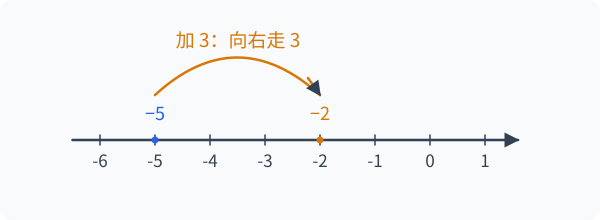
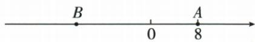
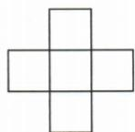
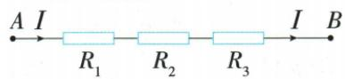

加减处理有方向的变化，乘除处理倍数与还原。先辨认运算对象，再决定符号和顺序；简便计算改变的是组织方式，不是参与运算的数。

<nav class="handbook-nav" aria-label="本章分区">
  <a class="handbook-jump is-knowledge" href="#knowledge">01 · 知识点概念、关系与适用条件</a>
  <a class="handbook-jump is-exam" href="#exam">02 · 考点题目分类和例题</a>
  <a class="handbook-jump is-pitfall" href="#pitfalls">03 · 坑点辨析错因，检查遗漏</a>
</nav>

## 【知识点】理解概念 {#knowledge .handbook-section .is-knowledge}

### 1. 有理数的加法 {#addition .knowledge-title}

| 情况 | 算法 | 例子 |
| --- | --- | --- |
| 同号 | 绝对值相加，符号不变 | $(-3)+(-2)=-5$ |
| 异号 | 较大绝对值减较小绝对值，取绝对值较大数的符号 | $(-5)+3=-2$ |
| 互为相反数 | 和为 $0$ | $(-3)+3=0$ |

任何数加 $0$，仍得这个数

### 2. 有理数的减法 {#subtraction .knowledge-title}

减去一个数，等于加上这个数的相反数

$$a-b=a+(-b)$$

例如 $3-(-2)=3+2=5$

### 3. 有理数的乘法 {#multiplication .knowledge-title}

1. 两数相乘：同号得正，异号得负，再把绝对值相乘
2. 任何数与 $0$ 相乘，积为 $0$
3. 多个非零数相乘：负因数为奇数个时积为负，偶数个时积为正

$$(-3)\times(-2)=6,\qquad(-3)\times2=-6$$

### 4. 倒数与除法 {#reciprocal .knowledge-title}

乘积为 $1$ 的两个数互为==倒数==。$a\ne0$ 时，$a$ 的倒数为 $\frac1a$；$0$ 没有倒数

除以一个非零数，等于乘这个数的倒数

$$a\div b=a\times\frac1b\quad(b\ne0)$$

例如 $\frac23\div(-\frac45)=\frac23\times(-\frac54)=-\frac56$

### 5. 运算律与运算顺序 {#laws .knowledge-title}

| 运算律 | 公式 |
| --- | --- |
| 加法交换律、结合律 | $a+b=b+a$；$(a+b)+c=a+(b+c)$ |
| 乘法交换律、结合律 | $ab=ba$；$(ab)c=a(bc)$ |
| 乘法分配律 | $a(b+c)=ab+ac$ |

有括号先算括号内，同一层先乘除、后加减，同级从左到右

## 【考点】方法与例题 {#exam .handbook-section .is-exam}

### 1. 选择能抵消或凑整的加数组合 {#exam-sum .exam-title}

先统一成带符号加数的和，再寻找相反数、同分母、同类小数或能凑整数的组合。负带分数表示整个数的相反数，如 $-23\frac13=-23-\frac13$。分组结束后逐项对照原式，不能漏项、改号。

<article class="handbook-example" aria-labelledby="example-1">

#### 例题 01 相反数与同分母分组 {#example-1 .example-heading}

题目

计算：$(+3)+(+\frac14)+(-3.3)+(-3)+(+0.3)+(-6\frac14)$。

答案与解析

解析

用加法交换律、结合律，将六个加数分成三组：

$$
[3+(-3)]+[-3.3+0.3]+[\tfrac14+(-6\tfrac14)]
=0-3-6=-9.
$$

第三组中 $-6\frac14=-6-\frac14$，分数部分恰好抵消。这里移动的是完整的带符号加数。

本题结论

$-9$。

</article>

<article class="handbook-example" aria-labelledby="example-2">

#### 例题 02 五种分组方法 {#example-2 .example-heading}

题目

计算：

1. $(+26)+(-14)+(-16)+(+18)$；
2. $(+12\frac56)+(-23\frac13)$；
3. $4.1+(+\frac12)+(-\frac14)+(-10.1)+7$；
4. $0.75+(-2\frac34)+0.125+(-12\frac57)+(-4\frac18)$；
5. $18.56+(-5.16)+(-1.44)+(+5.16)+(-18.56)$。

答案与解析

解析

1. 同号分组：$(26+18)+(-14-16)=44-30=14$。
2. 拆分带分数：$(12-23)+(\frac56-\frac13)=-11+\frac12=-10\frac12$。负带分数拆开后，整数、分数两部分都为负。
3. 同类凑整：$(4.1-10.1+7)+(\frac12-\frac14)=1+\frac14=1\frac14$。
4. 小数化同分母分数：$0.75=\frac34$，$0.125=\frac18$，故原式为 $(\frac34-2\frac34)+(\frac18-4\frac18)-12\frac57=-18\frac57$。
5. 相反数抵消：$[18.56-18.56]+[-5.16+5.16]-1.44=-1.44$。

本题结论

依次为 $14$、$-10\frac12$、$1\frac14$、$-18\frac57$、$-1.44$。

</article>

### 2. 先分清位置变化、距离和总路程 {#exam-travel .exam-title}

| 所求量 | 列式依据 |
| --- | --- |
| 最终位置相对起点的变化 | 各段带符号变化相加 |
| 终点距起点的距离 | 先求总变化，再取绝对值 |
| 实际总路程 | 每段先取绝对值，再相加 |
| 耗油量 | 总路程乘单位路程耗油量 |

正负只记录方向，向相反方向走并不让已经走过的路程消失。先统一正方向、基准和单位，计算后再把数解释回情境。

<article class="handbook-example" aria-labelledby="example-3">

#### 例题 03 回到出发点是否没有耗油 {#example-3 .example-heading}

题目

出租车司机小石一下午均在东西走向的大街上行车。规定向东为正、向西为负，各段行车记录如下，单位为千米：

$+15$，$-3$，$+14$，$-11$，$+10$，$-12$，$+4$，$-15$，$+16$，$-18$。

（1）送完最后一名乘客时，距下午出发地点多少千米？

（2）若每千米耗油 $0.4$ 升，这一下午共耗油多少升？

答案与解析

解析

向东各段共 $15+14+10+4+16=59$ 千米；向西各段共 $3+11+12+15+18=59$ 千米。

（1）位置总变化是 $59-59=0$ 千米，终点就是起点，故距离为 $0$ 千米。

（2）每段行驶都计入路程，总路程为 $59+59=118$ 千米。耗油量为 $118\times0.4=47.2$ 升。返程抵消的是位置变化，不是路程或油耗。

本题结论

（1）$0$ 千米；（2）$47.2$ 升。

</article>

<article class="handbook-example" aria-labelledby="example-4">

#### 例题 04 跨越零度的温差 2024 湖南长沙 {#example-4 .example-heading}

题目

“玉兔号”月球车能够耐受的最低温度为 $-180\,{}^\circ\mathrm C$，最高温度为 $150\,{}^\circ\mathrm C$，其耐受温差为（　）。

A. $-180\,{}^\circ\mathrm C$

B. $150\,{}^\circ\mathrm C$

C. $30\,{}^\circ\mathrm C$

D. $330\,{}^\circ\mathrm C$

答案与解析

解析

温差是最高温度减最低温度：$150-(-180)=150+180=330$。从 $-180$ 升到 $0$ 需变化 $180$ 度，再升到 $150$ 需变化 $150$ 度，两段合计 $330$ 度。

直接算 $150+(-180)$ 是求两个温度数值的和，不是温差；只算 $180-150$ 则遗漏了跨零的两段关系。

本题结论

D，温差为 $330\,{}^\circ\mathrm C$。

</article>

### 3. 用差与绝对值处理数轴上的距离 {#exam-distance .exam-title}

点 $A$、$B$ 分别表示 $a$、$b$ 时，$AB=|a-b|$。差带有方向，绝对值去掉方向，得到非负距离。已知距离而没有限定左右时，应检查两个位置；涉及运动时，再用方向、起点和时间条件筛选。

<article class="handbook-example" aria-labelledby="example-5">

#### 例题 05 距离条件对应的位置与时间 {#example-5 .example-heading}

题目

数轴上两点之间的距离为它们表示的数之差的绝对值。利用此结论回答：

（1）表示 $-3$ 与 $-5$ 的两点距离是多少？表示 $1$ 与 $-4$ 的两点呢？

（2）点 $B$ 表示 $-3$，$AB=3$，点 $A$ 表示什么数？

（3）点 $A$ 表示 $8$，点 $B$ 在 $A$ 左侧，$AB=22$。

①点 $B$ 表示什么数？②动点 $P$ 从原点出发，每秒向右运动 $5$ 个单位长度。运动时间为 $t>0$ 秒，何时 $AP=2$？

答案与解析

解析

（1）$|-3-(-5)|=2$，$|1-(-4)|=5$。

（2）距 $-3$ 为 $3$ 的位置可能在左侧或右侧，分别是 $-3-3=-6$、$-3+3=0$。

（3）①从 $8$ 向左走 $22$ 个单位，$B$ 表示 $8-22=-14$。

②距 $8$ 为 $2$ 的位置是 $6$ 或 $10$，二者都在原点右侧，符合运动方向。所需时间分别为 $6\div5=\frac65$ 秒、$10\div5=2$ 秒，且都满足 $t>0$。

本题结论

（1）$2$、$5$；（2）$0$ 或 $-6$；（3）①$-14$，②$\frac65$ 秒或 $2$ 秒。

</article>

### 4. 含共同项的和：同时去掉共同项 {#exam-cross .exam-title}

两个和相等，若都包含同一个数，可以两边同时减去这个数。十字形横、纵两组都含中心数，先比较各自剩下的两个端点之和，再安排填数。

<article class="handbook-example" aria-labelledby="example-6">

#### 例题 06 十字形中的中心数 2024 陕西 {#example-6 .example-heading}

题目

把 $0,-2,-1,1,2$ 分别填入图中的五个小正方形，使横向三个数之和与纵向三个数之和相等。中间的小正方形可以填什么数？写出一个符合题意的数即可。

答案与解析

解析

中心填 $0$，横向两端填 $-2,2$，纵向两端填 $-1,1$，两组和都为 $0$，已满足题意。

还可填 $2$：两组端点分别用 $(-1,0)$、$(-2,1)$；也可填 $-2$：两组端点分别用 $(-1,2)$、$(0,1)$。

若要确认所有可能：设中心为 $c$，每组端点和为整数 $s$。五数总和为 $0$，所以 $2s+c=0$，$c$ 必须是偶数。给定数中只有 $-2,0,2$，且上面均已构造成功。

本题结论

填 $0$ 即可；$2$、$-2$ 也可以。

</article>

### 5. 乘除统一成乘积后再约分 {#exam-product .exam-title}

::: steps
1. 带分数化假分数，有限小数按需要化为准确分数。
2. 每个除号改成乘号，只对该除数取倒数；先确认除数非零。
3. 全式成为乘积后，判断符号，约去分子分母的公共因数。
4. 检查原本相乘的因数是否保持原样，再算剩余乘积。
:::

<article class="handbook-example" aria-labelledby="example-7">

#### 例题 07 带分数与小数的乘除 {#example-7 .example-heading}

题目

计算：

（1）$-81\div2\frac14\times(-\frac49)$；

（2）$(-12)\times2\frac13\div4$；

（3）$2.5\times(-0.75)\div\frac38$。

答案与解析

解析

（1）$2\frac14=\frac94$，除以它要乘 $\frac49$：

$$-81\times\frac49\times(-\frac49)=\frac{81\times4\times4}{9\times9}=16.$$

（2）$(-12)\times\frac73\div4=-28\div4=-7$。

（3）化成分数后，$\frac52\times(-\frac34)\times\frac83=-\frac{5\times3\times8}{2\times4\times3}=-5$。约分发生在转换后的乘积中。

本题结论

（1）$16$；（2）$-7$；（3）$-5$。

</article>

<article class="handbook-example" aria-labelledby="example-8">

#### 例题 08 互为倒数先用乘积为一 2024 内蒙古包头 {#example-8 .example-heading}

题目

若 $m,n$ 互为倒数，且 $m+mn=3$，则 $n$ 的值为（　）。

A. $\frac14$

B. $\frac12$

C. $2$

D. $4$

答案与解析

解析

互为倒数给出 $mn=1$。代入第二个条件，$m+1=3$，得 $m=2$；再由 $2n=1$ 得 $n=\frac12$。

求出的 $2$ 是 $m$，不是所问的 $n$。回代检查：$2\times\frac12=1$，且 $2+1=3$。

本题结论

B，$n=\frac12$。

</article>

### 6. 分配律：拆成整数或提取共同乘数 {#exam-distribution .exam-title}

一个因数接近整十、整百、整千时，可以拆成整数量加减小量；几个乘积具有共同因数时，可以反向提取。选择哪一方向，要看变形后的括号是否更容易计算，而不是逢括号就展开。

<article class="handbook-example" aria-labelledby="example-9">

#### 例题 09 分配律的正用与逆用 {#example-9 .example-heading}

题目

例如 $98\times12=(100-2)\times12=1176$；$-16\times233+17\times233=(-16+17)\times233=233$。参考这些结构简便计算：

（1）$999\times(-15)$；

（2）$999\times118\frac45+999\times(-\frac15)-999\times18\frac35$。

答案与解析

解析

（1）$999=1000-1$，所以

$$(1000-1)\times(-15)=-15000-(-15)=-14985.$$

（2）三项都含因数 $999$，提取后保留各项符号：

$$999\times(118\tfrac45-\tfrac15-18\tfrac35)=999\times100=99900.$$

括号里整数部分 $118-18=100$，分数部分 $\frac45-\frac15-\frac35=0$。

本题结论

（1）$-14985$；（2）$99900$。

</article>

<article class="handbook-example" aria-labelledby="example-10">

#### 例题 10 公式代入也可以先提共同因数 2024 广东广州 {#example-10 .example-heading}

题目

把 $R_1,R_2,R_3$ 三个电阻串联起来，线路 $AB$ 上电流为 $I$、电压为 $U$，满足 $U=IR_1+IR_2+IR_3$。当 $R_1=20.3$、$R_2=31.9$、$R_3=47.8$、$I=2.2$ 时，求 $U$ 的值。

答案与解析

解析

题目已给公式，无需另外推导电学关系。三项共同因数是 $I$：

$$U=I(R_1+R_2+R_3)=2.2\times(20.3+31.9+47.8)=2.2\times100=220.$$

先相加凑整，可以避免逐项相乘。这里求题给公式的数值，原题未指定各量单位，不另补单位条件。

本题结论

$U=220$。

</article>

### 7. 多层括号逐层求值 {#exam-order .exam-title}

从最内层开始，每一层按先乘除、后加减计算；保留尚未执行的外层符号。小数与分数混合时可先化成准确分数，不在中间擅自取近似数。

<article class="handbook-example" aria-labelledby="example-11">

#### 例题 11 外层减号保留到最后 {#example-11 .example-heading}

题目

计算：$-3-[-5+(1-0.2\times\frac35)\div(-2)]$。

答案与解析

解析

最里层先乘：$0.2\times\frac35=\frac15\times\frac35=\frac3{25}$。

$$
\begin{aligned}
\text{原式}&=-3-\left[-5+\frac{22}{25}\div(-2)\right]\\
&=-3-\left[-5-\frac{11}{25}\right]\\
&=-3-\left(-\frac{136}{25}\right)\\
&=-\frac{75}{25}+\frac{136}{25}=\frac{61}{25}.
\end{aligned}
$$

最后一层是“$-3$ 减去中括号的值”，不是把 $-3$ 和中括号直接相加。

本题结论

$\frac{61}{25}=2\frac{11}{25}$。

</article>

## 【坑点】辨析与纠错 {#pitfalls .handbook-section .is-pitfall}

### 1. 换位置不等于换符号 {#pitfall-sign .pitfall-title}

常见错法： 为了凑整，只搬数字而把原负号留在原位；或把 $-23\frac13$ 拆成 $-23+\frac13$。

错在何处： 运算律只允许重新排列同一批数，不能改变其中一个数。负带分数是整个正带分数的相反数。

自查： 先把每个加数连同符号圈成一块。拆带分数时先写 $-(23+\frac13)$，再展开为 $-23-\frac13$。[例题2](#example-2)中的第二问可用于核对。

### 2. 回到原点，不代表路程为零 {#pitfall-distance .pitfall-title}

常见错法： 有向记录相加为零，就把总路程或油耗也写成零。

错在何处： 总变化允许方向抵消，已经走过的每一段长度不能抵消。

自查： 看问题问“在哪里”还是“走了多少”。前者先求带符号的和，后者先逐段取绝对值。[出租车例题](#example-3)中，同一组数据分别给出零位移与118千米路程。

### 3. 除数中的和差不能拆开分别除 {#pitfall-divisor .pitfall-title}

常见错法： 把 $a\div(b+c)$ 变为 $a\div b+a\div c$。

错在何处： 除数是整个和，它的倒数是 $\frac1{b+c}$，不是 $\frac1b+\frac1c$。这与 $(a+b)\div c=(a+b)\times\frac1c$ 不同；后者在 $c\ne0$ 时可以使用乘法分配律。

自查： 先圈出整个除数并求值，确认非零，才取它的倒数。

<article class="handbook-example is-pitfall" aria-labelledby="pitfall-1">

#### 辨析 01 这个除号能分配吗 改编辨析 {#pitfall-1 .example-heading}

题目

计算 $(-\frac1{63})\div(\frac19-\frac27+\frac23)$。能否把它拆为分别除以括号中的三项？

答案与解析

解析

不能。除数先通分：$\frac19-\frac27+\frac23=\frac{7-18+42}{63}=\frac{31}{63}\ne0$。

于是 $-\frac1{63}\div\frac{31}{63}=-\frac1{63}\times\frac{63}{31}=-\frac1{31}$。

若错拆为分别除，所得值为 $-\frac17+\frac1{18}-\frac1{42}=-\frac19$，与原式不等。能算出一个数，不代表变形合法。

本题结论

不能拆开，正确结果是 $-\frac1{31}$。

</article>

### 4. 有除号时，先转换再约分 {#pitfall-cancel .pitfall-title}

常见错法： 看见相邻两个分数互为倒数，就直接约为 $1$。

错在何处： 若前一个分数是除数，它还不是原样参与相乘的因数；直接相乘相当于暗中改变运算顺序。

自查： 先把每个除号改成乘倒数，再写出分子、分母的乘积，最后找公共因数。

<article class="handbook-example is-pitfall" aria-labelledby="pitfall-2">

#### 辨析 02 相邻倒数为什么不能直接约掉 改编辨析 {#pitfall-2 .example-heading}

题目

小明把 $-7\div\frac34\times\frac43$ 算为 $-7$，理由是“$\frac34\times\frac43=1$”。他的做法对吗？

答案与解析

解析

不对。除以 $\frac34$ 要乘 $\frac43$，原来后面的乘数不变：

$$-7\div\frac34\times\frac43=-7\times\frac43\times\frac43=-\frac{112}{9}.$$

若先把后两个分数相乘，就相当于擅自加入括号，变成 $-7\div(\frac34\times\frac43)$，那已经是另一个算式。

本题结论

错误；原式为 $-\frac{112}{9}$。

</article>

[上一页：有理数与数轴](./numbers-and-line.md) · [下一页：有理数的乘方](./powers.md)
