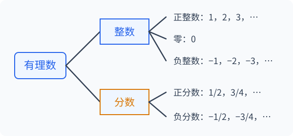
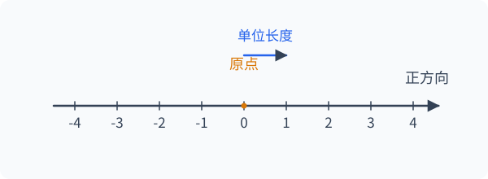
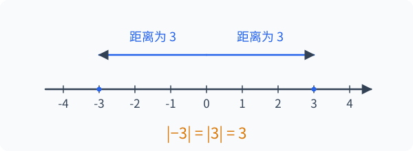
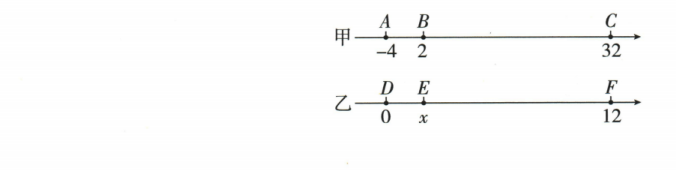
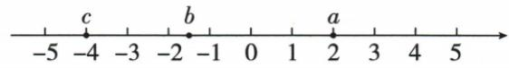
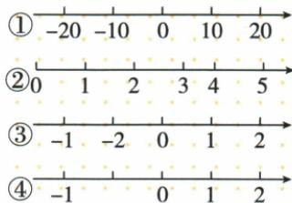

用正负表示方向，用数轴表示位置，用绝对值表示距离。把这三种含义分清，再处理分类、移动、比较和偏差问题。

<nav class="handbook-nav" aria-label="有理数与数轴章节分区">
  <a class="handbook-jump is-knowledge" href="#knowledge">01 · 知识点概念、关系与适用条件</a>
  <a class="handbook-jump is-exam" href="#exam">02 · 考点题目分类和例题</a>
  <a class="handbook-jump is-pitfall" href="#pitfalls">03 · 坑点辨析错因，检查遗漏</a>
</nav>

## 【知识点】理解概念 {#knowledge .handbook-section .is-knowledge}

### 1. 正数、负数和零 {#signed-numbers .knowledge-title}

约定上升为正，上升 $3$ 米记作 $+3$ 米，下降 $3$ 米记作 $-3$ 米

- 大于 $0$ 的数叫作==正数==，正号通常省略
- 小于 $0$ 的数叫作==负数==，负号必须保留
- $0$ 既不是正数，也不是负数

### 2. 有理数 {#rational-classification .knowledge-title}

整数和分数统称==有理数==，都能写成 $\frac pq$（$p,q$ 为整数，$q\ne0$）

有限小数和无限循环小数都是有理数，如 $0.25=\frac14$、$0.333\ldots=\frac13$

### 3. 数轴 {#number-line .knowledge-title}

规定了原点、正方向和单位长度的直线，叫作==数轴==

1. 原点表示 $0$
2. 通常规定向右为正方向，右边的数比左边的数大
3. 一个单位长度是 $0$ 到 $1$ 的距离，刻度要均匀

例如 $-3<-1<0<2$

### 4. 相反数 {#opposite-number .knowledge-title}

$2$ 与 $-2$ 只有符号不同，互为==相反数==；$0$ 的相反数是 $0$

1. $a$ 的相反数是 $-a$
2. 互为相反数的两数相加为 $0$
3. 数轴上，它们关于原点对称

### 5. 绝对值 {#absolute-value .knowledge-title}

一个数在数轴上对应的点到原点的距离，叫作这个数的==绝对值==

$$|3|=3,\qquad|-3|=3,\qquad|0|=0$$

- 正数的绝对值是它本身，负数的绝对值是它的相反数
- 绝对值不能为负，即 $|a|\ge0$
- 数轴上表示 $a,b$ 的两点间距离为 $|a-b|$

## 【考点】方法与例题 {#exam .handbook-section .is-exam}

### 1. 用正、负数表示相反意义的量 {#exam-signed .exam-title}

先确定基准与正方向，再按相反意义填写符号，最后写上数值和单位。题目问“记录什么数”时，不要改成求两个量的差；正负约定见[正数、负数和零](#signed-numbers)。

<article class="handbook-example" aria-labelledby="例题-1-零下温度怎样记录">

#### 例题 01 零下温度怎样记录 {#例题-1-零下温度怎样记录 .example-heading}

题目

若零上 $150\,{}^\circ\mathrm C$ 记作 $+150\,{}^\circ\mathrm C$，零下 $100\,{}^\circ\mathrm C$ 应怎样记录？

答案与解析

解析

题目以 $0\,{}^\circ\mathrm C$ 为基准，约定零上为正，因此零下为负。温度偏离基准的大小是 $100\,{}^\circ\mathrm C$，应记作 $-100\,{}^\circ\mathrm C$。

这里问的是温度的记录，不是两处温度相差多少，不需要计算 $150-100$。$0\,{}^\circ\mathrm C$ 也不是“没有温度”。

本题结论

应记作 $-100\,{}^\circ\mathrm C$。

</article>

### 2. 数轴上的移动 {#exam-movement .exam-title}

向右移动，表示的数增大；向左移动，表示的数减小。移动距离与点表示的数不是同一个量：距离不能为负，点表示的数可以为负。

每一步都以上一步到达的位置为起点；向右加上移动量，向左减去移动量。检查最终位置时，可以回到[数轴](#number-line)上复核。

<article class="handbook-example" aria-labelledby="例题-2-连续移动后的位置">

#### 例题 02 连续移动后的位置 {#例题-2-连续移动后的位置 .example-heading}

题目

点 $A$ 表示 $-2$，将它向右移动 $5$ 个单位长度，新位置表示什么数？点 $B$ 表示 $3$，先向右移动 $5$ 个单位长度，再向左移动 $2$ 个单位长度，最后表示什么数？

点 $C$ 向右移动4个单位后，新位置与原位置到原点的距离相等。点 $C$ 原来表示什么数？

答案与解析

解析

1. 点 $A$ 从 $-2$ 向右走 $2$ 个单位长度到达 $0$，还剩 $3$ 个单位长度，因此到达 $3$。
2. 点 $B$ 从 $3$ 向右移动到 $8$，再从 $8$ 向左移动到 $6$。第二次移动的起点是 $8$，不是原来的 $3$。
3. 点 $C$ 移动了非零距离，所以前后位置不同；两点又到原点等距，必在原点两侧对称。总距离4平分为两段2，向右移动前位于左侧，原数为 $-2$。

本题结论

点 $A$、$B$ 的最终位置分别表示 $3$、$6$；点 $C$ 原来表示 $-2$。

</article>

### 3. 识别相反数 {#exam-opposite-check .exam-title}

相反数的检验： 两数和为0才互为相反数。先化简，再检查这个条件，不能只看符号相反。

<article class="handbook-example" aria-labelledby="example-11">

#### 例题 03 相反数不能只看异号 2024·黑龙江大庆 {#example-11 .example-heading}

题目

下列各组数中，互为相反数的是（　）。

A. $|-2024|$ 和 $-2024$

B. $2024$ 和 $\frac1{2024}$

C. $|-2024|$ 和 $2024$

D. $-2024$ 和 $\frac1{2024}$

答案与解析

解析

先算 $|-2024|=2024$。A中两数之和为0，是相反数；B是乘积为1的倒数关系，不是相反数；C是同一个正数；D虽然异号，但绝对值不同，和不为0。

本题结论

A。

</article>

### 4. 由绝对值确定数或范围 {#exam-absolute .exam-title}

把绝对值译成“到原点的距离”。求原数时检查原点两侧；求整数个数时先确定范围，再按题意检查端点是否包含、是否包含 $0$。依据见[绝对值](#absolute-value)。

<article class="handbook-example" aria-labelledby="例题-3-距离条件对应哪些数">

#### 例题 04 距离条件对应哪些数 {#例题-3-距离条件对应哪些数 .example-heading}

题目

一个数的绝对值等于 $36$，这个数是多少？绝对值小于 $3$ 的整数有几个？

答案与解析

解析

- 距原点 $36$ 个单位长度的位置有两个，分别在左右两侧，所以这个数是 $36$ 或 $-36$。
- 绝对值小于 $3$，表示距原点不足 $3$ 个单位长度。符合条件的整数是 $-2,-1,0,1,2$，共 $5$ 个。$-3$ 与 $3$ 的距离恰好为 $3$，不满足“小于”。

本题结论

原数为 $36$ 或 $-36$；满足条件的整数有 $5$ 个。

</article>

### 5. 比较有理数的大小 {#exam-comparison .exam-title}

先分清正、零、负，再比较同一类中的数。两个负数，绝对值大的反而小：它到原点的距离更远，位置也更靠左。

分数可先通分，或比较绝对值后反向判断。不同符号的数，应先按数轴位置确定大小，不能直接套用负数间的比较规则。

<article class="handbook-example" aria-labelledby="例题-4-两个负数怎样比较">

#### 例题 05 两个负数怎样比较 知识清单例题·合并改编 {#例题-4-两个负数怎样比较 .example-heading}

题目

比较各组数的大小：

（1）$-7$ 与 $-2$；（2）$-\frac78$ 与 $-\frac89$；

（3）$-4\frac25$ 与 $-4.2$；（4）$-(-5)$ 与 $-|-5|$。

答案与解析

解析

- $-7$ 与 $-2$ 都是负数，$7>2$，所以 $-7<-2$。
- 将两个分数通分，得 $-\frac78=-\frac{63}{72}$，$-\frac89=-\frac{64}{72}$。前者距原点更近，所以 $-\frac78>-\frac89$。

不能只比较绝对值就对任意两数下结论。例如 $-7$ 的绝对值大于 $2$ 的绝对值，但 $-7<2$；原数的正负必须先看清。

另两组先化简：$-4\frac25=-4.4<-4.2$；$-(-5)=5$，$-|-5|=-5$，所以 $-(-5)>-|-5|$。负带分数的负号作用于整个带分数，不能写成 $-4+\frac25$。

本题结论

（1）$-7<-2$；（2）$-\frac78>-\frac89$；（3）$-4\frac25<-4.2$；（4）$-(-5)>-|-5|$。

</article>

<article class="handbook-example" aria-labelledby="example-10">

#### 例题 06 多种写法的数从大到小排序 {#example-10 .example-heading}

题目

把 $-3\frac13$，$-1$，$-0.5$，$4$，$-1.5$，$2\frac12$，$1.8$，$-4$ 用“$>$”连接起来。

答案与解析

解析

先分正负两段，再在段内比较。正数部分为 $4>2\frac12>1.8$。负数中，绝对值从小到大为 $0.5$，$1$，$1.5$，$3\frac13$，$4$，所以对应原数从大到小恰按这个次序排列。

最后核对八个数各出现一次，所有连接符均表示左大右小。

本题结论

$$4>2\frac12>1.8>-0.5>-1>-1.5>-3\frac13>-4.$$

</article>

### 6. 用绝对值判断偏差 {#exam-deviation .exam-title}

先分清记录的是实际值还是相对标准的偏差。偏差的符号表示方向，绝对值表示偏离程度；“不大于”包含等于。允许的正负偏差对称时，可用同一个绝对值上限判断，否则应分别检查上下限。

<article class="handbook-example" aria-labelledby="例题-5-哪件产品更接近标准">

#### 例题 07 哪件产品更接近标准 {#例题-5-哪件产品更接近标准 .example-heading}

题目

某厂抽查 $6$ 件橡胶垫的直径。比标准直径大的记正数，比标准直径小的记负数，记录如下。

| 编号 | 1 | 2 | 3 | 4 | 5 | 6 |
| --- | --- | --- | --- | --- | --- | --- |
| 偏差／毫米 | $+0.4$ | $-0.2$ | $+0.1$ | $+0.05$ | $-0.3$ | $+0.25$ |

（1）哪一件的直径最接近标准？

（2）若与标准直径相差不大于 $0.2$ 毫米为合格，有几件不合格？

答案与解析

解析

这些记录是偏差，不是实际直径。符号表示偏大还是偏小，绝对值表示偏离标准的大小。

1. 六件的绝对偏差依次为 $0.4$、$0.2$、$0.1$、$0.05$、$0.3$、$0.25$ 毫米。最小的是 $0.05$ 毫米，所以 4号最接近标准。
2. “不大于”包括等于。2、3、4号的绝对偏差不大于 $0.2$ 毫米，合格；1、5、6号超过上限，共3件不合格。

本题结论

4号最接近标准；1、5、6号不合格，共3件。

</article>

### 7. 非负数的和等于零 {#exam-zero-sum .exam-title}

先确认每一项都非负，再由“和为零”推出每项为零，最后解出未知数并代回。这里只能使用[非负数零和](#absolute-value)的条件，不能把任意两个数的和为零都拆成各自为零。

<article class="handbook-example" aria-labelledby="例题-6-绝对值的零和条件">

#### 例题 08 绝对值的零和条件 {#例题-6-绝对值的零和条件 .example-heading}

题目

已知 $|a-1|+|b-2|=0$，求 $a+b$。

答案与解析

解析

两个绝对值都不小于 $0$。如果其中一项大于 $0$，另一项又不能为负，总和就不可能为 $0$。所以两项必须分别等于 $0$：

$$
|a-1|=0,\qquad |b-2|=0.
$$

绝对值为 $0$ 时，里面的数也为 $0$，因此 $a=1$、$b=2$，得到 $a+b=3$。

这一推理必须有“每一项都非负”的条件。仅知道 $a+b=0$，不能推出 $a=b=0$，例如 $2+(-2)=0$。

本题结论

$a=1$、$b=2$，所以 $a+b=3$。

</article>

### 8. 双数轴对齐：比较对应长度的比例 {#exam-alignment .exam-title}

两条数轴的单位长度未必相同。先在各自数轴上用坐标差求距离，再按题给的对齐关系建立对应；相等的是对应线段的实际长度，不是坐标值。

1. 标清每条轴的点序，确定比较的部分与整体。
2. 在一条轴内求长度比，单位会约去。
3. 把这个比例用于另一条轴，最后检查方向与范围。

<article class="handbook-example" aria-labelledby="example-7">

#### 例题 09 上下对齐的两条数轴 2024·河北 {#example-7 .example-heading}

题目

如图，甲数轴上的 $A,B,C$ 三点依次表示 $-4,2,32$；乙数轴上的 $D,E,F$ 三点依次表示 $0,x,12$。

（1）求甲数轴上这三个数的和及 $\frac{AB}{AC}$。

（2）当 $A$ 与 $D$ 上下对齐时，$B,C$ 恰好分别与 $E,F$ 上下对齐，求 $x$。

答案与解析

解析

（1）三个数的和为 $-4+2+32=30$。

$$\frac{AB}{AC}=\frac{2-(-4)}{32-(-4)}=\frac6{36}=\frac16.$$

（2）对应点上下对齐，$DE$ 占 $DF$ 的比例与 $AB$ 占 $AC$ 的比例相同。乙轴上 $DF=12$ 个乙单位，因此 $DE=12\times\frac16=2$ 个乙单位。$E$ 在0右侧，所以 $x=2$。

这里不能说“甲轴的6个单位等于乙轴的6个单位”。可用 $A=-4$ 与 $D=0$ 反查：对齐的点显然不必同值。

本题结论

（1）30，$\frac16$；（2）$x=2$。

</article>

### 9. 先判内部整体的符号，再去绝对值 {#exam-compound-absolute .exam-title}

当绝对值里不是一个确定数，而是字母的和、差时，要把内部看成整体：

| 内部条件 | 替换方式 | 外部操作 |
| --- | --- | --- |
| 整体非负 | 保留原式 | 原有加减号仍保留 |
| 整体为负 | 取整个式子的相反数 | 先加括号，后展开 |
| 无法判号 | 按符号分类 | 不擅自选某一分支 |

数轴给出的左右次序通常已经够用，不必猜一个没有标明的具体数。去绝对值与合并同类项是两步；若尚未学习字母式的合并，可先核对每个替换是否正确，后续学习整式时再复习合并过程。

<article class="handbook-example" aria-labelledby="example-8">

#### 例题 10 由数轴顺序化简 {#example-8 .example-heading}

题目

$a,b,c$ 在数轴上的位置如图所示，化简

$$|b-a|-|2a-b|+|a-c|-|c|.$$

答案与解析

解析

由图得 $c<b<0<a$。逐项判断：

| 内部整体 | 符号依据 | 去绝对值后 |
| --- | --- | --- |
| $b-a$ | 负数减正数，小于0 | $a-b$ |
| $2a-b$ | 正数减负数，大于0 | $2a-b$ |
| $a-c$ | 正数减负数，大于0 | $a-c$ |
| $c$ | 已知小于0 | $-c$ |

保留原式各项前的运算符号：

$$\begin{aligned}
&|b-a|-|2a-b|+|a-c|-|c|\\
&=(a-b)-(2a-b)+(a-c)-(-c)\\
&=a-b-2a+b+a-c+c=0.
\end{aligned}$$

第二项前的减号作用于整个 $2a-b$，最后一项减的是 $-c$；这两处都不能漏变符号。

本题结论

原式等于0。

</article>

### 10. 检查数轴与相反数的图形条件 {#exam-line-check .exam-title}

检查数轴，逐项核对直线、原点、正方向和统一单位长度；相邻刻度可以表示10个单位，不必都是1。判断线段内是否存在一对相反数，则检查它能否容纳原点两侧的等距位置，不能只盯着两个端点。

<article class="handbook-example" aria-labelledby="example-9">

#### 例题 11 哪幅图能表示数轴 {#example-9 .example-heading}

题目

下列四幅图中，能正确表示数轴的有几个？

A. 0个

B. 1个

C. 2个

D. 3个

答案与解析

解析

①相邻数差都为10，间隔相同，满足三要素；②不是一条直线，单位长度也不统一；③把 $-2$ 画在 $-1$ 右侧，顺序错误；④同样相差1的两段长度不同。

只有①正确。

本题结论

1个，选B。

</article>

线段内部的点不止两个端点。例如一条线段从 $-1$ 延伸到 $2$，端点不互为相反数，但线段中含 $-\frac12$ 与 $\frac12$ 这对相反数；完全位于原点同侧且不经过原点的线段则不含这样的点对。

## 【坑点】辨析与纠错 {#pitfalls .handbook-section .is-pitfall}

重点检查符号、零和距离的含义。下面的辨析题先保留判断空间，答案与错因一起展开。

### 1. 式子前有“−”，不一定是负数 {#pitfall-minus .pitfall-title}

$-(-3)=3$。外面的负号表示“取相反数”，不能看到负号就判定整个式子小于 $0$。

字母未限定时，要看其取值：

| $a$ 的情况 | $-a$ 的情况 | 例子 |
| --- | --- | --- |
| $a>0$ | 负数 | $a=2$ 时，$-a=-2$ |
| $a=0$ | $0$ | $-0=0$ |
| $a<0$ | 正数 | $a=-2$ 时，$-a=2$ |

<article class="handbook-example is-pitfall" aria-labelledby="辨析-1-负数个数能确定吗">

#### 辨析 01 负数个数能唯一确定吗 改编辨析 {#辨析-1-负数个数能确定吗 .example-heading}

题目

在 $0$、$-(-2\frac14)$、$-1$、$3$、$\frac12$、$-0.1$、$-a$ 中，若 $a$ 是任意有理数，能确定共有几个负数吗？

答案与解析

解析

$-1$ 和 $-0.1$ 一定为负数，$-(-2\frac14)=2\frac14$ 为正数；$-a$ 则不能直接判定。

- 当 $a>0$ 时，$-a$ 也是负数，共 $3$ 个。
- 当 $a\le0$ 时，$-a$ 不是负数，共 $2$ 个。

因此，负数总数不能唯一确定。“能确定为负数的有两个”不等于“总共只有两个负数”。

本题结论

一定为负数的有两个；负数总数随 $a$ 改变，可能为 2个或3个。

</article>

### 2. 非正、非负都不能漏掉零 {#pitfall-zero .pitfall-title}

常见错法： 一看到“取相反数”就只考虑负数，或把非负数写成正数。

自查： 把 $0$ 代入条件。若它也满足，结论就必须把 $0$ 包含进来。分类含义见[有理数及其分类](#rational-classification)。

<article class="handbook-example is-pitfall" aria-labelledby="辨析-2-范围里有没有零">

#### 辨析 02 两个范围都少了一个数 自编辨析 {#辨析-2-范围里有没有零 .example-heading}

题目

小明由 $|a|=-a$ 得到 $a<0$；小红由 $|b|=b$ 得到 $b>0$。这两个结论完整吗？分别写出 $a$、$b$ 的范围。

答案与解析

解析

当 $a=0$ 时，$|a|=-a=0$，也满足条件；正数则不满足 $|a|=-a$。所以第一个范围应为非正数。

同样，当 $b=0$ 时也满足 $|b|=b$；负数的绝对值为正，不等于原数，所以第二个范围应为非负数。

本题结论

两个结论都漏掉了 $0$。完整范围是 $a\le0$、$b\ge0$。

</article>

### 3. 绝对值外的负号要保留 {#pitfall-outside-minus .pitfall-title}

常见错法： 把绝对值符号当成普通括号，看到内外两个负号就直接抵消。

自查： 先求绝对值，再处理外面的负号；两步分别写清。

<article class="handbook-example is-pitfall" aria-labelledby="辨析-3-两个负号能抵消吗">

#### 辨析 03 外面的负号到底作用在哪一步 改编辨析 {#辨析-3-两个负号能抵消吗 .example-heading}

题目

（1）分别计算 $-|-3|$ 与 $-(-3)$。

（2）再计算 $+(-3)$、$-(+3)$、$-[-(-3)]$。

（3）已知 $c<0$，化简 $-|c|$。小明写成 $-c$，对吗？

答案与解析

解析

前一个式子先求距离 $|-3|=3$，再取相反数，得到 $-3$；后一个式子直接对 $-3$ 取相反数，得到 $3$。

正号不改变原数，所以 $+(-3)=-3$；$-(+3)=-3$；从内向外计算 $-[-(-3)]=-(3)=-3$。

当 $c<0$ 时，$|c|=-c$，所以 $-|c|=-(-c)=c$，不是 $-c$。负数的绝对值写成 $-c$ 后，原来在绝对值外的负号还要保留。

本题结论

（1）分别为 $-3$、$3$；（2）三个式子的结果均为 $-3$；（3）结果是 $c$，小明的写法不对。

</article>

[返回知识点](#knowledge) · [查看考点](#exam) · [继续：有理数的加减乘除](./arithmetic.md)
