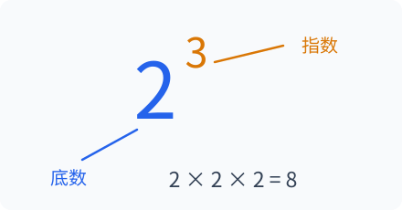

乘方把相同因数的连乘写得简洁。计算时先认清底数的范围，再利用指数的奇偶判断符号；大指数题往往只需要研究符号或个位，而不必求出整个数。

<nav class="handbook-nav" aria-label="本章分区">
  <a class="handbook-jump is-knowledge" href="#knowledge">01 · 知识点概念、关系与适用条件</a>
  <a class="handbook-jump is-exam" href="#exam">02 · 考点题目分类和例题</a>
  <a class="handbook-jump is-pitfall" href="#pitfalls">03 · 坑点辨析错因，检查遗漏</a>
</nav>

## 【知识点】理解概念 {#knowledge .handbook-section .is-knowledge}

### 1. 乘方、底数和指数 {#power-meaning .knowledge-title}

求几个相同因数的积，叫作==乘方==。例如 $2^3=2\times2\times2=8$

$a^2$ 读作 $a$ 的平方，$a^3$ 读作 $a$ 的立方；$a^1=a$

负数或分数作底数时加括号，如 $(-2)^3$、$(\frac12)^2$

### 2. 幂的符号 {#power-sign .knowledge-title}

下表中的指数都是正整数

| 底数 | 指数 | 结果 | 例子 |
| --- | --- | --- | --- |
| 正数 | 奇数或偶数 | 正数 | $2^3=8$ |
| 负数 | 奇数 | 负数 | $(-2)^3=-8$ |
| 负数 | 偶数 | 正数 | $(-2)^4=16$ |
| $0$ | 奇数或偶数 | $0$ | $0^3=0$ |

$1$ 的正整数次幂都是 $1$；$-1$ 的奇次幂为 $-1$，偶次幂为 $1$

### 3. 含乘方的混合运算 {#power-order .knowledge-title}

先乘方，再乘除，最后加减；有括号先算括号内

| 式子 | 计算过程 | 结果 |
| --- | --- | --- |
| $(-2)^4$ | 四个 $-2$ 相乘 | $16$ |
| $-2^4$ | 先算 $2^4$，再取相反数 | $-16$ |
| $3-2^2\times2$ | $3-4\times2$ | $-5$ |

## 【考点】方法与例题 {#exam .handbook-section .is-exam}

### 1. 先界定底数，再计算幂 {#exam-power .exam-title}

先看括号和指数作用的范围，再判断负因数的奇偶，最后计算绝对值。遇到分数底数，必要时展开一次乘法，检查分子、分母是否都参与乘方。

<article class="handbook-example" aria-labelledby="example-1">

#### 例题 01 负分数与负号的位置 {#example-1 .example-heading}

题目

计算：

（1）$(-\frac25)^2$；（2）$-8^3$；（3）$(-1)^{2n}$，其中 $n$ 为正整数。

答案与解析

解析

（1）$(-\frac25)^2=(-\frac25)\times(-\frac25)=\frac{2\times2}{5\times5}=\frac4{25}$。

（2）$-8^3$ 的底数是 $8$，外面的负号最后处理：$-(8\times8\times8)=-512$。

（3）$2n$ 是偶数，$2n$ 个 $-1$ 可以配成 $n$ 对，每对积为 $1$，所以结果为 $1$。

本题结论

依次为 $\frac4{25}$、$-512$、$1$。

</article>

### 2. 指数奇偶未定时分类讨论 {#exam-parity .exam-title}

$n$ 为正整数不代表它一定是奇数或偶数。遇到 $(-1)^n$，按奇、偶两类列出；相邻整数 $n$ 与 $n+1$ 一奇一偶。代入后还要完成式子中的其他运算。

<article class="handbook-example" aria-labelledby="example-2">

#### 例题 02 相邻指数的两个幂 {#example-2 .example-heading}

题目

$n$ 为正整数，$\frac{(-1)^n-(-1)^{n+1}}2$ 的值为（　）。

A. $-1$ 或 $0$

B. $0$ 或 $1$

C. $-1$ 或 $1$

D. $-1$ 或 $0$ 或 $1$

答案与解析

解析

| $n$ | $(-1)^n$ | $(-1)^{n+1}$ | 整个式子的值 |
| --- | --- | --- | --- |
| 奇数 | $-1$ | $1$ | $\frac{-1-1}{2}=-1$ |
| 偶数 | $1$ | $-1$ | $\frac{1-(-1)}2=1$ |

分子总为 $-2$ 或 $2$，不可能为 $0$。两类结果都要保留。

本题结论

C，值为 $-1$ 或 $1$。

</article>

### 3. 用偶次幂的非负性确定未知数 {#exam-nonnegative .exam-title}

先证明每一项都非负，再由和为零推出每项分别为零。这个推理不适用于任意两个数：若能一正一负，和为零也可能只是抵消。

<article class="handbook-example" aria-labelledby="example-3">

#### 例题 03 平方与绝对值的零和 2024 四川资阳 {#example-3 .example-heading}

题目

若 $(a-1)^2+|b-2|=0$，求 $ab$。

答案与解析

解析

平方 $(a-1)^2\ge0$，绝对值 $|b-2|\ge0$。若其中一项大于零，另一项不能为负，总和就不可能为零。因此

$$(a-1)^2=0,\qquad |b-2|=0.$$

得 $a-1=0$、$b-2=0$，即 $a=1$、$b=2$，所以 $ab=2$。

本题结论

$ab=2$。

</article>

### 4. 只研究大整数幂的个位 {#exam-cycle .exam-title}

::: steps
1. 确定所求是整个数、符号还是个位，不必为个位计算庞大的完整幂。
2. 写出一轮个位变化，说明轮末如何回到轮首，确认重复机制。
3. 用指数除以周期长度，余数定位；余数为零对应一轮的最后一项。
4. 若幂后还有加减，继续处理，不把幂的个位直接当作最终答案。
:::

<article class="handbook-example" aria-labelledby="example-4">

#### 例题 04 第2025次幂再加一 {#example-4 .example-heading}

题目

已知 $3^1+1=4$，$3^2+1=10$，$3^3+1=28$，$3^4+1=82$，$3^5+1=244$，……。归纳结果末位数字的变化规律，$3^{2025}+1$ 的末位数字为（　）。

A. $0$

B. $2$

C. $4$

D. $8$

答案与解析

解析

$3^n$ 的个位依次为 $3,9,7,1$：个位乘 $3$ 后分别变为 $9,7,1,3$，回到起点，因而每四次循环。十位以上乘 $3$ 仍是整十数，不影响个位。

| 指数在一轮中的位置 | 1 | 2 | 3 | 4 |
| --- | --- | --- | --- | --- |
| $3^n$ 的个位 | $3$ | $9$ | $7$ | $1$ |
| $3^n+1$ 的个位 | $4$ | $0$ | $8$ | $2$ |

$2025=4\times506+1$，在506个完整周期后到达下一轮第1项，最终个位为 $4$。注意 $9+1=10$，个位是 $0$。

本题结论

C，末位数字为 $4$。

</article>

### 5. 分层计算与新定义运算 {#exam-new .exam-title}

普通算式按层次计算；若题目另定义符号，先按定义把它翻译成普通运算，再执行运算顺序。负数代入字母位置时，把整个负数加括号，不能改变变量代表的整体。

<article class="handbook-example" aria-labelledby="example-5">

#### 例题 05 先乘方，外层减号不丢 {#example-5 .example-heading}

题目

计算：$-72-3\times[(-2)+(-1)^{2024}]$。

答案与解析

解析

指数 $2024$ 为偶数，所以 $(-1)^{2024}=1$。接着从括号内向外计算：

$$-72-3\times[(-2)+1]=-72-3\times(-1)=-72-(-3)=-69.$$

外层减号直到乘积算出后才执行。

本题结论

$-69$。

</article>

<article class="handbook-example" aria-labelledby="example-6">

#### 例题 06 星号不是普通乘号 2024 甘肃 {#example-6 .example-heading}

题目

定义运算 $\ast$：$m\ast n=m^n-mn$，其中 $m,n$ 为整数，$m\ne0$。例如 $2\ast3=2^3-2\times3=2$。求 $(-2)\ast2$。

答案与解析

解析

按位置对应，$m=-2$、$n=2$，满足题给输入条件。代入右式：

$$(-2)\ast2=(-2)^2-(-2)\times2=4-(-4)=8.$$

左侧星号的意义由题目定义，右侧 $mn$ 才是普通乘法。这里实际用到的指数是 $2$，无需为了本问处理其他整数指数。

本题结论

$8$。

</article>

## 【坑点】辨析与纠错 {#pitfalls .handbook-section .is-pitfall}

### 1. 括号决定指数作用的范围 {#pitfall-base .pitfall-title}

常见错法： 把 $-2^4$ 当成 $(-2)^4$，或把 $(\frac34)^2$ 只给分子平方。

错在何处： 指数原本作用于哪个整体没有读清。奇次方偶尔算出相同结果，更容易造成“括号可省”的错觉。

自查： 先圈出完整底数，再展开成一次连乘；外面的负号保持在乘方外。

<article class="handbook-example is-pitfall" aria-labelledby="pitfall-1">

#### 辨析 01 哪一个等式成立 {#pitfall-1 .example-heading}

题目

下列等式正确的是（　）。

A. $(\frac34)^2=\frac{3^2}{4}$

B. $|-3|^5=(-3)^5$

C. $(-2)^3=-2^3$

D. $-2^4=16$

答案与解析

解析

- A：左侧为 $\frac9{16}$，右侧为 $\frac94$，分母漏了平方。
- B：左侧先取绝对值，得 $3^5=243$；右侧为 $-243$。
- C：两侧均为 $-8$，成立。但这依赖本次指数为奇数，不代表括号总能删掉。
- D：负号在乘方外，结果为 $-16$，不是 $16$。

本题结论

C。

</article>

### 2. 偶次幂非负，不等于底数非负 {#pitfall-even .pitfall-title}

常见错法： 看到 $a^2>0$ 就写 $a>0$，或认定偶次幂总大于零。

错在何处： 平方消除了非零底数的正负区别：$2^2=(-2)^2=4$；底数为零时平方仍是零。

自查： 分别代入一个负数和零核验。由 $a^2>0$ 只能推出 $a\ne0$；由 $a^2=0$ 才能确定 $a=0$。[平方零和例题](#example-3)使用的是“非负且和为零”，不能省略后半个条件。

### 3. 周期题余数为零，取的是轮末 {#pitfall-cycle .pitfall-title}

常见错法： 把余数零当作“第0项”，或直接选下一轮首项。

错在何处： 从第1项计数时，整除表示恰好走完若干整轮，停在上一轮最后一项。

自查： 先用第4项、第8项这类小编号检查定位。例如[个位循环](#example-4)每四项一轮，余数为 $1,2,3,0$ 分别对应第 $1,2,3,4$ 项。只观察少数项还不够，必须有题给规则或可验证的重复机制。

[上一页：有理数的加减乘除](./arithmetic.md) · [下一页：科学记数法与近似数](./scientific-notation.md)
