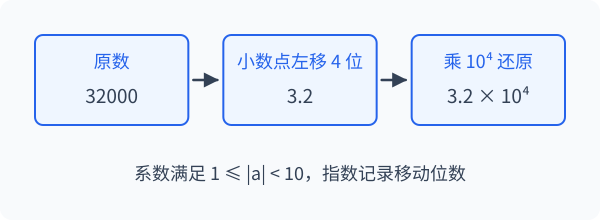

很大的数需要便于读写的表示方式，测量得到的数则需要说明精确到哪里。科学记数法解决写法问题，近似数解决精度问题；两者不能混为一谈。

<nav class="handbook-nav" aria-label="本章分区">
  <a class="handbook-jump is-knowledge" href="#knowledge">01 · 知识点概念、关系与适用条件</a>
  <a class="handbook-jump is-exam" href="#exam">02 · 考点题目分类和例题</a>
  <a class="handbook-jump is-pitfall" href="#pitfalls">03 · 坑点辨析错因，检查遗漏</a>
</nav>

## 【知识点】理解概念 {#knowledge .handbook-section .is-knowledge}

### 1. 科学记数法 {#notation .knowledge-title}

把一个非零数写成 $a\times10^n$，其中 $1\le|a|<10$、$n$ 为整数，叫作==科学记数法==

| 原数 | 科学记数法 |
| --- | --- |
| $32000$ | $3.2\times10^4$ |
| $-5600000$ | $-5.6\times10^6$ |
| $0.00032$ | $3.2\times10^{-4}$ |

大数的小数点向左移几位，指数就是几；绝对值小于 $1$ 时向右移几位，指数就是负几

### 2. 准确数与近似数 {#exact-approximate .knowledge-title}

- 逐一数出全班有 $40$ 人，$40$ 是准确数
- 测得身高约 $1.58$ 米，$1.58$ 是近似数

按要求用四舍五入得到近似数，用 $\approx$ 连接，例如 $3.14159\approx3.14$

### 3. 精确度 {#precision .knowledge-title}

最后保留的一位在哪个数位，就叫精确到哪个数位

| 近似数 | 精确到 |
| --- | --- |
| $6.3$ | 十分位 |
| $6.30$ | 百分位 |
| $6.30\times10^3=6300$ | 十位 |
| $6.30$ 万 | 百位 |

近似数末尾的 $0$ 表示精度，需要保留

### 4. 有效数字 {#significant-figures .knowledge-title}

从左边第一个非零数字起，到最后保留的一位止，都是==有效数字==

$0.03020$ 的有效数字是 $3,0,2,0$，共 $4$ 个

## 【考点】方法与例题 {#exam .handbook-section .is-exam}

### 1. 改写或还原科学记数法 {#notation-method .exam-title}

改写时，先保留正负号，再把小数点移到最高位非零数字之后，记录移动位数，最后核验系数范围。还原时，乘 $10^n$ 就将小数点向右移动 $n$ 位；位数不够时补零。

<article class="handbook-example" aria-labelledby="example-1">

#### 例题 01 把指数表示还原为普通数 {#example-1 .example-heading}

题目

把下列各数还原为普通数：

（1）$3.14\times10^3$；（2）$1.414\times10^5$；（3）$-1.732\times10^7$。

答案与解析

解析

分别向右移动小数点3、5、7位，原来的负号不变：

$$3.14\times10^3=3140,$$
$$1.414\times10^5=141400,$$
$$-1.732\times10^7=-17320000.$$

可反向把小数点移回去，检查补零数量。

本题结论

（1）3140；（2）141400；（3）−17320000。

</article>

### 2. 按指定数位四舍五入 {#rounding-method .exam-title}

1. 找到题目要求保留的最后一位。
2. 看它右边紧邻的一位，小于5舍去，大于或等于5向前进1；进位可能连续发生。
3. 写出能表达该精度的结果。较大的数用科学记数法时，也要保留必要的零。

这里使用的是题目指定的四舍五入。按箱数、人数等实际要求取值时，还应判断是否需要进一法或去尾法，不能只套四舍五入。

<article class="handbook-example" aria-labelledby="example-2">

#### 例题 02 保留数位与连续进位 {#example-2 .example-heading}

题目

用四舍五入法按要求取近似数：

（1）$5.8964$，精确到十分位；

（2）$199.5$，精确到个位；

（3）$200499$，精确到千位。

答案与解析

解析

（1）保留十分位的8，后一位为9，要进1，得 $5.9$。

（2）保留个位的9，后一位为5；个位、十位连续进位，得 $200$。

（3）千位是0，百位为4，应舍去后续部分。为了明确最后保留的是千位，写成 $2.00\times10^5$：系数的百分位对应 $10^3$。

本题结论

（1）5.9；（2）200；（3）$2.00\times10^5$。

</article>

### 3. 带单位或数量级时判断精确度 {#precision-method .exam-title}

不要先把尾零删掉，也不要只盯着系数的小数位。先确定系数最后一位的单位，再乘它后面的数量级；得到的单位就是原数的精确度。

<article class="handbook-example" aria-labelledby="example-3">

#### 例题 03 三个6.30，三种精度 {#example-3 .example-heading}

题目

说明下列近似数分别精确到哪一位：

（1）$6.30$；（2）$6.30\times10^3$；（3）$6.30$万。

答案与解析

解析

（1）最后的0在百分位，精确到百分位。

（2）最后一位表示 $0.01\times10^3=10$，精确到十位。

（3）最后一位表示 $0.01\times10000=100$，精确到百位。

本题结论

依次为百分位、十位、百位。

</article>

### 4. 由四舍五入结果反推原数范围 {#reverse-rounding .exam-title}

先看末位单位，再取它的一半，找到相邻两次舍入的分界点。对于本页的正数、普通四舍五入，较小分界点会进位成为该结果，较大分界点会进位成下一个结果，所以区间左端取等号、右端不取等号。

边界规则依赖取舍方式。题目若改用去尾法、进一法，或涉及负数的取舍约定，必须重新检查，不能照搬区间。

<article class="handbook-example" aria-labelledby="example-4">

#### 例题 04 1.20来自哪些数 {#example-4 .example-heading}

题目

一个数 $a$ 四舍五入后得到的近似数为 $1.20$，则 $a$ 的取值范围是（　）。

A. $1.15<a<1.25$

B. $1.15\le a<1.25$

C. $1.195<a<1.205$

D. $1.195\le a<1.205$

答案与解析

解析

$1.20$ 最后一位是百分位，半个末位单位为 $0.005$。两处分界为 $1.20-0.005=1.195$ 和 $1.20+0.005=1.205$。

$1.195$ 的千分位是5，进位后得到1.20，应包括；$1.205$ 进位后得到1.21，不应包括。A、B把百分位精度误当成十分位精度；C遗漏可以取到的左端点。

本题结论

$1.195\le a<1.205$，选D。

</article>

### 5. 实际数量的倍数与科学记数法 {#quantity-calculation .exam-title}

先按题意列出数量关系，再计算系数，最后重新调整到 $1\le|a|<10$。题干中的单位必须保留；算完系数大于或等于10时，指数也要随之调整。

<article class="handbook-example" aria-labelledby="example-5">

#### 例题 05 算力的五倍 2024·北京，改编 {#example-5 .example-heading}

题目

某超算系统的算力达到每秒 $4\times10^{17}$ 次浮点运算。若某运算系统的算力是它的5倍，则该系统每秒的浮点运算次数用科学记数法表示为（　）。

A. $8\times10^{16}$

B. $2\times10^{17}$

C. $5\times10^{17}$

D. $2\times10^{18}$

答案与解析

解析

“5倍”对应乘5：

$$5\times(4\times10^{17})=20\times10^{17}=2\times10^{18}.$$

$20\times10^{17}$ 与结果相等，但系数20不符合科学记数法的范围，还需再调整一次。

本题结论

D，即每秒 $2\times10^{18}$ 次。

</article>

## 【坑点】辨析与自查 {#pitfalls .handbook-section .is-pitfall}

### 1. 近似数末尾的零不能随意删 {#trailing-zero .pitfall-title}

常见错法： 认为 $3.7=3.70$，所以二者精确度相同。

错在何处： 数值相等不代表测量或取近似时保留的信息相同。作为近似数，3.7精确到十分位，3.70精确到百分位；删去末尾的零会改变精度。

自查： 读一遍“最后一位是哪个数位”。若有数量级，再按[精确度例题](#example-3)换算，不能仅数小数位。

<article class="handbook-example is-pitfall" aria-labelledby="pitfall-1">

#### 辨析 01 数值相等与精度相同 {#pitfall-1 .example-heading}

题目

判断下列说法是否正确，并说明理由。

（1）近似数3.7和3.70的精确度相同。

（2）近似数 $2.24\times10^4$ 精确到百位。

（3）把8903000保留三个有效数字，可写为 $8.90\times10^6$。

（4）求近似数时，无论什么实际问题，都应使用四舍五入法。

（5）实际问题中，有时要根据需要使用进一法或去尾法。

答案与解析

解析

（1）错误。分别精确到十分位、百分位。

（2）正确。$0.01\times10^4=100$。

（3）正确。$8903000=8.903\times10^6$，保留三个有效数字，看第四个数字3，得 $8.90\times10^6$；最后的0不可删。

（4）错误。例如确定装完物品所需的箱数时，不足一箱仍需一箱，不能无条件四舍五入。

（5）正确。方法由实际条件和取值要求决定。

本题结论

（1）错；（2）对；（3）对；（4）错；（5）对。

</article>

### 2. 系数合格、数值相等、精度合适要分别检查 {#three-checks .pitfall-title}

常见错法： 写成 $20\times10^{17}$ 就结束；或把 $200499$ 精确到千位后只写 $2\times10^5$。

错在何处： 前者数值对了，但不是规范的科学记数法；后者没有用末位清楚表达题目要求的千位精度。

自查： 依次检查三项：系数绝对值是否在 $[1,10)$ 内；展开后数值或舍入结果是否正确；最后保留的一位是否对应题目要求的数位。参看[倍数问题](#example-5)和[四舍五入例题](#example-2)。

[上一页：有理数的乘方](./powers.md)
