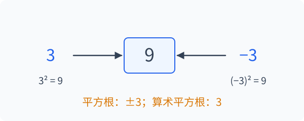
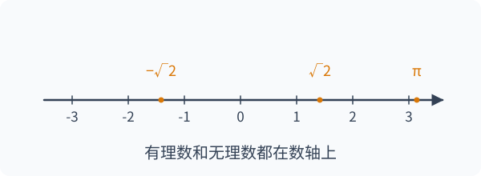
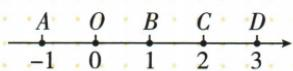

平方与立方从一个数求乘积，开方则从结果反求原数。分清“求全部平方根”与“取非负平方根”，再把数的范围从有理数扩展到实数；比较、估算和计算仍要依据数值及其条件。

<nav class="handbook-nav" aria-label="本章分区">
  <a class="handbook-jump is-knowledge" href="#knowledge">01 · 知识点概念、关系与适用条件</a>
  <a class="handbook-jump is-exam" href="#exam">02 · 考点题目分类和例题</a>
  <a class="handbook-jump is-pitfall" href="#pitfalls">03 · 坑点辨析错因，检查遗漏</a>
</nav>

## 【知识点】理解概念 {#knowledge .handbook-section .is-knowledge}

### 1. 平方根与算术平方根 {#square-roots .knowledge-title}

因为 $3^2=9$、$(-3)^2=9$，所以 $9$ 的==平方根==是 $3$ 和 $-3$，记作 $\pm\sqrt9$

其中非负的那个叫作==算术平方根==，所以 $\sqrt9=3$

| 数 | 平方根 | 算术平方根 |
| --- | --- | --- |
| 正数 $a$ | $\pm\sqrt a$ | $\sqrt a$ |
| $0$ | $0$ | $0$ |
| 负数 | 没有实数平方根 | 没有实数算术平方根 |

一般地，若 $x^2=a$，$x$ 就是 $a$ 的一个平方根

### 2. 立方根 {#cube-roots .knowledge-title}

因为 $2^3=8$、$(-2)^3=-8$，所以 $8$ 的==立方根==是 $2$，$-8$ 的立方根是 $-2$

$$\sqrt[3]8=2,\qquad\sqrt[3]{-8}=-2,\qquad\sqrt[3]0=0$$

每个实数只有一个实数立方根，符号与原数相同；根指数 $3$ 不能省略

### 3. 实数的分类 {#real-classification .knowledge-title}

无限不循环小数叫作==无理数==，如 $\sqrt2$、$\pi$。有理数和无理数统称==实数==

| 实数 | 包含哪些数 |
| --- | --- |
| 有理数 | 整数、有限小数、无限循环小数 |
| 无理数 | 无限不循环小数 |

按正负分类，实数又可分为正实数、$0$、负实数

### 4. 实数与数轴 {#real-properties .knowledge-title}

实数与数轴上的点一一对应，右边的点表示的数更大

相反数、绝对值、倒数和运算法则仍然适用。例如 $-\sqrt2$ 的相反数是 $\sqrt2$，绝对值是 $\sqrt2$

## 【考点】方法与例题 {#exam .handbook-section .is-exam}

### 1. 读清求根对象和题目问法 {#exam-root-object .exam-title}

先圈定“求谁的根”，把对象本身化简；再看是平方根、算术平方根还是立方根。全部平方根与一个非负根的答案形式不同；求边长时还要用实际条件筛选。最后把结果平方或立方回去核对。

<article class="handbook-example" aria-labelledby="example-1">

#### 例题 01 平方根与算术平方根分别填写 {#example-1 .example-heading}

题目

分别求225、$1\frac79$、0.09的平方根和算术平方根。

答案与解析

解析

$225=15^2$；$1\frac79=\frac{16}9=(\frac43)^2$；$0.09=0.3^2$。

| 原数 | 平方根 | 算术平方根 |
| --- | --- | --- |
| 225 | $\pm15$ | 15 |
| $1\frac79$ | $\pm\frac43$ | $\frac43$ |
| 0.09 | $\pm0.3$ | 0.3 |

本题结论

正数的平方根取正负两个；算术平方根只取非负的一个。

</article>

<article class="handbook-example" aria-labelledby="example-2">

#### 例题 02 总面积先分给每个正方形 2024·广东 {#example-2 .example-heading}

题目

完全相同的4个正方形面积之和是100，则每个正方形的边长是（　）。

A. 2

B. 5

C. 10

D. 20

答案与解析

解析

四个完全相同，所以一个正方形的面积为 $100\div4=25$。设边长为 $s$，则 $s^2=25$。代数候选为 $\pm5$，边长必须为正，因此取5。

不能直接对总面积100开方，那求的是面积100的单个正方形的边长。

本题结论

B，边长为5。

</article>

<article class="handbook-example" aria-labelledby="example-3">

#### 例题 03 开立方与反求原数 知识清单例题·合组 {#example-3 .example-heading}

题目

（1）343的立方根是多少？−0.512的立方根是多少？9是哪个数的立方根？

（2）计算 $-\sqrt[3]{-\frac1{27}}$、$\sqrt[3]{0.064}$、$\sqrt[3]{-3\frac38}$、$\sqrt[3]{\frac{10}{27}-5}$。

答案与解析

解析

（1）由 $7^3=343$、$(-0.8)^3=-0.512$，前两空为7、−0.8。9是某数的立方根，原数应为 $9^3=729$。

（2）分别处理根号内外：

$$-\sqrt[3]{-\frac1{27}}=-(-\tfrac13)=\tfrac13;$$
$$\sqrt[3]{0.064}=0.4;\qquad \sqrt[3]{-3\tfrac38}=\sqrt[3]{-\tfrac{27}8}=-\tfrac32;$$
$$\sqrt[3]{\tfrac{10}{27}-5}=\sqrt[3]{-\tfrac{125}{27}}=-\tfrac53.$$

最后一式中的减5也在根号下，必须先合并被开方数。

本题结论

（1）7，−0.8，729；（2）$\frac13,0.4,-\frac32,-\frac53$。

</article>

### 2. 把未知整体的幂单独留下 {#exam-equations .exam-title}

用等式两边同加减、同除非零系数，把方程变成 $X^2=a$ 或 $X^3=a$。$X$ 可以是整个括号。

1. 二次幂先检查右边：正数给两个相反候选，0给一个，负数无实数解。
2. 三次幂对任意实数右边都给唯一候选，不添 $\pm$。
3. 得到括号的值后，继续反求字母；全部候选代回原方程。

<article class="handbook-example" aria-labelledby="example-4">

#### 例题 04 开平方保留两条分支 {#example-4 .example-heading}

题目

求下列各式中的 $x$：

（1）$x^2=361$；（2）$81x^2-49=0$；（3）$(3x-1)^2=25$。

答案与解析

解析

（1）$361=19^2$，所以 $x=\pm19$。

（2）两边加49、再除以81，得 $x^2=\frac{49}{81}$，所以 $x=\pm\frac79$。

（3）先把 $3x-1$ 看作整体：$3x-1=5$ 或 $3x-1=-5$。分别解得 $x=2$ 或 $x=-\frac43$。代回后括号为5或−5，平方都为25。

本题结论

（1）$\pm19$；（2）$\pm\frac79$；（3）$2$ 或 $-\frac43$。

</article>

<article class="handbook-example" aria-labelledby="example-5">

#### 例题 05 开立方不添加负分支 {#example-5 .example-heading}

题目

求下列各式中的 $x$：

（1）$8x^3+27=0$；（2）$(x-1)^3=64$；（3）$3(x-3)^3-24=0$。

答案与解析

解析

（1）先减27再除8，得 $x^3=-\frac{27}8$，故 $x=-\frac32$。

（2）$x-1=\sqrt[3]{64}=4$，所以 $x=5$。

（3）先加24再除3，得 $(x-3)^3=8$；于是 $x-3=2$，$x=5$。

立方在实数范围一一对应，每个整体只取一个值。

本题结论

（1）$-\frac32$；（2）5；（3）5。

</article>

### 3. 由方根反求原数或数量关系 {#exam-reverse .exam-title}

已知方根，就按相应次数乘方恢复被开方数。求出字母后，重新读最后所求，避免把中间结果当答案。两立方根互为相反数时，它们的被开方数也互为相反数；使用分式时另查分母非零。

<article class="handbook-example" aria-labelledby="example-6">

#### 例题 06 已知两种根，求另一个数的平方根 {#example-6 .example-heading}

题目

已知 $2a-1$ 的平方根是 $\pm3$，$3a+b-1$ 的算术平方根是4，求 $a+2b$ 的平方根。

答案与解析

解析

平方根为 $\pm3$，说明原数为9：$2a-1=9$，得 $a=5$。算术平方根为4，说明原数为16：$3a+b-1=16$，代入得 $15+b-1=16$，$b=2$。

于是 $a+2b=5+4=9$。题目最后要求9的平方根，还需写出 $\pm3$。

本题结论

$a+2b$ 的平方根是 $\pm3$。

</article>

<article class="handbook-example" aria-labelledby="example-7">

#### 例题 07 相反的立方根与非零分母 改编，补充条件检查 {#example-7 .example-heading}

题目

若 $\sqrt[3]{1-2x}$ 与 $\sqrt[3]{3y-2}$ 互为相反数，求 $\frac{2x+1}{y}$ 的值，并说明它有意义的条件。

答案与解析

解析

互为相反数的两个数立方后仍互为相反数，所以

$$(1-2x)+(3y-2)=0,\qquad 2x+1=3y.$$

当所求分式有意义，即 $y\ne0$ 时，

$$\frac{2x+1}{y}=\frac{3y}{y}=3.$$

原方根关系本身并不排除 $y=0$：此时取 $x=-\frac12$ 仍符合两个根互反，但所求为 $0/0$，没有意义。非零条件来自所求分式，不是来自立方根。

本题结论

$y\ne0$ 时值为3；$y=0$ 时所求无意义。

</article>

### 4. 利用非负性逐项确定零 {#exam-nonnegative .exam-title}

先逐项说明非负，再利用“和为0”推每项为0。算术平方根存在时输出非负，平方也非负；立方根却可以为负，不能仅因都带根号就照搬这一方法。

<article class="handbook-example" aria-labelledby="example-8">

#### 例题 08 算术根与平方的零和条件 第（2）问：2024·四川成都·合组 {#example-8 .example-heading}

题目

（1）若 $\sqrt{x-1}+\sqrt{y+2}=0$，则 $(x+y)^{2025}$ 等于（　）。

A. −1

B. 1

C. $3^{2025}$

D. $-3^{2025}$

（2）若 $m,n$ 为实数，且 $(m+4)^2+\sqrt{n-5}=0$，求 $(m+n)^2$。

答案与解析

解析

（1）两算术根均非负，和为0，所以 $x-1=0,y+2=0$，得 $x=1,y=-2$。$x+y=-1$，2025为奇数，因此结果为−1，选A。

（2）两项同样非负，所以 $m+4=0,n-5=0$，得 $m=-4,n=5$。$(m+n)^2=1^2=1$。$m$ 为负不矛盾，非负的是平方项而不是字母本身。

本题结论

（1）A；（2）1。

</article>

### 5. 根据平方或立方倍率移动小数点 {#exam-scale .exam-title}

先匹配被开方数的倍率，再决定根扩大多少。若 $r^2=a$，则 $(100r)^2=10000a$；若 $r^3=a$，则 $(10r)^3=1000a$。所以平方根“原数移动两位、根移动一位”，立方根“三位对应一位”，方向一致。近似输入缩放后仍用近似号。

<article class="handbook-example" aria-labelledby="example-9">

#### 例题 09 同一个23700，根次数不同 知识清单例题·合组 {#example-9 .example-heading}

题目

（1）已知 $\sqrt{2.37}\approx1.539$，$\sqrt{23.7}\approx4.868$，则 $\sqrt{23700}$ 约等于（　）。

A. 15.39

B. 153.9

C. 48.68

D. 486.8

（2）已知 $\sqrt[3]{2.37}\approx1.333$，$\sqrt[3]{23.7}\approx2.872$，则 $\sqrt[3]{23700}$ 约等于（　）。

A. 28.72

B. 287.2

C. 13.33

D. 133.3

答案与解析

解析

（1）$23700=2.37\times100^2$，所以 $\sqrt{23700}=100\sqrt{2.37}\approx153.9$，选B。

（2）$23700=23.7\times10^3$，所以 $\sqrt[3]{23700}=10\sqrt[3]{23.7}\approx28.72$，选A。

应先看哪个已知数能通过完整平方或立方倍率达到目标，不能看数字相似就选。

本题结论

（1）B；（2）A。

</article>

### 6. 先化简，再分类或计算 {#exam-classify-calculate .exam-title}

分类看数值，不看外观；运算先处理方根、绝对值，再用分配律和同类项合并。准确根式中途不任意换近似小数，除数非零与根号有意义的条件始终保留。

<article class="handbook-example" aria-labelledby="example-10">

#### 例题 10 带根号的选项未必无理 2024·山东烟台 {#example-10 .example-heading}

题目

下列实数中的无理数是（　）。

A. $\frac23$

B. 3.14

C. $\sqrt{15}$

D. $\sqrt[3]{64}$

答案与解析

解析

A是整数之比；B是有限小数 $157/50$；D可化为整数4，都属于有理数。15不是完全平方正整数，$\sqrt{15}$ 是无理数。

本题结论

C。

</article>

<article class="handbook-example" aria-labelledby="example-11">

#### 例题 11 沿用相反数、绝对值与倒数 {#example-11 .example-heading}

题目

求 $-\sqrt5$ 的相反数、绝对值和倒数。

答案与解析

解析

$-\sqrt5<0$，取相反数与取绝对值都得到 $\sqrt5$；两个答案相同是由原数为负造成的，不是定义相同。

倒数为 $-1/\sqrt5$。分子分母同时乘非零的 $\sqrt5$，得 $-\sqrt5/5$，乘回原数为1。

本题结论

依次为 $\sqrt5,\sqrt5,-\frac{\sqrt5}5$。

</article>

<article class="handbook-example" aria-labelledby="example-12">

#### 例题 12 根式中的分配律 {#example-12 .example-heading}

题目

计算 $\sqrt[3]{-27}+|-\sqrt2|+\sqrt2(2-\sqrt2)$。

答案与解析

解析

先求根和绝对值，再分配乘法：

$$\begin{aligned}
&\sqrt[3]{-27}+|-\sqrt2|+\sqrt2(2-\sqrt2)\\
&=-3+\sqrt2+2\sqrt2-(\sqrt2)^2\\
&=-3+3\sqrt2-2=3\sqrt2-5.
\end{aligned}$$

$\sqrt2$ 和 $2\sqrt2$ 可以合并系数，常数−3、−2另行相加，不能把它们塞进根号。

本题结论

$3\sqrt2-5$。

</article>

### 7. 用相邻平方数或立方数夹住范围 {#exam-bounds .exam-title}

先找相邻整数的平方或立方，再夹住根的范围。表达式含多个根时，尽可能先准确化简再估值；只对每项粗估后相减，可能得到过宽区间。

若要求四舍五入到某位，夹住相邻候选还不够，要检验中点在哪侧。若要求区间内整数个数，则检查两个端点是否允许取到。

<article class="handbook-example" aria-labelledby="example-13">

#### 例题 13 数轴上的根式位置 {#example-13 .example-heading}

题目

数轴上的 $A,O,B,C,D$ 分别表示 $-1,0,1,2,3$。表示 $\sqrt5-1$ 的点 $P$ 应落在（　）。

A. 线段 $AO$ 上

B. 线段 $BO$ 上

C. 线段 $BC$ 上

D. 线段 $CD$ 上

答案与解析

解析

$2^2=4<5<9=3^2$，且两端非负，所以 $2<\sqrt5<3$。整个不等式减1得 $1<\sqrt5-1<2$。因此点在 $BC$ 上，不在端点。

本题结论

C。

</article>

<article class="handbook-example" aria-labelledby="example-14">

#### 例题 14 先合并，再估计区间 2024·重庆A {#example-14 .example-heading}

题目

已知 $m=\sqrt{27}-\sqrt3$，则实数 $m$ 的范围是（　）。

A. $2<m<3$

B. $3<m<4$

C. $4<m<5$

D. $5<m<6$

答案与解析

解析

$3\sqrt3$ 非负且平方为27，所以 $\sqrt{27}=3\sqrt3$。于是 $m=2\sqrt3$，它非负且平方为12，即 $m=\sqrt{12}$。

$3^2=9<12<16=4^2$，所以 $3<m<4$。

本题结论

B。

</article>

<article class="handbook-example" aria-labelledby="example-15">

#### 例题 15 估到指定数位还要判断中点 {#example-15 .example-heading}

题目

估算：（1）$\sqrt7$，精确到0.01；（2）$\sqrt[3]{100}$，精确到0.1。

答案与解析

解析

（1）逐层夹逼：

$$2^2<7<3^2;\quad 2.6^2=6.76<7<7.29=2.7^2;$$
$$2.64^2=6.9696<7<7.0225=2.65^2.$$

所以 $2.64<\sqrt7<2.65$。检验中点：$2.645^2=6.996025<7$，故 $\sqrt7>2.645$，四舍五入为2.65。

（2）$4^3=64<100<125=5^3$，再算 $4.6^3=97.336<100<103.823=4.7^3$。中点 $4.65^3=100.544625>100$，所以根小于4.65，应四舍五入为4.6。

本题结论

$\sqrt7\approx2.65$；$\sqrt[3]{100}\approx4.6$。

</article>

<article class="handbook-example" aria-labelledby="example-16">

#### 例题 16 严格区间内有多少个整数 2024·河北 {#example-16 .example-heading}

题目

已知 $a,b,n$ 均为正整数。

（1）若 $n<\sqrt{10}<n+1$，求 $n$。

（2）若 $n-1<\sqrt a<n$，$n<\sqrt b<n+1$，满足条件的 $a$ 的个数总比 $b$ 的个数少几个？

答案与解析

解析

（1）$9<10<16$，所以 $3<\sqrt{10}<4$，$n=3$。

（2）两边非负，平方保持顺序：

$$(n-1)^2<a<n^2,\qquad n^2<b<(n+1)^2.$$

整数端点之间且不含两端，整数个数为“右端−左端−1”。因此 $a$ 有 $n^2-(n-1)^2-1=2n-2$ 个，$b$ 有 $(n+1)^2-n^2-1=2n$ 个，相差2。

$n=1$ 时第一个区间没有正整数，第二个满足 $1<b<4$，只有2、3，共2个，同样成立。

本题结论

（1）3；（2）2个。

</article>

### 8. 正无理数的整数部分与小数部分 {#exam-integer-part .exam-title}

把整个正数表达式夹在相邻整数之间，较小整数是整数部分；用原数减整数部分得到小数部分，并检验它在0与1之间。根号外有减号时，先改变夹逼方向再平移，不能只对根号内一项取整。

<article class="handbook-example" aria-labelledby="example-17">

#### 例题 17 先确定整个差所在的区间 {#example-17 .example-heading}

题目

$a,b$ 分别是 $6-\sqrt{13}$ 的整数部分与小数部分，求 $2a-b$。

答案与解析

解析

$9<13<16$，所以 $3<\sqrt{13}<4$。取相反数得 $-4<-\sqrt{13}<-3$，再加6：

$$2<6-\sqrt{13}<3.$$

所以 $a=2$，$b=(6-\sqrt{13})-2=4-\sqrt{13}$，且 $0<b<1$。

$$2a-b=4-(4-\sqrt{13})=\sqrt{13}.$$

代入减去的整个 $b$ 时要带括号。

本题结论

$\sqrt{13}$。

</article>

### 9. 比较实数：先判符号，再选方法 {#exam-compare .exam-title}

| 两数的条件 | 可用方法 | 依据 |
| --- | --- | --- |
| 都非负，平方后简单 | 比较平方 | 非负范围平方保持顺序 |
| 都负 | 比绝对值，再反向 | 数轴上越远离0越小 |
| 异号 | 直接看正负 | 正数大于负数 |
| 作差后易判符号 | 前数减后数 | 差正则前数大，差负则前数小 |

近似结果相同不说明原数相等。准确比较尽量保留根式和分数。

<article class="handbook-example" aria-labelledby="example-18">

#### 例题 18 平方比较与作差比较 第（3）问：2024·安徽，去语境改编·合组 {#example-18 .example-heading}

题目

比较：（1）$\sqrt{65}$ 与8；（2）$\frac{\sqrt5-1}2$ 与0.5；（3）$\sqrt{10}$ 与 $\frac{22}7$。

答案与解析

解析

（1）两数都正，平方分别为65、64，故 $\sqrt{65}>8$。

（2）前数减后数：

$$\frac{\sqrt5-1}2-\frac12=\frac{\sqrt5-2}2>0,$$

因为 $\sqrt5>\sqrt4=2$。所以前数大。

（3）两数均正，平方分别为 $10=\frac{490}{49}$ 和 $\frac{484}{49}$，前者大，故 $\sqrt{10}>\frac{22}7$。

本题结论

三组均为前数大于后数。

</article>

## 【坑点】辨析与自查 {#pitfalls .handbook-section .is-pitfall}

### 1. 平方相等，不代表原数相等 {#pitfall-two-roots .pitfall-title}

常见错法： $x^2=0.81$ 只写 $x=0.9$；$a^2=(-3)^2$ 只写 $a=-3$。

错在何处： 平方把相反数合并成同一个结果，逆推时应把两个方向恢复出来。

自查： 把相反数代回平方。$(-0.9)^2=0.81$，所以前题有 $x=\pm0.9$；$3^2=(-3)^2=9$，所以后题有 $a=\pm3$。只有题意另限非负或长度时才能筛去负解，参看[正方形例题](#example-2)。

### 2. “根号四的平方根”包含两次操作 {#pitfall-object .pitfall-title}

常见错法： 看见4就直接答 $\pm2$。

错在何处： “的平方根”作用于整个 $\sqrt4$，不是仅作用于根号下的4。

自查： 先算对象，再把最终答案平方回对象检查。

<article class="handbook-example is-pitfall" aria-labelledby="pitfall-1">

#### 辨析 01 先算对象，再求它的根 改编辨析 {#pitfall-1 .example-heading}

题目

求 $\sqrt4$ 的平方根。有人答 $\pm2$，这个答案对吗？

答案与解析

解析

对象 $\sqrt4=2$，所以应求2的平方根，结果为 $\pm\sqrt2$。检验：$(\pm\sqrt2)^2=2$；而 $(\pm2)^2=4$，不是所求对象2。

本题结论

不对，正确结果为 $\pm\sqrt2$。

</article>

### 3. 无理数的判据不是根号或小数点 {#pitfall-classification .pitfall-title}

常见错法： 带根号就判无理，无限小数就判无理，或把 $\sqrt{-2}$ 叫负无理数。

错在何处： 这三种判断分别忽略了可化简的根、循环小数及实数意义的前提。

自查： 依次问“有实数意义吗”“能化简吗”“能写成整数之比吗”。$\sqrt[3]{64}=4$、$0.\dot3=\frac13$ 都有理；$\sqrt{-2}$ 无实数意义；$-\sqrt2$ 才是负无理数。参看[分类例题](#example-10)。

### 4. 夹住范围后，不能一律取左端 {#pitfall-rounding .pitfall-title}

常见错法： 知道 $2.64<\sqrt7<2.65$ 就写2.64。

错在何处： 这相当于截去后面的位，而题目要求四舍五入；必须知道原数位于2.645哪一侧。

自查： 把相邻候选的中点平方或立方，与被开方数比较。无需把无穷小数一直算下去，只须找到足以决定舍入的依据。完整过程见[估值例题](#example-15)。

[回看：有理数的乘方](../rational/powers.md) · [回看：近似数的精确度](../rational/scientific-notation.md)
