不等式的答案往往不是一个数，而是一段范围。先弄清边界能不能取，再看哪些值同时满足条件；遇到件数、人数等问题，还要在这个范围内选整数。

<nav class="handbook-nav" aria-label="本章分区">
  <a class="handbook-jump is-knowledge" href="#knowledge">01 · 知识点概念、关系与适用条件</a>
  <a class="handbook-jump is-exam" href="#exam">02 · 考点题目分类和例题</a>
  <a class="handbook-jump is-pitfall" href="#pitfalls">03 · 坑点辨析错因，检查遗漏</a>
</nav>

## 【知识点】概念与依据 {#knowledge .handbook-section .is-knowledge}

### 1. 不等式与解集 {#definition .knowledge-title}

用不等号表示数量关系的式子叫作==不等式==。使它成立的未知数的值是它的解，所有解组成==解集==

例如 $x+1>3$ 的解集是 $x>2$

| 用语 | 符号 |
| --- | --- |
| 大于、超过 | $>$ |
| 小于、不足 | $<$ |
| 至少、不小于 | $\ge$ |
| 至多、不超过 | $\le$ |

只含一个未知数、未知数的最高次数为 $1$、两边都是整式的不等式，叫作==一元一次不等式==

### 2. 不等式的性质 {#properties .knowledge-title}

1. 两边加或减同一个数或式子，不等号方向不变
2. 两边乘或除以同一个正数，不等号方向不变
3. 两边乘或除以同一个负数，不等号方向改变

例如 $-2x<6$，两边除以 $-2$，得到 $x>-3$

### 3. 用数轴表示解集 {#number-line .knowledge-title}

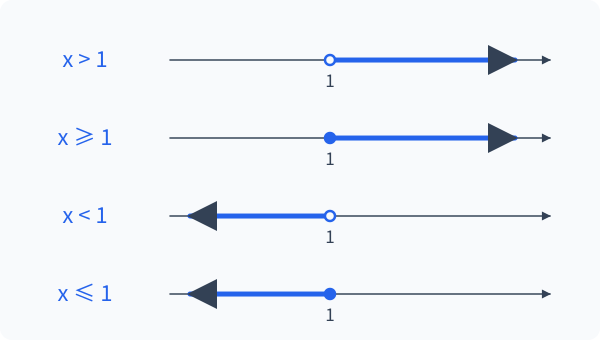

- 含等号画实心点，不含等号画空心点
- 大于向右，小于向左

### 4. 一元一次不等式组 {#intersection .knowledge-title}

不等式组的解必须同时满足每个不等式，因此取各解集的公共部分

例如 $\begin{cases}x>1\\x<4\end{cases}$ 的解集是 $1<x<4$

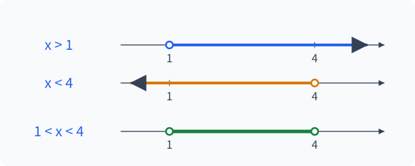

没有公共部分时，不等式组无解；有等号时，分别检查端点能否取到

## 【考点】方法与例题 {#exam .handbook-section .is-exam}

### 1. 整数条件与实际边界 {#integer-models .exam-title}

代数范围确定后，实际问题往往还有“非负”“正数”“整数”等限制。

- 求最大整数：从上界向内取，不是四舍五入；若上界本身是整数，还要看是否允许取等号。
- 求最小整数：从下界向内取；“超过”与“达到”可能相差一个单位。
- 预算限制通常是费用不超过预算；运力限制通常是容量不少于需求。
- “最多可装”是容量上限；“恰好满载”是等式。两种条件不能互换。

若想让某个区间内恰好有若干整数，先写出要保留的整数，再让相邻整数被排除。这样才能确定参数端点是否包含。

### 2. 把文字与式子翻译准确 {#translate .exam-title}

先找比较对象，再确定运算顺序，最后选不等号。出现“和的百分之几”等说法，括号应包住整个和；不要只对其中一项乘百分数。

<article class="handbook-example" aria-labelledby="example-1">

#### 例题 01 识别不等式与一元一次不等式 知识清单例题·合组 {#example-1 .example-heading}

题目

（1）下列式子中，不等式有几个？

① $-3<0$；② $4x+3y>0$；③ $x=3$；④ $x^2+xy+y^2$；⑤ $x\ne5$；⑥ $x+2>y+3$。

A. 5

B. 4

C. 3

D. 1

（2）下列哪一个是一元一次不等式？

A. $x+y\le0$

B. $x^2\ge0$

C. $\dfrac{x}{2}>3+x$

D. $\dfrac1x<0$

答案与解析

解析

（1）①②⑤⑥用不等号连接两个数量，是不等式。③是等式；④只是代数式，没有比较关系。

（2）A 含两个未知数；B 的未知数次数为 $2$；D 的未知数在分母中。C 只有未知数 $x$，两边均为整式，最高次数为 $1$。

本题结论

（1）4 个，选 B。（2）选 C。

</article>

<article class="handbook-example" aria-labelledby="example-2">

#### 例题 02 由关键词列不等式 知识清单例题 {#example-2 .example-heading}

题目

用不等式表示下列关系。

（1）$x$ 与 $1$ 的和是正数；（2）$y$ 的 $2$ 倍加 $1$ 大于 $3$；（3）$x$ 的三分之一与 $x$ 的 $2$ 倍的和是非正数；（4）$c$ 与 $4$ 的和的 $30\%$ 不大于 $-2$；（5）$x$ 的一半加 $2$ 至多是 $5$。

答案与解析

解析

正数对应 $>0$，非正数对应 $\le0$；“不大于”“至多”都允许相等。第（4）问的百分数作用于 $c+4$ 整体。

本题结论

（1）$x+1>0$；（2）$2y+1>3$；（3）$\dfrac{x}{3}+2x\le0$；（4）$0.3(c+4)\le-2$；（5）$\dfrac{x}{2}+2\le5$。

</article>

### 3. 用基本性质判断大小 {#compare .exam-title}

能看成同加、同乘时，直接检查操作及乘数符号；两个复杂式子共有很多项时，作差往往更简洁。作差后判断正、零、负，分别对应前者大、相等、前者小。

<article class="handbook-example" aria-labelledby="example-3">

#### 例题 03 同加与同乘的方向 知识清单例题·合组；第（2）问 2024 苏州 {#example-3 .example-heading}

题目

（1）已知 $a>b$，在横线上填入不等号。

$a+2$ ___ $b+2$；$a-3$ ___ $b-3$；$-4a$ ___ $-4b$；$\dfrac a2$ ___ $\dfrac b2$。

（2）已知 $a>b-1$，下列哪一个一定成立？

A. $a+1<b$

B. $a-1<b$

C. $a>b$

D. $a+1>b$

答案与解析

解析

（1）前两项同加减一个数，方向不变；第三项同乘负数 $-4$，方向反转；第四项同除正数 $2$，方向不变。

（2）原不等式两边加 $1$，直接得到 $a+1>b$。不能把右边的 $-1$ 无条件删掉。

本题结论

（1）依次为 $>$、$>$、$<$、$>$。（2）选 D。

</article>

<article class="handbook-example" aria-labelledby="example-4">

#### 例题 04 同登一级台阶 2024 吉林长春 {#example-4 .example-heading}

题目

两名同学原来站在同一水平面上，身高分别为 $a,b$，且 $a>b$；两人又同时站上高度为 $c$ 的台阶，如图。这个情境对应哪条性质？

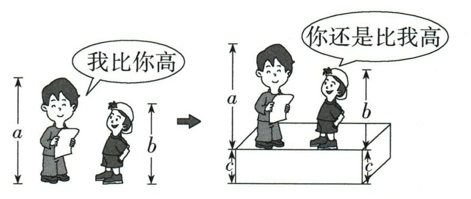

A. 若 $a>b$，则 $a+c>b+c$

B. 若 $a>b$、$b>c$，则 $a>c$

C. 若 $a>b$、$c>0$，则 $ac>bc$

D. 若 $a>b$、$c>0$，则 $\dfrac ac>\dfrac bc$

答案与解析

解析

登上台阶后，两人头顶离原地面的高度分别为 $a+c$、$b+c$。增加的是相同高度，不是把身高乘以某个倍数，因此对应同加性质。

本题结论

选 A。

</article>

<article class="handbook-example" aria-labelledby="example-5">

#### 例题 05 两个代数式怎样比较 知识清单例题·改编，明确实数范围 {#example-5 .example-heading}

题目

比较 $4+3a^2-2b+b^2$ 与 $3a^2-2b+1$ 的大小，其中 $a,b$ 为实数。

答案与解析

解析

前式减后式，共有项抵消：

$$
(4+3a^2-2b+b^2)-(3a^2-2b+1)=b^2+3.
$$

因为 $b^2\ge0$，所以差至少为 $3$，始终为正。

本题结论

$4+3a^2-2b+b^2>3a^2-2b+1$。

</article>

### 4. 解不等式并表示范围 {#solve .exam-title}

::: steps
1. 去分母：选择正的公倍数可避免这一步改变方向，每一项都要乘。
2. 去括号、移项、合并同类项，整理为 $ax>b$ 等形式。
3. 看 $a$ 的符号，再把未知数系数化为 $1$。
4. 用原不等式检验边界，按等号和方向画数轴。
:::

<article class="handbook-example" aria-labelledby="example-6">

#### 例题 06 分母为常数的不等式 知识清单例题 {#example-6 .example-heading}

题目

解不等式 $\dfrac{3x-2}{5}\ge\dfrac{2x+1}{3}-1$，并在数轴上表示解集。

答案与解析

解析

两边同乘正数 $15$：

$$3(3x-2)\ge5(2x+1)-15.$$

去括号得 $9x-6\ge10x-10$，移项得 $-x\ge-4$。同除 $-1$ 时方向反转，得 $x\le4$。等号可以取，端点 $4$ 为实心，向左表示。

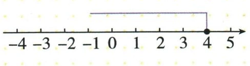

本题结论

解集为 $x\le4$，数轴表示见图。

</article>

<article class="handbook-example" aria-labelledby="example-7">

#### 例题 07 检查数轴上的端点 2024 湖北 {#example-7 .example-heading}

题目

不等式 $x+1\ge2$ 的解集在数轴上表示正确的是哪一个？

<figure class="handbook-option">

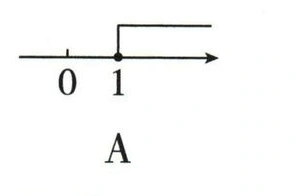

</figure>

<figure class="handbook-option">

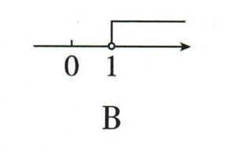

</figure>

<figure class="handbook-option">

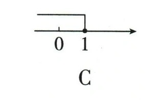

</figure>

<figure class="handbook-option">

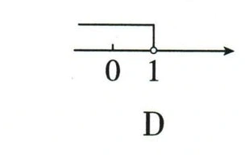

</figure>

答案与解析

解析

两边减 $1$，得 $x\ge1$。端点 $1$ 应实心，取值向右，对应 A。

本题结论

选 A。

</article>

<article class="handbook-example" aria-labelledby="example-8">

#### 例题 08 在解集中挑出整数 知识清单例题·合组 {#example-8 .example-heading}

题目

（1）求 $\dfrac{1+x}{2}\ge\dfrac{2x-1}{3}$ 的所有正整数解。

（2）求 $\dfrac{1+x}{3}\ge x-1$ 的所有正整数解。（2024 江苏盐城）

（3）求不等式组 $\begin{cases}2x-6\le0,\\x<\dfrac{4x-1}{2}\end{cases}$ 的所有整数解，并求它们的和。（2024 江苏扬州）

答案与解析

解析

（1）同乘 $6$ 得 $3+3x\ge4x-2$，所以 $x\le5$。结合正整数条件，取 $1,2,3,4,5$。

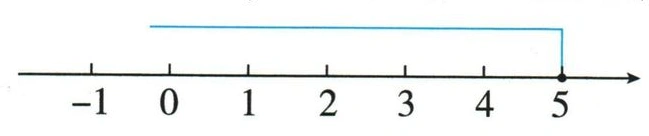

（2）$1+x\ge3x-3$，所以 $x\le2$，正整数为 $1,2$。

（3）两式分别给出 $x\le3$ 和 $x>\dfrac12$，交集为 $\dfrac12<x\le3$。其中整数为 $1,2,3$，和为 $6$。

本题结论

（1）$1,2,3,4,5$；（2）$1,2$；（3）$1,2,3$，和为 $6$。

</article>

### 5. 求交集与连写不等式 {#systems .exam-title}

先分别求解，再取公共部分。用数轴辅助时，可把各范围画在不同高度；最后只保留重叠部分。若是连写不等式，也可以拆为两个条件求交集，或对三部分同时作等价运算。

<article class="handbook-example" aria-labelledby="example-9">

#### 例题 09 两个图示选择 知识清单例题·合组 {#example-9 .example-heading}

题目

（1）不等式组 $\begin{cases}x+1>0,\\\dfrac{3x+1}{2}\ge2x-1\end{cases}$ 的解集对应哪幅图？

<figure class="handbook-option">

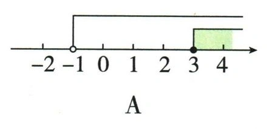

</figure>

<figure class="handbook-option">

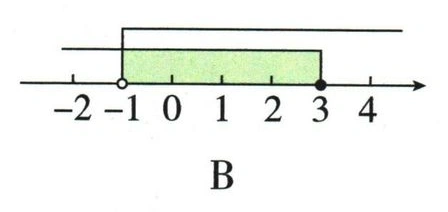

</figure>

<figure class="handbook-option">

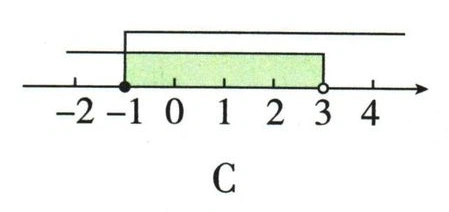

</figure>

<figure class="handbook-option">

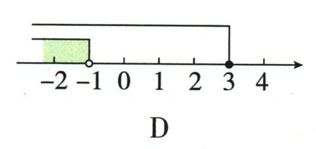

</figure>

（2）不等式组 $\begin{cases}3x-2<2x+1,\\x\ge2\end{cases}$ 的解集对应哪幅图？（2024 四川遂宁）

<figure class="handbook-option">

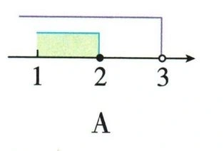

</figure>

<figure class="handbook-option">

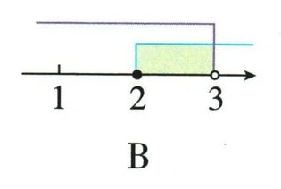

</figure>

<figure class="handbook-option">

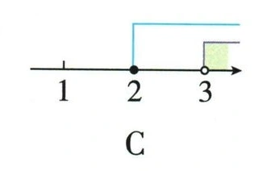

</figure>

<figure class="handbook-option">

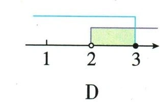

</figure>

答案与解析

解析

（1）第一式得 $x>-1$；第二式得 $3x+1\ge4x-2$，即 $x\le3$。交集 $-1<x\le3$，左空右实，选 B。

（2）第一式得 $x<3$，与 $x\ge2$ 取交集为 $2\le x<3$，左实右空，选 B。

本题结论

（1）$-1<x\le3$，选 B。（2）$2\le x<3$，选 B。

</article>

<article class="handbook-example" aria-labelledby="example-10">

#### 例题 10 连写式中的三个部分 知识清单例题 {#example-10 .example-heading}

题目

解不等式 $-1<\dfrac{1-2x}{4}\le2$。

答案与解析

解析

方法一：三部分同时变形。 同乘 $4$：$-4<1-2x\le8$；同减 $1$：$-5<-2x\le7$；同除 $-2$，两个方向都反转：$\dfrac52>x\ge-\dfrac72$。

方法二：拆开求交集。 左侧条件给出 $x<\dfrac52$，右侧条件给出 $x\ge-\dfrac72$。两者同时成立。

本题结论

$-\dfrac72\le x<\dfrac52$。

</article>

### 6. 从解集反求参数 {#parameters .exam-title}

参数题先看它控制什么：乘除方向、上界、下界还是区间长度。问“有正数解”只要求范围与正半轴有交集，并不是要求全部解都为正。问“解集不变”，另一个条件只能比原边界宽或相同。

<article class="handbook-example" aria-labelledby="example-11">

#### 例题 11 方向与存在正数解 知识清单例题·合组改编 {#example-11 .example-heading}

题目

（1）关于 $x$ 的不等式 $(m-6)x>5$ 的解集为 $x<\dfrac5{m-6}$，求 $m$ 的范围。

（2）若关于 $x$ 的不等式 $m-\dfrac x2\le1-x$ 有正数解，写出一个符合条件的 $m$，并说明所有可能的范围。（2024 山东烟台题，补充求范围）

答案与解析

解析

（1）系数化为 $1$ 后不等号反向，说明 $m-6<0$；若 $m=6$，原式是 $0>5$，无解，也不能写题中的分式。

（2）移项得 $\dfrac x2\le1-m$，即 $x\le2-2m$。要能选到 $x>0$，上界必须严格大于 $0$，所以 $m<1$。例如 $m=0$ 时，$0<x\le2$ 中的数都可取。

本题结论

（1）$m<6$。（2）例如 $m=0$；所有可能值为 $m<1$。

</article>

<article class="handbook-example" aria-labelledby="example-12">

#### 例题 12 无解与保持原解集 知识清单例题·合组 {#example-12 .example-heading}

题目

（1）不等式组 $\begin{cases}5-3x\ge-1,\\a-x<0\end{cases}$ 无解，求 $a$ 的范围。

（2）不等式组 $\begin{cases}2x-1<5,\\x<m+1\end{cases}$ 的解集为 $x<3$，求 $m$ 的范围。（2024 四川南充）

A. $m>2$

B. $m\ge2$

C. $m<2$

D. $m\le2$

答案与解析

解析

（1）两个条件分别为 $x\le2$、$x>a$。只有当 $a\ge2$ 时没有公共部分；特别地 $a=2$ 时，$x\le2$ 与 $x>2$ 也不相交。

（2）第一式给出 $x<3$。第二个上界不能更小，需 $m+1\ge3$，即 $m\ge2$。取等时两个范围恰好一致。

本题结论

（1）$a\ge2$。（2）$m\ge2$，选 B。

</article>

<article class="handbook-example" aria-labelledby="example-13">

#### 例题 13 恰好有两个整数解 知识清单例题 {#example-13 .example-heading}

题目

关于 $x$ 的不等式组 $\begin{cases}\dfrac{2x-1}{3}<3,\\3x-a>0\end{cases}$ 恰好有两个整数解，求 $a$ 的范围。

答案与解析

解析

第一式得 $x<5$，第二式得 $x>\dfrac a3$，所以解集为 $\dfrac a3<x<5$。上界固定且不含 $5$，若恰有两个整数，只能是 $3,4$。

要保留 $3$，需 $\dfrac a3<3$；要排除 $2$，需 $\dfrac a3\ge2$。注意左端为严格不等号，等于 $2$ 时已经排除了整数 $2$。

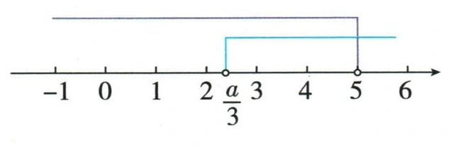

本题结论

$2\le\dfrac a3<3$，即 $6\le a<9$。

</article>

### 7. 积分、预算与整数最值 {#applications .exam-title}

先用一个变量表达其余数量，再根据“超过”“不超过”等词列约束。计算后同时检查总数限制与整数条件；得到最值后代回，再试相邻整数，可以确认边界没有取错。

<article class="handbook-example" aria-labelledby="example-14">

#### 例题 14 同一计分规则中的方程与不等式 知识清单例题·合组 {#example-14 .example-heading}

题目

（1）一次安全知识竞赛有 $20$ 道题，答对一题得 $5$ 分，答错或不答一题扣 $3$ 分。小李得 $60$ 分，答对多少题？小王得分在 $75$ 分至 $85$ 分之间（含两端），答对多少题？

（2）另一场竞赛有 $25$ 道题，答对得 $4$ 分，答错或不答扣 $2$ 分。要使得分超过 $70$ 分，至少答对多少题？

答案与解析

解析

（1）设答对 $x$ 题，则其他为 $20-x$ 题，总分 $5x-3(20-x)=8x-60$。小李满足 $8x-60=60$，得 $x=15$。小王满足 $75\le8x-60\le85$，得 $\dfrac{135}{8}\le x\le\dfrac{145}{8}$，整数为 $17,18$，对应得分 $76,84$。

（2）设答对 $y$ 题，$4y-2(25-y)>70$，所以 $6y>120$，即 $y>20$。最小整数为 $21$；答对 $20$ 题只有 $70$ 分，不满足“超过”。

本题结论

（1）小李 15 题；小王 17 题或 18 题。（2）至少 21 题。

</article>

<article class="handbook-example" aria-labelledby="example-15">

#### 例题 15 固定总额下能买多少 知识清单例题·合组 {#example-15 .example-heading}

题目

（1）用 $40$ 元买单价 $6$ 元的笔记本和单价 $2.2$ 元的笔。已经买了 $7$ 支笔，最多还能买几本笔记本？

A. 5

B. 4

C. 3

D. 2

（2）购买水基型与干粉型灭火器共 $50$ 个，单价分别为 $540$ 元、$380$ 元，总费用不超过 $21000$ 元。水基型最多买多少个？此时干粉型多少个？（2024 山西）

答案与解析

解析

（1）设笔记本 $x$ 本，$6x+2.2\times7\le40$，所以 $x\le4.1$。取非负整数，最多 $4$ 本。

（2）设水基型 $x$ 个，干粉型 $50-x$ 个。$540x+380(50-x)\le21000$，得 $160x\le2000$，即 $x\le12.5$。最大整数为 $12$，干粉型 $38$ 个。费用 $20920$ 元；若水基型买 $13$ 个，费用 $21080$ 元，超预算。

本题结论

（1）4 本，选 B。（2）水基型 12 个，干粉型 38 个。

</article>

<article class="handbook-example" aria-labelledby="example-16">

#### 例题 16 先求单价，再使用预算 2024 湖南长沙·情境缩写 {#example-16 .example-heading}

题目

某店购买湘绣 A、B 两种产品：买 $1$ 件 A 和 $2$ 件 B 共需 $700$ 元，买 $2$ 件 A 和 $3$ 件 B 共需 $1200$ 元。

（1）两种产品的单价各是多少？

（2）计划购买两种产品共 $200$ 件，总费用不超过 $50000$ 元，最多购买多少件 A？此时 B 有多少件？

答案与解析

解析

（1）设 A、B 单价分别为 $a,b$ 元，则 $a+2b=700$、$2a+3b=1200$。第一式乘 $2$ 减第二式得 $b=200$，代回得 $a=300$。

（2）设 A 为 $x$ 件，B 为 $200-x$ 件。$300x+200(200-x)\le50000$，得 $x\le100$，结合 $0\le x\le200$ 且为整数，最大取 $100$。

本题结论

（1）A 每件 300 元，B 每件 200 元。（2）A 最多 100 件，此时 B 为 100 件。

</article>

### 8. 分段优惠先分段，再比较 {#piecewise .exam-title}

“满额后仅超出部分优惠”不同于“达到门槛后全部优惠”。先按原价总额所在区间写费用，再作差；若在某一段求出的交点不属于该段，不能当成有效分界。

<article class="handbook-example" aria-labelledby="example-17">

#### 例题 17 两家书店的优惠 知识清单例题·改编，明确零额边界 {#example-17 .example-heading}

题目

甲书店所有图书按原价的 $80\%$ 出售。乙书店原价总额不超过 $100$ 元的部分按原价，超出 $100$ 元的部分按原价的 $60\%$ 出售。设所购图书原价总额为 $x$ 元，$x\ge0$。

（1）分别写出两家实际付款金额。

（2）原价总额不同时，去哪家更省钱？

答案与解析

解析

（1）甲的费用 $A(x)=0.8x$。乙的费用

$$B(x)=\begin{cases}x,&0\le x\le100,\\100+0.6(x-100)=0.6x+40,&x>100.\end{cases}$$

（2）当 $0<x\le100$，$0.8x<x$，甲便宜。超过 $100$ 元时，比较差：$A-B=0.2x-40$。差在 $x<200$ 时为负、$x=200$ 时为零、$x>200$ 时为正。把这一结果与低额区间合并；另检查 $x=0$，两家费用都为 $0$。

本题结论

甲：$0.8x$；乙：$x\le100$ 时为 $x$，$x>100$ 时为 $0.6x+40$。$0<x<200$ 选甲；$x=200$ 两家相同；$x>200$ 选乙；$x=0$ 都为 $0$。

</article>

## 【坑点】错因与边界 {#pitfalls .handbook-section .is-pitfall}

### 1. 一个解不等于全部解 {#pit-solution .pitfall-title}

把满足条件的一个数写成“解集”，会遗漏其他解。相反，写出一个范围时，也不应把它称为一个具体数值解。下面把原题中容易含糊的说法明确化后辨析。

<article class="handbook-example is-pitfall" aria-labelledby="pitfall-1">

#### 辨析 01 四种说法逐项检查 知识清单原题改编·明确“一个解”的表述 {#pitfall-1 .example-heading}

题目

对于不等式 $3x\ge9$，判断下列说法。

① 解集是 $\{3\}$；② 只有 $x=3$ 满足条件；③ $x=3$ 是一个解；④ $x\ge3$ 表示一个具体的数值解。

答案与解析

解析

原不等式同除正数 $3$，得全部范围 $x\ge3$。$3$ 确实满足，但 $4$、$3.5$ 等也满足。因此①②错，③对。④所写是整个解集，不是某一个具体数值，所以也错。

本题结论

①错；②错；③对；④错。只有③正确。

</article>

### 2. 含字母的乘除先判符号 {#pit-sign .pitfall-title}

不要把“平方非负”误当“平方为正”。是否为零，可能由题目的严格不等式排除，也可能没有排除；这决定能否约去平方因子以及是否仍保持严格不等号。

<article class="handbook-example is-pitfall" aria-labelledby="pitfall-2">

#### 辨析 02 四个推断是否成立 知识清单例题 {#pitfall-2 .example-heading}

题目

判断下列推断是否一定正确，并说明理由。

① $ac^2>bc^2\Rightarrow a>b$；② $ab>c\Rightarrow a>\dfrac cb$；③ $a-b>a\Rightarrow b>0$；④ $a<b\Rightarrow ac^2<bc^2$。

答案与解析

解析

① 正确。若 $c=0$，前提变成 $0>0$，不成立，因此已知前提排除了零；$c^2>0$，可以同除且方向不变。

② 错误。$b=0$ 时右式无意义；$b<0$ 时同除必须反向。例如 $a=-1,b=-1,c=0$，原式 $1>0$ 成立，但 $-1>0$ 不成立。

③ 错误。两边减 $a$ 得 $-b>0$，即 $b<0$。

④ 错误。$c=0$ 时两边相等。只可保证 $ac^2\le bc^2$；加上 $c\ne0$ 才能保持严格小于。

本题结论

①正确；②③④错误。

</article>

### 3. 分别有解，不代表同时有解 {#pit-intersection .pitfall-title}

每个不等式有解，只说明各自范围不空；若没有共同值，整个组仍然无解。不要把两条数轴线的并集当作答案。

<article class="handbook-example is-pitfall" aria-labelledby="pitfall-3">

#### 辨析 03 求两个条件的公共范围 知识清单例题 {#pitfall-3 .example-heading}

题目

解不等式组 $\begin{cases}2x+3<3(x-1),\\1\ge\dfrac{x+1}{3}.\end{cases}$

答案与解析

解析

第一式：$2x+3<3x-3$，得 $x>6$。第二式同乘 $3$：$3\ge x+1$，得 $x\le2$。一个数不能既大于 $6$ 又不大于 $2$。

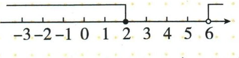

本题结论

此不等式组无解。

</article>

### 4. 容量上限不是恰好装满 {#pit-capacity .pitfall-title}

读到车辆、容器等条件，先确定“可装”给的是上限，还是要求每辆都按指定数量恰好满载。前者列不等式，后者列等式。只有在两类物资容量可以同时满足的模型下，才能分别比较两类总容量。

<article class="handbook-example is-pitfall" aria-labelledby="pitfall-4">

#### 辨析 04 运输方案先核对模型 知识清单原题改编·区分容量与满载条件 {#pitfall-4 .example-heading}

题目

购买甲、乙物资共 $540$ 吨，甲每吨 $3$ 万元、乙每吨 $2$ 万元，总费用 $1380$ 万元。

A 型车每辆最多可同时装甲 $7$ 吨、乙 $3$ 吨；B 型车每辆最多可同时装甲 $5$ 吨、乙 $7$ 吨。现有两型车共 $50$ 辆，允许不装满，并按两类物资的独立容量上限计算。

（1）甲、乙物资各多少吨？

（2）使用全部车辆，有哪些数量配比能运完？

（3）若改成每辆都必须按上述两种物资的指定吨数恰好满载，还能完成同一批物资的运输吗？

答案与解析

解析

（1）设甲 $u$ 吨、乙 $v$ 吨，$u+v=540$，$3u+2v=1380$，得 $u=300,v=240$。

（2）设 A 型 $m$ 辆，B 型 $50-m$ 辆。两种物资的容量都不能不足：

$$\begin{cases}7m+5(50-m)\ge300,\\3m+7(50-m)\ge240.\end{cases}$$

第一式得 $m\ge25$；第二式得 $m\le27.5$，所以整数 $m=25,26,27$。

| A 型辆数 | B 型辆数 | 甲容量 / 吨 | 乙容量 / 吨 |
| --- | --- | --- | --- |
| 25 | 25 | 300 | 250 |
| 26 | 24 | 302 | 246 |
| 27 | 23 | 304 | 242 |

在题设独立容量、允许不满载的模型下，三种都够用。

（3）若指定吨数都必须装满，甲要求 $250+2m=300$，得 $m=25$；乙要求 $350-4m=240$，得 $m=27.5$。两个要求互相矛盾，且后者不是整数，不能完成。

本题结论

（1）甲 300 吨、乙 240 吨。（2）A/B 配比为 25/25、26/24、27/23。（3）若要求按指定吨数每辆恰好满载，则无方案。

</article>

::: note 本页检查线索
遇到不等式，依次检查：比较对象 → 乘除符号 → 公共范围 → 边界空实 → 整数与实际条件。
:::
