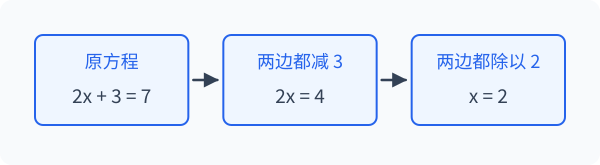
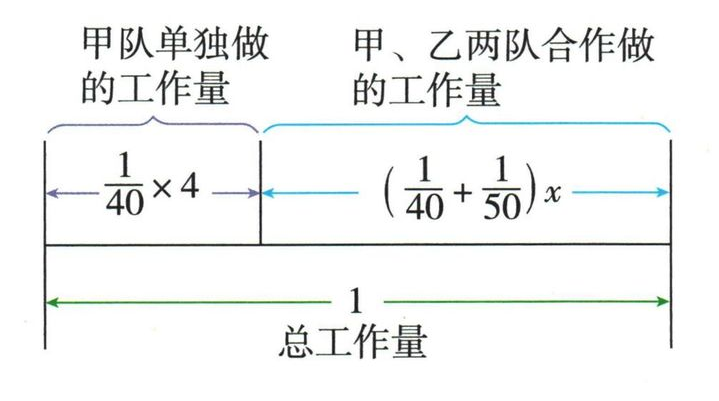
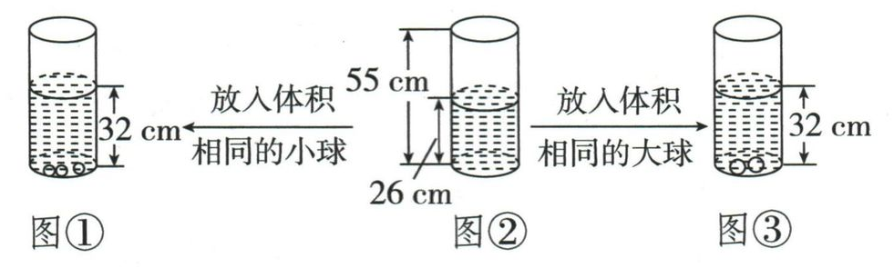
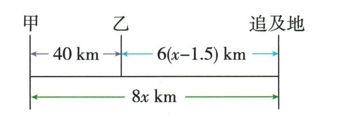

方程把“两个量相等”写成可以求解的关系。解方程要说明每步为何等价；列方程还要说明等号两边各是什么量，最后把解放回题意检查。

<nav class="handbook-nav" aria-label="本章分区">
  <a class="handbook-jump is-knowledge" href="#knowledge">01 · 知识点概念、关系与适用条件</a>
  <a class="handbook-jump is-exam" href="#exam">02 · 考点题目分类和例题</a>
  <a class="handbook-jump is-pitfall" href="#pitfalls">03 · 坑点辨析错因，检查遗漏</a>
</nav>

## 【知识点】概念与条件 {#knowledge .handbook-section .is-knowledge}

### 1. 方程与一元一次方程 {#definition .knowledge-title}

含有未知数的等式叫作==方程==。使等式成立的未知数的值，叫作方程的解

例如 $2x+3=7$，代入 $x=2$ 后两边都是 $7$，所以 $x=2$ 是它的解

只含一个未知数、未知数的最高次数为 $1$、两边都是整式的方程，叫作==一元一次方程==，可整理为

$$ax=b\quad(a\ne0)$$

### 2. 等式的性质 {#equality .knowledge-title}

1. 两边加或减同一个数或式子，结果仍相等
2. 两边乘同一个数，或除以同一个非零数，结果仍相等

### 3. 解一元一次方程 {#transform .knowledge-title}

目标是把方程变成 $x=$ 常数。根据方程选择需要的步骤

| 步骤 | 做什么 |
| --- | --- |
| 去分母 | 两边每一项都乘分母的最小公倍数 |
| 去括号 | 括号前的数乘里面每一项 |
| 移项 | 把含未知数的项放到一边，常数项放到另一边；移项变号 |
| 合并同类项 | 整理成 $ax=b$ |
| 系数化为 $1$ | 两边除以 $a$，得到 $x=\frac ba$ |

例如

$$\begin{aligned}2(x+1)&=8\\2x+2&=8\\2x&=8-2\\2x&=6\\x&=3\end{aligned}$$

## 【考点】方法与例题 {#exam .handbook-section .is-exam}

### 1. 应用题的数量关系与适用条件 {#models .exam-title}

设未知数时写清“什么量、什么单位”。直接设题问量容易对应答案；间接设相关量，有时能使式子更简单，但解后必须换回题问。

| 问题 | 基本关系 | 条件或边界 |
| --- | --- | --- |
| 总量与部分 | 总量=各部分之和 | 各部分不重不漏；人数、件数须为整数 |
| 行程 | 路程=速度×时间 | 各速度配各自时间，单位统一，题设为恒速模型 |
| 往返、相遇、追及 | 同程相等；相遇路程和为初距；追及路程差为初距 | 先看方向、起点和计时起点，不能只背和差 |
| 顺逆水或风 | 顺向速度=自身速度+流速；逆向速度=自身速度−流速 | 按题设沿同一直线，逆行速度必须为正 |
| 工程 | 工作量=效率×时间 | 恒定效率、合作互不干扰；总量记1时独做 $T$ 天的效率为 $1/T$ |
| 配套 | A数量÷每套A件数=B数量÷每套B件数 | 比的是产品数，不是投入原料；恰好配套、无余件时用等式 |
| 积分 | 总分=各类场数×对应分值后相加 | 分值按题给；负场不一定扣分，场数须非负整数 |
| 等积变形 | 转变前体积=转变后体积 | 不漏、不溢、体积不变；圆柱体积=底面积×高 |

圆周运动另看圈数：从同一点出发，反向第一次相遇时合路程为一圈；同向第一次追上时差路程为一圈。多圈不能仍机械只用一圈。

若十位数字为 $a$、个位为 $b$，两位数是 $10a+b$，而不是 $ab$；数字各有0到9的范围，首位不能为0。

### 2. 百分比、单利与分段费用 {#rates .exam-title}

| 关系 | 表达式 | 百分数乘谁 |
| --- | --- | --- |
| 增长、减少 | 新量=原量×$(1\pm r)$ | 各自的原量；连续变化要逐次更新基数 |
| 利润、利润率 | 利润=售价−进价；利润率=利润÷进价 | 本章题设以正的进价为基数 |
| 盈利或亏损后的售价 | 售价=进价×$(1+r)$ 或进价×$(1-r)$ | 不同商品的进价可能不同 |
| 折扣 | 实际售价=标价×折数÷10 | 标价，不一定是进价 |
| 单利 | 利息=本金×每期利率×期数；本息和=本金+利息 | 固定本金，利息不再计息；年利率配年数 |
| 阶梯计费 | 总费=各段用量×该段单价后相加 | “超出部分”改价不是全部用量改价 |
| 平均单价 | 总费用÷总用量 | 总用量须大于0，不是各档单价的简单平均 |

不同百分数先标明基数，再计算金额或数量。利率、费用只按题设模型使用；若有复利、分期投入、其他扣费，或超过阈值后全量改价，要另按相应规则列式。

### 3. 辨类型时同时查次数与系数 {#exam-definition .exam-title}

先看是否为含未知数的等式，再看是否只含一个未知数、两边是否为整式。含参数时，次数符合还不够，系数为0会使方程退化；筛出的参数应代回原式确认。
<article class="handbook-example" aria-labelledby="example-1">

#### 例题 01 六个式子的分类 知识清单例题 {#example-1 .example-heading}

题目

下列式子中，是方程的有哪些？填序号。

① $\frac x3+8=3$；② $12-x$；③ $x-y=3$；

④ $3a^2=10$；⑤ $2+5=7$；⑥ $x-1\ne0$。

答案与解析

解析

①③④同时有未知数和等号。②只是代数式，没有等号；⑤虽为等式，却没有未知数；⑥表示不相等。③含两个未知数、④为二次，并不妨碍它们是方程，只是不能叫一元一次方程。

本题结论

①③④。

</article>

<article class="handbook-example" aria-labelledby="example-2">

#### 例题 02 含参数的指数与系数 知识清单例题 {#example-2 .example-heading}

题目

若 $(m+2)x^{|m|-1}=4$ 是关于 $x$ 的一元一次方程，求 $m$。

答案与解析

解析

指数应满足 $|m|-1=1$，所以 $|m|=2$，候选为 $m=2,-2$。

同时系数 $m+2\ne0$，排除 $m=-2$。当 $m=2$ 时原式为 $4x=4$，确为一元一次方程。

本题结论

$m=2$。

</article>

### 4. 写出等式两边的实际操作 {#exam-equality .exam-title}

比较原式与目标：消去加减项，用性质1；改变系数或去分母，用性质2。写出“两边同做什么”的中间行，再化简。分式内部同乘和整条等式同乘是不同层次。

<article class="handbook-example" aria-labelledby="example-3">

#### 例题 03 等式性质的两种用法 知识清单例题·同类任务分组·合组 {#example-3 .example-heading}

题目

第一组

利用等式的性质解方程：（1）$2x-1=3$；（2）$5x-6=2x+3$。

第二组

填适当的数或式子：

（1）若 $a-3=b+2$，则 $a+1=\underline{\qquad}$；

（2）若 $3x=2x+5$，则 $3x-\underline{\qquad}=5$；

（3）若 $\frac12x=5$，则 $x=\underline{\qquad}$。

答案与解析

解析

第一组

（1）两边同加1，得 $2x=4$；再同除非零的2，得 $x=2$。代回，两边均为3。

（2）两边同减整个 $2x-6$：左边 $5x-6-(2x-6)=3x$，右边 $2x+3-(2x-6)=9$，所以 $3x=9$。同除3得 $x=3$，代回两边均为9。

第二组

（1）左边增加4才变成 $a+1$，右边也增加4，得 $b+6$。

（2）右边要消去 $2x$，两边同减 $2x$。

（3）两边同乘2，使左边系数变为1，右边为10。

本题结论

第一组：（1）$x=2$；（2）$x=3$。

第二组：（1）$b+6$；（2）$2x$；（3）10。

</article>

<article class="handbook-example" aria-labelledby="example-5">

#### 例题 04 去分母用了哪条性质 2022·山东滨州 {#example-5 .example-heading}

题目

导体中的电流 $I$、电压 $U$、电阻 $R$ 满足 $I=\frac UR$。去分母得 $IR=U$，变形依据是（　）。

A. 等式的性质1

B. 等式的性质2

C. 分式的基本性质

D. 不等式的性质2

答案与解析

解析

原式要求 $R\ne0$。整个等式两边同乘 $R$，得 $IR=(U/R)R=U$，用的是性质2。A是同加减；C只描述分式内部分子分母同乘；D针对不等关系。

本题结论

B。

</article>

### 5. 按结构安排解方程的步骤 {#exam-solve .exam-title}

通常按“去分母→去括号→移项→合并→系数化为1”进行，但不必强行凑齐五步。小数分母可先在各分数内化整；去分母之后，保留分子的括号再分配。解完代回原方程核验。
<article class="handbook-example" aria-labelledby="example-6">

#### 例题 05 三种常见结构 （1）2024·海南；（2）2024·新疆；（3）2024·山东滨州节选·合组 {#example-6 .example-heading}

题目

（1）若代数式 $x-3$ 的值为5，则 $x$ 等于（　）。

A. 8

B. $-8$

C. 2

D. $-2$

（2）解方程 $2(x-1)-3=x$。

（3）解方程 $\frac{2x-1}{3}=\frac{x+1}{2}$。

答案与解析

解析

（1）列 $x-3=5$，两边加3得 $x=8$，选A。B、C、D代入 $x-3$ 分别为 $-11,-1,-5$，都不是5。

（2）分配2得到 $2x-2-3=x$，合并为 $2x-5=x$。两边减 $x$ 再加5，得 $x=5$。原左边 $2(5-1)-3=5$。

（3）两边同乘6得 $2(2x-1)=3(x+1)$。展开 $4x-2=3x+3$，两边减 $3x$ 加2，得 $x=5$。原左右两边均为3。

本题结论

（1）A；（2）$x=5$；（3）$x=5$。

</article>

<article class="handbook-example" aria-labelledby="example-7">

#### 例题 06 小数分母与分子整体 知识清单例题 {#example-7 .example-heading}

题目

解方程 $\frac{0.4x-9}{0.5}-\frac{x-5}{2}=\frac{0.03+0.02x}{0.03}$。

答案与解析

解析

先把各分数内部化整：第一分数上下乘10，最后分数上下乘100，得到

$$\frac{4x-90}{5}-\frac{x-5}{2}=\frac{3+2x}{3}.$$

分母5、2、3的最小公倍数为30，整条等式两边同乘30：

$$6(4x-90)-15(x-5)=10(3+2x).$$

展开为 $24x-540-15x+75=30+20x$。移项、合并得 $-11x=495$，同除 $-11$ 得 $x=-45$。

回到原式，左为 $-54-(-25)=-29$，右为 $-0.87/0.03=-29$。

本题结论

$x=-45$。

</article>

### 6. 已知解、同解与整数解求参数 {#exam-parameter .exam-title}

“某值是解”表示代入后原等式成立。若两方程同解，一方无参数就先解它；两方都有参数，可以分别表示解再令其相等。最后确认两方程确有相同的全部解，而不只是一个共同值。

参数为整数、方程解为正整数时，先排零系数，再将解写成分式，按整除和正负两条条件筛选。
<article class="handbook-example" aria-labelledby="example-8">

#### 例题 07 已知根之后还要求目标值 知识清单例题 {#example-8 .example-heading}

题目

关于 $x$ 的方程 $3a-x=\frac x2+3$ 的解是 $x=4$，求 $a^2-2a$。

答案与解析

解析

将 $x=4$ 代入所有 $x$ 的位置，得 $3a-4=4/2+3=5$。两边加4、除3，得 $a=3$。

所求不是 $a$，而是 $a^2-2a=9-6=3$。代 $a=3,x=4$，原两边均为5。

本题结论

3。

</article>

<article class="handbook-example" aria-labelledby="example-9">

#### 例题 08 同解方程的两种结构 知识清单例题·同类任务分组·合组 {#example-9 .example-heading}

题目

第一组

方程 $\frac43(\frac14x-1)-2-x=2$ 与关于 $x$ 的方程 $\frac{x-m}{3}=2x+m$ 的解相同，求 $m$。

第二组

关于 $x$ 的方程 $4x+2m=3x+1$ 与 $3x+1=2x+2m$ 的解相同，求这个相同的解。

答案与解析

解析

第一组

首式去括号后两边乘3，得 $x-4-6-3x=6$，即 $-2x=16$，所以 $x=-8$。

代入第二式：$(-8-m)/3=-16+m$，乘3得 $-8-m=-48+3m$，所以 $-4m=-40$，$m=10$。

第二式整理为 $-5x=4m$，一次项系数恒非零；$m=10$ 时唯一解确为 $-8$，与首式同解。

第二组

第一式得 $x=1-2m$，第二式得 $x=2m-1$，各自一次项系数为1，均有唯一解。

同解给 $1-2m=2m-1$，故 $4m=2$，$m=1/2$。回代得 $x=0$。此时两原式左右均为1，符合题意。

本题结论

第一组：$m=10$。

第二组：共同解为 $x=0$。

</article>

<article class="handbook-example" aria-labelledby="example-11">

#### 例题 09 参数取整数，解取正整数 知识清单例题 {#example-11 .example-heading}

题目

当 $m$ 取什么整数时，关于 $x$ 的方程 $\frac12mx-\frac53=\frac12x-\frac23$ 的解是正整数？

答案与解析

解析

移项、同乘2得 $(m-1)x=2$。$m=1$ 时成为 $0=2$，无解，须先排除。

其余情形 $x=2/(m-1)$。$m$ 是整数，$m-1$ 也是整数；要使 $x$ 为正整数，$m-1$ 必须是2的正因数，只能取1或2。于是 $m=2$ 或3，分别得到 $x=2$ 或1。负因数给负解，不能取。

本题结论

$m=2$ 或 $m=3$。

</article>

### 7. 用同一总量的两种表达列式 {#exam-model .exam-title}

1. 审：找已知、所求、单位，以及保持不变的总量。
2. 设：写出字母所指的量，用总量减一部分表示另一部分。
3. 列：解释等号两边各是什么，同种量才能相等。
4. 解：用可逆的等式变形求解。
5. 验、答：核原关系及实际范围，必要时将中间量换回题问。

盈不足题中，“每人分配后还有余量”用已分量加余量表示现有总数；“还缺若干”用所需量减缺量表示现有总数。
<article class="handbook-example" aria-labelledby="example-12">

#### 例题 10 门票数量与收入 知识清单例题 {#example-12 .example-heading}

题目

动物园成人票每张50元，儿童票每张30元。某日售出700张，共得29000元。设儿童票售出 $x$ 张，可列方程为（　）。

A. $30x+50(700-x)=29000$

B. $50x+30(700-x)=29000$

C. $30x+50(700+x)=29000$

D. $50x+30(700+x)=29000$

答案与解析

解析

儿童 $x$ 张，成人 $700-x$ 张；收入分别为 $30x$ 和 $50(700-x)$ 元，总收入29000元，所以选A。

B交换了两类票价；C使总张数变成 $700+2x$；D两处均错。若继续核验，$-20x=-6000$ 得 $x=300$，成人400张，收入 $9000+20000=29000$，票数也为700。

本题结论

A。

</article>

<article class="handbook-example" aria-labelledby="example-13">

#### 例题 11 两种分法，同一批图书 知识清单例题 {#example-13 .example-heading}

题目

把一些图书分给某班学生，每人3本剩20本，每人4本还缺25本。这个班有多少名学生？

答案与解析

解析

设学生 $x$ 名，须为正整数。

| 分法 | 表示现有图书总数 |
| --- | --- |
| 每人3本，剩20本 | $3x+20$ |
| 每人4本，缺25本 | $4x-25$ |

同一批书，故 $3x+20=4x-25$，解得 $x=45$。回验两种表达均为155本，且45为正整数。

本题结论

45名学生。

</article>

### 8. 行程题给每个速度配自己的时间 {#exam-travel .exam-title}

先标方向和起点，再标各自出发与到达时刻。同程往返列路程相等；追及列快者比慢者多走的路程等于初距。题问“从谁出发后”，未知时间就注明从谁开始计。顺逆问题还要检查逆行速度为正。
<article class="handbook-example" aria-labelledby="example-14">

#### 例题 12 同一码头之间往返 知识清单例题 {#example-14 .example-heading}

题目

轮船从甲码头到乙码头顺流用3小时，逆流返程用4小时，静水速度30千米/时。求水流速度。

答案与解析

解析

设水速 $x$ 千米/时，$0\le x<30$。

| 方向 | 速度 | 时间 | 路程 |
| --- | --- | --- | --- |
| 顺流 | $30+x$ | 3 | $3(30+x)$ |
| 逆流 | $30-x$ | 4 | $4(30-x)$ |

往返路程相同，列 $3(30+x)=4(30-x)$，即 $90+3x=120-4x$，得 $7x=30$，$x=30/7$。它在允许范围内，两段路程均为 $720/7$ 千米。

本题结论

水速 $\frac{30}{7}$ 千米/时。

</article>

<article class="handbook-example" aria-labelledby="example-15">

#### 例题 13 间接设时间求最远距离 知识清单例题·改编，明确题设模型 {#example-15 .example-heading}

题目

飞机储油最多供空中飞行4.6小时，出航顺风，无风速度575千米/时，风速25千米/时。按题设恒定速度模型，它最远飞出多少千米就应返回？

答案与解析

解析

顺风速度600，逆风速度550千米/时。最远飞行时用足4.6小时。设顺风飞行 $t$ 小时，返程用 $4.6-t$ 小时，同程给

$$600t=550(4.6-t).$$

展开得 $1150t=2530$，$t=2.2$，返程2.4小时。所求距离为 $600\times2.2=1320$ 千米，与 $550\times2.4$ 相同，总时间4.6小时。

设时间而非距离使式子直接保持一次形式；$t=2.2$ 是中间量，不能当作距离作答。

本题结论

1320千米。

</article>

<article class="handbook-example" aria-labelledby="example-16">

#### 例题 14 先行的是距离 2024·江苏扬州，缩写历史背景 {#example-16 .example-heading}

题目

《九章算术》中的追及问题可理解为：快者每分钟走100米，慢者每分钟走60米。慢者先走100米，快者再去追。快者追上需要多少分钟？

答案与解析

解析

设快者追 $x$ 分钟。在这段共同的时间里快者走 $100x$ 米，慢者又走 $60x$ 米，慢者还有先行的100米。

列 $100x=100+60x$，两边减 $60x$ 得 $40x=100$，$x=2.5$。核验快者走250米，慢者总路程 $100+150=250$ 米。

本题结论

2.5分钟。

</article>

### 9. 工程题先把各阶段工作量分开 {#exam-work .exam-title}

总工程记为1，独做所需时间取倒数得到效率。各阶段分别用“效率×实际时间”，再将工作量相加。若先后工作，阶段时间相加为总工期；若同时工作，各队累计天数不能直接相加当日历工期。

<article class="handbook-example" aria-labelledby="example-17">

#### 例题 15 先后与合作的工作量分段 第一组：知识清单例题；第二组：2024·陕西，缩写背景·合组 {#example-17 .example-heading}

题目

第一组

甲队独做一项工程需40天，乙队需50天。甲先单独做4天后两队合作，求合作多少天完成工程。

第二组

小峰独自完成家庭大扫除需4小时，爸爸独自完成需2小时。当天小峰先打扫一段时间后去训练，爸爸接着单独完成剩余任务，两人共打扫3小时。小峰打扫了多久？

答案与解析

解析

第一组

设合作 $x$ 天。甲先做 $4/40=1/10$，合作效率为 $1/40+1/50=9/200$。

所以 $1/10+9x/200=1$。两边乘200得 $20+9x=200$，$x=20$。

合作完成 $9/10$，加先做 $1/10$ 恰为1；问的是合作20天，总历时24天是另一个量。

第二组

总任务记1。设小峰打扫 $x$ 小时，爸爸打扫 $3-x$ 小时，$0\le x\le3$。

先后完成的量之和为1，$x/4+(3-x)/2=1$。两边乘4，得 $x+2(3-x)=4$，所以 $-x=-2$，$x=2$。

爸爸1小时，两人各完成任务的一半，总时间3小时。不是两人合作3小时，不能将效率和乘3。

本题结论

第一组：两队合作20天。

第二组：小峰打扫2小时。

</article>

### 10. 配套先从原料换算到产品数 {#exam-pair .exam-title}

把投入量乘单位产量，先算每类产品的件数，再按每套所需件数求套数。恰好配套要求两类套数相同，解后同时验原料总量、件数整数与配套比。
<article class="handbook-example" aria-labelledby="example-19">

#### 例题 16 桌面与桌腿的配套 知识清单例题 {#example-19 .example-heading}

题目

一张桌子需要1个桌面和4条腿。1立方米木料可做50个桌面或300条桌腿。现有5立方米木料，一部分做桌面，其余全部做桌腿，恰好配套。做桌面的木料为（　）。

A. 3.5立方米

B. 3立方米

C. 2.8立方米

D. 2.6立方米

答案与解析

解析

设桌面用 $x$ 立方米，则桌腿用 $5-x$，$0\le x\le5$。产量分别为 $50x$ 个桌面和 $300(5-x)$ 条腿。

每面配4腿，所以 $4\times50x=300(5-x)$，即 $500x=1500$，$x=3$。此时150面、600腿，恰配150套。

A产生175面、450腿，腿不足；C产生140面、660腿，腿多100；D产生130面、720腿，腿多200。

本题结论

B，3立方米。

</article>

### 11. 积分题利用总场数表示第三类 {#exam-points .exam-title}

已知两类之间的倍数关系，先设其中一类，另一类写成倍数；第三类用总场数减去前两类。各类再乘题设分值，求和列式。检验三类场数均为非负整数，别把中间设的量当题问量。
<article class="handbook-example" aria-labelledby="example-20">

#### 例题 17 胜、平、负的两条总量关系 知识清单例题 {#example-20 .example-heading}

题目

足球联赛每队赛8场，胜得3分、平得1分、负得0分。某队平场数是负场数的2倍，共17分，求该队胜了几场。

答案与解析

解析

设负 $x$ 场，则平 $2x$ 场，胜 $8-3x$ 场。

| 结果 | 场数 | 积分 |
| --- | --- | --- |
| 胜 | $8-3x$ | $3(8-3x)$ |
| 平 | $2x$ | $2x$ |
| 负 | $x$ | 0 |

列 $3(8-3x)+2x=17$，即 $24-7x=17$，得 $x=1$。所以胜5场、平2场、负1场；总场数8，总分 $15+2=17$。

本题结论

胜5场。

</article>

### 12. 百分比题逐行标明基数 {#exam-rates .exam-title}

不同本金分别计息，不同商品分别计算新价。先列“原量—变化后量”表，每个百分数只乘它对应的原量；总量变化的百分数乘总原量。已知利息时不再加本金，若问本息和才相加。
<article class="handbook-example" aria-labelledby="example-21">

#### 例题 18 两类储蓄各自计息 知识清单例题·改编，明确单利模型 {#example-21 .example-heading}

题目

某年小张以两种形式储蓄共5000元，年利率分别为1.2%和1.5%，一年共得66元利息。按单利模型，分别存入多少元？

答案与解析

解析

设第一种本金 $x$ 元，第二种 $5000-x$ 元，$0\le x\le5000$。两种均存一年，利息和为

$$0.012x+0.015(5000-x)=66.$$

展开得 $-0.003x+75=66$，$-0.003x=-9$，$x=3000$；第二种2000元。

核验利息 $36+30=66$ 元，本金和5000元。66是利息，不是本息和。

本题结论

第一种3000元，第二种2000元。

</article>

<article class="handbook-example" aria-labelledby="example-22">

#### 例题 19 两种商品各有一个变化基数 知识清单例题 {#example-22 .example-heading}

题目

甲、乙商品原单价和100元。甲降价10%，乙提价5%，调价后单价和比原单价和提高2%。求两种商品原单价。

答案与解析

解析

设甲原单价 $x$ 元，乙为 $100-x$ 元，$0<x<100$。

| 商品 | 原单价/元 | 调价后单价/元 |
| --- | --- | --- |
| 甲 | $x$ | $0.9x$ |
| 乙 | $100-x$ | $1.05(100-x)$ |
| 合计 | 100 | $100\times1.02=102$ |

所以 $0.9x+1.05(100-x)=102$，展开 $-0.15x+105=102$，解得 $x=20$，乙80元。新价18元和84元，相加102元，满足原条件。

本题结论

甲20元，乙80元。

</article>

### 13. 从等积和水位图提取不变量 {#exam-volume .exam-title}

转移水时找体积不变；等截面容器中放入完全浸没的物体，排水体积与水面升高成比例。先辨标注的是容器高、原水位还是末水位，用末水位减原水位才是升高量。需检查无漏水、无溢出、物体浸没等条件。
<article class="handbook-example" aria-labelledby="example-23">

#### 例题 20 水量相同，不是水高相同 知识清单例题·改编，明确内底面同高 {#example-23 .example-heading}

题目

水平桌上甲、乙容器内部均呈圆柱形，两容器内底面处于同一高度，内底面积分别为80平方厘米和100平方厘米。甲装满水，乙为空。把甲水全部倒入乙后，乙水面比原甲水面低8厘米。甲容积为（　）。

A. 1280立方厘米

B. 2560立方厘米

C. 3200立方厘米

D. 4000立方厘米

答案与解析

解析

设甲水高 $x$ 厘米，乙水高 $x-8$ 厘米，$x>8$。无损转移使体积相同：$80x=100(x-8)$，得 $20x=800$，$x=40$。

甲装满，因此容积 $80\times40=3200$ 立方厘米，选C。乙水高32厘米，确低8厘米。若用A、B、D的体积分别除以两底面积，所得高度差为3.2、6.4、10厘米，均不合题。

本题结论

C。

</article>

<article class="handbook-example" aria-labelledby="example-24">

#### 例题 21 读出水位差与球数 知识清单例题·改编，补明图示模型条件 {#example-24 .example-heading}

题目

如图，图②为只有水的瓶；图①放入3个等体积小球，图③放入2个等体积大球。按图示等截面容器、球完全浸没且不溢水的情形解答。

（1）放入1个小球、1个大球，水面分别升高多少厘米？

（2）在图②中放入10个球，要使水面升到50厘米，应放大球、小球各多少个？

答案与解析

解析

（1）初始水位26厘米，两种放球后的水位都为32厘米，均升高6厘米。每小球贡献 $6/3=2$ 厘米，每大球贡献 $6/2=3$ 厘米。

（2）设大球 $x$ 个，小球 $10-x$ 个。目标升高量是 $50-26=24$ 厘米，不是50厘米。因此 $3x+2(10-x)=24$，解得 $x=4$，小球6个。

核验球数10，升高 $12+12=24$ 厘米，最终水位50厘米，低于瓶高55厘米。球数为非负整数。

本题结论

（1）小球2厘米，大球3厘米；（2）大球4个，小球6个。

</article>

### 14. 阶梯计费先判档，再列费用 {#exam-tier .exam-title}

给用量，与阈值比较；给总费，与首档最高费用比较；给平均单价，看是否可能全在首档。高档费用仍保留低档部分，只将超出的量按高单价计算。求出的量还要落在所假设的档内。
<article class="handbook-example" aria-labelledby="example-25">

#### 例题 22 用量、费用与平均单价 知识清单例题 {#example-25 .example-heading}

题目

某市按题设规则收月电费：不超过140千瓦时，每千瓦时0.56元；超过140千瓦时，超过部分每千瓦时0.61元。

（1）5月用电200千瓦时，应缴多少元？

（2）4月电费120元，用电多少千瓦时？精确到0.1千瓦时。

（3）若4月平均每千瓦时电费0.59元，应缴多少元？

答案与解析

解析

（1）200超过140，分两段算：$140\times0.56+60\times0.61=78.4+36.6=115$ 元。

（2）首档最高费用 $140\times0.56=78.4$ 元，小于120，故已超140千瓦时。设用量 $x$，列 $78.4+0.61(x-140)=120$。得 $x=140+41.6/0.61=12700/61\approx208.2$，大于140，与判档一致。

（3）平均价0.59高于首档0.56，也已进入高档。设用量 $y$，费用既是分段相加，也等于平均价乘总量：

$$78.4+0.61(y-140)=0.59y.$$

化简 $0.02y=7$，$y=350$。这是用电量，所求费用为 $350\times0.59=206.5$ 元。

本题结论

（1）115元；（2）约208.2千瓦时；（3）206.5元。

</article>

## 【坑点】辨析与纠错 {#pitfalls .handbook-section .is-pitfall}

### 1. 移项与去括号不要混为一件事 {#pit-sign .pitfall-title}

移项时只改变跨等号整项的符号。去括号则是该边表达式的等值展开，等号另一边不因此改变；完整的外因数必须乘到每一项。
<article class="handbook-example is-pitfall" aria-labelledby="pitfall-1">

#### 辨析 01 核对四个方程变形 知识清单例题 {#pitfall-1 .example-heading}

题目

以下变形哪些正确？填序号。

① $3x+6=0$ 变为 $3x=6$；② $2x=x-1$ 变为 $x=-1$；

③ $2+x=2x+1$ 变为 $-x=1$；④ $4x-2=5+2x$ 变为 $2x=7$。

答案与解析

解析

①两边减6应为 $3x=-6$，错误。②两边减 $x$，正确。

③两边减 $2x$、减2，应为 $-x=-1$，错误。④两边减 $2x$、加2，得 $2x=7$，正确。

本题结论

②④。

</article>

<article class="handbook-example is-pitfall" aria-labelledby="pitfall-2">

#### 辨析 02 外面的负系数乘到哪里 知识清单例题 {#pitfall-2 .example-heading}

题目

将 $2x-3(4-2x)=6$ 去括号。

答案与解析

解析

完整外因数为 $-3$。它乘4得到 $-12$，乘 $-2x$ 得 $+6x$；原来的 $2x$ 与右边6保持。这里只是左边展开，不是移项。

本题结论

$2x-12+6x=6$。

</article>

### 2. 分数内部化整不等于整条等式去分母 {#pit-denominator .pitfall-title}

先给操作划定范围。单个分数上下同乘时值不变，其他项无需改变；整条等式同乘时，所有项都要乘，不能漏掉常数。
<article class="handbook-example is-pitfall" aria-labelledby="pitfall-3">

#### 辨析 03 右边究竟要不要一起乘 由知识清单示例改编 {#pitfall-3 .example-heading}

题目

将 $\frac{0.4x+0.9}{0.5}=1$ 的分数内部化为整数，能否写成 $\frac{4x+9}{5}=10$？说明理由，并写出去分母后的方程。

答案与解析

解析

不能。上下同乘10只将左边分数换成等值的 $(4x+9)/5$，右边仍为1。

随后整个等式两边同乘5，才得到 $4x+9=5$。若直接整条等式乘10，左边应为 $10(0.4x+0.9)/0.5$，也不是所写的分数。

本题结论

内部化整为 $\frac{4x+9}{5}=1$；去分母为 $4x+9=5$。

</article>

### 3. 绝对值分段后，候选解必须回查范围 {#pit-absolute .pitfall-title}

先求每个内部式的零点并排序，分段确定符号；负的内部式整体取相反数。各段得到的方程只在该段等价，候选解须留在本段，再代原式。若 $x$ 项消去，要看剩下的是恒等式还是矛盾式，不能一律说任意数都是解。
<article class="handbook-example is-pitfall" aria-labelledby="pitfall-4">

#### 辨析 04 按两个零点分成三段 知识清单例题 {#pitfall-4 .example-heading}

题目

解方程 $|x-2|+|x+1|=4$。

答案与解析

解析

内部零点为 $-1,2$。端点分别归入外侧两段，分段不漏不重：

| 范围 | 去绝对值后的方程 | 结果与范围检查 |
| --- | --- | --- |
| $x\le-1$ | $-(x-2)-(x+1)=4$，即 $1-2x=4$ | $x=-3/2$，在本段 |
| $-1<x<2$ | $-(x-2)+(x+1)=4$，即 $3=4$ | 矛盾，无解 |
| $x\ge2$ | $(x-2)+(x+1)=4$，即 $2x-1=4$ | $x=5/2$，在本段 |

两个候选代原式均得4；端点 $-1,2$ 时左边均为3，不是解。

本题结论

$x=-\frac32$ 或 $x=\frac52$。

</article>

### 4. 同一追上时刻，不等于相同走路时间 {#pit-travel .pitfall-title}

早出发者走得更久。设从甲出发后经过 $x$ 小时，乙晚出发的时差就要从 $x$ 中减去。若改从乙出发计时，求出的时间最后还需换回题问起点。
<article class="handbook-example is-pitfall" aria-labelledby="pitfall-5">

#### 辨析 05 两个人的时钟起点不同 知识清单例题 {#pitfall-5 .example-heading}

题目

甲、乙相距40千米，甲在后、乙在前，同向行走。甲先出发1.5小时后乙出发，甲速8千米/时，乙速6千米/时。甲出发几小时后追上乙？

答案与解析

解析

甲先走1.5小时只有12千米，小于初距40，乙出发前尚未追上。设甲出发 $x$ 小时后追上，则乙走 $x-1.5$ 小时。

差程为初距：$8x-6(x-1.5)=40$，展开得 $2x+9=40$，$x=15.5$。

乙走14小时、84千米，甲走124千米，路程差40。若只写14小时，答的是从乙出发后的时间，不是题问。

本题结论

甲出发15.5小时后追上乙。

</article>

### 5. 相同售价，不代表百分比的基数相同 {#pit-profit .pitfall-title}

利润率以各自进价为基数。先反求两件的成本，再将收入和成本分别相加；不能看到一个盈利、一个亏损同百分比就认为抵消。调价题也应逐件标明原价。
<article class="handbook-example is-pitfall" aria-labelledby="pitfall-6">

#### 辨析 06 两件衣服的总盈亏 知识清单例题 {#pitfall-6 .example-heading}

题目

两件夹克各以120元售出，一件盈利20%，另一件亏损20%。这次买卖盈利还是亏损？求金额。

答案与解析

解析

设盈利件进价 $x$，$1.2x=120$，得 $x=100$ 元；亏损件进价 $y$，$0.8y=120$，得 $y=150$ 元。

| 商品 | 进价 | 售价 | 利润 |
| --- | --- | --- | --- |
| 盈利件 | 100元 | 120元 | 20元 |
| 亏损件 | 150元 | 120元 | $-30$ 元 |
| 合计 | 250元 | 240元 | $-10$ 元 |

两个20%分别作用于100与150，金额不同。总收入减总成本为 $240-250=-10$ 元。

本题结论

亏损10元。

</article>

### 6. 最省方案要比较同样工作量，还要排得进工期 {#pit-optimal .pitfall-title}

日费低的队伍可能效率也低，先比较完成相同工作量的费用。用总工作量关系表示费用随某队工作天数的变化，检查所有允许天数，而不只比较两个方案。最后给出实际排程，说明没有把两队累计天数当成日历工期。
<article class="handbook-example is-pitfall" aria-labelledby="pitfall-7">

#### 辨析 07 工期限制下怎样安排两队 知识清单例题·改编，明确费用与合作模型 {#pitfall-7 .example-heading}

题目

一项工程，甲队独做20天完成，共费3200元；乙队独做30天完成，共费3000元。按恒定效率、费用与各队工作天数成正比、两队可同时施工的模型解答。

（1）两队合作6天，剩余由乙独做：①乙还需几天？②总费多少？

（2）工期不超过24天，怎样安排使总费最少？最少多少？

答案与解析

解析

（1）效率分别为 $1/20,1/30$，合作6天完成 $6(1/20+1/30)=1/2$。余下 $1/2$ 由乙完成，需 $(1/2)\div(1/30)=15$ 天。

甲每日160元，乙每日100元。甲工作6天，乙共21天，总费 $160\times6+100\times21=3060$ 元。

（2）完成同一整项工程，乙3000元比甲3200元少，乙的单位工作量更便宜。设乙累计工作 $t$ 天，甲工作 $u$ 天，则

$$\frac u{20}+\frac t{30}=1,\qquad u=20-\frac23t.$$

总费 $160u+100t=3200-\frac{20}{3}t$。乙每增加一天，在保持总工作量不变时，费用减少 $20/3$ 元。工期不超过24天，乙最多工作24天；取 $t=24$，得 $u=4$，费用 $640+2400=3040$ 元。所有 $t\le24$ 的其他安排都不会更省。

可行排程：前4天两队合作，随后乙独做20天，历时24天。工作量 $4/20+24/30=1$。不能把甲4天与乙24天相加作28天。

本题结论

（1）①15天，②3060元；（2）甲4天、乙24天，前4天共同施工，最少3040元。

</article>
