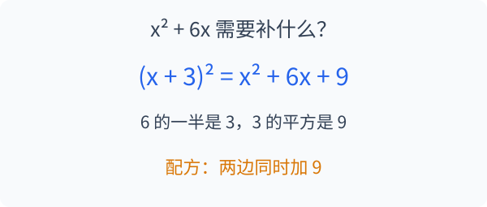
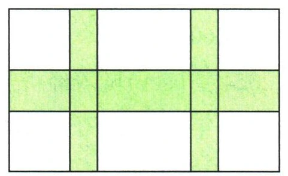
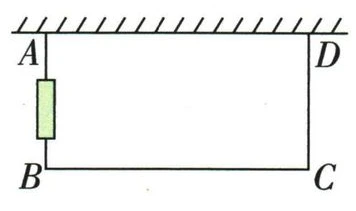

一元二次方程的解法都在做同一件事：把二次关系转化成容易求解的一次关系。先理解平方、零乘积与配方，再看根的情况和实际问题，四种解法就不再是互不相干的公式。

<nav class="handbook-nav" aria-label="本章分区">
  <a class="handbook-jump is-knowledge" href="#knowledge">01 · 知识点概念、关系与适用条件</a>
  <a class="handbook-jump is-exam" href="#exam">02 · 考点题目分类和例题</a>
  <a class="handbook-jump is-pitfall" href="#pitfalls">03 · 坑点辨析错因，检查遗漏</a>
</nav>

## 【知识点】概念与依据 {#knowledge .handbook-section .is-knowledge}

### 1. 一元二次方程 {#definition .knowledge-title}

只含一个未知数、整理后未知数的最高次数为 $2$、两边都是整式的方程，叫作==一元二次方程==

$$ax^2+bx+c=0\quad(a\ne0)$$

$a,b,c$ 分别是二次项系数、一次项系数和常数项，要连同符号一起读。例如 $2x^2-3x+1=0$ 中，$a=2,b=-3,c=1$

### 2. 直接开平方法与因式分解法 {#basic-principles .knowledge-title}

| 方法 | 怎样解 | 例子 |
| --- | --- | --- |
| 直接开平方法 | 化成 $U^2=k$；$k\ge0$ 时，$U=\pm\sqrt k$ | $(x-1)^2=9\Rightarrow x-1=\pm3\Rightarrow x=4$ 或 $-2$ |
| 因式分解法 | 化成两个因式的积为 $0$，分别令每个因式为 $0$ | $(x-2)(x+3)=0\Rightarrow x=2$ 或 $-3$ |

若 $U^2=k$ 中 $k<0$，方程没有实数解

### 3. 配方法 {#completing-square .knowledge-title}

把含未知数的部分配成完全平方式，再直接开平方

例如解 $x^2+6x+5=0$

$$\begin{aligned}x^2+6x&=-5\\x^2+6x+9&=-5+9\\(x+3)^2&=4\\x+3&=\pm2\\x&=-1\text{ 或 }-5\end{aligned}$$

先把二次项系数化为 $1$，再在两边加上“一次项系数一半的平方”

### 4. 求根公式与根的判别式 {#formula .knowledge-title}

对 $ax^2+bx+c=0$（$a\ne0$），记 $\Delta=b^2-4ac$，叫作==根的判别式==

| $\Delta$ | 实数根的情况 |
| --- | --- |
| $\Delta>0$ | 两个不相等的实数根 |
| $\Delta=0$ | 两个相等的实数根 |
| $\Delta<0$ | 没有实数根 |

$\Delta\ge0$ 时，求根公式为

$$x=\frac{-b\pm\sqrt{b^2-4ac}}{2a}$$

::: info 求根公式的推导

展开配方过程

$$\begin{aligned}ax^2+bx+c&=0\\4a^2x^2+4abx&=-4ac\\(2ax+b)^2&=b^2-4ac\\2ax+b&=\pm\sqrt{b^2-4ac}\end{aligned}$$

最后移项、除以 $2a$，就得到求根公式

:::

### 5. 根与系数的关系 {#vieta .knowledge-title}

若 $ax^2+bx+c=0$ 有两个实数根 $x_1,x_2$，则

$$x_1+x_2=-\frac ba,\qquad x_1x_2=\frac ca$$

例如 $x^2-5x+6=0$ 的两根为 $2,3$，两根之和是 $5$，积是 $6$

## 【考点】方法与例题 {#exam .handbook-section .is-exam}

### 1. 实际问题中的二次关系 {#models .exam-title}

先设未知量并写出允许范围，再由等量关系列方程。纯方程求出的根，还要经过实际条件筛选。

| 模型 | 数量关系 | 边界与解释 |
| --- | --- | --- |
| 两次平均增长 | $A(1+r)^2=B$ | 第二次基数已变为 $A(1+r)$ |
| 两次平均下降 | $A(1-r)^2=B$ | 原量、新量为正时 $0\le r<1$ |
| 面积 | 长×宽＝面积 | 每一条实际边都为正；不能只验乘积 |
| 调价利润 | （售价−单位成本）×销量＝总利润 | 售价、降价额不能混用 |
| 销售额 | 售价×销量＝销售额 | 不是利润，不应擅自扣未知成本 |
| 单循环比赛 | $\frac{n(n-1)}2$ 场 | 每两队只赛一次，$n\ge2$ 为整数 |
| 双循环比赛 | $n(n-1)$ 场 | 每两队赛两次 |

单循环中，每队要与其余 $n-1$ 队比赛，先数出 $n(n-1)$ 次；每场同时被两队各算一次，所以除以 $2$。双循环则每对比赛两次，不再除以 $2$。

连续平均增长率是使总倍数相同的等效统一率，不表示实际每年的增长率必定相同，也不是把总增长率简单除以年数。

### 2. 判断类型：整理次数，不丢非零条件 {#identify .exam-title}

先排除含未知数分母的原式，再去括号、移项、合并。参数既可能改变指数，也可能使二次项系数变成零；两个条件要同时检查。
<article class="handbook-example" aria-labelledby="example-1">

#### 例题 01 哪些式子一定是二次方程 知识清单例题 {#example-1 .example-heading}

题目

下列关于 $x$ 的方程，哪些一定是一元二次方程？

① $ax^2+bx+c=0$；　② $x^2+\dfrac1x-1=0$；

③ $2x^2-x-1=2(x-1)(x+3)$；　④ $(x+1)^2=2(x+1)$。

答案与解析

解析

| 序号 | 检查过程 | 结论 |
| --- | --- | --- |
| ① | 未给 $a\ne0$，二次项可能消失 | 不一定 |
| ② | 原式分母含 $x$ | 不是整式方程 |
| ③ | 右边为 $2x^2+4x-6$，整理得 $-5x+5=0$ | 实际降为一次 |
| ④ | 整理为 $x^2-1=0$ | 一元二次 |

不要根据未整理时出现了 $x^2$ 就直接判断。

本题结论

只有④。

</article>

<article class="handbook-example" aria-labelledby="example-2">

#### 例题 02 指数条件与二次系数 知识清单例题·合组 {#example-2 .example-heading}

题目

（1）$(m-2)x^{m^2-5m+8}+(m-3)x+5=0$ 是关于 $x$ 的一元二次方程，求 $m$。

（2）$(m-1)x^{|m+1|}+mx-1=0$ 是关于 $x$ 的一元二次方程，求 $m$。

答案与解析

解析

（1）要求 $m^2-5m+8=2$ 且 $m-2\ne0$。由 $(m-2)(m-3)=0$ 得候选 $2,3$，排除使系数为零的 $2$，取 $m=3$。此时为 $x^2+5=0$，虽无实数根，仍是二次方程。

（2）要求 $|m+1|=2$ 且 $m-1\ne0$。指数条件给 $m=1$ 或 $-3$，排除 $1$，所以 $m=-3$。

本题结论

（1）$m=3$；（2）$m=-3$。

</article>

### 3. 由根的定义求参数或整体值 {#root-relation .exam-title}

“某数是根”意味着代入原式后等式成立。目标表达式含平方项时，先展开或整理，把已知等式中的整体找出来；含倒数时先证明分母不为零，不必急着写出根式解。
<article class="handbook-example" aria-labelledby="example-3">

#### 例题 03 检验候选根 知识清单例题 {#example-3 .example-heading}

题目

判断括号里的数是不是方程的根。

（1）$2x^2-3x+1=0$，候选 $\frac12,1$。

（2）$x^2-2\sqrt3x+3=0$，候选 $\sqrt3,1$。

答案与解析

解析

（1）代入 $\frac12$，左边为 $\frac12-\frac32+1=0$；代入 $1$，左边为 $2-3+1=0$。两者都是根。

（2）代入 $\sqrt3$，左边为 $3-6+3=0$，是根；代入 $1$，左边为 $4-2\sqrt3>0$，不是根。检验的是原等式，不能只看数的形式。

本题结论

（1）两者都是；（2）$\sqrt3$ 是，$1$ 不是。

</article>

<article class="handbook-example" aria-labelledby="example-4">

#### 例题 04 用根的等式替换整体 知识清单例题·合组 {#example-4 .example-heading}

题目

（1）$m$ 是 $x^2-2x-1=0$ 的根，求 $m^2+\dfrac1{m^2}$。

（2）（2024 四川南充）$m$ 是 $x^2+4x-1=0$ 的一个根，求 $(m+5)(m-1)$。

答案与解析

解析

（1）$m^2-2m-1=0$。$m=0$ 不满足原式，所以可以除以 $m$，得到 $m-\frac1m=2$。平方得

$$m^2-2+\frac1{m^2}=4,$$

所以所求为 $6$。交叉项是 $-2m\cdot\frac1m=-2$。

（2）由根的定义，$m^2+4m=1$。展开目标得 $m^2+4m-5=1-5=-4$。两个可能的根都满足这条关系，不需分别求根。

本题结论

（1）6；（2）−4。

</article>

### 4. 按结构选择解法 {#choose-method .exam-title}

| 看到的结构 | 优先考虑 | 完成后检查 |
| --- | --- | --- |
| 已是一个整体的平方等于常数 | 直接开平方 | 正负分支是否齐全 |
| 无常数项或有公共括号 | 因式分解 | 公共因子为零的分支有没有被除掉 |
| 二次系数化1后容易配平方 | 配方法 | 两边补同一个数 |
| 没有明显简便结构 | 公式法 | 一般形式、系数符号、判别式 |

方法选择是为了减少计算，不要求同一道题把四种方法都演一遍。若题目指定方法，则按指定方法完成。
<article class="handbook-example" aria-labelledby="example-5">

#### 例题 05 直接开平方 知识清单例题 {#example-5 .example-heading}

题目

解：（1）$2x^2=54$；（2）$9x^2+6x+1=8$。

答案与解析

解析

（1）除以 $2$ 得 $x^2=27$，所以 $x=\pm\sqrt{27}=\pm3\sqrt3$。

（2）识别左边为 $(3x+1)^2$。于是 $3x+1=\pm2\sqrt2$，每个分支再减 $1$、除以 $3$：

$$x=\frac{-1+2\sqrt2}{3}\quad\text{或}\quad x=\frac{-1-2\sqrt2}{3}.$$

两个整体值分别为 $2\sqrt2$、$-2\sqrt2$，平方都为 $8$。

本题结论

（1）$x=\pm3\sqrt3$；（2）$x=\dfrac{-1\pm2\sqrt2}{3}$。

</article>

<article class="handbook-example" aria-labelledby="example-6">

#### 例题 06 配方后的右边可能为负 知识清单例题 {#example-6 .example-heading}

题目

用配方法解：（1）$x^2-4x+2=0$；（2）$2x^2-3x+2=0$。

答案与解析

解析

（1）移项得 $x^2-4x=-2$。两边同加 $(-2)^2=4$，得 $(x-2)^2=2$，所以 $x=2\pm\sqrt2$。

（2）先除以 $2$，再移项：$x^2-\frac32x=-1$。此时一次系数的一半是 $-\frac34$，两边同加 $\frac9{16}$：

$$\left(x-\frac34\right)^2=-1+\frac9{16}=-\frac7{16}.$$

实数平方不能为负，因此无实数根。这里不是“少写一个负根”，而是没有任何实数能够满足。

本题结论

（1）$x=2\pm\sqrt2$；（2）无实数根。

</article>

<article class="handbook-example" aria-labelledby="example-7">

#### 例题 07 公式法的三种根的情况 知识清单例题 {#example-7 .example-heading}

题目

用公式法解：

（1）$x^2-3x=2$；（2）$2x^2+x+1=0$；（3）$y^2+2=2\sqrt2y$。

答案与解析

解析

先整理，再连同符号读取系数。

| 小题 | 一般形式中的 $(a,b,c)$ | $\Delta=b^2-4ac$ | 结果 |
| --- | --- | --- | --- |
| （1） | $(1,-3,-2)$ | $9+8=17$ | $x=\dfrac{3\pm\sqrt{17}}2$ |
| （2） | $(2,1,1)$ | $1-8=-7$ | 无实数根 |
| （3） | $(1,-2\sqrt2,2)$ | $8-8=0$ | $y_1=y_2=\sqrt2$ |

（1）右边 $2$ 移到左边是 $-2$；（3）先写成 $y^2-2\sqrt2y+2=0$，公式分子为 $2\sqrt2\pm0$，整体除以 $2$。负的判别式不继续取实数根号。

本题结论

（1）$x=\dfrac{3\pm\sqrt{17}}2$；（2）无实数根；（3）$y_1=y_2=\sqrt2$。

</article>

<article class="handbook-example" aria-labelledby="example-8">

#### 例题 08 四个结构各选一条简便路线 知识清单例题 {#example-8 .example-heading}

题目

用适当的方法解：

（1）$3x^2-2x-2=0$；（2）$(x-1)^2=3$；

（3）$2(x-3)=3x(x-3)$；（4）$x^2-4x=21$。

答案与解析

解析

（1）用公式法：$\Delta=(-2)^2-4\times3\times(-2)=28$，所以 $x=\frac{2\pm\sqrt{28}}6=\frac{1\pm\sqrt7}3$。

（2）直接开平方：$x-1=\pm\sqrt3$，故 $x=1\pm\sqrt3$。

（3）移项提取公共因子：$(x-3)(2-3x)=0$。所以 $x=3$ 或 $x=\frac23$。不能先约掉 $x-3$。

（4）两边加 $4$ 配方：$(x-2)^2=25$，所以 $x-2=\pm5$，得到 $x=7$ 或 $-3$。

本题结论

（1）$\dfrac{1\pm\sqrt7}3$；（2）$1\pm\sqrt3$；（3）$3,\dfrac23$；（4）$7,-3$。

</article>

<article class="handbook-example" aria-labelledby="example-9">

#### 例题 09 移项与零乘积 知识清单例题·合组 {#example-9 .example-heading}

题目

解方程：

（1）（2024 山东滨州节选）$x^2-4x=0$。

（2）（2024 安徽）$x^2-2x=3$。

答案与解析

解析

（1）提公因式 $x(x-4)=0$，所以 $x=0$ 或 $4$。两个根都使原左边为零。

（2）先移项成 $x^2-2x-3=0$，再分解为 $(x-3)(x+1)=0$，所以 $x=3$ 或 $-1$。代原式分别为 $9-6=3$、$1+2=3$。

第二题不能在右边还为 $3$ 时，就把左边的因子各自置零。

本题结论

（1）$x=0$ 或 $4$；（2）$x=3$ 或 $-1$。

</article>

### 5. 不求具体根，判断根数与参数 {#discriminant-method .exam-title}

题目问根的情况时，计算判别式即可；问参数范围时，把文字译成 $\Delta>0$、$=0$ 或 $\ge0$ 等条件，再与二次系数非零条件一起考虑。
<article class="handbook-example" aria-labelledby="example-10">

#### 例题 10 恒有不同实根与重根条件 知识清单例题·合组 {#example-10 .example-heading}

题目

（1）不解方程，判断 $x^2+2mx+m^2-1=0$ 的根的情况，$m$ 为实数。

（2）（2024 四川自贡）$x^2+mx-2=0$ 的根的情况是哪一个？

A. 两个不相等的实数根

B. 两个相等的实数根

C. 只有一个实数根

D. 没有实数根

（3）（2024 江苏连云港）$x^2-x+c=0$ 有两个相等的实数根，求 $c$。

答案与解析

解析

（1）$a=1$ 始终非零，$\Delta=(2m)^2-4(m^2-1)=4>0$，因此对每个实数 $m$ 都有两个不相等的实数根。

（2）$\Delta=m^2+8\ge8>0$，所以选 A。这里不论怎样计数，都有两个不同的根值。

（3）重根条件是 $\Delta=1-4c=0$，得 $c=\frac14$。代回为 $(x-\frac12)^2=0$，确为重根。

本题结论

（1）总有两个不相等的实数根；（2）A；（3）$c=\frac14$。

</article>

### 6. 两根表达式：先化成和与积 {#symmetric .exam-title}

先检查实根与分母条件，再把目标化成两根和、积。若目标不对称，先用其中一根满足的方程降低次数，看剩下的部分能否合成根和。
<article class="handbook-example" aria-labelledby="example-11">

#### 例题 11 根定义与根和共同使用 知识清单例题 {#example-11 .example-heading}

题目

（2024 四川成都）$m,n$ 是 $x^2-5x+2=0$ 的两个实数根，求 $m+(n-2)^2$。

答案与解析

解析

由 $n$ 是根，得到 $n^2=5n-2$；由根与系数的关系，$m+n=5$。

展开目标再替换：

$$m+(n-2)^2=m+n^2-4n+4=m+(5n-2)-4n+4=m+n+2=7.$$

第一条条件用来降次，第二条用来求和。不能把 $n^2$ 直接写成 $5n$ 而漏掉常数 $-2$。

本题结论

7。

</article>

### 7. 连续变化：按新基数连乘 {#growth .exam-title}

先数清变化次数：从第一阶段到第三阶段，是两次变化；从2021年到2023年也是两次。先写第一步，再写第二步，就不会把平方误成“率乘2”。
<article class="handbook-example" aria-labelledby="example-12">

#### 例题 12 平均增长与下一阶段 知识清单例题·合组改编，目标明确为至少达到 {#example-12 .example-heading}

题目

（1）水稻单位面积产量第一阶段为 $700$ 千克，第三阶段为 $1008$ 千克。求第二、第三阶段的平均增长率；若第四阶段仍按这个增长率增长，能否达到至少 $1200$ 千克？

（2）（2024 重庆A）某公司2021年缴税 $40$ 万元，2023年缴税 $48.4$ 万元。求这两年缴税的年平均增长率。

答案与解析

解析

（1）设平均增长率 $r$，两次连乘给出 $700(1+r)^2=1008$。所以 $(1+r)^2=\frac{36}{25}$，$1+r=\pm\frac65$，候选为 $r=\frac15$ 或 $-\frac{11}5$。

后者使中间阶段产量为负，不合题意，故平均增长率为 $20\%$。按同样增长因子，第四阶段为 $1008\times1.2=1209.6$ 千克，超过目标。

（2）$40(1+r)^2=48.4$，所以 $1+r=\pm1.1$。正量的增长因子取 $1.1$，故 $r=10\%$；负因子舍去。核验 $40\times1.1\times1.1=48.4$。

本题结论

（1）20%，按该模型可达1209.6千克；（2）10%。

</article>

### 8. 面积方程：先表达边长与范围 {#geometry .exam-title}

长、宽都含未知量时，乘积就可能形成二次式。剪去一角与两端各剪一角不同；条带交叉的面积不能重复计入。方程求完还要检查每条边是否为正、是否超过限制。
<article class="handbook-example" aria-labelledby="example-13">

#### 例题 13 四角剪去正方形 知识清单例题 {#example-13 .example-heading}

题目

长 $80\text{ cm}$、宽 $60\text{ cm}$ 的薄钢片，四角截去四个相同的小正方形，折成底面积 $1500\text{ cm}^2$ 的无盖长方体盒子。求截去的小正方形边长。

答案与解析

解析

设边长 $x\text{ cm}$。两端各剪去 $x$，底长、底宽分别为 $80-2x,60-2x$；所以必须 $0<x<30$。

$$\begin{aligned}(80-2x)(60-2x)&=1500,\\4x^2-280x+3300&=0,\\(x-55)(x-15)&=0.\end{aligned}$$

两个形式根为 $55,15$。$55$ 超过允许范围，两条底边均为负，不能作为几何长度；取 $15$，底面为 $50\times30=1500\text{ cm}^2$，符合条件。

本题结论

截去的小正方形边长为15厘米。

</article>

<article class="handbook-example" aria-labelledby="example-14">

#### 例题 14 一横两竖的彩条 知识清单例题 {#example-14 .example-heading}

题目

长 $20\text{ m}$、宽 $12\text{ m}$ 的图案中，有一横两竖三条彩条。横条与每条竖条的宽度比为 $3:2$，三条覆盖的总面积是 $96\text{ m}^2$。求横、竖彩条的宽度。

答案与解析

解析

设横条宽 $3x$ 米，每条竖条宽 $2x$ 米。扣去彩条后，白色部分可平移拼成宽 $20-4x$、高 $12-3x$ 的长方形。必须 $0<x<4$。

$$\begin{aligned}(20-4x)(12-3x)&=240-96=144,\\12x^2-108x+96&=0,\\(x-1)(x-8)&=0.\end{aligned}$$

$x=8$ 不符合范围，取 $x=1$。故横条宽 $3$ 米、竖条宽 $2$ 米。

也可直接核彩色面积：横条 $20\times3=60$，两竖条 $2\times12\times2=48$；两个交叉区共 $2\times3\times2=12$，重复算过一次，应扣除，得到 $60+48-12=96$。

本题结论

横彩条宽3米，竖彩条宽2米。

</article>

### 9. 逐轮计数：新增与累计分开 {#round-model .exam-title}

“每轮每个已有对象新增相同数量”这类理想化模型，要逐轮注明谁参与、是否退出、是否重复计数。若旧对象仍参加下一轮，第二轮的参与数是第一轮结束的累计数，不只是第一轮新增数。
<article class="handbook-example" aria-labelledby="example-15">

#### 例题 15 两轮传播的计数模型 知识清单例题·改编，明确理想化计数假设 {#example-15 .example-heading}

题目

在一个理想化的两轮传播模型中，最初有1名感染者；每轮所有已有感染者都参与传播，每人平均新传给 $x$ 人。两轮中没有重复计人，没有退出，原感染者也计入累计人数。两轮后累计为361人，求 $x$。

本题只讨论上述计数约定，不用于现实疫情预测。

答案与解析

解析

| 阶段 | 本轮参与者 | 本轮新增 | 结束时累计 |
| --- | --- | --- | --- |
| 最初 | — | — | $1$ |
| 第一轮 | $1$ | $x$ | $1+x$ |
| 第二轮 | $1+x$ | $(1+x)x$ | $1+x+(1+x)x$ |

因此 $(1+x)^2=361$，得 $1+x=\pm19$，所以 $x=18$ 或 $-20$。人数条件排除负值，取 $18$。

核验第一轮累计 $19$ 人，第二轮新增 $19\times18=342$ 人，最终累计 $19+342=361$。若只有第一轮新增者参加第二轮，式子会变成 $1+x+x^2$；不能在没有说明规则时混用。

本题结论

按题设模型，平均每人每轮新传给18人。

</article>

### 10. 销售问题：先区分收入与利润 {#sales .exam-title}

将售价、降价额、销量、单位成本分栏，再写目标关系。销售额是售价乘销量；总利润还要扣去每件成本。每件成本固定，不代表每天总成本固定，因为卖出的数量会变。
<article class="handbook-example" aria-labelledby="example-16">

#### 例题 16 降价促销达到利润目标 知识清单例题 {#example-16 .example-heading}

题目

某玩具售价每个480元时，每天卖160个；每降价1元，每天可多卖2个。每个玩具成本固定为360元。

（1）每个降价5元，每天销量、总利润分别是多少？

（2）销售单价为多少时，每天总利润可达20000元？

答案与解析

解析

（1）销量 $160+2\times5=170$ 个；单件利润 $480-5-360=115$ 元；总利润 $115\times170=19550$ 元。

（2）设售价 $x$ 元。降价额为 $480-x$，销量为 $160+2(480-x)$，单件利润为 $x-360$。降价且目标利润为正，要求 $360<x\le480$。

$$(x-360)[160+2(480-x)]=20000.$$

展开、移项并除以 $-2$，得到 $x^2-920x+211600=0$，即 $(x-460)^2=0$，故 $x=460$。

此时销量 $200$ 个、单件利润 $100$ 元，总利润恰为 $20000$ 元，且售价在允许范围内。重根只对应一种售价，不需要再找一个不同价格。

本题结论

（1）170个，19550元；（2）每个460元。

</article>

<article class="handbook-example" aria-labelledby="example-17">

#### 例题 17 销售额目标是否可达 知识清单例题 {#example-17 .example-heading}

题目

（2024 辽宁）商品日销量 $y$ 件与售价 $x$ 元满足一次函数关系，部分数据如下。

| 售价 $x$/元 | 45 | 55 | 65 |
| --- | --- | --- | --- |
| 日销量 $y$/件 | 55 | 45 | 35 |

（1）求 $y$ 与 $x$ 的关系式，不要求写自变量取值范围。

（2）日销售额能否达到2600元？若能，求售价；若不能，说明理由。

答案与解析

解析

（1）一次函数关系可写为 $y=kx+b$。代两组数据：$45k+b=55,55k+b=45$，相减得 $k=-1$，再得 $b=100$。所以 $y=100-x$，第三组 $65,35$ 也符合。

（2）销售额为 $xy=x(100-x)$。若等于2600，则

$$x^2-100x+2600=0.$$

判别式 $\Delta=10000-10400=-400<0$，不存在实数售价，因此不能达到2600元。

从配方也能看出原因：$x(100-x)=2500-(x-50)^2\le2500$。按该模型，售价50元、销量50件时达到2500元，仍小于目标。题问销售额，没有给成本，不用利润公式。

本题结论

（1）$y=100-x$；（2）不能达到2600元。

</article>

## 【坑点】条件与易错 {#pitfalls .handbook-section .is-pitfall}

### 1. 已知根不能代替二次条件 {#nonzero .pitfall-title}

“某数是根”只说明代入等式成立；原方程还必须保持二次。先求参数候选，再逐个检查二次系数，不能把退化成一次的值留下。
<article class="handbook-example is-pitfall" aria-labelledby="pitfall-1">

#### 辨析 01 零根条件下的参数筛选 知识清单例题·合组 {#pitfall-1 .example-heading}

题目

（1）$(a^2+2a-3)x^2+x+a^2-1=0$ 是一元二次方程，且一个根为0。求 $a$。

A. $1$

B. $-1$

C. $1$ 或 $-1$

D. $\frac12$

（2）（2024 四川凉山州）$(a+2)x^2+x+a^2-4=0$ 是一元二次方程，且一个根为0。求 $a$。

A. $2$

B. $-2$

C. $2$ 或 $-2$

D. $\frac12$

答案与解析

解析

（1）代入0得 $a^2-1=0$，候选 $a=\pm1$。但二次系数 $a^2+2a-3$ 不能为零：$a=1$ 时为0，排除；$a=-1$ 时为 $-4$，保留，选 B。

（2）代入0得 $a^2-4=0$，候选 $a=\pm2$。二次系数 $a+2\ne0$ 排除 $-2$，保留 $2$，选 A。

两题其余选项不是包含退化值，就是不满足零根条件。

本题结论

（1）B；（2）A。

</article>

### 2. 约掉未知因子会漏根 {#zero-factor .pitfall-title}

等式两边可以除以已知非零的数；未知表达式可能为零，不能直接约掉。移项后提公因式，并分别令各因子为零，能保留完整分支。
<article class="handbook-example is-pitfall" aria-labelledby="pitfall-2">

#### 辨析 02 从平方等式求全部根 知识清单例题 {#pitfall-2 .example-heading}

题目

求 $x^2=2x$ 的全部实数根。

答案与解析

解析

移项并因式分解：$x^2-2x=x(x-2)=0$。于是 $x=0$ 或 $x=2$。

若两边直接除以 $x$，实际上先假定了 $x\ne0$，会删除使原式两边同为0的合法根。两根回验分别为 $0=0$、$4=4$。

本题结论

$x=0$ 或 $2$。

</article>

### 3. 判别式成立，还要排除降次 {#discriminant-boundary .pitfall-title}

参数影响二次项系数时，要把“保持二次”和“根的情况”并列写出。判别式为正本身不能替代二次系数非零，边界重根也不能混入两个不同根的范围。
<article class="handbook-example is-pitfall" aria-labelledby="pitfall-3">

#### 辨析 03 两个不同实根的参数范围 知识清单例题 {#pitfall-3 .example-heading}

题目

一元二次方程 $kx^2-3x-1=0$ 有两个不相等的实数根，求 $k$ 的范围。

答案与解析

解析

首先 $k\ne0$。其次 $\Delta=(-3)^2-4k(-1)=9+4k>0$，得 $k>-\frac94$。

两条件合并为 $k>-\frac94$ 且 $k\ne0$。端点 $-\frac94$ 给重根，不能取；$k=0$ 时方程退化为 $-3x-1=0$，也不能取。

本题结论

$k>-\frac94$ 且 $k\ne0$。

</article>

### 4. 平方和不是和的平方 {#squares-sum .pitfall-title}

先用恒等式整理目标，再代根和、根积。平方和应从和的平方中减去两倍根积；根积可能为负，通分后仍要保留分母符号。
<article class="handbook-example is-pitfall" aria-labelledby="pitfall-4">

#### 辨析 04 两个比值之和 知识清单例题 {#pitfall-4 .example-heading}

题目

$\alpha,\beta$ 是 $3x^2+2x-9=0$ 的两根，求 $\dfrac\beta\alpha+\dfrac\alpha\beta$。

A. $\dfrac4{27}$

B. $-\dfrac4{27}$

C. $-\dfrac{58}{27}$

D. $\dfrac{58}{27}$

答案与解析

解析

$\Delta=4+108=112>0$，存在两实根；$\alpha+\beta=-\frac23,\alpha\beta=-3\ne0$，所以两个分母都不为零。

$$\frac\beta\alpha+\frac\alpha\beta=\frac{\alpha^2+\beta^2}{\alpha\beta}=\frac{(\alpha+\beta)^2-2\alpha\beta}{\alpha\beta}=\frac{4/9+6}{-3}=-\frac{58}{27}.$$

A、B 漏掉了分子中的 $6$；D 漏掉了负号。平方和为正、根积为负，也能先判断结果应为负数。

本题结论

选C。

</article>

### 5. 两次下降不能写成一次减两倍 {#rate-pit .pitfall-title}

第二次下降按已经下降过的量计算，不再按最初量计算。写出两步新量，比记忆“平方还是乘2”更可靠。
<article class="handbook-example is-pitfall" aria-labelledby="pitfall-5">

#### 辨析 05 年平均下降率的列式 知识清单例题 {#pitfall-5 .example-heading}

题目

（2024 云南）两年前每千克某药品的生产成本为80元，现在为60元。设成本的年平均下降率为 $x$，正确方程是哪一个？

A. $80(1-x^2)=60$

B. $80(1-x)^2=60$

C. $80(1-x)=60$

D. $80(1-2x)=60$

答案与解析

解析

第一年成本 $80(1-x)$；第二年在此基础上再乘 $1-x$，所以 $80(1-x)^2=60$，选 B。

A 把连续因子误写成 $1-x^2$；C 只计一次；D 两次都按最初80元下降，漏掉第二次基数变化。展开正确式为 $80(1-2x+x^2)=60$，比 D 多了 $80x^2$。成本保持正值，下降率应在 $0\le x<1$ 内。

本题结论

选B。

</article>

### 6. 面积根还要过墙长、正边长这一关 {#geometry-boundary .pitfall-title}

面积乘积正确，不等于每条边都可行。设未知量时就记录上限与正值条件，求出所有形式根以后再筛选。题问哪一条边，最后就答哪一条边。
<article class="handbook-example is-pitfall" aria-labelledby="pitfall-6">

#### 辨析 06 有门且墙长有限的围栏 知识清单例题 {#pitfall-6 .example-heading}

题目

（2024 内蒙古通辽）用10米铁丝网围成一边靠墙的矩形鸭舍，墙长5.5米，鸭舍面积15平方米。在侧边中间留一个1米宽的门，门由其他材料制成。求图中 $BC$ 的长。

A. 5米或6米

B. 2.5米或3米

C. 5米

D. 3米

答案与解析

解析

设 $BC=x$ 米，$AB=h$ 米。网围三边，但门的1米不用网，故 $2h+x-1=10$，所以 $h=\frac{11-x}2$。

面积给 $\frac{11-x}2x=15$，整理为 $(x-5)(x-6)=0$。形式根为5、6，但 $BC$ 与靠墙边等长，不能超过墙长5.5米，排除6，取5。

此时 $AB=3$，检查网长 $2\times3+5-1=10$、面积 $3\times5=15$。题问 $BC$，不是 $AB$，故选 C。

本题结论

选C，BC长5米。

</article>

### 7. 配方补项与交叉面积都不能漏条件 {#last-check .pitfall-title}

- 配方：二次系数先化1，再取此时一次系数的一半；两边同时补平方。配出负的右边就是无实数根，不能擅自改成正数。
- 开平方：平方根的两个分支都要处理，只有实际条件才能筛去不合适的根。
- 彩条交叉：横条面积加竖条面积会把交叉区算两次，必须扣一次，或直接用空白补集面积。
- 传播累计：最终累计已经含原有人数，不能再把第一轮累计多加一次；谁参与下一轮必须按题设确定。
- 收入与利润：先写目标量名称，再决定是否扣单位成本。不要在无成本信息的销售额题中自行扣成本。
