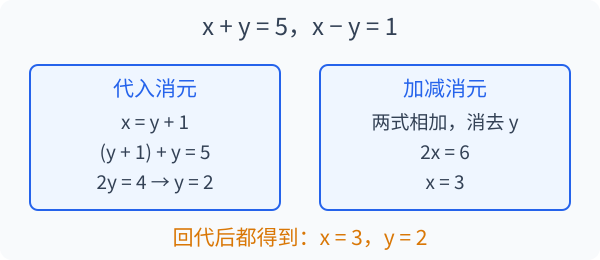
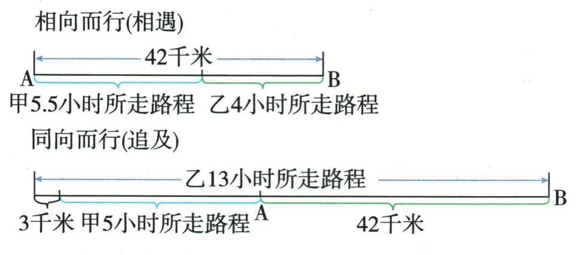
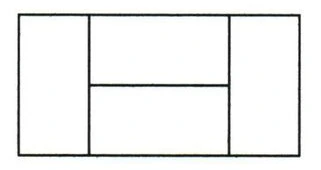

一个方程给出一条数量关系，方程组要求几条关系同时成立。本页从“什么样的数对才是解”出发，学习消元，再把方法用到两未知量的实际问题中。

<nav class="handbook-nav" aria-label="本章分区">
  <a class="handbook-jump is-knowledge" href="#knowledge">01 · 知识点概念、关系与适用条件</a>
  <a class="handbook-jump is-exam" href="#exam">02 · 考点题目分类和例题</a>
  <a class="handbook-jump is-pitfall" href="#pitfalls">03 · 坑点辨析错因，检查遗漏</a>
</nav>

## 【知识点】理解概念 {#knowledge .handbook-section .is-knowledge}

### 1. 二元一次方程与方程组 {#definition .knowledge-title}

$x+y=5$ 含有两个未知数，每个含未知数的项的次数都是 $1$，是==二元一次方程==

把有关同一组未知数的两个一次方程合在一起，就得到==二元一次方程组==，例如

$$\begin{cases}x+y=5\\x-y=1\end{cases}$$

### 2. 方程组的解 {#common-solution .knowledge-title}

一对数必须同时满足组内全部方程，才是方程组的解

上面方程组的解是 $\begin{cases}x=3\\y=2\end{cases}$，因为 $3+2=5$、$3-2=1$

### 3. 代入消元与加减消元 {#elimination .knowledge-title}

把两个未知数变成一个未知数，叫作==消元==

| 方法 | 以上面的方程组为例 |
| --- | --- |
| 代入消元 | 由 $x-y=1$ 得 $x=y+1$，代入另一式：$(y+1)+y=5$ |
| 加减消元 | 两式相加，$y$ 消去，得到 $2x=6$ |

求出一个未知数后，代回原方程求另一个，再把两个数一起代入原方程组检验

## 【考点】方法与例题 {#exam .handbook-section .is-exam}

### 1. 整数解与实际范围 {#integer-range .exam-title}

对 $ax+by=c$，在实数范围内可以任取一个未知数，再求另一个，因此有无穷多组实数解。限制为整数或正整数后，必须重新筛选。

- 整数包括负整数、零和正整数。
- 非负整数包括 $0$；正整数从 $1$ 开始。
- 人数、件数通常取非负整数；“两种都要买”还要求各自至少为 $1$。
- 并非每个二元一次方程都有整数解。例如 $2x+2y=1$ 不可能有整数解，因为左边为偶数。

若 $a,b,c$ 都是整数，且已经有一组整数解 $(x_0,y_0)$，那么 $(x_0+bk,y_0-ak)$ 对每个整数 $k$ 都仍是整数解。这说明“有整数解”和“有多少整数解”需要先后判断。

### 2. 两条关系，各有依据 {#model .exam-title}

两个未知量不便用一个字母表示时，可以分别设元。关键不是凑够两个等式，而是找出两条不同的数量关系。

| 问题中的信息 | 常用关系 | 需要保留的条件 |
| --- | --- | --- |
| 总数与倍数、差 | 两部分相加等于总数；一部分用另一部分表示 | 单位一致，倍数作用对象明确 |
| 材料配套 | 各部件数量÷每套所需数量相等 | 材料只能加工哪一类、整数限制 |
| 两种行程情景 | 各自路程＝各自速度×各自时间 | 起点、方向、先后出发的时间 |
| 增长前后 | 新量＝原量×增长因子 | 百分比以哪个时期的量为基数 |
| 图形拼接 | 对齐边长相等；外边周长关系 | 同样大小、无重叠拼接、长宽对应 |

求出方程组的解后，再检查它是否符合题意。负工作时间、分数人数都不能直接成为实际问题的答案。

### 3. 先检查整式，再检查元数和次数 {#identify .exam-title}

定义判断按三个条件逐项检查；含参数时，指数条件和系数不为零要同时满足。固定常数作分母不会使式子变成分式，未知数作分母则会。
<article class="handbook-example" aria-labelledby="example-1">

#### 例题 01 方程与方程组的定义辨别 知识清单例题·合组 {#example-1 .example-heading}

题目

（1）下列方程中，二元一次方程有几个？

① $2x-5=y$；② $x-4=1$；③ $xy=3$；

④ $5x+\dfrac2y=1$；⑤ $x^2-3y=0$；⑥ $\dfrac{x+4y}{2}=6$。

A. $2$ 个

B. $3$ 个

C. $4$ 个

D. $5$ 个

（2）下列哪个是二元一次方程组？

A. $\left\{\begin{aligned}2x+y-xy&=1,\\3x-2y&=3\end{aligned}\right.$

B. $\left\{\begin{aligned}3x&=y-1,\\5x-4z&=7\end{aligned}\right.$

C. $\left\{\begin{aligned}x+\frac2y&=5,\\5x+y&=3\end{aligned}\right.$

D. $\left\{\begin{aligned}x-2y&=14,\\3x+y&=9\end{aligned}\right.$

答案与解析

解析

（1）①⑥符合条件。②只有一元；③含二次项 $xy$；④未知数在分母；⑤含二次项 $x^2$。所以选 A。

（2）A 含 $xy$；B 整组有 $x,y,z$ 三元；C 含字母分母；只有 D 同时满足条件。

本题结论

（1）A；（2）D。

</article>

<article class="handbook-example" aria-labelledby="example-2">

#### 例题 02 参数影响指数，也影响元数 知识清单例题 {#example-2 .example-heading}

题目

若 $(a-2)x+y^{|a-1|}=0$ 是关于 $x,y$ 的二元一次方程，求 $a$。

答案与解析

解析

$y$ 项为一次，要求 $|a-1|=1$，得到 $a=0$ 或 $a=2$。

还要有 $a-2\ne0$，否则 $x$ 项消失。排除 $a=2$；当 $a=0$ 时方程是 $-2x+y=0$，符合定义。

本题结论

$a=0$。

</article>

### 4. 已知解：代入全部相关方程 {#substitute-root .exam-title}

判定一个数对是不是解，按字母位置代入；已知某个数对是解，则把它代入，得到关于参数的等式。数对是方程组的解时，每一条原式都可用，不能只用第一条。
<article class="handbook-example" aria-labelledby="example-3">

#### 例题 03 逐式代入与求参数 知识清单例题·合组 {#example-3 .example-heading}

题目

（1）（2023 江苏无锡）下列数对中，不是 $2x+y=4$ 的解的是哪一个？

A. $(1,2)$

B. $(2,0)$

C. $(\frac12,3)$

D. $(-2,4)$

（2）已知 $x=2,y=3$ 是 $ax-3y=3$ 的解，$a$ 的值为多少？

A. $\dfrac16$

B. $6$

C. $\dfrac13$

D. $3$

（3）若 $\left\{\begin{aligned}3x-y&=m,\\x+my&=n\end{aligned}\right.$ 的解是 $x=1,y=2$，求 $|m-n|$。

答案与解析

解析

（1）A、B、C 代入左边依次为 $4,4,4$；D 为 $2(-2)+4=0\ne4$，选 D。

（2）$2a-9=3$，所以 $2a=12$，$a=6$，选 B。

（3）第一式给 $m=3-2=1$；再代第二式，$n=1+2m=3$。最后求绝对值：$|m-n|=|1-3|=2$。

本题结论

（1）D；（2）B；（3）2。

</article>

### 5. 正整数解：先定范围，再筛选 {#integer-method .exam-title}

先由两个量都为正确定有限范围，再用整除条件筛选，最后列出数对或计数。计数时一组数量是一种方案，不把不同排列、切割顺序重复计入。
<article class="handbook-example" aria-labelledby="example-4">

#### 例题 04 整数范围与方案计数 知识清单例题·合组 {#example-4 .example-heading}

题目

（1）求 $4x+y=20$ 的所有正整数解。

（2）小碗每个 $3$ 元，大碗每个 $4$ 元，花 $30$ 元买这两种碗，两种都买。有哪些数量方案？

（3）（2023 黑龙江齐齐哈尔）把长 $150\text{ cm}$ 的铁丝全部截成 $10\text{ cm}$、$20\text{ cm}$ 两种长度，每种至少一段。有多少种数量方案？

A. $5$

B. $6$

C. $7$

D. $8$

答案与解析

解析

（1）$y=20-4x>0$，所以 $0<x<5$。依次取 $x=1,2,3,4$，得到 $(x,y)=(1,16)$、$(2,12)$、$(3,8)$、$(4,4)$。$x=5$ 时 $y=0$，不符合正整数条件。

（2）设小碗 $x$ 个、大碗 $y$ 个，则 $3x+4y=30$，$x,y\ge1$ 且为整数。由 $4y\le27$ 得 $1\le y\le6$；$30-4y$ 是 $3$ 的倍数，故 $y$ 是 $3$ 的倍数。只有 $y=3,6$，对应 $x=6,2$。

（3）设两种段数分别为 $x,y$，有 $10x+20y=150$，即 $x=15-2y$。由 $x,y\ge1$ 得 $y=1,2,\ldots,7$，对应 $x$ 依次为 $13$、$11$、$9$、$7$、$5$、$3$、$1$，共 $7$ 种，选 C。

本题结论

（1）$(1,16)$、$(2,12)$、$(3,8)$、$(4,4)$；（2）小碗6个、大碗3个，或小碗2个、大碗6个；（3）C。

</article>

### 6. 代入、加减：按系数选路 {#solve-method .exam-title}

有单位系数时先考虑代入；同系数相减、互为相反数相加；其他情况先倍乘整条等式配系数。无论选哪条路，消元后都要回代。
<article class="handbook-example" aria-labelledby="example-5">

#### 例题 05 单位系数先代入 知识清单例题 {#example-5 .example-heading}

题目

用代入法解 $\left\{\begin{aligned}x-2y&=3,\\3x-8y&=13.\end{aligned}\right.$

答案与解析

解析

由第一式得 $x=3+2y$，代入第二式：

$$3(3+2y)-8y=13\Rightarrow9-2y=13\Rightarrow y=-2.$$

回代得 $x=3+2(-2)=-1$。检验：$-1-2(-2)=3$，$3(-1)-8(-2)=13$，两式都成立。

本题结论

$\left\{\begin{aligned}x&=-1,\\y&=-2.\end{aligned}\right.$

</article>

<article class="handbook-example" aria-labelledby="example-6">

#### 例题 06 同系数相减的一组题 知识清单例题·合组 {#example-6 .example-heading}

题目

（1）对 $\left\{\begin{aligned}3x+2y&=2,\quad\text{\textcircled{1}}\\x+2y&=0,\quad\text{\textcircled{2}}\end{aligned}\right.$，$\text{\textcircled{1}}-\text{\textcircled{2}}$ 消去哪个未知数？得到什么一元一次方程？

（2）用加减法解 $\left\{\begin{aligned}2x-5y&=7,\\3y+2x&=-1.\end{aligned}\right.$

（3）（2024 江苏苏州）解 $\left\{\begin{aligned}2x+y&=7,\\2x-3y&=3.\end{aligned}\right.$

答案与解析

解析

（1）$(3x+2y)-(x+2y)=2-0$，所以消去 $y$，得到 $2x=2$。若继续求全组解，则 $x=1,y=-\frac12$。

（2）第一式减第二式：$(2x-5y)-(2x+3y)=7-(-1)$，即 $-8y=8$，故 $y=-1$。回第一式 $2x+5=7$，得 $x=1$。

（3）第一式减第二式：$4y=4$，得 $y=1$；回代 $2x+1=7$，得 $x=3$。

三个问题都利用相同系数消元，减法的作用范围都是整条等式，不能只减选中的未知项。

本题结论

（1）消去 $y$，得 $2x=2$；（2）$x=1,y=-1$；（3）$x=3,y=1$。

</article>

<article class="handbook-example" aria-labelledby="example-7">

#### 例题 07 整理后配出相同系数 知识清单例题 {#example-7 .example-heading}

题目

用加减法解 $\left\{\begin{aligned}3(x-1)&=2(y+1),\\2(x+2)&=15-5(y-1).\end{aligned}\right.$

答案与解析

解析

先去括号、移项：

$$\left\{\begin{aligned}3x-2y&=5,\quad\text{\textcircled{1}}\\2x+5y&=16.\quad\text{\textcircled{2}}\end{aligned}\right.$$

$\text{\textcircled{1}}\times2$ 得 $6x-4y=10$；$\text{\textcircled{2}}\times3$ 得 $6x+15y=48$。后式减前式得 $19y=38$，所以 $y=2$。回代 $3x-4=5$，得 $x=3$。

检验原括号式：$3(3-1)=2(2+1)=6$，$2(3+2)=15-5(2-1)=10$。

本题结论

$x=3,y=2$。

</article>

### 7. 重复整体与所求组合 {#whole .exam-title}

先观察能否直接求出重复块，或通过两式相加、相减得到题目所求的组合。只有结构确实重复时才换元；新变量取名后写清定义，算完必须回到原变量。
<article class="handbook-example" aria-labelledby="example-8">

#### 例题 08 整体代入与直接求差 知识清单例题·合组 {#example-8 .example-heading}

题目

（1）解 $\left\{\begin{aligned}\frac95(x+y)&=18,\\\frac23x+\frac32(x+y)&=18.\end{aligned}\right.$

（2）（2023 辽宁朝阳）$\left\{\begin{aligned}2x+y&=2a+1,\\x+2y&=a-1\end{aligned}\right.$ 的解满足 $x-y=4$，求 $a$。

答案与解析

解析

（1）第一式直接给出 $x+y=10$。代入第二式，$\frac23x+15=18$，得到 $x=\frac92$，再由和为 $10$ 得 $y=\frac{11}2$。

（2）两式相减，左边是 $x-y$，右边是 $(2a+1)-(a-1)=a+2$。因此 $a+2=4$，$a=2$。回验此时 $x=3,y=-1$，满足原两式与差为 $4$ 的条件。

本题结论

（1）$x=\frac92,y=\frac{11}2$；（2）$a=2$。

</article>

<article class="handbook-example" aria-labelledby="example-9">

#### 例题 09 换元后再回换 知识清单例题 {#example-9 .example-heading}

题目

乐乐解 $\left\{\begin{aligned}3(m+5)-2(n+3)&=-1,\\3(m+5)+2(n+3)&=7\end{aligned}\right.$ 时，设 $X=m+5,Y=n+3$，得到

$$\left\{\begin{aligned}3X-2Y&=-1,\\3X+2Y&=7.\end{aligned}\right.$$

解得 $X=1,Y=2$，再回换得到 $m=-4,n=-1$。

仿照这个方法，解 $\left\{\begin{aligned}\frac{x+y}{3}+\frac{x-y}{5}&=4,\\\frac{x+y}{3}-\frac{x-y}{5}&=-2.\end{aligned}\right.$

答案与解析

解析

设 $M=\dfrac{x+y}{3},N=\dfrac{x-y}{5}$，则 $M+N=4,M-N=-2$。相加得 $M=1$，相减得 $N=3$。

这还不是原未知数的值。 回换：

$$\left\{\begin{aligned}x+y&=3,\\x-y&=15\end{aligned}\right.\Rightarrow x=9,\ y=-6.$$

检验原两块分别为 $1,3$，和为 $4$、差为 $-2$。题内示范也一样：$X=1$ 代表 $m+5=1$，并不代表 $m=1$。

本题结论

$x=9,y=-6$。

</article>

<article class="handbook-example" aria-labelledby="example-10">

#### 例题 10 已知解与变量组合对应 2024 江苏宿迁·改编，明确唯一解条件 {#example-10 .example-heading}

题目

（2024 江苏宿迁题，明确唯一解条件）已知 $\left\{\begin{aligned}ax+y&=b,\\cx-y&=d\end{aligned}\right.$ 的唯一解是 $x=3,y=-2$。求 $\left\{\begin{aligned}ax+2y&=2a+b,\\cx-2y&=2c+d\end{aligned}\right.$ 的解。

答案与解析

解析

把新组整理成 $a(x-2)+2y=b,c(x-2)-2y=d$。设 $X=x-2,Y=2y$，它正好成为已知的方程组。因此 $X=3,Y=-2$，回换得 $x=5,y=-1$。

这里用到的是已知组的唯一解。若只知道它“有一组解”为 $(3,-2)$，只能推出新组有对应的一组解，不能断言没有其他解。原组相加得 $(a+c)x=b+d$，唯一解条件要求 $a+c\ne0$。

本题结论

$x=5,y=-1$。

</article>

### 8. 同解与看错系数：分清可靠的等式 {#parameter .exam-title}

“两个方程组同解”时，先用不含参数的两式确定公共数对，再代含参数的式子。“看错系数”题则相反：某人的错解只能代入他没有看错的那条原方程。
<article class="handbook-example" aria-labelledby="example-11">

#### 例题 11 同解确定参数组合 知识清单例题 {#example-11 .example-heading}

题目

方程组 $\left\{\begin{aligned}4x+y&=3,\\ax-by&=-5\end{aligned}\right.$ 与 $\left\{\begin{aligned}3x+2y&=1,\\ax+by&=1\end{aligned}\right.$ 有相同的解，求 $a^2-b^2$。

答案与解析

解析

先解 $4x+y=3,3x+2y=1$：第一式乘 $2$ 减第二式，得 $5x=5$，故 $x=1,y=-1$。

代入参数式，得 $a+b=-5,a-b=1$，所以

$$a^2-b^2=(a+b)(a-b)=-5\times1=-5.$$

也可解得 $a=-2,b=-3$；代回两个原组，数对 $(1,-1)$ 均成立，且两组都不会退化。

本题结论

$a^2-b^2=-5$。

</article>

<article class="handbook-example" aria-labelledby="example-12">

#### 例题 12 错解只用未看错的方程 知识清单例题 {#example-12 .example-heading}

题目

原方程组为 $\left\{\begin{aligned}ax+5y&=15,\quad\text{\textcircled{1}}\\4x-by&=-2.\quad\text{\textcircled{2}}\end{aligned}\right.$ 甲只看错①中的 $a$，得到 $x=-3,y=-1$；乙只看错②中的 $b$，得到 $x=5,y=4$。求原来的 $a,b$。

答案与解析

解析

| 人物 | 可信的原式 | 代入后所得 |
| --- | --- | --- |
| 甲 | 没看错的② | $4(-3)-b(-1)=-2$，故 $b=10$ |
| 乙 | 没看错的① | $5a+5\times4=15$，故 $a=-1$ |

不能把甲的数对代入原①求 $a$，因为甲解的是已经看错系数的另一条方程；乙同理。

本题结论

$a=-1,b=10$。

</article>

### 9. 应用：两种情景共用同一组未知量 {#applications .exam-title}

列式前先用文字写出两条等量关系。设元可直接也可间接，但同一个字母在所有等式中含义不变。不同情景用同一速度、单价等量时，要确认题设允许共用。
<article class="handbook-example" aria-labelledby="example-13">

#### 例题 13 总量与差、倍数 知识清单例题·情境文字合组缩写 {#example-13 .example-heading}

题目

（1）某年级有 $246$ 人，男生比女生的 $2$ 倍少 $3$ 人。设女生 $x$ 人、男生 $y$ 人，列方程组。

（2）（2024 江苏盐城）一条绳索比竿子长 $5$ 尺，把绳索对折后又比竿子短 $5$ 尺。求竿子的长度。

（3）（2024 山西）按题设数据，每吨废旧智能手机提炼出的白银比黄金多 $760$ 克；$2.5$ 吨提炼出的黄金与 $0.6$ 吨提炼出的白银质量相等。每吨能提炼出黄金、白银各多少克？

答案与解析

解析

（1）人数和、倍数差分别给 $x+y=246,y=2x-3$。若求人数，则 $3x-3=246$，得女生 $83$ 人、男生 $163$ 人。

（2）设绳长 $x$ 尺、竿长 $y$ 尺，则 $x=y+5,\frac x2=y-5$。把前式代入后式：$y+5=2y-10$，故 $y=15,x=20$。题问竿长，答 $15$ 尺。

（3）设每吨提炼黄金 $x$ 克、白银 $y$ 克，则 $y=x+760,2.5x=0.6y$。代入得 $1.9x=456$，所以 $x=240,y=1000$。两种总提炼量均为 $600$ 克，这是核验用的中间量，不是“每吨”的答案。

本题结论

（1）$x+y=246,y=2x-3$；（2）15尺；（3）黄金240克、白银1000克。

</article>

<article class="handbook-example" aria-labelledby="example-14">

#### 例题 14 相向与同向分别画路程 知识清单例题·改编，明确两次起点和速度条件 {#example-14 .example-heading}

题目

A、B 两地相距 $42$ 千米，甲、乙分别从 A、B 出发。相向而行时，甲比乙早 $1.5$ 小时出发，乙出发 $4$ 小时后相遇。另一次两人仍从各自原起点出发，均沿 B→A 方向走，乙比甲早 $8$ 小时出发，甲出发 $5$ 小时后，乙超出甲 $3$ 千米。两人的速度各自不变，求甲、乙的速度。

答案与解析

解析

设甲速 $x$、乙速 $y$，单位为千米/时。

| 情景 | 甲走的时间 | 乙走的时间 | 等量关系 |
| --- | --- | --- | --- |
| 相向 | $1.5+4=5.5$ | $4$ | $5.5x+4y=42$ |
| 同向 | $5$ | $8+5=13$ | $13y=42+5x+3$ |

同向时起点相距 $42$ 千米，不能只写两人路程差为 $3$。

第一式乘 $2$ 得 $11x+8y=84$；第二式整理为 $-5x+13y=45$。两式分别乘 $5,11$ 后相加，得 $183y=915$，所以 $y=5$，回代 $x=4$。

核验相向路程 $22+20=42$；同向乙走 $65$，等于 $42+20+3$。

本题结论

甲4千米/时，乙5千米/时。

</article>

<article class="handbook-example" aria-labelledby="example-15">

#### 例题 15 拼接图中的两条边长关系 知识清单例题 {#example-15 .example-heading}

题目

四个形状、大小一样的小长方形按图拼成大长方形。大长方形的周长为 $12\text{ cm}$，求小长方形的周长。

答案与解析

解析

设小长方形宽 $x\text{ cm}$、长 $y\text{ cm}$。

- 中间上下两块的高度与两侧竖块相同，所以 $2x=y$。
- 大长方形宽为 $y$，长为 $y+2x$；半周长是 $y+(y+2x)=6$。

因此 $\left\{\begin{aligned}2x&=y,\\2y+2x&=6\end{aligned}\right.$，解得 $x=1,y=2$。小长方形周长为 $2(x+y)=6\text{ cm}$。

注意半周长包含大长方形的一长一宽，不能漏掉其中一个 $y$。

本题结论

小长方形周长为6厘米。

</article>

### 10. 配套最多：先找配平方案，再证明上界 {#matching .exam-title}

加工材料数与产出部件数不是同一个量。先按“部件数÷每套所需数”配平；题目要求“最多”时，还应说明任何方案都不能超过所得数量，而不是仅因解出一组整数就宣称最优。
<article class="handbook-example" aria-labelledby="example-16">

#### 例题 16 窗框材料的最优分配 知识清单例题 {#example-16 .example-heading}

题目

每根铝合金材料可以做竖柱 $5$ 根或者横梁 $8$ 根，而且只能做其中一种。每个窗框用 $2$ 根竖柱、$3$ 根横梁。现有 $310$ 根材料，怎样分配才能做出最多的窗框？

答案与解析

解析

设用 $x$ 根材料做竖柱、$y$ 根做横梁。全部使用且恰好配套时，

$$x+y=310,\qquad\frac{5x}{2}=\frac{8y}{3},$$

即 $15x=16y$。解得 $x=160,y=150$，产出竖柱 $800$ 根、横梁 $1200$ 根，恰好组成 $400$ 个窗框。

为什么不会有更多？ 若做 $N$ 个窗框，至少需要 $\frac{2N}{5}$ 根材料供应竖柱，$\frac{3N}{8}$ 根供应横梁。于是

$$\frac{2N}{5}+\frac{3N}{8}=\frac{31N}{40}\le310\Rightarrow N\le400.$$

上述整数方案达到上界，故确实最优。

本题结论

160根材料做竖柱，150根做横梁，最多400个窗框。

</article>

## 【坑点】辨析与边界 {#pitfalls .handbook-section .is-pitfall}

### 1. 整数、非负整数、正整数不能混用 {#integer-pit .pitfall-title}

先标出取值范围，再谈解的个数。一个方程有无穷多组实数解，不表示任意范围内都无穷多；零是否能取也会改变计数。
<article class="handbook-example is-pitfall" aria-labelledby="pitfall-1">

#### 辨析 01 同一个方程，不同解的范围 知识清单例题 {#pitfall-1 .example-heading}

题目

对二元一次方程 $x+y=1$，下列说法正确的是哪一个？

A. 有一组正整数解

B. 只有有限组解

C. 只有一组非负整数解

D. 有无穷多组整数解

答案与解析

解析

正整数 $x,y$ 至少都为 $1$，和至少为 $2$，所以 A 错。实数范围内任取 $x=t$，都有 $y=1-t$，所以 B 错。

非负整数解有 $(0,1),(1,0)$ 两组，不是一组，C 错。

令 $x=k,y=1-k$，每个整数 $k$ 都给出一组整数解，故 D 对。这个结论来自本题的结构，不能推广成“任何二元一次方程都有整数解”。

本题结论

选D。

</article>

### 2. 代入与相减都要保留整块 {#operation-pit .pitfall-title}

把一个表达式代替未知数时，原来的外系数仍乘整个表达式；两式相减时，后一式的每一项都要改变符号。倍乘方程则两边每一项都要乘同一个数。
<article class="handbook-example is-pitfall" aria-labelledby="pitfall-2">

#### 辨析 02 代入后哪一步成立 知识清单例题 {#pitfall-2 .example-heading}

题目

用代入法解 $y=1-x,\ x+2y=4$，把第一式代入第二式，正确结果是哪一个？

A. $x-2-2x=4$

B. $x+2-2x=4$

C. $x+2+x=4$

D. $x+2-x=4$

答案与解析

解析

先写 $x+2(1-x)=4$，再用分配律得到 $x+2-2x=4$，所以 B 正确。

A 错在常数符号；C 错在 $x$ 项的符号与倍数；D 漏乘了外系数 $2$。不要把“代入”与“去括号”混成一步心算。

本题结论

选B。

</article>

<article class="handbook-example is-pitfall" aria-labelledby="pitfall-3">

#### 辨析 03 倍乘与消去哪一元 知识清单例题 {#pitfall-3 .example-heading}

题目

解 $\left\{\begin{aligned}2x+5y&=-10,\quad\text{\textcircled{1}}\\5x-3y&=-1,\quad\text{\textcircled{2}}\end{aligned}\right.$ 时，下列操作正确的是哪一个？

A. $\text{\textcircled{1}}\times3-\text{\textcircled{2}}\times5$ 消去 $x$

B. $\text{\textcircled{1}}\times5+\text{\textcircled{2}}\times2$ 消去 $y$

C. $\text{\textcircled{1}}\times5-\text{\textcircled{2}}\times2$ 消去 $x$

D. $\text{\textcircled{1}}\times3+\text{\textcircled{2}}\times2$ 消去 $y$

答案与解析

解析

逐项只先检查声称要消去的那一元系数：

| 选项 | 对应系数结果 | 判断 |
| --- | --- | --- |
| A | $2\times3-5\times5=-19$ | $x$ 未消去 |
| B | $5\times5+(-3)\times2=19$ | $y$ 未消去 |
| C | $2\times5-5\times2=0$ | $x$ 消去 |
| D | $5\times3+(-3)\times2=9$ | $y$ 未消去 |

执行 C 时，两式分别变成 $10x+25y=-50$、$10x-6y=-2$，相减为 $31y=-48$；常数项也必须随整式倍乘。

本题结论

选C。

</article>

### 3. 观察者是否包括自己 {#observer .pitfall-title}

“看到的人数”不一定等于总人数。分别站在每位观察者的位置列数量表，只从他自己所属的那一类减去一人，不是两类都减一。
<article class="handbook-example is-pitfall" aria-labelledby="pitfall-4">

#### 辨析 04 帽子数量的观察范围 知识清单例题·改编，明确可见范围 {#pitfall-4 .example-heading}

题目

七（1）班男生戴白帽、女生戴红帽。男生小明说：“我看到白帽比红帽多5顶。”女生小红说：“我看到红帽是白帽数量的 $\frac34$。”每人能看见全班其他人的帽子，但看不见自己的帽子。求男、女生人数。

答案与解析

解析

设男生 $x$ 人、女生 $y$ 人。

| 观察者 | 看见白帽 | 看见红帽 | 关系 |
| --- | --- | --- | --- |
| 小明 | $x-1$ | $y$ | $x-1=y+5$ |
| 小红 | $x$ | $y-1$ | $y-1=\frac34x$ |

第一式得 $x=y+6$；第二式乘 $4$ 后代入，$4y-4=3y+18$，得到 $y=22,x=28$。

回验：小明看见 $27$ 顶白帽与 $22$ 顶红帽；小红看见 $21$ 顶红帽与 $28$ 顶白帽，两个条件都满足。

本题结论

男生28人，女生22人。

</article>

### 4. 空房与多出的人，单位不能混 {#surplus .pitfall-title}

“空出一间”减少的是已使用的房间数；“多出几人”增加的是总人数。先写每个量的单位，再决定加减发生在乘法括号内还是括号外。
<article class="handbook-example is-pitfall" aria-labelledby="pitfall-5">

#### 辨析 05 同一批客人的两种入住方式 2024 四川南充·情境缩写 {#pitfall-5 .example-heading}

题目

（2024 四川南充）每间客房住 $7$ 人，有 $7$ 人无房可住；每间住 $9$ 人，则空出一间。设房间 $x$ 间、客人 $y$ 人，可列哪组方程？

A. $y=7x-7,\ y=9(x+1)$

B. $y=7x-7,\ y=9(x-1)$

C. $y=7x+7,\ y=9(x+1)$

D. $y=7x+7,\ y=9(x-1)$

答案与解析

解析

每间住 $7$ 人，全部房间住下 $7x$ 人，还有 $7$ 人，所以总人数 $y=7x+7$。

每间住 $9$ 人，只使用 $x-1$ 间，故 $y=9(x-1)$。不能写 $9x-1$，那相当于少一人而不是空一间。

两式联立也可验证 $x=8,y=63$：$7\times8+7=63$，$9\times7=63$。

本题结论

选D。

</article>

### 5. 解出的年份要与问题一致 {#growth .pitfall-title}

设去年量通常便于使用去年差值，但求出的根仍是去年量。列两年对照表，解后再按各自增长率回到今年，不能把间接设出的中间量直接当答案。
<article class="handbook-example is-pitfall" aria-labelledby="pitfall-6">

#### 辨析 06 旅游人数的前后年份 知识清单例题 {#pitfall-6 .example-heading}

题目

今年“五一”某市外来、外出旅游总人数为 $208$ 万，分别比去年同期增加 $20\%$、$10\%$；去年外来比外出多 $20$ 万。求今年两类旅游人数。

答案与解析

解析

设去年外来 $x$ 万、外出 $y$ 万。

| 类别 | 去年 | 今年 |
| --- | --- | --- |
| 外来 | $x$ | $1.2x$ |
| 外出 | $y$ | $1.1y$ |

去年差值给 $x-y=20$；今年总量给 $1.2x+1.1y=208$。代 $x=y+20$，得 $2.3y+24=208$，所以 $y=80,x=100$。

回到今年：$1.2x=120$，$1.1y=88$，和为 $208$。只答 $100,80$，回答的是去年而不是今年。

本题结论

今年外来120万人，外出88万人。

</article>

### 6. 形式方程有解，不代表计划可行 {#feasibility .pitfall-title}

先后工作的时间可以相加，但工作天数必须非负。出现负天数时，应回查数量关系与原始数据；不能为了得到正数自行改题。也可以用效率上下界在求解前检查可行性。
<article class="handbook-example is-pitfall" aria-labelledby="pitfall-7">

#### 辨析 07 一份绿化计划能否执行 依据知识清单原题改编·条件辨析 {#pitfall-7 .example-heading}

题目

一块面积 $12$ 公顷的荒地，计划甲队先绿化，乙队接替，共用 $20$ 天。甲每天绿化 $0.75$ 公顷，乙每天绿化 $0.8$ 公顷。设甲、乙分别工作 $x,y$ 天，列出方程组，并判断这个计划是否可行。

答案与解析

解析

先后工作，时间不重叠，故 $x+y=20$；面积相加，故 $0.75x+0.8y=12$。形式方程组为

$$\left\{\begin{aligned}x+y&=20,\\0.75x+0.8y&=12.\end{aligned}\right.$$

代入 $y=20-x$，得 $0.75x+16-0.8x=12$，所以 $x=80,y=-60$。负工作时间不符合题意，计划不可行。

也可直接判断：连续工作 $20$ 天，即使每天都按较慢的 $0.75$ 公顷计算，也至少绿化 $15$ 公顷，已经超过题设的 $12$ 公顷。矛盾在给定条件，而不是消元算法。

本题结论

可列上述形式方程组，但没有满足工作时间非负的实际方案。

</article>
