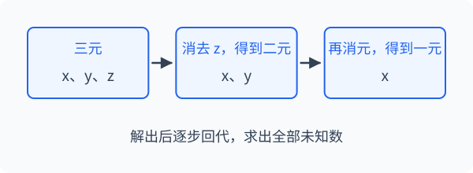
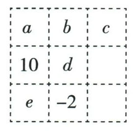

三元一次方程组沿用二元方程组的消元思想：先把三个未知数减少为两个，再减少为一个。本页作为多元一次方程组的拓展，重点是消元顺序与回代，而不是增加一套新算法。

<nav class="handbook-nav" aria-label="本章分区">
  <a class="handbook-jump is-knowledge" href="#knowledge">01 · 知识点概念、关系与适用条件</a>
  <a class="handbook-jump is-exam" href="#exam">02 · 考点题目分类和例题</a>
  <a class="handbook-jump is-pitfall" href="#pitfalls">03 · 坑点辨析错因，检查遗漏</a>
</nav>

## 【知识点】理解概念 {#knowledge .handbook-section .is-knowledge}

### 1. 三元一次方程组 {#definition .knowledge-title}

方程组含有三个未知数，各方程都是一次整式方程，叫作==三元一次方程组==

例如 $\begin{cases}x+y+z=6\\x-y=0\\z=2\end{cases}$，解是一组同时满足全部方程的三个数

### 2. 消元求解 {#elimination .knowledge-title}

1. 选定一个未知数，用两组方程分别消去它，得到二元一次方程组
2. 解二元一次方程组，求出两个未知数
3. 代回原方程，求第三个未知数

例如上面已知 $z=2$，代入第一式得到 $x+y=4$；与 $x-y=0$ 联立，得 $x=y=2$

所以原方程组的解是 $\begin{cases}x=2\\y=2\\z=2\end{cases}$

## 【考点】方法与例题 {#exam .handbook-section .is-exam}

### 1. 先用已经确定的量 {#known-variable .exam-title}

观察有没有 $c=\text{常数}$ 这样的方程。有就先代入其余两式，得到二元组；随后按系数选择加减或代入。最后把三个变量的值完整列出。
<article class="handbook-example" aria-labelledby="example-1">

#### 例题 01 一元已知时的降元 知识清单概念示例·改编为求解题 {#example-1 .example-heading}

题目

解方程组 $\left\{\begin{aligned}a+b+c&=7,\\4a+2b+c&=17,\\c&=1.\end{aligned}\right.$

答案与解析

解析

由第三式 $c=1$，代入前两式：

$$\left\{\begin{aligned}a+b&=6,\\4a+2b&=16.\end{aligned}\right.$$

第二式除以 $2$，得 $2a+b=8$；减去第一式，得 $a=2$。再代入 $a+b=6$，得 $b=4$。

检验原组：$2+4+1=7$，$4\times2+2\times4+1=17$，且 $c=1$。

本题结论

$a=2,b=4,c=1$。

</article>

### 2. 两次消同一元，构成二元组 {#same-variable .exam-title}

先看哪一元的系数最容易抵消。选定以后，第一次、第二次都消它。例如原式中有 $-y,+y,+y$，可用含 $-y$ 的方程分别与另外两式相加。

::: steps
1. 给三条原方程编号，圈定同一个待消元。
2. 写出两次运算的来源与所得二元方程。
3. 联立这两个二元方程，求出保留的两个未知数。
4. 回代一条原式求第三元，再逐式检验。
:::

<article class="handbook-example" aria-labelledby="example-2">

#### 例题 02 消去同一元再回代 知识清单例题 {#example-2 .example-heading}

题目

解方程组 $\left\{\begin{aligned}3x-y+2z&=3,\quad\text{\textcircled{1}}\\2x+y-3z&=11,\quad\text{\textcircled{2}}\\x+y+z&=12.\quad\text{\textcircled{3}}\end{aligned}\right.$

答案与解析

解析

$\text{\textcircled{1}}+\text{\textcircled{2}}$ 消去 $y$，得到 $5x-z=14$，记为④。

$\text{\textcircled{1}}+\text{\textcircled{3}}$ 也消去 $y$，得到 $4x+3z=15$，记为⑤。于是构成同含 $x,z$ 的二元组：

$$\left\{\begin{aligned}5x-z&=14,\\4x+3z&=15.\end{aligned}\right.$$

$\text{\textcircled{4}}\times3+\text{\textcircled{5}}$ 得 $19x=57$，所以 $x=3$；代④，$15-z=14$，得 $z=1$。

再回原③：$3+y+1=12$，得 $y=8$。

| 原式 | 代入检查 |
| --- | --- |
| ① | $3\times3-8+2\times1=3$ |
| ② | $2\times3+8-3\times1=11$ |
| ③ | $3+8+1=12$ |

三个原条件全部满足。

本题结论

$\left\{\begin{aligned}x&=3,\\y&=8,\\z&=1.\end{aligned}\right.$

</article>

### 3. 只求一个量，不必求全体未知数 {#target .exam-title}

方格、图形或数量关系中未知量很多时，先盯住所求量。选择含有共同部分的两条关系相减，可以连续消去不需要的量。每一步都要说明使用了哪两条相等关系，不能凭“看起来相似”约掉不同的项。
<article class="handbook-example" aria-labelledby="example-3">

#### 例题 03 幻方中的目标量 知识清单例题 {#example-3 .example-heading}

题目

幻方要求每一横行、每一竖列以及两条对角线上的三个数之和相等。图中是一个三阶幻方的一部分，求右上角 $c$ 的值。

A. $-2$

B. $0$

C. $2$

D. $4$

答案与解析

解析

先从已知格子最多的线选关系。

| 相等的两条线 | 原等式 | 消去共同格后 |
| --- | --- | --- |
| 第一行与第一列 | $a+b+c=a+10+e$ | $b+c=10+e$ |
| 第二列与反对角线 | $b+d-2=c+d+e$ | $b-2=c+e$ |

将两条简化关系相减：

$$(10+e)-(c+e)=(b+c)-(b-2),$$

即 $10-c=c+2$，所以 $2c=8,c=4$，选 D。

不需要求出 $a,b,d,e$。本题只要求行、列、对角线的和相等，没有规定填 $1$ 至 $9$，也没有规定九个数互不相同，不能自行添加这些限制。

本题结论

$c=4$，选D。

</article>

## 【坑点】辨析与边界 {#pitfalls .handbook-section .is-pitfall}

### 1. 两次消去不同元，还没有降成同一个二元组 {#mixed-elimination .pitfall-title}

若第一次得到只含 $x,z$ 的方程，第二次却得到只含 $x,y$ 的方程，合起来仍有 $x,y,z$ 三个未知数。两步单独可能都正确，但还没有完成“三元→二元”的目标。

正确做法：提前决定保留哪两个量，让两次运算都消去第三个量；或者继续利用原式消元。不要把不同的字母直接当作同一个未知数，也不要因为得到两条方程就误称二元组。

### 2. 两元求完，原组三元还没有求完 {#back-substitution .pitfall-title}

求出两个保留的未知数后，必须回原关系求被消去的第三元。回验也要回到原组三式，而非仅验证消元后的两式。

检查顺序：三个未知数是否都写出 → 数值是否对应正确字母 → 每条原方程是否成立。

### 3. 幻方不能附加未给出的数字范围 {#magic-boundary .pitfall-title}

传统幻方有很多形式。解具体题目时，以题干给出的规则为准：要求各条线的和相等，不等于要求“只能填 $1$ 至 $9$”；给出了负数，也不能擅自改成正数。

只求某一格时，必要的相等关系可能已经足够。不要为了补齐整张表引入多余假设，也不要把尚未唯一确定的其他格子硬算成一个值。
