用两个有顺序的数表示平面内的位置，再用坐标计算距离、描述平移与对称。

<nav class="handbook-nav" aria-label="本章分区">
  <a class="handbook-jump is-knowledge" href="#knowledge">01 · 知识点概念、关系与适用条件</a>
  <a class="handbook-jump is-exam" href="#exam">02 · 考点先归纳方法，再看例题</a>
  <a class="handbook-jump is-pitfall" href="#pitfalls">03 · 坑点辨析错因，检查遗漏</a>
</nav>

## 【知识点】概念与依据 {#knowledge .handbook-section .is-knowledge}

### 1. 有序数对 {#ordered-pairs .knowledge-title}

如图，约定先写列号，再写排号，就能用两个数确定学生的位置。小红在第 $2$ 列第 $3$ 排，简记为 $(2,3)$。

像 $(2,3)$ 这样按顺序排列的两个数，叫作==有序数对==。

### 2. 坐标、坐标轴 {#axes .knowledge-title}

在平面内画两条互相垂直、原点重合的数轴，就得到==平面直角坐标系==。这两条数轴叫作==坐标轴==，通常这样放置：

- 水平的叫 ==$x$ 轴==，也叫横轴，向右为正方向。
- 竖直的叫 ==$y$ 轴==，也叫纵轴，向上为正方向。

两轴的交点 $O$ 叫作==原点==。

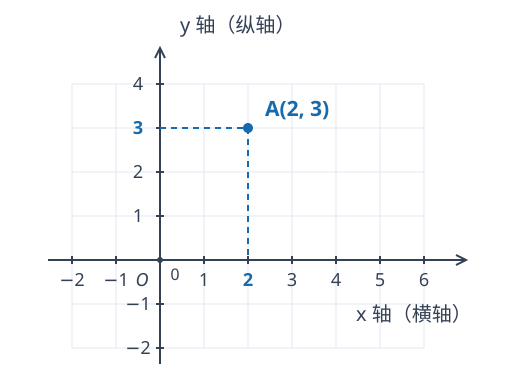

沿虚线读数，点 $A$ 的==横坐标==是 $2$，==纵坐标==是 $3$。

==坐标==按“先横后纵”写成 $(2,3)$，记作 $A(2,3)$。原点的坐标是 $(0,0)$。

一个单位指一个==单位长度==，也就是数轴上 $0$ 到 $1$ 的距离。向左移动一个单位，就是横坐标减 $1$，纵坐标不变。例如，$A(2,3)$ 向左移动一个单位后到达 $(1,3)$。

一格代表几个单位，要看刻度。 若横轴上一格从 $0$ 到 $2$，这一格就代表 $2$ 个单位，向左移动一个单位只需移半格。

### 3. 象限 {#quadrants .knowledge-title}

从右上方开始，按逆时针顺序依次为第一、第二、第三、第四象限。

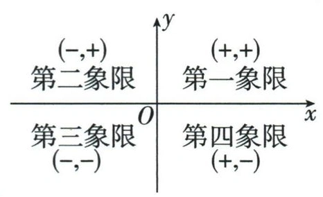

| 位置 | 坐标符号 $(x,y)$ | 坐标示例 |
| --- | --- | --- |
| 第一象限 | $(+,+)$ | $(2,3)$ |
| 第二象限 | $(-,+)$ | $(-2,3)$ |
| 第三象限 | $(-,-)$ | $(-2,-3)$ |
| 第四象限 | $(+,-)$ | $(2,-3)$ |
| $x$ 轴上 | $(+,0)$、$(-,0)$ 或 $(0,0)$ | $(2,0)$、$(-2,0)$ |
| $y$ 轴上 | $(0,+)$、$(0,-)$ 或 $(0,0)$ | $(0,3)$、$(0,-3)$ |
| 原点 | $(0,0)$ | $(0,0)$ |

两坐标都非零才属于某个象限。原点属于两条坐标轴，但不属于任何象限；正、负半轴也都不包含原点。

- $xy>0$ &emsp;→&emsp; $x$ 和 $y$ 同号 &emsp;→&emsp; 点在第一或第三象限 &emsp;→&emsp; $(+,+)$ 或 $(-,-)$。
- $xy<0$ &emsp;→&emsp; $x$ 和 $y$ 异号 &emsp;→&emsp; 点在第二或第四象限 &emsp;→&emsp; $(-,+)$ 或 $(+,-)$。

要确定具体在哪个象限，还需判断 $x$、$y$ 各自的正负。

### 4. 距离 {#distances .knowledge-title}

| 所求量 | 计算方法 | 例子 |
| --- | --- | --- |
| 点 $(x,y)$ 到 $x$ 轴的距离 | $\lvert y\rvert$ | $(-2,3)$ 到 $x$ 轴的距离为 $3$ |
| 点 $(x,y)$ 到 $y$ 轴的距离 | $\lvert x\rvert$ | $(-2,3)$ 到 $y$ 轴的距离为 $2$ |
| 水平线上两点距离（纵坐标相同） | 两横坐标之差的绝对值 | $(-2,3)$ 到 $(4,3)$：$\lvert4-(-2)\rvert=6$ |
| 竖直线上两点距离（横坐标相同） | 两纵坐标之差的绝对值 | $(2,-1)$ 到 $(2,3)$：$\lvert3-(-1)\rvert=4$ |

::: warning 距离 ≠ 坐标
坐标可以为负，距离不能为负。例如，横坐标是 $-2$ 的点，到 $y$ 轴的距离是 $2$。
:::

任意两点之间的距离：构造直角三角形，用勾股定理。

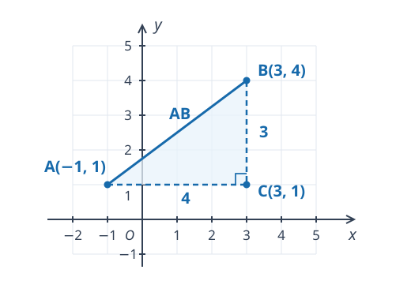

如图，水平距离是 $3-(-1)=4$，竖直距离是 $4-1=3$，所以 $AB=\sqrt{4^2+3^2}=5$。

一般地，$A(x_1,y_1)$、$B(x_2,y_2)$ 之间的距离为（两轴的单位长度相同）：

$$AB=\sqrt{(x_2-x_1)^2+(y_2-y_1)^2}.$$

### 5. 中点坐标 {#midpoint .knowledge-title}

横坐标取平均，纵坐标也取平均。 若 $A(x_1,y_1)$、$B(x_2,y_2)$，线段 $AB$ 的中点为：

$$M\left(\frac{x_1+x_2}{2},\frac{y_1+y_2}{2}\right).$$

例如，$A(-2,1)$、$B(4,3)$ 的中点为 $M\left(\frac{-2+4}{2},\frac{1+3}{2}\right)$，即 $M(1,2)$。计算时保留坐标的正负号。

### 6. 象限角平分线 {#bisectors .knowledge-title}

象限角平分线上的点，到相邻两条坐标轴的距离相等，所以 $|x|=|y|$。作垂线后得到的直角三角形有两个 $45^\circ$ 角，两直角边相等。

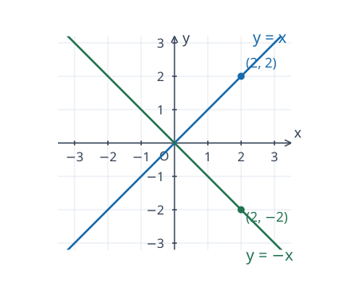

| 所在象限 | 坐标关系 | 示例 |
| --- | --- | --- |
| 第一、第三象限 | 同号且绝对值相等，$y=x$ | $(2,2)$、$(-2,-2)$ |
| 第二、第四象限 | 异号且绝对值相等，$y=-x$ | $(-2,2)$、$(2,-2)$ |

两条直线都经过原点；原点满足 $|x|=|y|$，但不属于象限。只知道两轴距离相等，可能在两条直线中的任意一条上；指定某个象限后，还要符合该象限的正负条件。

### 7. 坐标的平移与对称 {#transformations .knowledge-title}

坐标系固定，让点移动。 下表中 $m,n>0$：

| 变换 | 坐标怎么变 | $P(x,y)$ 变为 | $A(2,3)$ 的例子 |
| --- | --- | --- | --- |
| 向右平移 $m$ 向左平移 $m$ | $x$ 右加 $x$ 左减 | $(x+m,y)$ $(x-m,y)$ | 右移 $1$：$(3,3)$ 左移 $1$：$(1,3)$ |
| 向上平移 $n$ 向下平移 $n$ | $y$ 上加 $y$ 下减 | $(x,y+n)$ $(x,y-n)$ | 上移 $1$：$(2,4)$ 下移 $1$：$(2,2)$ |
| 关于 $x$ 轴对称 | $y$ 变为相反数 | $(x,-y)$ | $(2,-3)$ |
| 关于 $y$ 轴对称 | $x$ 变为相反数 | $(-x,y)$ | $(-2,3)$ |
| 关于原点对称 | $x$、$y$ 都变为相反数 | $(-x,-y)$ | $(-2,-3)$ |

### 8. 方向和距离定位 {#position-area .knowledge-title}

以谁为观测点、朝哪个方向、相距多远，说清这三点，就能确定位置。

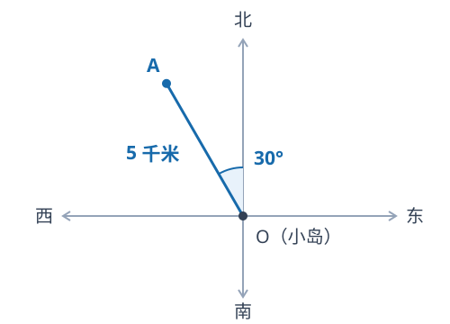

如图，以小岛 $O$ 为观测点，从北向西转 $30^\circ$，再沿这个方向走 $5$ 千米，就到达点 $A$。

### 9. 用坐标求面积 {#coordinate-area .knowledge-title}

优先选水平或竖直的边作底，用坐标差求底和高。 高是顶点到底所在直线的垂直距离。

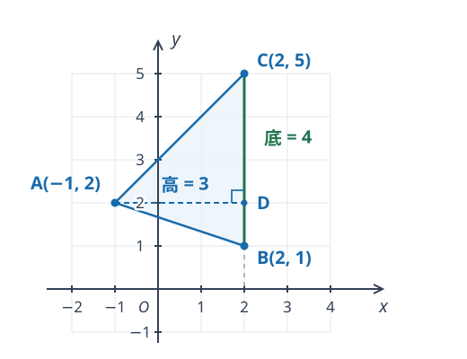

如图，以 $BC$ 为底，底长为 $5-1=4$，高为 $2-(-1)=3$，所以：

$$S_{\triangle ABC}=\frac{1}{2}\times4\times3=6.$$

复杂图形可以分割成三角形，或补成矩形来求面积。

## 【考点】方法与例题 {#exam .handbook-section .is-exam}

### 1. 读有序数对 {#read-pairs .exam-title}

写数对前，把第一项、第二项分别代表什么说清。表示定向位移时，负号只改变方向，不把路程读成“负多少米”；座位编号则按该教室的编号规则。

<article class="handbook-example" aria-labelledby="example-1">

#### 例题 01 座位与方向的有序数对 知识清单例题·合组改编，明确排号方向 {#example-1 .example-heading}

题目

（1）教室按“列号、排号”记位置，排号向后递增。小红坐第 $2$ 列第 $3$ 排，记作 $(2,3)$。小亮坐在她正后方的第一个位置，怎样表示？

（2）向东、向北为正，先写东西位移，再写南北位移；如向东 $4$ 米、再向北 $6$ 米记作 $(4,6)$。$(6,4)$ 与 $(-2,-6)$ 各表示怎样走？

答案与解析

解析

（1）正后方不换列，列号仍为 $2$；向后一排，排号为 $4$。

（2）第一项正为东、负为西，第二项正为北、负为南。所以 $(6,4)$ 是东 $6$ 米、北 $4$ 米；$(-2,-6)$ 是西 $2$ 米、南 $6$ 米。顺序不能按大小重新排列。

本题结论

（1）$(2,4)$。（2）向东 6 米再向北 4 米；向西 2 米再向南 6 米。

</article>

### 2. 读点与描点 {#grid .exam-title}

::: steps
1. 找原点、两轴正方向与已知点。
2. 用已知坐标除以相应格数，分别确定横、纵一格表示多少单位。
3. 从原点读目标点的横、纵位置，或按目标坐标找到点。
4. 复核两个坐标，不把目标点相对于已知点的位移当成坐标。
:::

<article class="handbook-example" aria-labelledby="example-2">

#### 例题 02 两幅网格各自读尺度 知识清单例题·合组 {#example-2 .example-heading}

题目

（1）从 $O$ 出发，向西走 $40$ 米，再向南走 $30$ 米到 $M$，用 $(-40,-30)$ 表示 $M$。图中 $(10,20)$ 表示哪个点？

A. 点 A

B. 点 B

C. 点 C

D. 点 D

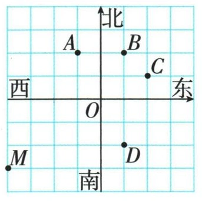

（2）如图，$O$ 为原点，$P(2,1)$，求 $Q$ 的坐标。（2024 广西）

A. $(3,0)$

B. $(0,2)$

C. $(3,2)$

D. $(1,2)$

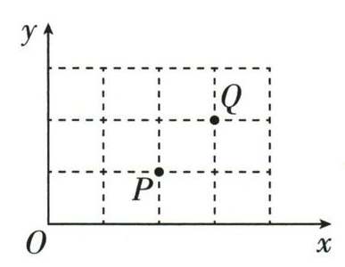

答案与解析

解析

（1）$M$ 在 $O$ 左 $4$ 格、下 $3$ 格，所以每格是 $10$ 米。目标点在右 $1$ 格、上 $2$ 格，是 B。A 横坐标为负；C 把横纵格数交换；D 的纵坐标为负。

（2）$P$ 在右 $2$ 格、上 $1$ 格，所以每格为 $1$ 单位。$Q$ 在右 $3$ 格、上 $2$ 格，坐标 $(3,2)$。$Q$ 相对 $P$ 右 $1$、上 $1$，但这不是它相对于原点的坐标。

本题结论

（1）选 B。（2）$Q(3,2)$，选 C。

</article>

### 3. 建立坐标系 {#construct .exam-title}

选顶点作原点便于直接使用边长，选中心作原点便于使用对称。无论哪一种，都要交代原点、轴方向、单位；全部点沿用同一套基准。开放建系题不要求唯一一组坐标。

<article class="handbook-example" aria-labelledby="example-3">

#### 例题 03 边长为4的正方形 知识清单例题 {#example-3 .example-heading}

题目

已知正方形 $ABCD$ 的边长为 $4$，建立适当的平面直角坐标系，写出各顶点坐标。

答案与解析

解析

取图示字母顺序：A 在左上、B 在左下、C 在右下、D 在右上，单位长度为 $1$。

以中心为原点。 两轴平行于正方形两邻边，向右、向上为正。中心到每条边的距离为 $2$，所以左右横坐标分别 $-2,2$，上下纵坐标分别 $2,-2$。

以 B 为原点。 BC 方向为横轴正方向，BA 方向为纵轴正方向，坐标取 $0$ 或 $4$。

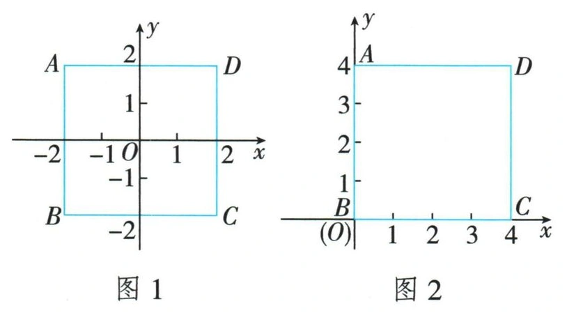

| 顶点 | 中心建系 | B 点建系 |
| --- | --- | --- |
| A | $(-2,2)$ | $(0,4)$ |
| B | $(-2,-2)$ | $(0,0)$ |
| C | $(2,-2)$ | $(4,0)$ |
| D | $(2,2)$ | $(4,4)$ |

坐标不同，是基准不同；两种表示中的边长都仍为 $4$。

本题结论

两套坐标如表，均正确；其他原点、方向和坐标相互一致的建系也可以。

</article>

### 4. 根据位置求参数 {#signs .exam-title}

点在轴上，先令相应坐标为零；点在象限中，列两个严格符号条件并取交集。若所问是另一个点，要重新代入、重新判符号，不能沿用已知点的象限。

<article class="handbook-example" aria-labelledby="example-4">

#### 例题 04 由已知点判断另一个点 知识清单例题·合组 {#example-4 .example-heading}

题目

（1）点 $A(-2,n+3)$ 在 $x$ 轴上，点 $B(n-1,n+1)$ 在第几象限？

（2）点 $P(a,b)$ 在第四象限，点 $Q(b-1,-a)$ 在哪里？

A. 第一象限

B. 第二象限

C. 第三象限

D. 第四象限

（3）单项式 $-x^{2m}y^3$ 与 $2x^4y^{2-n}$ 的和仍是一个单项式，点 $(m,n)$ 在哪里？选项同第（2）问。（2024 四川广元）

答案与解析

解析

（1）$A$ 在横轴上，纵坐标 $n+3=0$，得 $n=-3$。代入 $B=(-4,-2)$，横纵均负，在第三象限。

（2）由 $P$ 在第四象限得 $a>0,b<0$。于是 $b-1<0$、$-a<0$，Q 在第三象限。

（3）两个非零单项式要合成一项，相同字母的指数必须相同，且这里系数和 $-1+2=1\ne0$。故 $2m=4$、$3=2-n$，得到 $m=2,n=-1$。点 $(2,-1)$ 在第四象限。

本题结论

（1）第三象限。（2）第三象限，选 C。（3）第四象限，选 D。

</article>

<article class="handbook-example" aria-labelledby="example-5">

#### 例题 05 用象限列参数范围 2024 山东滨州 {#example-5 .example-heading}

题目

点 $P(1-2a,a)$ 在第二象限，$a$ 的范围是哪一个？

A. $a>\dfrac12$

B. $a<\dfrac12$

C. $0<a<\dfrac12$

D. $0\le a<\dfrac12$

答案与解析

解析

第二象限必须同时满足

$$\begin{cases}1-2a<0,\\a>0.\end{cases}$$

第一式得 $a>\dfrac12$，与 $a>0$ 取交集仍是 $a>\dfrac12$。$a=\dfrac12$ 时横坐标为零，点落在纵轴上，不能收入第二象限。

本题结论

$a>\dfrac12$，选 A。

</article>

### 5. 根据距离求坐标 {#axis-distance .exam-title}

先用距离确定 $|x|$、$|y|$，再按象限填正负号。到 $x$ 轴的距离对应 $|y|$，到 $y$ 轴的距离对应 $|x|$；若有倍数关系，先算出两个距离。

<article class="handbook-example" aria-labelledby="example-6">

#### 例题 06 距离倍数与第二象限 知识清单例题 {#example-6 .example-heading}

题目

点 A 到 $x$ 轴的距离为 $3$，到 $y$ 轴的距离是到 $x$ 轴距离的 $3$ 倍。若 A 在第二象限，它的坐标是？

A. $(-9,3)$

B. $(-3,1)$

C. $(-3,9)$

D. $(-1,3)$

答案与解析

解析

到横轴距离 $3$ 给出 $|y|=3$；到纵轴距离 $3\times3=9$ 给出 $|x|=9$。第二象限横负纵正，所以 A 为 $(-9,3)$。

B 到横轴的距离是 $1$；C 把两轴距离颠倒；D 到纵轴的距离是 $1$，均不符合。

本题结论

$A(-9,3)$，选 A。

</article>

### 6. 方向与距离定位 {#bearings .exam-title}

先确认“相对于谁”，再找角标从北、南还是别的方向量起，最后配上原单位的距离。相邻方向的等价说法要换余角；只给方向或只给距离，都不足以报告平面内的准确位置。

<article class="handbook-example" aria-labelledby="example-7">

#### 例题 07 四艘渔船的位置 知识清单例题·情境缩写 {#example-7 .example-heading}

题目

四艘渔船 A、B、C、D 在回港途中遭遇强风，需要小岛上的人员救援。请根据图示，分别说明四艘渔船相对于小岛的位置。图中 n mile 表示海里。

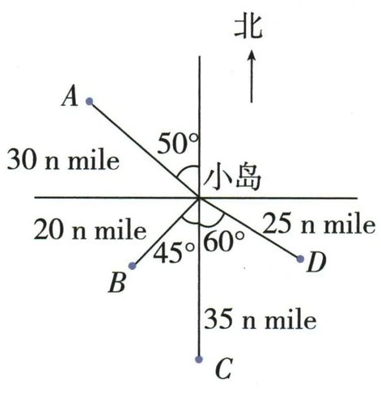

答案与解析

解析

以小岛为观测点，图示上北下南。A 的 $50^\circ$ 从北向西量；B 的 $45^\circ$ 从南向西量，是西南方向；C 在正南；D 的 $60^\circ$ 从南向东量。

方向确定一条射线，再沿这条射线读相应距离。A 也可说西偏北 $40^\circ$，但不能说西偏北 $50^\circ$；D 同理不能直接换成东偏南 $60^\circ$。

本题结论

A：北偏西 $50^\circ$，30 海里；B：西南方向，20 海里；C：正南方向，35 海里；D：南偏东 $60^\circ$，25 海里。

</article>

### 7. 用坐标求面积 {#area .exam-title}

先按横纵顺序落点并按题目顺序连接。找到水平、竖直边或对角线后，用坐标差求底和垂高；割补需说明覆盖了哪些区域，避免漏算或重叠。

<article class="handbook-example" aria-labelledby="example-8">

#### 例题 08 三角形与四边形面积 知识清单例题 {#example-8 .example-heading}

题目

（1）$A(0,1)$、$B(2,0)$、$C(2,3)$，在下图中画出 $\triangle ABC$，并求面积。

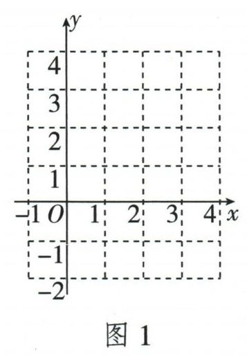

（2）如图，四边形 ABCD 的顶点为 $A(-2,5)$、$B(-5,-3)$、$C(-2,-4)$、$D(4,-1)$，求其面积。

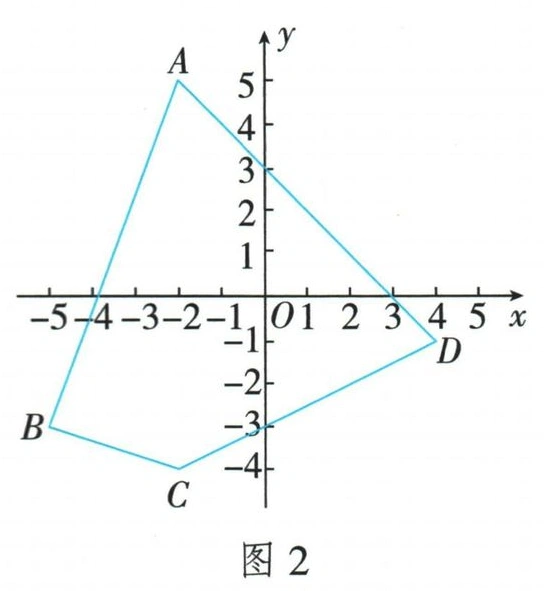

答案与解析

解析

（1）按坐标描点连接，图形如下。B、C 同横坐标 $2$，底 $BC=3$；A 到直线 $x=2$ 的垂直距离为 $2$。所以 $S_{\triangle ABC}=\dfrac12\times3\times2=3$。

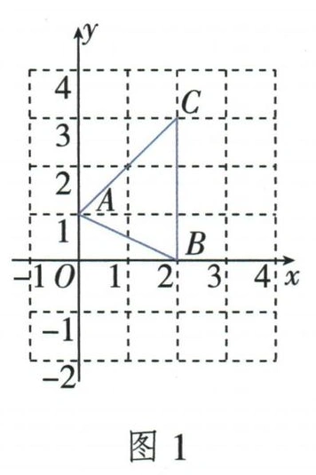

（2）连接 AC。A、C 同横坐标 $-2$，$AC=5-(-4)=9$。B、D 分别在 AC 两侧，四边形正好分成两个不重叠三角形。

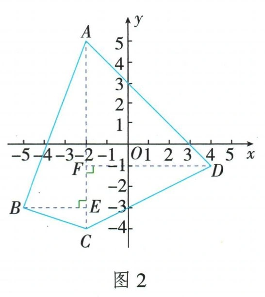

B 到 AC 的距离 $BE=|-5-(-2)|=3$；D 到 AC 的距离 $DF=|4-(-2)|=6$。因此

$$S_{ABCD}=\frac12\times9\times3+\frac12\times9\times6=\frac{81}{2}.$$

这里的高不是到 $y$ 轴的距离 $5$ 和 $4$，因为底 AC 不在 $y$ 轴上。

本题结论

（1）图形见解析，面积为 $3$。（2）面积为 $\dfrac{81}{2}$。

</article>

### 8. 点与图形的平移 {#translation .exam-title}

右、上为正增量，左、下为负增量。每次只改变对应方向的坐标；若先后两步作用于同一点，第二步从第一步得到的位置开始。图形作图还需将所有顶点按同一位移移动并按原顺序连接。

<article class="handbook-example" aria-labelledby="example-9">

#### 例题 09 先右移，再上移 2024 江西 {#example-9 .example-heading}

题目

在平面直角坐标系中，将 $A(1,1)$ 向右平移 $2$ 个单位长度，再向上平移 $3$ 个单位长度，得到 B。求 B 的坐标。

答案与解析

解析

右移 $2$：$(1,1)\to(3,1)$；上移 $3$：$(3,1)\to(3,4)$。也可分别累计横、纵增量，得到 $(1+2,1+3)$。

本题结论

$B(3,4)$。

</article>

## 【坑点】错因与边界 {#pitfalls .handbook-section .is-pitfall}

### 1. 括号相同，不代表规则相同 {#pit-convention .pitfall-title}

看到两个数不要立刻套“横在前、纵在后”。题目可能另设位置规则；先看给出的示例，确认角从哪里量、方向如何规定，再读新点。

<article class="handbook-example is-pitfall" aria-labelledby="pitfall-1">

#### 辨析 01 一种“圆”坐标 2023 江苏连云港 {#pitfall-1 .example-heading}

题目

画水平数轴，以原点 O 为圆心，过数轴的每个刻度点画同心圆；再从正半轴起，逆时针每隔 $30^\circ$ 画一条射线，建立“圆”坐标系。如图，$A(6,60^\circ)$、$B(5,180^\circ)$、$C(4,330^\circ)$。点 D 怎样表示？

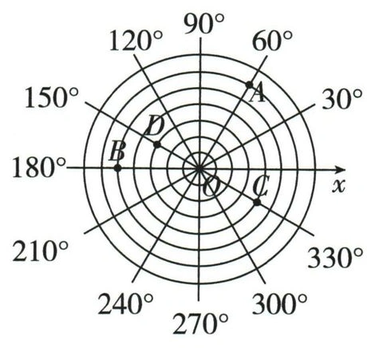

答案与解析

解析

由已知点可知，第一项表示距 O 的圆层尺度，第二项表示从正半轴逆时针转过的角。D 在第三个圆上，射线角为 $150^\circ$，因此写成 $(3,150^\circ)$。

这里的 $150^\circ$ 是角，不是直角坐标中的纵坐标；不能按“横3、纵150”另找点。

本题结论

$D(3,150^\circ)$。

</article>

### 2. 只给长度，没有指定方向 {#pit-direction .pitfall-title}

长度是坐标差的绝对值，不自带向左或向右。无方向、象限限制时，应保留所有符合条件的位置；不要用随手画的一张图替题目增加条件。

<article class="handbook-example is-pitfall" aria-labelledby="pitfall-2">

#### 辨析 02 水平线段的另一端点 知识清单例题 {#pitfall-2 .example-heading}

题目

线段 AB 平行于 $x$ 轴，长为 $5$，$A(4,5)$。求 B 的坐标。

答案与解析

解析

水平线段纵坐标不变，所以设 $B(x,5)$。长度条件为 $|x-4|=5$，得到 $x-4=5$ 或 $x-4=-5$，即 $x=9$ 或 $x=-1$。

两个点分别在 A 右、左，都与 A 相距 $5$；题目没有指定方向，所以都应保留。线段在直线 $y=5$ 上，并不是在 $x$ 轴上。

本题结论

$B(9,5)$ 或 $B(-1,5)$。

</article>

<article class="handbook-example is-pitfall" aria-labelledby="pitfall-3">

#### 辨析 03 两轴距离能确定几个点 知识清单例题 {#pitfall-3 .example-heading}

题目

点 P 到 $x$ 轴的距离为 $3$，到 $y$ 轴的距离为 $2$，求 P 的全部坐标。

答案与解析

解析

到横轴距离给 $|y|=3$，到纵轴距离给 $|x|=2$。因此 $x$ 可取 $2,-2$，$y$ 可取 $3,-3$，两个符号独立组合。

| 横坐标 | 纵坐标 | 所在象限 |
| --- | --- | --- |
| $2$ | $3$ | 第一 |
| $-2$ | $3$ | 第二 |
| $-2$ | $-3$ | 第三 |
| $2$ | $-3$ | 第四 |

四点到两轴的距离都符合要求。距离为正不意味着坐标也为正。

本题结论

$(2,3)$、$(-2,3)$、$(-2,-3)$、$(2,-3)$。

</article>

### 3. 先辨关于哪条轴或哪个点对称 {#pit-reflection .pitfall-title}

关于轴对称，沿轴方向的位置不变；关于原点对称，横纵有向位置都反过来。用中点检查原点对称时，两坐标分别相加应为零，不能只改一个符号。

<article class="handbook-example is-pitfall" aria-labelledby="pitfall-4">

#### 辨析 04 关于原点的对称点 2024 江苏扬州 {#pitfall-4 .example-heading}

题目

$P(1,2)$ 关于坐标原点的对称点 $P'$ 的坐标是？

A. $(-1,-2)$

B. $(-1,2)$

C. $(1,-2)$

D. $(1,2)$

答案与解析

解析

原点应是 $PP'$ 的中点，所以横坐标互为相反数，纵坐标也互为相反数，得 $P'(-1,-2)$。

B 只改变横坐标，是关于 $y$ 轴的对称点；C 只改变纵坐标，是关于 $x$ 轴的对称点；D 保持原位置，而本题 P 不是原点，不能在原点对称后保持不动。

本题结论

$P'(-1,-2)$，选 A。

</article>

### 4. 周期只用在真正重复的部分 {#pit-period .pitfall-title}

把横、纵坐标分开追踪：哪一项不断累积，哪一项循环？余数只定位循环中的位置，不能代替总步数。起点编号为零时，尚未运动，不计为第一次。

<article class="handbook-example is-pitfall" aria-labelledby="pitfall-5">

#### 辨析 05 按图示规律运动 知识清单例题 {#pitfall-5 .example-heading}

题目

动点 P 从原点出发，按图中箭头所示的规律持续运动：第 $1$ 次到 $(1,1)$，第 $2$ 次到 $(2,0)$，第 $3$ 次到 $(3,2)$，此后重复图示运动规律。第 $2023$ 次运动后的坐标是？

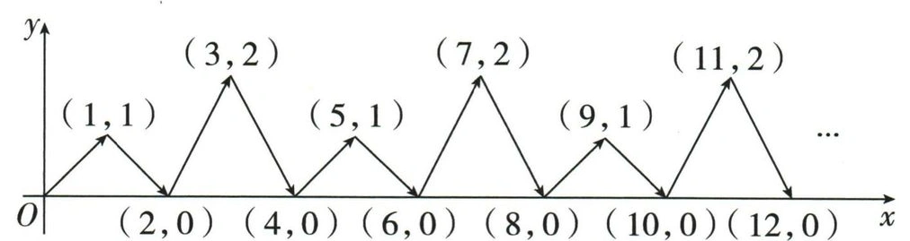

A. $(2023,1)$

B. $(2023,2)$

C. $(2023,0)$

D. $(2024,0)$

答案与解析

解析

每次向右 $1$ 单位，第 $k$ 次横坐标就是 $k$，并不循环。按题设持续重复的轨迹，纵坐标依次为 $1,0,2,0$，每 $4$ 步一轮。

| 步数形式 | 横坐标 | 纵坐标 |
| --- | --- | --- |
| $4n$ | $4n$ | $0$ |
| $4n+1$ | $4n+1$ | $1$ |
| $4n+2$ | $4n+2$ | $0$ |
| $4n+3$ | $4n+3$ | $2$ |

其中 $n$ 为非负整数，$4n=0$ 对应尚未运动的起点。$2023=4\times505+3$，纵坐标取这一轮第 $3$ 项 $2$，横坐标仍为总次数 $2023$。

不能答 $(3,2)$，因为横坐标没有回到周期内；也不能把起点算成一次而写 $2024$。这里依赖题目给出的持续规则，仅凭任意几个点不能唯一推出无限运动规律。

本题结论

$(2023,2)$，选 B。

</article>

