时间变长，走过的路程也在变化。函数研究的就是：一个量确定后，怎样确定另一个量。

<nav class="handbook-nav" aria-label="本章分区">
  <a class="handbook-jump is-knowledge" href="#knowledge">01 · 知识点概念、关系与适用条件</a>
  <a class="handbook-jump is-exam" href="#exam">02 · 考点先归纳方法，再看例题</a>
  <a class="handbook-jump is-pitfall" href="#pitfalls">03 · 坑点辨析错因，检查遗漏</a>
</nav>

## 【知识点】概念与依据 {#knowledge .handbook-section .is-knowledge}

### 1. 变量与常量 {#variables .knowledge-title}

小明匀速步行，每小时走 $3$ 千米。用 $x$ 表示时间（小时），$y$ 表示走过的路程（千米），则 $y=3x$。

| 量 | 在这次步行中怎样变化 | 名称 |
| --- | --- | --- |
| 时间 $x$、路程 $y$ | 随步行过程改变 | 变量 |
| 速度 $3$ 千米/时 | 保持不变 | 常量 |

在一个变化过程中，数值改变的量叫==变量==，数值不变的量叫==常量==。 判断时要看具体过程：如果改成加速行走，速度也成了变量；用字母表示还是用数字表示，不决定它是哪一种。

### 2. 函数与自变量 {#function .knowledge-title}

仍看 $y=3x$：走 $1$ 小时，路程是 $3$ 千米；走 $2$ 小时，路程是 $6$ 千米。时间一旦确定，路程就有唯一确定的值。

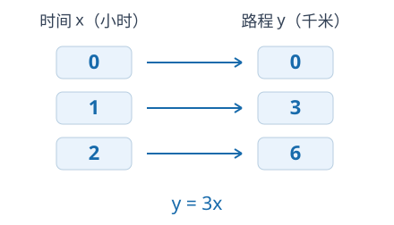

在允许范围内，$x$ 每取一个确定的值，$y$ 都有唯一确定的值与它对应，就说 $y$ 是 $x$ 的==函数==。其中，$x$ 叫作==自变量==。

关键是沿着 $x$ &emsp;→&emsp; $y$ 检查：

- ==一个 $x$ 对应两个不同的 $y$ &emsp;→&emsp; 不是函数=={.danger}。
- ==两个不同的 $x$ 对应同一个 $y$ &emsp;→&emsp; 可以是函数==。例如 $y=x^2$ 中，$x=2$ 和 $x=-2$ 都得到 $y=4$。

### 3. 函数值与自变量的取值范围 {#domain .knowledge-title}

在 $y=3x$ 中，$x=2$ 时算得 $y=6$，这个 $6$ 就叫作 $x=2$ 时的==函数值==。

==自变量的取值范围==，就是 $x$ 可以取哪些值。先保证算式有意义，再满足实际问题的要求：

| 情况 | $x$ 必须满足什么 | 例子 |
| --- | --- | --- |
| 整式 | 单从算式看，可取任意实数 | $y=3x-2$ |
| 分式 | 分母不为 $0$ | $y=1/(x-1)$ 要求 $x\ne1$ |
| 二次根式 | 被开方数不小于 $0$ | $y=\sqrt{x-2}$ 要求 $x\ge2$ |
| 零次幂、负整数次幂 | 底数不为 $0$ | $(x-1)^0$、$(x-1)^{-2}$ 要求 $x\ne1$ |
| 实际问题 | 还要符合量的含义 | 时间通常非负；件数还须为整数 |

有几个限制，就要同时满足。例如 $y=\sqrt{x-2}$ 要求 $x\ge2$；若 $x$ 又是一个持续到第 $8$ 秒的过程中的时间，则合起来是 $2\le x\le8$。

给定 $x$ 求函数值，用代入；给定函数值求 $x$，用解方程，最后检查 $x$ 是否在允许范围内。

### 4. 函数的三种表示方法 {#representations .knowledge-title}

同一个步行过程，可以用三种方式表示：

| 方法 | 怎样表示 $y=3x$ 这段关系 |
| --- | --- |
| 列表法 | 把时间和路程配对列出，如 $0\to0$、$1\to3$、$2\to6$ |
| 解析式法 | 写出 $y=3x$，$x\ge0$ |
| 图象法 | 以时间为横坐标、路程为纵坐标，描出点 $(x,y)$ |

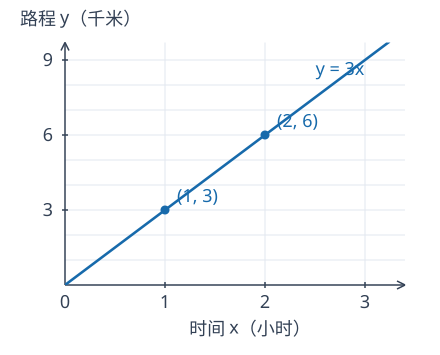

表格便于查值，解析式便于计算，图象便于看变化趋势。画图通常按“列表 → 描点 → 连线”进行；能否连线，要看自变量是否连续取值。上面的时间可以连续变化；购买件数只能取整数时，应画成分开的点。

只有几个观测点、没有给出变化规律时，不能据此确定所有未列出的值；示意图中未标明的刻度也不能当成精确数值。

### 5. 怎样读函数图象 {#graph-reading .knowledge-title}

先看两条轴分别表示什么量、什么单位、每格是多少，再从左往右读图。

| 图象从左往右的样子 | 说明什么 |
| --- | --- |
| 向上升 | $x$ 增大，$y$ 增大 |
| 向下降 | $x$ 增大，$y$ 减小 |
| 水平 | 这一段 $y$ 不变 |
| 直线段较陡 | 同一坐标尺度下，$x$ 改变相同数量，$y$ 改变得更多 |

水平段只表示纵轴上的量不变。 例如路程不变可以表示休息，面积不变却可能是动点仍在移动、三角形的高没变。

对一段直线，变化的快慢可用

$$\frac{y\text{ 的变化量}}{x\text{ 的变化量}}=\frac{y_2-y_1}{x_2-x_1}\qquad(x_2>x_1)$$

表示。若横轴是时间、纵轴是累计路程，这个比值就是该段平均速度；纵轴换成温度或面积，含义也要随之改变。不同图的刻度不同，不能直接凭陡缓比快慢。

### 6. 分段函数 {#piecewise .knowledge-title}

有些过程会改变规则。例如先行走、再休息、再行走，路程随时间的变化就分成三段。同一个函数可以分段用不同的式子表示，每个式子都要写清适用范围。

1. 找到规则改变的时刻或位置。
2. 每段分别列式；需要本段新增路程时，用总路程减去前面已走的路程。
3. 检查交接处和终点：连续的路程、面积应接得上，题目不允许取的终点不能补进去。

分段的依据是实际过程，不能把时间随意等分。

## 【考点】方法与例题 {#exam .handbook-section .is-exam}

### 1. 列函数关系式 {#model .exam-title}

先找题目中保持不变的量，用等式把变量联系起来。例如周长固定时，先表示出另一条边，再列面积式。写完关系式，还要注明变量、常量和允许范围。

<article class="handbook-example" aria-labelledby="example-1">

#### 例题 01 固定周长与直角条件 知识清单例题 {#example-1 .example-heading}

题目

写出关系式，并指出其中的变量和常量。

（1）用长 $20\,\mathrm{cm}$ 的铁丝围成长方形，一边长为 $x\,\mathrm{cm}$，面积为 $S\,\mathrm{cm^2}$。

（2）直角三角形的两个锐角分别为 $\alpha,\beta$。

答案与解析

解析

（1）设邻边长为 $b$。由周长不变，$2x+2b=20$，得 $b=10-x$。因此

$$S=x(10-x),\qquad 0<x<10.$$

在改变长方形形状的过程中，$x,S$ 是变量；周长 $20$ 和两邻边之和 $10$ 保持不变，是常量。

（2）三角形内角和为 $180^\circ$，直角占 $90^\circ$，所以 $\alpha+\beta=90^\circ$，即 $\alpha=90^\circ-\beta$。两个锐角可改变，$90^\circ$ 不变。两锐角都在 $0^\circ$ 与 $90^\circ$ 之间。

本题结论

（1）$S=x(10-x)$，$x,S$ 为变量，$20,10$ 为常量。（2）$\alpha=90^\circ-\beta$，$\alpha,\beta$ 为变量，$90^\circ$ 为常量。

</article>

### 2. 判断函数关系 {#unique-method .exam-title}

用竖直线检查图象：只要有一条竖直线与图象有两个或更多交点，就不是函数图象。

<article class="handbook-example" aria-labelledby="example-2">

#### 例题 02 四幅图中的对应关系 知识清单例题 {#example-2 .example-heading}

题目

下列图象中，不能表示 $y$ 是 $x$ 的函数的是哪一个？

<figure class="handbook-option">

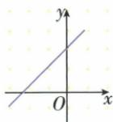

<figcaption>A</figcaption>
</figure>

<figure class="handbook-option">

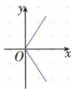

<figcaption>B</figcaption>
</figure>

<figure class="handbook-option">

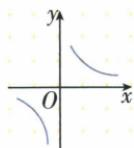

<figcaption>C</figcaption>
</figure>

<figure class="handbook-option">

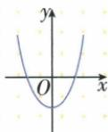

<figcaption>D</figcaption>
</figure>

答案与解析

解析

A 中每个横坐标只对应直线上一个点。B 向右张开，在一些正横坐标处，竖直线同时交到上、下两支，出现两个不同的纵坐标。

C 虽有两支，但正、负输入分别落在不同分支，每个允许输入仍只有一个输出；$x=0$ 不在它的允许范围。D 的左右两部分可以有相同高度，但同一横坐标只有一个点。

本题结论

选 B。

</article>

### 3. 求自变量的取值范围 {#domain-method .exam-title}

逐个检查分母和根号，不要把几个根号的被开方数先相加再判断。表达式有限制时写出限制；没有限制时明确写全体实数。

<article class="handbook-example" aria-labelledby="example-3">

#### 例题 03 几类表达式的允许输入 知识清单例题·合组；第（5）问 2024 山东滨州 {#example-3 .example-heading}

题目

求下列函数中自变量 $x$ 的取值范围。

（1）$y=3x-2$。

（2）$y=\dfrac1{1-x}$。

（3）$y=\sqrt{x+3}$。

（4）$y=\sqrt{x-3}+\sqrt{5-x}$。

（5）$y=\dfrac1{x-1}$ 在实数范围内有意义时，$x$ 的取值范围是什么？

答案与解析

解析

（1）整式没有额外的实数运算限制，$x$ 可取全体实数。

（2）$1-x\ne0$，得 $x\ne1$。

（3）$x+3\ge0$，得 $x\ge-3$。

（4）两个根号分别要求 $x\ge3$、$x\le5$，同时满足得到 $3\le x\le5$。

（5）$x-1\ne0$，得 $x\ne1$。与（2）的分母相反，不改变分母的零点，因此范围相同。

本题结论

依次为：全体实数；$x\ne1$；$x\ge-3$；$3\le x\le5$；$x\ne1$。

</article>

### 4. 求函数值与实际值 {#values .exam-title}

给定输入，先检查是否合法，再整体代入，负数保留括号。实际收费要看优惠针对全部金额还是超出部分，不能把一句“八折”套到全部价款。

<article class="handbook-example" aria-labelledby="example-4">

#### 例题 04 同一规则的两个输入 知识清单例题 {#example-4 .example-heading}

题目

已知 $y=2x-3$，求 $x$ 取 $2$ 和 $-2$ 时的函数值。

答案与解析

解析

当 $x=2$ 时，$y=2\times2-3=1$。

当 $x=-2$ 时，$y=2\times(-2)-3=-4-3=-7$。

输入改变符号，常数 $-3$ 并不随之改变符号，不能把第一次的结果简单取相反数。

本题结论

$x=2$ 时 $y=1$；$x=-2$ 时 $y=-7$。

</article>

<article class="handbook-example" aria-labelledby="example-5">

#### 例题 05 超出部分打折 知识清单例题 {#example-5 .example-heading}

题目

商场规定：一次性购买粽子超过 $100$ 元，超过 $100$ 元的部分按八折优惠。礼盒单价 $60$ 元，购买 $x$ 件，题设 $x>2$。应付款 $y$ 元与 $x$ 有怎样的关系？

答案与解析

解析

先按原价算总金额 $60x$。前 $100$ 元不打折，剩余 $60x-100$ 元按八折支付：

$$y=100+0.8(60x-100)=48x+20.$$

题目给 $x>2$，又因件数为整数，本题使用范围是 $x=3,4,5,\ldots$。这里的 $20$ 来自展开合并，并不是题目另外发放的补贴。

本题结论

$y=48x+20$，其中 $x>2$ 且为整数。

</article>

<article class="handbook-example" aria-labelledby="example-6">

#### 例题 06 测距的计时包含哪两段 2024 广西 {#example-6 .example-heading}

题目

激光测距仪 $L$ 发出的激光束以 $3\times10^5\,\mathrm{km/s}$ 射向目标 $M$，$t$ 秒后收到反射回来的激光束。$L$ 到 $M$ 的距离 $d$（千米）与 $t$ 的关系式是（　）。

A. $d=\dfrac{3\times10^5}{2}t$

B. $d=3\times10^5t$

C. $d=2\times3\times10^5t$

D. $d=3\times10^6t$

答案与解析

解析

这段时间包括去程和回程，各走 $d$ 千米，总路程为 $2d$。由路程等于速度乘时间，

$$2d=3\times10^5t,\qquad d=\frac{3\times10^5}{2}t.$$

B 算的是往返总路程；C 又把总路程加倍；D 无题目支持的十倍关系。速度的时间单位是秒，与 $t$ 一致。

本题结论

选 A。

</article>

### 5. 注水与水位图象 {#water .exam-title}

匀速注水指相同时间注入相同体积，不代表水位等速上升。在水平截面积固定的一层，

$$\text{高度增量}=\frac{\text{注入的体积}}{\text{可容水的水平截面积}}.$$

所以可用截面积越小，水位升得越快。遇到固定实心物体，要先从容器截面积中扣掉物体占用的面积，再按水从底向上的顺序分段。

<article class="handbook-example" aria-labelledby="example-7">

#### 例题 07 容器形状与水位图象 知识清单例题·合组；第（2）问 2024 湖北武汉·改编，明确物体位置不变 {#example-7 .example-heading}

题目

（1）均匀地向一个容器内注水，注满水的过程中，水面高度 $h$ 与时间 $t$ 的关系如图。该容器可能是哪一个？

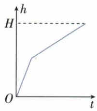

<figure class="handbook-option">

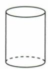

<figcaption>A</figcaption>
</figure>

<figure class="handbook-option">

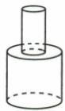

<figcaption>B</figcaption>
</figure>

<figure class="handbook-option">

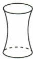

<figcaption>C</figcaption>
</figure>

<figure class="handbook-option">

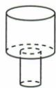

<figcaption>D</figcaption>
</figure>

（2）一个圆柱形水槽底部叠放两个底面半径不等的实心圆柱体，如图。两圆柱体在注水过程中保持图示位置不变。向水槽匀速注水，哪幅图象能大致反映水深 $h$ 与注水时间 $t$ 的关系？

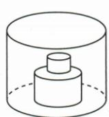

<figure class="handbook-option">

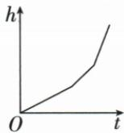

<figcaption>A</figcaption>
</figure>

<figure class="handbook-option">

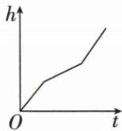

<figcaption>B</figcaption>
</figure>

<figure class="handbook-option">

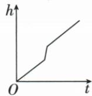

<figcaption>C</figcaption>
</figure>

<figure class="handbook-option">

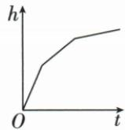

<figcaption>D</figcaption>
</figure>

答案与解析

解析

（1）图象先陡后缓，且两段都是直线，说明下层可用截面积小且固定，上层较大且固定。D 符合。A 等截面应始终同速；B 下宽上窄应先慢后快；C 截面逐渐变化，不能匹配两段恒速。

（2）从下向上，可容水的截面积依次为“水槽面积减大柱面积”“水槽面积减小柱面积”“整个水槽面积”，逐渐变大。因此水位连续上升，三段速度依次变小，图象由陡到缓，选 D。A 后面更陡，B、C 中间出现加快，都与实际截面积变化相反。

本题结论

（1）D；（2）D。

</article>

### 6. 判断变化趋势 {#trend .exam-title}

先看初值，再看上升还是下降，最后看趋向稳定还是持续改变。实际过程的前提不能省：恒温热水与正在冷却的热水，会给出不同趋势。示意曲线能判断趋势，不一定能算出精确时刻。

<article class="handbook-example" aria-labelledby="example-8">

#### 例题 08 温度计的读数怎样变化 2024 江西 {#example-8 .example-heading}

题目

把常温中的温度计插入一杯恒温的 $60^\circ\mathrm C$ 热水中，温度计读数 $y$ 与时间 $x$ 的关系可近似表示为哪幅图象？

<figure class="handbook-option">

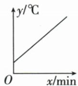

<figcaption>A</figcaption>
</figure>

<figure class="handbook-option">

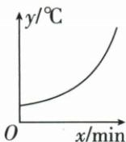

<figcaption>B</figcaption>
</figure>

<figure class="handbook-option">

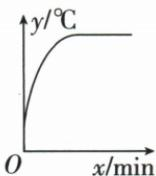

<figcaption>C</figcaption>
</figure>

<figure class="handbook-option">

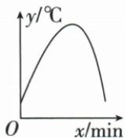

<figcaption>D</figcaption>
</figure>

答案与解析

解析

温度计初温低于热水温度，读数应上升。接近水温时，变化逐渐减缓，最后在测量精度内稳定，C 符合。

A 始终按相同速度上升，B 越来越快，D 上升后又下降，都不符合题定恒温环境中的近似变化。图象不提供精确到达稳定读数的时刻，不凭它虚构时间。

本题结论

选 C。

</article>

### 7. 动点面积图象 {#area-peak .exam-title}

先判断动点在什么位置时面积最大，再把峰值翻译为底与高的关系。总时间乘速度给的是沿路线的路程，不一定是两端的直线距离。题目给直角时，才能调用勾股定理。

<article class="handbook-example" aria-labelledby="example-9">

#### 例题 09 面积峰值与折线路程 2024 四川广元 {#example-9 .example-heading}

题目

在 $\triangle ABC$ 中，$\angle ACB=90^\circ$。点 $P$ 从 $A$ 出发，沿 $A\to C\to B$ 以 $1\,\mathrm{cm/s}$ 匀速运动到 $B$。图②是 $\triangle ABP$ 的面积 $y$ 随时间 $x$ 的变化图象。斜边 $AB$ 的长为（　）。

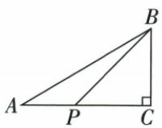

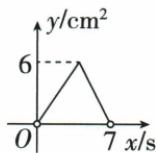

A. $5\,\mathrm{cm}$

B. $7\,\mathrm{cm}$

C. $3\sqrt2\,\mathrm{cm}$

D. $2\sqrt3\,\mathrm{cm}$

答案与解析

解析

$P$ 到达 $C$ 时，$\triangle ABP$ 就是整个 $\triangle ABC$，面积达到 $6\,\mathrm{cm^2}$，所以

$$AC\cdot BC=2\times6=12.$$

全程 $7$ 秒、速度 $1\,\mathrm{cm/s}$，故 $AC+BC=7$。用完全平方公式：

$$AC^2+BC^2=(AC+BC)^2-2AC\cdot BC=49-24=25.$$

因为 $C$ 是直角，勾股定理给 $AB^2=25$，取正长度 $AB=5\,\mathrm{cm}$。$7$ 是两条直角边之和，不是斜边；其余选项平方分别为 $18,12$，也不等于 $25$。

本题结论

选 A，斜边长 5 cm。

</article>

## 【坑点】错因与边界 {#pitfalls .handbook-section .is-pitfall}

### 1. 把唯一性的方向反过来 {#uniqueness-pit .pitfall-title}

错法： 看到两个 $x$ 对应同一个 $y$，就说不是函数。

自查： 沿 $x	o y$ 的方向检查。真正不允许的是一个 $x$ 对应两个不同的 $y$；题目没限制正负时，求出的负值也要保留。

<article class="handbook-example is-pitfall" aria-labelledby="pitfall-1">

#### 辨析 01 四种对应关系 知识清单例题 {#pitfall-1 .example-heading}

题目

关于变量 $x,y$ 有以下关系：① $x-y=5$；② $y^2=2x$；③ $y=|x|$；④ $y=\dfrac3x$。其中 $y$ 是 $x$ 的函数的是（　）。

A. ①②③

B. ①②③④

C. ①③

D. ①③④

答案与解析

解析

①可化为 $y=x-5$，每个 $x$ 给出唯一值。

②取 $x=1$，得到 $y=\sqrt2$ 或 $y=-\sqrt2$，一个输入对应两个输出，不成立。

③绝对值对每个输入都有唯一结果；正、负输入可能给同一个输出，不违反定义。

④在 $x\ne0$ 的范围内，每个输入都有唯一输出。不能因范围外的 $x=0$ 没有值，就否定整个函数。

本题结论

①③④成立，选 D。

</article>

### 2. 只检查根号，漏掉分母 {#domain-pit .pitfall-title}

错法： 只要求根号内非负，漏查分母；或把分子也一律限制为非零。

自查： 根号、分母分别列条件，再取共同范围。根号在分母里时，既要有意义，也要保证整个分母不为 $0$。

<article class="handbook-example is-pitfall" aria-labelledby="pitfall-2">

#### 辨析 02 两个位置分别检查 知识清单例题 {#pitfall-2 .example-heading}

题目

求 $y=\dfrac{\sqrt{x+3}}{x-1}$ 的自变量取值范围。

答案与解析

解析

根号要求 $x+3\ge0$，即 $x\ge-3$；分母要求 $x-1\ne0$，即 $x\ne1$。二者必须同时成立。

回查边界：$x=-3$ 时分子为 $0$、分母为 $-4$，函数值为 $0$，可以取。$x=1$ 虽使根号有意义，却使分母为零，不能取。

本题结论

$x\ge-3$ 且 $x\ne1$。

</article>

### 3. 把累计量当成每段新增量 {#cumulative .pitfall-title}

累计路程图中，后一时刻的数已经包括前面走过的路。求一段新增路程要相减；求全程总路程读终点，不能把中途累计值再加一次。

<article class="handbook-example is-pitfall" aria-labelledby="pitfall-3">

#### 辨析 03 登山图中的总路程 知识清单例题 {#pitfall-3 .example-heading}

题目

小明从山脚爬到山顶，中途休息了一段时间。所用时间 $t$（分钟）与所走路程 $s$（米）的关系如图。下列说法错误的是（　）。

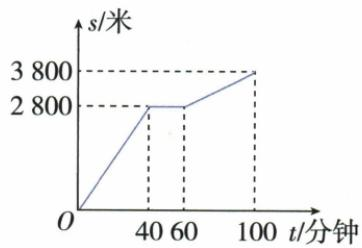

A. 中途休息 20 分钟。

B. 休息前平均速度为每分钟 70 米。

C. 全过程走了 6600 米。

D. 休息前平均速度大于休息后平均速度。

答案与解析

解析

平台从第 $40$ 分钟持续到第 $60$ 分钟，休息 $60-40=20$ 分钟，A 正确。

前段平均速度 $2800\div40=70$ 米/分。后段新增路程为 $3800-2800=1000$ 米，用时 $100-60=40$ 分钟，平均速度为 $25$ 米/分。因此 B、D 正确。

最后累计路程是 $3800$ 米。把 $2800$ 与 $3800$ 相加，会把前段重复计算一次。

本题结论

错误的是 C；总路程 3800 米。

</article>

### 4. 面积不变不等于动点停止 {#area-platform .pitfall-title}

图象的平台只说明纵轴所表示的量不变。面积题应固定底，再看垂高；动点沿平行于底的直线移动时，高可以保持不变。

<article class="handbook-example is-pitfall" aria-labelledby="pitfall-4">

#### 辨析 04 长方形边上的动点 知识清单例题 {#pitfall-4 .example-heading}

题目

长方形 $ABCD$ 中，$AB=2,BC=1$。点 $P$ 从 $B$ 出发，沿 $B\to C\to D$ 匀速运动。$\triangle ABP$ 的面积 $S$ 与点 $P$ 运动路程 $x$ 的关系图象大致是哪一个？

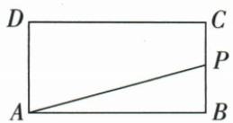

<figure class="handbook-option">

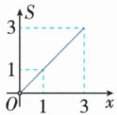

<figcaption>A</figcaption>
</figure>

<figure class="handbook-option">

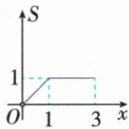

<figcaption>B</figcaption>
</figure>

<figure class="handbook-option">

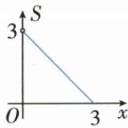

<figcaption>C</figcaption>
</figure>

<figure class="handbook-option">

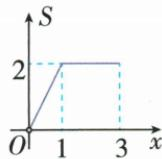

<figcaption>D</figcaption>
</figure>

答案与解析

解析

固定底 $AB=2$。

- 从 $B$ 到 $C$，高为 $BP=x$，所以 $S=\frac12\times2\times x=x$，$0\le x\le1$。
- 从 $C$ 到 $D$，$CD\parallel AB$，点到直线 $AB$ 的距离始终为 $1$，所以 $S=1$，$1<x\le3$。

在 $x=1$ 处两段接上；起点三点共线，面积取 $0$。因此图象先增后保持不变，选 B。A 错在后段仍增加；C 起点、趋势不符；D 的平台高度多算了一倍，漏掉面积公式中的 $\frac12$。

本题结论

选 B；平台表示面积不变，点仍沿 CD 运动。

</article>

### 5. 递增不等于每次等量增加 {#equal-increments .pitfall-title}

“越来越大”只比较先后的大小；“每次增加同样多”还要求等输入增量对应等输出增量。在同一坐标尺度下，后者表现为固定斜率的直线，不能只看曲线向右上升。

<article class="handbook-example is-pitfall" aria-labelledby="pitfall-5">

#### 辨析 05 两幅用电关系图 2024 河南·情境缩写 {#pitfall-5 .example-heading}

题目

把多个用电器连接在同一个插线板上，同时使用会使电源线发热，存在安全隐患。研究得到时长一定时，电流 $I$ 与总功率 $P$ 的关系如图①，热量 $Q$ 与电流 $I$ 的关系如图②。下列结论错误的是（　）。

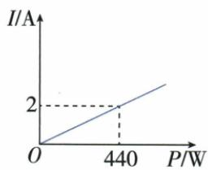

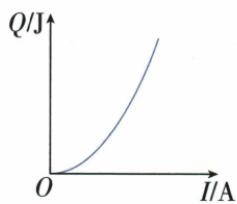

A. $P=440\,\mathrm W$ 时，$I=2\,\mathrm A$。

B. $Q$ 随 $I$ 增大而增大。

C. $I$ 每增加 $1\,\mathrm A$，$Q$ 的增加量相同。

D. $P$ 越大，电源线产生的热量 $Q$ 越多。

答案与解析

解析

图①标明 $440\,\mathrm W$ 对应 $2\,\mathrm A$，A 正确。

图②向右上升，B 正确；但图象越来越陡，相同电流增量对应的热量增量并不相同，所以 C 错误。

图①显示 $P$ 增大时 $I$ 增大，再由图②可知 $Q$ 增大，D 正确。这只能推出两个量同向变化，不能进一步断言它们按固定差值增加。

本题结论

选 C。

</article>

