路程一定，速度越大，用时越短。反比例函数描述的是两个量的乘积保持不变的关系。

<nav class="handbook-nav" aria-label="本章分区">
  <a class="handbook-jump is-knowledge" href="#knowledge">01 · 知识点概念、关系与适用条件</a>
  <a class="handbook-jump is-exam" href="#exam">02 · 考点题目分类和例题</a>
  <a class="handbook-jump is-pitfall" href="#pitfalls">03 · 坑点辨析错因，检查遗漏</a>
</nav>

## 【知识点】概念与依据 {#knowledge .handbook-section .is-knowledge}

### 1. 反比例函数 {#definition .knowledge-title}

路程为 $6$ 千米，速度 $v$ 与时间 $t$ 满足 $vt=6$，即 $t=\frac6v$。速度变成 $2$ 倍，用时变成原来的 $\frac12$

形如 $y=\frac kx$（$k\ne0$，$k$ 为常数）的函数，叫作==反比例函数==

$$y=\frac kx\quad\Longleftrightarrow\quad xy=k\quad(x\ne0)$$

### 2. 图象与性质 {#branches .knowledge-title}

反比例函数的图象是==双曲线==，有两条分支，不与坐标轴相交

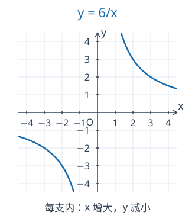

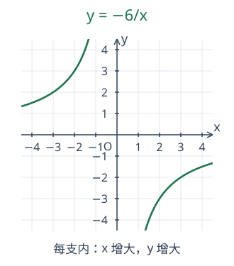

| 系数 | 象限 | 在每一条分支内 |
| --- | --- | --- |
| $k>0$ | 第一、第三象限 | $y$ 随 $x$ 增大而减小 |
| $k<0$ | 第二、第四象限 | $y$ 随 $x$ 增大而增大 |

增减性要在同一条分支内判断

### 3. 图象的对称性 {#symmetry .knowledge-title}

完整图象关于原点对称：有点 $(a,b)$，就有点 $(-a,-b)$

例如 $y=\frac6x$ 经过 $(2,3)$，也经过 $(-2,-3)$

两轴单位长度相同时，图象还关于直线 $y=x$、$y=-x$ 对称

### 4. 系数 k 与面积 {#area .knowledge-title}

从图象上的点 $P$ 向两轴作垂线，与原点围成一个矩形

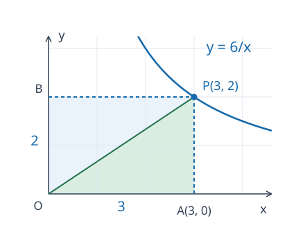

$$S_{\text{矩形}}=|k|,\qquad S_{\triangle OAP}=\frac{|k|}{2}$$

图中 $P(3,2)$，所以矩形面积为 $6$，三角形面积为 $3$

## 【考点】方法与例题 {#exam .handbook-section .is-exam}

### 1. 哪两个量成反比例 {#whole-quantity .exam-title}

看清等式中的整体，再判断“谁与谁成反比例”：

| 等式（$C\ne0$） | 固定的乘积 | 成反比例的两个量 |
| --- | --- | --- |
| $v=C/u$ | $vu=C$ | $v$ 与 $u$ |
| $v+d=C/u$（$d$ 为常数） | $(v+d)u=C$ | $v+d$ 与 $u$ |
| $v=C/u^2$ | $vu^2=C$ | $v$ 与 $u^2$ |

例如 $y+1=2/x$，成反比例的是 $y+1$ 与 $x$；不能把 $+1$ 丢掉，改说 $y$ 与 $x$ 成反比例。

若把 $1/u$ 看成新自变量，$v=C(1/u)$ 又表示 $v$ 与 $1/u$ 成正比例。换了自变量，关系的名称也可能改变，但原来的范围限制仍须保留。

对于已经化成 $y=Ax^r$ 的整数指数幂式，判断为反比例函数，要同时检查 $r=-1$、$A\ne0$。

### 2. 用一个点求解析式 {#coefficient .exam-title}

已知是反比例函数，只需图象上一个点，就能求出 $k$。

例如图象经过 $(2,3)$，则 $k=2\times3=6$，所以 $y=6/x$，$x\ne0$。一般地，点 $(a,b)$ 在图象上，就有

$$k=ab.$$

- 知道 $x$ 求 $y$：代入 $y=k/x$。
- 知道 $y$ 求 $x$：用 $x=k/y$。
- 检查多个点：每个点的横、纵坐标乘积都应等于同一个 $k$。

轴上的点有一个坐标为 $0$，不可能在 $k\ne0$ 的反比例函数图象上。

### 3. 直线与双曲线的交点 {#intersections .exam-title}

交点要同时满足两式。把非水平直线 $y=mx+b$（$m\ne0$）与 $y=k/x$ 联立：

$$mx+b=\frac{k}{x}\quad\Longrightarrow\quad mx^2+bx-k=0,\qquad x\ne0.$$

这个二次方程的常数项 $-k\ne0$，所以 $0$ 不是根，每个实根都对应一个交点。

- $\Delta=b^2+4mk>0$ &emsp;→&emsp; 两个不同交点。
- $\Delta=0$ &emsp;→&emsp; 一个交点。
- $\Delta<0$ &emsp;→&emsp; 没有交点。

特殊直线可直接求解：

| 直线 | 与完整双曲线的交点 |
| --- | --- |
| $x$ 轴或 $y$ 轴 | 没有 |
| $y=c$，$c\ne0$ | $(k/c,c)$ |
| $x=c$，$c\ne0$ | $(c,k/c)$ |
| $y=mx$，$m\ne0$ | 由 $x^2=k/m$ 判断：$k/m>0$ 时有两个原点对称点，$k/m<0$ 时没有 |

水平直线联立后不是二次方程，不能用二次判别式。只取一支或某段实际范围时，交点还要筛选。

### 4. 比较反比例函数与一次函数 {#comparison .exam-title}

同一个 $x$ 处，图象越高，函数值越大。 读范围时，用交点的横坐标和 $0$ 把数轴分段，再逐段比较。

代数上也可以作差：

$$mx+b-\frac{k}{x}=\frac{mx^2+bx-k}{x},\qquad x\ne0.$$

分子为 $0$ 的位置是交点，分母为 $0$ 的位置是函数没有意义的地方；这些都是分段的界限。每段分别判断分子、分母的符号，再看商的正负。

含等号可保留交点，但 $x=0$ 始终不能取。 若直接乘 $x$ 解不等式，要分 $x>0$ 和 $x<0$；乘负数时不等号反向，所得范围还须符合对应的正负条件。

### 5. 反比例函数的实际应用 {#applications .exam-title}

先找固定乘积，再把所求量表示出来：

| 固定的量 | 关系 |
| --- | --- |
| 总路程 | 速度 × 时间 = 总路程 |
| 总货量 | 卸货速度 × 时间 = 总货量 |
| 给定的杠杆平衡条件 | 动力 × 动力臂 = 阻力 × 阻力臂 |

单位要统一；固定总量或模型条件改变后，也要重新检查系数。对正量关系 $uv=C$，若 $u$ 变成原来的 $r$ 倍（$r>0$），则 $v$ 变为原来的 $1/r$：

$$v'=\frac{C}{ru}=\frac vr.$$

“至少”“至多”先写成所限制量的不等式，再代入函数式求另一个量；最后检查正值范围和等号。

周期过程还要看从何时计时。 如题目规定冷却公式使用“本轮开机后的时间”，冷却开始时就不能把时间重置为 $0$；进入下一轮时才重置。“高于某温度”不包含等于，临界时刻要单独核对。

### 6. 判断反比例函数 {#identify .exam-title}

先确认题目所问的输入和输出，再把式子化为非零常数除以输入，或检查两者乘积。系数含根号、负号，不会因此失去反比例类型。

<article class="handbook-example" aria-labelledby="example-1">

#### 例题 01 识别不同写法 知识清单例题 {#example-1 .example-heading}

题目

下列哪些解析式中的 $y$ 是 $x$ 的反比例函数？填序号。

① $y=-\dfrac{\sqrt5}{3x}$；

② $y=x^{-1}$；

③ $xy=-3$。

答案与解析

解析

①可写成 $y=(-\sqrt5/3)/x$，系数非零。②由负整数指数幂的定义，$x^{-1}=1/x$。③非零乘积使 $x\ne0$，除以 $x$ 得 $y=-3/x$。三式都符合定义。

本题结论

①②③。

</article>

### 7. 求解析式与函数值 {#determine .exam-title}

1. 已知反比例类型，设 $y=k/x$。
2. 用一对对应值求 $k=xy$，写清范围。
3. 求输出就代输入，求输入就解方程；其他点都用同一个系数。
4. 回代原条件，核对符号、单位和非零限制。

<article class="handbook-example" aria-labelledby="example-2">

#### 例题 02 对应值与图上点 知识清单例题·合组 {#example-2 .example-heading}

题目

（1）已知 $y$ 是 $x$ 的反比例函数，$x=5$ 时 $y=-8$。求解析式，以及 $x=-6$ 时的 $y$、$y=10$ 时的 $x$。

（2）反比例函数的图象经过 $(2,-2)$、$(m,1)$，求 $m$。

答案与解析

解析

（1）$k=5\times(-8)=-40$，所以 $y=-40/x$，$x\ne0$。代 $x=-6$ 得 $y=20/3$；由 $10=-40/x$ 得 $10x=-40$，所以 $x=-4$，回代成立。

（2）同一图上两点的乘积相等，$2\times(-2)=m\times1$，所以 $m=-4$。

本题结论

（1）$y=-40/x$，$x\ne0$；$x=-6$ 时 $y=20/3$，$y=10$ 时 $x=-4$。（2）$m=-4$。

</article>

### 8. 根据图象性质求参数 {#coefficient-sign .exam-title}

先找分子中的完整系数，再根据增减性或象限列不等式。例如 $y=(k-1)/x$ 的系数是 $k-1$；每支递增要求 $k-1<0$。题目只要求举一个值时，给出一个满足条件的值即可。

<article class="handbook-example" aria-labelledby="example-3">

#### 例题 03 由增减性确定参数 知识清单例题·合组 {#example-3 .example-heading}

题目

（1）反比例函数 $y=(k-1)/x$ 在每条分支内，$y$ 随 $x$ 的增大而增大，$k$ 可以取下列哪个值？

A. $0$

B. $1$

C. $2$

D. $3$

（2）（2024 湖北武汉）反比例函数 $y=k/x$ 在 $x>0$ 时，$y$ 随 $x$ 的增大而减小。写出一个满足条件的 $k$ 值。

答案与解析

解析

第一组：真正的比例系数是 $k-1$。每支递增要求 $k-1<0$，即 $k<1$，故选 A。$k=1$ 使系数为零，不是反比例函数；$k=2,3$ 则每支递减。

第二组：$x>0$ 时递减，要求 $k>0$，例如 $k=1$。所有正数都满足，不唯一。

本题结论

第一组：A。第二组：例如 $k=1$，答案不唯一。

</article>

### 9. 比较函数值 {#compare-values .exam-title}

用 $y=k/x$ 的符号先把正值和负值分开；同一分支内再用增减性比较。最后检查整串大小关系，不是只判断最大或最小一项。

<article class="handbook-example" aria-labelledby="example-4">

#### 例题 04 三个点分属两条分支 知识清单例题 {#example-4 .example-heading}

题目

点 $(x_1,y_1)$、$(x_2,y_2)$、$(x_3,y_3)$ 在 $y=-1/x$ 的图象上，且 $x_1>x_2>0>x_3$。下列关系正确的是（　）。

A. $y_3>y_1>y_2$

B. $y_3>y_2>y_1$

C. $y_1>y_2>y_3$

D. $y_1>y_3>y_2$

答案与解析

解析

因为 $k=-1<0$，正横坐标 $x_1,x_2$ 对应负纵坐标，负横坐标 $x_3$ 对应正纵坐标，故 $y_3$ 最大。

在 $x>0$ 的分支内，函数递增，$x_1>x_2$，所以 $y_1>y_2$。合起来为 $y_3>y_1>y_2$。B 颠倒同支次序，C、D 都把负值排在正值上面。

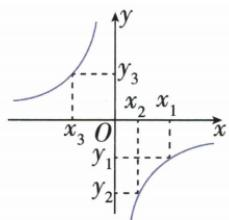

本题结论

A，即 $y_3>y_1>y_2$。

</article>

### 10. 利用对称求和 {#opposite-inputs .exam-title}

先确认两点属于同一个反比例函数。输入互为相反数，输出也互为相反数；系数未知不妨碍求和，但不能据此求出每个输出的唯一数值。

<article class="handbook-example" aria-labelledby="example-5">

#### 例题 05 不先求系数的求和 知识清单例题 {#example-5 .example-heading}

题目

（2024 北京）函数 $y=k/x$（$k\ne0$）的图象经过 $(3,y_1)$、$(-3,y_2)$，求 $y_1+y_2$。

答案与解析

解析

由同一函数可写 $y_1=k/3$，$y_2=k/(-3)=-k/3$，因此 $y_1+y_2=0$。这是原点对称，不是关于纵轴对称。

本题结论

$0$。

</article>

### 11. 用面积求系数 {#area-method .exam-title}

先把坐标化成正长度，确认所用图形是不是轴向矩形或轴三角形，再按包含、重叠关系相加或相减。反求系数时，面积给出绝对值，象限给出符号。

<article class="handbook-example" aria-labelledby="example-6">

#### 例题 06 两条双曲线之间的三角形 知识清单例题 {#example-6 .example-heading}

题目

如图，点 $A$ 在 $y=6/x$ 的图象上。过 $A$ 作 $AB\perp x$ 轴，垂足为 $B$，线段 $AB$ 与 $y=2/x$ 的图象交于 $C$。求 $\triangle OAC$ 的面积。

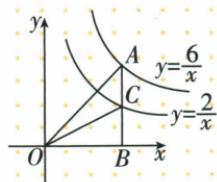

答案与解析

解析

设共同横坐标为 $x>0$。$AB=6/x$，$CB=2/x$，$OB=x$，所以

$$S_{\triangle OAB}=\frac12x\frac6x=3,\qquad S_{\triangle OCB}=\frac12x\frac2x=1.$$

$C$ 在线段 $AB$ 内，大三角形由 $\triangle OAC$ 与 $\triangle OCB$ 组成，故所求面积为 $3-1=2$。也可取 $AC=4/x$ 为底、原点到这条竖线的距离 $x$ 为高。

本题结论

$2$。

</article>

<article class="handbook-example" aria-labelledby="example-7">

#### 例题 07 由平行四边形求系数 知识清单例题 {#example-7 .example-heading}

题目

（2024 黑龙江齐齐哈尔）如图，$y=k/x$（$x<0$）的图象经过平行四边形 $ABCO$ 的顶点 $A$，$OC$ 在 $x$ 轴上。已知 $B(-1,3)$，平行四边形面积为 $3$，求 $k$。

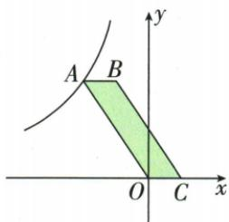

答案与解析

解析

$AB\parallel OC$，所以 $A,B$ 同高 $3$。由面积 $3=OC\times3$ 得 $OC=1$。题图中 $C$ 位于正横轴，$AB=OC=1$，且 $A$ 在 $B$ 左侧，因此 $A(-2,3)$，从而 $k=(-2)\times3=-6$。

也可用割补说明面积意义：延长 $AB$ 交纵轴于 $D$，设 $BC$ 交纵轴于 $E$。$BD=OC=1$，$\angle BDE=\angle COE=90^\circ$，$\angle BED=\angle CEO$ 为对顶角，所以 $\triangle BED\cong\triangle CEO$。两图形扣除共有的四边形 $ABEO$ 后，剩余三角形面积相等，故 $S_{\triangle AOD}=S_{\square ABCO}=3$。

于是 $\lvert k\rvert=2\times3=6$，再由 $A$ 在第二象限取 $k=-6$。

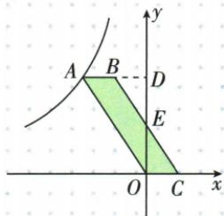

本题结论

$k=-6$。

</article>

### 12. 判断交点与系数符号 {#intersection-method .exam-title}

公共点必须同时满足两式。过原点直线可直接研究 $x^2=k/m$；一般斜直线则化为二次方程，用判别式判断。不能只凭“图象经过同一象限”断言必有交点。

<article class="handbook-example" aria-labelledby="example-8">

#### 例题 08 无交点条件怎样确定符号 知识清单例题 {#example-8 .example-heading}

题目

直线 $y=-x$ 与 $y=k/x$（$k\ne0$）的图象没有交点。已知双曲线经过 $A(1,y_1)$、$B(2,y_2)$，下列关系正确的是（　）。

A. $y_1<y_2$

B. $y_1=y_2$

C. $y_1>y_2$

D. 无法确定

答案与解析

解析

联立 $-x=k/x$，保留 $x\ne0$，得到 $-x^2=k$。若 $k<0$，两个非零实数 $x=\pm\sqrt{-k}$ 都给出交点；$k=0$ 又已被定义排除。因此无交点只能是 $k>0$。

两个横坐标都为正，$y_1=k$，$y_2=k/2$，所以 $y_1>y_2$，选 C。A 方向相反，B 会推出 $k=0$，D 忽略了无交点的约束。

本题结论

C。

</article>

### 13. 直线与双曲线的综合问题 {#combined .exam-title}

先用完整交点确定双曲线，再恢复另一个交点，最后用两点确定直线。面积可借坐标轴截点拆分；比较函数值则另列交点与零输入的全部分界，逐段看上下关系。

<article class="handbook-example" aria-labelledby="example-9">

#### 例题 09 同一图中的三个任务 知识清单例题 {#example-9 .example-heading}

题目

反比例函数 $y=k_1/x$（$k_1\ne0$）与一次函数 $y=k_2x+b$（$k_2\ne0$）的图象交于 $A(1,8)$、$B(-4,m)$。

（1）求 $k_1,k_2,b$。

（2）求 $\triangle AOB$ 的面积。

（3）写出不等式 $k_1/x\le k_2x+b$ 的解集。

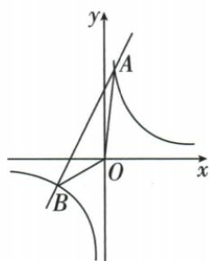

答案与解析

解析

（1）由 $A(1,8)$ 得 $k_1=8$。$B$ 在双曲线上，故 $m=8/(-4)=-2$。两点代入直线：

$$\begin{cases}k_2+b=8,\\-4k_2+b=-2.\end{cases}$$

两式相减得 $5k_2=10$，所以 $k_2=2$，$b=6$。

（2）直线与纵轴交于 $C(0,6)$。$A,B$ 分居纵轴两侧，$C$ 在线段 $AB$ 内，两三角形共享底 $OC=6$，垂高分别为 $1,4$，所以 $S_{\triangle AOB}=6(1+4)/2=15$。

（3）要求 $8/x\le2x+6$，移项、通分为

$$\frac{2(x+4)(x-1)}x\ge0,\qquad x\ne0.$$

| 横坐标范围 | 分子符号 | 分母符号 | 商的符号 |
| --- | --- | --- | --- |
| $x<-4$ | 正 | 负 | 负 |
| $-4<x<0$ | 负 | 负 | 正 |
| $0<x<1$ | 负 | 正 | 负 |
| $x>1$ | 正 | 正 | 正 |

交点 $-4,1$ 可以取，零不能取。因此 $-4\le x<0$ 或 $x\ge1$。

本题结论

（1）$k_1=8,k_2=2,b=6$；（2）$15$；（3）$-4\le x<0$ 或 $x\ge1$。

</article>

### 14. 建立反比例模型 {#model .exam-title}

找出两个量相乘后保持的总量，或使用题目明确给出的比例关系。先统一单位，再写正范围；数值只适用于题目给定的条件，不能将特定模型推广为普遍规律。

<article class="handbook-example" aria-labelledby="example-10">

#### 例题 10 两种固定乘积 知识清单例题·合组 {#example-10 .example-heading}

题目

（1）（2024 山西）一款机器狗载重后的最快移动速度 $v$（米/秒）与总质量 $m$（千克）成反比例关系。$m=60$ 时，$v=6$。求 $m=90$ 时的 $v$。

（2）（2024 江苏连云港）杠杆平衡时，阻力 × 阻力臂 = 动力 × 动力臂。已知阻力为 $1600$ 牛、阻力臂为 $0.5$ 米，动力为 $F$ 牛、动力臂为 $l$ 米，求 $F$ 关于 $l$ 的函数表达式。

答案与解析

解析

第一组：题目已规定反比例关系，设 $v=k/m$。由 $60\times6=360$ 得 $v=360/m$，所以总质量 $90$ 千克时，$v=360/90=4$ 米/秒。质量变为原来的 $3/2$ 倍，速度也正好变为原来的 $2/3$。

第二组：题给的平衡关系是 $Fl=1600\times0.5=800$。动力臂为正长度，故 $F=800/l$，$l>0$。$800$ 是力与力臂乘积的数值，不是固定的动力值。

本题结论

第一组：$4\ \mathrm{m/s}$。第二组：$F=800/l$，$l>0$，$F$ 的单位为牛，$l$ 的单位为米。

</article>

<article class="handbook-example" aria-labelledby="example-11">

#### 例题 11 总用电量不变时的变化 知识清单例题 {#example-11 .example-heading}

题目

（2024 河北）淇淇家计划购买 $500$ 度电。若平均每天用电 $x$ 度，能使用 $y$ 天，下列说法错误的是（　）。

A. $x=5$ 时，$y=100$。

B. $y=125$ 时，$x=4$。

C. $x$ 减小，$y$ 也减小。

D. $x$ 减小一半，$y$ 增大一倍。

答案与解析

解析

$xy=500$，且 $x,y>0$。

- A：$y=500/5=100$，正确。
- B：$x=500/125=4$，正确。
- C：$x>0$ 时，$x$ 减小时 $y$ 增大，说二者都减小错误。
- D：$500/(x/2)=2(500/x)=2y$，变为原来的两倍，确实是增大一倍。

题目问错误的说法，故选 C。

本题结论

C。

</article>

### 15. 解“至少”“至多”问题 {#threshold-method .exam-title}

“时间不超过”先限制时间，“气压不超过”先限制气压；再代入反比例式。实际变量为正时，乘它不改变不等号方向。最后代回边界，判断它是否符合原来的严格或非严格要求。

<article class="handbook-example" aria-labelledby="example-12">

#### 例题 12 限时卸货 知识清单例题 {#example-12 .example-heading}

题目

一艘轮船装有 $100$ 吨货物。设平均卸货速度为 $v$ 吨/时，卸完所需时间为 $t$ 小时。

（1）求 $v$ 关于 $t$ 的函数表达式。

（2）若要求不超过 $5$ 小时卸完，平均每小时至少卸多少吨？

答案与解析

解析

（1）卸货速度乘卸货时间等于总货量，$vt=100$，所以 $v=100/t$，$t>0$。

（2）不超过 $5$ 小时指 $0<t\le5$。由 $t=100/v$，且 $v>0$，有

$$\frac{100}{v}\le5\quad\Longrightarrow\quad100\le5v\quad\Longrightarrow\quad v\ge20.$$

$v=20$ 时恰好用 $5$ 小时，符合题意，因此每小时至少卸 $20$ 吨。

本题结论

（1）$v=100/t$，$t>0$；（2）每小时至少卸 $20$ 吨。

</article>

<article class="handbook-example" aria-labelledby="example-13">

#### 例题 13 给定气压模型的边界 知识清单例题 {#example-13 .example-heading}

题目

气球内气体的质量、温度不变，题设气压 $p$（千帕）与体积 $V$（立方米）成反比例关系，图象如下。

（1）求函数解析式。

（2）体积为 $1$ 立方米时，气压是多少？

（3）题设气压大于 $140$ 千帕时气球会爆炸。按这一模型，气体体积应不少于多少立方米？

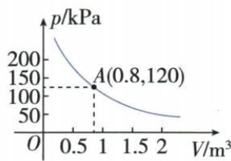

答案与解析

解析

（1）按题目指定的反比例关系设 $p=k/V$。图上 $A(0.8,120)$ 给 $k=0.8\times120=96$，所以 $p=96/V$，$V>0$。

（2）$V=1$ 时，$p=96\ \mathrm{kPa}$。

（3）题设危险条件为 $p>140$。在这一理想模型内，不触发该条件需 $p\le140$，故

$$\frac{96}{V}\le140\quad\Longrightarrow\quad V\ge\frac{96}{140}=\frac{24}{35}.$$

边界对应 $p=140$，符合题设“不大于 $140$”的要求，可以保留等号。

本题结论

（1）$p=96/V$，$V>0$；（2）$96\ \mathrm{kPa}$；（3）体积不少于 $\frac{24}{35}\ \mathrm{m^3}$。

</article>

## 【坑点】条件与辨析 {#pitfalls .handbook-section .is-pitfall}

### 1. 把整量拆掉，关系就变了 {#whole-pit .pitfall-title}

分母里出现 $x$，不代表所问的两个量一定成反比例。先写出它们的乘积，检查是否真的恒定；不要把 $y+1$ 当成 $y$，也不要把 $x^2$ 当成 $x$。

<article class="handbook-example is-pitfall" aria-labelledby="pitfall-1">

#### 辨析 01 判断四个比例关系 知识清单辨析·去除题面答案 {#pitfall-1 .example-heading}

题目

判断下列说法是否正确，并说明理由。

（1）在 $y=1/x-1$ 中，$y+1$ 与 $x$ 成反比例关系。

（2）在 $xy=-2$ 中，$y$ 与 $1/x$ 成正比例关系。

（3）在 $y=1/(2x^2)$ 中，$y$ 与 $x$ 成反比例关系。

（4）在 $xy=-3$ 中，$y$ 与 $x$ 成反比例关系。

答案与解析

解析

（1）移项得 $y+1=1/x$，所以 $(y+1)x=1$，正确。

（2）$y=-2(1/x)$，以整体 $1/x$ 为输入，是正比例关系，正确。

（3）$xy=1/(2x)$ 随输入改变，并非常数，错误；恒定的其实是 $yx^2=1/2$。

（4）$xy=-3$ 是非零恒定乘积，正确。

本题结论

（1）正确；（2）正确；（3）错误；（4）正确。

</article>

### 2. 指数与系数是两道条件 {#parameter-pit .pitfall-title}

解指数方程只得到候选值。把候选代回整个系数，排除使系数为零的值，再检查原式是否有意义。

<article class="handbook-example is-pitfall" aria-labelledby="pitfall-2">

#### 辨析 02 参数是否全部保留 知识清单例题 {#pitfall-2 .example-heading}

题目

（1）若 $y=(|m|-2)/x$ 是反比例函数，求 $m$ 的取值范围。

（2）若 $y=(n+1)x^{n^2+n-1}$ 是 $x$ 的反比例函数，求 $n$。

答案与解析

解析

（1）$\lvert m\rvert-2\ne0$，所以 $m\ne2$ 且 $m\ne-2$。排除的不是 $m=0$。

（2）指数条件为 $n^2+n-1=-1$，即 $n(n+1)=0$，候选 $n=0,-1$。还要满足 $n+1\ne0$，故排除 $-1$，只保留 $0$。代入得到 $y=1/x$，符合定义。

本题结论

（1）$m\ne\pm2$；（2）$n=0$。

</article>

### 3. 不能跨零套用单调性 {#branch-pit .pitfall-title}

错法： 把“每条分支内递增”用到跨过 $0$ 的两个横坐标上。

自查： 先看函数值的正负，正数总大于负数；同一支上的两个值，再按增减性比较。

<article class="handbook-example is-pitfall" aria-labelledby="pitfall-3">

#### 辨析 03 负横坐标和正横坐标混合排序 知识清单例题 {#pitfall-3 .example-heading}

题目

（2024 山东济宁）点 $A(-2,y_1)$、$B(-1,y_2)$、$C(3,y_3)$ 在 $y=k/x$（$k<0$）的图象上，三个函数值的大小关系是（　）。

A. $y_1<y_2<y_3$

B. $y_2<y_1<y_3$

C. $y_3<y_1<y_2$

D. $y_3<y_2<y_1$

答案与解析

解析

$k<0$，所以负横坐标对应的 $y_1,y_2$ 为正，而 $y_3=k/3<0$，先知 $y_3$ 最小。

在 $x<0$ 的分支内，$-2<-1$，函数递增，故 $y_1<y_2$。也可直接写 $y_1=-k/2$、$y_2=-k$，因为 $-k>0$，前者只有后者的一半。

因此只有 C 的整个次序都正确；D 虽把 $y_3$ 放在最小位置，却颠倒了另外两项。

本题结论

C，即 $y_3<y_1<y_2$。

</article>

### 4. 两份面积中的重叠要分别处理 {#overlap-pit .pitfall-title}

先列每个完整图形由哪些部分组成。求并集只扣一份重叠；若两份完整面积中都要除去阴影，就应各扣一份，不能混淆两种任务。

<article class="handbook-example is-pitfall" aria-labelledby="pitfall-4">

#### 辨析 04 求非阴影面积之和 知识清单例题 {#pitfall-4 .example-heading}

题目

如图，$A,B$ 在 $y=4/x$ 的图象上，分别过两点向坐标轴作垂线段。阴影面积为 $1$，求非阴影部分的面积之和 $S_1+S_2$。

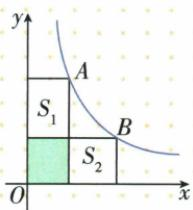

答案与解析

解析

两个轴向矩形的面积都是 $\lvert k\rvert=4$。由图中分解，$S_1+1=4$，$S_2+1=4$，因此

$$S_1+S_2=4+4-2\times1=6.$$

$4+4-1=7$ 算的是两矩形并集，仍含一份阴影，不是题目所求。

本题结论

$6$。

</article>

### 5. 无公共点不包括相切 {#no-intersection-pit .pitfall-title}

斜直线联立为二次方程后，“无交点”要求判别式严格小于零。等于零仍有一个交点；直线若退化成水平线，则先另作分类，不能继续套二次判别式。

<article class="handbook-example is-pitfall" aria-labelledby="pitfall-5">

#### 辨析 05 检查无交点的参数边界 知识清单例题 {#pitfall-5 .example-heading}

题目

反比例函数 $y=k/x$（$k\ne0$）与一次函数 $y=x+2$ 的图象没有公共点，求 $k$ 的取值范围。

答案与解析

解析

联立 $k/x=x+2$，乘非零 $x$ 得 $x^2+2x-k=0$。由于 $k\ne0$，$x=0$ 不是根，所以实根与交点一一对应。

无交点要求 $\Delta=4+4k<0$，解得 $k<-1$。若取 $k=-1$，方程成为 $(x+1)^2=0$，仍有合法交点 $(-1,1)$，不能收等号。

本题结论

$k<-1$。

</article>

### 6. 不等号的等号不允许分母为零 {#zero-pit .pitfall-title}

交点和零输入来自不同条件：前者比较的是两函数值能否相等，后者决定函数是否有意义。读图时即使两个交点之间跨过零，也必须把它断开。

<article class="handbook-example is-pitfall" aria-labelledby="pitfall-6">

#### 辨析 06 直线较低时怎样读取范围 知识清单例题 {#pitfall-6 .example-heading}

题目

（2024 山东威海）直线 $y_1=ax+b$（$a\ne0$）与双曲线 $y_2=k/x$（$k\ne0$）交于 $A(-1,m)$、$B(2,-1)$。求满足 $y_1\le y_2$ 的 $x$ 的取值范围。

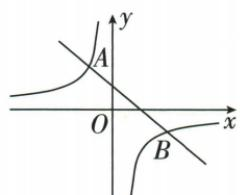

答案与解析

解析

由 $B(2,-1)$ 得 $k=-2$，故 $A(-1,2)$。直线经过两点，斜率为 $(-1-2)/(2+1)=-1$，截距为 $1$，所以 $y_1=1-x$。

题目要求 $1-x\le-2/x$，通分、乘常数 $-1$ 后可写为

$$\frac{(x-2)(x+1)}x\ge0,\qquad x\ne0.$$

分界是 $-1,0,2$。从左到右四段的商符号依次为负、正、负、正，因此取 $-1<x<0$ 或 $x>2$。原比较含等号，两个交点可取；零仍不能取。

本题结论

$-1\le x<0$ 或 $x\ge2$。

</article>

### 7. 周期计时和严格阈值要分别检查 {#cycle-pit .pitfall-title}

先算完整周期，再求升温和降温两次穿过阈值的时刻。跨轮等待等于本轮剩余时间加下一轮升温时间；但算出临界长度后，还须把末端温度代回“高于”这一严格要求。

<article class="handbook-example is-pitfall" aria-labelledby="pitfall-7">

#### 辨析 07 重复加热中的等待问题 知识清单例题 {#pitfall-7 .example-heading}

题目

饮水机从 $30{}^\circ\mathrm C$ 开始加热，每分钟升温 $10{}^\circ\mathrm C$，到 $100{}^\circ\mathrm C$ 时停止加热。冷却时，水温 $y$ 与本轮开机后的时间 $x$ 成反比例关系；降到 $30{}^\circ\mathrm C$ 后立即开始下一轮，重复上述过程。时间单位为分钟。

（1）写出第一轮升温、降温阶段的函数关系式。

（2）怡萱想接高于 $50{}^\circ\mathrm C$ 的热水，最多需要等待多长时间？注意判断严格大于时的端点。

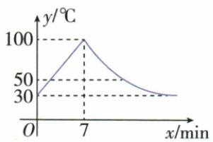

答案与解析

解析

（1）先看第一轮，令 $x$ 为本轮开机后的分钟数。初温 $30{}^\circ\mathrm C$，每分钟升温 $10{}^\circ\mathrm C$，所以升温式为 $y=10x+30$。到 $100{}^\circ\mathrm C$ 时，$10x+30=100$，得 $x=7$。

冷却阶段按题意仍用本轮开机时间作输入，设 $y=a/x$，由 $(7,100)$ 得 $a=700$。降至 $30{}^\circ\mathrm C$ 时 $700/x=30$，得 $x=70/3$。因此第一轮为

$$y=\begin{cases}10x+30,&0\le x\le7,\\700/x,&7<x\le70/3.\end{cases}$$

一轮长 $L=70/3$ 分钟。累计时间经过 $n$ 个整周期后，令本轮局部时间 $u=t-nL$，再用同样的分段式；不能将累计时间直接代入 $700/x$，也不能在冷却刚开始时把分母计时清零。

（2）升温到 $50{}^\circ\mathrm C$ 时，$10u+30=50$，得 $u=2$；冷却到 $50{}^\circ\mathrm C$ 时，$700/u=50$，得 $u=14$。因此本轮严格高于 $50{}^\circ\mathrm C$ 的时间是 $2<u<14$。

从本轮 $u=14$ 到下一轮 $u=2$，相隔

$$L-14+2=\frac{70}{3}-14+2=\frac{34}{3}\text{ 分钟}.$$

检查端点：这段间隔的两端，水温都恰为 $50{}^\circ\mathrm C$。若在本轮 $u=14$ 时到达，等待 $34/3$ 分钟后仍不能接到“高于 $50{}^\circ\mathrm C$”的水，还须再等一点时间。

在连续模型中，这“一点时间”可任意小，没有最早合格时刻。因此，按原题的严格措辞，不能给出一个可取得的“最大等待时间”。$34/3$ 分钟是低温间隔的临界长度，不能直接当作原题的最大等待答案。

本题结论

（1）第一轮 $y=10x+30$，$0\le x\le7$；$y=700/x$，$7<x\le70/3$，以后按每轮局部时间重复。

（2）临界低温间隔为 $34/3$ 分钟；原题“高于 $50{}^\circ\mathrm C$”的严格端点使它不是可直接取得的最大等待答案。

</article>

