一次函数的图象是一条直线。从定义与非零条件出发，读懂系数和图象，再学习用两个点确定表达式。

<nav class="handbook-nav" aria-label="本章教学路径">
  <a class="handbook-jump" href="#definition">01 · 定义判定认形式，同时查非零条件</a>
  <a class="handbook-jump" href="#graph-path">02 · 系数与图象看 k 的增减方向，看 b 的轴上位置</a>
  <a class="handbook-jump" href="#determination">03 · 两点求式列方程、求系数、代回检验</a>
</nav>

**学习方式**：先读概念与图象，再独立尝试例题和专项练习；需要时展开提示与解析，检查自己的思路。

**选读提示**：平移、交点、实际应用等专题在后文，可用页内目录按需查阅。

## 【知识点】从定义开始：先认形式，再查条件 {#knowledge .handbook-section .is-knowledge}

### 【知识点】一次函数与正比例函数 {#definition .knowledge-title}

形如 $y=kx+b$（$k\ne0$，$k,b$ 为常数）的函数，叫作==一次函数==，图象是一条直线

$b=0$ 时，得到 $y=kx$，叫作==正比例函数==，图象经过原点

例如 $y=2x+1$ 是一次函数，$y=2x$ 和 $y=-2x$ 都是正比例函数

### 【坑点】指数为一，还要检查系数非零 {#definition-pit .pitfall-title}

含参式写着一次幂，不等于实际存在一次项。指数、系数、常数项分开检查：正比例函数还要求实际常数项为零，一次函数则允许常数项非零。

<article class="handbook-example is-pitfall" aria-labelledby="pitfall-1">

#### 辨析 01 含参定义的三个位置 知识清单例题 {#pitfall-1 .example-heading}

题目

（1）$y=(k-2)x^{k^2-3}+b+1$ 是正比例函数，求 $k,b$。

（2）$y=(m-2)x^{m^2-3}+1$ 是一次函数，求 $m$。

答案与解析

解析

（1）同时要求 $k^2-3=1$、$k-2\ne0$、$b+1=0$。指数条件给 $k=\pm2$，非零系数条件排除 $2$，所以 $k=-2,b=-1$，整体变为 $y=-4x$。

（2）指数条件给 $m=\pm2$，但 $m=2$ 时一次项消失，只剩常函数 $y=1$，不合题意。故 $m=-2$，得到 $y=-4x+1$。常数项 $1$ 不妨碍一次函数的定义。

本题结论

（1）$k=-2,b=-1$。（2）$m=-2$。

</article>

#### 【考点】定义判定专项练习（原创）

<NotePractice mode="single" answer="B" choices="A,B,C,D" title="专项练习 1（原创）">

已知 $y=(m-1)x^{m^2}+2$ 是一次函数，$m$ 应取哪个值？按“指数为 $1$、一次项系数非零”同时检查。

<template #option-a>

$m=0$

</template>

<template #option-b>

$m=-1$

</template>

<template #option-c>

$m=1$

</template>

<template #option-d>

$m=2$

</template>

<template #hint>

先由 $m^2=1$ 得到候选值，再检查 $m-1$ 是否为零。常数项 $2$ 不影响一次函数的判定。

</template>

<template #answer>

选 B。由 $m^2=1$ 得 $m=\pm1$；由 $m-1\ne0$ 排除 $m=1$，故 $m=-1$。

检验：代入得到 $y=-2x+2$，指数为 $1$、系数 $-2\ne0$。A 不含一次项，C 的一次项系数为 $0$，D 给 $y=x^4+2$，均不是一次函数。

</template>

</NotePractice>

## 【知识点】把 k、b 与图象对应起来 {#graph-path}

### 【知识点】系数 k 与 b {#coefficients .knowledge-title}

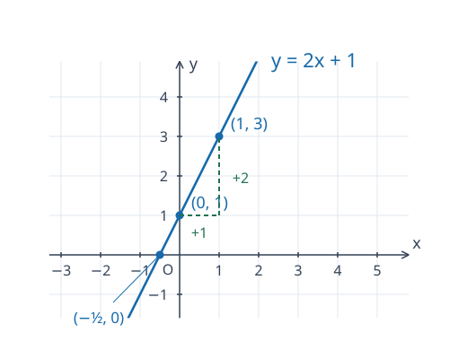

看 $y=2x+1$：$x$ 每增加 $1$，$y$ 增加 $2$；$x=0$ 时，$y=1$

一般地，$k$ 决定直线的倾斜方向和程度，$b$ 是直线与 $y$ 轴交点的纵坐标

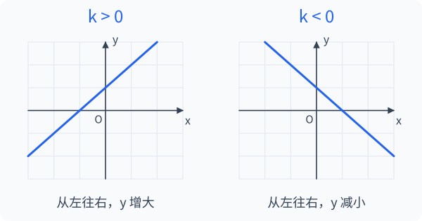

1. $k>0$：$y$ 随 $x$ 增大而增大
2. $k<0$：$y$ 随 $x$ 增大而减小
3. $b>0$、$b=0$、$b<0$：分别与 $y$ 轴正半轴、原点、负半轴相交

#### 【坑点】截距的正负不能决定增减

$y=-x+2$ 的 $b=2>0$，却因 $k=-1<0$ 而递减。检查时先圈出 $x$ 的完整系数，再单独读取常数项；两件事不能互相代替。

### 【知识点】与坐标轴的交点 {#intercepts .knowledge-title}

| 交点 | 代入什么 | 坐标 |
| --- | --- | --- |
| 与 $y$ 轴的交点 | $x=0$ | $(0,b)$ |
| 与 $x$ 轴的交点 | $y=0$ | $(-\frac bk,0)$ |

描出两个不同的点，过它们画直线，就能得到一次函数的图象

### 【考点】比较函数值 {#monotonicity .exam-title}

先找一次项的完整系数，再判断增减。例如 $y=(1-3k)x+2$ 的斜率是 $1-3k$。已知横坐标大小后，斜率为正，函数值同向比较；斜率为负，大小关系反过来。

<article class="handbook-example" aria-labelledby="example-3">

#### 例题 03 两点的函数值比较 知识清单例题·合组；第（2）问 2024 山西 {#example-3 .example-heading}

题目

（1）$P_1(x_1,y_1),P_2(x_2,y_2)$ 在 $y=-x+2$ 的图象上，下列判断正确的是（　）。

A. $y_1>y_2$

B. $y_1<y_2$

C. 当 $x_1<x_2$ 时，$y_1>y_2$

D. 当 $x_1<x_2$ 时，$y_1<y_2$

（2）$A(x_1,y_1),B(x_2,y_2)$ 在 $y=3x$ 的图象上，且 $x_1<x_2$。下列关系正确的是（　）。

A. $y_1>y_2$

B. $y_1<y_2$

C. $y_1=y_2$

D. $y_1\ge y_2$

答案与解析

解析

（1）$k=-1<0$，横坐标越大，纵坐标越小。因此在 $x_1<x_2$ 时有 $y_1>y_2$，选 C。A、B 都没有交代横坐标次序，不能恒成立；D 把增减方向弄反。

（2）由 $x_1<x_2$，两边乘正数 $3$ 得 $3x_1<3x_2$，即 $y_1<y_2$，选 B。相等或大于均与严格小于矛盾。

本题结论

（1）C；（2）B。

</article>

<article class="handbook-example" aria-labelledby="example-4">

#### 例题 04 同一含参直线的三种要求 知识清单例题 {#example-4 .example-heading}

题目

已知直线 $y=(1-3k)x+2k-1$，分别求：

（1）过原点时的 $k$；（2）与纵轴交于 $(0,-2)$ 时的 $k$；（3）$y$ 随 $x$ 增大而增大时的 $k$ 的范围。

答案与解析

解析

（1）过原点，代 $x=y=0$，得 $2k-1=0$，所以 $k=\frac12$。

（2）纵轴交点的纵坐标是常数项，故 $2k-1=-2$，得 $k=-\frac12$。

（3）递增要求真正的一次项系数为正：$1-3k>0$，得 $k<\frac13$。等于 $\frac13$ 时斜率为零，不能收入严格递增的范围。

本题结论

（1）$k=\frac12$；（2）$k=-\frac12$；（3）$k<\frac13$。

</article>

<article class="handbook-example" aria-labelledby="example-5">

#### 例题 05 过一点且递减 2024 吉林长春·改编，补充范围设问 {#example-5 .example-heading}

题目

直线 $y=kx+b$ 经过 $(1,1)$，且 $y$ 随 $x$ 增大而减小。写出一个可行的 $b$ 值，并说明还有哪些 $b$ 值可行。

答案与解析

解析

过点给 $k+b=1$，递减给 $k<0$，所以 $b=1-k>1$。

例如取 $b=2$，则 $k=-1$，直线 $y=-x+2$ 确实经过 $(1,1)$ 且递减。反过来，任意 $b>1$ 都给出 $k=1-b<0$，因此这些值都可行。$b=1$ 则得到水平线，不满足递减。

本题结论

例如 $b=2$；全部可行值为 $b>1$。

</article>

### 【考点】根据系数选图象 {#select-graph .exam-title}

先看一次项系数决定右升还是右降，再看常数项决定纵轴交点在上还是在下。不能只满足其中一条就选图。

<article class="handbook-example" aria-labelledby="example-6">

#### 例题 06 参数范围决定图象 知识清单例题 {#example-6 .example-heading}

题目

若 $m<-2$，则 $y=(m+1)x+1-m$ 的图象可能是哪一个？

<figure class="handbook-option">

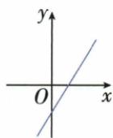

<figcaption>A</figcaption>
</figure>

<figure class="handbook-option">

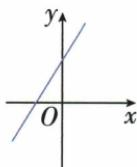

<figcaption>B</figcaption>
</figure>

<figure class="handbook-option">

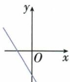

<figcaption>C</figcaption>
</figure>

<figure class="handbook-option">

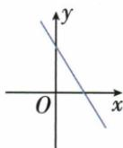

<figcaption>D</figcaption>
</figure>

答案与解析

解析

由 $m<-2$ 得 $m+1<-1<0$，图象向右下降；同时 $1-m>3>0$，与纵轴交于正半轴。

D 同时满足。A、B 都向右上升；C 虽然下降，但纵轴交点在负半轴。注意减去负数会增大，不能由 $m<0$ 就断言 $1-m<0$。

本题结论

选 D。

</article>

<article class="handbook-example" aria-labelledby="example-7">

#### 例题 07 逐项核对函数性质 知识清单例题·合组；第（2）问 2024 湖南长沙 {#example-7 .example-heading}

题目

（1）关于 $y=-2x+1$，下列正确的是（　）。

A. 必过 $(-2,1)$

B. 经过第一、二、三象限

C. $x>\frac12$ 时 $y<0$

D. $y$ 随 $x$ 增大而增大

（2）关于 $y=2x-1$，下列正确的是（　）。

A. 与纵轴交于 $(0,-1)$

B. $y$ 随 $x$ 增大而减小

C. $x>\frac12$ 时 $y<0$

D. 经过第一、二、三象限

答案与解析

解析

（1）代 $x=-2$ 得 $y=5$，不是 $1$；斜率负、两轴截点均在正半轴，经过第一、二、四象限；$x>\frac12$ 时 $-2x+1<0$；函数递减。因此只有 C 正确。

（2）代 $x=0$ 得 $y=-1$，A 正确；系数 $2>0$，函数递增；$x>\frac12$ 时 $2x-1>0$；负输入时输出必负，不经过第二象限，实际经过第一、三、四象限。故 B、C、D 均错。

本题结论

（1）C；（2）A。

</article>

## 【考点】用两个点确定表达式 {#exam .handbook-section .is-exam}

### 【考点】待定系数法 {#determination .exam-title}

已经知道是一次函数，但不知道 $k,b$，就先设出式子，再用已知条件求系数。这叫作==待定系数法==。

1. 设式：一次函数设 $y=kx+b$；正比例函数设 $y=kx$，均要求 $k\ne0$。
2. 代点：把每个点的横、纵坐标成对代入，列方程。
3. 求系数、回查：解出 $k,b$，代回原条件，并检查 $k\ne0$。

两点 $(x_1,y_1)$、$(x_2,y_2)$ 的横坐标不同时，也可直接算：

$$k=\frac{y_2-y_1}{x_2-x_1},\qquad b=y_1-kx_1.$$

公式来自两式相减消去 $b$。两点若完全相同，只给了一次条件；若横坐标相同、纵坐标不同，则不可能属于同一个函数。实际问题还须先有“一次变化”的依据，不能仅凭两次观测就断定整个过程是一次函数。

#### 【坑点】两点未必确定一次函数

两点横坐标不同，才能用差商求 $k$；还要检查求得的 $k\ne0$。例如 $(0,2)$、$(1,2)$ 只确定常函数 $y=2$，不能称作一次函数。求式后必须把两个点成对代回，并结合情境检查自变量范围。

### 【考点】求函数解析式 {#find-formula .exam-title}

先看是一次函数还是正比例函数，再设式、代入点坐标求系数。若点由对称关系给出，先求完整坐标；若给轴上交点，先把相应坐标设为 $0$。最后回代原条件。

<article class="handbook-example" aria-labelledby="example-1">

#### 例题 01 一次函数与正比例函数的定式 知识清单例题·合组；第（2）问 2024 陕西 {#example-1 .example-heading}

题目

（1）已知 $y$ 是 $x$ 的一次函数，$x=-2$ 时 $y=-3$，$x=1$ 时 $y=3$。求解析式。

（2）一个正比例函数经过 $A(2,m),B(n,-6)$，且两点关于原点对称。这个函数的表达式是（　）。

A. $y=3x$

B. $y=-3x$

C. $y=\dfrac13x$

D. $y=-\dfrac13x$

答案与解析

解析

（1）设 $y=kx+b$，代入两点：

$$\begin{cases}-2k+b=-3,\\k+b=3.\end{cases}$$

相减得 $3k=6$，所以 $k=2,b=1$，函数为 $y=2x+1$。代入两个原输入，分别得到 $-3,3$，正确。

（2）关于原点对称的两个坐标分别相反，所以 $m=6,n=-2$。设 $y=kx$，用 $A(2,6)$ 得 $6=2k$，即 $k=3$。另点也满足 $-6=3\times(-2)$。

本题结论

（1）$y=2x+1$。（2）选 A，$y=3x$。

</article>

<article class="handbook-example" aria-labelledby="example-2">

#### 例题 02 成正比例的是两个整体 知识清单例题 {#example-2 .example-heading}

题目

已知 $y+5$ 与 $3x+4$ 成正比例，$x=1$ 时 $y=2$。

（1）求 $y$ 与 $x$ 的函数关系式。（2）求 $x=-1$ 时的 $y$。

答案与解析

解析

（1）题目中的两个整体是 $y+5$ 和 $3x+4$，应设

$$y+5=k(3x+4),\qquad k\ne0.$$

代入 $x=1,y=2$，得 $7=7k$，所以 $k=1$。于是 $y+5=3x+4$，还原为 $y=3x-1$。

（2）代入 $x=-1$，得 $y=-3-1=-4$。若一开始写成 $y=kx$，就丢失了题目两个整体中的常数项。

本题结论

（1）$y=3x-1$。（2）$y=-4$。

</article>

### 【考点】从两点到图象的综合自查（原创）

<NotePractice mode="self" title="专项练习 2（原创）">

已知一次函数经过 $A(-1,5)$、$B(2,-1)$。求解析式、与 $y$ 轴的交点和 $x=4$ 时的函数值，并判断增减性；最后回代两个已知点检验。

<template #hint>

两点横坐标不同，可先求 $k=\dfrac{-1-5}{2-(-1)}$，再求 $b$。不要把截距的正负当作增减性的依据。

</template>

<template #answer>

设 $y=kx+b$，由两点得 $-k+b=5$、$2k+b=-1$。相减得 $3k=-6$，故 $k=-2$，再得 $b=3$。

所以 $y=-2x+3$；与 $y$ 轴交于 $(0,3)$；$x=4$ 时 $y=-5$。因 $k=-2<0$，$y$ 随 $x$ 增大而减小，不能因 $b=3>0$ 就判断递增。

检验：$-2\times(-1)+3=5$、$-2\times2+3=-1$，且 $k\ne0$。自查时逐项核对表达式、轴上交点、函数值、增减性和两个点的回代，不只核对最终式子。

</template>

</NotePractice>

## 继续探索：图象的平移与实际应用 {#further-topics}

读懂基础关系后，可以继续研究图象的平移、直线交点和实际应用。每次计算都要回到题设，核对取值范围和实际含义。

### 【知识点】一次函数图象的平移 {#translation .knowledge-title}

平移后 $k$ 不变。设 $m,n>0$

| 方向 | 原式 $y=kx+b$ 变为 |
| --- | --- |
| 右移 $m$ | $y=k(x-m)+b$ |
| 左移 $m$ | $y=k(x+m)+b$ |
| 上移 $n$ | $y=kx+b+n$ |
| 下移 $n$ | $y=kx+b-n$ |

例如 $y=2x$ 右移 $1$ 个单位，得到 $y=2(x-1)$，原点移到 $(1,0)$

### 【考点】两条直线的交点 {#intersections .exam-title}

交点同时在两条直线上，所以它的坐标要同时满足两个函数式。把 $y=k_1x+b_1$、$y=k_2x+b_2$ 联立：

$$k_1x+b_1=k_2x+b_2\quad\Longrightarrow\quad(k_1-k_2)x=b_2-b_1.$$

先求 $x$，再代入任意一个原式求 $y$。

| 系数关系 | 两条直线 | 对应方程组 |
| --- | --- | --- |
| $k_1\ne k_2$ | 相交，有一个交点 | 唯一解 |
| $k_1=k_2$，$b_1\ne b_2$ | 平行，没有交点 | 无解 |
| $k_1=k_2$，$b_1=b_2$ | 重合 | 无穷多解 |

实际问题只取线段或射线时，算出的交点还要落在两者共同允许的范围内。

补充：垂直的判定。 两轴单位长度相同时，对两条能写成 $y=kx+b$ 的直线，有 $k_1k_2=-1$ 当且仅当它们垂直。垂直时，两条直线与横轴形成的锐角互余，所对应直角三角形的两直角边比互为倒数；一条上升、一条下降，斜率符号相反，因而乘积为 $-1$。竖直线不能写成这种形式，应直接用几何关系判断。

### 【考点】用图象解方程与不等式 {#equations-inequalities .exam-title}

方程找交点，不等式找图象的上、下方；最后读横坐标。

| 要求什么 | 在图上找什么 | 答什么 |
| --- | --- | --- |
| $kx+b=0$ | 与 $x$ 轴的交点 | 交点横坐标 |
| $kx+b=c$ | 与直线 $y=c$ 的交点 | 交点横坐标 |
| 两个函数值相等 | 两图的交点 | 交点横坐标 |
| 第一个函数值小于第二个 | 同一个 $x$ 处，第一条图象在第二条下方的部分 | 相应的 $x$ 的范围 |

有“等于”时保留符合条件的交点，严格大于或小于时排除交点。比较两个函数时，要看两条图象的相对高低；只有与 $0$ 比较时，才看它在横轴上方还是下方。

### 【考点】一次函数的实际应用 {#application .exam-title}

先把“固定部分”和“每次增加的部分”分开。例如剧院第 $1$ 排有 $50$ 个座位，以后每排增加 $3$ 个，则第 $x$ 排有

$$y=50+3(x-1)=3x+47.$$

从第 $1$ 排到第 $x$ 排，只增加了 $x-1$ 次；这里的 $47$ 不表示现实中有“第 $0$ 排”。一般地，已知 $x=x_0$ 时 $y=y_0$，每增加一单位 $x$，$y$ 改变 $k$，则

$$y=y_0+k(x-x_0).$$

求最值，先定范围，再看增减。

| 允许范围有最小、最大输入 | 最小输出在哪里 | 最大输出在哪里 |
| --- | --- | --- |
| $k>0$ | 最小输入处 | 最大输入处 |
| $k<0$ | 最大输入处 | 最小输入处 |

范围由预算、总量、比例、时间和整数要求等共同决定。端点必须能取到；件数的下界不是整数时，要取满足条件的第一个整数，不能四舍五入。范围没有某个端点时，也可能没有对应最值。

收费规则、运动状态等发生改变时，应分段列式，不能用同一条直线套完整过程。

### 【考点】求交点与面积 {#intersection-method .exam-title}

公共点要同时满足两式，可以图解，也可以代数联立复核。求与横轴围成的三角形面积时，底长是两个横轴交点的距离，高是顶点纵坐标的绝对值。

<article class="handbook-example" aria-labelledby="example-8">

#### 例题 08 图解与代入求公共点 知识清单例题·合组；第（2）问 2024 内蒙古呼伦贝尔 {#example-8 .example-heading}

题目

（1）利用作图方法解方程组 $\begin{cases}2x-3y+3=0,\\5x-3y-6=0.\end{cases}$

（2）点 $P(x,y)$ 在直线 $y=-\frac34x+4$ 上，且满足 $5x-6y=33$，则 $P$ 在哪一个象限？

A. 第一

B. 第二

C. 第三

D. 第四

答案与解析

解析

（1）分别化为 $y=\frac23x+1$、$y=\frac53x-2$，在同一坐标系画出两条直线，交点为 $(3,3)$。

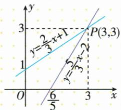

代入复核：$2\times3-3\times3+3=0$，$5\times3-3\times3-6=0$，故方程组的解为 $x=3,y=3$。

（2）把整个函数式代入：

$$5x-6\left(-\frac34x+4\right)=33,$$

得 $\frac{19}{2}x=57$，所以 $x=6$，再得 $y=-\frac12$。横正纵负，在第四象限。

本题结论

（1）$\begin{cases}x=3,\\y=3.\end{cases}$（2）选 D，$P\left(6,-\frac12\right)$。

</article>

<article class="handbook-example" aria-labelledby="example-9">

#### 例题 09 两条直线与横轴围成的三角形 知识清单例题 {#example-9 .example-heading}

题目

直线 $l_1:y=2x+3$、$l_2:y=-x+5$ 分别与横轴交于 $B,C$，两线相交于 $A$。

（1）求 $A,B,C$ 坐标。（2）求 $\triangle ABC$ 面积。

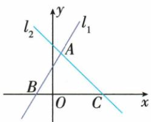

答案与解析

解析

（1）令两线函数值相等：$2x+3=-x+5$，得 $x=\frac23$，代回得 $y=\frac{13}{3}$。

分别令 $y=0$，由 $2x+3=0$ 得 $B\left(-\frac32,0\right)$；由 $-x+5=0$ 得 $C(5,0)$。

（2）底 $BC$ 跨过原点，长度是 $5-(-\frac32)=\frac{13}{2}$。高为 $A$ 到横轴的距离 $\frac{13}{3}$，所以

$$S=\frac12\times\frac{13}{2}\times\frac{13}{3}=\frac{169}{12}.$$

不能把负横坐标当成正距离后直接相减。

本题结论

$A\left(\frac23,\frac{13}{3}\right)$，$B\left(-\frac32,0\right)$，$C(5,0)$；面积 $\frac{169}{12}$。

</article>

### 【考点】用图象解方程与不等式 {#graph-solutions .exam-title}

先把目标翻译为“某个高度”“横轴上方或下方”“两图谁高谁低”。再读横坐标，不把图上的纵坐标答成方程的根。距离要结合正负半轴还原坐标。

<article class="handbook-example" aria-labelledby="example-10">

#### 例题 10 同一图象的不同高度 知识清单例题·合组；第（2）问 2024 江苏扬州 {#example-10 .example-heading}

题目

（1）一次函数 $y=kx+b$ 如图，分别求 $kx+b=0$、$kx+b=2$ 的解。

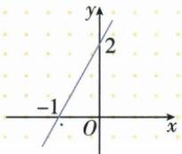

（2）一次函数与两轴交于 $A,B$，如图，$OA=2,OB=1$。求 $kx+b=0$ 的解。

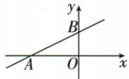

答案与解析

解析

（1）函数值为 $0$ 时，对应横轴交点 $(-1,0)$，所以根为 $x=-1$；函数值为 $2$ 时，对应 $(0,2)$，所以根为 $x=0$。第二问不再是找横轴交点。

（2）图中 $A$ 在横轴负半轴，距离 $OA=2$，所以横坐标为 $-2$。方程的根是 $x=-2$，不是距离 $2$。

本题结论

（1）依次为 $x=-1$、$x=0$。（2）$x=-2$。

</article>

<article class="handbook-example" aria-labelledby="example-11">

#### 例题 11 比两条线与比横轴 知识清单例题·合组 {#example-11 .example-heading}

题目

（1）$y=kx$ 与 $y=mx+n$ 的图象如图，求 $kx<mx+n$ 的解集。

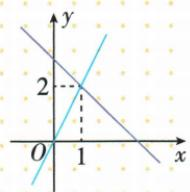

（2）画出 $y=-3x+12$ 的图象，并利用图象求 $-3x+12>0$、$-3x+12\le0$ 的解集。

答案与解析

解析

（1）两图交点横坐标为 $1$。在交点左侧，$y=kx$ 位于另一条线下方，所以 $kx<mx+n$ 的解集是 $x<1$。交点处两者相等，不收入严格不等式。

（2）代 $x=0$ 得 $(0,12)$；令 $y=0$ 得 $(4,0)$，过两点画直线。

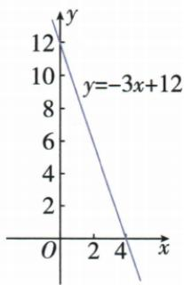

横坐标小于 $4$ 时，图象在横轴上方；横坐标不小于 $4$ 时，图象在横轴上或下方。因此两问分别是 $x<4$、$x\ge4$。代数解法中除以负数 $-3$ 要改变不等号方向，结果一致。

本题结论

（1）$x<1$。（2）依次为 $x<4$、$x\ge4$。

</article>

<article class="handbook-example" aria-labelledby="example-12">

#### 例题 12 由解集反选图象 2024 广东 {#example-12 .example-heading}

题目

已知 $kx+b<0$ 的解集是 $x<2$，则 $y=kx+b$ 的图象大致是哪一个？

<figure class="handbook-option">

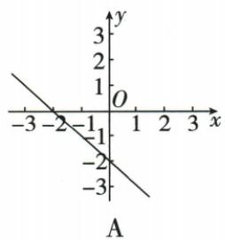

</figure>

<figure class="handbook-option">

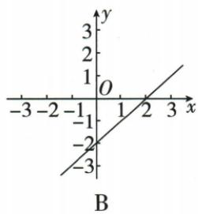

</figure>

<figure class="handbook-option">

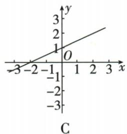

</figure>

<figure class="handbook-option">

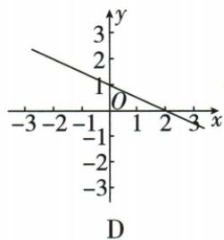

</figure>

答案与解析

解析

解集 $x<2$ 表示在横坐标 $2$ 左侧，图象位于横轴下方；在 $x=2$ 时恰好与横轴相交。因此应为向右上升、横轴截点为 $2$ 的 B。

A 对应 $x>-2$，C 对应 $x<-2$，D 对应 $x>2$。只看截点而不看哪侧低于横轴，会混淆 B 与 D。

本题结论

选 B。

</article>

### 【考点】比较费用方案 {#costs .exam-title}

先分别求出两个表达式，再求相等的临界输入，最后分区比较。固定费用和每单位费用各有作用，不能单凭其中一项低就断定始终合算。

<article class="handbook-example" aria-labelledby="example-13">

#### 例题 13 两种游园消费卡 知识清单例题 {#example-13 .example-heading}

题目

某体验园推出甲、乙两种消费卡，入园次数 $x$ 与费用 $y$ 的关系如图。

（1）分别求两种费用的表达式。（2）根据入园次数，选择哪种卡更合算？

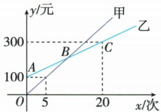

答案与解析

解析

（1）甲图过原点与 $(5,100)$，设 $y_{\text{甲}}=kx$，得 $100=5k$，所以 $y_{\text{甲}}=20x$。

乙图过 $(0,100)$、$(20,300)$，设 $y_{\text{乙}}=kx+100$，得 $300=20k+100$，所以 $y_{\text{乙}}=10x+100$。

（2）两种费用之差为 $10x-100$：小于 $0$ 时甲更便宜，等于 $0$ 时同费，大于 $0$ 时乙更便宜。入园次数须为非负整数；乙的 $100$ 元是固定费用，并非每次入园单价。

本题结论

$y_{\text{甲}}=20x$，$y_{\text{乙}}=10x+100$。少于10次选甲；10次同费200元；多于10次选乙。

</article>

<article class="handbook-example" aria-labelledby="example-14">

#### 例题 14 两点确定变化率 知识清单例题·合组；（1）2024 山东济南，（2）2024 上海 {#example-14 .example-heading}

题目

（1）图中 $l_1,l_2$ 分别表示 A、B 两款新能源汽车充满电后，剩余电量 $y$ 与路程 $x$ 的关系。同样行驶 $300\,\mathrm{km}$，A 比 B 多剩多少电量？

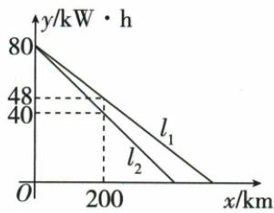

（2）某商品销售额 $y$（万元）与广告投入 $x$（万元）成一次函数关系。投入10万元时销售额1000万元，投入90万元时销售额5000万元。投入80万元时，销售额是多少？

答案与解析

解析

（1）两图初始电量均为 $80$；$200\,\mathrm{km}$ 时，A 剩48、B 剩40。单位路程对应剩电变化分别为 $(48-80)/200=-0.16$、$(40-80)/200=-0.2$。因此

$$y_A=80-0.16x,\qquad y_B=80-0.2x.$$

$x=300$ 时，分别剩 $32,20\,\mathrm{kW\cdot h}$，差为 $12\,\mathrm{kW\cdot h}$。关系式按图中模型使用，不能外推到负剩电。

（2）设 $y=kx+b$，由 $10k+b=1000$、$90k+b=5000$，相减得 $80k=4000$，所以 $k=50,b=500$。代 $x=80$ 得 $y=4500$ 万元。这里题目已明确成一次函数，并非仅凭两次观测就保证现实始终线性。

本题结论

（1）多 $12\,\mathrm{kW\cdot h}$。（2）$4500$ 万元。

</article>

### 【考点】求最大利润 {#optimization .exam-title}

总量固定时，用 $x$ 与“总量减 $x$”表示两类数量。先列预算、比例与利润门槛，求共同整数范围，再看目标式的增减性。最大利润要同时报告对应的实际数量，并回验限制。

<article class="handbook-example" aria-labelledby="example-15">

#### 例题 15 比例约束下的销售利润 2024 云南·情境缩写 {#example-15 .example-heading}

题目

某超市销售两种吉祥物，价格信息如下。

| 型号 | 成本/元 | 售价/元 |
| --- | --- | --- |
| A | 35 | $a$ |
| B | 42 | $b$ |

买8个A、7个B共需670元；买4个A、5个B共需410元。

（1）求 $a,b$。（2）某公司购买90个，A的数量 $x$ 不少于B的 $\frac43$，又不超过B的2倍。求超市售出这90个的最大利润。每件利润等于售价减成本。

答案与解析

解析

（1）列 $8a+7b=670$、$4a+5b=410$。第二式乘2再减第一式，得 $3b=150$，所以 $b=50,a=40$。

（2）B为 $90-x$ 个，限制为

$$\frac43(90-x)\le x\le2(90-x).$$

解得 $\frac{360}{7}\le x\le60$。数量取整数，所以 $52\le x\le60$。利润为

$$y=(40-35)x+(50-42)(90-x)=720-3x.$$

系数 $-3<0$，在可行范围内，$x$ 越小利润越大。因此取 $x=52$、B为38个，利润 $720-3\times52=564$ 元。两数量合计90，且52满足原比例条件。

本题结论

（1）$a=40,b=50$。（2）A为52个、B为38个时，最大利润564元。

</article>

## 【坑点】边界与易错辨析 {#pitfalls .handbook-section .is-pitfall}

### 【坑点】不经过某象限，别漏零截距 {#quadrant-pit .pitfall-title}

“不经过”要求该象限里没有图象上的点，并不要求截距一定严格为正或严格为负。零截距要单独检查，不能只套非零截距的三象限表。

<article class="handbook-example is-pitfall" aria-labelledby="pitfall-2">

#### 辨析 02 纵轴交点的边界 知识清单例题 {#pitfall-2 .example-heading}

题目

一次函数 $y=2x+m$ 的图象不经过第二象限，求 $m$ 的范围。

答案与解析

解析

第二象限要求横坐标负、纵坐标正。

若 $m\le0$，当 $x<0$ 时，$2x+m<0$，因此不会进入第二象限。特别是 $m=0$ 时，直线只经过第一、三象限，也满足要求。

若 $m>0$，取 $x=-\frac m4<0$，则 $y=\frac m2>0$，确有点在第二象限，应排除。

本题结论

$m\le0$，包含 $m=0$。

</article>

### 【坑点】点的平移量不能直接塞进函数式 {#translation-pit .pitfall-title}

错法： 把右移 $a$ 写成在函数式中直接用 $x+a$。

自查： 右移后，新横坐标 $x$ 对应旧横坐标 $x-a$。写完新式，再把原图上的一个点按题意移动，代入检验。

<article class="handbook-example is-pitfall" aria-labelledby="pitfall-3">

#### 辨析 03 三种平移分别求式 知识清单例题 {#pitfall-3 .example-heading}

题目

原直线为 $y=2x$，分别求下列平移后的解析式：

（1）向上2个单位；（2）向左2个单位；（3）先向下2个单位，再向右2个单位。

答案与解析

解析

（1）每点纵坐标加2，得 $y=2x+2$。

（2）新横坐标 $x$ 对应旧横坐标 $x+2$，得 $y=2(x+2)=2x+4$。原点左移成 $(-2,0)$，代入新式确为0。

（3）右移使旧输入为 $x-2$，下移再减2，得 $y=2(x-2)-2=2x-6$。原点移到 $(2,-2)$，也满足新式。

本题结论

（1）$y=2x+2$；（2）$y=2x+4$；（3）$y=2x-6$。

</article>

### 【坑点】同斜率不代表重合 {#parallel-pit .pitfall-title}

斜率相同，只能说明倾斜方向一致。还要比较截距：不同则平行，相同才是同一直线。与方程组的解数一起核验，可以避免把无解和无穷多解混淆。

<article class="handbook-example is-pitfall" aria-labelledby="pitfall-4">

#### 辨析 04 从无解判断两线关系 知识清单例题 {#pitfall-4 .example-heading}

题目

根据方程组 $\begin{cases}x+y=2,\\2x+2y=3\end{cases}$ 的解的情况，判断 $y=2-x$ 与 $y=\frac32-x$ 的位置关系。

A. 重合

B. 平行

C. 相交

D. 无法确定

答案与解析

解析

第一式乘2应得到 $2x+2y=4$，不可能同时满足第二式的 $2x+2y=3$，因此没有公共解。

两直线斜率都是 $-1$，截距分别为 $2,\frac32$，不同，所以平行。重合会有无穷多公共点，相交则有公共点，都不符合原方程组无解。

本题结论

选 B。

</article>

### 【坑点】整数输入不能四舍五入成精确解 {#integer-pit .pitfall-title}

排号、件数只能取整数时，精确方程得到非整数，可能说明没有这种方案，不能把它四舍五入。与不等式中的“取首个合法整数”是两回事。

<article class="handbook-example is-pitfall" aria-labelledby="pitfall-5">

#### 辨析 05 哪一排有指定座位数 知识清单例题 {#pitfall-5 .example-heading}

题目

某剧院按下表规律设置座位。

| 排数 $x$ | 1 | 2 | 3 | 4 | … |
| --- | --- | --- | --- | --- | --- |
| 座位数 $y$ | 50 | 53 | 56 | 59 | … |

（1）写出关系式。（2）是否可能有某一排恰好90个座位？

答案与解析

解析

（1）从第1排到第 $x$ 排，增加了 $x-1$ 次，每次3个，所以 $y=50+3(x-1)=3x+47$，$x$ 为正整数。

（2）令 $3x+47=90$，得 $x=\frac{43}{3}$，不是正整数，因此没有这样的整排。取14或15排分别是89、92个座位，都不等于90。常数47也不表示现实中一定存在第0排。

本题结论

（1）$y=3x+47$，$x$ 为正整数。（2）不可能恰好90个座位。

</article>

### 【坑点】利润最优之前，先查约束 {#optimization-pit .pitfall-title}

目标式递减，不意味着能直接把输入取0。预算和利润门槛可能排除小输入；最优只能在所有限制同时满足的范围里比较。

<article class="handbook-example is-pitfall" aria-labelledby="pitfall-6">

#### 辨析 06 采购预算限制最优数量 知识清单例题 {#pitfall-6 .example-heading}

题目

商店购进甲、乙两型平板电脑共20台。甲进价1600元、售价2000元；乙进价2500元、售价3000元。甲购进 $x$ 台，全部售出后利润为 $y$ 元。

（1）写出 $y$ 与 $x$ 的关系。（2）总进价不超过39200元，利润不低于8500元，列出全部采购方案，并求最大利润及对应方案。

答案与解析

解析

（1）每台利润分别是400元、500元，故

$$y=400x+500(20-x)=10000-100x.$$

（2）预算要求 $1600x+2500(20-x)\le39200$，化为 $x\ge12$；利润门槛要求 $10000-100x\ge8500$，化为 $x\le15$。结合数量为整数，共4种：

| 甲/台 | 乙/台 | 利润/元 |
| --- | --- | --- |
| 12 | 8 | 8800 |
| 13 | 7 | 8700 |
| 14 | 6 | 8600 |
| 15 | 5 | 8500 |

利润式系数为负，可行范围中最小的 $x=12$ 给最大利润8800元。直接取 $x=0$ 虽让目标式更大，却使进价50000元超过预算。

本题结论

4种方案为甲/乙：12/8、13/7、14/6、15/5；最大利润8800元，对应12/8。

</article>

### 【坑点】分段面积的终点是否允许 {#endpoint-pit .pitfall-title}

动点运动路线的总长度与允许终点要分别核对。某段表达式算得面积0，并不意味着题目允许动点到达那个位置；空心点应由题设决定。

<article class="handbook-example is-pitfall" aria-labelledby="pitfall-7">

#### 辨析 07 正方形边上的路线 知识清单例题 {#pitfall-7 .example-heading}

题目

正方形 $ABCD$ 边长2。点 $P$ 从 $C$ 出发，沿 $C\to B\to A$ 运动，且 $P$ 与 $A$ 不重合。路程为 $x$，$\triangle ADP$ 面积为 $y$。哪幅图象符合题意？

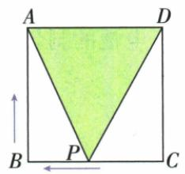

<figure class="handbook-option">

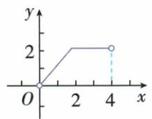

<figcaption>A</figcaption>
</figure>

<figure class="handbook-option">

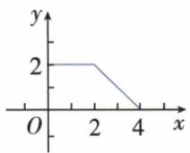

<figcaption>B</figcaption>
</figure>

<figure class="handbook-option">

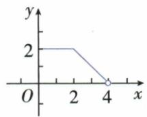

<figcaption>C</figcaption>
</figure>

<figure class="handbook-option">

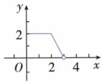

<figcaption>D</figcaption>
</figure>

答案与解析

解析

固定底 $AD=2$。

在 $CB$ 上，点到 $AD$ 的高恒为2，故 $y=2$，$0\le x\le2$。

转入 $BA$ 后，已在该边走了 $x-2$，到 $A$ 还剩 $2-(x-2)=4-x$，它就是高，所以 $y=4-x$，$2<x<4$。

两段在 $(2,2)$ 接合。$x=4$ 对应题目排除的 $A$，末端 $(4,0)$ 应为空心点，选 C。A 的初段不符；B 收入了终点；D 在未走完到A的路线时就到零，也不符。

本题结论

选 C；允许范围 $0\le x<4$。

</article>

### 【坑点】相对距离的变化不等于实际路程 {#relative-distance .pitfall-title}

两车间距离是位置差的绝对值。相遇时距离为0，相遇后前后位置互换，距离图可以由降变升，并不代表车辆掉头。一车休息时，另一车若先接近再远离，要把两段实际路程相加。

<article class="handbook-example is-pitfall" aria-labelledby="pitfall-8">

#### 辨析 08 两车距离图中的休息段 2024 山东威海 {#pitfall-8 .example-heading}

题目

公路连接 $A,B,C$ 三地，$B$ 在 $A,C$ 之间。甲、乙两车分别从 $A,B$ 同时出发前往 $C$。甲速度始终不变，乙中途休息一段时间后继续行驶。两车间距离 $y$ 与时间 $x$ 的关系如图。下列结论正确的是（　）。

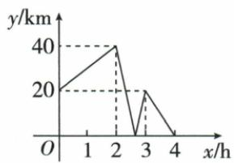

A. 甲行驶 $\frac83$ 小时与乙相遇。

B. A、C两地相距220千米。

C. 甲速度为70千米/时。

D. 乙中途休息36分钟。

答案与解析

解析

乙休息从第2小时到第3小时，共1小时。此时甲先走40千米追上乙，再走20千米超过乙，实际路程为 $40+20=60$ 千米，而不是末初距离之差。

甲速度为 $60\div1=60$ 千米/时，全程4小时，所以 $AC=240$ 千米。首次相遇时刻为

$$2+\frac{40}{60}=\frac83\text{ 小时}.$$

所以 A 正确；B应为240千米，C应为60千米/时，D应为60分钟。图象斜率描述的是两车相对距离变化，不能在任意阶段直接当甲或乙的速度。

本题结论

选 A。

</article>
