二次函数的图象是抛物线。看清开口、对称轴和顶点，就能理解函数值怎样变化，以及最大值、最小值在哪里。

<nav class="handbook-nav" aria-label="本章分区">
  <a class="handbook-jump is-knowledge" href="#knowledge">01 · 知识点概念、关系与适用条件</a>
  <a class="handbook-jump is-exam" href="#exam">02 · 考点题目分类和例题</a>
  <a class="handbook-jump is-pitfall" href="#pitfalls">03 · 坑点辨析错因，检查遗漏</a>
</nav>

## 【知识点】概念与依据 {#knowledge .handbook-section .is-knowledge}

### 1. 二次函数与抛物线 {#definition .knowledge-title}

形如 $y=ax^2+bx+c$（$a\ne0$，$a,b,c$ 为常数）的函数，叫作==二次函数==，图象是一条==抛物线==

例如 $y=x^2$，当 $x=-2,-1,0,1,2$ 时，$y$ 分别为 $4,1,0,1,4$

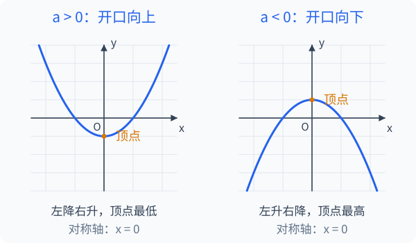

### 2. 二次函数的三种形式 {#forms .knowledge-title}

| 形式 | 表达式 | 直接读出 |
| --- | --- | --- |
| 一般式 | $y=ax^2+bx+c$ | 与 $y$ 轴交于 $(0,c)$ |
| 顶点式 | $y=a(x-h)^2+k$ | 顶点 $(h,k)$，对称轴 $x=h$ |
| 交点式 | $y=a(x-r)(x-s)$ | 与 $x$ 轴交于 $(r,0)$、$(s,0)$ |

交点式要求有实数根。例如

$$y=x^2-2x-3=(x-1)^2-4=(x+1)(x-3)$$

顶点是 $(1,-4)$，与 $x$ 轴交于 $(-1,0)$、$(3,0)$

### 3. 配方与顶点坐标 {#completing-square .knowledge-title}

把一般式配成顶点式，就能读出顶点。例如

$$x^2-2x-3=(x^2-2x+1)-1-3=(x-1)^2-4$$

一般式 $y=ax^2+bx+c$ 的顶点为

$$\left(-\frac b{2a},\frac{4ac-b^2}{4a}\right)$$

::: info 顶点公式的推导

展开配方

$$y=a\left(x+\frac b{2a}\right)^2+\frac{4ac-b^2}{4a}$$

平方项等于 $0$ 时到达顶点，便得到顶点坐标

:::

### 4. 二次函数的性质 {#properties .knowledge-title}

对 $y=a(x-h)^2+k$，对称轴是 $x=h$

| 性质 | $a>0$ | $a<0$ |
| --- | --- | --- |
| 开口 | 向上 | 向下 |
| 轴左侧，从左往右看 | $y$ 减小 | $y$ 增大 |
| 轴右侧，从左往右看 | $y$ 增大 | $y$ 减小 |
| $x$ 取全体实数时的最值 | $x=h$ 时最小值为 $k$ | $x=h$ 时最大值为 $k$ |

到对称轴距离相等的两点，函数值相等；同一坐标尺度下，$|a|$ 越大，开口越窄

### 5. 抛物线的平移 {#translation .knowledge-title}

先移动顶点，再写顶点式，$a$ 保持不变

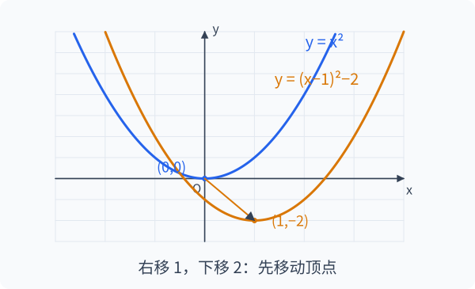

例如 $y=x^2$ 右移 $1$、下移 $2$，顶点由 $(0,0)$ 变为 $(1,-2)$，得到 $y=(x-1)^2-2$

### 6. 抛物线与 x 轴的交点 {#roots-sign .knowledge-title}

交点处 $y=0$，所以交点的横坐标就是方程 $ax^2+bx+c=0$ 的实根

| $\Delta=b^2-4ac$ | 与 $x$ 轴的公共点 |
| --- | --- |
| $\Delta>0$ | 两个 |
| $\Delta=0$ | 一个，顶点在 $x$ 轴上 |
| $\Delta<0$ | 没有 |

图象在 $x$ 轴上方时 $y>0$，在下方时 $y<0$

## 【考点】方法与例题 {#exam .handbook-section .is-exam}

### 1. 从图象判断系数 {#coefficients .exam-title}

| 图上看什么 | 能确定什么 |
| --- | --- |
| 开口向上、向下 | 分别有 $a>0$、$a<0$ |
| 与 $y$ 轴的交点 | 纵坐标就是 $c$ |
| 对称轴 $x=-b/(2a)$ | 结合 $a$ 的正负判断 $b$ |
| 与 $x$ 轴的公共点个数 | 判断 $\Delta=b^2-4ac$ 的正负 |
| 某个 $x$ 处的图象高低 | 判断代入后所得式子的正负 |

例如，$x=-1$ 时有 $y=a-b+c$：图象在横轴上方，就有 $a-b+c>0$；在下方就小于 $0$；在轴上就等于 $0$。$x=2$ 则对应 $4a+2b+c$，先看代入的是哪个数。

由 $-b/(2a)$ 的符号可知：轴在纵轴左侧 → $a,b$ 同号；轴在右侧 → $a,b$ 异号。没有标明的刻度不能猜成精确值，几个系数各自的符号也不足以直接决定它们的和的符号。

### 2. 水平线交点与限定范围内的最值 {#level-extrema .exam-title}

方程 $a(x-h)^2+k=d$ 表示抛物线与水平线 $y=d$ 相交。整理为

$$(x-h)^2=\frac{d-k}{a}$$

后，右边 大于 $0$ → 两个交点；等于 $0$ → 一个交点；小于 $0$ → 无交点。这是完整图象的结论，限制了 $x$ 时还要筛选。

求某个范围内的最值：

1. 找顶点，检查顶点横坐标是否在允许范围内。
2. 能取到的端点代入比较；不能取到的端点，只能接近，不能算作已取得。
3. $x$ 只能取整数时，检查离对称轴最近的合法整数，以及允许范围的端点。

例如 $y=(x-1)^2-4$ 在 $0<x<2$ 内，$x=1$ 能取到，最小值是 $-4$；两端都不能取，$y$ 只能接近 $-3$，因此没有最大值。报出最值时，要能指出一个合法的 $x$ 确实取得它。

### 3. 二次函数的实际应用 {#applications .exam-title}

先把所求量写成式子，再配方找顶点，最后检查顶点是否在实际范围内。

| 问题 | 怎样列式 | 要检查什么 |
| --- | --- | --- |
| 矩形面积 | 两邻边相乘，用周长或材料量表示另一边 | 边长为正，墙长是否够用 |
| 销售收入 | 售价 × 销量 | 价格变化规律的适用范围 |
| 销售利润 | （售价 − 成本）× 销量，各渠道分别算 | 每个价格是否对应本渠道销量 |
| 门洞或运动轨迹 | 选坐标系，把测量值写成点坐标 | 实际高度、方向和运动范围 |

两个随自变量一次变化的量相乘，展开后通常得到二次式。列式前先确认每个因子的含义与单位。

围栏题还要分清矩形周长与新围栏长度：

$$\text{新围栏长度}=\text{矩形周长}-\text{边界上可利用的已有墙长}.$$

缺口和超出墙端的部分都要补材料，矩形内部的墙不算边界。越过墙端时，材料关系可能改变，要分段列式，并比较所有允许位置，不能只找一个局部最优方案。

### 4. 判断二次函数 {#identify .exam-title}

先确认是关于自变量的整式，再看展开合并后是否有非零二次项。参数未知时，应按条件分类，不能直接说“是”。

<article class="handbook-example" aria-labelledby="example-1">

#### 例题 01 四种表达式的判断 知识清单例题 {#example-1 .example-heading}

题目

判断下列函数是不是二次函数。

（1）$y=2-x^2$。

（2）$y=1/(x^2-1)$。

（3）$y=2x(1+4x)$。

（4）$y=mx^2+nx+p$，其中 $m,n,p$ 均为常数。

答案与解析

解析

（1）$2-x^2$ 的二次项系数为 $-1\ne0$，是二次函数。

（2）$1/(x^2-1)$ 是含自变量分母的分式，不是二次整式。

（3）$2x(1+4x)=2x+8x^2$，二次项系数为 $8$，是二次函数。

（4）$m\ne0$ 时二次项存在，是二次函数；$m=0$ 时至多是一次式，不是二次函数。

本题结论

（1）是；（2）不是；（3）是；（4）当且仅当 $m\ne0$ 时是。

</article>

### 5. 求函数解析式 {#determine .exam-title}

| 已知条件 | 优先设式 | 还需注意 |
| --- | --- | --- |
| 三个横坐标不同的点 | $y=ax^2+bx+c$ | 解后仍须 $a\ne0$ |
| 顶点与另一点 | $y=a(x-h)^2+k$ | 另一点不能只是重复顶点 |
| 两实零点与另一点 | $y=a(x-r)(x-s)$ | 第三个点须提供新条件 |
| 已知二次项系数 | 固定 $a$，只求 $b,c$ | 不必重新设三个未知数 |

为什么要三个横坐标不同的点？ 若两个至多二次的候选式都过这三点，两式相减就有三个不同零点；非零的至多二次式不可能有三个不同零点，所以两个候选式只能相同。求出 $a=0$ 时，得到的是一次函数或常函数，仍不符合二次函数的要求。

代点列方程后，回代所有给定点。重复点不提供新的独立条件；同一横坐标配不同纵坐标，则不符合函数定义。

<article class="handbook-example" aria-labelledby="example-2">

#### 例题 02 用不同条件确定解析式 知识清单例题·合组 {#example-2 .example-heading}

题目

根据下列条件,分别求出对应的二次函数的表达式.

(1)二次函数的图象经过点 $(0,-1)$ ， $(1,0)$ ， $(-1,2)$ .  
(2)抛物线的顶点坐标为 $(1,-3)$ ，且与y轴交于点 $(0,1)$ .  
(3) 抛物线与 x 轴交于点 $(-3,0)$ ， $(5,0)$ ，且与 y 轴交于点 $(0,-3)$ .

（4）（2024 福建节选）已知 $y=x^2+bx+c$ 与横轴交于 $A,B$，与纵轴交于 $C$，其中 $A(-2,0),C(0,-2)$，求表达式。

答案与解析

解析

（1）过 $(0,-1)$ 得 $c=-1$。另两点给 $a+b=1$、$a-b=3$，相加得 $a=2$，再得 $b=-1$，所以 $y=2x^2-x-1$。

（2）设 $y=a(x-1)^2-3$。代 $(0,1)$ 得 $1=a-3$，故 $a=4$，即 $y=4(x-1)^2-3$。

（3）设 $y=a(x+3)(x-5)$。代 $(0,-3)$ 得 $-3=-15a$，故 $a=1/5$。

（4）二次项系数已经是 $1$。代 $C$ 得 $c=-2$；代 $A$ 得 $4-2b-2=0$，所以 $b=1$。各式回代对应条件均成立。

本题结论

（1）$y=2x^2-x-1$；（2）$y=4x^2-8x+1$；（3）$y=\frac15x^2-\frac25x-3$；（4）$y=x^2+x-2$。

</article>

### 6. 求对称轴与顶点 {#vertex-method .exam-title}

先提出二次项系数，再在括号中补一次项系数一半的平方，同时减去相同量。读顶点横坐标时，让平方内部等于零；最后代回一般式核验纵坐标。

<article class="handbook-example" aria-labelledby="example-3">

#### 例题 03 二次项系数不是一 知识清单例题 {#example-3 .example-heading}

题目

求抛物线 $y=\frac{1}{2}x^{2}+3x+\frac{1}{2}$ 的对称轴和顶点坐标.

答案与解析

解析

先提出 $1/2$，括号内的一次项系数变为 $6$，应补 $3^2=9$：

$$\begin{aligned}
y&=\frac12(x^2+6x)+\frac12\\
 &=\frac12[(x+3)^2-9]+\frac12\\
 &=\frac12(x+3)^2-4.
\end{aligned}$$

括号中补的 $9$ 受外面 $1/2$ 相乘，所以实际减去 $9/2$，不是减去 $9$。令 $x+3=0$ 得 $x=-3$，此时 $y=-4$。

公式法可核验：$h=-3/(2\times\frac12)=-3$，$k=(4\times\frac12\times\frac12-9)/(4\times\frac12)=-4$。

本题结论

对称轴是直线 $x=-3$，顶点坐标是 $(-3,-4)$。

</article>

### 7. 判断图象性质 {#property-method .exam-title}

开口看 $a$；轴与顶点用配方；纵轴交点令 $x=0$；横轴交点令 $y=0$。选择题的各项可能分别错在不同位置，应逐项核对，不凭一条性质猜其余结论。

<article class="handbook-example" aria-labelledby="example-4">

#### 例题 04 开口、对称轴和截点 知识清单例题·合组 {#example-4 .example-heading}

题目

（1）$y=2x^2$ 与 $y=-2x^2$ 的图象具有哪一条相同性质？

A. 开口向下

B. 对称轴是 $y$ 轴

C. 有最低点

D. 对称轴是 $x$ 轴

（2）关于 $y=x^2+2x-8$，下列说法正确的是（　）。

A. 对称轴在 $y$ 轴右侧。

B. 与 $y$ 轴的交点为 $(0,8)$。

C. 与 $x$ 轴的交点为 $(-2,0)$、$(4,0)$。

D. $y$ 的最小值为 $-9$。

答案与解析

解析

第一组：$2x^2$ 上开，有最低点；$-2x^2$ 下开，有最高点。两者都满足 $f(x)=f(-x)$，对称轴均为 $y$ 轴。故 A、C 只适用于其中一个，D 对两者都不成立，选 B。

第二组：$x^2+2x-8=(x+1)^2-9$，轴为 $x=-1$，在纵轴左侧，A 错；$x=0$ 时 $y=-8$，B 错；令 $y=0$ 得 $(x+4)(x-2)=0$，横轴点是 $(-4,0),(2,0)$，C 错；上开且顶点可取，最小值 $-9$，D 对。

本题结论

第一组选 B；第二组选 D。

</article>

### 8. 比较函数值 {#compare-method .exam-title}

同侧点可以按这一侧的增减比较；异侧点比较到对称轴的距离。下开时离轴越近，函数值越大；上开时相反。坐标简单时也可直接代入，作为独立核验。

<article class="handbook-example" aria-labelledby="example-5">

#### 例题 05 三点函数值的排序 知识清单例题·合组 {#example-5 .example-heading}

题目

（1）点 $A(-2,y_1)$、$B(1,y_2)$、$C(-\tfrac12,y_3)$ 在 $y=-2x^2-12x-16$ 的图象上，三个函数值的大小关系是（　）。

A. $y_2>y_3>y_1$

B. $y_1>y_3>y_2$

C. $y_3>y_1>y_2$

D. $y_1>y_2>y_3$

（2）（2024 广东）点 $(0,y_1)$、$(1,y_2)$、$(2,y_3)$ 都在 $y=x^2$ 的图象上，下列关系正确的是（　）。

A. $y_3>y_2>y_1$

B. $y_2>y_1>y_3$

C. $y_1>y_3>y_2$

D. $y_3>y_1>y_2$

答案与解析

解析

第一组：

$$y=-2(x^2+6x+9-9)-16=-2(x+3)^2+2.$$

轴为 $x=-3$。三个横坐标都在轴右侧，且 $-2<-1/2<1$，下开右侧递减，所以 $y_1>y_3>y_2$。也可比较到轴距离 $1,4,5/2$，得同样结论。代入验证依次为 $0,-30,-21/2$，选 B。

第二组：代 $x=0,1,2$ 得 $y_1=0,y_2=1,y_3=4$，所以 $y_3>y_2>y_1$，选 A。这里横坐标都非负，不能由此推断 $y=x^2$ 在全部实数上都递增。

本题结论

第一组 $y_1>y_3>y_2$，选 B；第二组 $y_3>y_2>y_1$，选 A。

</article>

### 9. 平移与逆平移 {#translation-method .exam-title}

先把原式、目标式化成顶点式，比较顶点坐标差。求原式时，把题给位移反过来；写完可再按正向平移检验。

<article class="handbook-example" aria-labelledby="example-6">

#### 例题 06 比较两条抛物线的位置 知识清单例题 {#example-6 .example-heading}

题目

要得到抛物线 $y=x^{2}+2x+3$ ，应将抛物线 $y=(x-1)^{2}+5$ 进行怎样的平移？

答案与解析

解析

目标式 $x^2+2x+3=(x+1)^2+2$，顶点为 $(-1,2)$；原式顶点为 $(1,5)$。二次项系数相同，横坐标减少 $2$，纵坐标减少 $3$。

写式核验：$(x+2-1)^2+5-3=(x+1)^2+2$，与目标一致。

本题结论

向左平移 2 个单位，再向下平移 3 个单位，先后次序可交换。

</article>

<article class="handbook-example" aria-labelledby="example-7">

#### 例题 07 求新式与恢复原式 知识清单例题·合组 {#example-7 .example-heading}

题目

(1) 将抛物线 $y = -2x^{2}$ 先向右平移 1 个单位长度, 再向下平移 2 个单位长度, 所得抛物线的解析式为 ____.

(2) 将抛物线 $y = x^{2} + bx + c$ 先向右平移 2 个单位长度, 再向下平移 3 个单位长度, 所得抛物线的解析式为 $y = (x - 1)^{2} - 4$ , 则 b = ____, c = ____.

（3）（2024 山东滨州）将 $y=-x^2$ 先向右平移 1 个单位，再向上平移 2 个单位，求新顶点坐标。

答案与解析

解析

（1）原顶点 $(0,0)$ 变成 $(1,-2)$，保持 $a=-2$，新式 $y=-2(x-1)^2-2=-2x^2+4x-4$。

（2）结果顶点 $(1,-4)$，逆向左移 $2$、上移 $3$，原顶点为 $(-1,-1)$。因此原式 $y=(x+1)^2-1=x^2+2x$，得 $b=2,c=0$。

（3）原顶点 $(0,0)$ 右移 $1$、上移 $2$，变成 $(1,2)$。对应新式 $y=-(x-1)^2+2$。

本题结论

（1）$y=-2x^2+4x-4$；（2）$b=2,c=0$；（3）$(1,2)$。

</article>

### 10. 从图象判断系数关系 {#coefficient-method .exam-title}

先查开口、轴和截点，再把特殊代数式认作某个横坐标处的函数值。平方项的正负与一次项不同，代负数时尤其不能漏符号。

<article class="handbook-example" aria-labelledby="example-8">

#### 例题 08 从标明刻度的图象取信息 知识清单例题 {#example-8 .example-heading}

题目

小强从如图所示的二次函数 $y=ax^{2}+bx+c$ 的图象中, 观察得出了下面四条信息: (1) a<0; (2) c>1; (3) b>0; (4) $a-b+c>0$ . 其中正确的是 ____. (填序号)

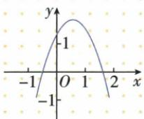

答案与解析

解析

开口向下，所以 $a<0$；纵轴交点高于刻度 $1$，所以 $c>1$。

对称轴在纵轴右侧，$-b/(2a)>0$；又 $a<0$，所以 $b>0$。

$a-b+c=f(-1)$。图中 $x=-1$ 处在横轴下方，所以 $a-b+c<0$，第（4）条不成立。图象只支持这些符号、大小关系，不足以随意报出具体系数。

本题结论

正确的是（1）（2）（3）。

</article>

<article class="handbook-example" aria-labelledby="example-9">

#### 例题 09 将四个结论逐一对应到图上 知识清单例题 {#example-9 .example-heading}

题目

二次函数 $y = ax^{2} + bx + c (a \neq 0)$ 的图象如图所示, 下列结论: ① $b^{2} - 4ac > 0$ ; ② $abc < 0$ ; ③ $4a + b = 0$ ; ④ $4a - 2b + c > 0$ . 其中正确结论的个数是 ( )

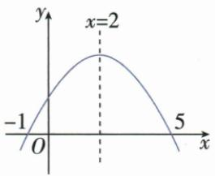

A.4

B.3

C.2

D.1

答案与解析

解析

① 图象与横轴有两个不同交点，故 $\Delta>0$，正确。

② 下开给 $a<0$，轴在右侧给 $b>0$，纵截距为正给 $c>0$，故 $abc<0$，正确。

③ 轴为 $x=2$，所以 $-b/(2a)=2$，即 $4a+b=0$，正确。

④ $4a-2b+c=f(-2)$，不是 $f(2)$。$-2$ 位于左根 $-1$ 的左侧，下开抛物线在两根外为负，所以此项错误。

共三条正确，A 多收④，C、D 都漏收正确项。

本题结论

①②③正确，选 B。

</article>

<article class="handbook-example" aria-labelledby="example-10">

#### 例题 10 顶点与纵截距共同限制系数 知识清单例题 {#example-10 .example-heading}

题目

（2024 湖北）抛物线 $y=ax^2+bx+c$（$a\ne0$）的顶点为 $(-1,-2)$，与 $y$ 轴的交点在 $x$ 轴上方。下列结论正确的是（　）。

A. $a<0$

B. $c<0$

C. $a-b+c=-2$

D. $b^2-4ac=0$

答案与解析

解析

顶点是 $(-1,-2)$，可写 $y=a(x+1)^2-2$。由 $c=f(0)>0$，得 $a-2>0$，所以 $a>2$，A、B 均错。

代顶点横坐标 $-1$，直接得到 $a-b+c=-2$，C 对。上开且顶点在横轴下方，两侧各有一个横轴交点，故 $\Delta>0$，D 错。

本题结论

选 C。

</article>

### 11. 含同一参数的两幅图象 {#shared-parameter .exam-title}

同一个 $a$，在直线式中决定升降，在二次式中决定开口。先核两图纵轴交点，再核两图给出的 $a$ 符号是否相容。

<article class="handbook-example" aria-labelledby="example-11">

#### 例题 11 直线与抛物线的可能组合 知识清单例题 {#example-11 .example-heading}

题目

在同一直角坐标系中, 直线 $y = ax + 1$ 与二次函数 $y = ax^{2} + bx + 1$ 的图象可能是 ( )

<figure class="handbook-option">

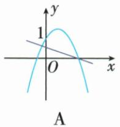

</figure>

<figure class="handbook-option">

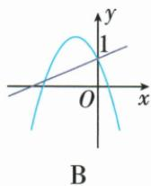

</figure>

<figure class="handbook-option">

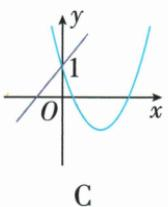

</figure>

<figure class="handbook-option">

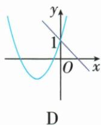

</figure>

答案与解析

解析

两式的常数项都是 $1$，都必须经过 $(0,1)$。A 的直线不满足这一点，排除。

B 的直线上升要求 $a>0$，而抛物线下开要求 $a<0$，矛盾。D 的直线下降而抛物线上开，同样矛盾。

C 两图都经过 $(0,1)$，直线上升、抛物线上开都要求 $a>0$，条件相容。

本题结论

选 C。

</article>

### 12. 判断横轴交点个数 {#discriminant-method .exam-title}

先检查二次项系数非零，再按题意选择 $\Delta>0$、$\Delta=0$、$\Delta<0$ 或 $\Delta\ge0$。最后把所得范围与非零条件取交；“最低点”还要求开口向上。

<article class="handbook-example" aria-labelledby="example-12">

#### 例题 12 不画图判断横轴公共点 知识清单例题 {#example-12 .example-heading}

题目

不画图象,判断下列抛物线与 x 轴的公共点的个数.

(1) $y=2x^{2}+5x-3.$   
(2) $y = -4x^{2} + 8x - 4.$   
(3) $y=3x^{2}-4x+7.$

答案与解析

解析

（1）$\Delta=5^2-4\times2\times(-3)=49>0$，有两个不同公共点。

（2）$\Delta=8^2-4\times(-4)\times(-4)=0$，有一个公共点。也可写成 $y=-4(x-1)^2$，只有 $x=1$ 时为零。

（3）$\Delta=(-4)^2-4\times3\times7=-68<0$，没有公共点。开口向上本身不能决定是否与横轴相交。

本题结论

（1）2 个；（2）1 个；（3）0 个。

</article>

<article class="handbook-example" aria-labelledby="example-13">

#### 例题 13 参数还会改变函数类型 知识清单例题 {#example-13 .example-heading}

题目

若二次函数 $y=2(k-1)x^{2}-4kx+2(k-1)$ 的图象与 x 轴有两个交点, 求 k 的取值范围.

答案与解析

解析

必须同时满足

$$2(k-1)\ne0,\qquad (-4k)^2-4\cdot2(k-1)\cdot2(k-1)>0.$$

前者给 $k\ne1$；后者化为

$$16k^2-16(k-1)^2=16(2k-1)>0,$$

所以 $k>1/2$。$k=1$ 虽满足形式上算出的正判别式，却使原函数退化为 $y=-4x$，必须排除。

本题结论

$k>\frac12$，且 $k\ne1$。

</article>

<article class="handbook-example" aria-labelledby="example-14">

#### 例题 14 一个公共点与最低点在轴上 知识清单例题 {#example-14 .example-heading}

题目

(1) 若抛物线 $y = 2{x}^{2} + {8x} + m$ 与 $x$ 轴只有一个公共点,求 $m$ 的值.

(2) 若抛物线 $y=(k-1)x^{2}+2kx+3k-2$ 的最低点在 x 轴上, 求 k 的值.

答案与解析

解析

（1）$\Delta=8^2-4\times2m=64-8m$。只有一个公共点，故 $64-8m=0$，得 $m=8$。

（2）最低点在横轴上，要同时满足 $k-1>0$ 和 $\Delta=0$。

$$\begin{aligned}
\Delta&=4k^2-4(k-1)(3k-2)\\
&=-4(2k-1)(k-2).
\end{aligned}$$

候选值 $k=1/2,2$，只有 $2$ 满足 $k>1$。$k=1/2$ 是下开，贴轴的是最高点，不符合题意。

本题结论

（1）$m=8$；（2）$k=2$。

</article>

<article class="handbook-example" aria-labelledby="example-15">

#### 例题 15 没有横轴交点 知识清单例题 {#example-15 .example-heading}

题目

(2024 吉林长春) 若抛物线 $y = x^{2} - x + c$ ( $c$ 是常数) 与 $x$ 轴没有交点, 则 $c$ 的取值范围是 ____.

答案与解析

解析

$a=1,b=-1$，所以 $\Delta=1-4c$。无交点要求 $1-4c<0$，除以负数时不等号反向，得 $c>1/4$。

$c=1/4$ 时顶点恰好在横轴上，仍有一个公共点，因此不收等号。

本题结论

$c>\frac14$。

</article>

### 13. 利用对称求根的位置 {#root-symmetry .exam-title}

两个不同点的纵坐标相同，就关于对称轴对称。两根 $u,v$ 满足 $(u+v)/2=h$；给一个根的区间时，用 $v=2h-u$ 推另一个区间，乘负数要反向。

<article class="handbook-example" aria-labelledby="example-16">

#### 例题 16 求对称轴与另一个根的范围 知识清单例题·合组 {#example-16 .example-heading}

题目

第一组

已知抛物线 $y=ax^{2}+bx+c$ 与 x 轴的公共点是 $(-4,0)$ ， $(2,0)$ ，则这条抛物线的对称轴是直线 ____。

第二组

如图,以(1,-4)为顶点的二次函数 $y=ax^{2}+bx+c$ 的图象与 x 轴负半轴交于 A 点,则一元二次方程 $ax^{2}+bx+c=0$ 的正数解的范围是 ( )

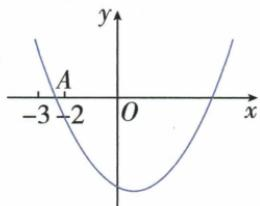

A. $2<x<3$

B. $3<x<4$

C. $4<x<5$

D. $5<x<6$

答案与解析

解析

第一组：两根为 $-4,2$，轴横坐标为 $(-4+2)/2=-1$，应答直线 $x=-1$，不是只写一个点。

第二组：顶点横坐标为 $1$，故 $u+v=2$。图示负根满足 $-3<u<-2$，所以

$$2<-u<3,\qquad 4<2-u<5.$$

另一根 $v=2-u$，故 $4<v<5$，选 C。直接取负根相反数只适用于对称轴为 $y$ 轴，本题不能如此处理。

本题结论

第一组：$x=-1$；第二组：正根在 $4<x<5$，选 C。

</article>

### 14. 用图象解方程与不等式 {#graph-equations .exam-title}

等于零找横轴交点；大于零找横轴上方的部分；等于常数找对应水平线。最后读出的应是横坐标或其范围，不是把“图象在上面”直接当答案。

<article class="handbook-example" aria-labelledby="example-17">

#### 例题 17 上开抛物线的三个范围 知识清单例题 {#example-17 .example-heading}

题目

观察函数 $y=\frac{1}{2}x^{2}-x-\frac{3}{2}$ 的
图象, 回答下列问题:

(1) 当 x 取什么值时, y > 0?  
(2) 当 x 取什么值时, y=0?  
(3) 当 x 取什么值时, y < 0?

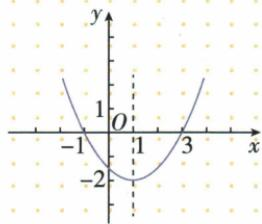

答案与解析

解析

函数可分解为 $y=\frac12(x+1)(x-3)$，零点为 $-1,3$。二次项系数为正，所以两根外为正、两根之间为负。

当 $x<-1$ 时，两因子都负，乘积为正；当 $-1<x<3$ 时，一正一负，乘积为负；当 $x>3$ 时，两因子都正。零点单独对应 $y=0$。

本题结论

（1）$x<-1$ 或 $x>3$；（2）$x=-1$ 或 $x=3$；（3）$-1<x<3$。

</article>

<article class="handbook-example" aria-labelledby="example-18">

#### 例题 18 同一幅图回答四类问题 知识清单例题 {#example-18 .example-heading}

题目

二次函数 $y = ax^{2} + bx + c (a \neq 0)$ 的图象如图所示,根据图象解答下列问题:

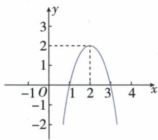

(1) 写出方程 $ax^{2} + bx + c = 0$ 的两个根. (2) 写出不等式 $ax^{2} + bx + c > 0$ 的解集.  
(3) 写出 y 随 x 的增大而减小时 x 的取值范围.  
(4) 若方程 $ax^{2}+bx+c=k$ 有两个不相等的实数根, 求 k 的取值范围.

答案与解析

解析

（1）横轴交点横坐标为 $1,3$，即方程的两根。

（2）两根之间图象在横轴上方，因此 $1<x<3$。

（3）开口向下，轴为 $x=2$，在轴右侧 $x>2$ 时，$y$ 随 $x$ 增大而减小。若把顶点一并作为单调区间端点，也可表述为在 $x\ge2$ 上递减。

（4）方程右边为 $k$，应看水平线 $y=k$。最高点纵坐标为 $2$：$k<2$ 时交两点，$k=2$ 时贴顶点，$k>2$ 时不相交。

本题结论

（1）$1,3$；（2）$1<x<3$；（3）轴右侧 $x>2$；（4）$k<2$。

</article>

### 15. 建立面积模型 {#area-method .exam-title}

先列边长之间的关系，再将面积写成乘积；普通周长包含四条边，靠墙的材料可能只用于三条边。式子正确但输入范围错误，仍不是完整模型。

<article class="handbook-example" aria-labelledby="example-19">

#### 例题 19 固定周长确定面积式 知识清单例题 {#example-19 .example-heading}

题目

长方形周长为 $12\,\mathrm{cm}$，一边长为 $x\,\mathrm{cm}$，面积为 $y\,\mathrm{cm^2}$。下列关系式及自变量范围均正确的是（　）。

A. $y=-x^2+6x$，$3<x<6$。

B. $y=-x^2+12x$，$6<x<12$。

C. $y=-x^2+6x$，$0<x<6$。

D. $y=-x^2+12x$，$0<x<12$。

答案与解析

解析

邻边和是 $12/2=6$，另一边长为 $6-x$，所以 $y=x(6-x)=-x^2+6x$。

两边都必须为正：$x>0$ 且 $6-x>0$，故 $0<x<6$。A 无理由排除了 $x\le3$，题目没说所设边是较长边；B、D 把周长直接当邻边和，均错误。

本题结论

$y=-x^2+6x$，$0<x<6$，选 C。

</article>

<article class="handbook-example" aria-labelledby="example-20">

#### 例题 20 靠墙与留门后的最优尺寸 知识清单例题 {#example-20 .example-heading}

题目

某农场拟建一间长方形种牛饲养室,饲养室的一面靠墙(墙足够长),已知计划中的建筑材料可建围墙的总长为 $50 \, m$ , 设饲养室与现有墙平行的一边长为 $x \, m$ , 占地面积为 $y \, m^{2}$ .

(1)如图①所示,问饲养室与现有墙平行的一边长为多少米时,占地面积最大?  
(2)如图②所示,现要求在图中所示位置留2 m宽的门,且仍使饲养室的占地面积最大,小敏说:“只要饲养室与现有墙平行的一边长比(1)中的长多2 m就行了.”请你通过计算,判断小敏的说法是否正确.

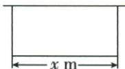

  
图①

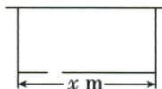

  
图②

答案与解析

解析

（1）设垂直墙的边长为 $z$，新材料用于三边，$x+2z=50$，故 $z=(50-x)/2$，$0<x<50$。

$$y=x\frac{50-x}{2}=-\frac12(x-25)^2+\frac{625}{2}.$$

$x=25$ 合法，面积最大，另两边各为 $12.5$ 米。

（2）门不占材料，几何边仍完整计入面积。材料式是 $x-2+2z=50$，不是仍用第一问的式子。

$$y=x\frac{52-x}{2}=-\frac12(x-26)^2+338.$$

$x=26$ 时门可以容纳，另两边各 $13$ 米，材料 $26-2+13+13=50$。平行边增加 $1$ 米，不是 $2$ 米。

本题结论

（1）平行边长 $25$ 米时面积最大，为 $312.5$ 平方米；（2）应取 $26$ 米，最大面积 $338$ 平方米，小敏的说法不正确。

</article>

### 16. 门洞与运动轨迹 {#physical-model .exam-title}

题给抛物线形状时，可选地面中点为原点，使两横轴交点对称；若直接给最高点，就用顶点式。测得的距离先转换成所选坐标系中的坐标，最后把代数结果还原为实际长度或时间。

<article class="handbook-example" aria-labelledby="example-21">

#### 例题 21 由竹竿测量门洞高度 知识清单例题 {#example-21 .example-heading}

题目

如图所示,某建筑物有一抛物线形的门洞,小强想知道该门洞的高度,他先测出门洞的宽度AB=8 m,然后用一根长为4 m的小竹竿CD竖直地接触地面和门洞的内壁,并测得AC=1 m,则门洞高为____m.

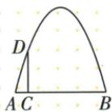

答案与解析

解析

取 $AB$ 中点 $O$ 为原点，$AB$ 为横轴，向上为纵轴。于是 $A(-4,0),B(4,0)$；由 $AC=1$，竿脚横坐标为 $-3$，竿长为 $4$，所以 $D(-3,4)$。

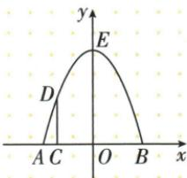

设 $y=a(x+4)(x-4)$，代入 $D$ 得 $4=-7a$，所以

$$y=-\frac47(x+4)(x-4)=-\frac47x^2+\frac{64}{7}.$$

对称轴为 $x=0$，顶点纵坐标为 $64/7$。地面恰为 $y=0$，因此这个纵坐标就是门洞高度。

本题结论

门洞高 $\dfrac{64}{7}$ 米。

</article>

<article class="handbook-example" aria-labelledby="example-22">

#### 例题 22 从给定高度模型找最高时刻 知识清单例题 {#example-22 .example-heading}

题目

（2024 河南节选）从地面竖直向上发射的物体离地面的高度 $h(\mathrm{m})$ 满足关系式 $h = -5t^{2} + v_{0}t$ ，其中 $t(\mathrm{s})$ 是物体运动的时间， $v_{0}(\mathrm{m/s})$ 是物体被发射时的速度。社团活动时，科学小组在实验楼前从地面竖直向上发射小球。小球被发射后 ____ s 时离地面的高度最大（用含 $v_{0}$ 的式子表示）。

答案与解析

解析

将题给公式配方，不必另引入运动定律：

$$h=-5\left[t^2-\frac{v_0}{5}t\right]=-5\left(t-\frac{v_0}{10}\right)^2+\frac{v_0^2}{20}.$$

开口向下，在平方项为零时最高。题目是竖直向上发射，$v_0>0$；所得时刻 $v_0/10$ 在从发射到回地面的 $0\le t\le v_0/5$ 内，合法。

题问的是时间，不是顶点高度 $v_0^2/20$。

本题结论

发射后 $\dfrac{v_0}{10}$ 秒，离地高度最大。

</article>

<article class="handbook-example" aria-labelledby="example-23">

#### 例题 23 求落地点还要筛选运动方向 知识清单例题 {#example-23 .example-heading}

题目

(2024 广西)如图,壮壮同学投掷实心球,出手(点 P 处)的高度 OP 是 $\frac{7}{4}$ m, 出手后实心球沿一段抛物线运行, 到达最高点时, 水平距离是 5 m, 高度是 4 m. 若实心球落地点为 M, 则 OM 为 ____ m.

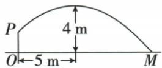

答案与解析

解析

取 $O$ 为原点，$OM$ 所在直线为横轴，$OP$ 所在直线为纵轴。出手点为 $(0,7/4)$，最高点为 $(5,4)$。

设 $y=a(x-5)^2+4$，代出手点得 $7/4=25a+4$，所以 $a=-9/100$。

落地时 $y=0$：

$$(x-5)^2=\frac{400}{9},\qquad x-5=\pm\frac{20}{3}.$$

解得 $x=35/3$ 或 $x=-5/3$。本次运动从出手点向前落地，只取正向的 $35/3$；负根是完整抛物线向后延伸的交点，不属于这段运动。

本题结论

$OM=\dfrac{35}{3}$ 米。

</article>

### 17. 求销售利润 {#profit-method .exam-title}

先由数据确定销量，再将每个渠道的“售价减成本”与该渠道销量相乘，最后求和。配方后查价格范围，回代销量与利润核验，不把最大收入与最大利润混成一个目标。

<article class="handbook-example" aria-labelledby="example-24">

#### 例题 24 线上、线下两种销售方式 知识清单例题 {#example-24 .example-heading}

题目

已知商家购进一批产品,成本为 10 元/件,拟采取线上和线下两种方式进行销售.调查发现,线下的月销量 y(单位:件)与线下的售价 x(单位:元/件, $12 \leqslant x < 24$ )满足一次函数关系,部分数据如下表:

| x/(元/件) | 12 | 13 | 14 | 15 | 16 |
| --- | --- | --- | --- | --- | --- |
| y/件 | 1 200 | 1 100 | 1 000 | 900 | 800 |

(1) 求 y 与 x 的函数关系式.

(2)线上售价始终比线下每件便宜2元,且线上的月销量固定为400件.试问:当x为多少时,线上和线下的月利润总和最大?并求出最大月利润.

答案与解析

解析

（1）设线下月销量 $y=kx+b$。相邻售价增加 $1$ 元，销量减少 $100$ 件，所以 $k=-100$。代 $(12,1200)$ 得 $b=2400$，故 $y=-100x+2400$，其余数据也符合。

（2）分渠道计算：

| 渠道 | 每件售价 | 每件利润 | 月销量 |
| --- | --- | --- | --- |
| 线下 | $x$ | $x-10$ | $-100x+2400$ |
| 线上 | $x-2$ | $x-12$ | $400$ |

于是总月利润

$$\begin{aligned}
w&=(x-10)(-100x+2400)+400(x-12)\\
 &=-100x^2+3800x-28800\\
 &=-100(x-19)^2+7300.
\end{aligned}$$

$19$ 在 $12\le x<24$ 内，所以可取最大值 $7300$。核验：线下销量 $500$ 件、每件利润 $9$ 元，线上每件利润 $7$ 元，$500\times9+400\times7=7300$。

本题结论

（1）$y=-100x+2400$，$12\le x<24$；（2）线下售价 $19$ 元/件时，总月利润最大，为 $7300$ 元。

</article>

## 【坑点】错因与边界 {#pitfalls .handbook-section .is-pitfall}

### 1. 指数条件与系数条件不能漏一个 {#degree-pit .pitfall-title}

写出的指数等于 $2$，还要检查相应系数有没有变成零。只解指数条件，会把已经降次的候选值留下。

<article class="handbook-example is-pitfall" aria-labelledby="pitfall-1">

#### 辨析 01 含参数的二次函数 知识清单例题 {#pitfall-1 .example-heading}

题目

当 m 取何值时, 关于 x 的函数 $y = -3x + (m - 2)x^{|m|}$ 是二次函数?

答案与解析

解析

二次项确实存在，需要 $|m|=2$ 且 $m-2\ne0$。前者得到 $m=2$ 或 $m=-2$。

$m=2$ 时系数为零，原函数只剩 $y=-3x$，排除；$m=-2$ 时 $y=-3x-4x^2$，确为二次函数。

本题结论

$m=-2$。

</article>

### 2. 顶点横坐标不是照抄括号里的常数 {#vertex-sign-pit .pitfall-title}

错法： 把 $(x+1)^2$ 中的 $+1$ 直接抄成顶点横坐标 $1$。

自查： 令括号内部等于 $0$，如 $x+1=0$ 得 $x=-1$。对称轴写直线，顶点写坐标。

<article class="handbook-example is-pitfall" aria-labelledby="pitfall-2">

#### 辨析 02 从顶点式读出三项性质 知识清单例题 {#pitfall-2 .example-heading}

题目

已知函数 $y=(x+1)^{2}-4$ ，指出函数图象的开口方向、对称轴和顶点坐标.

答案与解析

解析

$x+1=x-(-1)$，所以 $h=-1$。也可以令 $x+1=0$，解得 $x=-1$，此时平方项为零，$y=-4$。

$a=1>0$，开口向上。错误的 $(1,-4)$ 把括号内常数直接当成了顶点横坐标。

本题结论

开口向上；对称轴 $x=-1$；顶点 $(-1,-4)$。

</article>

### 3. 开端点只能接近，不能取得 {#open-endpoint-pit .pitfall-title}

求最值不仅要算候选数值，还要指出合法输入。顶点在范围内可以取，端点被排除时就不能把端点函数值直接叫最大值。

<article class="handbook-example is-pitfall" aria-labelledby="pitfall-3">

#### 辨析 03 同一函数，不同输入范围 知识清单例题 {#pitfall-3 .example-heading}

题目

分别在下列范围内求函数 $y=x^{2}-2x-3$ 的最大值和最小值.

（1）$0<x<2$。   
(2) $2 \leqslant x \leqslant 3.$

答案与解析

解析

配方得 $y=(x-1)^2-4$。

（1）$x=1$ 在 $0<x<2$ 内，最小值为 $-4$。但两端 $0,2$ 都不允许取，$|x-1|<1$，所以 $y<-3$。函数值可以无限接近 $-3$，却不能等于 $-3$，没有最大值。

（2）$2\le x\le3$ 全在轴右侧，上开函数在此递增；两个端点都合法，所以最小值 $f(2)=-3$，最大值 $f(3)=0$。

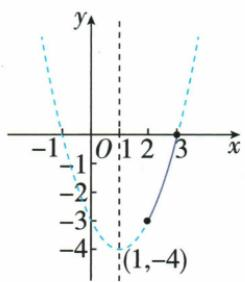

本题结论

（1）最小值 $-4$，无最大值；（2）最小值 $-3$，最大值 $0$。

</article>

### 4. “横坐标为正”不等于“在轴右侧” {#monotonicity-pit .pitfall-title}

先求真实对称轴，再判断给定范围有没有跨轴。表格含多组数据时，用部分数据求式以后，还要回验其余数据。

<article class="handbook-example is-pitfall" aria-labelledby="pitfall-4">

#### 辨析 04 由数据检验四个性质 知识清单例题 {#pitfall-4 .example-heading}

题目

（2024陕西）已知一个二次函数 $y = ax^{2} + bx + c$ 的自变量 $x$ 与函数 $y$ 的几组对应值如下表：

| x | ... | -4 | -2 | 0 | 3 | 5 | ... |
| --- | --- | --- | --- | --- | --- | --- | --- |
| y | ... | -24 | -8 | 0 | -3 | -15 | ... |

则下列关于这个二次函数的结论正确的是 （）

A. 图象的开口向上

B. 当 x>0 时, y 的值随 x 值的增大而减小

C. 图象经过第二、三、四象限

D. 图象的对称轴是直线 $x = 1$

答案与解析

解析

$x=0,y=0$ 给 $c=0$；由 $(-2,-8),(3,-3)$ 得

$$4a-2b=-8,\qquad 9a+3b=-3.$$

前式乘 $3$、后式乘 $2$ 后相加，得 $30a=-30$，于是 $a=-1,b=2$。所以 $y=-x^2+2x=-(x-1)^2+1$。回验 $x=-4,5$，分别得到 $-24,-15$。

A：$a<0$，实际向下开口，错误。

B：$0<x<1$ 还在轴左侧，函数值增大，不能说所有 $x>0$ 都减小，错误。

C：根为 $0,2$，实际经过第一、三、四象限，不经过第二象限，错误。

D：轴确为 $x=1$，正确。

本题结论

选 D。

</article>

### 5. “有公共点”必须包含相切的一点 {#intersection-pit .pitfall-title}

“两个不同交点”用严格正判别式，“有公共点”是至少一个，应包含顶点贴轴的情形。边界是否收取，由题目的语言决定。

<article class="handbook-example is-pitfall" aria-labelledby="pitfall-5">

#### 辨析 05 向下移动到与横轴相交 知识清单例题 {#pitfall-5 .example-heading}

题目

(2024 山东济宁) 将抛物线 $y = x^{2} - 6x + 12$ 向下平移 $k$ 个单位长度, 若平移后得到的抛物线与 $x$ 轴有公共点, 则 $k$ 的取值范围是 ____.

答案与解析

解析

原式 $x^2-6x+12=(x-3)^2+3$，最低点高为 $3$。下移 $k$ 后，最低值变成 $3-k$。

有横轴公共点要求 $3-k\le0$，得 $k\ge3$。等号时恰有一个公共点，也符合题意。用判别式验证，$\Delta=36-4(12-k)=4(k-3)\ge0$，结论相同。

本题结论

$k\ge3$。

</article>

### 6. 存在一个，不代表任意一个 {#quantifier-pit .pitfall-title}

“可以找到”只要求有合法参数使结论成立；“无论怎样取”要求覆盖全部允许参数。先求满足条件的参数范围，再辨认量词，不能把一次试值当成全称证明。

<article class="handbook-example is-pitfall" aria-labelledby="pitfall-6">

#### 辨析 06 两种参数断言 知识清单例题 {#pitfall-6 .example-heading}

题目

（2024福建）已知二次函数 $y = x^{2} - 2ax + a (a \neq 0)$ 的图象经过 $A\left(\frac{a}{2}, y_{1}\right), B(3a, y_{2})$ 两点，则下列判断正确的是（）

A. 可以找到一个实数 $a$ , 使得 $y_{1} > a$

B.无论实数 $a$ 取什么值，都有 $y_{1} > a$

C. 可以找到一个实数 $a$ ，使得 $y_{2} < 0$

D.无论实数 a 取什么值,都有 $y_{2}<0$

答案与解析

解析

代入两点横坐标，得

$$y_1=-\frac34a^2+a,\qquad y_2=3a^2+a=a(3a+1).$$

由于 $a\ne0$，$y_1-a=-3a^2/4<0$，因此 A 所说的“可以找到”和 B 所说的“无论怎样取”都不能使 $y_1>a$。

$y_2<0$ 等价于 $a(3a+1)<0$，解得 $-1/3<a<0$。这个区间非空，故确实可以找到这样的 $a$，C 对；但它没有覆盖所有允许的非零实数，D 错。

本题结论

选 C。

</article>

### 7. 墙长有限，最优点也要分段检查 {#wall-pit .pitfall-title}

越过原墙端点后，多出的边长要另用材料。每个面积式必须带自己的适用范围，还须比较其他摆放位置。可以先求各区域面积上界，再用一个实际可行方案达到最大的上界。

<article class="handbook-example is-pitfall" aria-labelledby="pitfall-7">

#### 辨析 07 缺口围墙的最大菜地 知识清单例题 {#pitfall-7 .example-heading}

题目

(2024 四川自贡) 九(1) 班劳动实践基地内有一块面积足够大的平整空地, 地上两段围墙 $AB \perp CD$ 于点 $O$ (如图), 其中 $AB$ 上的 $EO$ 段围墙空缺. 同学们测得 $AE = 6.6 \mathrm{~m}, OE = 1.4 \mathrm{~m}, OB = 6 \mathrm{~m}, OC = 5 \mathrm{~m}, OD = 3 \mathrm{~m}$ , 班长买来可切断的围栏 $16 \mathrm{~m}$ , 准备利用已有围墙, 围出一块封闭的矩形菜地, 则该菜地最大面积是 $\underline{\quad} \mathrm{m}^{2}$ .

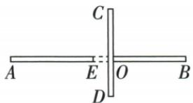

答案与解析

解析

先记清墙长：$OA=6.6+1.4=8$，但其中 $EO=1.4$ 是缺口；$OC=5$。设左上区域的矩形沿 $OA$、$OC$ 的边长分别为 $x,z$。

先找可实现的候选。 当 $1.4<x\le8$ 且 $z>5$ 时，现成墙可用 $x-1.4$ 和 $5$ 米，因此

$$2x+2z-(x-1.4)-5\le16,\qquad z\le9.8-\frac x2.$$

面积满足

$$S=xz\le-\frac12x^2+9.8x=-\frac12(x-9.8)^2+48.02.$$

顶点 $9.8$ 超出本段 $x\le8$，不能直接报 $48.02$。本段随 $x$ 增大而增大，取 $x=8,z=5.8$ 得 $S=46.4$。所需新栏为 $8+5.8+1.4+0.8=16$ 米，确能实现。

再核左上区域的其他范围。

| 边长范围 | 材料或面积依据 | 面积上界 |
| --- | --- | --- |
| $x\le1.4,z\le5$ | $S\le1.4\times5$ | $7$ |
| $x\le1.4,z>5$ | $2x+2z-5\le16$，$S\le x(10.5-x)$ | $12.74$ |
| $1.4<x\le8,z\le5$ | $S\le8\times5$ | $40$ |
| $x>8,z\le5$ | $2x+z-6.6\le16$，$S\le z(11.3-z/2)$ | $44$ |
| $x>8,z>5$ | $x+z\le13.8$，$S\le x(13.8-x)$，在 $x>8$ 递减 | 小于 $46.4$ |

其他位置也要比较。 边长和不超过 $L$ 时，由 $(x-z)^2\ge0$ 可得 $xz\le L^2/4$。右上、左下、右下最多可用墙长分别为 $11,9.6,9$ 米，于是矩形周长至多为 $27,25.6,25$ 米，面积分别不超过

$$45.5625,\qquad40.96,\qquad39.0625,$$

都小于 $46.4$。

若只利用一条墙边，沿 $CD$ 最多可用 $8$ 米：墙边长 $u\le8$ 时，面积不超过 $u(16-u)/2\le32$；$u>8$ 时，面积不超过 $u(12-u)<32$。沿 $AB$ 的连续墙段不超过 $6.6$ 米，也不超过上述界限；若跨过缺口，$u\le14$ 时新栏至少为 $u+2z+1.4$，面积不超过 $u(14.6-u)/2\le26.645$；$u>14$ 时可用墙最多 $12.6$ 米，面积不超过 $u(14.3-u)<4.2$。完全不用墙时，周长至多 $16$，面积至多 $16$。

两条垂直墙同时作为矩形边界时回到前述四区域；只在矩形内部的墙不节省边界围栏。因此没有其他允许位置超过已实现的 $46.4$。

本题结论

最大面积为 $46.4\,\mathrm{m^2}$，可取左上区域两边 $8$ 米、$5.8$ 米。

</article>

### 8. 最大收入与最大利润要分别求 {#revenue-pit .pitfall-title}

收入没有扣除成本；销量随价格改变时，成本总额也随之改变，所以两个目标的最优售价通常不同。价格模型只在题给变化范围内使用，不外推未知的涨价规律。

<article class="handbook-example is-pitfall" aria-labelledby="pitfall-8">

#### 辨析 08 同一销量模型下的两个最优价 知识清单例题 {#pitfall-8 .example-heading}

题目

（2024 广东）广东省全力实施“百县千镇万村高质量发展工程”，2023 年农产品进出口总额居全国首位，其中荔枝鲜果远销欧美。某果商以每吨 2 万元的价格收购早熟荔枝，销往国外。若按每吨 5 万元出售，平均每天可售出 100 吨。市场调查反映：如果每吨降价 1 万元，每天销售量相应增加 50 吨。该果商如何定价才能使每天的“利润”或“销售收入”最大？并求出其最大值。（题中“元”为人民币）

答案与解析

解析

设每吨售价为 $x$ 万元。相对原售价 $5$ 万元，降价 $5-x$ 万元，日销量为

$$q=100+50(5-x)=350-50x.$$

按题给降价模型和非负售价，在 $0\le x\le5$ 内讨论。每吨成本 $2$ 万元，所以

| 目标 | 计算式 | 配方结果 |
| --- | --- | --- |
| 日利润 $w$ | $(x-2)(350-50x)$ | $-50(x-4.5)^2+312.5$ |
| 日销售收入 $R$ | $x(350-50x)$ | $-50(x-3.5)^2+612.5$ |

两式都向下开口，顶点价格 $4.5$、$3.5$ 均在允许范围内。前者销量 $125$ 吨，每吨利润 $2.5$ 万元，利润 $312.5$ 万元；后者销量 $175$ 吨，收入 $175\times3.5=612.5$ 万元。

把收入最大时的 $3.5$ 万元直接答作利润最优价，错在没有扣除随销量变化的成本。

本题结论

每吨定价 $4.5$ 万元，日利润最大为 $312.5$ 万元；每吨定价 $3.5$ 万元，日销售收入最大为 $612.5$ 万元。

</article>

