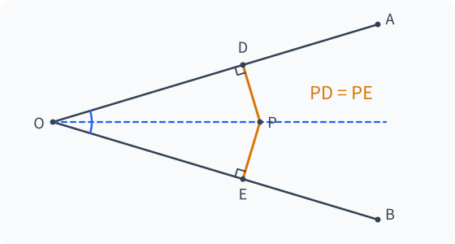
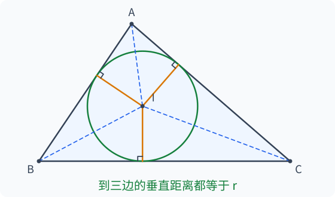
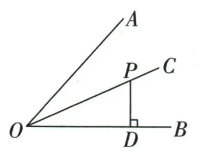
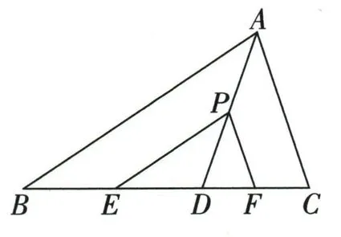
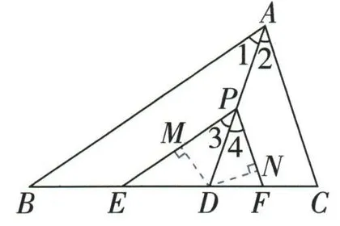
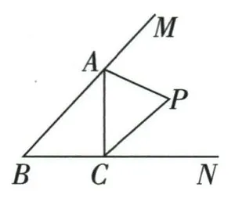
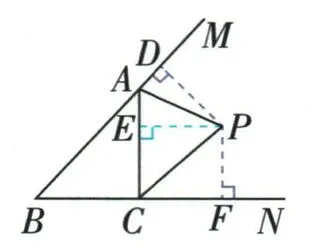
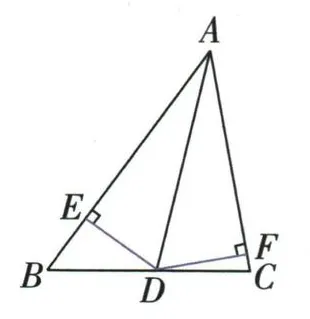
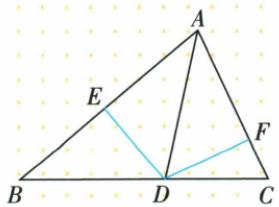

角平分线把一个角分成两个相等的角，也把“角相等”与“到两边的距离相等”联系起来。这里的距离必须是垂直距离；换了点或换了直线，就要重新判断。

<nav class="handbook-nav" aria-label="本章分区">
  <a class="handbook-jump is-knowledge" href="#knowledge">01 · 知识点概念、关系与适用条件</a>
  <a class="handbook-jump is-exam" href="#exam">02 · 考点题目分类和例题</a>
  <a class="handbook-jump is-pitfall" href="#pitfalls">03 · 坑点辨析错因，检查遗漏</a>
</nav>

## 【知识点】概念与依据 {#knowledge .handbook-section .is-knowledge}

### 1. 角平分线的性质 {#distance-property .knowledge-title}

角平分线上的点，到角两边的垂直距离相等

图中 $OP$ 平分 $\angle AOB$，$PD\perp OA$、$PE\perp OB$，所以 $PD=PE$

::: info 性质为什么成立

展开证明

两个直角三角形有公共斜边 $OP$、相等的半角，由 AAS 得 $\triangle OPD\cong\triangle OPE$，所以 $PD=PE$

:::

### 2. 角平分线的判定 {#distance-converse .knowledge-title}

在角内部，到角两边垂直距离相等的点，在角平分线上

图中若已知 $PD=PE$，则由公共斜边 $OP$ 和 HL 判定两个直角三角形全等，得到 $\angle DOP=\angle POE$

### 3. 三角形的内心 {#incenter-excenters .knowledge-title}

三条内角平分线交于一点，叫作三角形的==内心==，它始终在三角形内部，到三边的距离相等

以这个点为圆心、到一边的距离为半径，可画出与三边都相切的内切圆

## 【考点】方法与例题 {#exam .handbook-section .is-exam}

### 1. 先把题目中的距离落到垂线段 {#read-distance .exam-title}

1. 找角顶点和两条边，确认平分的是哪个角。
2. 从所给点向目标直线作垂线，用垂线段的长度表示所求距离。
3. 核对两条垂线是否从同一点出发，再调用性质。

<article class="handbook-example" aria-labelledby="example-1">

#### 例题 01 点到另一边的距离 2024 青海 {#example-1 .example-heading}

题目

(2024 青海)如图, OC 平分 $\angle AOB$ , 点 P 在 OC 上, $PD \perp OB$ , PD = 2, 则点 P 到 OA 的距离是 ()

A.4

B.3

C.2

D.1

答案与解析

解析

过 $P$ 作 $PE\perp OA$。因为 $P$ 在 $\angle AOB$ 的平分线上，所以 $PE=PD=2$。

A 把两条相等距离相加；B 没有题设依据；D 把距离再除以二。平分的是角，不是把已给垂距减半。

本题结论

选 C，距离为 $2$。

</article>

### 2. 平行线先搬角，再建立新的平分线 {#parallel-transfer .exam-title}

有平行线时，先用同位角或内错角把原来的两个半角搬到新顶点。证明新射线确实平分新角之后，才能讨论另一个点到新两边的距离。不能仅凭图中出现平分线，就把所有垂距都写成相等。

<article class="handbook-example" aria-labelledby="example-2">

#### 例题 02 原平分线与新角 知识清单例题 {#example-2 .example-heading}

题目

如图, 在 $\triangle ABC$ 中, $AD$ 是角平分线, $P$ 是 $AD$ 上一点, $PE \parallel AB$ , 交 $BC$ 于点 $E$ , $PF \parallel AC$ , 交 $BC$ 于点 $F$ . 求证: 点 $D$ 到 $PE$ 和 $PF$ 的距离相等.

答案与解析

解析

由 $AD$ 平分 $\angle BAC$，得 $\angle BAD=\angle DAC$。

$PE\parallel AB$、$PF\parallel AC$，以 $AD$ 为截线可得

$$\angle EPD=\angle BAD,\qquad \angle DPF=\angle DAC.$$

所以 $\angle EPD=\angle DPF$，即 $PD$ 平分 $\angle EPF$。

作 $DM\perp PE$、$DN\perp PF$。点 $D$ 在这个角的内部平分线上，故 $DM=DN$。

本题结论

点 $D$ 到 $PE$、$PF$ 的距离相等。

</article>

### 3. 作三条垂线，让两次等距共用一个量 {#three-distances .exam-title}

遇到两条角平分线相交、要证明第三条平分线时，可从交点向三条边线分别作垂线。两次性质通常给出 $d_1=d_2$、$d_2=d_3$，传递后再使用判定。最后还要核对交点在目标角的内部。

<article class="handbook-example" aria-labelledby="example-3">

#### 例题 03 由两个外角平分线证明第三条 知识清单例题 {#example-3 .example-heading}

题目

如图, $AP \text{、} CP$ 分别平分 $\angle MAC \text{、} \angle ACN$ . 求证: 点 $P$ 在 $\angle MBN$ 的平分线上.

答案与解析

解析

过 $P$ 作 $PD\perp MB$、$PE\perp AC$、$PF\perp BN$。垂足可以在原边的延长线上。

$AP$ 平分 $\angle MAC$，所以 $PD=PE$；$CP$ 平分 $\angle ACN$，所以 $PE=PF$。于是 $PD=PF$。

原图中 $P$ 位于 $\angle MBN$ 内部。由角平分线判定，$BP$ 平分 $\angle MBN$。

本题结论

$P$ 在 $\angle MBN$ 的平分线上。

</article>

### 4. 同一组垂距，可以作为不同底边的高 {#area-method .exam-title}

若平分线交对边于 $D$，从 $D$ 向两腰作的等长垂线，可以分别作为两小三角形的高。面积相加时要先确认这两小块恰好组成原三角形；不能把两块的底边与高交叉配对。

若两垂距均为 $r$，则 $S_{\triangle ABC}=\frac12 r(AB+AC)$。解出未知边后，还须回验其余几何条件；方程有正数解，不保证图形一定存在。

## 【坑点】条件与辨析 {#pitfalls .handbook-section .is-pitfall}

### 1. 换了点或换了直线，等距关系不能照搬 {#changed-object .pitfall-title}

“$D$ 到 $AB$ 的距离”与“$E$ 到 $AD$ 的距离”是不同对象。角平分线性质只能直接处理前一组对应的垂距。下面这题还用到勾股定理，可在学过勾股定理后回看。

<article class="handbook-example is-pitfall" aria-labelledby="pitfall-1">

#### 辨析 01 辨清所求的垂线段 2023 广东广州 {#pitfall-1 .example-heading}

题目

（2023 广东广州）如图, 已知 AD 是 $\triangle ABC$ 的角平分线, DE, DF 分别是 $\triangle ABD$ 和 $\triangle ACD$ 的高, AE = 12, DF = 5, 则点 E 到直线 AD 的距离为 \_\_\_\_.

答案与解析

解析

因为 $DE\perp AB$、$DF\perp AC$，且 $D$ 在角平分线上，所以 $DE=DF=5$。

在直角三角形 $ADE$ 中，用勾股定理：

$$AD^2=AE^2+DE^2=12^2+5^2=169,\qquad AD=13.$$

所求不是 $DE$。过 $E$ 作 $EH\perp AD$，同一三角形 $ADE$ 换底、高表示面积：

$$\frac12 AE\cdot DE=\frac12 AD\cdot EH.$$

所以 $12\times5=13EH$，得到 $EH=\dfrac{60}{13}$。不能把 $DE=DF=5$ 推广成所有画出的垂线段都等于 $5$。

本题结论

点 $E$ 到直线 $AD$ 的距离为 $\dfrac{60}{13}$。

</article>

### 2. 代数结果还要接受几何条件检查 {#feasibility .pitfall-title}

面积方程有正数解，不代表所有几何条件一定能同时实现。把算出的边长放回三角形，核查高、面积与边长的大小关系，才能确定原图是否存在。

<article class="handbook-example is-pitfall" aria-labelledby="pitfall-2">

#### 辨析 02 给定的量能否同时成立 依据知识清单例题改编·条件核验 {#pitfall-2 .example-heading}

题目

设 $AD$ 平分 $\angle BAC$，$D$ 在 $BC$ 上，$DE\perp AB$ 于 $E$，$DF\perp AC$ 于 $F$。给出 $S_{\triangle ABC}=7$、$DE=2$、$AB=4$。

按面积关系能形式上求出怎样的 $AC$？这些数据能否同时构成题设三角形？

答案与解析

解析

距离性质给 $DF=DE=2$。按两小块面积相加，形式上有

$$7=\frac12\times4\times2+\frac12 AC\times2=4+AC,$$

所以得到 $AC=3$。

但这还不是合格答案。以 $AB=4$ 为底，从 $C$ 到直线 $AB$ 的高不大于线段 $AC=3$，故

$$S_{\triangle ABC}\le\frac12\times4\times3=6,$$

与给定面积 $7$ 矛盾。因此不是再寻找另一条计算路线，而是这组给定数据本身不能同时成立。图仅示意关系，不能消除数值矛盾。

本题结论

形式上算得 $AC=3$，但题设不存在满足全部条件的三角形。

</article>

### 3. “角内部”与“所在直线”不能省略 {#region-boundary .pitfall-title}

- 求三角形内部的等距点，只取内心。
- 求到三边所在直线等距的全部点，要计入三个旁心。
- 到两条完整相交直线等距，对应两条角平分直线，不只是图上锐角内的那一支。
- 点取在角顶点时，两距离虽都为零，却不能由两个重合点确定一条平分射线。

题目中的区域限定决定答案数量；不是先记“一”或“四”，再套到任何图上。
