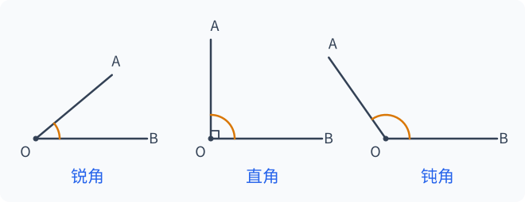
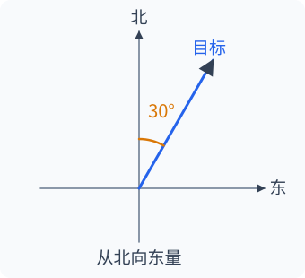
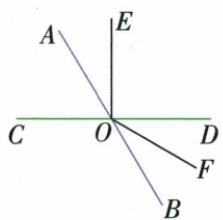
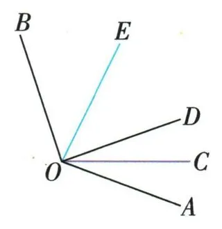
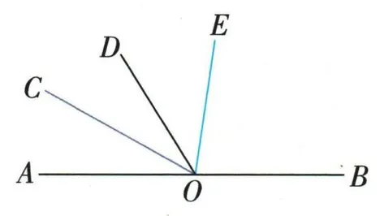
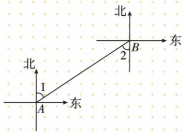
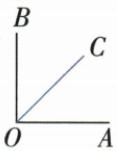
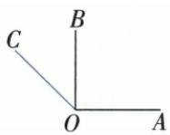
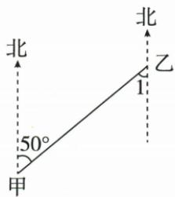

角的大小由两边张开的程度决定。读图时先找顶点和两条边，计算时再把平分、余补、方位等条件翻译成角度关系；特别要留意射线究竟在角内还是角外。

<nav class="handbook-nav" aria-label="本章分区">
  <a class="handbook-jump is-knowledge" href="#knowledge">01 · 知识点概念、关系与适用条件</a>
  <a class="handbook-jump is-exam" href="#exam">02 · 考点题目分类和例题</a>
  <a class="handbook-jump is-pitfall" href="#pitfalls">03 · 坑点辨析错因，检查遗漏</a>
</nav>

## 【知识点】概念与依据 {#knowledge .handbook-section .is-knowledge}

### 1. 角的组成与表示 {#definition .knowledge-title}

有公共端点的两条射线组成==角==，公共端点叫顶点，两条射线叫角的边

$\angle AOB$ 的顶点是 $O$，写在中间；顶点处只有一个角时，可以简记为 $\angle O$

| 锐角 | 直角 | 钝角 | 平角 | 周角 |
| --- | --- | --- | --- | --- |
| 大于 $0^\circ$、小于 $90^\circ$ | $90^\circ$ | 大于 $90^\circ$、小于 $180^\circ$ | $180^\circ$ | $360^\circ$ |

### 2. 角度单位 {#units .knowledge-title}

$$1^\circ=60',\qquad1'=60''$$

大单位化小单位乘 $60$，小单位化大单位除 $60$。例如 $1.5^\circ=1^\circ30'$

### 3. 角的比较与和差 {#comparison .knowledge-title}

角的大小看两边张开的程度，与边画得多长无关

射线 $OC$ 在 $\angle AOB$ 内部时，$\angle AOB=\angle AOC+\angle COB$

### 4. 角平分线 {#bisector .knowledge-title}

从顶点出发，把一个角分成两个相等角的射线，叫作这个角的==平分线==

$$\angle AOC=\angle COB=\frac12\angle AOB$$

### 5. 余角与补角 {#complement .knowledge-title}

| 关系 | 两角之和 | 例子 |
| --- | --- | --- |
| 互为余角 | $90^\circ$ | $30^\circ$ 与 $60^\circ$ |
| 互为补角 | $180^\circ$ | $70^\circ$ 与 $110^\circ$ |

同角或等角的余角相等，补角也相等

### 6. 方向角 {#direction .knowledge-title}

“北偏东 $30^\circ$”：从正北方向向东转 $30^\circ$

方向确定一条射线，再给出与观测点的距离，才能确定一个位置

## 【考点】方法与例题 {#exam .handbook-section .is-exam}

### 1. 统一单位后比较和运算 {#units-method .exam-title}

比较时先把各数化成同一种表示，再从度、分、秒依次比。运算时同单位对齐，秒向分、分向度逐级进位；借位反过来，每次均为60。

<article class="handbook-example" aria-labelledby="example-1">

#### 例题 01 三种角度表示的比较 知识清单例题 {#example-1 .example-heading}

题目

已知 $\angle A = 30^{\circ}28'$ , $\angle B = 30^{\circ}28'30''$ , $\angle C = 30.4^{\circ}$ , 则这三个角的大小关系为 ____. (用 “>” 连接)

答案与解析

解析

$\angle C=30.4^\circ=30^\circ24'$，不是 $30^\circ40'$。$\angle A$ 为 $30^\circ28'$，大于 $\angle C$；$\angle B$ 又比 $\angle A$ 多 $30''$。

本题结论

$\angle B>\angle A>\angle C$。

</article>

<article class="handbook-example" aria-labelledby="example-2">

#### 例题 02 度分秒的四则运算 知识清单例题 {#example-2 .example-heading}

题目

计算：

（1）$152^\circ49'12''+20.18^\circ$。

（2）$82^\circ-36^\circ42'15''$。

（3）$35^\circ36'47''\times9$。

（4）$41^\circ37'\div3$。

答案与解析

解析

（1）$20.18^\circ=20^\circ10'48''$，相加得 $172^\circ59'60''$，秒进1分，分再进1度，得 $173^\circ$。也可将前一个数化成 $152.82^\circ$ 后相加。

（2）把 $82^\circ$ 借位成 $81^\circ59'60''$，相减得 $45^\circ17'45''$。

（3）分别乘9得 $315^\circ324'423''$。$423''=7'3''$，总分数为 $331'=5^\circ31'$，故为 $320^\circ31'3''$。

（4）$41^\circ\div3$ 商 $13^\circ$ 余 $2^\circ$；余度化120分，加原37分为157分，除3商52分余1分；余1分化60秒，除3得20秒。

本题结论

（1）$173^\circ$；（2）$45^\circ17'45''$；（3）$320^\circ31'3''$；（4）$13^\circ52'20''$。

</article>

### 2. 按包含关系或工具比较角 {#compare-method .exam-title}

有共顶点、共边和同侧包含时直接比较；不共边时，可按题目指定的三角尺或量角器建立共同基准。每问注明依据，不把实际测量值当成图上本来标出的已知数。

<article class="handbook-example" aria-labelledby="example-3">

#### 例题 03 同一图中的三组角 知识清单例题 {#example-3 .example-heading}

题目

如图,回答下列问题:(1) 比较∠FOD与∠FOE的大小.

(2)借助三角尺比较 $\angle DOE$ 与 $\angle BOF$ 的大小.  
(3)借助量角器比较 $\angle AOE$ 与 $\angle DOF$ 的大小.

答案与解析

解析

（1）两角共有顶点 $O$ 和边 $OF$，$OD$ 在较大的 $\angle FOE$ 内，所以 $\angle FOD<\angle FOE$。

（2）用含 $45^\circ$ 的三角尺比较，$\angle DOE>45^\circ$，$\angle BOF<45^\circ$，所以前者大于后者。

（3）按题意使用量角器，原图两角均量得约 $30^\circ$，因而相等。这是原题的测量结论，不是所有相似示意图都能凭外形推出的数值。

本题结论

（1）$\angle FOD<\angle FOE$；（2）$\angle DOE>\angle BOF$；（3）$\angle AOE=\angle DOF$。

</article>

### 3. 两个半角先合成整体 {#half-method .exam-title}

先依据平分写出两个半角，再根据射线顺序确定所求是和还是差。如果它们正好合成已知总角的一半，可直接整体代入，不必分别求出两个原角。

<article class="handbook-example" aria-labelledby="example-4">

#### 例题 04 两条内角平分线 知识清单例题 {#example-4 .example-heading}

题目

如图, $OC$ 是 $\angle AOD$ 的平分线, $OE$ 是 $\angle BOD$ 的平分线.

(1) 如果 $\angle AOB = 130^{\circ}$ ，那么 $\angle COE$ 是多少度？

(2) 在 (1) 的条件下, 如果 $\angle DOC = 20^{\circ}$ , 那么 $\angle BOE$ 是多少度?

答案与解析

解析

（1）由平分有 $\angle COD=\angle AOD/2$，$\angle DOE=\angle BOD/2$。图中 $OD$ 在 $\angle AOB$ 内，且在 $OC,OE$ 之间，故

$$\angle COE=\frac12(\angle AOD+\angle BOD)=\frac12\angle AOB=65^\circ.$$

（2）$\angle DOE=\angle COE-\angle COD=65^\circ-20^\circ=45^\circ$。$OE$ 平分 $\angle BOD$，故 $\angle BOE=45^\circ$。

本题结论

（1）$65^\circ$；（2）$45^\circ$。

</article>

### 4. 把余补关系与平角划分列成方程 {#equation-method .exam-title}

余补角关系可统一设原角为未知数；多射线的平角图可选一份小角为未知数。先用半角、倍分关系表示各部分，再按原数量关系或平角总和列式，解后核正值与位置。

<article class="handbook-example" aria-labelledby="example-5">

#### 例题 05 补角与余角的倍差 知识清单例题 {#example-5 .example-heading}

题目

已知一个角的补角比这个角的余角的 4 倍大 $15^{\circ}$ ，求这个角的度数.

答案与解析

解析

设原角为 $x^\circ$，余角为 $(90-x)^\circ$，补角为 $(180-x)^\circ$。“补角比余角的4倍大15度”给

$$180-x=4(90-x)+15\Rightarrow3x=195\Rightarrow x=65.$$

回代余角 $25^\circ$、补角 $115^\circ$，且 $4\times25+15=115$；原角确有正余角。

本题结论

$65^\circ$。

</article>

<article class="handbook-example" aria-labelledby="example-6">

#### 例题 06 平角内的几条射线 知识清单例题 {#example-6 .example-heading}

题目

如图, $AB$ 为一条直线, 点 $O$ 在 $AB$ 上, $OC$ 是 $\angle AOD$ 的平分线, $OE$ 在

$\angle BOD$ 内， $\angle DOE = \frac{1}{3}\angle BOD,\angle COE = 70^{\circ}$ ，求 $\angle EOB$ 的度数

答案与解析

解析

设 $\angle DOE=x^\circ$，则 $\angle BOD=3x^\circ$，$\angle EOB=2x^\circ$。

$\angle COE=70^\circ$，图中 $OD$ 在其内部，所以 $\angle COD=(70-x)^\circ$。由平分，$\angle AOC$ 也为 $(70-x)^\circ$。四小角组成平角：

$$2(70-x)+x+2x=180\Rightarrow x=40.$$

故 $\angle EOB=80^\circ$。回代四部分为30、30、40、80度，都为正，和为180度；$\angle COE=30^\circ+40^\circ=70^\circ$。

本题结论

$\angle EOB=80^\circ$。

</article>

### 5. 改变观测点后重新读方向 {#direction-method .exam-title}

先把“谁看谁”写清，反向后同时交换南北与东西，再核图中所问角到底从南北线还是东西线起量。只有换基准时才取余角，不是每次互看都取余角。

<article class="handbook-example" aria-labelledby="example-7">

#### 例题 07 两点互看 知识清单例题 {#example-7 .example-heading}

题目

如图,从 A 看 B 的方向是北偏东 $60^{\circ}$ ,那么从 B 看 A 的方向是 ____.

答案与解析

解析

从 $A$ 看 $B$ 以北线为基准向东偏 $60^\circ$。从 $B$ 看 $A$ 是同一直线反向，目标落在西南方向。南北同时互换、东西同时互换，偏角仍为 $60^\circ$。两处南北线平行，对向射线的相应夹角相等。

本题结论

南偏西 $60^\circ$。

</article>

## 【坑点】条件与辨析 {#pitfalls .handbook-section .is-pitfall}

### 1. 半角关系还要有内部位置 {#bisector-pit .pitfall-title}

角平分线是射线，不是整条直线。仅一边的半角等式，没有说明角内位置时，不能保证把原角分成了两部分。

<article class="handbook-example is-pitfall" aria-labelledby="pitfall-1">

#### 辨析 01 核对角平分线的定义 知识清单辨析·去除题面答案 {#pitfall-1 .example-heading}

题目

判断下列说法：

（1）从一个角的顶点出发，把这个角分成两个相等的角的直线，叫这个角的平分线。

（2）角的平分线一定在角的内部。

（3）若 $\angle BOC=\frac12\angle BOA$，则 $OC$ 是 $\angle BOA$ 的平分线。

答案与解析

解析

（1）错在“直线”，应为从顶点出发、指向角内部的射线。

（2）按角的内平分线定义，正确。

（3）没有给 $OC$ 在 $\angle BOA$ 内部；在 $OB$ 的另一侧，也可能有与 $OB$ 成这个半角的射线，却不能平分原角。

本题结论

（1）错；（2）对；（3）错。

</article>

### 2. 从顶点引出不等于在角内 {#position-pit .pitfall-title}

已知一条射线与某边的夹角时，先考虑该边两侧的候选位置，再用题设排除。原题未说在内部，就不能只保留自己先画出来的那一支。

<article class="handbook-example is-pitfall" aria-labelledby="pitfall-2">

#### 辨析 02 射线的位置是否确定 知识清单例题 {#pitfall-2 .example-heading}

题目

已知 $\angle AOB = 90^{\circ}$ , OC 是从 $\angle AOB$ 的顶点 O 引出的一条射线, 若 $\angle AOB = 2\angle BOC$ , 求 $\angle AOC$ 的度数.

答案与解析

解析

由 $\angle AOB=2\angle BOC=90^\circ$，得 $\angle BOC=45^\circ$。

若 $OC$ 在 $\angle AOB$ 内，$\angle AOC=90^\circ-45^\circ=45^\circ$。若在 $OB$ 背离 $OA$ 的另一侧，则 $\angle AOC=90^\circ+45^\circ=135^\circ$。

固定 $OB$ 后，与其夹45度的射线在两侧各一条，两种情况已列全。

本题结论

$45^\circ$ 或 $135^\circ$。

</article>

### 3. 余角、补角别用错总量 {#total-pit .pitfall-title}

求余角用90度减原角，求补角用180度减原角。算完可把结果与原角相加，检查总量，而不是只看结果是否为锐角或钝角。

<article class="handbook-example is-pitfall" aria-labelledby="pitfall-3">

#### 辨析 03 求给定角的补角 2024 甘肃 {#pitfall-3 .example-heading}

题目

(2024甘肃)若 $\angle A = 55^{\circ}$ , 则 $\angle A$ 的补角为

A. $35^{\circ}$

B. $45^{\circ}$

C. $115^{\circ}$

D. $125^{\circ}$

答案与解析

解析

补角应为 $180^\circ-55^\circ=125^\circ$，选 D。A 的 $35^\circ$ 是余角；B与原角和为100度，C与原角和为170度，都不满足补角定义。

本题结论

选 D，125°。

</article>

### 4. 方位换基准与反方向不能混淆 {#direction-pit .pitfall-title}

反向保持相应偏角；改用相邻方向作基准才涉及互余。看清角标的两条边，比背“方向相反”的一句口诀更重要。

<article class="handbook-example is-pitfall" aria-labelledby="pitfall-4">

#### 辨析 04 角标从哪条方向线起量 2024 安徽 {#pitfall-4 .example-heading}

题目

(2024 安徽)如图,乙地在甲地的北偏东 $50^{\circ}$ 方向上,则 $\angle1$ 的度数为 ()

A. $60^{\circ}$

B. $50^{\circ}$

C. ${40}^{ \circ  }$

D. $30^{\circ}$

答案与解析

解析

甲看乙是北偏东 $50^\circ$，乙看甲则为南偏西 $50^\circ$。图中 $\angle1$ 的一边是乙地的向南线，另一边指向甲，所以它为 $50^\circ$。

若改从向西线量，可说西偏南 $40^\circ$，但那不是图中所标的 $\angle1$。A、D的60度、30度也不符合原方向。

本题结论

选 B，50°。

</article>

