正多边形的长度计算归结到半径、边心距与半边长组成的直角三角形；扇形与圆锥的计算则要先认清“哪一段弧、哪一个半径、哪一块面积”。

<nav class="handbook-nav" aria-label="本章分区">
  <a class="handbook-jump is-knowledge" href="#knowledge">01 · 知识点概念、关系与适用条件</a>
  <a class="handbook-jump is-exam" href="#exam">02 · 考点题目分类和例题</a>
  <a class="handbook-jump is-pitfall" href="#pitfalls">03 · 坑点辨析错因，检查遗漏</a>
</nav>

## 【知识点】概念与依据 {#knowledge .handbook-section .is-knowledge}

### 1. 正多边形的中心、半径与边心距 {#regular-polygons .knowledge-title}

正多边形的外接圆与内切圆有相同的圆心，叫作它的中心

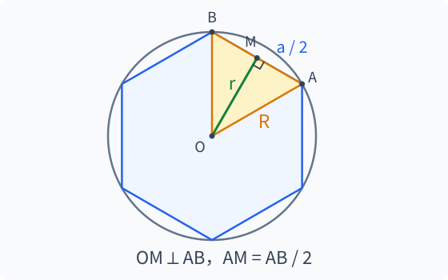

- 半径 $R$：中心到顶点的距离
- 边心距 $r$：中心到边的垂直距离
- 正 $n$ 边形的中心角为 $\frac{360^\circ}{n}$

### 2. 边长与面积 {#radius-apothem .knowledge-title}

边长为 $a$ 时，半径、边心距、半边长组成直角三角形

$$R^2=r^2+\left(\frac a2\right)^2$$

| 图形 | 边长与半径的关系 |
| --- | --- |
| 正三角形 | $a=\sqrt3R$ |
| 正方形 | $a=\sqrt2R$ |
| 正六边形 | $a=R$ |

连接中心与各顶点，分成 $n$ 个等腰三角形，因此 $S=\frac12nar=\frac12Lr$，其中 $L$ 是周长

### 3. 正多边形的对称性 {#symmetry .knowledge-title}

1. 正 $n$ 边形有 $n$ 条对称轴
2. 绕中心旋转 $\frac{360^\circ}{n}$ 的整数倍，与原图重合
3. $n$ 为偶数时是中心对称图形，$n$ 为奇数时不是

### 4. 弧长与扇形面积 {#arc-sector .knowledge-title}

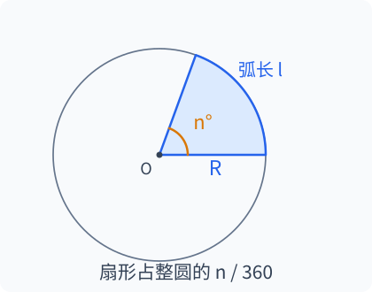

半径为 $R$、圆心角为 $n^\circ$，扇形占整圆的 $\frac n{360}$，所以

$$l=\frac{n\pi R}{180},\qquad S=\frac{n\pi R^2}{360}=\frac12lR$$

例如 $R=6$、$n=60$，弧长为 $2\pi$，扇形面积为 $6\pi$

### 5. 圆柱与圆锥的展开 {#surface-models .knowledge-title}

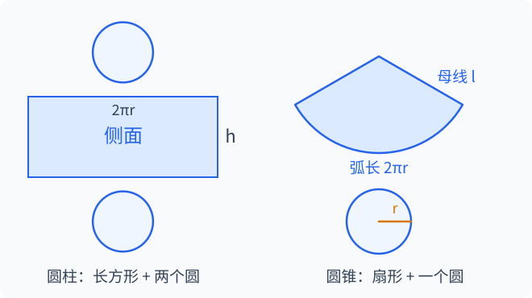

| 图形 | 展开时对应什么 | 侧面积 | 表面积 |
| --- | --- | --- | --- |
| 圆柱 | 长方形长为底面周长 $2\pi r$，宽为高 $h$ | $2\pi rh$ | $2\pi rh+2\pi r^2$ |
| 圆锥 | 扇形半径是母线 $l$，弧长为底面周长 $2\pi r$ | $\pi rl$ | $\pi rl+\pi r^2$ |

圆锥中 $l^2=h^2+r^2$，展开扇形的圆心角为 $\frac{360r}{l}$ 度

圆柱体积 $V=\pi r^2h$，圆锥体积 $V=\frac13\pi r^2h$

## 【考点】先方法，后例题 {#exam .handbook-section .is-exam}

### 1. 由中心角定边数，由半边长求边心距 {#regular-calculation .exam-title}

中心角已知，先用 $n=360^\circ/\theta$ 求边数并检查 $n$ 为不小于3的整数。长度计算连接相邻两顶点与中心，再从中心作边的垂线；面积则用周长乘边心距的一半。

<article class="handbook-example" aria-labelledby="example-1">

#### 例题 01 由中心角求内角和 知识清单例题 {#example-1 .example-heading}

题目

如果一个正多边形的中心角等于 $72^{\circ}$ ，那么这个正多边形的内角和为 \_\_\_\_。

答案与解析

解析

中心角为72°，所以边数 $n=360^\circ\div72^\circ=5$。五边形内角和为 $(5-2)\times180^\circ=540^\circ$。中心角的和与多边形内角和是两种不同的和，不能直接答360°。

本题结论

540°。

</article>

<article class="handbook-example" aria-labelledby="example-2">

#### 例题 02 正方形的两个半径 知识清单例题 {#example-2 .example-heading}

题目

已知边长为 a 的正方形的内切圆的半径为 r，外接圆的半径为 R，则 r:R:a= （）

A. $1:1:\sqrt{2}$

B. $1:\sqrt{2}:2$

C. $1: \sqrt{2}: 1$

D. $\sqrt{2}: 2: 4$

答案与解析

解析

设 $C$ 为边 $AB$ 的中点，连接 $OA,OC$。正方形中心到边的距离 $OC=a/2=r$，且 $AC=a/2$。在直角三角形 $OCA$ 中，

$$R=OA=\sqrt{(a/2)^2+(a/2)^2}=\frac{\sqrt2a}{2}.$$

故 $r:R:a=\frac a2:\frac{\sqrt2a}{2}:a=1:\sqrt2:2$。

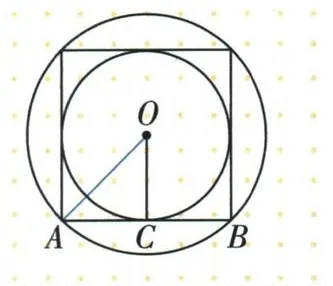

本题结论

选 B。

</article>

<article class="handbook-example" aria-labelledby="example-3">

#### 例题 03 正六边形地基的周长与面积 知识清单例题 {#example-3 .example-heading}

题目

如图,有一个亭子,它的地基是半径为4 m的正六边形,求该地基的周长和面积.

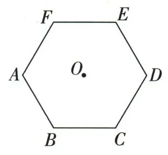

答案与解析

解析

连接 $OB,OC$，作 $OP\perp BC$ 于 $P$。正六边形中心角60°，且 $OB=OC=4$ m，所以 $\triangle OBC$ 为等边三角形，$BC=4$ m。

周长为 $6\times4=24$ m。$PC=2$ m，在直角三角形 $OPC$ 中，$OP=\sqrt{4^2-2^2}=2\sqrt3$ m。

面积为 $\frac12\times24\times2\sqrt3=24\sqrt3$ m²。

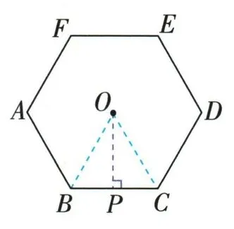

本题结论

周长24 m，面积 $24\sqrt3$ m²。

</article>

<article class="handbook-example" aria-labelledby="example-4">

#### 例题 04 正六边形的内切圆半径 知识清单例题 {#example-4 .example-heading}

题目

（2024 山东济宁）如图, 边长为 2 的正六边形 ABCDEF 内接于 $\odot O$ , 则它的内切圆半径为 ( )

A.1

B.2

C. $\sqrt{2}$

D. $\sqrt{3}$

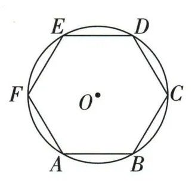

答案与解析

解析

连接 $OA,OB$，作 $OG\perp AB$ 于 $G$。中心角60°，两半径相等，所以 $\triangle OAB$ 是边长2的等边三角形。$AG=1$，故

$$OG=\sqrt{OA^2-AG^2}=\sqrt{4-1}=\sqrt3.$$

$OG$ 是正六边形的边心距，也就是正六边形内切圆半径。不能直接把外接圆半径2当答案。

本题结论

选 D，$\sqrt3$。

</article>

### 2. 先分清求弧长还是求面积 {#sector-calculation .exam-title}

只有圆心角和半径时，从占整圆的比例出发；弧长和面积同时给出时，用 $S=LR/2$。多个小问可共用这一方法，但单位和所求量须逐问核对。

<article class="handbook-example" aria-labelledby="example-5">

#### 例题 05 已知圆心角求扇形面积 知识清单例题·原题第1问 {#example-5 .example-heading}

题目

在半径为6 cm的圆中，圆心角为60°的扇形面积是多少？

答案与解析

解析

该扇形占整圆的 $60/360=1/6$，因此 $S=\frac16\pi\times6^2=6\pi$ cm²。

本题结论

$6\pi$ cm²。

</article>

<article class="handbook-example" aria-labelledby="example-6">

#### 例题 06 纸扇的外边弧长 知识清单例题 {#example-6 .example-heading}

题目

(2024 贵州)如图,在扇形纸扇中,若 $\angle AOB=150^{\circ},OA=24$ ,则 $\widehat{AB}$ 的长为 ( )

A.30π

B. $25\pi$

C.20π

D. $10\pi$

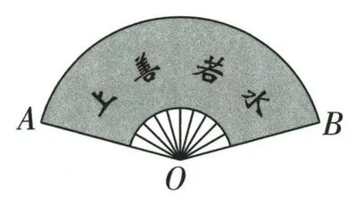

答案与解析

解析

纸扇的圆心角150°，半径24。弧长

$$L=\frac{150\pi\times24}{180}=20\pi.$$

弧长公式分母是180；面积公式才用半径平方与分母360。

本题结论

选 C，$20\pi$。

</article>

<article class="handbook-example" aria-labelledby="example-7">

#### 例题 07 直角扇形的面积 知识清单例题 {#example-7 .example-heading}

题目

(2024 湖南长沙) 半径为 4, 圆心角为 $90^{\circ}$ 的扇形的面积为 \_\_\_\_ (结果保留 $\pi$ ).

答案与解析

解析

90°扇形是整圆的四分之一，故 $S=\frac14\pi\times4^2=4\pi$。

本题结论

$4\pi$。

</article>

### 3. 滚动轨迹分段找圆心、半径和转角 {#rolling .exam-title}

多边形沿直线滚动时，每一段绕当前接触点旋转。跟踪的是题目指定的同一个顶点，半径是它到本段转动中心的距离；相邻两段的中心和半径可能都不同。转角由落地条件确定，常为相应内角的补角，而非直接取内角。

<article class="handbook-example" aria-labelledby="example-8">

#### 例题 08 直角三角形滚动两次 知识清单例题 {#example-8 .example-heading}

题目

如图, 把直角三角形 ABC 的斜边 AB 放在直线 l 上, 按顺时针方向在 l 上滚动两次, 使它滚动到 $\triangle A''B'C'$ 的位置. 若 $BC = 1, AC = \sqrt{3}$ , 求顶点 A 运动到点 $A''$ 的位置时, 点 A 所经过的路线长.

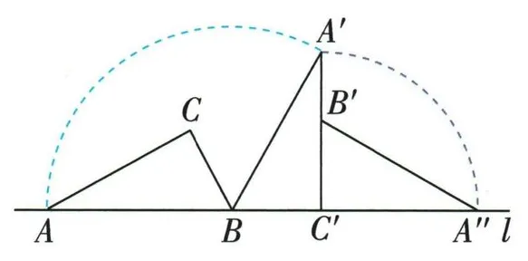

答案与解析

解析

由勾股定理，$AB=\sqrt{1+3}=2$。$\angle A=30^\circ$，$\angle B=60^\circ$。

第一次绕 $B$ 旋转，半径为 $AB=2$，转角为 $180^\circ-60^\circ=120^\circ$，故弧 $AA'$ 长为 $\frac{120\pi\times2}{180}=\frac{4\pi}{3}$。

第二次绕 $C'$ 旋转，半径为 $C'A'=AC=\sqrt3$，转角为90°，故弧 $A'A''$ 长为 $\frac{90\pi\sqrt3}{180}=\frac{\sqrt3\pi}{2}$。

两段轨迹首尾相接，长度相加即可。

本题结论

$\frac{4\pi}{3}+\frac{\sqrt3\pi}{2}$。

</article>

### 4. 阴影面积：先说明等积，再作加减 {#shaded-area .exam-title}

常见思路有三种：

1. 割补：把不规则区域移到另一处，必须先证两块全等或等面积。
2. 差面积：把目标写成大块减小块，检查每个小块是否真的包含在大块里。
3. 整体消元：若只需 $R^2-r^2$，可直接用勾股关系，不必分别求两个半径。

写出面积表达式后再代数，尤其注意“减去一整块”时括号必须保留。

<article class="handbook-example" aria-labelledby="example-9">

#### 例题 09 两个同心直角扇形的割补 知识清单例题 {#example-9 .example-heading}

题目

如图,扇形 OAB 与扇形 OCD 的圆心角均为 $90^{\circ}$ , 连接 AC, BD. 若 OA = 3 cm, OC = 1 cm, 求阴影部分的面积.

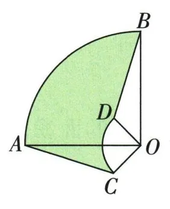

答案与解析

解析

两扇形圆心角均90°，减去公共的 $\angle AOD$，得 $\angle AOC=\angle BOD$。又 $OA=OB,OC=OD$，故 $\triangle AOC\cong\triangle BOD$（SAS），两块面积相等。

用其中一块补到另一块的位置后，阴影面积等于大直角扇形减小直角扇形：

$$S=\frac{90\pi\times3^2}{360}-\frac{90\pi\times1^2}{360}=2\pi\text{ cm}^2.$$

并不是只因两圆同心就能相减，关键是两块三角形的等积保证了割补。

本题结论

$2\pi$ cm²。

</article>

<article class="handbook-example" aria-labelledby="example-10">

#### 例题 10 用半弦与等面积转成扇形 知识清单例题 {#example-10 .example-heading}

题目

如图, $AB$ 是 $\odot O$ 的直径, 弦 $CD \perp AB$ , $\angle CDB = 30^{\circ}$ , $CD = 2\sqrt{3}$ , 求阴影部分的面积.

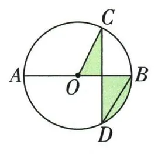

答案与解析

解析

连接 $OD$，设 $CD$ 交 $AB$ 于 $E$。垂径定理给 $CE=DE=\sqrt3$，所以同高 $OE$ 的两三角形 $OCE,ODE$ 面积相等。把其中一块补到另一侧，阴影面积等于扇形 $OBD$ 面积。

$\angle CDB=30^\circ$ 对应圆心角 $\angle COB=60^\circ$；对称得 $\angle BOD=60^\circ$。在直角三角形 $OCE$ 中，$\angle OCE=30^\circ$，故 $OE=OC/2$。由 $OC^2=OE^2+CE^2$ 得 $OC=2$。

因此 $S=\frac{60\pi\times2^2}{360}=\frac{2\pi}{3}$。

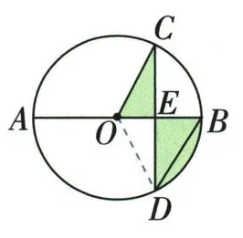

本题结论

$\frac{2\pi}{3}$。

</article>

<article class="handbook-example" aria-labelledby="example-11">

#### 例题 11 不必分别求出两个半径 知识清单例题 {#example-11 .example-heading}

题目

如图,两个半圆的直径共线,O为大半圆的圆心,AB是半圆O的弦,CD是半圆O的直径,AB与小半圆相切, $AB \parallel CD$ ,且AB=24,求图中阴影部分的面积.

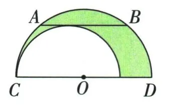

答案与解析

解析

设大、小半圆半径分别为 $R,r$。将小半圆沿共同底线平移，使圆心与 $O$ 重合，面积不变；其最高点仍在与底线平行的切线 $AB$ 上。

设切点为 $E$，连接 $OE,OB$。$OE\perp AB$，垂径定理给 $BE=12$，所以 $R^2-r^2=BE^2=144$。

阴影面积为两半圆面积之差：

$$S=\frac\pi2R^2-\frac\pi2r^2=\frac\pi2(R^2-r^2)=72\pi.$$

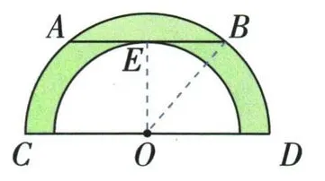

本题结论

$72\pi$。

</article>

### 5. 圆锥：用同一条弧连接展开图与底面 {#cone-calculation .exam-title}

先给底面半径和母线分别命名，再写“展开弧长=底面周长”。求侧面积用母线和底面半径；求高才用勾股。剪下的扇形若以原圆上的点为圆心，其半径不必等于原圆半径，应先从原图求出。

<article class="handbook-example" aria-labelledby="example-12">

#### 例题 12 展开图是半圆 知识清单例题 {#example-12 .example-heading}

题目

某圆锥的底面积是 $15 \, cm^{2}$ ，其侧面展开图中扇形的圆心角是 $180^{\circ}$ ，则该圆锥的侧面积是 \_\_\_\_ $cm^{2}$ .

答案与解析

解析

设底面半径为 $r$，母线长为 $l$。底面积给 $\pi r^2=15$；展开图为半圆，弧长为 $\pi l$，故 $\pi l=2\pi r$，得到 $l=2r$。

侧面积为 $\pi rl=2\pi r^2=30$ cm²。无需先求出含根式的 $r$。

本题结论

30 cm²。

</article>

<article class="handbook-example" aria-labelledby="example-13">

#### 例题 13 从圆形铁皮剪出扇形 知识清单例题 {#example-13 .example-heading}

题目

如图,从一块半径为 $1 \, m$ 的圆形铁皮上剪出一个圆心角为 $120^{\circ}$ 的扇形 ABC, 如果将剪下来的扇形围成一个无底的圆锥, 求该圆锥的底面圆的半径.

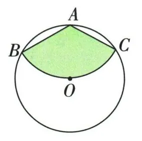

答案与解析

解析

连接 $OA,OB,OC$。扇形以 $A$ 为圆心，故 $AB=AC$；原圆半径给 $OB=OC$，且 $OA$ 公共，所以 $\triangle AOB\cong\triangle AOC$（SSS）。因此 $OA$ 平分 $\angle BAC$，$\angle BAO=60^\circ$。

$OA=OB$，故 $\triangle AOB$ 为等边三角形，$AB=OA=1$ m。这个 $AB$ 才是剪下扇形的半径，也是圆锥母线。

展开弧长为 $\frac{120\pi\times1}{180}=\frac{2\pi}{3}$ m。设圆锥底面半径为 $r$ m，$2\pi r=\frac{2\pi}{3}$，故 $r=\frac13$。

本题结论

圆锥底面半径为 $\frac13$ m。

</article>

<article class="handbook-example" aria-labelledby="example-14">

#### 例题 14 先求底面半径，再求高和体积 知识清单例题·体积延伸 {#example-14 .example-heading}

题目

（2024 广东广州）如图，圆锥的侧面展开图是一个圆心角为 $72^{\circ}$ 的扇形，若扇形的半径 l 是 5，则该圆锥的体积是（）

A. $\frac{3\sqrt{11}}{8}\pi$

B. $\frac{\sqrt{11}}{8}\pi$

C. $2 \sqrt{6} \pi$

D. $\frac{2\sqrt{6}}{3}\pi$

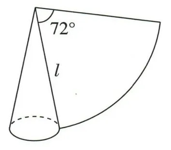

答案与解析

解析

扇形半径5就是母线长。展开弧长 $L=\frac{72\pi\times5}{180}=2\pi$，因此圆锥底面周长为 $2\pi$，底面半径为1。

轴截面的一半是直角三角形，$h=\sqrt{5^2-1^2}=2\sqrt6$。体积为

$$V=\frac13\pi r^2h=\frac13\pi\times1^2\times2\sqrt6=\frac{2\sqrt6\pi}{3}.$$

C少了圆锥体积中的 $1/3$，A、B也不符已求出的半径和高。

本题结论

选 D，$\frac{2\sqrt6\pi}{3}$。

</article>

### 6. 侧面最短路：展开后检查线段确实可走 {#surface-path .exam-title}

沿一条母线剪开圆锥侧面，原来同一个底面点变成扇形弧两端的两个复制点。绕一周返回原点，展开后要连接这两个不同复制点，而不是把起终点仍画成同一个点。直线段只有落在相应展开区域内、未越出实际表面，才是合法最短路。

<article class="handbook-example" aria-labelledby="example-15">

#### 例题 15 沿圆锥侧面绕一周 知识清单例题 {#example-15 .example-heading}

题目

如图,圆锥底面圆的半径为 $1 \mathrm{~cm}$ , 母线长为 $3 \mathrm{~cm}$ , 有一只蚂蚁位于底面圆周上的点 $A$ 处, 它从点 $A$ 出发沿圆锥侧面爬行一周后又回到原出发点. 请你给它指出一条最短的爬行路径, 并求出最短路程.

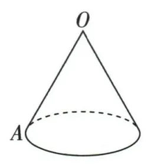

答案与解析

解析

沿母线 $OA$ 展开，原点 $A$ 的两个复制点为 $A,A'$。扇形半径为3 cm，弧长等于底面周长 $2\pi$ cm，故

$$\frac{\theta\pi\times3}{180}=2\pi,\qquad \theta=120.$$

连接 $AA'$。该扇形角为120°，线段 $AA'$ 完全在展开扇形内，且不经过顶点，折回后是沿侧面绕一周的合法路径。平面内两点间线段最短，因此它给出最短路。

作 $OC\perp AA'$，则 $C$ 为中点，$\angle AOC=60^\circ$，$OC=OA/2=3/2$。由勾股定理，

$$AA'=2\sqrt{3^2-(3/2)^2}=3\sqrt3\text{ cm}.$$

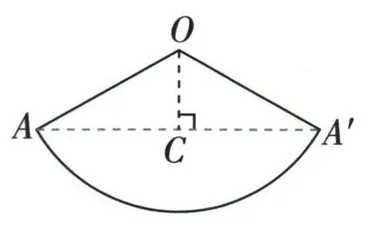

本题结论

沿展开图中的线段 $AA'$ 爬行，最短路程为 $3\sqrt3$ cm。

</article>

## 【坑点】边界与辨析 {#pitfalls .handbook-section .is-pitfall}

### 1. 弓形要整体相减，别漏掉括号 {#segment-subtraction .pitfall-title}

弓形面积通常是“扇形减三角形”。若题目还要从更大区域里减去这个弓形，三角形项最后应加回来。先把每一块名称写全，再展开括号，能同时检查图形是否重扣、漏扣。

<article class="handbook-example is-pitfall" aria-labelledby="pitfall-1">

#### 辨析 01 两个圆弧交出的阴影 知识清单例题 {#pitfall-1 .example-heading}

题目

(2024 四川资阳) 如图, 在矩形 $ABCD$ 中, $AB = 4$ , $AD = 2$ . 以点 $A$ 为圆心, $AD$ 长为半径作弧交 $AB$ 于点 $E$ , 再以 $AB$ 为直径作半圆, 与 $\widehat{DE}$ 交于点 $F$ , 则图中阴影部分的面积为 \_\_\_\_.

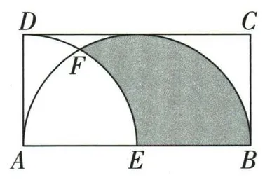

答案与解析

解析

连接 $AF,EF$。$AB=4$，所以半圆的圆心为 $E$、半径为2。$AF=AE=EF=2$，$\triangle AEF$ 为等边三角形，两个相关扇形的圆心角都是60°。

阴影面积等于半圆面积，减去以 $A$ 为圆心的扇形 $AEF$，再减去以 $E$ 为圆心的弓形 $AF$：

$$\begin{aligned}S&=2\pi-\frac{60\pi\times2^2}{360}-\left(\frac{60\pi\times2^2}{360}-\sqrt3\right)\\&=\frac{2\pi}{3}+\sqrt3.\end{aligned}$$

三角形边长2、高 $\sqrt3$，面积为 $\sqrt3$。最后一项前有两次相减，所以应为加号；若写成 $2\pi/3-\sqrt3$，就是去括号时变号错误。

本题结论

$\frac{2\pi}{3}+\sqrt3$。

</article>

### 2. 算出正数，还要检查扇形能否画出 {#sector-feasibility .pitfall-title}

普通扇形的弧至多是一周，所以 $0<L\le2\pi R$，圆心角不能超过360°。由面积关系形式求得半径后，还应检查弧长与圆周长是否相容；代数等式成立，不代表原图形一定存在。

<article class="handbook-example is-pitfall" aria-labelledby="pitfall-2">

#### 辨析 02 弧长与面积是否相容 知识清单原题改编·条件辨析 {#pitfall-2 .example-heading}

题目

给定某扇形的弧长为 $10\pi$ cm，面积为 $20\pi$ cm²。

（1）若只用 $S=LR/2$，形式上算出的半径是多少？

（2）这些数据能否对应一个普通扇形？说明理由。

答案与解析

解析

（1）形式上 $R=2S/L=2\times20\pi/(10\pi)=4$ cm。

（2）半径4 cm的整圆周长只有 $2\pi R=8\pi$ cm，小于给出的弧长 $10\pi$ cm。若继续代入弧长式，得到 $\theta=180L/(\pi R)=450$，超过一周。因此原数据不可能属于普通扇形；4 cm只是形式代数值，不是可实现图形的半径。

本题结论

（1）形式值4 cm；（2）不存在满足这组数据的普通扇形。

</article>

### 3. 三个长度与三种公式不可串用 {#cone-symbols .pitfall-title}

| 容易混淆的量 | 正确对应 | 出错后会怎样 |
| --- | --- | --- |
| 展开扇形的半径 | 圆锥母线 $l$ | 用底面半径 $r$ 代入，会把展开弧长算错 |
| 圆锥的高 | $h=\sqrt{l^2-r^2}$ | 直接把母线当高，会把体积放大 |
| 圆锥侧面积 | $\pi rl$ | 误写成 $\pi r^2$ 就只算了底面 |
| 圆锥表面积 | 侧面积加一个底面 | 加两个底面是误套圆柱 |
| 弧长与面积 | 一个是长度，一个是面积 | 单位可帮助发现漏平方或多平方 |

每次换到展开图，保留“弧长等于底面周长”的对应关系；每次换到轴截面，重新确认斜边是母线。不要让同一个字母在中途改指另一条长度。
