判断位置关系，先选对距离；证明切线，先核清切点是否已知。外心到顶点等距，内心到三边等距，两种中心不能混用。

<nav class="handbook-nav" aria-label="本章分区">
  <a class="handbook-jump is-knowledge" href="#knowledge">01 · 知识点概念、关系与适用条件</a>
  <a class="handbook-jump is-exam" href="#exam">02 · 考点题目分类和例题</a>
  <a class="handbook-jump is-pitfall" href="#pitfalls">03 · 坑点辨析错因，检查遗漏</a>
</nav>

## 【知识点】概念与依据 {#knowledge .handbook-section .is-knowledge}

### 1. 点与圆的位置关系 {#point-circle .knowledge-title}

比较点到圆心的距离 $d$ 与半径 $r$

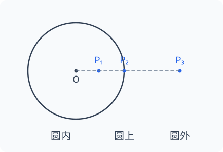

| 位置 | 圆内 | 圆上 | 圆外 |
| --- | --- | --- | --- |
| 条件 | $d<r$ | $d=r$ | $d>r$ |

### 2. 经过已知点作圆 {#circle-through-points .knowledge-title}

1. 经过一个点或两个不同点，可以作无数个圆
2. 三个不共线的点确定一个圆，圆心是两边中垂线的交点
3. 三个不同的共线点不能在同一个圆上

### 3. 外心与内心 {#centers .knowledge-title}

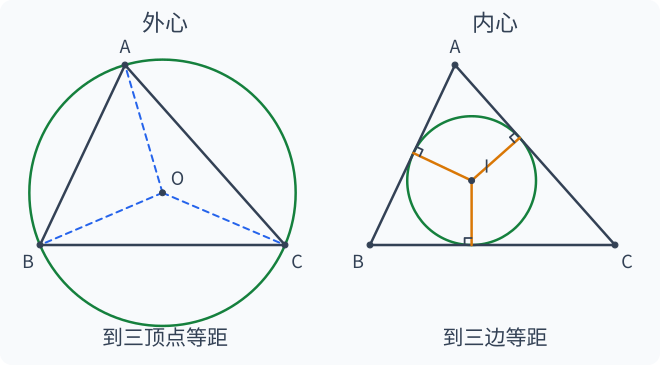

| 名称 | 怎样得到 | 等距对象 |
| --- | --- | --- |
| 外心 | 三边垂直平分线的交点 | 三个顶点 |
| 内心 | 三个内角平分线的交点 | 三条边 |

外心是外接圆圆心；内心是内切圆圆心，始终在三角形内部

外心的位置随三角形的类型变化

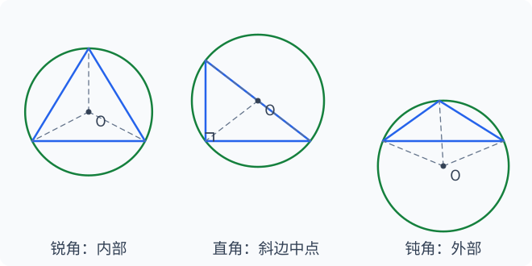

### 4. 直线与圆的位置关系 {#line-circle .knowledge-title}

$d$ 是圆心到直线的垂直距离

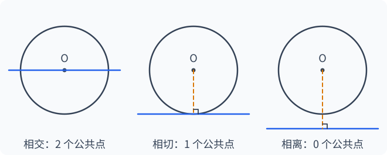

| 位置 | 相交 | 相切 | 相离 |
| --- | --- | --- | --- |
| 公共点数 | $2$ | $1$ | $0$ |
| 条件 | $d<r$ | $d=r$ | $d>r$ |

### 5. 切线的性质与判定 {#tangent .knowledge-title}

- 性质：切线垂直于经过切点的半径
- 判定：经过半径的外端点，且垂直于这条半径的直线，是圆的切线

### 6. 切线长定理 {#tangent-length .knowledge-title}

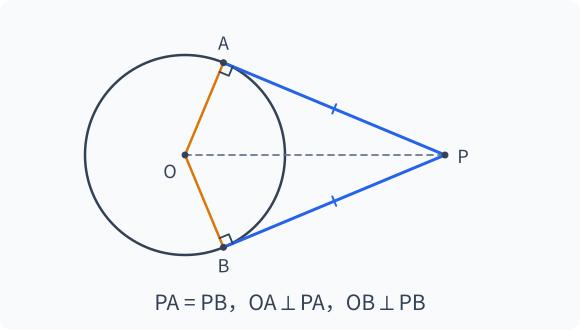

从圆外一点 $P$ 引两条切线，切点为 $A,B$

1. 两条切线段相等：$PA=PB$
2. $OP$ 平分两切线的夹角，也平分 $\angle AOB$
3. $\angle APB+\angle AOB=180^\circ$

### 7. 内切圆半径与面积 {#inradius .knowledge-title}

三边为 $a,b,c$，半周长 $s=\frac{a+b+c}{2}$，内切圆半径为 $r$

$$S=\frac12ar+\frac12br+\frac12cr=sr$$

把内心连向三个顶点，分成的三个三角形都以 $r$ 为高

### 8. 两圆的位置关系 {#two-circles .knowledge-title}

设两圆半径 $R>r>0$，圆心距为 $d$

| 位置 | 条件 | 公共点数 |
| --- | --- | --- |
| 外离 | $d>R+r$ | $0$ |
| 外切 | $d=R+r$ | $1$ |
| 相交 | $R-r<d<R+r$ | $2$ |
| 内切 | $d=R-r$ | $1$ |
| 内含 | $d<R-r$ | $0$ |

半径相等时，圆心重合则两圆重合；圆心不重合时，用外离、外切或相交判断

## 【考点】先方法，后例题 {#exam .handbook-section .is-exam}

### 1. 先求距离，再比较半径 {#distance-method .exam-title}

点与圆看点心距；直线与圆看垂距。所需距离未直接给出时，可连半径、作垂线，借助勾股定理或同一三角形的两种面积表达式求出它。若题目要求“至少一点在内、至少一点在外”，分别由最小距离和最大距离控制，两端都要检查严格性。

<article class="handbook-example" aria-labelledby="example-1">

#### 例题 01 矩形三个顶点的位置 知识清单例题 {#example-1 .example-heading}

题目

已知矩形 $ABCD$ 的边 $AB = 3, AD = 4$ .

(1) 若以点 A 为圆心, 4 为半径作 $\odot A$ , 分别写出点 B, C, D 与 $\odot A$ 的位置关系.  
(2) 若以点 A 为圆心作 $\odot A$ ，使 B, C, D 三点中至少有一点在圆内，且至少有一点在圆外，求 $\odot A$ 的半径 r 的取值范围.

答案与解析

解析

连接 $AC$。由矩形性质及勾股定理，$AB=3$，$AD=4$，$AC=\sqrt{3^2+4^2}=5$。

（1）半径为4，故 $AB<4,AD=4,AC>4$，三点依次在圆内、圆上、圆外。

（2）至少一点在内，等价于最小点心距 $3<r$；至少一点在外，等价于最大点心距 $5>r$。取交集得 $3<r<5$。$r=3$ 时没有圆内点，$r=5$ 时没有圆外点，都要排除。

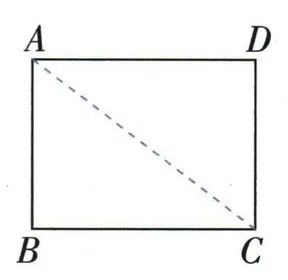

本题结论

（1）B在圆内，D在圆上，C在圆外；（2）$3<r<5$。

</article>

<article class="handbook-example" aria-labelledby="example-2">

#### 例题 02 由弦长求半径 知识清单例题 {#example-2 .example-heading}

题目

（2024 广东广州）如图， $\odot O$ 中，弦 AB 的长为 $4\sqrt{3}$ ，点 C 在 $\odot O$ 上， $OC \perp AB, \angle ABC = 30^{\circ}$ . $\odot O$ 所在的平面内有一点 P，若 OP = 5，则点 P 与 $\odot O$ 的位置关系是（）

A. 点 P 在 $\odot O$ 上

B. 点 P 在 $\odot O$ 内

C. 点 P 在 $\odot O$ 外

D. 无法确定

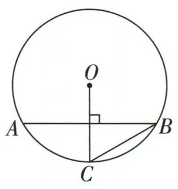

答案与解析

解析

连接 $OA$，设 $OC$ 与 $AB$ 交于 $D$。垂径定理给 $AD=2\sqrt3$；圆周角定理给 $\angle AOC=60^\circ$。

在直角三角形 $OAD$ 中，$\angle OAD=30^\circ$，所以 $OD=\frac12OA$。设半径为 $r$，由勾股定理：

$$r^2=(2\sqrt3)^2+\left(\frac r2\right)^2,\quad \frac34r^2=12,\quad r=4.$$

已知 $OP=5>4$，故 $P$ 在圆外。A、B分别要求点心距等于、小于半径，均不符；半径已唯一求出，D也不成立。

本题结论

选 C，P在圆外。

</article>

<article class="handbook-example" aria-labelledby="example-3">

#### 例题 03 求圆心到斜边的距离 知识清单例题 {#example-3 .example-heading}

题目

在 Rt△ABC 中, ∠C=90°, AC=2, BC=4, 以 C 为圆心, r 为半径作圆.

(1) 当 r=3 时, 直线 AB 和 $\odot C$ 的位置关系是什么?

(2) 当 r 取何值时, $\odot C$ 与直线 AB 有且只有一个公共点?

答案与解析

解析

作 $CD\perp AB$ 于 $D$。由勾股定理，$AB=\sqrt{2^2+4^2}=2\sqrt5$。

同一三角形的面积满足

$$\frac12\times2\times4=\frac12\times2\sqrt5\times CD,\quad CD=\frac{4\sqrt5}{5}.$$

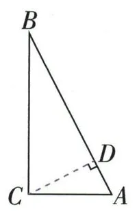

（1）$CD<3$，直线与圆相交。（2）只有一个公共点即相切，必须且只需 $r=CD=\frac{4\sqrt5}{5}$。

本题结论

（1）相交；（2）$r=\frac{4\sqrt5}{5}$。

</article>

### 2. 计数时先排除共线，再排除重复圆 {#count-circles .exam-title}

三点确定圆的前提是不共线。先列合法三点组，再检查不同点组是否可能确定同一个圆；不能把“点组数”直接当作“圆的个数”。

<article class="handbook-example" aria-labelledby="example-4">

#### 例题 04 四个共线点与一个线外点 知识清单例题 {#example-4 .example-heading}

题目

(2023 江西) 如图, 点 A, B, C, D 均在直线 l 上, 点 P 在直线 l 外, 则经过其中任意三个点, 最多可画出圆的个数为 ( )

A.3

B.4

C.5

D.6

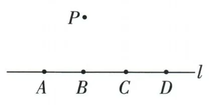

答案与解析

解析

任取三个共线点都不能确定圆，因此每个圆必须经过 $P$，再从 $A,B,C,D$ 中取两个。

六对为 $AB,AC,AD,BC,BD,CD$，各与 $P$ 组成不共线三点，都能确定一个圆。

不同点对不能给出同一圆，否则该圆至少含有直线 $l$ 上三个不同点，而直线与圆最多有两个公共点。因此恰有6个，A、B、C都漏计。

本题结论

选 D，共6个圆。

</article>

### 3. 认清内心、外心，再传递角度 {#center-angles .exam-title}

内心先把原角平分；外心先连向顶点形成等腰三角形，或者用同弧圆心角与圆周角的关系。遇到普通圆心角已知而顶点位置未定，应按顶点所在的两段弧分类，不凭“圆心在内还是在外”直接套倍角。

<article class="handbook-example" aria-labelledby="example-5">

#### 例题 05 同一圆心角对应哪两种顶角 知识清单例题 {#example-5 .example-heading}

题目

在 $\triangle ABC$ 中,点 $I$ 是外心, $\angle BIC=130^{\circ}$ ,求 $\angle A$ 的度数.

答案与解析

解析

外心 $I$ 到 $A,B,C$ 等距，三点在圆 $I$ 上。普通 $\angle BIC=130^\circ$ 对应劣弧 $BC$。

- $A$ 在优弧 $BC$ 上时，$\angle A$ 截劣弧，故 $\angle A=130^\circ\div2=65^\circ$。
- $A$ 在劣弧 $BC$ 上时，$\angle A$ 截优弧，故 $\angle A=(360^\circ-130^\circ)\div2=115^\circ$。

分类依据是 $A$ 相对弦 $BC$ 的位置，不是单看外心是否位于三角形外。

本题结论

$\angle A=65^\circ$ 或 $115^\circ$。

</article>

<article class="handbook-example" aria-labelledby="example-6">

#### 例题 06 两种圆心同时出现 知识清单例题 {#example-6 .example-heading}

题目

如图, 点 O 是 $\triangle ABC$ 外接圆的圆心, 点 I 是 $\triangle ABC$ 的内心, 连接 OB, IA. 若 $\angle CAI = 35^{\circ}$ , 则 $\angle OBC$ 的度数为 \_\_\_\_.

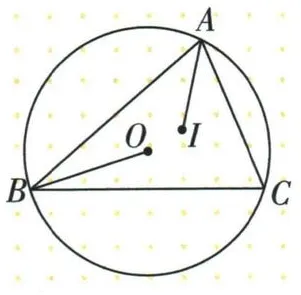

答案与解析

解析

$I$ 是内心，故 $AI$ 平分 $\angle BAC$，$\angle BAC=2\times35^\circ=70^\circ$。

连接 $OC$。$O$ 是外心，圆心角 $\angle BOC=2\angle BAC=140^\circ$，且 $OB=OC$。于是

$$\angle OBC=\frac{180^\circ-140^\circ}{2}=20^\circ.$$

前一步用内心的角平分性质，后两步才用外心的等半径和圆周角关系，不能交换。

本题结论

$20^\circ$。

</article>

### 4. 已知切点：连半径，转成直角 {#known-tangent-point .exam-title}

已知切线先连切点半径，得到90°；待证切线且公共点已知时，目标反过来是证明该半径与直线垂直。图中若有直径、平行线或等腰三角形，先把这些条件转成角，再把余角凑成直角。

<article class="handbook-example" aria-labelledby="example-7">

#### 例题 07 切线与平行四边形 知识清单例题 {#example-7 .example-heading}

题目

如图, 四边形 OABC 是平行四边形, 以点 O 为圆心, OC 的长为半径的 $\odot O$ 与 AB 相切于点 B, 与 AO 相交于点 D, AO 的延长线交 $\odot O$ 于点 E, 连接 EB 交 OC 于点 F. 求 $\angle C$ 和 $\angle E$ 的度数.

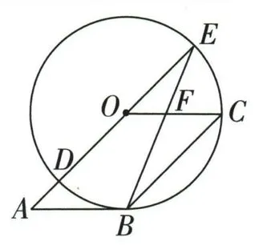

答案与解析

解析

连接 $OB$。$AB$ 切圆于 $B$，故 $OB\perp AB$。又 $AB\parallel OC$，所以 $OB\perp OC$。

$OB=OC$ 为半径，$\triangle OBC$ 是等腰直角三角形，故 $\angle C=45^\circ$。由 $OA\parallel BC$ 得 $\angle AOB=45^\circ$。$D$ 在射线 $OA$ 上，故 $\angle DOB=45^\circ$；$\angle DEB$ 是同弧所对圆周角，$\angle E=\frac12\angle DOB=22.5^\circ$。

本题结论

$\angle C=45^\circ$，$\angle E=22.5^\circ$。

</article>

<article class="handbook-example" aria-labelledby="example-8">

#### 例题 08 先证切线，再用直角求半径 知识清单例题 {#example-8 .example-heading}

题目

如图, 已知 AB 为 $\odot O$ 的直径, AD、BD 是 $\odot O$ 的弦, BC 是 $\odot O$ 的切线, 切点为 B, OC // AD, BA、CD 的延长线相交于点 E.

(1) 求证: CD 是 $\odot O$ 的切线. (2) 若 AE = 1, ED = 3, 求 $\odot O$ 的半径.

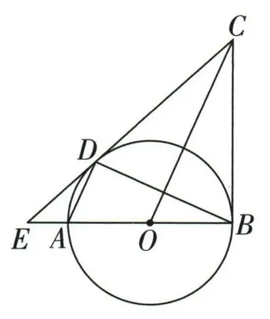

答案与解析

解析

（1）连接 $OD$。由 $AD\parallel OC$ 得 $\angle DAO=\angle COB$、$\angle ADO=\angle COD$。$OA=OD$，所以 $\angle DAO=\angle ADO$，从而 $\angle COB=\angle COD$。

$OC$ 公共，$OB=OD$，夹角相等，故 $\triangle COB\cong\triangle COD$（SAS）。$BC$ 为切线，$\angle CBO=90^\circ$，因此 $\angle CDO=90^\circ$。$D$ 已在圆上，故 $CD$ 为切线。

（2）设半径为 $r$。图中 $E,A,O$ 顺次共线，故 $EO=r+1$；$ED$ 在切线上，所以 $OD\perp ED$。在直角三角形 $ODE$ 中，

$$(r+1)^2=r^2+3^2,\quad 2r+1=9,\quad r=4.$$

取正数符合半径要求。

本题结论

（1）CD为圆的切线；（2）半径为4。

</article>

<article class="handbook-example" aria-labelledby="example-9">

#### 例题 09 用两个角凑出切点的直角 知识清单例题 {#example-9 .example-heading}

题目

(2024 江西节选) 如图, $AB$ 是半圆 $O$ 的直径, 点 $D$ 是弦 $AC$ 延长线上一点, 连接 $BD, BC, \angle D = \angle ABC = 60^{\circ}$ . 求证: $BD$ 是半圆 $O$ 的切线.

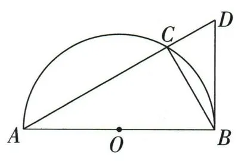

答案与解析

解析

$AB$ 是半圆直径，故 $\angle ACB=90^\circ$。$A,C,D$ 共线，所以 $\angle DCB=90^\circ$。

在 $\triangle DCB$ 中，$\angle D=60^\circ$，所以 $\angle CBD=30^\circ$。由题图中的射线顺序，$\angle ABD=\angle ABC+\angle CBD=60^\circ+30^\circ=90^\circ$。

$OB$ 在直径 $AB$ 上，故 $BD\perp OB$，且 $B$ 在圆上，因此 $BD$ 是半圆的切线。

本题结论

BD是半圆O在B处的切线。

</article>

<article class="handbook-example" aria-labelledby="example-10">

#### 例题 10 圆心角与切点直角 知识清单例题 {#example-10 .example-heading}

题目

(2024 山西) 如图, 已知 $\triangle ABC$ , 以 $AB$ 为直径的 $\odot O$ 交 $BC$ 于点 $D$ , 与 $AC$ 相切于点 $A$ , 连接 $OD$ . 若 $\angle AOD = 80^{\circ}$ , 则 $\angle C$ 的度数为 ( )

A. ${30}^{ \circ  }$

B. $40^{\circ}$

C.45°

D. $50^{\circ}$

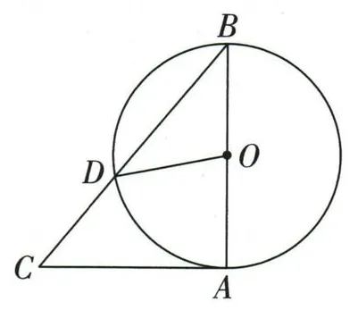

答案与解析

解析

$AC$ 在 $A$ 处相切，故 $AC\perp OA$。$OA$ 与 $AB$ 共线，因此 $\angle BAC=90^\circ$。

$\angle ABD$ 与 $\angle AOD$ 截同一弧，故 $\angle ABC=\angle ABD=\frac12\times80^\circ=40^\circ$。三角形内角和给 $\angle C=180^\circ-90^\circ-40^\circ=50^\circ$。

本题结论

选 D，50°。

</article>

<article class="handbook-example" aria-labelledby="example-11">

#### 例题 11 弧中点处的切线 知识清单例题 {#example-11 .example-heading}

题目

(2024 福建) 如图, 已知点 A, B 在 $\odot O$ 上, $\angle AOB = 72^{\circ}$ , 直线 MN 与 $\odot O$ 相切, 切点为 C, 且 C 为 $\widehat{AB}$ 的中点, 则 $\angle ACM$ 等于 ( )

A. ${18}^{ \circ  }$

B. $30^{\circ}$

C. $36^{\circ}$

D.72°

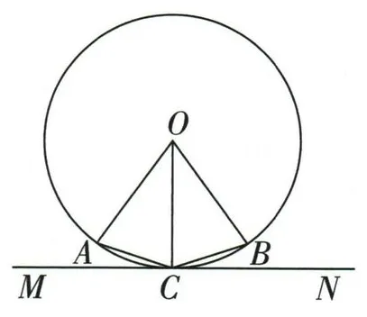

答案与解析

解析

连接 $OC$。$C$ 是图中劣弧 $AB$ 的中点，故 $\angle AOC=\frac12\angle AOB=36^\circ$。

$OA=OC$，所以 $\angle OCA=(180^\circ-36^\circ)\div2=72^\circ$。$MN$ 为切线，$OC\perp MN$；按题图射线方向，$\angle ACM=90^\circ-72^\circ=18^\circ$。

本题结论

选 A，18°。

</article>

### 5. 未知切点：先作垂线，再证明等于半径 {#unknown-tangent-point .exam-title}

不要先设“待证直线与圆交于某点”。从圆心向待证直线作垂线，垂足始终存在；利用角平分线的等距性质或全等三角形，证这段垂距等于已知半径，切线判定才闭合。

<article class="handbook-example" aria-labelledby="example-12">

#### 例题 12 等腰三角形另一腰与圆的关系 知识清单例题 {#example-12 .example-heading}

题目

如图, $\triangle ABC$ 为等腰三角形, $O$ 是底边 $BC$ 的中点, 腰 $AB$ 与 $\odot O$ 相切于点 $D$ . 求证: $AC$ 是 $\odot O$ 的切线.

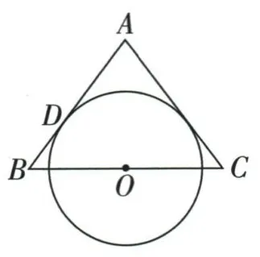

答案与解析

解析

作 $OE\perp AC$ 于 $E$，连接 $OD,OA$。$AB$ 已与圆切于 $D$，故 $OD\perp AB$，且 $OD=r$。

$\triangle ABC$ 是等腰三角形，$O$ 为底边中点，所以 $AO$ 平分 $\angle BAC$。角平分线上的点到两边距离相等，故 $OE=OD=r$。

圆心 $O$ 到直线 $AC$ 的距离等于半径，因此 $AC$ 与圆相切，$E$ 此时才能称为切点。

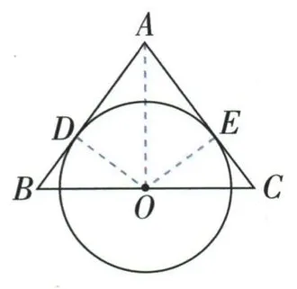

本题结论

AC是圆O的切线。

</article>

### 6. 两条切线：用全等、半角和等长替换 {#two-tangents-method .exam-title}

两条切线来自同一个圆外点，才能直接说切线长相等。角度题连接圆心与圆外点，利用半角；周长题给每一对等长标明共同的出发点，再按点的先后顺序决定用加法还是减法。

<article class="handbook-example" aria-labelledby="example-13">

#### 例题 13 由切线夹角求半径 知识清单例题 {#example-13 .example-heading}

题目

如图, $PA\text{、}PB$ 是 $\odot O$ 的两条切线, $A\text{、}B$ 是切点, 若 $\angle APB = 60^{\circ}, PO = 2$ , 则 $\odot O$ 的半径长为 \_\_\_\_.

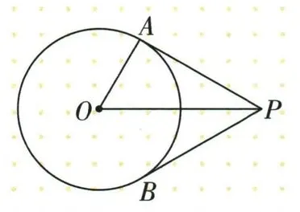

答案与解析

解析

连接 $OA$。切线性质给 $OA\perp PA$；同一点引出的两切线关于 $OP$ 对称，所以 $\angle APO=\frac12\angle APB=30^\circ$。

在直角三角形 $OAP$ 中，斜边 $OP=2$，30°所对直角边 $OA=\frac12OP=1$。

本题结论

半径为1。

</article>

<article class="handbook-example" aria-labelledby="example-14">

#### 例题 14 由半径与弦的夹角求两切线夹角 知识清单例题 {#example-14 .example-heading}

题目

如图, $PA \text{、} PB$ 是 $\odot O$ 的切线, $A \text{、} B$ 为切点, $\angle OAB = 38^{\circ}$ , 则 $\angle P$ 的度数为 \_\_\_\_.

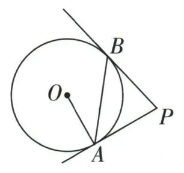

答案与解析

解析

同一点引出的两切线长相等，$PA=PB$，所以 $\angle PAB=\angle PBA$。

$PA\perp OA$，由题图角的位置得 $\angle PAB=90^\circ-\angle OAB=52^\circ$。因此

$$\angle P=180^\circ-2\times52^\circ=76^\circ.$$

也可先由 $OA=OB$ 求 $\angle AOB=104^\circ$，再用两切线夹角与该圆心角互补求得76°。

本题结论

$76^\circ$。

</article>

<article class="handbook-example" aria-labelledby="example-15">

#### 例题 15 第三条切线截出的周长 知识清单例题·改编，明确图示点序 {#example-15 .example-heading}

题目

如图, $PA\text{、}PB\text{、}CD$ 都与 $\odot O$ 相切, $A\text{、}B\text{、}E$ 为切点, $PA=10, CD$ 分别交 $PA\text{、}PB$ 于 $C\text{、}D$ 两点, 则 $\triangle PCD$ 的周长是 \_\_\_\_.

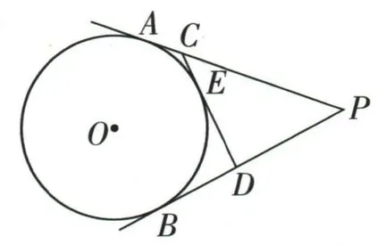

其中 $C,D$ 分别在切线段 $PA,PB$ 内部，切点 $E$ 在线段 $CD$ 上。

答案与解析

解析

从 $P$ 出发：$PA=PB=10$；从 $C$ 出发：$CA=CE$；从 $D$ 出发：$DB=DE$。

由题给点序，$CD=CE+ED=CA+DB$，所以

$$\begin{aligned}PC+CD+PD&=PC+CA+DB+PD\\&=PA+PB=20.\end{aligned}$$

若 $C,D$ 改在两切线段的延长线上，$PC+CA=PA$ 等关系不再成立，不能套这条周长结论。

本题结论

周长为20。

</article>

### 7. 内心与平行线：把角平分转成等腰 {#incenter-transfer .exam-title}

角平分线把一个原角拆为两个相等的角，平行线可再把其中一角转移到新三角形。得到两个相等的角后，才能推出对应边相等。用于周长时，把新边逐一换成原边的一部分，并确认这些部分确实首尾相接。

<article class="handbook-example" aria-labelledby="example-16">

#### 例题 16 内心处平移一个角 知识清单例题 {#example-16 .example-heading}

题目

如图, 点 I 为 $\triangle ABC$ 的内心, AB = 4 cm, AC = 3 cm, BC = 2 cm, 将 $\angle ACB$ 平移, 使其顶点与点 I 重合, 则图中阴影部分的周长为 \_\_\_\_.

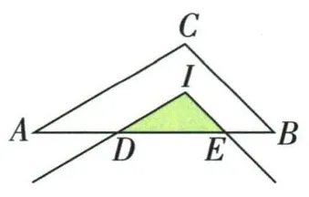

答案与解析

解析

连接 $AI,BI$。$I$ 为内心，故 $\angle CAI=\angle DAI$、$\angle CBI=\angle EBI$。

由平移，$DI\parallel AC$、$EI\parallel BC$。所以 $\angle DIA=\angle CAI=\angle DAI$，得 $DI=DA$；同理 $EI=EB$。

$A,D,E,B$ 按图顺次在一条线上，阴影三角形的周长为

$$DE+DI+EI=DE+DA+EB=AB=4\text{ cm}.$$

$AC=3,BC=2$ 用来确定原三角形情境；本题周长替换后只需 $AB$，不必强行使用每个数。

本题结论

阴影部分周长为4 cm。

</article>

<article class="handbook-example" aria-labelledby="example-17">

#### 例题 17 角平分线延长到圆上 知识清单例题·改编，明确必然等长 {#example-17 .example-heading}

题目

（2024 山东烟台节选）如图, $AB$ 是 $\odot O$ 的直径, $\triangle ABC$ 内接于 $\odot O$ , 点 $I$ 为 $\triangle ABC$ 的内心, 连接 $CI$ 并延长交 $\odot O$ 于点 $D.E$ 是 $\widehat{BC}$ 上任意一点, 连接 $AD, BD, BE, CE$ . 找出由题设条件保证与 $DI$ 相等的其他已画线段，并证明。

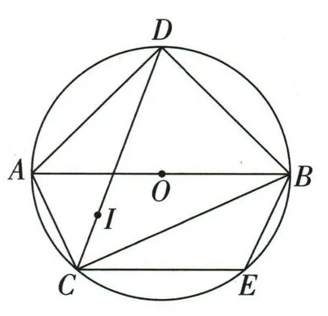

答案与解析

解析

连接 $AI$。$CI$ 平分 $\angle ACB$，所以 $\angle ACD=\angle DCB$，所对弧 $AD,DB$ 相等，进而 $AD=BD$。

又 $\angle DAB=\angle DCB=\angle ACI$，$AI$ 平分 $\angle CAB$，故 $\angle BAI=\angle CAI$。按图中射线顺序，

$$\angle DAI=\angle DAB+\angle BAI=\angle ACI+\angle CAI.$$

$I$ 在 $CD$ 上，$ID$ 是 $IC$ 的反向射线。由 $\triangle ACI$ 的外角定理，$\angle DIA=\angle ACI+\angle CAI$。因此 $\angle DAI=\angle DIA$，$DI=AD$。

综上 $DI=AD=BD$。$E$ 是任意点，个别特殊位置可能再出现等长，但不能把这些偶然关系当作题设必然保证的结论。

本题结论

由题设保证的其他线段为AD、BD，且DI=AD=BD。

</article>

### 8. 尺规作切线：先由点的位置选构造 {#tangent-construction .exam-title}

圆上点用“过点作半径的垂线”，圆外点用“作以点心连线为直径的辅助圆”。两种构造都要保留等半径作弧的痕迹，并用相应判据说明得到的直线为什么是切线。

<article class="handbook-example" aria-labelledby="example-18">

#### 例题 18 过圆上一点作切线 知识清单例题 {#example-18 .example-heading}

题目

已知 $\odot O$ 和圆上一点 $P$，请过点 $P$ 作圆的切线。尺规作图，保留作图痕迹。

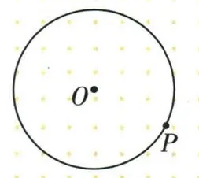

答案与解析

解析

1. 作射线 $OP$。
2. 以 $P$ 为圆心，取小于 $OP$ 的正长度为半径作弧，交射线 $OP$ 于 $A,B$ 两点，使 $A,P,B$ 顺次排列。
3. 分别以 $A,B$ 为圆心，以同一大于 $AB/2$ 的长度为半径作弧，取一个交点 $M$。
4. 作直线 $MP$，保留上述作弧痕迹。

由作图，$PA=PB$，$MA=MB$，故 $PM$ 是 $AB$ 的垂直平分线，$PM\perp OP$。$P$ 本来就在圆上，所以 $MP$ 是切线。

第2步半径小于 $OP$，是为保证射线上得到夹住 $P$ 的两个交点；不能任意取过大的半径。第3步选另一个弧交点，得到的仍是同一条垂线。

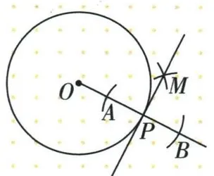

本题结论

直线MP为所求唯一切线。

</article>

<article class="handbook-example" aria-labelledby="example-19">

#### 例题 19 过圆外一点作一条切线 知识清单例题 {#example-19 .example-heading}

题目

已知 $\odot O$ 和圆外一点 $P$，请过点 $P$ 作出圆的一条切线。尺规作图，保留作图痕迹。

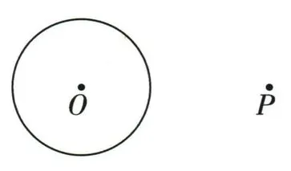

答案与解析

解析

1. 连接 $OP$，分别以 $O,P$ 为圆心，以同一大于 $OP/2$ 的长度为半径，向 $OP$ 两侧作弧，交于 $M,N$。
2. 作直线 $MN$，交 $OP$ 于 $A$。由中垂线作法，$A$ 为 $OP$ 中点。
3. 以 $A$ 为圆心、$AP$ 为半径作辅助圆，取它与原圆的一个交点 $Q$。
4. 作直线 $PQ$，保留作图痕迹。

交点为何存在？设 $OP=d>r$，辅助圆半径及两圆心距都为 $d/2$。两圆满足 $\lvert d/2-r\rvert<d/2<d/2+r$，所以相交于两点。

$Q$ 在以 $OP$ 为直径的辅助圆上，因此 $\angle OQP=90^\circ$；又 $Q$ 在原圆上，$OQ$ 是半径，所以 $PQ$ 为原圆的切线。取另一交点也得到一条切线，本题只要求作其中一条。

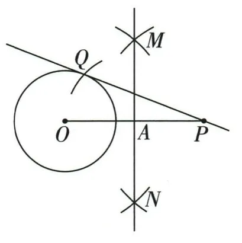

本题结论

直线PQ为所求的一条切线。

</article>

## 【坑点】检查错因与边界 {#pitfalls .handbook-section .is-pitfall}

### 1. 不能先假设待证切点存在 {#assumed-contact .pitfall-title}

“设公共点存在”不是普通辅助线作法。若存在性本身正是待证结论的一部分，这样设点会让证明循环。把它改成必定能作出的垂足，再用距离证明它落在圆上。

<article class="handbook-example is-pitfall" aria-labelledby="pitfall-1">

#### 辨析 01 两种证明思路是否都成立 知识清单例题 {#pitfall-1 .example-heading}

题目

如图,已知菱形 ABCD 的对角线 AC、BD 相交于点 O, AB 与 $\odot O$ 相切于点 E. 若要证明 BC 与 $\odot O$ 相切, 正确的证明思路是 \_\_\_\_. (填序号)

①连接 OE, 作 $OF \perp BC$ 于点 F, 证明 OF = OE.

②设 F 是 $\odot O$ 与 BC 的公共点, 连接 OF, 证明 $OF \perp BC$ .

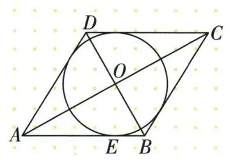

答案与解析

解析

①成立。$AB$ 切圆于 $E$，故 $OE\perp AB$ 且 $OE=r$。菱形的对角线 $BO$ 平分 $\angle ABC$，因此 $O$ 到 $AB,BC$ 的垂距相等，$OF=OE=r$，于是 $BC$ 相切。

②不成立。题设没有给出 $BC$ 与圆有公共点，不能先设这样的 $F$ 已存在。正确做法是从圆心作垂线，证明垂足恰在圆上。

本题结论

只有①正确。

</article>

### 2. 距离可以为零，圆上不算圆内 {#distance-endpoints .pitfall-title}

圆心到直线的距离非负，不是必定正数。相交条件只在上端排除等号；点在圆内、圆外则都不包括圆上。把条件分别写出，再取交集，能避免靠印象增删等号。

<article class="handbook-example is-pitfall" aria-labelledby="pitfall-2">

#### 辨析 02 两个公共点的距离范围 知识清单例题 {#pitfall-2 .example-heading}

题目

已知 $\odot O$ 的半径为 3, 点 O 到直线 m 的距离为 d, 若直线 m 与 $\odot O$ 的公共点的个数为 2, 则 d 的取值范围是 \_\_\_\_.

答案与解析

解析

直线与圆有两个公共点，故相交，$d<r=3$。距离非负，合起来为 $0\le d<3$。

$d=0$ 时直线过圆心，仍有两个直径端点；$d=3$ 时只有一个切点，必须排除。

本题结论

$0\le d<3$。

</article>

<article class="handbook-example is-pitfall" aria-labelledby="pitfall-3">

#### 辨析 03 圆内、圆上与确定一个圆 知识清单辨析·合组改编，明确正半径条件 {#pitfall-3 .example-heading}

题目

判断下列说法。

（1）圆内部是到圆心距离小于半径的点的集合。

（2）圆外部是到圆心距离大于半径的点的集合。

（3）不在圆外的点一定在圆内。

（4）过给定点 $A$ 作圆，圆心可以是除 $A$ 外的任意一点。

（5）过两个不同点作圆，圆心的位置没有限制。

（6）三个不同点一定能确定一个圆。

答案与解析

解析

（1）对，圆心也满足距离为0小于半径。（2）对，是圆外点的距离定义。

（3）错，还可能在圆上。

（4）对，选定圆心 $O\ne A$ 后，以正数 $OA$ 为半径即可；不能选 $A$ 本身。

（5）错，圆心必须在两点连线段的垂直平分线上。

（6）错，三点还须不共线；三点共线时不存在这样的圆。

本题结论

（1）（2）（4）对；（3）（5）（6）错。

</article>

