圆题中，半径提供等长，直径提供直角，弧把分散的角联系起来。先分清圆周与区域、弦与弧，再在同一个圆中逐项寻找依据。

<nav class="handbook-nav" aria-label="本章分区">
  <a class="handbook-jump is-knowledge" href="#knowledge">01 · 知识点概念、关系与适用条件</a>
  <a class="handbook-jump is-exam" href="#exam">02 · 考点题目分类和例题</a>
  <a class="handbook-jump is-pitfall" href="#pitfalls">03 · 坑点辨析错因，检查遗漏</a>
</nav>

## 【知识点】概念与依据 {#knowledge .handbook-section .is-knowledge}

### 1. 圆 {#definition .knowledge-title}

平面内，到定点 $O$ 的距离等于定长 $r$ 的所有点组成的图形，叫作==圆==，记作 $\odot O$

$O$ 是圆心，决定位置；$r$ 是半径，决定大小。圆指圆周，圆周及其内部合起来叫圆面

### 2. 弦、直径与弧 {#chords-arcs .knowledge-title}

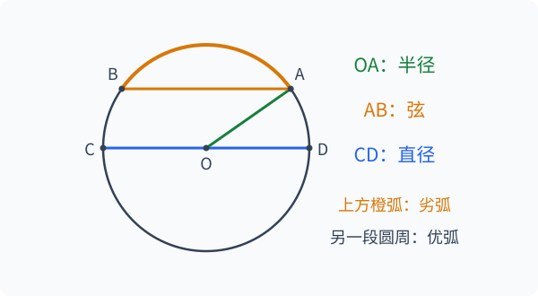

- 弦：连接圆上两点的线段
- 直径：经过圆心的弦，长为 $2r$，是最长的弦
- 弧：圆上两点之间的一段圆周；小于半圆的叫劣弧，大于半圆的叫优弧

### 3. 同圆、等圆与等弧 {#equal-circles .knowledge-title}

- 等圆：半径相等的圆
- 同心圆：圆心相同的圆
- 等弧：在同圆或等圆中，能够互相重合的弧

### 4. 圆心角与圆周角 {#angle-regions .knowledge-title}

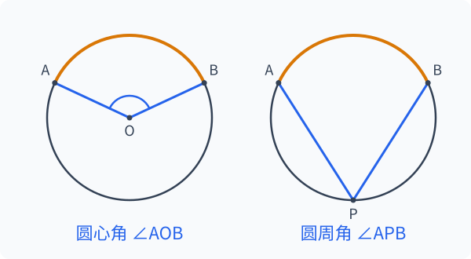

- 圆心角：顶点在圆心，两边是半径
- 圆周角：顶点在圆上，两边与圆相交
- 扇形：两条半径与它们之间的弧围成的图形

### 5. 垂径定理 {#perpendicular-chord .knowledge-title}

圆是轴对称图形，每条直径所在的直线都是对称轴

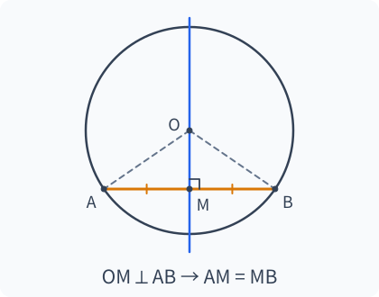

垂直于弦的直径平分这条弦，也平分弦所对的两条弧

反过来，平分非直径弦的直径垂直于这条弦。连接圆心与弦中点，常能得到直角三角形

$$R^2=d^2+\left(\frac{AB}{2}\right)^2$$

其中 $d$ 是圆心到弦的距离

### 6. 弧、弦、圆心角的关系 {#equal-objects .knowledge-title}

在同圆或等圆中，对应的劣弧相等、弦相等、圆心角相等可以互相推出；等弦的弦心距也相等。直径对应的半圆同样可以比较

### 7. 圆周角定理 {#inscribed-angle .knowledge-title}

同弧所对的圆周角，等于对应圆心角的一半；同弧或等弧所对的圆周角相等

上图中 $\angle APB=\frac12\angle AOB$，二者所对的是同一条不含 $P$ 的弧 $AB$

::: info 圆周角定理的证明

展开三种位置

圆心在角的一边上时，利用半径相等得到等腰三角形，再用外角等于两不相邻内角之和证明

圆心在角内部或外部时，作经过角顶点的直径，将角拆成前一种情形，分别相加或相减

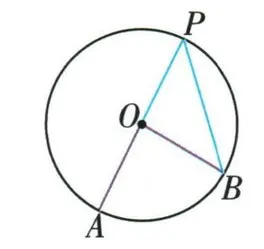

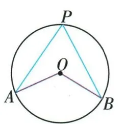

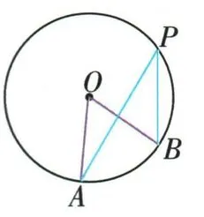

:::

### 8. 直径所对的圆周角 {#diameter-angle .knowledge-title}

1. 直径所对的圆周角是 $90^\circ$
2. $90^\circ$ 的圆周角所对的弦是直径

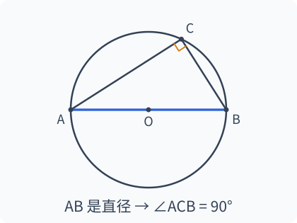

### 9. 圆内接四边形 {#cyclic-quadrilateral .knowledge-title}

四个顶点都在同一个圆上的四边形，叫作==圆内接四边形==

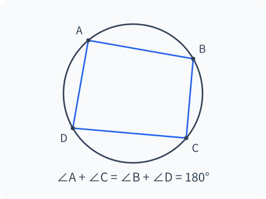

1. 两组对角分别互补
2. 外角等于与它不相邻的内对角
3. 反过来，凸四边形一组对角互补，则四个顶点在同一个圆上

## 【考点】方法与例题 {#exam .handbook-section .is-exam}

### 1. 先按定义检查对象 {#recognize .exam-title}

角先查顶点，再查两条射线；区域先查围界，特别是两条直边是否确为同一圆的半径。共圆则寻找一个到所有目标点等距的固定点，并说明距离为正。

<article class="handbook-example" aria-labelledby="example-1">

#### 例题 01 标出的四个角 知识清单例题 {#example-1 .example-heading}

题目

如图,在图中标出的 4 个角中,圆周角有 ( )

A.1 个

B.2 个

C.3 个

D.4 个

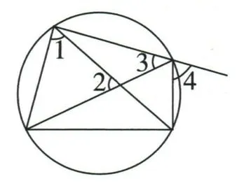

答案与解析

解析

角1、角3的顶点在圆上，两边又分别再次交圆，符合圆周角定义。角2顶点在圆内而非圆上；角4虽在圆上，却有一边向外而不再交圆。恰有2个，选B。

本题结论

B，2个。

</article>

<article class="handbook-example" aria-labelledby="example-2">

#### 例题 02 三种曲边区域 知识清单例题·2023江苏连云港 {#example-2 .example-heading}

题目

（2023 江苏连云港）如图，甲由一条直径、一条弦及一段圆弧围成；乙由两条半径与一段圆弧围成；丙由不过圆心 $O$ 的两条线段与一段圆弧围成。下列叙述正确的是哪一项？

A. 只有甲是扇形

B. 只有乙是扇形

C. 只有丙是扇形

D. 只有乙、丙是扇形

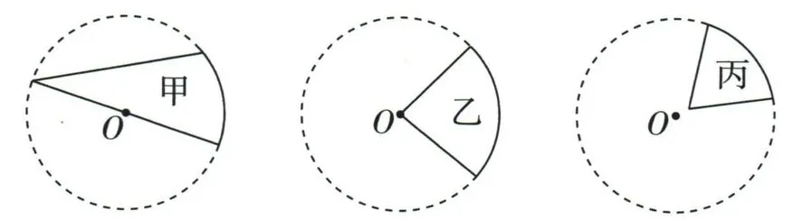

答案与解析

解析

甲的直边是直径与弦，不是从同一圆心出发的两条半径；乙符合两半径围弧的定义；丙共同顶点不是圆心。只有乙，选B。

本题结论

B。

</article>

<article class="handbook-example" aria-labelledby="example-3">

#### 例题 03 四个中点为什么共圆 知识清单例题 {#example-3 .example-heading}

题目

如图,矩形 ABCD 的对角线相交于点 O, E, F, G, H 分别为 OA, OB, OC, OD 的中点. 求证: E, F, G, H 四点在同一个圆上.

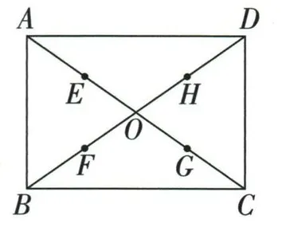

答案与解析

解析

矩形两对角线等长且互相平分，$OA=OB=OC=OD$。四段再各取一半，得 $OE=OF=OG=OH>0$。以 $O$ 为圆心、$OE$ 为半径作圆，四点都满足圆的等距定义，故共圆。

本题结论

四点在以O为圆心、OE为半径的同一个圆上。

</article>

### 2. 用半径、半弦、垂距组成直角三角形 {#half-chord .exam-title}

先从圆心向弦作垂线，再用半弦。动点最短还要证明垂足在允许范围内；残圆问题常把一条直角边表示为半径与弓高之差，平方展开后消去二次项。

<article class="handbook-example" aria-labelledby="example-4">

#### 例题 04 同心圆中的两侧截段 知识清单例题 {#example-4 .example-heading}

题目

已知在以点 O 为圆心的两个同心圆中, 大圆的弦 AB 交小圆于点 C, D (如图所示).

求证:AC=BD.

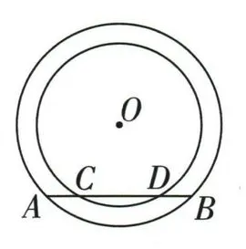

答案与解析

解析

作 $OE\perp AB$ 于 $E$。这条垂线同时垂直小圆的弦 $CD$，所以 $AE=BE$、$CE=DE$。按 $A,C,E,D,B$ 的点序，$AC=AE-CE$，$BD=BE-DE$。等量减等量，$AC=BD$。

本题结论

$AC=BD$。

</article>

<article class="handbook-example" aria-labelledby="example-5">

#### 例题 05 弦上动点到圆心的距离 知识清单例题 {#example-5 .example-heading}

题目

如图, $\odot O$ 的半径为10,AB=16,点P在弦AB上,求OP的最小值.

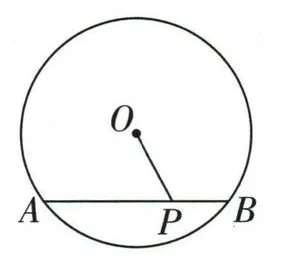

答案与解析

解析

作 $OH\perp AB$，连接 $OB$。垂径给 $HB=AB/2=8$，且中点 $H$ 确在原弦上。

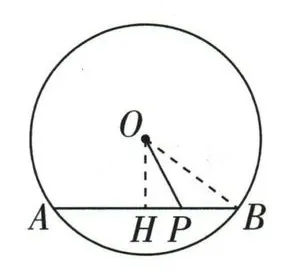

勾股得 $OH=\sqrt{10^2-8^2}=6$。任意弦上点 $P$ 满足 $OP^2=OH^2+HP^2\ge36$，只有 $P=H$ 取等，最小值6。

本题结论

最小值6，在P为弦AB中点时取得。

</article>

<article class="handbook-example" aria-labelledby="example-6">

#### 例题 06 测量残缺圆形工件 知识清单例题·2024四川凉山州 {#example-6 .example-heading}

题目

(2024 四川凉山州) 数学活动课上, 同学们要测一个如图所示的残缺圆形工件的半径, 小明的解决方案是: 在工件圆弧上任取两点 A, B, 连接 AB, 作 AB 的垂直平分线 CD 交 AB 于点 D, 交 $\widehat{AB}$ 于点 C, 测出 AB = 40 cm, CD = 10 cm, 则圆形工件的半径为

A.50 cm

B.35 cm

C.25 cm

D.20 cm

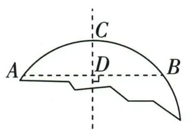

答案与解析

解析

圆心 $O$ 在弦的中垂线上。设半径为 $R$，半弦 $BD=20\text{ cm}$。按图中 $C,D,O$ 点序，$OD=R-10$。

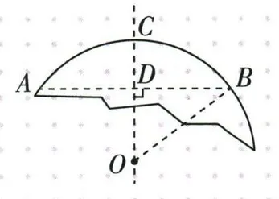

由勾股，$(R-10)^2+20^2=R^2$。展开并消去 $R^2$，$-20R+500=0$，得 $R=25\text{ cm}$。回验两直角边15、20与斜边25成立，选C。

本题结论

C，25 cm。

</article>

### 3. 等量先转成中心角，再转弧或弦 {#equal-transfer .exam-title}

连接半径，把等弦或半弦条件放进两个三角形，用全等取得圆心角相等，再说明所比较的弧属于同一种弧。不要把“等量互换”扩张成任意倍数互换。

<article class="handbook-example" aria-labelledby="example-7">

#### 例题 07 两条半径的中点作垂线 知识清单例题 {#example-7 .example-heading}

题目

如图, $AB$ 是 $\odot O$ 的直径, $M, N$ 分别是 $OA, OB$ 的中点, $CM \perp AB$ 于 $M, DN \perp AB$ 于 $N$ . 求证: $\widehat{AC} = \widehat{BD}$ .

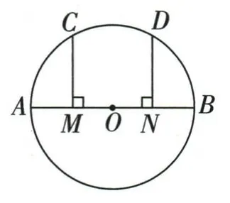

答案与解析

解析

连接 $OC,OD$。$OC=OD$ 为半径，$OM=ON$ 为相等半径的一半，$\angle CMO=\angle DNO=90^\circ$，由 HL 得 $\triangle CMO\cong\triangle DNO$。

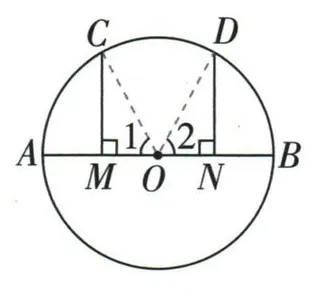

所以 $\angle COM=\angle DON$。$OM$ 与 $OA$ 同向、$ON$ 与 $OB$ 同向，故 $\angle COA=\angle DOB$，所对劣弧 $AC,BD$ 相等。

本题结论

$\widehat{AC}=\widehat{BD}$。

</article>

### 4. 把圆周角集中到同一条弧 {#angle-transfer .exam-title}

为每个角标出两个弦端点及不含角顶点的弧。需要时连半径，圆周角倍回中心转角；直径提供180°；目标再取一半。若原顶点位置未确定，必须分别考虑截优弧、劣弧。

<article class="handbook-example" aria-labelledby="example-8">

#### 例题 08 直径两边的角度转换 知识清单例题 {#example-8 .example-heading}

题目

如图, $AB$ 为 $\odot O$ 的直径, 点 $C\text{、}D\text{、}E$ 在 $\odot O$ 上, $\angle BED = 40^{\circ}$ , 则 $\angle ACD$ 的度数为 \_\_\_\_.

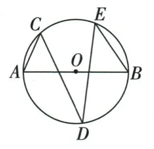

答案与解析

解析

连 $OD$。$\angle BED$ 截弧 $BD$，所以 $\angle BOD=2\times40^\circ=80^\circ$。$AB$ 是直径，$\angle AOD=180^\circ-80^\circ=100^\circ$。

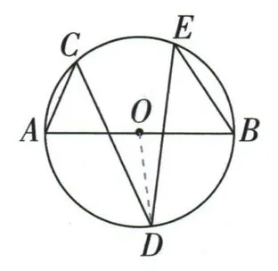

按图 $C$ 截劣弧 $AD$，$\angle ACD=100^\circ/2=50^\circ$。

本题结论

$50^\circ$。

</article>

<article class="handbook-example" aria-labelledby="example-9">

#### 例题 09 圆周角与等腰底角的和 知识清单例题·2024陕西 {#example-9 .example-heading}

题目

(2024 陕西) 如图, BC 是 $\odot O$ 的弦, 连接 OB, OC, $\angle A$ 是 $\widehat{BC}$ 所对的圆周角, 则 $\angle A$ 与 $\angle OBC$ 的度数的和是 \_\_\_\_.

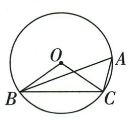

答案与解析

解析

$OB=OC$，所以 $2\angle OBC+\angle BOC=180^\circ$。按图 $A$ 在优弧 $BC$ 上，$\angle A=\angle BOC/2$。前式除以2，得 $\angle OBC+\angle A=90^\circ$。

本题结论

$90^\circ$。

</article>

### 5. 直径先造直角，再接等腰或勾股 {#diameter-method .exam-title}

直径与圆上第三点组成直角三角形。若还给等腰，考虑顶点高线同时是中线；若给长度，明确每个直角三角形的斜边，不把不同位置的直角混作一个。

<article class="handbook-example" aria-labelledby="example-10">

#### 例题 10 同一图中的求角与证中点 知识清单例题 {#example-10 .example-heading}

题目

如图, $AB$ 为 $\odot O$ 的直径, $AB = AC$ , $AC$ 交 $\odot O$ 于点 $E$ , $BC$ 交 $\odot O$ 于点 $D$ , 连接 $BE$ , $\angle BAC = 45^{\circ}$ .

(1) 求 $\angle EBC$ 的度数. (2) 求证: BD = CD.

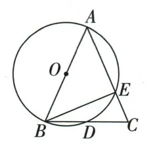

答案与解析

解析

（1）$E$ 在直径圆上，$\angle AEB=90^\circ$。$\angle BAE=45^\circ$，故 $\angle ABE=45^\circ$。$AB=AC$，两底角各 $(180^\circ-45^\circ)/2=67.5^\circ$，所以 $\angle EBC=67.5^\circ-45^\circ=22.5^\circ$。

（2）连接 $AD$，直径给 $\angle ADB=90^\circ$。$B,D,C$ 共线，所以 $AD\perp BC$。等腰三角形的顶点高也是底边中线，故 $BD=CD$。也可用斜边 $AB=AC$、公共直角边 $AD$ 作 HL 后取对应边。

本题结论

（1）$22.5^\circ$；（2）$BD=CD$。

</article>

<article class="handbook-example" aria-labelledby="example-11">

#### 例题 11 同弧换角后取余角 知识清单例题·2024江苏常州 {#example-11 .example-heading}

题目

（2024江苏常州）如图，AB是⊙O的直径，CD是⊙O的弦，连接AD、BC、BD.若 $\angle BCD=20^{\circ}$ ，则 $\angle ABD=$ \_\_\_\_°.

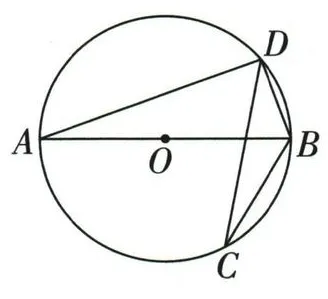

答案与解析

解析

$\angle BCD$ 与 $\angle BAD$ 截同一弧 $BD$，所以 $\angle BAD=20^\circ$。直径给 $\angle ADB=90^\circ$，三角形角和得 $\angle ABD=90^\circ-20^\circ=70^\circ$。

本题结论

$70^\circ$。

</article>

### 6. 内接四边形先找真正的对角 {#cyclic-method .exam-title}

先用平行线或圆周角定理求出一个内角，再与不相邻内角互补。外角也可以与内对角直接相等，但必须确认延长射线的方向。

<article class="handbook-example" aria-labelledby="example-12">

#### 例题 12 两个角的比值 知识清单例题 {#example-12 .example-heading}

题目

如图, 四边形 ABCD 内接于 $\odot O$ , 连接 OA, OC, 若 $\angle AOC : \angle ADC = 2 : 3$ , 则 $\angle ABC$ 的度数为

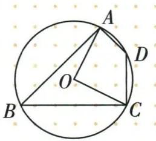

答案与解析

解析

设 $\angle AOC=2x^\circ$，则 $\angle ADC=3x^\circ$。按图 $B$ 截劣弧 $AC$，$\angle ABC=x^\circ$。内接四边形两对角互补，$3x+x=180$，解得 $x=45$。回验中心角90°、另一对角135°，比值2∶3。

本题结论

$45^\circ$。

</article>

<article class="handbook-example" aria-labelledby="example-13">

#### 例题 13 平行线把已知角移到圆上 知识清单例题·2024吉林 {#example-13 .example-heading}

题目

（2024 吉林）如图, 四边形 ABCD 内接于 $\odot O$ . 过点 B 作 BE // AD, 交 CD 于点 E. 若 $\angle BEC = 50^{\circ}$ , 则 $\angle ABC$ 的度数是 ( )

A. ${50}^{ \circ  }$

B. ${100}^{ \circ  }$

C.130°

D. $150^{\circ}$

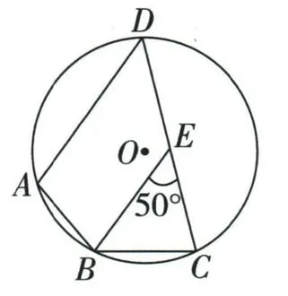

答案与解析

解析

$BE\parallel AD$，$D,E,C$ 顺次共线，同位角给 $\angle ADC=\angle BEC=50^\circ$。内接四边形对角互补，所以 $\angle ABC=180^\circ-50^\circ=130^\circ$，选C。

本题结论

C，$130^\circ$。

</article>

<article class="handbook-example" aria-labelledby="example-14">

#### 例题 14 圆周角的外角 知识清单例题 {#example-14 .example-heading}

题目

如图, 圆心角 $\angle AOB = 120^{\circ}$ , 若 $P$ 是弧 $AB$ 上任意一点 (不与点 $A, B$ 重合), 点 $C$ 在 $AP$ 的延长线上, 则 $\angle BPC$ 的度数为 \_\_\_\_.

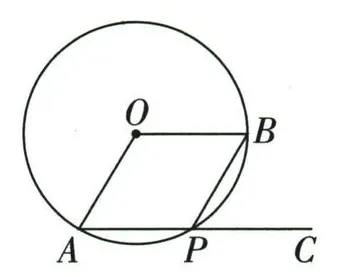

答案与解析

解析

按图 $P$ 位于120°对应的劣弧 $AB$ 内。它截另一条240°优弧，所以 $\angle APB=120^\circ$；$PC$ 是 $PA$ 的反向射线，$\angle BPC=60^\circ$。

也可在优弧上取 $E$，$\angle AEB=120^\circ/2=60^\circ$；$\angle AEB$ 与 $\angle APB$ 是内接四边形的对角，$\angle BPC$ 与 $\angle APB$ 是邻补角，因此前两者同补而相等。若P换到优弧，不能沿用该结果。

本题结论

$60^\circ$。

</article>

### 7. 遇到弧中点，连接半径并补出直角三角形 {#arc-midpoint-method .exam-title}

弧中点到两端点的弦相等，连圆心与弧中点，就得到弦的垂直平分线。若题中还有直径，先标出直径所对的直角，再观察半径与半弦能否组成三角形中位线。每用一次勾股定理，都应重新指出这一组三边中的斜边。

<article class="handbook-example" aria-labelledby="example-15">

#### 例题 15 直径、弧中点与两条弦 知识清单例题 {#example-15 .example-heading}

题目

如图，$AB$ 是 $\odot O$ 的直径，$P$ 是弧 $BC$ 的中点，$AB=13$，$AC=5$，求 $PA$ 的长。

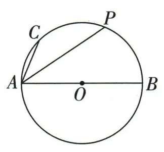

答案与解析

解析

连接 $PB,BC$，连接 $OP$ 交 $BC$ 于 $D$。

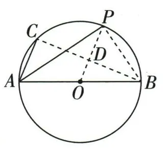

1. $P$ 为弧中点，所以 $OP\perp BC$，$BD=CD$。又 $O$ 是 $AB$ 中点，$OD$ 是 $\triangle ABC$ 的中位线，故 $OD=\frac12AC=\frac52$。由图中点序，$PD=OP-OD=\frac{13}2-\frac52=4$。
2. $AB$ 是直径，故 $\angle ACB=90^\circ$。在 $\triangle ABC$ 中，$BC=\sqrt{13^2-5^2}=12$，从而 $BD=6$。
3. 在直角三角形 $PDB$ 中，$PB=\sqrt{4^2+6^2}=2\sqrt{13}$。
4. 同样因为 $AB$ 是直径，$\angle APB=90^\circ$，所以 $PA=\sqrt{AB^2-PB^2}=\sqrt{169-52}=3\sqrt{13}$。

本题结论

$PA=3\sqrt{13}$。

</article>

## 【坑点】边界与辨析 {#pitfalls .handbook-section .is-pitfall}

### 1. 圆弧的类别与长度不能跨圆照搬 {#arc-boundaries .pitfall-title}

优弧、劣弧相对于各自所在圆比较，半圆另成一类；等弧还要形状相同。判断时不要把曲线换成区域。

<article class="handbook-example is-pitfall" aria-labelledby="pitfall-1">

#### 辨析 01 七个说法是否成立 知识清单辨析·合组 {#pitfall-1 .example-heading}

题目

判断并说明理由：

（1）半圆既不是优弧，也不是劣弧。

（2）半圆与半圆形没有区别。

（3）等弧就是长度相等的弧。

（4）一条弧只对应一条弦。

（5）一条弦只对应一条弧。

（6）弧只有优弧和劣弧之分。

（7）优弧一定比劣弧长。

答案与解析

解析

（1）正确，半圆恰好半周。（2）错误，曲线与包含内部的区域不同。（3）错误，还须同圆或等圆中能重合。（4）正确，指定弧两端唯一连出一条弦。（5）错误，一条弦分出两段弧。（6）错误，漏半圆。（7）错误，跨不同半径比较不成立；在同圆或等圆内才可以这样比较。

本题结论

依次：对、错、错、对、错、错、错。

</article>

### 2. 两条平行弦的位置可能有两种 {#parallel-chords .pitfall-title}

垂径与勾股只求出每条弦到圆心的非负距离。同侧两弦取距离之差，异侧取距离之和；没有位置限制时不能只保图中一种。

<article class="handbook-example is-pitfall" aria-labelledby="pitfall-2">

#### 辨析 02 平行弦之间的距离 知识清单例题 {#pitfall-2 .example-heading}

题目

已知圆的半径为 13, 两弦 $AB \parallel CD$ , $AB = 24$ , $CD = 10$ , 则两弦 $AB$ 、 $CD$ 之间的距离是 \_\_\_\_.

答案与解析

解析

过 $O$ 向两弦作垂线，因两弦平行，两个垂足与圆心共线。半弦分别12、5，所以两弦心距为 $\sqrt{13^2-12^2}=5$ 与 $\sqrt{13^2-5^2}=12$。

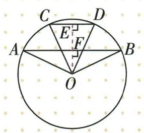

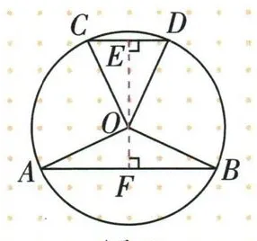

同侧距离为 $12-5=7$；异侧为 $12+5=17$。两种均可实现，题干未排除其中一种。

本题结论

7或17。

</article>

### 3. 弧的倍数不直接等于弦的倍数 {#arc-multiples .pitfall-title}

把长弧分成等弧，可得到相等的分段弦；整条弦与折线的比较则要另用三角形三边关系。

<article class="handbook-example is-pitfall" aria-labelledby="pitfall-3">

#### 辨析 03 两倍圆弧所对应的弦 知识清单例题 {#pitfall-3 .example-heading}

题目

如图所示,在同圆中,如果 $\widehat{AB}=2\widehat{CD}$ ,那么弦AB与弦CD的关系为AB \_\_\_\_ 2CD.(填“>”“=”或“<”)

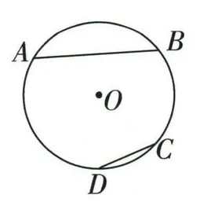

答案与解析

解析

在弧 $AB$ 上取弧中点 $E$。弧 $AE,EB,CD$ 相等，所以 $AE=EB=CD$。

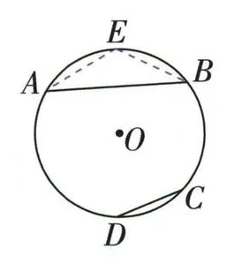

三个不同圆上点 $A,E,B$ 不共线，故 $AB<AE+EB=2CD$。严格小于来自非退化三角形，不是从画出的弧长直接看出。

本题结论

$AB<2CD$。

</article>

### 4. 同一条弦不一定对应相等的圆周角 {#same-chord .pitfall-title}

同弧对应角相等；同弦还要分顶点位于弦的哪一侧。先定位所截的弧，再决定相等还是互补。

<article class="handbook-example is-pitfall" aria-labelledby="pitfall-4">

#### 辨析 04 同弦所对的两种角关系 知识清单辨析·合组 {#pitfall-4 .example-heading}

题目

判断两句话：

（1）同圆或等圆中，同弦或等弦所对的圆周角相等。

（2）同圆或等圆中，同弦或等弦所对的圆周角相等或互补。

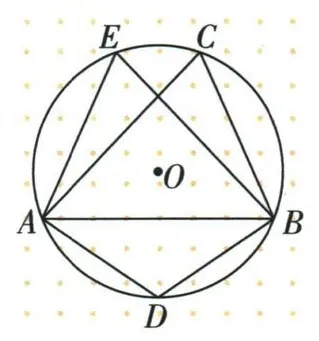

答案与解析

解析

（1）错误，少了顶点同侧的限制。（2）正确。图中 $C,E$ 在弦 $AB$ 同侧，截同弧，$\angle C=\angle E$；$D$ 在另一侧，截另外一段弧，两弧共360°，所以 $\angle C+\angle D=180^\circ$。

本题结论

（1）错；（2）对。

</article>

