证明两条边或两个角相等，常常可以先找到它们所在的两个三角形。先确定顶点怎样对应，再选择判据；判定全等之后，才能使用对应边、对应角相等。

<nav class="handbook-nav" aria-label="本章分区">
  <a class="handbook-jump is-knowledge" href="#knowledge">01 · 知识点概念、关系与适用条件</a>
  <a class="handbook-jump is-exam" href="#exam">02 · 考点题目分类和例题</a>
  <a class="handbook-jump is-pitfall" href="#pitfalls">03 · 坑点辨析错因，检查遗漏</a>
</nav>

## 【知识点】概念与依据 {#knowledge .handbook-section .is-knowledge}

### 1. 全等三角形与对应关系 {#correspondence .knowledge-title}

能够完全重合的两个三角形，叫作==全等三角形==，形状和大小都相同

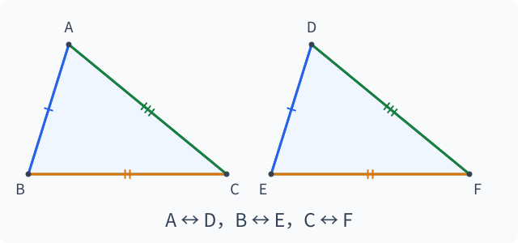

记作 $\triangle ABC\cong\triangle DEF$，字母按对应顺序写：$A\leftrightarrow D$、$B\leftrightarrow E$、$C\leftrightarrow F$

### 2. 全等三角形的性质 {#rigid-motion .knowledge-title}

1. 对应边相等，对应角相等
2. 对应的高、中线、角平分线分别相等
3. 周长相等，面积相等

平移、翻折、旋转都保持图形的形状和大小，得到的图形与原图形全等

### 3. 全等三角形的判定 {#criteria .knowledge-title}

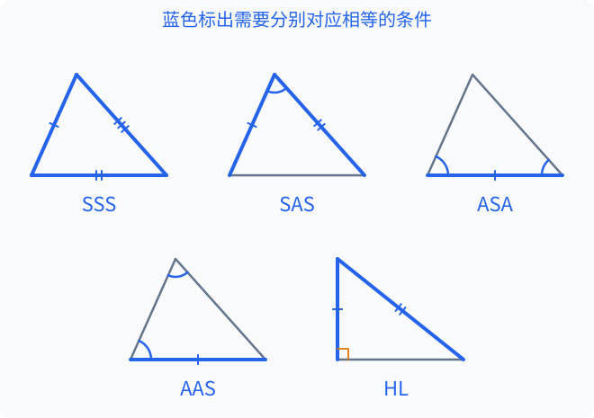

| 判定 | 条件 |
| --- | --- |
| SSS，边边边 | 三边分别相等 |
| SAS，边角边 | 两边和它们的夹角分别相等 |
| ASA，角边角 | 两角和它们的夹边分别相等 |
| AAS，角角边 | 两角和其中一角的对边分别相等 |
| HL，斜边、直角边 | 两个直角三角形的斜边和一条直角边分别相等 |

各组条件都要按对应顺序匹配。SAS 必须是夹角，HL 必须先有两个直角三角形

::: info AAS 为什么能判定全等

展开说明

两组角分别相等，由三角形内角和，第三组角也相等。这样给定边就成了另两组相等角的夹边，可以用 ASA 判定全等

:::

## 【考点】方法与例题 {#exam .handbook-section .is-exam}

### 1. 按字母找对应，再处理线段或角的和差 {#given-congruence .exam-title}

1. 逐个写出对应顶点，不按图上“左边、右边”猜。
2. 两端点对应确定对应边，角顶点对应确定对应角。
3. 所求不是整条对应边、整个对应角时，再按点序或射线顺序相加、相减。

最长边与最长边、最大角与最大角可以帮助核查，但有相等元素时仍以同一套顶点对应为准。公共点、公共边也不能不经核对就指定为对应元素。

<article class="handbook-example" aria-labelledby="example-1">

#### 例题 01 重叠线段中的长度 知识清单例题 {#example-1 .example-heading}

题目

如图, $\triangle EFG \cong \triangle NMH$ , $E\text{、}H\text{、}G\text{、}N$ 在同一条直线上, 若 $EH = 1.1 \mathrm{~cm}, NH = 3.3 \mathrm{~cm}$ , 求线段 $HG$ 的长.

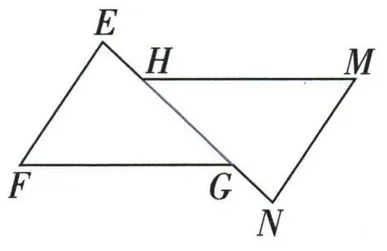

答案与解析

解析

由 $\triangle EFG\cong\triangle NMH$，得 $EG=NH=3.3\text{ cm}$。原点序为 $E-H-G-N$，故

$$HG=EG-EH=3.3-1.1=2.2\text{ cm}.$$

也可以由 $EH+HG=NG+HG$ 得 $NG=EH=1.1\text{ cm}$，再用 $HG=NH-NG$。两种减法都要以原点序为依据。

本题结论

$HG=2.2\text{ cm}$。

</article>

<article class="handbook-example" aria-labelledby="example-2">

#### 例题 02 对应角与两次外角关系 知识清单例题 {#example-2 .example-heading}

题目

如图, $\triangle AFB \cong \triangle AEC$ , $\angle A = 60^{\circ}$ , $\angle B = 26^{\circ}$ , 求 $\angle BOC$ 的度数.

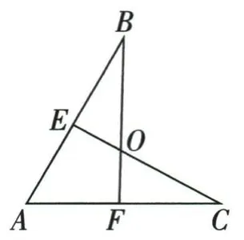

答案与解析

解析

由对应顺序，$\angle C=\angle B=26^\circ$。

$\angle BEC$ 是 $\triangle AEC$ 在 $E$ 处的外角，故

$$\angle BEC=60^\circ+26^\circ=86^\circ.$$

$E,O,C$ 共线，所以 $\angle BOC$ 又是 $\triangle BOE$ 在 $O$ 处的外角：

$$\angle BOC=86^\circ+26^\circ=112^\circ.$$

每一步都先指定小三角形，再用外角等于两个不相邻内角之和。

本题结论

$\angle BOC=112^\circ$。

</article>

<article class="handbook-example" aria-labelledby="example-3">

#### 例题 03 用可到达的线段替代测距 知识清单例题 {#example-3 .example-heading}

题目

如图,小强利用全等三角形的知识测量池塘两端 M、N 的距离,若 $\triangle PQO \cong \triangle NMO$ , 则只需测出 ( )

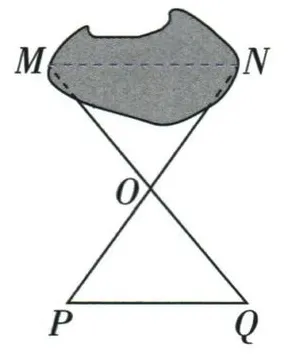

A.PO 的长

B.PQ 的长

C.MO 的长

D.MQ 的长

答案与解析

解析

$\triangle PQO\cong\triangle NMO$ 给出 $P\leftrightarrow N$、$Q\leftrightarrow M$、$O\leftrightarrow O$，所以 $PQ$ 对应 $NM$。

A 中的 $PO$ 对应 $NO$；C 中的 $MO$ 对应 $QO$；D 中的 $MQ$ 跨越两个图形，不是 $NM$ 的对应边。

本题结论

选 B，测量 $PQ$。

</article>

### 2. 先补齐条件，再选择判据 {#choose-criteria .exam-title}

| 已有条件 | 优先寻找什么 |
| --- | --- |
| 两边对应相等 | 第三边用于 SSS；夹角用于 SAS；确为两个直角三角形时再检查 HL |
| 两角对应相等 | 一条位置对应的边，用 ASA 或 AAS |
| 一边及其对角对应相等 | 再找一对角，考虑 AAS |
| 一边及其邻角对应相等 | 再找夹着该角的另一边，或再找适当的角 |

常见的隐藏条件来自公共边、公共角、对顶角、平行线、角平分线，以及等长线段或等角的同加同减。待证结论不属于已知条件。

下面五例各保留一种判据的完整书写，重点比较夹角、夹边和直角的位置。

<article class="handbook-example" aria-labelledby="example-4">

#### 例题 04 SSS：把短段接成对应边 知识清单书写示例 {#example-4 .example-heading}

题目

如图,点 E、F 在 BC 上,AB=DC,AF=DE,$BE = CF$ ，求证 $\triangle ABF\cong \triangle DCE.$

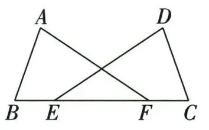

答案与解析

解析

原点序为 $B-E-F-C$。由 $BE=CF$，两边同加 $EF$，得 $BF=CE$。

在 $\triangle ABF$ 和 $\triangle DCE$ 中，$AB=DC$、$AF=DE$、$BF=CE$，所以由 SSS 得两三角形全等。

本题结论

$\triangle ABF\cong\triangle DCE$。

</article>

<article class="handbook-example" aria-labelledby="example-5">

#### 例题 05 SAS：对应边与夹角 知识清单书写示例 {#example-5 .example-heading}

题目

如图, 点 A、F、C、D 在一条直线上, $AB \parallel DE$ , AB = DE, AF = DC, 求证 $BC \parallel EF$ .

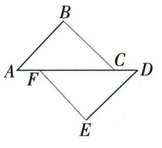

答案与解析

解析

$AF=DC$，两边同加 $FC$，得 $AC=DF$。由 $AB\parallel DE$，以 $AD$ 为截线，得 $\angle BAC=\angle EDF$。

$AB=DE$、夹角 $\angle BAC=\angle EDF$、$AC=DF$，所以 $\triangle ABC\cong\triangle DEF$（SAS）。于是 $\angle ACB=\angle DFE$，这对内错角相等，故 $BC\parallel EF$。不能提前使用待证的平行关系来证明全等。

本题结论

$BC\parallel EF$。

</article>

<article class="handbook-example" aria-labelledby="example-6">

#### 例题 06 ASA：两端角夹住的边 知识清单书写示例 {#example-6 .example-heading}

题目

如图, 已知 D 是 AC 上一点, $AB = DA$ , $DE \parallel AB$ , $\angle B = \angle DAE$ , 求证 BC = AE.

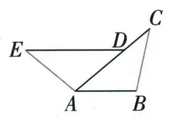

答案与解析

解析

$D$ 在 $AC$ 上，$DE\parallel AB$，故 $\angle CAB=\angle ADE$。

在 $\triangle ABC$ 和 $\triangle DAE$ 中，$\angle CAB=\angle ADE$、$AB=DA$、$\angle B=\angle DAE$。给定边分别夹在两给定角之间，所以由 ASA 全等，得对应边 $BC=AE$。

本题结论

$BC=AE$。

</article>

<article class="handbook-example" aria-labelledby="example-7">

#### 例题 07 AAS：给定边不是夹边 知识清单书写示例 {#example-7 .example-heading}

题目

如图,已知 DF=CE, $\angle DAE=\angle CBF$ , $\angle D=\angle C$ , 求证 $\triangle AED\cong\triangle BFC$ .

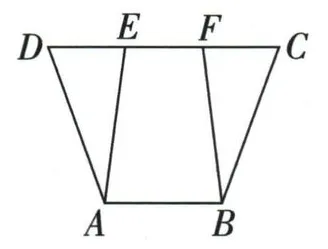

答案与解析

解析

原点序为 $D-E-F-C$。$DF=CE$，同减公共段 $EF$，得 $DE=CF$。

在 $\triangle AED$ 和 $\triangle BFC$ 中，$\angle DAE=\angle CBF$、$\angle D=\angle C$、$DE=CF$。$DE$、$CF$ 是第一对角的对边，而不是两给定角的夹边，因此用 AAS。

本题结论

$\triangle AED\cong\triangle BFC$。

</article>

<article class="handbook-example" aria-labelledby="example-8">

#### 例题 08 HL：先核两个直角 知识清单书写示例 {#example-8 .example-heading}

题目

如图,在 $\triangle ABC$ 中, $AB=CB,\angle ABC=90^{\circ},F$ 为AB延长线上一点,点E在BC上,且AE=CF.求证 $\triangle ABE\cong\triangle CBF$ .

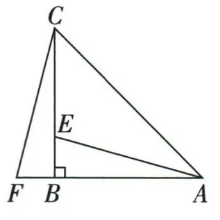

答案与解析

解析

$F$ 在 $AB$ 经过 $B$ 的延长线上，所以 $\angle CBF=180^\circ-\angle ABC=90^\circ$；$E$ 在 $BC$ 上，$\angle ABE$ 也为直角。

在直角三角形 $ABE$、$CBF$ 中，斜边 $AE=CF$，一条直角边 $AB=CB$，由 HL 全等。先确认两个直角，才有使用 HL 的前提。

本题结论

$\mathrm{Rt}\triangle ABE\cong\mathrm{Rt}\triangle CBF$。

</article>

<article class="handbook-example" aria-labelledby="example-9">

#### 例题 09 添加一个足够的条件 2024 山东德州 {#example-9 .example-heading}

题目

（2024 山东德州）如图，C 是 AB 的中点，CD = BE，请添加一个条件：\_\_\_\_，使 $\triangle ACD \cong \triangle CBE$ .

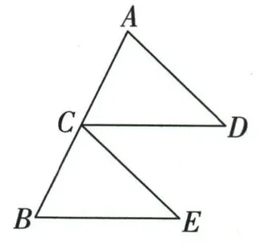

答案与解析

解析

$C$ 是 $AB$ 中点，故 $AC=CB$；还已知 $CD=BE$。对应顺序应为 $A\leftrightarrow C$、$C\leftrightarrow B$、$D\leftrightarrow E$。

可添加 $AD=CE$，凑齐三边，用 SSS。也可添加两已知边之间的夹角相等，即 $\angle ACD=\angle CBE$，用 SAS。任意添加一个非夹角，并不保证足够。

本题结论

可填 $AD=CE$；答案不唯一。

</article>

#### 网格中的垂线 {#grid-perpendicular}

正方形网格可以提供等长的水平、竖直边。下图红线连接的两个格点之间，横向相差3格、纵向相差1格；从两线相交的格点出发，灰线向右1格、向下3格。

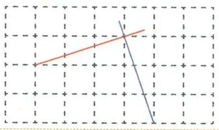

分别补出水平、竖直的直角边，两小直角三角形的两条直角边分别为3格、1格，由 SAS 全等。设红线与水平线的锐夹角为 $\alpha$，对应角相等使灰线与竖直线的锐夹角也是 $\alpha$。灰线与水平线的另一锐角便为 $90^\circ-\alpha$，与红线的夹角是

$$\alpha+(90^\circ-\alpha)=90^\circ.$$

因此两线垂直。这里用的是正方形网格；若横纵格距不同，只交换格数，不一定保持实际边长。

### 3. 共顶点的角相减，建立新的全等 {#shared-vertex .exam-title}

两组等边绕同一顶点展开时，常先从两个相等的大角中减去公共小角，得到另一对夹角。随后使用 SAS。若还要研究更小的图形，应逐层提取上一组全等给出的边角，不能直接跳到最后的对应关系。

<article class="handbook-example" aria-labelledby="example-10">

#### 例题 10 两个整体角的公共部分 知识清单例题 {#example-10 .example-heading}

题目

如图, $AB = AC$ , $AD = AE$ , $\angle BAC = \angle DAE$ . 求证: $\triangle ABD \cong \triangle ACE$ .

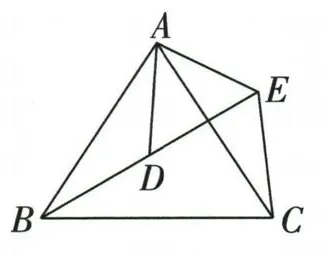

答案与解析

解析

原射线按 $AB,AD,AC,AE$ 排列。

$$\angle BAC=\angle BAD+\angle DAC,\qquad
\angle DAE=\angle DAC+\angle CAE.$$

两大角相等，同减 $\angle DAC$，得 $\angle BAD=\angle CAE$。

再用 $AB=AC$、$AD=AE$，两边及夹角对应相等，故 $\triangle ABD\cong\triangle ACE$（SAS）。两组等腰边本身还不够，相等的旋转角是夹角相等的来源。

本题结论

$\triangle ABD\cong\triangle ACE$。

</article>

<article class="handbook-example" aria-labelledby="example-11">

#### 例题 11 一组全等怎样带出另一组 知识清单例题 {#example-11 .example-heading}

题目

如图, 已知 Rt△ABC≌Rt△ADE, ∠ABC = ∠ADE = 90°, 连接 CD、EB.

(1) 图中还有几对全等三角形？请你一一列举.  
(2) 求证: CF = EF.

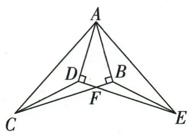

答案与解析

解析

第一种路线：先 SAS，再 AAS。

原全等给 $AC=AE$、$AB=AD$、$\angle CAB=\angle EAD$。同减 $\angle DAB$ 得 $\angle CAD=\angle EAB$，所以

$$\triangle ACD\cong\triangle AEB\quad(\mathrm{SAS}).$$

由此 $CD=EB$、$\angle ADC=\angle ABE$。两大角分别减去原已知的直角，得 $\angle CDF=\angle EBF$。再配对顶角 $\angle DFC=\angle BFE$，用 AAS 得

$$\triangle CDF\cong\triangle EBF,\qquad CF=EF.$$

第二种路线：连接公共斜边。

连接 $AF$。直角三角形 $ABF$、$ADF$ 有公共斜边 $AF$，且 $AB=AD$，由 HL 全等，得 $BF=DF$。原 $BC=DE$，且 $B-F-C$、$D-F-E$ 按序，故

$$CF=BC-BF=DE-DF=EF.$$

第二种方法添加了 $AF$，不把新加线后的三角形算进第（1）问原图的统计。

本题结论

（1）原图另外两对为 $\triangle ADC\cong\triangle ABE$、$\triangle CDF\cong\triangle EBF$。 （2）$CF=EF$。

</article>

### 4. 同一直线上的垂足：先全等，后读点序 {#line-model .exam-title}

同一条直线上出现两个垂足，又有一个直角顶角时，可以用“同角的余角相等”补角。但还必须有对应边相等，才能由 AAS 证明全等。得到对应线段后，重新按每幅图的共线点顺序写和、差。

<article class="handbook-example" aria-labelledby="example-12">

#### 例题 12 转动直线后的三种位置 知识清单例题·改编明确转线位置 {#example-12 .example-heading}

题目

如图1, 在 $\triangle ABC$ 中, $\angle BAC=90^{\circ}$ , $AB=AC$ , $AE$ 是过点 $A$ 的一条直线, 且 $B$ 、 $C$ 在 $AE$ 的异侧, $BD\perp AE$ 于 $D$ , $CE\perp AE$ 于 $E$ .

(1) 求证: $BD = DE + CE$ .   
(2) 若直线 AE 绕 A 点旋转到如图 2 所示的位置 ($BD<CE$)，保留直角、$AB=AC$ 及两垂线条件，点的位置以本问图示为准，$B,C$ 此时在 $AE$ 同侧，则 BD 与 DE, CE 满足什么数量关系？并证明.  
(3) 若直线 AE 绕 A 点旋转到如图 3 所示的位置 ($BD>CE$)，保留直角、$AB=AC$ 及两垂线条件，点的位置以本问图示为准，$B,C$ 此时在 $AE$ 同侧，则 BD 与 DE，CE 满足什么数量关系？请直接写出结果，不需证明.

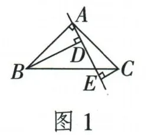

  
图 1

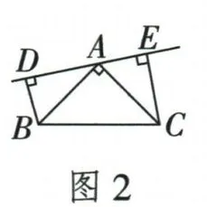

  
图 2

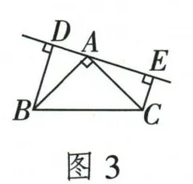

  
图3

答案与解析

解析

三图中的垂直给 $\angle ADB=\angle AEC=90^\circ$；由原 $\angle BAC=90^\circ$，结合相应角的余角关系，得 $\angle ABD=\angle CAE$。再有 $AB=CA$，所以三幅非退化图中均有

$$\triangle ABD\cong\triangle CAE\quad(\mathrm{AAS}),\qquad BD=AE,\quad AD=CE.$$

- 图1按 $A-D-E$ 排列，$AE=AD+DE$，所以 $BD=CE+DE$。
- 图2按 $D-A-E$ 排列，$AE=DE-AD$，所以 $BD=DE-CE$。
- 图3仍按 $D-A-E$ 排列，所以同样 $BD=DE-CE$。

图2的 $BD<CE$ 与图3的 $BD>CE$，只改变两条长度的大小比较，不改变上述点序。不能据这两个不等式自行把差式改成和式。

本题结论

（1）$BD=DE+CE$；（2）$BD=DE-CE$；（3）$BD=DE-CE$。

</article>

### 5. 倍长中线，把两条原边接进同一三角形 {#double-median .exam-title}

中点已经提供一对等长线段。把经过中点的线段延长同样长度，再用对顶角，可形成“边、角、边”。这样能把原来分散的长度搬到同一三角形中，再用三边关系。

<article class="handbook-example" aria-labelledby="example-13">

#### 例题 13 中线长度的范围 知识清单例题 {#example-13 .example-heading}

题目

如图, 在 $\triangle ABC$ 中, $AB = 12$ , $AC = 8$ , $AD$ 是 $BC$ 边上的中线, 求 $AD$ 的取值范围.

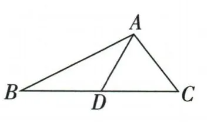

答案与解析

解析

延长 $AD$ 到 $H$，使 $DH=AD$，连接 $BH$。

$BD=CD$、$DH=DA$、$\angle BDH=\angle CDA$（对顶角），所以 $\triangle BDH\cong\triangle CDA$（SAS），得到 $BH=CA=8$。

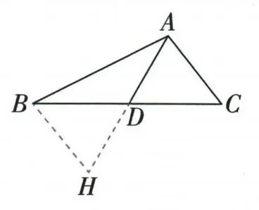

在 $\triangle ABH$ 中，$AB=12$、$BH=8$，且 $AH=2AD$，因此

$$12-8<2AD<12+8,$$

即 $2<AD<10$。反过来，任意满足 $4<AH<20$ 的长度都能与 $12,8$ 构成非退化三角形；以 $AH$ 中点作对应构造，能恢复原三角形，所以这是完整范围，不只是必要限制。

两端等号都会使图形退化，不能把 $2$、$10$ 当成可取得的最小值、最大值。

本题结论

$2<AD<10$。

</article>

### 6. 截长补短，把和式转成对应边相等 {#cut-extend .exam-title}

证明一条线段等于另外两条之和，可以在长段上截出一段，证明余段等于另一段；也可以延长一条短段，证明延长后的整段等于目标长段。圆规保证截出的长度，点序保证相加，剩下的等量要用全等证明。

“长段”不能只凭图上看起来较长。若截点必须在线段内部，先证明这个位置可实现，不能拿待证和式来反过来保证作图。

<article class="handbook-example" aria-labelledby="example-14">

#### 例题 14 同一线段和的两种证明 知识清单例题 {#example-14 .example-heading}

题目

如图, $AC \parallel BD$ , $AE$ 、 $BE$ 分别平分 $\angle CAB$ 和 $\angle DBA$ , $CD$ 过点 $E$ . 求证: $AB = AC + BD$ .

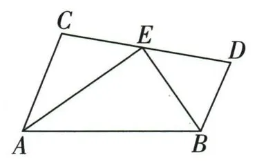

答案与解析

解析

先说明截点的位置。 由 $AC\parallel BD$，$\angle CAB+\angle DBA=180^\circ$；两角分别被平分，故 $\angle AEB=90^\circ$。又 $C,E,D$ 共线，得 $\angle CEA+\angle BED=90^\circ$，所以 $\angle CEA<90^\circ$。

在射线 $AB$ 上取 $AF=AC$。$AE$ 公共，$\angle CAE=\angle EAF$，由 SAS 得 $\triangle ACE\cong\triangle AFE$。于是 $\angle AEF=\angle CEA<\angle AEB$，故 $EF$ 落在直角 $AEB$ 内部，与射线 $AB$ 相交的 $F$ 在 $A,B$ 之间。这独立保证了 $AC<AB$。

证法一：截长。

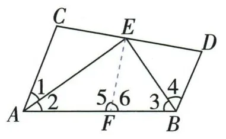

第一组全等给 $\angle AFE=\angle ACE$。$AC\parallel BD$，故 $\angle ACE+\angle BDE=180^\circ$；又 $A,F,B$ 共线，$\angle AFE+\angle EFB=180^\circ$，所以 $\angle EFB=\angle BDE$。

再有 $\angle EBF=\angle EBD$、$BE$ 公共，由 AAS 得 $\triangle EFB\cong\triangle EDB$，故 $FB=BD$。因此

$$AB=AF+FB=AC+BD.$$

证法二：补短。 延长 $AC$ 到 $G$，使 $AG=AB$，连接 $EG$。

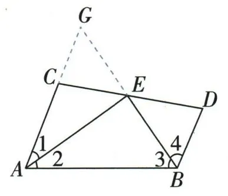

由 $AG=AB$、$AE$ 公共及 A 处半角相等，得 $\triangle AEG\cong\triangle AEB$（SAS），故 $EG=EB$、$\angle AGE=\angle ABE=\angle EBD$。

$AC\parallel BD$ 给 $\angle GCE=\angle BDE$。于是 $\triangle CEG\cong\triangle DEB$（AAS），得 $CG=DB$。所以

$$AB=AG=AC+CG=AC+BD.$$

两种方法都经历两次全等；只证明第一组，还不足以得到目标和式。

本题结论

$AB=AC+BD$。

</article>

### 7. 延长垂线段，先形成两段相等 {#extend-perpendicular .exam-title}

角平分线与某条线段垂直时，可把垂线段延到角的另一边所在直线。两直角、两个半角与公共边常能组成 ASA，得到垂线段两侧相等。如果目标还涉及别的线段，须再建立第二组对应关系。

<article class="handbook-example" aria-labelledby="example-15">

#### 例题 15 倍长关系中的两次全等 知识清单例题 {#example-15 .example-heading}

题目

如图, 在 $\triangle AOB$ 中, $OA = OB$ , $\angle AOB = 90^{\circ}$ , $BD$ 平分 $\angle ABO$ 交 $OA$ 于点 $D$ , $AE \perp BD$ 交 $BD$ 的延长线于点 $E$ . 求证: $BD = 2AE$ .

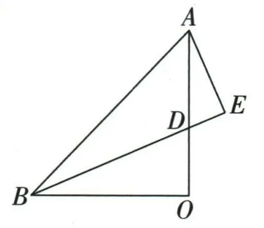

答案与解析

解析

延长 $AE$、$BO$ 交于 $F$。$\angle AEB=\angle FEB=90^\circ$，$BD$ 平分 $\angle ABO$，故 $\angle ABE=\angle FBE$；$BE$ 公共，由 ASA 得 $\triangle ABE\cong\triangle FBE$。于是 $AE=EF$，且按 $A-E-F$ 点序，$AF=2AE$。

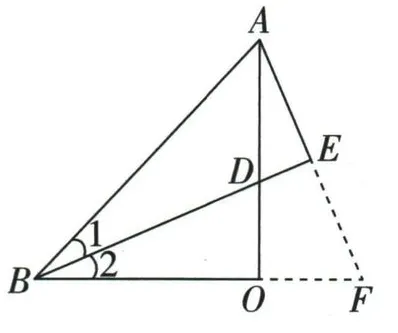

但目标是 $BD$，还需证明 $BD=AF$。

$\angle BDO=\angle ADE$ 为对顶角，$\angle OBD$、$\angle FAO$ 分别是它们的余角，所以 $\angle OBD=\angle FAO$。配 $BO=AO$ 及 $\angle BOD=\angle AOF=90^\circ$，由 ASA 得 $\triangle BDO\cong\triangle AFO$，故 $BD=AF$。

最终 $BD=AF=AE+EF=2AE$。

本题结论

$BD=2AE$。

</article>

### 8. 把目标面积拆成公共块与可替换块 {#area-transfer .exam-title}

目标四边形不易直接套面积公式时，先连合适的线把它分成两块。保留其中的公共块，用全等把另一块换到相邻位置，尝试拼成面积已知的三角形。面积相等来自全等，不是仅凭示意图的大小。

<article class="handbook-example" aria-labelledby="example-16">

#### 例题 16 全等替换一块面积 2024 广东广州 {#example-16 .example-heading}

题目

(2024 广东广州) 如图, 在 $\triangle ABC$ 中, $\angle A = 90^{\circ}$ , AB = AC = 6, D 为边 BC 的中点, 点 E, F 分别在边 AB, AC 上, AE = CF, 则四边形 AEDF 的面积为 ( )

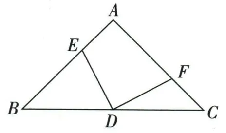

A.18

B. $9\sqrt{2}$

C.9

D. $6\sqrt{2}$

答案与解析

解析

连接 $AD$。$AB=AC$、$BD=CD$、$AD$ 公共，先用 SSS 得 $\triangle ABD\cong\triangle ACD$，所以 $AD$ 平分 A 处直角，且 $AD\perp BC$。

$\angle DAE=45^\circ$；$\triangle ADC$ 另一个锐角也为 $45^\circ$，所以 $AD=CD$。再配 $AE=CF$ 与 $\angle DAE=\angle DCF=45^\circ$，SAS 得 $\triangle DAE\cong\triangle DCF$。

因此

$$S_{AEDF}=S_{DAE}+S_{DAF}=S_{DCF}+S_{DAF}=S_{ACD}.$$

$D$ 是 $BC$ 中点，中线分成等面积两块，故

$$S_{AEDF}=\frac12S_{ABC}=\frac12\times\frac12\times6\times6=9.$$

A 是整个 $ABC$ 的面积；D 的数值是斜边长度，不是面积；B 也不符合面积计算。

本题结论

选 C，面积为 $9$。

</article>

### 9. 开放条件：选作结论的句子不能先用 {#open-conditions .exam-title}

先保留所有固定背景，再从候选条件中选出两条。没有选作已知的那条必须当作待证；若要声称任意两条都可以，应逐组检查。本例还用到等腰三角形的“等边对等角、等角对等边”，可在学过等腰三角形后回看。

<article class="handbook-example" aria-labelledby="example-17">

#### 例题 17 三个条件任选两个 知识清单例题 {#example-17 .example-heading}

题目

如图，$EG\parallel AF$。从① $AB=AC$、② $DE=DF$、③ $BE=CF$ 中选两个作已知，剩下一个作结论，构成真命题并证明，只需写一种。

原图 $E$ 在 $AB$ 上，$G,D$ 在 $BC$ 上，$F$ 在 $AC$ 的延长线上，$E,D,F$ 共线。

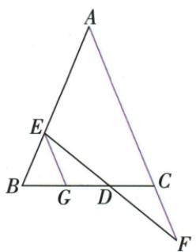

答案与解析

解析

选①②作已知，求证③。

$AB=AC$，所以 $\angle B=\angle BCA$。$EG\parallel AF$，故 $\angle BGE=\angle BCA$。于是 $\triangle BEG$ 中 $\angle B=\angle BGE$，得到 $BE=EG$。

另一方面，$\angle GED=\angle CFD$（平行线），$\angle EDG=\angle FDC$（对顶角），又 $DE=DF$，所以

$$\triangle DEG\cong\triangle DFC\quad(\mathrm{ASA}).$$

得 $EG=CF$，结合 $BE=EG$，最终 $BE=CF$。

其余选法为什么也可行？ 记 $x=BE$、$y=EG$、$z=CF$。在固定背景下，①由平行角关系及等腰性质、判定等价于 $x=y$；②由上述两角关系及 ASA/AAS 等价于 $y=z$；③就是 $x=z$。三个等量关系中，任意两条推出第三条。逆选时以 $EG=CF$ 作给定边，用 AAS，而不是仍写夹边 $DE=DF$ 已知。

本题结论

可选①②作已知，证明③；也可选①③证明②，或选②③证明①。

</article>

## 【坑点】条件与辨析 {#pitfalls .handbook-section .is-pitfall}

### 1. 共用一个点，不一定把它对应到自身 {#shared-point .pitfall-title}

顶点的物理位置与全等书写中的对应关系是两件事。先逐字配对，再计算角度，尤其要检查两个三角形共用的字母。

<article class="handbook-example is-pitfall" aria-labelledby="pitfall-1">

#### 辨析 01 两种共顶点情况 原题合组·2024 山东济南、四川成都 {#pitfall-1 .example-heading}

题目

（1）（2024山东济南）如图，已知 $\triangle ABC \cong \triangle DEC, \angle A = 60^{\circ}, \angle B = 40^{\circ}$ ，则 $\angle DCE$ 的度数为 （）

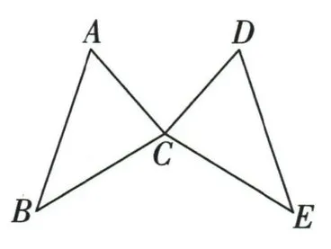

A. ${40}^{ \circ  }$

B. $60^{\circ}$

C. ${80}^{ \circ  }$

D. $100^{\circ}$

（2）（2024 四川成都）如图， $\triangle ABC \cong \triangle CDE$ ，若 $\angle D = 35^{\circ}$ ， $\angle ACB = 45^{\circ}$ ，则 $\angle DCE$ 的度数为 \_\_\_\_.

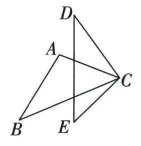

答案与解析

解析

（1）$\triangle ABC\cong\triangle DEC$ 中，$C$ 对应 $C$。先算 $\angle ACB=180^\circ-60^\circ-40^\circ=80^\circ$，故 $\angle DCE=80^\circ$，选 C。40°、60°来自其他对应顶点；100°是80°的补角，不是本问内角。

（2）$\triangle ABC\cong\triangle CDE$ 中，原 $C$ 对应新 $E$，所以 $\angle CED=45^\circ$。在 $\triangle CDE$ 内，$\angle DCE=180^\circ-35^\circ-45^\circ=100^\circ$。

本题结论

（1）C，$80^\circ$；（2）$100^\circ$。

</article>

### 2. 大角相等，不代表每一块小角都相等 {#angle-parts .pitfall-title}

从两个等角中减去同一个角，余角相等；但若没有“同一个部分”，不能把相邻小角任意配成相等。

<article class="handbook-example is-pitfall" aria-labelledby="pitfall-2">

#### 辨析 02 核对四个边角结论 知识清单例题 {#pitfall-2 .example-heading}

题目

如图所示, $\triangle ABC\cong\triangle AEF$ ,
AB=AE, $\angle B=\angle E$ ,下列结论正确
的是\_\_\_\_.(填序号)

①AC = AF;   
② $\angle FAB = \angle EAB;$   
③EF=BC;   
④ $\angle EAB = \angle FAC.$

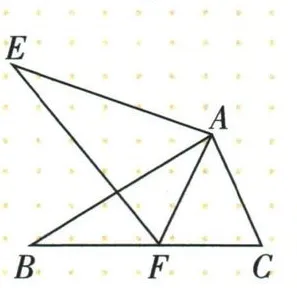

答案与解析

解析

按 $A\leftrightarrow A$、$B\leftrightarrow E$、$C\leftrightarrow F$，对应边给 $AC=AF$、$BC=EF$，所以①③正确。

$\angle BAC=\angle EAF$，原图两大角都含 $\angle BAF$，同减得到 $\angle FAC=\angle EAB$，所以④正确。

②将公共小角 $\angle FAB$ 与另一个小角 $\angle EAB$ 直接判等，没有题设依据。

本题结论

正确的是①③④。

</article>

### 3. 三个元素相等，不一定组成合法判据 {#ssa-aaa .pitfall-title}

SAS 的“夹”不能漏，AAA 缺少确定大小的边。HL 是两个直角三角形的专门判据，不代表一般的 SSA 也成立。

<article class="handbook-example is-pitfall" aria-labelledby="pitfall-3">

#### 辨析 03 两组图能否保证全等 知识清单辨析·设问整合 {#pitfall-3 .example-heading}

题目

判断下列说法，并根据所给图形说明理由。

（1）两边和其中一边的对角分别相等，两个三角形一定全等。图中 $AP$ 公共、$BP=CP$、A 处角相同。

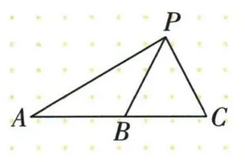

（2）三个角分别相等，两个三角形一定全等。图中对应角相等。

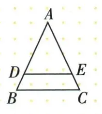

答案与解析

解析

（1）不正确。给定角不是两给定边的夹角。以 $P$ 为圆心、$PB$ 为半径的圆，可以在同一射线上交于不同点 $B,C$；两组三项条件都满足，第三边却不同。

（2）不正确。图中一个三角形是另一个的缩放，角度相同，尺寸不同。只有角相等不能保证完全重合。

本题结论

（1）（2）均不能保证全等。

</article>

### 4. 一线三等角，还缺不缺长度条件 {#three-angle-boundary .pitfall-title}

看到相似的图形结构，应先列真实条件，再找判据。模型名称不是定理，也不能补上题目没有给出的等边。

<article class="handbook-example is-pitfall" aria-labelledby="pitfall-4">

#### 辨析 04 相等的三个角是否足够 依据知识清单模型改编·条件辨析 {#pitfall-4 .example-heading}

题目

下面同侧、异侧示意图中，一条直线上有三个相等的角。仅凭这些角关系，能否断言相应的两个三角形全等？若要判全等，还需要怎样的条件？

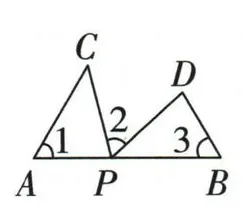

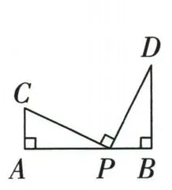

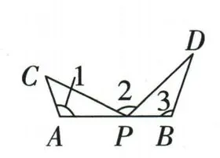

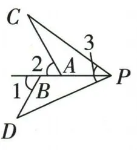

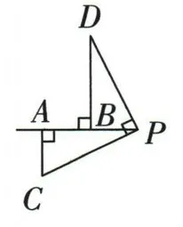

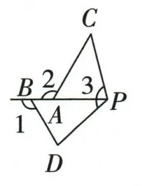

答案与解析

解析

不能。以第一图为例，设三个标出的等角为 $\theta$，$\angle CPA=\varphi$、$\angle DPB=\psi$。由 $A,P,B$ 共线，

$$\varphi+\theta+\psi=180^\circ.$$

于是 $\triangle APC$ 的 C 角为 $\psi$，$\triangle BDP$ 的 D 角为 $\varphi$，只能得到两三角形对应角相等，尚未限定大小。

若另外给出 $CP=DP$ 等一对相应边相等，才可结合角关系用 AAS 判全等。这是额外条件，不是从三个角相等中推出来的。前面的转线例题有 $AB=AC$，所以它的 AAS 证明是充分的。

本题结论

角关系本身不足；还需实际给出或证明一对位置对应的边相等。

</article>

