尺规作图不是把图画得“看起来准确”，而是用允许的工具保证每个条件。圆规留下的等半径弧、直线的交点和所选方向，都是证明图形符合要求的依据。

<nav class="handbook-nav" aria-label="本章分区">
  <a class="handbook-jump is-knowledge" href="#knowledge">01 · 知识点概念、关系与适用条件</a>
  <a class="handbook-jump is-exam" href="#exam">02 · 考点题目分类和例题</a>
  <a class="handbook-jump is-pitfall" href="#pitfalls">03 · 坑点辨析错因，检查遗漏</a>
</nav>

## 【知识点】工具与依据 {#knowledge .handbook-section .is-knowledge}

### 1. 尺规作图 {#tools .knowledge-title}

==尺规作图==使用无刻度直尺和圆规：直尺画直线，圆规画圆或弧、复制长度，保留作图痕迹

### 2. 复制线段与作线段的和差 {#length-copy .knowledge-title}

作射线 $OA$，以 $O$ 为圆心、已知长度 $a$ 为半径画弧，交射线于 $B$，就得到 $OB=a$

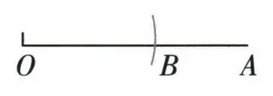

- 作 $a+b$：沿同一方向连续截取 $a$ 和 $b$
- 作 $a-b$：先截取 $a$，再从末端向回截取 $b$（$a>b>0$）

### 3. 复制角 {#angle-copy .knowledge-title}

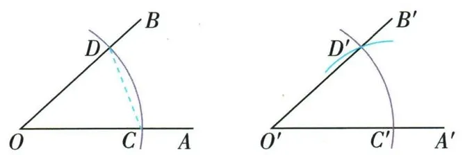

1. 在原角两边上用相同半径截得 $C,D$
2. 在新顶点用同一半径画弧，截得 $C'$
3. 用圆规量取 $CD$，以 $C'$ 为圆心在新弧上截得 $D'$
4. 连接新顶点与 $D'$，得到相等的角

### 4. 作角平分线 {#angle-bisector .knowledge-title}

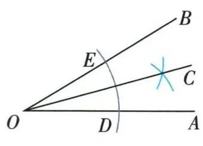

1. 以顶点为圆心画弧，交两边于 $D,E$
2. 以 $D,E$ 为圆心，取相同且大于 $\frac12DE$ 的半径画弧，交于角内一点 $C$
3. 作射线 $OC$，就是角平分线

### 5. 作垂直平分线 {#perpendicular-bisector .knowledge-title}

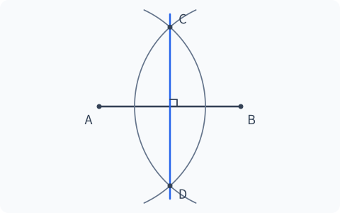

分别以线段两端为圆心，取相同且大于线段一半的半径作弧，连接两侧交点，得到垂直平分线

### 6. 过一点作已知直线的垂线 {#perpendicular .knowledge-title}

- 点在线上：以该点为圆心，截出两侧等距点，再作这两点连线的中垂线
- 点在线外：以该点为圆心，取足够大的半径，与直线交于两点，再作这两点连线的中垂线

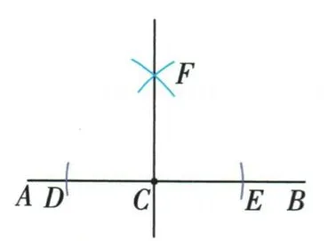

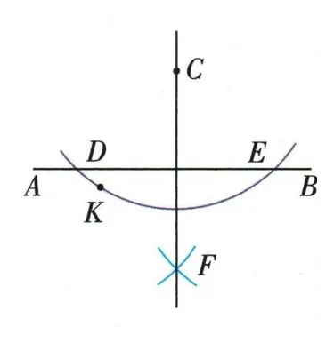

## 【考点】方法与例题 {#exam .handbook-section .is-exam}

### 1. 作平行线：复制一对同位角 {#parallel-construction .exam-title}

取经过已知点的截线，复制原直线与截线所成的角。关键不只是“角相等”，还要检查所选射线方向，保证它们确为同位角或内错角。

<article class="handbook-example" aria-labelledby="example-1">

#### 例题 01 过线外一点作平行线 知识清单例题·明确弧交点方向 {#example-1 .example-heading}

题目

如图,已知直线 l 与直线 l 外一点 P,请过点 P 作直线 l 的平行线.(尺规作图,保留作图痕迹)

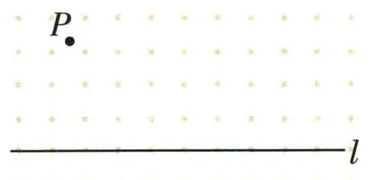

答案与解析

解析

在 $l$ 上取 $A$，作射线 $AP$。以 $A$ 为圆心，取小于 $AP$ 的正半径 $r$ 作弧，交 $AP$ 于 $M$、交 $l$ 于 $N$。

以 $P$ 为圆心、同一半径作弧，取射线 $AP$ 越过 $P$ 后的交点 $K$。以 $K$ 为圆心、$MN$ 为半径作弧，交上一弧于 $Q$，选取与原 $N$ 相应的同侧方向。作直线 $PQ$。

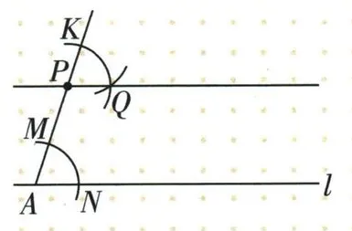

$PK=AM$、$PQ=AN$、$KQ=MN$，由 SSS 得 $\triangle PKQ\cong\triangle AMN$，所以 $\angle KPQ=\angle MAN$。两角为同位角，因此 $PQ\parallel l$。

$K$ 取在 $P$ 的前方，而不是朝回 $A$ 的方向；若改变交点分支，原来的同位角理由不能原样照用。

本题结论

直线 $PQ$ 为所求平行线。

</article>

### 2. 根据给定元素，决定第三顶点 {#triangle-construction .exam-title}

先画草图分析所需条件，再按条件作图。SAS 先复制夹角、截两边；SSS 先固定基边，再从两端作定半径弧；ASA 在基边同侧复制两端角，使射线相交。最后用相应判据说明结果为何符合要求。

<article class="handbook-example" aria-labelledby="example-2">

#### 例题 02 给两边及夹角作三角形 知识清单例题 {#example-2 .example-heading}

题目

如图所示,已知线段 a 和 $\angle\alpha$ , 求作一个 $\triangle ABC$ , 使 BC=a, AC=2a, $\angle BCA=\angle\alpha$ . (尺规作图,保留作图痕迹)

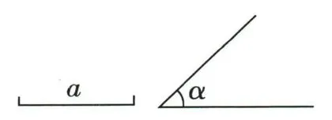

答案与解析

解析

先按复制角的方法作 $\angle MCN=\angle\alpha$。在射线 $CM$ 上保持圆规开口 $a$，连续截取两次，得 $CA=2a$；在射线 $CN$ 上截取 $CB=a$。连接 $AB$。

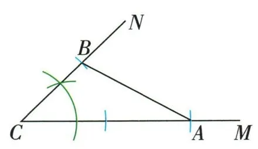

圆规保证两条边，复制角保证它们的夹角，因此所得三角形满足 $BC=a$、$AC=2a$、$\angle BCA=\angle\alpha$。给定角非零且非平角，图形不退化；两个给定边和夹角也按 SAS 确定形状大小。

本题结论

所作 $\triangle ABC$ 符合要求。

</article>

<article class="handbook-example" aria-labelledby="example-3">

#### 例题 03 复制同一个三角形的三种方法 知识清单例题 {#example-3 .example-heading}

题目

如图,已知 $\triangle ABC$ ,求作 $\triangle A^{\prime}B^{\prime}C^{\prime}$ ,使 $\triangle A^{\prime}B^{\prime}C^{\prime}\cong\triangle ABC$ . (尺规作图,保留作图痕迹)

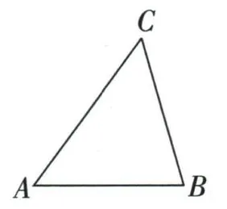

答案与解析

解析

三种方法都先作 $A'B'=AB$。

SAS 法。 在 $A'$ 复制原角 $A$，得到射线 $A'M$；沿它截取 $A'C'=AC$，连接 $B'C'$。两边与夹角对应相等。

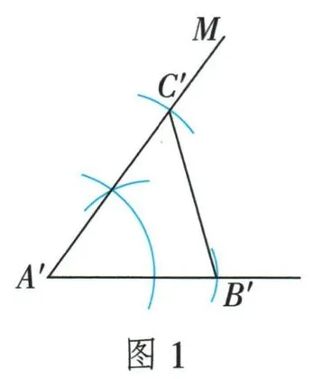

SSS 法。 以 $A'$ 为圆心、$AC$ 为半径作弧；以 $B'$ 为圆心、$BC$ 为半径作弧，两弧交于 $C'$，连接两边。三个长度都由圆规保证。基边另一侧的交点给出镜像图，也同样全等。

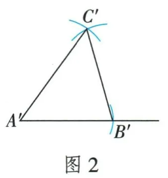

ASA 法。 在基边同侧，分别于 $A'$、$B'$ 复制原角 $A,B$，两射线交于 $C'$。夹边和两角对应相等。选同侧是为了让所作射线按原三角形关系相交，不能拿不相应的延长线交点代替。

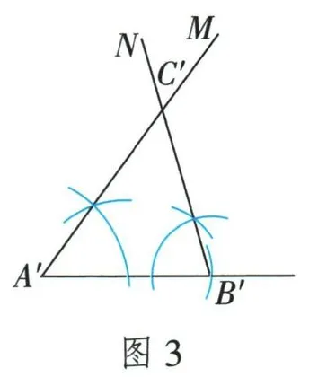

本题结论

三种作法均得到 $\triangle A'B'C'\cong\triangle ABC$。

</article>

### 3. 把等距要求转成轨迹的交点 {#locus-construction .exam-title}

| 位置要求 | 应作的线 |
| --- | --- |
| 到两个固定点等距 | 两点连线段的垂直平分线 |
| 在一个角内，到两边等距 | 该角的内部平分线 |
| 到两条完整相交直线等距 | 两条夹角平分直线，不能只取一支 |
| 到三个不共线点等距 | 两边中垂线的交点 |

同时满足两组要求，就取两类轨迹的交点，并逐点回验。特殊位置可能没有交点、交点重合或出现重合直线，数量不能脱离原图直接记成常数。

<article class="handbook-example" aria-labelledby="example-4">

#### 例题 04 确定全部符合要求的位置 知识清单例题 {#example-4 .example-heading}

题目

两个城镇 A, B 与两条公路 $l_{1}$ 、 $l_{2}$ 的位置如图所示, 电信部门需在 C 处修建一座信号发射塔, 要求发射塔到两个城镇 A、B 的距离必须相等, 到两条公路 $l_{1}$ 、 $l_{2}$ 的距离也必须相等, 那么点 C 应选在何处? 请在图中找出所有符合条件的点 C. (尺规作图, 不写作法, 保留作图痕迹)

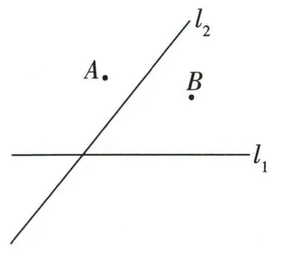

答案与解析

解析

先作 $AB$ 的垂直平分线，线上每一点到两城镇的距离相等。

再作两条公路夹角的两条平分直线，包括内、外两种方向。原图中它们与中垂线分别交于 $C_1,C_2$。

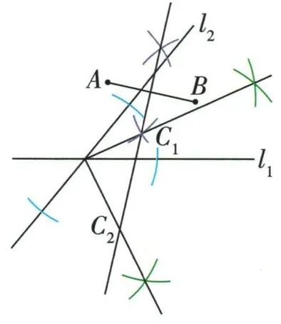

$C_1,C_2$ 都在 $AB$ 的中垂线上，所以到两城镇等距；各自又在公路夹角的平分线上，所以到两条公路的垂直距离相等。两组条件都满足，两个点都应保留。

这里按公路所在整直线建模；不能把到道路的距离误作到道路交点的距离。

本题结论

原图中所有合格位置为 $C_1,C_2$。

</article>

<article class="handbook-example" aria-labelledby="example-5">

#### 例题 05 经过三点作圆 知识清单例题 {#example-5 .example-heading}

题目

如图,已知 $\triangle ABC$ , 请作一个圆,使 A、B、C 三点都在该圆上. (尺规作图,不写作法,保留作图痕迹)

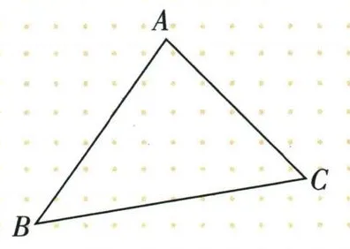

答案与解析

解析

分别作 $AB$、$BC$ 的垂直平分线，交于 $O$。以 $O$ 为圆心、$OA$ 为半径画圆。

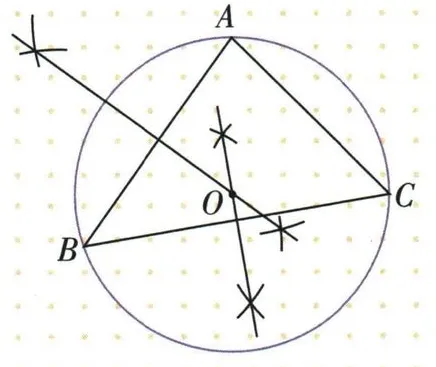

$O$ 在第一条中垂线上，故 $OA=OB$；在第二条中垂线上，故 $OB=OC$。所以 $OA=OB=OC$，三个点都在所作圆上。

原题给非退化三角形，三点不共线，两条中垂线有唯一交点，半径随之确定。不是任意画一个把三角形包住的圆，而是三个顶点恰好都在圆周上。

本题结论

以 $O$ 为圆心、$OA$ 为半径的圆为所求。

</article>

### 4. 先作垂线，再用圆规截取相等边 {#right-isosceles .exam-title}

题目若没有指定直角顶点，可选择便于作图的位置。先保证垂直和点在线上的要求，再截取两条相等直角边。辅助作图点不一定是最终三角形的顶点。

<article class="handbook-example" aria-labelledby="example-6">

#### 例题 06 在线上安排两个顶点 2024 陕西 {#example-6 .example-heading}

题目

（2024陕西）如图，已知直线 $l$ 和 $l$ 外一点 $A$ . 请用尺规作图法，求作一个等腰直角 $\triangle ABC$ ，使得顶点 $B$ 和顶点 $C$ 都在直线 $l$ 上。（作出符合题意的一个等腰直角三角形即可，保留作图痕迹，不写作法）

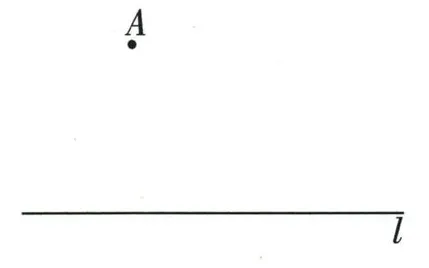

答案与解析

解析

过 $A$ 作 $l$ 的垂线，垂足为 $C$。以 $C$ 为圆心、$CA$ 为半径作弧，与 $l$ 交于 $B$，任选一侧即可；连接 $AB$。

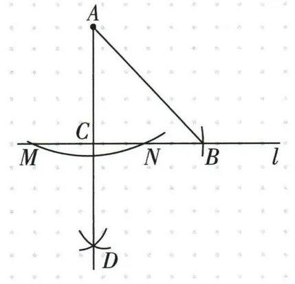

$AC\perp CB$，所以 $\angle ACB=90^\circ$；$CB=CA$ 由同一圆的半径保证。于是 $ABC$ 是等腰直角三角形，且 $B,C$ 都在 $l$ 上。

题目没有要求直角必须在 $A$。原图的 $M,N,D$ 用来确定垂线，是辅助点，不把线外的 $D$ 当成要求在线上的顶点。

本题结论

$\triangle ABC$ 符合要求，直角顶点为 $C$。

</article>

## 【坑点】痕迹与条件 {#pitfalls .handbook-section .is-pitfall}

### 1. 看懂痕迹，而不是只认一种常见画法 {#trace-reading .pitfall-title}

先把每一组同圆或同半径弧翻译成具体等长线段，再判断能否组成 SSS、SAS、ASA 或 HL。不同的作法可能得到同一个对象；不能因为图形不像熟悉的模板就否认它。

<article class="handbook-example is-pitfall" aria-labelledby="pitfall-1">

#### 辨析 01 四组尺规作图痕迹 2024 山东烟台 {#pitfall-1 .example-heading}

题目

某班开展“用直尺和圆规作角平分线”的探究活动，各组展示的作图痕迹如下。射线 $OP$ 为 $\angle AOB$ 的平分线的有多少个？

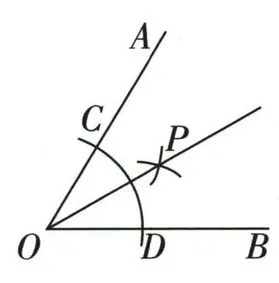

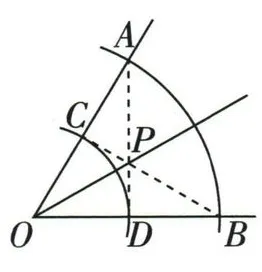

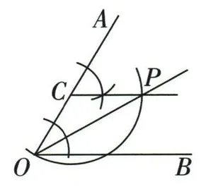

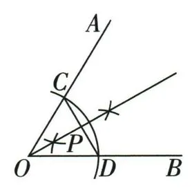

A. 1个

B. 2个

C. 3个

D. 4个

答案与解析

解析

图1：SSS。 同圆给 $OC=OD$，两等半径弧给 $CP=DP$，$OP$ 公共，故 $\triangle OCP\cong\triangle ODP$。

图2：先后使用三次全等。 同圆给 $OA=OB$、$OC=OD$，O 处夹角公共，SAS 得 $\triangle OAD\cong\triangle OBC$，得到两对对应角。又 $AC=OA-OC=OB-OD=BD$，两端角由共线及邻补关系对应相等，ASA 得 $\triangle ACP\cong\triangle BDP$，故 $CP=DP$。最后配 $OC=OD$ 与 $OP$ 公共，用 SSS 得两个半角相等。

图3：平行与等腰。 复制角使 $CP\parallel OB$，以 $C$ 为圆心的弧给 $CO=CP$。等腰三角形底角相等，得 $\angle COP=\angle CPO$；平行线内错角给 $\angle CPO=\angle BOP$，所以两半角相等。

图4：HL。 痕迹给 $OC=OD$，且 $OP\perp CD$，$P$ 在 $CD$ 上。两小直角三角形有相等斜边、公共直角边 $OP$，由 HL 全等，所以两半角相等。

四种都有效。A、B、C 都漏计了合法作法。

本题结论

选 D，共4个。

</article>

### 2. 中垂线的交点，不是重心 {#centroid-construction .pitfall-title}

作三角形重心，必须先用中垂线取得两边中点，再连接顶点与对边中点，取两条中线的交点。两条中垂线直接相交得到的是等距于三个顶点的点，属于另一个几何中心。

前一页三角形的重心作图已经保留了完整例题与作图痕迹。这里检查的关键是：中垂线只是取中点的工具，中线才是定位重心的线。

### 3. 检查方向、半径和交点存在性 {#construction-check .pitfall-title}

- 作角平分线，最后应作射线，不能只写“连接两点”就当作完整射线。
- 两圆心作弧时，两次半径须相同；“都大于半边”不代表它们相等。
- 线外点作垂线，第一圆弧须与直线有两个不同交点。
- 用两弧交点定直线，两个点不能重合。
- 同一射线或同一圆可能产生多个交点，要按原角区域、同侧要求和截取方向选择。

“保留作图痕迹”不只是格式要求；缺少这些关系，图形再像，也不能证明作法正确。
