包装盒怎样展开，平面图形绕轴后形成什么，切开的截面又是什么形状？辨认这些图形，要把纸上的示意图与它所表示的空间对象分开。

<nav class="handbook-nav" aria-label="本章分区">
  <a class="handbook-jump is-knowledge" href="#knowledge">01 · 知识点概念、关系与适用条件</a>
  <a class="handbook-jump is-exam" href="#exam">02 · 考点题目分类和例题</a>
  <a class="handbook-jump is-pitfall" href="#pitfalls">03 · 坑点辨析错因，检查遗漏</a>
</nav>

## 【知识点】概念与依据 {#knowledge .handbook-section .is-knowledge}

### 1. 点、线、面、体 {#elements .knowledge-title}

| 对象 | 表示什么 | 生活中的对应 |
| --- | --- | --- |
| 点 | 位置，没有大小 | 地图上标出的城市位置 |
| 线 | 延伸，有直线和曲线 | 拉紧的细线、弯曲的绳子 |
| 面 | 表面，没有厚度 | 桌面、球的表面 |
| 体 | 占据空间 | 盒子、球 |

### 2. 平面图形与立体图形 {#classification .knowledge-title}

三角形、长方形、圆是平面图形；正方体、圆柱、圆锥等是立体图形

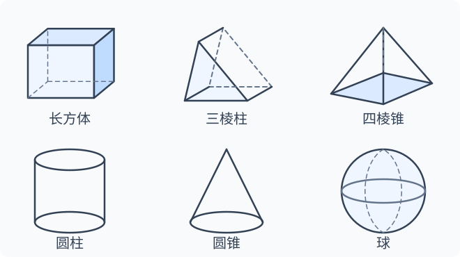

- 柱体有两个平行、全等的底面
- 锥体有一个底面，侧面汇聚到一个顶点
- 球由曲面围成
- 用平行于底面的平面截去锥体顶部，可得到圆台或棱台

### 3. 顶点、棱和面 {#count-structure .knowledge-title}

面与面相交形成棱，棱与棱相交形成顶点。“几棱柱”的“几”指底面的边数

| 底面为 n 边形 | 顶点数 | 棱数 | 面数 |
| --- | --- | --- | --- |
| $n$ 棱柱 | $2n$ | $3n$ | $n+2$ |
| $n$ 棱锥 | $n+1$ | $2n$ | $n+1$ |

例如三棱柱有 $6$ 个顶点、$9$ 条棱、$5$ 个面

### 4. 展开图 {#nets .knowledge-title}

沿适当位置剪开立体图形的表面，铺成平面图形，得到它的==展开图==

- 圆柱：两个圆和一个长方形
- 圆锥：一个圆和一个扇形
- 正方体：六个相同的正方形，要能折回且没有重叠

### 5. 正方体的相对面 {#cube-nets .knowledge-title}

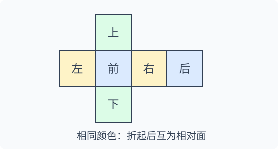

相邻面共用一条棱，相对面不相邻。图中相同颜色的两面，折起后互相相对

::: info 正方体的展开方式

展开 11 种基本展开图

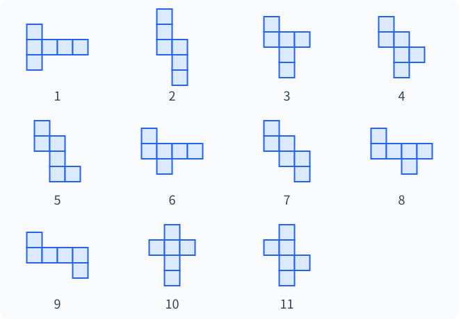

整体旋转或翻面得到的同一种布局，不重复计算

:::

### 6. 旋转体与截面 {#rotation-section .knowledge-title}

- 长方形绕一边旋转一周，形成圆柱
- 直角三角形绕一直角边旋转一周，形成圆锥
- 半圆绕直径旋转一周，形成球

用一个平面去截立体，截得的图形叫作==截面==。截面的形状与切的位置、方向有关

## 【考点】方法与例题 {#exam .handbook-section .is-exam}

### 1. 辨认类型与结构数量 {#identify-method .exam-title}

先问所表示的对象能否全部放在同一平面，再按底面、侧面和顶点辨认立体。计数时分组：棱柱分“两底＋侧部”，棱锥分“底＋锥顶＋侧部”，不沿着一张透视图随意数线条。

<article class="handbook-example" aria-labelledby="example-1">

#### 例题 01 平面与立体 知识清单例题 {#example-1 .example-heading}

题目

下列几何图形中,属于立体图形的是____.(填序号)

①三角形；②长方形；

③正方体；④圆；

⑤四棱锥；⑥圆柱.

答案与解析

解析

三角形、长方形、圆都可以在同一平面内；正方体、四棱锥、圆柱的各部分不都共面。纸面图只是表示方式。

本题结论

③⑤⑥。

</article>

<article class="handbook-example" aria-labelledby="example-2">

#### 例题 02 按底部和侧部分组计数 知识清单例题 {#example-2 .example-heading}

题目

n 棱柱共有 ____ 个顶点，____ 条棱，____ 个面；n 棱锥共有 ____ 个顶点，____ 条棱，____ 个面.

答案与解析

解析

棱柱顶点为 $n+n=2n$，棱为 $n+n+n=3n$，面为 $2+n$。

棱锥顶点为 $n+1$，棱为 $n+n=2n$，面为 $1+n$。每个数量都对应一个明确的计数组，不因棱被两个面共用而重复。

本题结论

六空依次为 $2n$、$3n$、$n+2$；$n+1$、$2n$、$n+1$。

</article>

### 2. 由展开图还原立体 {#net-method .exam-title}

先认底面与侧面，再检查数量、连接和封闭情况。遇到“有盖”或“侧面”时，先圈定所要求的表面范围。

<article class="handbook-example" aria-labelledby="example-3">

#### 例题 03 六种展开图 知识清单例题 {#example-3 .example-heading}

题目

写出下列各展开图所对应的立体名称。

<figure class="handbook-option">

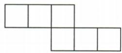

（1）

</figure>

<figure class="handbook-option">

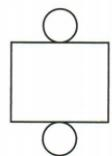

（2）

</figure>

<figure class="handbook-option">

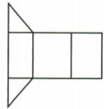

（3）

</figure>

<figure class="handbook-option">

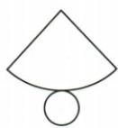

（4）

</figure>

<figure class="handbook-option">

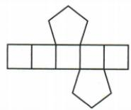

（5）

</figure>

<figure class="handbook-option">

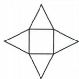

（6）

</figure>

答案与解析

解析

（1）六个等大方片折成六面，是正方体。（2）长方形曲侧配两个圆底，是圆柱。

（3）两个三角形底面配三个长方形侧面，是三棱柱。（4）扇形合拢成曲侧，配圆底，是圆锥。

（5）两个五边形底面配五个侧面，是五棱柱。（6）四边形底面配四个三角形侧面，是四棱锥。

本题结论

（1）正方体；（2）圆柱；（3）三棱柱；（4）圆锥；（5）五棱柱；（6）四棱锥。

</article>

### 3. 固定一面，逐片追踪相对关系 {#opposite-method .exam-title}

把所问面固定为正面，沿公共边依次折转，并记下其他面落到左、右、上、下还是后。最后核对六片没有重叠，再找正面的对面。

<article class="handbook-example" aria-labelledby="example-4">

#### 例题 04 文字面折叠后的对应 知识清单例题·情境缩写，题图等位重绘 {#example-4 .example-heading}

题目

一个正方体展开图的六片面分别标有“猪、牛、羊、马、鸡、狗”。折成正方体后，与“牛”相对的是哪一面？

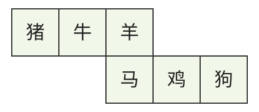

A. 羊

B. 马

C. 鸡

D. 狗

答案与解析

解析

固定“牛”为正面，“猪”“羊”折到左右两侧；从“羊”下边接出的“马”折到底面，“鸡”继续折到背面，“狗”折到顶面。

因此三对相对面为牛与鸡、猪与羊、马与狗。羊、马、狗都与牛相邻。

本题结论

选 C，即“鸡”面。

</article>

### 4. 旋转时比较各层半径 {#rotation-method .exam-title}

先固定题给旋转轴，再比较上部、中部、下部到轴的距离。等距离形成柱形，直线变化形成锥侧，曲线变化形成相应曲侧；不能自行换轴让某选项成立。

<article class="handbook-example" aria-labelledby="example-5">

#### 例题 05 平面图形与旋转体 知识清单例题 {#example-5 .example-heading}

题目

将选项中的平面区域绕图示轴旋转一周，哪一个能形成下图立体？

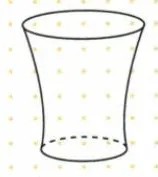

<figure class="handbook-option">

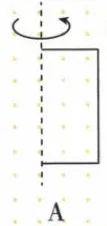

选项 A

</figure>

<figure class="handbook-option">

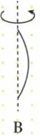

选项 B

</figure>

<figure class="handbook-option">

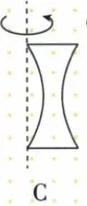

选项 C

</figure>

<figure class="handbook-option">

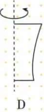

选项 D

</figure>

答案与解析

解析

目标上下较宽，中间平滑收窄。A各层半径不变，形成圆柱；B中部向外鼓，与目标相反；C的两侧都是曲边，中部的区域与轴分离，旋转后产生空腔，并非目标实心收腰体；D中间到轴的距离小、两端较大，符合目标。

本题结论

选 D。

</article>

<article class="handbook-example" aria-labelledby="example-6">

#### 例题 06 绕直径旋转 2024 陕西 {#example-6 .example-heading}

题目

（2024 陕西）将下图的半圆绕直径所在虚线旋转一周，得到的立体是（　）。

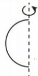

<figure class="handbook-option">

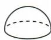

选项 A

</figure>

<figure class="handbook-option">

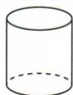

选项 B

</figure>

<figure class="handbook-option">

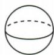

选项 C

</figure>

<figure class="handbook-option">

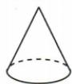

选项 D

</figure>

答案与解析

解析

半圆区域绕直径转满一周，扫过整个球，不只剩半球。圆柱要求各层半径相同，圆锥要求侧轮廓是相应斜直线，都与原圆弧不符。

本题结论

选 C，球。

</article>

### 5. 按指定切面判断截面 {#section-method .exam-title}

沿切面与各表面的交线依次追踪边界，再看平行、垂直与边长关系。回答的是图中指定切法，不能把另一种切法的结果也填入。

<article class="handbook-example" aria-labelledby="example-7">

#### 例题 07 两种立体的指定截面 知识清单例题 {#example-7 .example-heading}

题目

图示正方体和圆台的截面分别对应哪个选项？

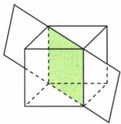

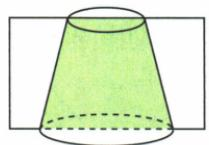

<figure class="handbook-option">

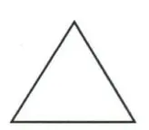

选项 A

</figure>

<figure class="handbook-option">

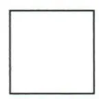

选项 B

</figure>

<figure class="handbook-option">

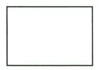

选项 C

</figure>

<figure class="handbook-option">

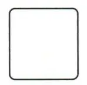

选项 D

</figure>

<figure class="handbook-option">

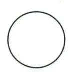

选项 E

</figure>

<figure class="handbook-option">

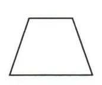

选项 F

</figure>

答案与解析

解析

正方体切面沿竖直方向贯穿，上下边沿底面对角方向，两个竖边与它们垂直，形成长方形。底面对角线长于一条棱，所以不是正方形。

圆台沿过轴的竖直平面切开，两圆底给出两段平行且不等长的直径，侧边连接它们，形成梯形。圆形可以由另一种水平切法得到，但不是题给切法。

本题结论

正方体选 C；圆台选 F。

</article>

## 【坑点】条件与辨析 {#pitfalls .handbook-section .is-pitfall}

### 1. 完整表面与侧面不能混看 {#scope-pit .pitfall-title}

先读范围，再判断是否缺面：有盖盒需要上下两个底，单独的侧面展开则本来就不包含底面。

<article class="handbook-example is-pitfall" aria-labelledby="pitfall-1">

#### 辨析 01 有盖礼盒的展开设计 知识清单例题 {#pitfall-1 .example-heading}

题目

小红想设计制作一个圆柱形的有盖礼品盒,下列展开图中设计正确的是 ( )

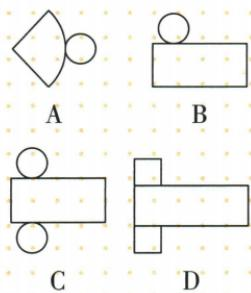

答案与解析

解析

A扇形加圆对应圆锥，不是圆柱。B只有一个圆底，缺少另一个底或盖。C长方形曲侧配两个相同圆底，组成完整圆柱表面。D小长方形不能作为圆底。

设计还应满足卷绕方向边长与底面周长匹配；本题按图给定设计辨认组成，不从示意比例猜半径。

本题结论

选 C。

</article>

<article class="handbook-example is-pitfall" aria-labelledby="pitfall-2">

#### 辨析 02 只展开侧面 2024 江苏常州 {#pitfall-2 .example-heading}

题目

（2024 江苏常州）下列哪一幅图是四棱锥的侧面展开图？

<figure class="handbook-option">

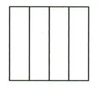

选项 A

</figure>

<figure class="handbook-option">

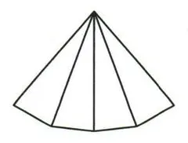

选项 B

</figure>

<figure class="handbook-option">

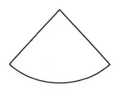

选项 C

</figure>

<figure class="handbook-option">

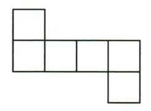

选项 D

</figure>

答案与解析

解析

四棱锥有四个三角形侧面，展开时不要求附带四边形底面。A是四棱柱侧面，B是四个三角形共锥顶的侧面，C是圆锥侧面，D是正方体完整表面。

本题结论

选 B。

</article>

### 2. 纸上最远与折后最远是两回事 {#distance-pit .pitfall-title}

先折回并确认标点所在的空间顶点，再比较直线距离。若棱长为 $s>0$，一条棱长为 $s$，面对角线平方为 $2s^2$，体对角线平方为 $3s^2$。后两项可用勾股定理说明：先在正方形面内求面对角，再在由它与垂直棱组成的直角三角形中求体对角。

这是折后两点直接连线的长度，不是沿表面行走的路程；展开纸上的距离不能直接代替它。

<article class="handbook-example is-pitfall" aria-labelledby="pitfall-3">

#### 辨析 03 折叠后比较顶点距离 2024 四川宜宾 {#pitfall-3 .example-heading}

题目

（2024四川宜宾）如图是正方体表面展开图.将其折叠成正方体后,距顶点A最远的点是()

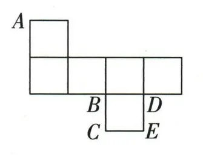

A.B点

B.C点

C.D 点

D.E点

答案与解析

解析

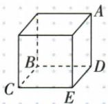

固定折后的各点，$AD$ 是一条棱；$AB$、$AE$ 是面对角线；$AC$ 是连接相对顶点的体对角线。

设棱长 $s>0$，有 $AD^2=s^2$，$AB^2=AE^2=2s^2$，$AC^2=3s^2$。正长度按平方比较，$AC$ 最大。选项字母 B 对应几何点 C，二者不要混写。

本题结论

选 B，即 C 点。

</article>

