两条相等的边带来两个相等的角，也带来一条对称轴。处理等腰问题时，先认清腰、底边与顶角，再在具体三角形中传递边角关系；未说明腰底时，要保留不同可能。

<nav class="handbook-nav" aria-label="本章分区">
  <a class="handbook-jump is-knowledge" href="#knowledge">01 · 知识点概念、关系与适用条件</a>
  <a class="handbook-jump is-exam" href="#exam">02 · 考点先归纳方法，再看例题</a>
  <a class="handbook-jump is-pitfall" href="#pitfalls">03 · 坑点辨析错因，检查遗漏</a>
</nav>

## 【知识点】概念与依据 {#knowledge .handbook-section .is-knowledge}

### 1. 腰、底边、顶角与底角 {#definition .knowledge-title}

有两条边相等的三角形叫作==等腰三角形==

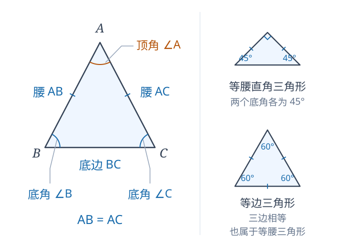

### 2. 等腰三角形的性质 {#angles-sides .knowledge-title}

设 $AB=AC$

1. 两底角相等：$\angle B=\angle C$
2. 三线合一：顶角的平分线、底边上的中线和高重合
3. 轴对称：顶角平分线所在直线是一条对称轴
4. 角度关系：顶角＋$2\times$底角＝$180^\circ$
5. 对应线段相等：两腰上的高相等、中线相等，两底角的平分线相等

::: info 性质与判定的图解证明

展开：为什么等边对等角、等角对等边

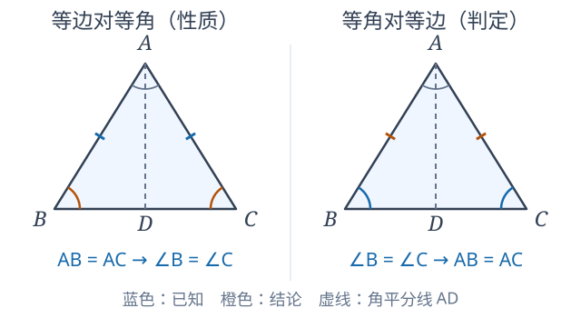

性质：从 $AB=AC$ 出发

1. 作顶角平分线 $AD$
2. $AB=AC$、$\angle BAD=\angle CAD$，再加上公共边 $AD$，由 SAS 得到 $\triangle ABD\cong\triangle ACD$
3. 对应角相等，所以 $\angle B=\angle C$

判定：从 $\angle B=\angle C$ 出发

1. 同样作顶角平分线 $AD$
2. $\angle BAD=\angle CAD$、$\angle B=\angle C$，再加上公共边 $AD$，由 AAS 得到 $\triangle ABD\cong\triangle ACD$
3. 对应边相等，所以 $AB=AC$

这两个结论都针对同一个三角形

:::

### 3. 三线合一 {#three-in-one .knowledge-title}

等腰三角形顶角的平分线、底边上的中线、底边上的高重合，叫作==三线合一==

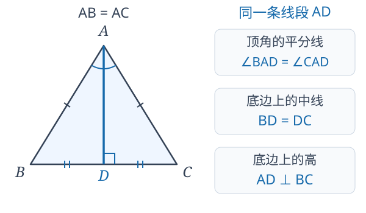

### 4. 底边上点到两腰的距离和 {#distance-sum .knowledge-title}

在等腰三角形 $ABC$ 中，$AB=AC$，点 $P$ 在底边 $BC$ 上

从 $P$ 向两腰作垂线，图中的 $u,v$ 就是这两段垂线的长度

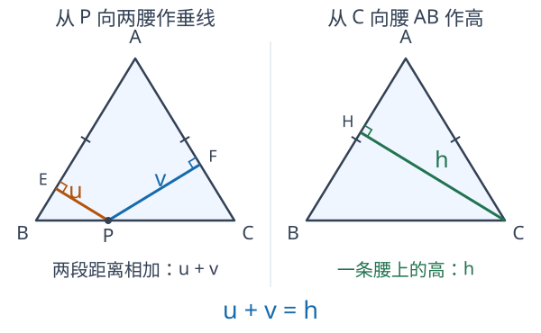

$P$ 沿底边移动时，$u,v$ 会变，但它们的和始终等于右图的高 $h$

::: info 为什么距离和不变

展开：把面积分成两块

1. 连接 $AP$，大三角形分成 $\triangle ABP$ 和 $\triangle ACP$
2. 两腰一样长，记为 $L$，两块面积相加：$S=\frac12Lu+\frac12Lv$
3. 大三角形以腰 $AB$ 为底、高为 $h$，也有 $S=\frac12Lh$，所以 $u+v=h$

:::

## 【考点】方法与例题 {#exam .handbook-section .is-exam}

### 1. 利用等腰性质求角 {#angle-chain .exam-title}

把每一组等边所属的三角形写清楚，再配它们的对角。求角常用两条路线：已知角逐步传递，或设一个基本角，把其他角都表示成它的倍数。出现延长线时，先分辨内角与外角。

<article class="handbook-example" aria-labelledby="example-1">

#### 例题 01 由一个小角逐步求两个角 知识清单例题 {#example-1 .example-heading}

题目

如图, 在 $\triangle ABC$ 中, $AB=AD=DC$ , $\angle BAD=26^{\circ}$ , 求 $\angle B$ 和 $\angle C$ 的度数.

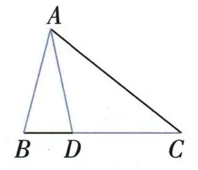

答案与解析

解析

在 $\triangle ABD$ 中，$AB=AD$，故

$$\angle B=\angle ADB=\frac{180^\circ-26^\circ}{2}=77^\circ.$$

$B,D,C$ 顺次共线，$\angle ADB$ 是 $\triangle ADC$ 在 $D$ 处的外角，所以 $\angle C+\angle DAC=77^\circ$。

在 $\triangle ADC$ 中，$AD=DC$，故 $\angle C=\angle DAC=38.5^\circ$。

本题结论

$\angle B=77^\circ$，$\angle C=38.5^\circ$。

</article>

<article class="handbook-example" aria-labelledby="example-2">

#### 例题 02 把各角写成同一个未知数 知识清单例题 {#example-2 .example-heading}

题目

如图, 在 $\triangle ABC$ 中, AB = AC, D 为 BC 上的一点, 且 DA = DC, BD = BA, 求 $\angle B$ 的度数.

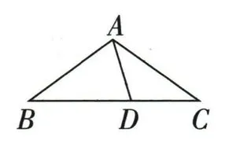

答案与解析

解析

设 $\angle C=x$。$DA=DC$ 给 $\angle DAC=x$；外角关系给 $\angle ADB=2x$。

$BD=BA$ 给 $\angle BAD=\angle ADB=2x$；$AB=AC$ 给 $\angle B=\angle C=x$。于是大三角形的三个角为 $3x,x,x$，

$$3x+x+x=180^\circ,\qquad x=36^\circ.$$

每一步等角都来自各自三角形内的一组等边。

本题结论

$\angle B=36^\circ$。

</article>

### 2. 角分属不同三角形，先用全等建立联系 {#congruence-transfer .exam-title}

目标角不在同一个三角形中时，先找两边及夹角等全等条件。全等移来一组等边，才能在新三角形中使用等腰性质；最后按图中角的组成相加或相减。

<article class="handbook-example" aria-labelledby="example-3">

#### 例题 03 全等之后，再利用同一三角形的底角 知识清单例题 {#example-3 .example-heading}

题目

如图, 已知 $AB = AE$ , $\angle B = \angle E$ , $BC = DE$ , 求证: $\angle BCD = \angle EDC$ .

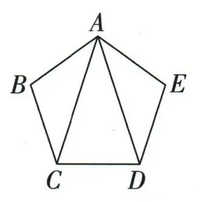

答案与解析

解析

在 $\triangle ABC$、$\triangle AED$ 中，$AB=AE$、$\angle B=\angle E$、$BC=ED$，由 SAS 全等，得 $AC=AD$、$\angle ACB=\angle ADE$。

再看 $\triangle ACD$，$AC=AD$，所以 $\angle ACD=\angle ADC$。按图中角的组成，

$$\angle BCD=\angle BCA+\angle ACD=\angle EDA+\angle ADC=\angle EDC.$$

第一层靠跨三角形全等，第二层才是同一三角形的等边对等角。

本题结论

$\angle BCD=\angle EDC$。

</article>

### 3. 证等腰，先找两角怎样相等 {#prove-isosceles .exam-title}

若边长不好直接比较，可以转向对角。角平分线给相等半角，平行线搬角，两个直角给余角相等，外角给角的和。将目标三角形中的两角写成相同的表达式后，再认准它们的对边。

<article class="handbook-example" aria-labelledby="example-4">

#### 例题 04 直角、高与角平分线 知识清单例题 {#example-4 .example-heading}

题目

如图, 在 $\triangle ABC$ 中, $\angle BAC = 90^{\circ}$ , $AD \perp BC$ 于点 $D$ , $BE$ 交 $AD$ 于点 $F$ , 交 $AC$ 于点 $E$ . 若 $BE$ 平分 $\angle ABC$ , 试判断 $\triangle AEF$ 的形状, 并说明理由.

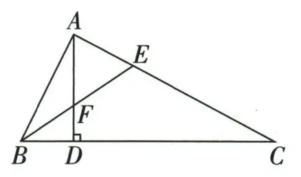

答案与解析

解析

$\angle BAC=90^\circ$、$AD\perp BC$，给出

$$\angle BAD+\angle CAD=90^\circ,\qquad\angle C+\angle CAD=90^\circ.$$

两式同减 $\angle CAD$，得 $\angle BAD=\angle C$。又 $BE$ 平分 $\angle ABC$，所以 $\angle ABE=\angle CBE$。

图中 $B,F,E$、$A,E,C$ 分别顺次共线，因此两个外角分别为

$$\angle AFE=\angle ABE+\angle BAD,\qquad\angle AEF=\angle CBE+\angle C.$$

两对加数相等，得 $\angle AFE=\angle AEF$。在 $\triangle AEF$ 中，这两个角的对边是 $AE,AF$，故 $AE=AF$。

本题结论

$\triangle AEF$ 是等腰三角形，腰为 $AE,AF$。

</article>

<article class="handbook-example" aria-labelledby="example-5">

#### 例题 05 平行线与一个半角 知识清单例题 {#example-5 .example-heading}

题目

如图,在 $\triangle ABC$ 中,已知 $BD$ 是 $\angle ABC$ 的平分线,且 $DE \parallel BC$ .

求证: $\triangle BED$ 是等腰三角形.

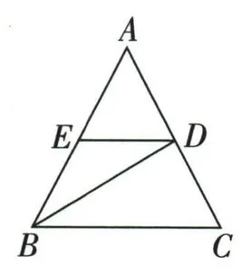

答案与解析

解析

$E$ 在 $AB$ 上，$BD$ 平分 $\angle ABC$，所以 $\angle EBD=\angle DBC$。

$DE\parallel BC$，以 $BD$ 为截线，得 $\angle EDB=\angle DBC$。于是 $\angle EBD=\angle EDB$，两角在同一 $\triangle BED$ 中，由等角对等边得 $DE=BE$。

本题结论

$\triangle BED$ 是等腰三角形，$BE=DE$。

</article>

<article class="handbook-example" aria-labelledby="example-6">

#### 例题 06 由角平分与平行判断等边 知识清单例题 {#example-6 .example-heading}

题目

如图, 在 $\triangle ABC$ 中, $\angle ACB=120^{\circ}$ , $CD$ 平分 $\angle ACB$ , $AE \parallel DC$ , $AE$ 交 $BC$ 的延长线于点 $E$ , 证明 $\triangle ACE$ 是等边三角形.

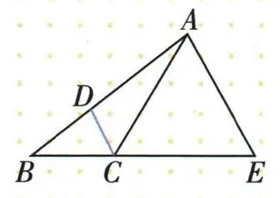

答案与解析

解析

$B,C,E$ 顺次共线，所以 $\angle ACE=180^\circ-120^\circ=60^\circ$。

$CD$ 平分 $120^\circ$ 的角，故 $\angle ACD=\angle BCD=60^\circ$。$AE\parallel DC$，给 $\angle CAE=\angle ACD=60^\circ$，也给 $\angle AEC=\angle BCD=60^\circ$。

三个内角都为 $60^\circ$，由等角对等边得到三边相等。不是仅凭一个 $60^\circ$ 就判断等边。

本题结论

$\triangle ACE$ 是等边三角形。

</article>

### 4. 中点与对称条件，选择全等或中垂线 {#symmetry-method .exam-title}

等腰三角形的底边上出现两端等长的截段时，可直接用两腰及底角作 SAS，也可作底边上的高，利用三线合一转成中垂线。两条路线都必须核对点序；若两点重合，目标等长往往直接成立，不必套全等。

<article class="handbook-example" aria-labelledby="example-7">

#### 例题 07 底边上两个点的两种证法 知识清单例题 {#example-7 .example-heading}

题目

如图，点 $D,E$ 在 $\triangle ABC$ 的边 $BC$ 上，$AB=AC$，$BD=CE$。求证：$AD=AE$。

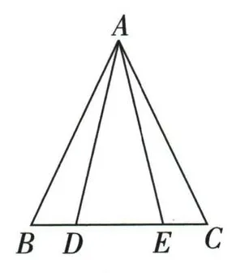

答案与解析

解析

证法一：SAS。 $AB=AC$，所以 $\angle B=\angle C$。再有 $BD=CE$，两边及夹角对应相等，得 $\triangle ABD\cong\triangle ACE$，从而 $AD=AE$。

证法二：底边上的高。 作 $AF\perp BC$。三线合一给 $BF=CF$。按图中 $B,D,E,C$ 的顺序和 $BD=CE$，$D,E$ 分居 $F$ 两侧，

$$DF=BF-BD=CF-CE=EF.$$

因此 $AF$ 是 $DE$ 的中垂线，得 $AD=AE$。若 $D=E$，结论直接成立，无须对退化图套判据。

也可在第二种作法中，用 $DF=EF$ 说明 $AF$ 同时是 $\triangle ADE$ 的中线和高，或直接对两小直角三角形用 SAS，得到同一结论。

本题结论

$AD=AE$。

</article>

### 5. 等边中的中线先给半角，再转移长度 {#equilateral-midpoint .exam-title}

认准中点在哪条边上，以及中线从哪个顶点出发。等边三角形的顶角为 $60^\circ$，中线平分它得到 $30^\circ$；再借新增的等腰条件，可能在另一个三角形里得到第二组等角，逐段传递长度。

<article class="handbook-example" aria-labelledby="example-8">

#### 例题 08 中点与延长线上的等长线段 知识清单例题 {#example-8 .example-heading}

题目

如图,等边三角形 ABC 的边长为 3,D 是 AC 的中点,点 E 在 BC 的延长线上,若 DE=DB,求 CE 的长.

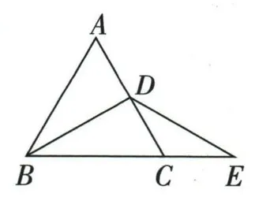

答案与解析

解析

$D$ 为 $AC$ 中点，$BD$ 从顶点 $B$ 出发，是中线，也是角平分线，故 $\angle DBE=30^\circ$。

$DB=DE$，所以 $\angle BED=\angle DBE=30^\circ$。在 $\triangle CDE$ 中，$\angle ACB=60^\circ$ 是 $C$ 处的外角，得 $\angle CDE+\angle CED=60^\circ$，于是 $\angle CDE=30^\circ$。

在同一个 $\triangle CDE$ 中，两角相等，故 $CE=CD=\frac12 AC=\frac32$。

本题结论

$CE=\frac32$。

</article>

### 6. 两个等腰共顶点，先找真正的夹角 {#shared-vertex .exam-title}

两组等边已经给出时，SAS 还缺的是它们的夹角。若已知两个相等的整体角含有同一个小角，可同减该小角得到所需夹角。条件换成等边特例时，原全等关系通常保留，还可能增加 $60^\circ$ 与平行关系。

<article class="handbook-example" aria-labelledby="example-9">

#### 例题 09 两个等腰与等边特例 知识清单例题 {#example-9 .example-heading}

题目

如图 1, $\triangle ABC$ 是等腰三角形, AC = BC, D 是 AB 边上一点, 以 CD 为边作等腰三角形 CDE, 使点 E, A 在直线 DC 的同侧, $\angle BCA = \angle DCE$ , CD = CE, 连接 AE.

(1) 求证: $\triangle DBC \cong \triangle EAC.$   
(2)如图2,若 $\triangle ABC$ 、 $\triangle CDE$ 都是等边三角形,(1)中结论是否仍然成立?请直接写出你的判断,无需证明.  
(3)在(2)的条件下,AE与BC有怎样的位置关系?请写出理由.

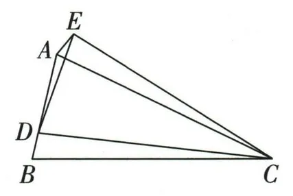

图1：一般等腰情形

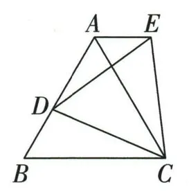

  
图2：等边特例

答案与解析

解析

（1） 按图中位置，

$$\angle BCD+\angle DCA=\angle BCA,\qquad\angle ACE+\angle DCA=\angle DCE.$$

两个整体角相等，同减 $\angle DCA$，得 $\angle BCD=\angle ACE$。再有 $BC=AC$、$CD=CE$，由 SAS 得 $\triangle DBC\cong\triangle EAC$。

（2） 仍然成立。两三角形为等边时，原来的两组等边及相等顶角条件仍满足。

（3） 等边给 $\angle B=\angle ACB=60^\circ$；全等的对应角给 $\angle CAE=\angle B=60^\circ$。所以 $\angle CAE=\angle ACB$，以内错角相等判定 $AE\parallel BC$。

本题结论

（1）两三角形全等；（2）仍成立；（3）$AE\parallel BC$。

</article>

## 【坑点】条件与边界 {#pitfalls .handbook-section .is-pitfall}

### 1. 未指定腰底时，先分类再筛选 {#classification .pitfall-title}

给两种不同边长而没有说明腰底时，分别让每一种作为重复的腰，再检查严格的三边关系。若给一个角而未说明顶角或底角，也要分别处理：

| 设所给角为 $\alpha$ | 其余角 | 边界 |
| --- | --- | --- |
| 它是顶角 | 两底角各 $(180^\circ-\alpha)/2$ | $0^\circ<\alpha<180^\circ$ |
| 它是底角 | 另一底角为 $\alpha$，顶角为 $180^\circ-2\alpha$ | $0^\circ<\alpha<90^\circ$ |

分类不等于所有分支都有效；零角和三边关系中的等号都须排除。

<article class="handbook-example is-pitfall" aria-labelledby="pitfall-1">

#### 辨析 01 两组边长各有哪些可能 知识清单例题 {#pitfall-1 .example-heading}

题目

(1)已知等腰三角形的一边长是5,另一边长是7,该三角形的周长是\_\_\_\_.

(2)已知等腰三角形的一边长是3,另一边长是6,该三角形的周长是\_\_\_\_.

答案与解析

解析

（1） 腰为 $5$ 时，三边为 $5,5,7$，满足 $5+5>7$，周长 $17$；腰为 $7$ 时，三边为 $7,7,5$，也能构成三角形，周长 $19$。

（2） 腰为 $3$ 时，$3+3=6$，三点共线退化，不是三角形。腰为 $6$ 时，三边 $6,6,3$ 满足三边关系，周长 $15$。

本题结论

（1）$17$ 或 $19$；（2）$15$。

</article>

### 2. 底角的平分线不能套三线合一 {#wrong-bisector .pitfall-title}

三线合一对应的是顶角平分线与底边。从一个底角引出的平分线，通常既不是另一腰的中线，也不是高。要靠实际角度重新判断小三角形，不能看到“等腰＋平分”就写垂直或中点。

<article class="handbook-example is-pitfall" aria-labelledby="pitfall-2">

#### 辨析 02 从一个底角引平分线 2024 重庆 B {#pitfall-2 .example-heading}

题目

(2024 重庆 B) 如图, 在 $\triangle ABC$ 中, $AB = AC$ , $\angle A = 36^{\circ}$ , $BD$ 平分 $\angle ABC$ 交 $AC$ 于点 $D$ . 若 $BC = 2$ , 则 $AD$ 的长度为 \_\_\_\_.

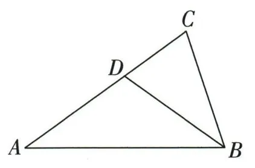

答案与解析

解析

$AB=AC$、$\angle A=36^\circ$，所以 $\angle B=\angle C=72^\circ$。$BD$ 平分 $\angle B$，得 $\angle ABD=\angle CBD=36^\circ$。

$A,D,C$ 共线，$\angle CDB$ 是 $\triangle ABD$ 的外角，所以 $\angle CDB=36^\circ+36^\circ=72^\circ=\angle C$。在 $\triangle BCD$ 中，得 $BD=BC=2$。

再在 $\triangle ABD$ 中，$\angle A=\angle ABD$，得 $AD=BD=2$。两次等角对等边分别在两个三角形里使用，未使用 $BD\perp AC$。

本题结论

$AD=2$。

</article>

### 3. 平行线搬的是同一截线形成的角 {#parallel-angles .pitfall-title}

小角不一定就是同位角或内错角。先辨认截线，拼出完整的同旁内角或内错角，使用平行关系后，再减去等边三角形的 $60^\circ$。

<article class="handbook-example is-pitfall" aria-labelledby="pitfall-3">

#### 辨析 03 两条平行线间的等边三角形 2024 山东泰安 {#pitfall-3 .example-heading}

题目

（2024山东泰安）如图，直线 $l / / m$ ，等边三角形ABC的两个顶点 $B,C$ 分别落在直线 $l,m$ 上，若 $\angle ABE = 21^{\circ}$ ，则 $\angle ACD$ 的度数是（）

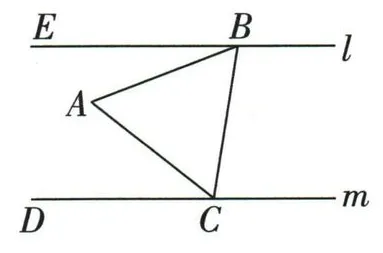

A. ${45}^{ \circ  }$

B. $39^{\circ}$

C.29°

D. ${21}^{ \circ  }$

答案与解析

解析

等边三角形的两个内角均为 $60^\circ$，图中

$$\angle CBE=60^\circ+21^\circ=81^\circ.$$

以 $BC$ 为截线，由 $l\parallel m$ 得 $\angle BCD=180^\circ-81^\circ=99^\circ$。再减去 $\angle BCA=60^\circ$，得到 $\angle ACD=39^\circ$。

不能把分属截线 $AB$ 与 $AC$ 的小角直接认成相等；$45^\circ$ 也缺少等腰直角条件。回验 $60^\circ+21^\circ+60^\circ+39^\circ=180^\circ$。

本题结论

选 B，$\angle ACD=39^\circ$。

</article>

### 4. 一个60°，还缺少什么条件 {#sixty-boundary .pitfall-title}

仅有一个 $60^\circ$ 的三角形，另外两个角未必也为 $60^\circ$。要判定等边，还须有等腰条件、另一个 $60^\circ$，或足够的等边关系。底边点的两垂距和性质也有边界：两腰要等长，点要在有限底边上，距离要取垂直距离，三个条件不能省略。
