同一条线上写着几个点，可以表示哪些线段、射线？计算一段长度之前，又该先确认什么？本页围绕端点、方向和点的顺序，建立几何语言与长度关系的对应。

<nav class="handbook-nav" aria-label="本章分区">
  <a class="handbook-jump is-knowledge" href="#knowledge">01 · 知识点概念、关系与适用条件</a>
  <a class="handbook-jump is-exam" href="#exam">02 · 考点题目分类和例题</a>
  <a class="handbook-jump is-pitfall" href="#pitfalls">03 · 坑点辨析错因，检查遗漏</a>
</nav>

## 【知识点】概念与依据 {#knowledge .handbook-section .is-knowledge}

### 1. 直线、射线、线段 {#objects .knowledge-title}

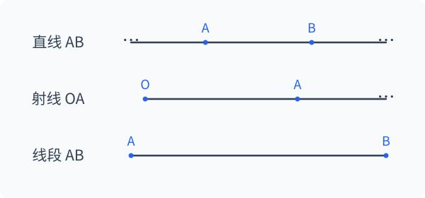

| 名称 | 端点 | 表示方法 |
| --- | --- | --- |
| 直线 | 无 | 直线 $AB$ 或直线 $l$ |
| 射线 | 一个 | 射线 $OA$，端点 $O$ 写在前面 |
| 线段 | 两个 | 线段 $AB$ 或 $BA$ |

直线、射线无限延伸，只有线段能度量总长

### 2. 直线与线段的基本事实 {#basic-facts .knowledge-title}

1. 两个不同的点确定一条直线
2. 两点之间，线段最短
3. 两点间的距离，是连接它们的线段的长度

### 3. 线段的和与差 {#length .knowledge-title}

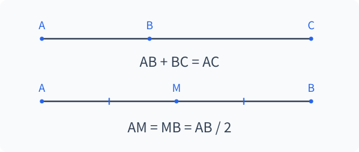

$A,B,C$ 依次在同一直线上时，$AB+BC=AC$，所以 $AB=AC-BC$

“延长 $AB$ 到 $C$”表示沿 $A\to B$ 的方向越过 $B$

### 4. 中点与等分点 {#midpoint .knowledge-title}

在线段 $AB$ 上，把线段分成相等两部分的点 $M$，叫作它的==中点==

$$AM=MB=\frac12AB$$

三等分有 $2$ 个内部等分点，四等分有 $3$ 个，$n$ 等分有 $n-1$ 个

### 5. 用圆规作线段的和与差 {#construction .knowledge-title}

1. 作和：沿同一射线依次截取长度 $a,b$，总长度为 $a+b$
2. 作差：先截取 $a$，再从末端向回截取 $b$，剩下的长度为 $a-b$（$a>b>0$）

## 【考点】方法与例题 {#exam .handbook-section .is-exam}

### 1. 按端点、方向去重计数 {#count-method .exam-title}

线段按两个端点组成的无序点对计数，$AB$ 与 $BA$ 不重复。射线按“端点＋方向”计数，同端同向只算一条。先确定图中哪里真的无限延伸，不能自行把有限边延长后再计数。

若一条直线上有 $n$ 个指定点，以这些点为端点的射线，每点两向，共 $2n$ 条；由这些点两两确定的线段有 $n(n-1)/2$ 条，因为每段若从两端分别计数，会重复一次。

<article class="handbook-example" aria-labelledby="example-1">

#### 例题 01 两类计数的对象 知识清单例题·合组改编，明确计数端点范围 {#example-1 .example-heading}

题目

（1）直线上有 $n$ 个不同点，$n$ 为正整数。以这些已给点为端点、沿这条直线的射线有多少条？

（2）如图，直线 $l$ 上有 $A,B,C,D$ 四个点，以图中标出的点为端点，共有多少条线段？

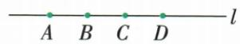

答案与解析

解析

（1）每个给定点分别向两侧形成一条射线，不同端点的射线也不同，故为 $2n$。

（2）从左到右计：$A$ 可配 $B,C,D$，有3条；$B$ 再配 $C,D$，有2条；$C$ 再配 $D$，有1条。共 $3+2+1=6$ 条，也可用 $4\times3/2=6$。

本题结论

（1）$2n$ 条；（2）6条。

</article>

<article class="handbook-example" aria-labelledby="example-2">

#### 例题 02 按题图给定的范围计数 知识清单例题 {#example-2 .example-heading}

题目

下图中共有 ____ 条线段, ____ 条射线, ____ 条直线, 其中以 B 为端点的线段是 ____.

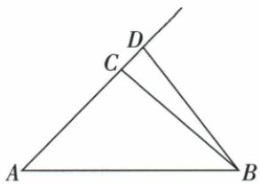

答案与解析

解析

线段为 $AB$、$AC$、$AD$、$BC$、$BD$、$CD$，共6条，长段 $AD$ 不能因包含小段就漏掉。

沿 $A,C,D$ 的方向向外延伸，以 $A$、$C$、$D$ 为端点分别有一条射线。同一端点向 $C$、$D$ 的同向命名不能重复算。$B$ 处没有画出无限延伸，图中也没有两向无限的直线。

以 $B$ 为端点的线段是 $AB$、$BC$、$BD$。

本题结论

6条线段，3条射线，0条直线；以 $B$ 为端点的线段是 $AB$、$BC$、$BD$。

</article>

### 2. 由中点和包含关系求长度 {#midpoint-method .exam-title}

把中点先翻译成半长，再按图中的实际顺序写“整段＝部分＋部分”。这一步确定该加还是该减，不应只看题中出现两个数就选择减法。

<article class="handbook-example" aria-labelledby="example-3">

#### 例题 03 中点与内部点 知识清单例题 {#example-3 .example-heading}

题目

如图,已知 AB=8 cm,BD=3 cm,C 为 AB 的中点,则线段 CD 的长为 ____ cm.

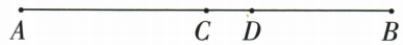

答案与解析

解析

$C$ 为 $AB$ 中点，所以 $BC=AB/2=4\ \mathrm{cm}$。图中 $D$ 在 $CB$ 内，$BC=CD+DB$，故 $CD=4-3=1\ \mathrm{cm}$。

本题结论

1 cm。

</article>

### 3. 先画清延长与反向延长 {#extension-method .exam-title}

先按命名字母确定越过哪一端，排列全部点，再把半长、等长翻译成数量关系。作图、判中点、求比值和求长度是不同任务，要逐问作答。

<article class="handbook-example" aria-labelledby="example-4">

#### 例题 04 四个点的排列与长度 知识清单例题 {#example-4 .example-heading}

题目

已知线段 AB=2 cm, 延长线段 AB 至点 C, 使得 $BC=\frac{1}{2}AB$ , 再反向延长 AC 至点 D, 使得 AD=AC.

(1) 准确地画出图形, 并标出相应的字母.   
(2)哪个点是线段 $DC$ 的中点？线段 $AB$ 的长是线段 $DC$ 长的几分之几？  
(3) 求线段 BD 的长度.

答案与解析

解析

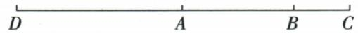

（1）沿 $A\to B$ 延长得到 $C$，$BC=1\ \mathrm{cm}$，所以 $AC=3\ \mathrm{cm}$。反向延长 $AC$ 越过 $A$ 得 $D$，$AD=AC=3\ \mathrm{cm}$，顺序为 $D,A,B,C$。

（2）$A$ 在 $DC$ 内，且 $AD=AC$，所以 $A$ 为 $DC$ 中点。$DC=6\ \mathrm{cm}$，故 $AB/DC=2/6=1/3$。

（3）$D,B$ 分处 $A$ 两侧，$BD=DA+AB=3+2=5\ \mathrm{cm}$。

本题结论

（1）图见解析，顺序 $D,A,B,C$；（2）$A$ 是中点，$AB=DC/3$；（3）$BD=5\ \mathrm{cm}$。

</article>

### 4. 等分与比例统一成一份量 {#ratio-method .exam-title}

有比例时设每份为同一个正数；有等分时先辨较短段占整段几份。再用已给的和、差建立方程，求得一份后还要换算成题目真正要求的长度。

<article class="handbook-example" aria-labelledby="example-5">

#### 例题 05 三等分点与比例 知识清单例题 {#example-5 .example-heading}

题目

如图, 点 C 是线段 AB 上靠近 A 的三等分点, 点 D 在线段 CB 上, CD:DB=17:2, 且 CD-AC=3 cm, 求线段 AB 的长.

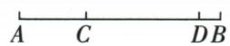

答案与解析

解析

设 $CD=17x\ \mathrm{cm}$、$DB=2x\ \mathrm{cm}$，$x>0$。因为 $D$ 在 $CB$ 内，$CB=19x\ \mathrm{cm}$。

$C$ 是靠近 $A$ 的三等分点，所以 $CB=2AC$，$AC=19x/2\ \mathrm{cm}$。由差为3，

$$17x-\frac{19x}{2}=3\Rightarrow15x=6\Rightarrow x=0.4.$$

因此 $AC=3.8\ \mathrm{cm}$，$AB=3AC=11.4\ \mathrm{cm}$。回代 $CD=6.8$、$DB=0.8$，差和比都符合原条件。

本题结论

$AB=11.4\ \mathrm{cm}$。

</article>

### 5. 区分定位与最短路径的依据 {#fact-method .exam-title}

看情境要解决的是“线的位置唯一”还是“路径长度最短”。不要只因题中出现绳子或两点，就把两条基本事实混用。

<article class="handbook-example" aria-labelledby="example-6">

#### 例题 06 砌墙的参照线 2022 湖北十堰·略去非必要情境图 {#example-6 .example-heading}

题目

（2022 湖北十堰）工人砌墙时,先在两个墙脚的位置分别插一根木桩,再拉一条直的参照线,就能使砌的砖在一条直线上.这样做应用的数学知识是()

A.两点之间,线段最短

B.两点确定一条直线

C.垂线段最短

D.三角形两边之和大于第三边

答案与解析

解析

两个不同墙脚的位置固定了一条且仅一条直线，砖沿这条参照线排列，所以用“两点确定一条直线”。其余选项涉及路径长度或垂距、三角形边长，不是本题解释排直的依据。

本题结论

选 B。

</article>

## 【坑点】条件与辨析 {#pitfalls .handbook-section .is-pitfall}

### 1. 无限延伸的对象不能按笔画比长 {#object-pit .pitfall-title}

逐句核对对象、端点与延伸方向。对已确定的点序，还可用长度和差检查所要求的等式是否可能成立。

<article class="handbook-example is-pitfall" aria-labelledby="pitfall-1">

#### 辨析 01 逐句核对几何语言 知识清单例题 {#pitfall-1 .example-heading}

题目

下列语句中,表述正确的是
____.(填序号)

①延长线段 AB；②延长射线 OA；③延长直线 l；④延长线段 AB 至 C，使 AC=BC；⑤线段是直线的一部分；⑥线段是射线的一部分；⑦直线比射线长.

答案与解析

解析

①线段有限，可以延长，正确。②射线正向已无限，不能再向原方向延长；③直线两向都无限，也不能再延长。

④延长 $AB$ 至 $C$ 时，$AC=AB+BC>BC$，不能使 $AC=BC$。⑤线段可以是直线的一部分；⑥也可以是相应射线的一部分，均正确。⑦直线、射线没有可比较的有限总长，不能说直线更长。

本题结论

①⑤⑥正确。

</article>

### 2. 中点条件不能只剩一条等式 {#midpoint-pit .pitfall-title}

判断中点要同时保证位置和等长。若只给距离，可试着把点移到线段外或直线外，检查是否仍满足等式；能找到这种点，就不能断言中点。

<article class="handbook-example is-pitfall" aria-labelledby="pitfall-2">

#### 辨析 02 哪些条件足以判断中点 知识清单例题 {#pitfall-2 .example-heading}

题目

下列说法中, 正确的是
(填序号)

①若 $AP=\frac{1}{2}AB$ ，则点 P 为线段 AB 的中点；②若 AP=PB，则点 P 为线段 AB 的中点；③若 AB=2PB，则点 P 为线段 AB 的中点；④若 $AP=PB=\frac{1}{2}AB$ ，则点 P 为线段 AB 的中点.

答案与解析

解析

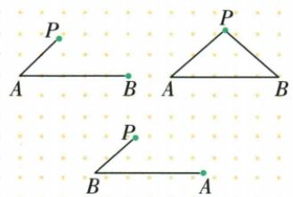

①只给到 $A$ 的半长距离，$P$ 可偏离 $AB$；②等距点也可能不在线段上；③只给到 $B$ 的半长距离，同样未限定位置，因此三项都不充分。

④同时有 $AP=PB=AB/2$，于是 $AP+PB=AB$。若 $P$ 离开线段，绕行的折路会长于直接线段；等号迫使 $P$ 在线段 $AB$ 上，再结合等长可判中点。

本题结论

只有④正确。

</article>

### 3. 省略点序会改变线段和差 {#order-pit .pitfall-title}

长度字母可以简写，但位置条件不能省。把原图的顺次截取条件单独写出来，就能看清等式究竟适用于什么范围。

<article class="handbook-example is-pitfall" aria-labelledby="pitfall-3">

#### 辨析 03 线段和的前提 知识清单辨析·改编，展开原作图上下文条件 {#pitfall-3 .example-heading}

题目

在顺次截取线段的图中，$A,B,C$ 共线且依次排列。判断：

（1）$AB+BC=AC$。

（2）若线段 $AB$ 比线段 $CD$ 长，可以写成 $AB>CD$。

答案与解析

解析

（1）$B$ 在线段 $AC$ 上，整段由两部分组成，所以成立。若删掉共线且依次排列，等式不再是一般结论。

（2）这里字母表示长度，比较长短可以用 $AB>CD$ 表示；不能把图形本身理解为一个数。

本题结论

两句都正确；第一句依赖题给的位置条件。

</article>

### 4. 位置未定时不能只画一种情况 {#cases-pit .pitfall-title}

在一条直线上，距固定点一定长度的点通常有左右两种可能。先列两侧，再由已给大段长度排除不可能情况，不能用自己随手画的一张图补充原题条件。

<article class="handbook-example is-pitfall" aria-labelledby="pitfall-4">

#### 辨析 04 两中点之间的距离 知识清单例题 {#pitfall-4 .example-heading}

题目

已知线段 $AB = 10 \mathrm{~cm}$ , 直线 $AB$ 上有一点 $C, BC = 6 \mathrm{~cm}, M$ 为线段 $AB$ 的中点, $N$ 为线段 $BC$ 的中点, 求线段 $MN$ 的长.

答案与解析

解析

$MB=AB/2=5\ \mathrm{cm}$，$NB=BC/2=3\ \mathrm{cm}$。

当 $C$ 在线段 $AB$ 内时，$M,N$ 在 $B$ 同侧，$MN=5-3=2\ \mathrm{cm}$。当 $C$ 在 $AB$ 的延长线上时，$M,N$ 在 $B$ 两侧，$MN=5+3=8\ \mathrm{cm}$。$C$ 若越过 $A$，则应有 $BC>AB$，与 $6<10$ 不符。

也可取 $A$ 坐标0、$B$ 坐标10，则 $C$ 坐标为4或16；$M$ 坐标5，$N$ 坐标7或13，两中点距离仍为2或8。

本题结论

$MN=2\ \mathrm{cm}$ 或 $8\ \mathrm{cm}$。

</article>

### 5. 度量斜线段，不度量它的水平投影 {#measure-pit .pitfall-title}

仅在题目允许按图度量时，才以图的真实比例比较长度。各图必须采用同一缩放比例；把每条线单独拉成同宽图片，会破坏原题。

<article class="handbook-example is-pitfall" aria-labelledby="pitfall-5">

#### 辨析 05 按图比较线段长短 知识清单例题 {#pitfall-5 .example-heading}

题目

下列线段中，最长的是（　）。

<figure class="handbook-option">

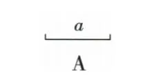

</figure>

<figure class="handbook-option">

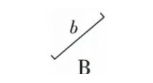

</figure>

<figure class="handbook-option">

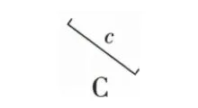

</figure>

<figure class="handbook-option">

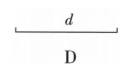

</figure>

答案与解析

解析

沿每条线段的方向量两端间距，而不是量横向投影。保持四图同一比例，比较可得线段 d 最长。图中没有给出具体厘米数，不能自行编造各段长度。

本题结论

选 D。

</article>

