两个中点把原来分散的边长与方向联系起来。使用中位线前，先说清它属于哪一个三角形；遇到四边形，各边的中点与半条对角线的中点不是同一种构造。

<nav class="handbook-nav" aria-label="本章分区">
  <a class="handbook-jump is-knowledge" href="#knowledge">01 · 知识点概念、关系与适用条件</a>
  <a class="handbook-jump is-exam" href="#exam">02 · 考点题目分类和例题</a>
  <a class="handbook-jump is-pitfall" href="#pitfalls">03 · 坑点辨析错因，检查遗漏</a>
</nav>

## 【知识点】概念与依据 {#knowledge .handbook-section .is-knowledge}

### 1. 三角形的中位线 {#midline .knowledge-title}

连接三角形两边中点的线段，叫作三角形的==中位线==，一个三角形有三条中位线

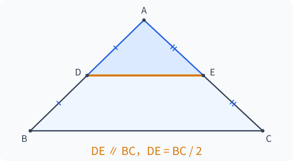

$D,E$ 分别是 $AB,AC$ 的中点，则

$$DE\parallel BC,\qquad DE=\frac12BC$$

中线连接“顶点与对边中点”，中位线连接“两边中点”

::: info 中位线定理的证明

展开相似证明

$AD=DB$、$AE=EC$，所以 $\frac{AD}{AB}=\frac{AE}{AC}=\frac12$，且共用 $\angle A$，由 SAS 得 $\triangle ADE\sim\triangle ABC$

对应角相等，得到 $DE\parallel BC$；对应边成比例，得到 $DE=\frac12BC$

:::

### 2. 三条中位线的性质 {#four-parts .knowledge-title}

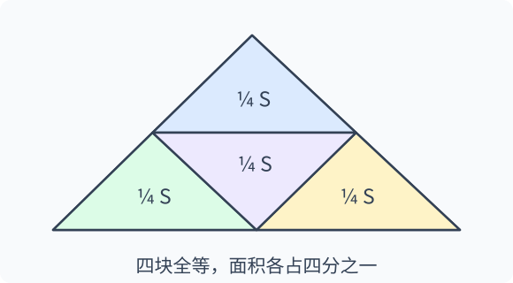

1. 四个小三角形彼此全等
2. 每个小三角形的周长为原来的 $\frac12$
3. 每个小三角形的面积为原来的 $\frac14$

## 【考点】方法与例题 {#exam .handbook-section .is-exam}

### 1. 中点四边形看原来的两条对角线 {#midpoint-quadrilateral .exam-title}

顺次连接凸四边形 $ABCD$ 各边的中点 $E,F,G,H$，得到中点四边形 $EFGH$。

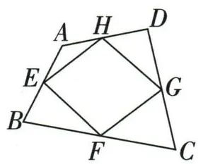

连接原对角线 $AC,BD$。在 $ABC,ADC$ 中分别用中位线定理，得 $EF\parallel AC$、$HG\parallel AC$，且 $EF=HG=AC/2$。同理，$FG=HE=BD/2$，并都与 $BD$ 平行。因此中点四边形总是平行四边形。

| 原四边形的对角线条件 | 中点四边形的对应条件 | 新图形 |
| --- | --- | --- |
| 无附加条件 | 两组对边分别平行 | 平行四边形 |
| $AC=BD$ | 两条相邻边相等 | 菱形 |
| $AC\perp BD$ | 两条相邻边垂直 | 矩形 |
| 两对角线既等长又垂直 | 邻边相等且垂直 | 正方形 |

要注意方向：原对角线“相等”变成新图的“邻边相等”，不是新对角线相等。

面积为什么是一半？ 在每个原顶角处，两个边中点围出的小三角形，是相应大三角形四个全等中位线小块之一。$A,C$ 两角的小块面积，分别为 $\triangle ABD$、$\triangle CBD$ 面积的四分之一，共为原面积的四分之一；$B,D$ 两角同理又占四分之一。四角合占一半，余下中点四边形也占一半。

上述面积扣除以原图凸、各小块在内部为前提。凹图或自交图要另看区域，不能不加说明直接套普通面积的一半。

### 2. 认清同一个三角形中的两个中点 {#direct .exam-title}

先写出三角形的三个顶点，再说明两个点分别是谁的中点。求长用半长关系，求角用平行关系。若中点来自对角线互相平分，要先有平行四边形这一依据。

<article class="handbook-example" aria-labelledby="example-1">

#### 例题 01 绕开不能直接测量的距离 知识清单例题 {#example-1 .example-heading}

题目

如图，A、B两点被池塘隔开，A、B、C三点不共线.设AC、BC的中点分别为M、N.若MN=3米，则AB=\_\_\_\_.

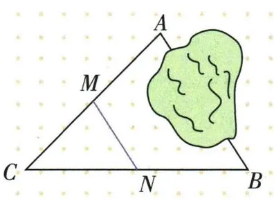

答案与解析

解析

在 $\triangle ABC$ 中，$M,N$ 分别为 $AC,BC$ 中点，所以 $MN$ 为中位线，$MN=AB/2$。因此 $AB=2MN=6\text{ m}$。

本题结论

$AB=6\text{ m}$。

</article>

<article class="handbook-example" aria-labelledby="example-2">

#### 例题 02 三边中点围出的四边形 知识清单例题 {#example-2 .example-heading}

题目

如图,在 $\triangle ABC$ 中, $AB=6,AC=10$ ,点 $D,E,F$ 分别是 $AB,BC,AC$ 的中点,则四边形 $ADEF$ 的周长是（ ）

A.8

B.10

C.12

D.16

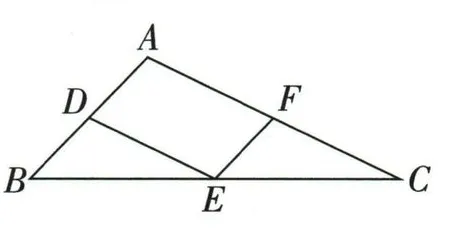

答案与解析

解析

$AD=AB/2=3$，$AF=AC/2=5$。$DE$ 为中位线，$DE=AC/2=5$；$EF$ 也是中位线，$EF=AB/2=3$。所以周长为 $3+5+3+5=16$，选 D。

还可由 $DE\parallel AC$、$EF\parallel AB$ 判定 $ADEF$ 是平行四边形，再算 $2(DE+EF)$。不需要知道 $BC$ 的长度。

本题结论

D，周长16。

</article>

<article class="handbook-example" aria-labelledby="example-3">

#### 例题 03 平行后把已知角移到原三角形 知识清单例题·2024四川广安 {#example-3 .example-heading}

题目

（2024四川广安）如图，在 $\triangle ABC$ 中，点 $D,E$ 分别是 $AC,BC$ 的中点，若 $\angle A=45^{\circ},\angle CED=70^{\circ}$ ，则 $\angle C$ 的度数为()

A. $45^{\circ}$

B. $50^{\circ}$

C.60°

D.65°

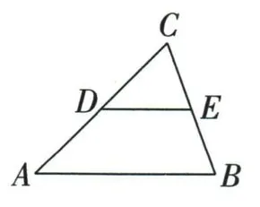

答案与解析

解析

$D,E$ 为 $AC,BC$ 中点，故 $DE\parallel AB$。于是 $\angle ABC=\angle CED=70^\circ$，

$$\angle C=180^\circ-45^\circ-70^\circ=65^\circ.$$

注意70°移到的是 $B$ 角，不是 $C$ 角。

本题结论

D，$65^\circ$。

</article>

<article class="handbook-example" aria-labelledby="example-4">

#### 例题 04 菱形中的中点：正向与反向求长 知识清单例题·合组；（2）2024山东济宁 {#example-4 .example-heading}

题目

（1）如图,菱形ABCD的周长为20,对角线AC、BD相交于点O,E是CD的中点,则OE的长是()

A.2.5

B.3

C.4

D.5

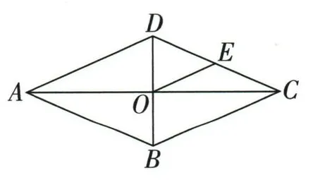

（2）（2024 山东济宁）如图,菱形 ABCD 的对角线 AC,BD 相交于点 O,E 是 AB 的中点,连接 OE. 若 OE =3,则菱形的边长为 ( )

A.6

B.8

C.10

D.12

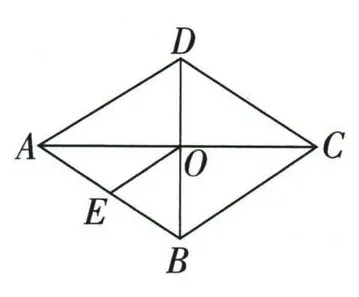

答案与解析

解析

（1）菱形边长 $BC=20/4=5$，对角线交点 $O$ 为 $BD$ 中点，$E$ 为 $CD$ 中点。在 $\triangle BCD$ 中，$OE=BC/2=2.5$，选 A。

（2）$O$ 为 $AC$ 中点，$E$ 为 $AB$ 中点。在 $\triangle ABC$ 中，$OE=BC/2$，所以 $BC=2OE=6$，选 A。

两题中的中点分属不同的边，必须各自找出所用三角形，不能只按两幅图的朝向判断。

本题结论

（1）A，2.5；（2）A，6。

</article>

### 3. 只有一个中点，先证明第二个 {#construct-midpoint .exam-title}

先用平行、全等或平行四边形判定得到另一个中点，再用中位线。看到图上某点靠近一条边的中间，不是“中点”的证据。

<article class="handbook-example" aria-labelledby="example-5">

#### 例题 05 跷跷板的高度 知识清单例题·2024海南 {#example-5 .example-heading}

题目

（2024 海南）如图是跷跷板示意图, 支柱 OM 经过 AB 的中点 O,

OM 与地面 CD 垂直于点 M, OM = 40 cm, 当跷跷板的一端 A 着地时, 另一端 B 离地面的高度为 \_\_\_\_ cm.

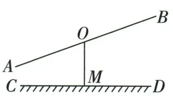

答案与解析

解析

过 $B$ 作 $BE\perp CD$，垂足为 $E$。$OM\perp CD$，故 $OM\parallel BE$。$A$ 着地，$O$ 为 $AB$ 中点，因此过中点且平行 $BE$ 的直线，必交 $AE$ 于其中点 $M$。

所以 $OM$ 为 $\triangle ABE$ 的中位线，$BE=2OM=80\text{ cm}$。此处40 cm是中点的高度，不是另一端的高度。

本题结论

$80\text{ cm}$。

</article>

<article class="handbook-example" aria-labelledby="example-6">

#### 例题 06 先用新的平行四边形找中点 知识清单例题 {#example-6 .example-heading}

题目

如图, 点 E 为平行四边形 ABCD 的边 DC 的延长线上一点, 且 CE = DC, 连接 AE 交 BC 于点 F, 连接 AC、BD 交于点 O, 连接 OF. 求证: DE = 4OF.

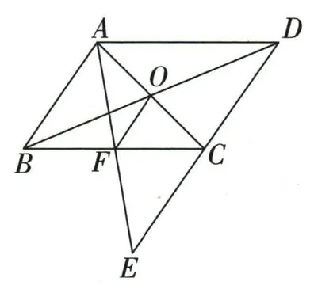

答案与解析

解析

连接 $BE$。原平行四边形给 $AB=DC$、$AB\parallel DC$、$BO=DO$。又 $CE=DC$，所以 $AB=CE$ 且 $AB\parallel CE$，四边形 $ABEC$ 为平行四边形。

它的对角线是 $AE$ 与 $BC$，交点 $F$ 因而是 $BC$ 中点。$O$ 为 $BD$ 中点，在 $\triangle BCD$ 中，$OF$ 为中位线，$CD=2OF$。

$D,C,E$ 顺次共线，且 $CE=CD$，所以 $DE=2CD=4OF$。

本题结论

$DE=4OF$。

</article>

<article class="handbook-example" aria-labelledby="example-7">

#### 例题 07 延长垂线构造两个中点 知识清单例题·改编，明确图示点的位置 {#example-7 .example-heading}

题目

如图, 在 $\triangle ABC$ 中, $AD$ 平分 $\angle BAC, AD \perp BD$ , $E$ 为 $BC$ 的中点.

(1) 求证: $DE \parallel AC$ .

(2) 若 AB=4, AC=6, 求 DE 的长.

其中 $D$ 严格位于 $\triangle ABC$ 内部。

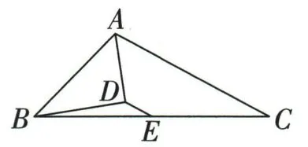

答案与解析

解析

（1）延长 $BD$ 交 $AC$ 于 $H$。

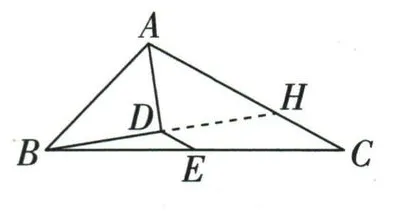

$AD$ 平分 $\angle BAC$，故 $\angle BAD=\angle HAD$；$\angle ADB=\angle ADH=90^\circ$，且 $AD$ 公共。由 ASA 得 $\triangle ADB\cong\triangle ADH$，所以 $BD=DH$、$AB=AH$。

$D$ 是 $BH$ 中点，$E$ 是 $BC$ 中点，在新三角形 $BHC$ 中用中位线，得 $DE\parallel HC$，即 $DE\parallel AC$。

（2）$AH=AB=4$，$CH=AC-AH=6-4=2$，因此 $DE=CH/2=1$。

本题结论

（1）$DE\parallel AC$；（2）$DE=1$。

</article>

### 4. 两个分散中点，用同一条对角线的中点连接 {#bridge-midpoint .exam-title}

当已知两条分散的边相等，可取共同对角线的中点，把两个原边分别变为两个三角形中位线的两倍。新的两条半长线段相等，便能构造等腰；再用平行把等角移回目标图形。

<article class="handbook-example" aria-labelledby="example-8">

#### 例题 08 交叉线段中的等腰判断 知识清单例题 {#example-8 .example-heading}

题目

如图所示,在四边形 ADBC 中,AB 与 CD 相交于点 O,AB=CD,E,F 分别是 BC,AD 的中点,连接 EF,分别交 DC,AB 于点 M,N,判断 $\triangle OMN$ 的形状,并说明理由.

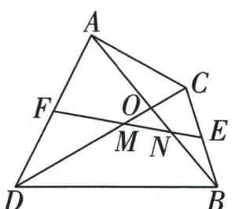

答案与解析

解析

取 $BD$ 中点 $H$，连接 $HE,HF$。

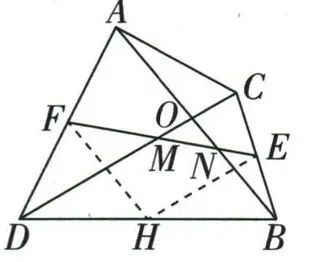

在 $\triangle BCD$ 中，$HE\parallel CD$、$HE=CD/2$；在 $\triangle ABD$ 中，$HF\parallel AB$、$HF=AB/2$。$AB=CD$，所以 $HE=HF$，有 $\angle HFE=\angle HEF$。

由两组平行，$\angle HFE=\angle ONM$、$\angle HEF=\angle OMN$，故 $\angle ONM=\angle OMN$，$OM=ON$。

取点 $H$ 的关键是让它同时进入两个原三角形，不是任意新增一个点都会产生两条中位线。

本题结论

$\triangle OMN$ 为等腰三角形，$OM=ON$。

</article>

<article class="handbook-example" aria-labelledby="example-9">

#### 例题 09 延长线上的两个目标角 知识清单例题 {#example-9 .example-heading}

题目

如图，在四边形 $ABCD$ 中，$AB=CD$，$E,F$ 分别为 $BC,AD$ 的中点。$BA,CD$ 的延长线分别与 $EF$ 的延长线交于 $M,N$。求证：$\angle BME=\angle CNE$。

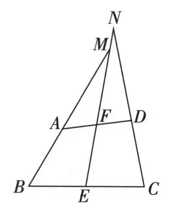

答案与解析

解析

连接 $BD$，取其中点 $G$，连接 $GE,GF$。

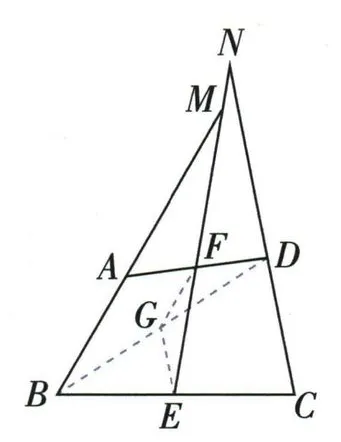

在 $\triangle ABD$ 中，$GF=AB/2$、$GF\parallel AB$；在 $\triangle BCD$ 中，$GE=CD/2$、$GE\parallel CD$。由 $AB=CD$ 得 $GF=GE$，所以 $\angle GEF=\angle GFE$。

按照图中的射线方向，由 $GF\parallel BM$ 得 $\angle GFE=\angle BME$；由 $GE\parallel CN$ 得 $\angle GEF=\angle CNE$。两式代入，得到所求等角。

本题结论

$\angle BME=\angle CNE$。

</article>

## 【坑点】辨析与边界 {#pitfalls .handbook-section .is-pitfall}

### 1. 边中点与半对角中点，先看端点是谁 {#which-midpoints .pitfall-title}

“连接中点”不是一个可直接判图形类型的条件。四条原边的中点，会把原对角线变成新边；半条对角线的中点，则使新对角线仍在原对角线上。两种构造必须分别证明。

<article class="handbook-example is-pitfall" aria-labelledby="pitfall-1">

#### 辨析 01 矩形半对角线的四个中点 知识清单例题 {#pitfall-1 .example-heading}

题目

矩形 $ABCD$ 的对角线交于 $O$，$E,F,G,H$ 分别为 $AO,BO,CO,DO$ 的中点。四边形 $EFGH$ 是矩形吗？说明理由。

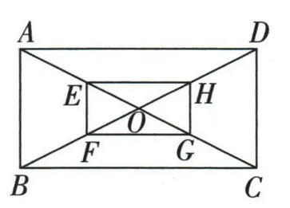

答案与解析

解析

矩形给 $AO=BO=CO=DO$，所以四个中点满足 $EO=FO=GO=HO$。$E,O,G$ 共线，$F,O,H$ 共线，新对角线 $EG,FH$ 在 $O$ 互相平分，故 $EFGH$ 先是平行四边形。

又 $EG=EO+OG=FO+OH=FH$，两对角线相等，因而 $EFGH$ 是矩形。

如果改为原四条边的中点，才应使用“原等对角线→新邻边等”，得到菱形。不是同一道题的两种随意答案。

本题结论

是矩形。此题的点在半对角线上，不在原四条边上。

</article>

