先认清是哪几条线、哪一对角，再使用数量关系。对顶角的位置本身保证相等；同位角的位置本身却不保证相等，还需要两条被截线平行。

<nav class="handbook-nav" aria-label="本章分区">
  <a class="handbook-jump is-knowledge" href="#knowledge">01 · 知识点概念、关系与适用条件</a>
  <a class="handbook-jump is-exam" href="#exam">02 · 考点题目分类和例题</a>
  <a class="handbook-jump is-pitfall" href="#pitfalls">03 · 坑点辨析错因，检查遗漏</a>
</nav>

## 【知识点】概念与依据 {#knowledge .handbook-section .is-knowledge}

### 1. 相交、垂直与平行 {#positions .knowledge-title}

同一平面内，两条不同直线相交或平行。相交成直角时，叫作互相垂直

- 垂直记作 $a\perp b$，交点叫垂足
- 平行记作 $a\parallel b$，两条直线没有公共点
- 过一点有且只有一条直线垂直于已知直线
- 过直线外一点有且只有一条直线平行于已知直线

### 2. 用三角尺画垂线和平行线 {#construction .knowledge-title}

- 画垂线：三角尺一直角边贴住已知直线，移动到另一直角边经过指定点，再沿边画线
- 画平行线：用直尺固定方向，沿直尺平移三角尺，移动到指定点后沿对应边画线

### 3. 点到直线的距离 {#distance .knowledge-title}

从点 $P$ 向直线作垂线，垂足为 $H$，垂线段 $PH$ 的长度叫作==点到直线的距离==

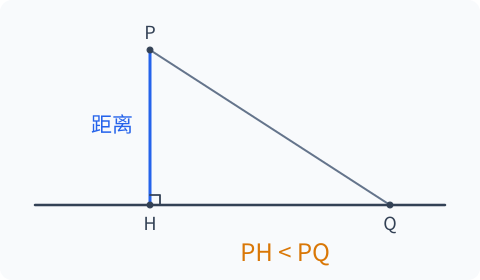

从直线外一点到这条直线的所有线段中，垂线段最短

### 4. 对顶角与邻补角 {#opposite-adjacent .knowledge-title}

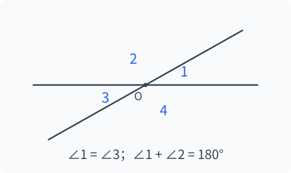

- 对顶角相等：$\angle1=\angle3$、$\angle2=\angle4$
- 邻补角之和为 $180^\circ$：如 $\angle1+\angle2=180^\circ$

### 5. 同位角、内错角、同旁内角 {#angle-pairs .knowledge-title}

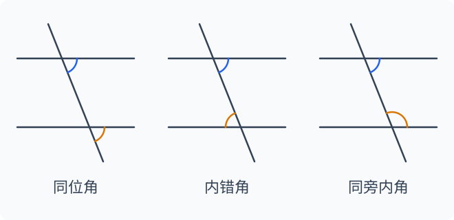

先看两条直线和一条截线，再按图中的位置找角。两条直线还未确定平行时，这些名称只表示位置

### 6. 平行线的判定与性质 {#criteria-properties .knowledge-title}

| 角的关系 | 能判定 | 已知平行时能得到 |
| --- | --- | --- |
| 同位角相等 | 两直线平行 | 同位角相等 |
| 内错角相等 | 两直线平行 | 内错角相等 |
| 同旁内角互补 | 两直线平行 | 同旁内角互补 |

两条直线都平行于第三条直线，则这两条直线平行

## 【考点】方法先于例题 {#exam .handbook-section .is-exam}

### 1. 交点的最大数与计数条件 {#intersections .exam-title}

同一平面内 $n$ 条不同直线，$n\ge2$ 且为整数，最多有 $\dfrac{n(n-1)}2$ 个不同交点。

第 $k$ 条线与前 $k-1$ 条线至多各交一次，新增交点至多 $k-1$ 个。于是总数上限为

$$S=1+2+\cdots+(n-1),\qquad 2S=n(n-1).$$

也可按线对计数：选第一条有 $n$ 种，第二条有 $n-1$ 种，交换顺序重复一次，所以除以2。达到上限还需无两线平行、无三线共点，否则线对数不等于不同交点数。

若允许所有线互相平行，最少是0个交点；若要求两两相交，可以共点时最少是1个。不能忽略题目的限制统一回答“最少1个”。在无平行、无三线共点的最大布局中，每个交点有2对对顶角、4对邻补角，所以相应为 $n(n-1)$ 对、$2n(n-1)$ 对；多线共点时不能简单按不同交点数乘2或乘4。

### 2. 垂直条件：先找整个直角，再做和差 {#perpendicular-method .exam-title}

先把垂直翻译成有名称的 $90^\circ$ 角。核对内部射线顺序，把倍数、平分关系放进对应的整体；证明垂直时反向进行，先证明两条射线所夹角是直角，再写垂直结论。

<article class="handbook-example" aria-labelledby="example-1">

#### 例题 01 直角中的倍数与平分 知识清单例题 {#example-1 .example-heading}

题目

如图, $OA \perp OD$ , $\angle AOC = 3\angle COD$ , $OC$ 平分 $\angle BOD$ , 求 $\angle AOB$ 的度数.

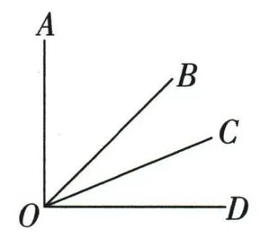

答案与解析

解析

设 $\angle COD=x$。由 $OA\perp OD$ 及图中的角包含关系，$\angle AOC+\angle COD=90^\circ$，所以

$$3x+x=90^\circ\Rightarrow x=22.5^\circ.$$

$OC$ 平分的是 $\angle BOD$，因此 $\angle BOD=2x=45^\circ$。目标在直角的剩余部分，$\angle AOB=90^\circ-45^\circ=45^\circ$。

本题结论

$\angle AOB=45^\circ$。

</article>

<article class="handbook-example" aria-labelledby="example-2">

#### 例题 02 给等角，说明两射线的位置关系 知识清单例题 {#example-2 .example-heading}

题目

如图, $CO \perp AB$ ,垂足为 O, $\angle AOE = \angle COF$ ,则 OE,OF 有什么位置关系?请说明理由.

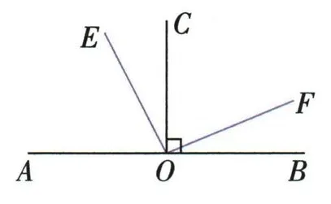

答案与解析

解析

由 $CO\perp AB$，得 $\angle AOC=90^\circ$。图中 $OE$ 在 $\angle AOC$ 内，$OC$ 在 $\angle EOF$ 内，将已知等角两边同加 $\angle COE$：

$$\angle AOE+\angle COE=\angle COF+\angle COE.$$

左边是 $\angle AOC$，右边是 $\angle EOF$，所以 $\angle EOF=90^\circ$。由垂直的定义，$OE\perp OF$。

本题结论

$OE\perp OF$，交点为 $O$。

</article>

### 3. 最近路线：先分清终点固定还是可选 {#shortest-method .exam-title}

两端固定，就连接两点；终点可以在一条直线上任选，就向这条线作垂线。作图后还要逐问写出路线和依据，不能只用“最短”二字替代判断。

<article class="handbook-example" aria-labelledby="example-3">

#### 例题 03 车站、码头、铁路与河流 知识清单例题 {#example-3 .example-heading}

题目

如图所示,火车站、码头分别位于 A、B 两点,直线 a 和 b 分别表示河流与铁路.

(1)从火车站到码头怎样走最近？画图并说明理由.   
(2)从码头到铁路怎样走最近？画图并说明理由.   
(3)从火车站到河流怎样走最近？画图并说明理由.

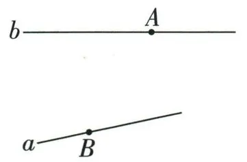

答案与解析

解析

（1）连接 $AB$，沿线段 $AB$ 走。两端都固定，依据“两点之间，线段最短”。

（2）过 $B$ 作 $BE\perp b$，垂足为 $E$。终点可在铁路上选择，所以沿 $BE$ 走，依据“垂线段最短”。

（3）过 $A$ 作 $AF\perp a$，垂足为 $F$。沿 $AF$ 走，依据同上。这里按题给直线模型，不另设道路障碍。

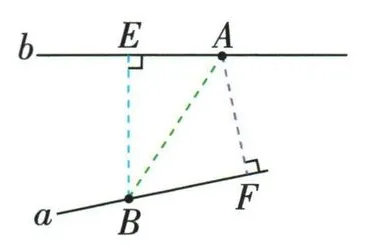

本题结论

（1）$AB$；（2）$BE$；（3）$AF$。第一问依据线段最短，后两问依据垂线段最短。

</article>

### 4. 最大交点：逐次增加，并检查能否同时达到 {#count-method .exam-title}

每加一条直线，最多与每条旧线产生一个新交点。数完后要解释怎样避免平行和共点，而不是把任何布局都当作最大布局。

<article class="handbook-example" aria-labelledby="example-4">

#### 例题 04 从三条线推到一般情形 知识清单例题 {#example-4 .example-heading}

题目

$l_{1}$ 和 $l_{2}$ 是同一平面内的两条相交直线, 它们有 1 个交点, 如果在这个平面内, 再画第三条直线 $l_{3}$ , 那么这 3 条直线最多可有 ____ 个交点; 如果在这个平面内, 再画第四条直线 $l_{4}$ , 那么这 4 条直线最多可有 ____ 个交点. 由此我们可以推测: 在同一平面内, 6 条直线最多可有 ____ 个交点, n (n 为大于 1 的整数) 条直线最多可有 ____ 个交点.

答案与解析

解析

第三条至多增加2个新交点，合计 $1+2=3$；第四条至多增加3个，合计 $1+2+3=6$。图示各交点分开，表明这些上限能够达到。

<figure class="handbook-option">

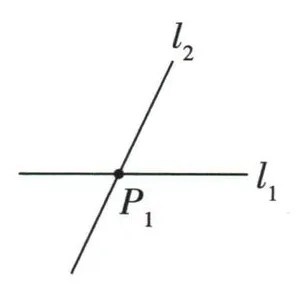

2 条直线的最大交点布局

</figure>

<figure class="handbook-option">

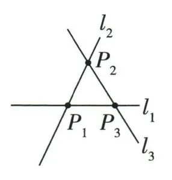

3 条直线的最大交点布局

</figure>

<figure class="handbook-option">

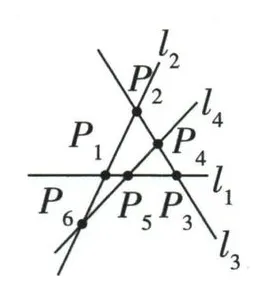

4 条直线的最大交点布局

</figure>

一般为 $n(n-1)/2$，代入 $n=6$ 得15。三条线全部共点只有一个交点，不能作为最大布局。

本题结论

依次填 $3$、$6$、$15$、$\dfrac{n(n-1)}2$。

</article>

### 5. 换到目标所在区域，再决定减哪个角 {#angle-calculation .exam-title}

对顶角相等可以把已知角换到另一侧。换过去以后，目标可能是直角的余下部分、平角的余下部分，或某个已知整体的一部分。若有平分线，先写它平分的角名，再除以2。

<article class="handbook-example" aria-labelledby="example-5">

#### 例题 05 直角与对顶角 2024 北京 {#example-5 .example-heading}

题目

（2024 北京）如图，直线 AB 和 CD 相交于点 O, OE ⊥ OC. 若 $\angle AOC = 58^{\circ}$ ，则 $\angle EOB$ 的大小为 ____

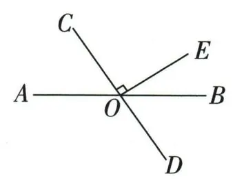

A. $29^{\circ}$

B. $32^{\circ}$

C. $45^{\circ}$

D. $58^{\circ}$

答案与解析

解析

$OC$ 与 $OD$ 反向，$OE\perp OC$ 也给出 $\angle EOD=90^\circ$。$\angle BOD$ 与 $\angle AOC$ 是对顶角，故 $\angle BOD=58^\circ$。图中 $OB$ 在直角内部，所以

$$\angle EOB=90^\circ-58^\circ=32^\circ.$$

$29^\circ$ 是误把58减半；$45^\circ$ 需要直角被平分，而题目没有这项条件；$58^\circ$ 是中间角，不是目标。

本题结论

选 B，$32^\circ$。

</article>

<article class="handbook-example" aria-labelledby="example-6">

#### 例题 06 先半角，再邻补 知识清单例题 {#example-6 .example-heading}

题目

如图, 直线 AB, CD 相交于点 O, OE 平分 $\angle DOB$ , 若 $\angle AOC = 70^{\circ}$ , 求 $\angle EOC$ 的度数.

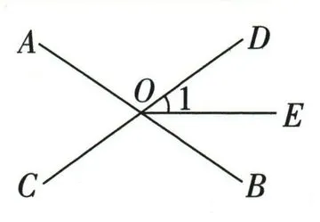

答案与解析

解析

先由对顶角相等得 $\angle DOB=\angle AOC=70^\circ$。$OE$ 平分 $\angle DOB$，所以 $\angle DOE=35^\circ$。

$OD$ 与 $OC$ 反向，$\angle DOE$ 与 $\angle EOC$ 邻补，因此 $\angle EOC=180^\circ-35^\circ=145^\circ$。应减半角，而不是直接减整个70°。

本题结论

$\angle EOC=145^\circ$。

</article>

<article class="handbook-example" aria-labelledby="example-7">

#### 例题 07 找包含目标的整个角 2024 山东日照 {#example-7 .example-heading}

题目

（2024 山东日照）如图，直线 AB, CD 相交于点 O，若 $\angle1=40^{\circ}$ ， $\angle2=120^{\circ}$ ，则 $\angle COM$ 的度数为（）

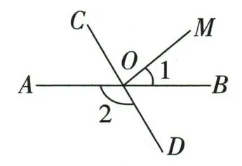

A. ${70}^{ \circ  }$

B. ${80}^{ \circ  }$

C. ${90}^{ \circ  }$

D. ${100}^{ \circ  }$

答案与解析

解析

$\angle BOC$ 与图中 $\angle2$ 是对顶角，所以 $\angle BOC=120^\circ$。$OM$ 在 $\angle BOC$ 内部，且 $\angle BOM=\angle1=40^\circ$，故

$$\angle COM=120^\circ-40^\circ=80^\circ.$$

没有垂直标记，不能把 $\angle COM$ 看作90°；也不能把相邻但不是目标组成部分的角随意相减。

本题结论

选 B，$80^\circ$。

</article>

### 6. 识别角对：每一对都重新找截线 {#identify-method .exam-title}

先写角的两边，找到共线的一边作为截线，再看另外两边的位置。同一个角可以参与多套三线关系；要求“所有”角对时，按截线逐组检查，避免漏答。

<article class="handbook-example" aria-labelledby="example-8">

#### 例题 08 同旁内角不止一种选择 知识清单例题 {#example-8 .example-heading}

题目

如图, $\angle BAC$ 和 $\angle$ ____ 是直线 AB, BD 被直线 ____ 所截得的内错角; $\angle ACB$ 的同旁内角是 ____.

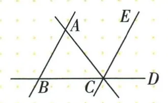

答案与解析

解析

$AB$、$BD$ 被 $AC$ 所截时，$\angle BAC$ 与 $\angle ACD$ 都在两被截线之间、截线异侧，是内错角。

$\angle ACB$ 的同旁内角有两种：以 $AC$ 为截线，另一角是 $\angle BAC$；以 $BC$ 为截线，另一角是 $\angle ABC$。两套关系不能混为同一套。题目未给平行，所以这里只识别位置，不断言互补。

本题结论

依次填 $ACD$、$AC$；同旁内角为 $\angle BAC$、$\angle ABC$。

</article>

<article class="handbook-example" aria-labelledby="example-9">

#### 例题 09 六个标角中的全部角对 知识清单例题 {#example-9 .example-heading}

题目

在下图标出的 $\angle1$、$\angle2$、$\angle3$、$\angle4$、$\angle5$ 和 $\angle B$ 中，分别找出所有同位角、内错角和同旁内角。

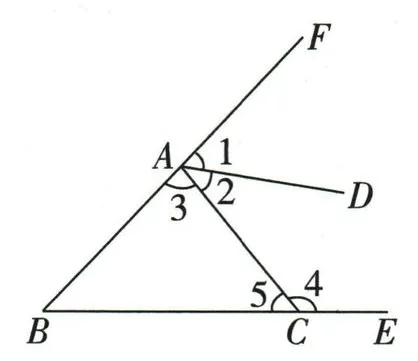

答案与解析

解析

逐组抽出相关三条线，结果如下。表中“截线”是两角中共线边所在的直线，不一定是图中最显眼的一条。

| 角对 | 被截线 | 截线 | 类型 |
| --- | --- | --- | --- |
| 1与B | $AD,BE$ | $BF$ | 同位 |
| 4与B | $AC,BF$ | $BE$ | 同位 |
| 2与5 | $AD,BE$ | $AC$ | 内错 |
| 4与3 | $BF,BE$ | $AC$ | 内错 |
| 2与4 | $AD,BE$ | $AC$ | 同旁内角 |
| 3与5 | $BF,BE$ | $AC$ | 同旁内角 |
| 3与B | $AC,BE$ | $BF$ | 同旁内角 |
| B与5 | $BF,AC$ | $BE$ | 同旁内角 |

<figure class="handbook-option">

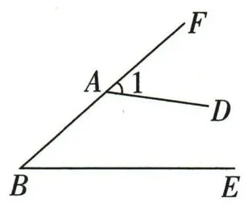

分解图 1

</figure>

<figure class="handbook-option">

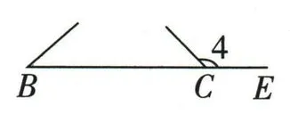

分解图 2

</figure>

<figure class="handbook-option">

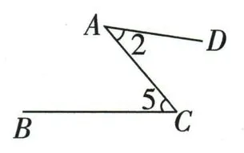

分解图 3

</figure>

<figure class="handbook-option">

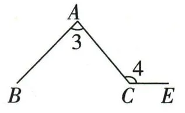

分解图 4

</figure>

<figure class="handbook-option">

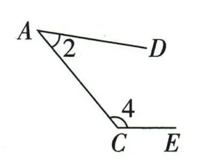

分解图 5

</figure>

<figure class="handbook-option">

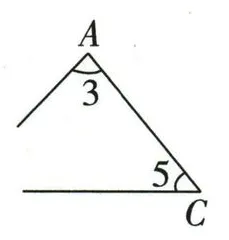

分解图 6

</figure>

<figure class="handbook-option">

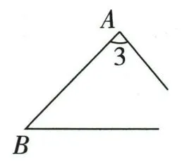

分解图 7

</figure>

<figure class="handbook-option">

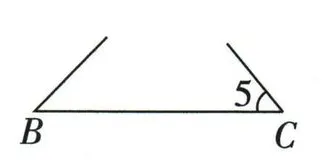

分解图 8

</figure>

本题结论

同位角：1与B、4与B；内错角：2与5、4与3；同旁内角：2与4、3与5、3与B、B与5。

</article>

### 7. 从角到线，再从线到角 {#proof-chain .exam-title}

判定与性质的方向相反：判定用已知角关系证明平行，性质用已经成立的平行推出角关系。综合题逐行标明线对与截线，换了一套线组就重新识角。

1. 从已知中找到等角或补角，建立第一组平行。
2. 用这组平行产生需要的中间角关系。
3. 与另一项已知等量代换，建立第二组平行或目标直角。
4. 回到目标角名，确认没有停在中间结论。

<article class="handbook-example" aria-labelledby="example-10">

#### 例题 10 共同垂线之外还要用哪个条件 知识清单例题 {#example-10 .example-heading}

题目

如图, $AB \perp EF$ 于 $B, CD \perp EF$ 于 $D, \angle 1 = \angle 2$ .

(1)请说明 $AB \parallel CD$ 的理由。(2)试问 BM 与 DN 是否平行？为什么？

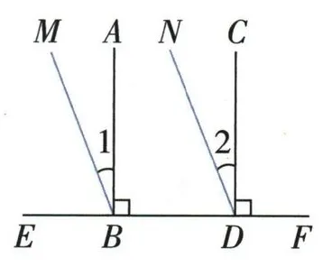

答案与解析

解析

（1）$AB\perp EF$、$CD\perp EF$，所以 $\angle ABE=\angle CDE=90^\circ$。它们是 $EF$ 截 $AB,CD$ 的同位角，因此 $AB\parallel CD$。

（2）由图中内部位置，

$$\angle MBE=90^\circ-\angle1,\qquad \angle NDE=90^\circ-\angle2.$$

已知 $\angle1=\angle2$，所以 $\angle MBE=\angle NDE$。这次被截线是 $BM,DN$，截线仍是 $EF$，由同位角相等得 $BM\parallel DN$。第一问的平行不能直接代替第二问。

本题结论

（1）$AB\parallel CD$；（2）$BM\parallel DN$。

</article>

<article class="handbook-example" aria-labelledby="example-11">

#### 例题 11 先求整角，再把半角移到目标 知识清单例题 {#example-11 .example-heading}

题目

如图所示,已知 $AD \parallel BC$ , BE 平分 $\angle ABC$ , $\angle A = 110^{\circ}$ . 求 $\angle ADB$ 的度数.

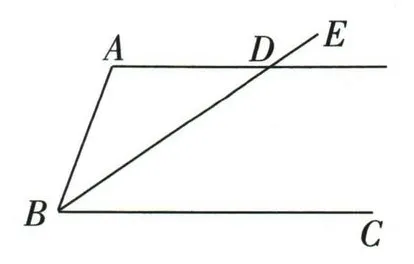

答案与解析

解析

先以 $AB$ 为截线：$AD\parallel BC$ 给 $\angle A+\angle ABC=180^\circ$，所以 $\angle ABC=70^\circ$。

$BE$ 平分 $\angle ABC$，图中 $B,D,E$ 在同一射线上，故 $\angle CBD=35^\circ$。再以 $BD$ 为截线：$\angle ADB$ 与 $\angle DBC$ 是内错角，因而 $\angle ADB=35^\circ$。

本题结论

$\angle ADB=35^\circ$。

</article>

<article class="handbook-example" aria-labelledby="example-12">

#### 例题 12 两次判平行，最后得到直角 知识清单例题·题图去除推导标记 {#example-12 .example-heading}

题目

如图,已知 $EF \perp BC, \angle1 = \angle C, \angle2 + \angle3 = 180^{\circ}$ . 求证: $\angle ADC = 90^{\circ}$ .

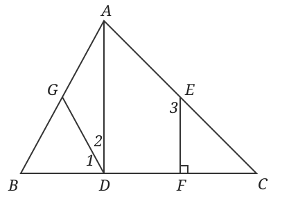

答案与解析

解析

按线组逐步推理：

| 步骤 | 推理 | 依据 |
| --- | --- | --- |
| 1 | $\angle1=\angle C\Rightarrow GD\parallel AC$ | $BC$ 为截线，同位角相等 |
| 2 | $\angle2=\angle DAC$ | $AD$ 为截线，平行线内错角相等 |
| 3 | $\angle DAC+\angle3=180^\circ$ | 用第2步替换已知中的 $\angle2$ |
| 4 | $AD\parallel EF$ | $AC$ 为截线，同旁内角互补 |
| 5 | $\angle ADC=\angle EFC=90^\circ$ | $BC$ 为截线，同位角相等；$EF\perp BC$ |

两组平行在图中可分别标记，但证明之前不能把它们当作已知。

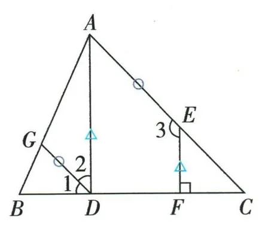

本题结论

$\angle ADC=90^\circ$。

</article>

<article class="handbook-example" aria-labelledby="example-13">

#### 例题 13 从一条截线换到另一条 2024 内蒙古呼和浩特 {#example-13 .example-heading}

题目

（2024 内蒙古呼和浩特）如图，直线 $l_{1}$ 和 $l_{2}$ 被直线 $l_{3}$ 和 $l_{4}$ 所截， $\angle1=\angle2=130^{\circ},\angle3=75^{\circ}$ ，则 $\angle4$ 的度数为（）

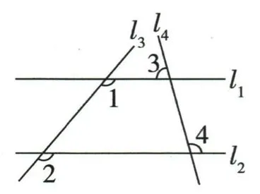

A. $75^{\circ}$

B. $105^{\circ}$

C. $115^{\circ}$

D. $130^{\circ}$

答案与解析

解析

先以 $l_3$ 为截线，$\angle1=\angle2$ 是同位角相等，所以 $l_1\parallel l_2$。

再改用 $l_4$。把 $\angle3$ 换成同一交点的对顶角，它与 $\angle4$ 同旁内角互补，所以 $\angle4=180^\circ-75^\circ=105^\circ$。

$130^\circ$ 用于第一套截线的判定，不应直接参与第二套截线的角度运算；$75^\circ$ 是已知角，不是所求补角。

本题结论

选 B，$105^\circ$。

</article>

### 8. 折线换位置，辅助射线也要重新选 {#zigzag-method .exam-title}

两条平行线之间有折线时，过拐点作共同平行线，把目标分成能沿两条截线换算的角。选择进入目标角内部的辅助射线，分别判断是等角还是补角，然后做和差。拐点换了区域，旧关系式不一定继续成立。

<article class="handbook-example" aria-labelledby="example-14">

#### 例题 14 同一折线的三幅图 知识清单例题 {#example-14 .example-heading}

题目

图1中 $AB\parallel CD$，$E$ 在两平行线之间。过 $E$ 作 $EF\parallel AB$，可得 $EF\parallel CD$。于是 $\angle B=\angle BEF$，$\angle C=\angle CEF$，所以 $\angle B+\angle C=\angle BEC$。

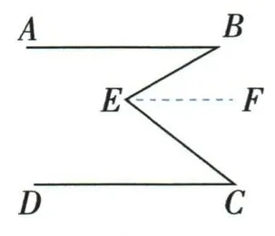

（1）若点 $E$ 移到图2的位置，其他条件不变，$\angle B$、$\angle C$、$\angle BEC$ 有什么关系？证明你的结论。

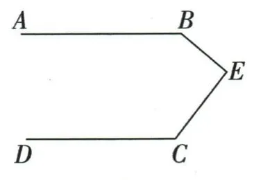

（2）图3中 $AB\parallel DC$，$\angle C=120^\circ$，$\angle AEC=80^\circ$，求 $\angle A$。

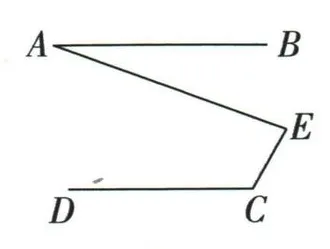

答案与解析

解析

（1）过 $E$ 向左作 $EF\parallel AB$，由平行传递也有 $EF\parallel DC$。两套截线分别给

$$\angle B+\angle BEF=180^\circ,\qquad \angle C+\angle CEF=180^\circ.$$

$EF$ 在 $\angle BEC$ 内，将两式相加，得 $\angle B+\angle C+\angle BEC=360^\circ$。

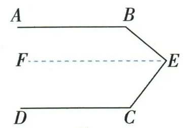

（2）同样过 $E$ 向左作 $EF\parallel AB\parallel DC$。$\angle C$ 与 $\angle CEF$ 是同旁内角，故 $\angle CEF=60^\circ$。从整体 $\angle AEC$ 中扣去它，得 $\angle AEF=80^\circ-60^\circ=20^\circ$。再由内错角相等得 $\angle A=20^\circ$。

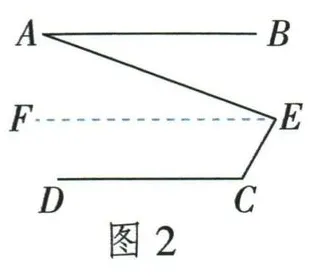

本题结论

（1）$\angle B+\angle C+\angle BEC=360^\circ$；（2）$\angle A=20^\circ$。

</article>

## 【坑点】辨析与边界 {#pitfalls .handbook-section .is-pitfall}

### 1. 看到了直角，不等于找对了距离 {#distance-pit .pitfall-title}

距离题要同时检查三个对象：从哪个点出发、垂足在哪条直线上、直角夹在哪两条线之间。垂足在线段之外不是错误；垂直了另一条线才是对象错误。

<article class="handbook-example is-pitfall" aria-labelledby="pitfall-1">

#### 辨析 01 点A到直线BC的距离 知识清单例题·改编，明确距离为长度 {#pitfall-1 .example-heading}

题目

以下哪幅图中的垂线段长度表示点 $A$ 到直线 $BC$ 的距离？

<figure class="handbook-option">

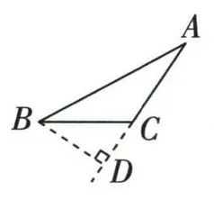

选项 A

</figure>

<figure class="handbook-option">

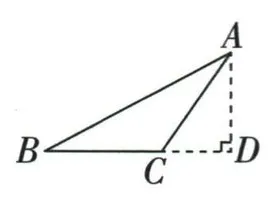

选项 B

</figure>

<figure class="handbook-option">

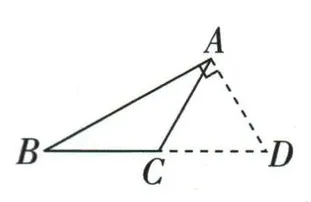

选项 C

</figure>

<figure class="handbook-option">

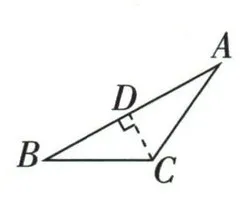

选项 D

</figure>

答案与解析

解析

A中的 $BD$ 表示 $B$ 到直线 $AC$ 的距离；B中的 $AD$ 从 $A$ 出发、垂直于直线 $BC$，垂足 $D$ 虽在延长线上仍有效；C中 $AD\perp AB$，不是垂直 $BC$；D中的 $CD$ 表示 $C$ 到 $AB$ 的距离。

只有B同时满足指定点、指定直线、垂直关系三项条件。

本题结论

选 B，距离是 $AD$ 的长度。

</article>

### 2. 角的名称看两边，不看编号是否相邻 {#position-pit .pitfall-title}

多个角共顶点时，“隔一格”“在对面”都不足以作判断。对顶角逐边检查反向，邻补角检查公共边和另外两边反向；仅数值相等或相加180°不能替代位置条件。

<article class="handbook-example is-pitfall" aria-labelledby="pitfall-2">

#### 辨析 02 三条直线共点 知识清单例题 {#pitfall-2 .example-heading}

题目

直线 $a,b,c$ 交于点 $O$，下列判断正确的是（　）。

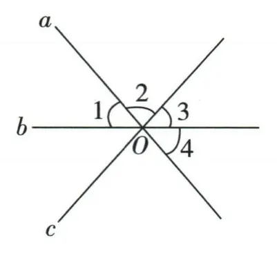

A. $\angle1$ 与 $\angle2$ 是对顶角。

B. $\angle1$ 与 $\angle3$ 是邻补角。

C. $\angle4$ 的对顶角是 $\angle1$。

D. $\angle2$ 的邻补角是 $\angle4$。

答案与解析

解析

A、B、D所说的两角，其边涉及三条不同直线，分别不满足对顶角或邻补角所需的位置。只有 $\angle4$ 与 $\angle1$ 来自直线 $a,b$，两边分别反向，所以是对顶角。应沿着图中 $a,b,c$ 三条直线追踪角的两边。

本题结论

选 C。

</article>

<article class="handbook-example is-pitfall" aria-labelledby="pitfall-3">

#### 辨析 03 补角必须紧挨着吗 知识清单例题 {#pitfall-3 .example-heading}

题目

如图, $\angle AOC = \angle BOC = \angle DOE = 90^{\circ}$ . 图中有与 $\angle 3$ 互补的角吗?

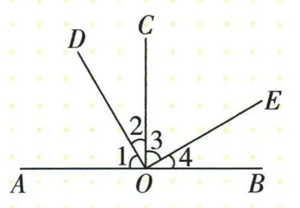

答案与解析

解析

图中 $\angle1+\angle2=90^\circ$，$\angle2+\angle3=90^\circ$，同减 $\angle2$ 得 $\angle1=\angle3$。

$\angle1$ 即 $\angle AOD$，与 $\angle BOD$ 邻补，故 $\angle1+\angle BOD=180^\circ$。将 $\angle1$ 换成相等的 $\angle3$，可知 $\angle3+\angle BOD=180^\circ$。等量代换只改变数值表达，不把两个角的位置也换成相邻。

本题结论

有，$\angle BOD$ 与 $\angle3$ 互补。

</article>

### 3. “只有一条”不能省略经过的点和点的位置 {#unique-pit .pitfall-title}

唯一性限制的是同一个固定线外点处的候选平行线。删掉“固定点”或删掉“线外”，命题的范围就变了；垂线唯一性与平行线唯一性的点位置要求也不同。

<article class="handbook-example is-pitfall" aria-labelledby="pitfall-4">

#### 辨析 04 两句话是否完整 知识清单辨析·去除题面答案 {#pitfall-4 .example-heading}

题目

判断并说明理由：

（1）一条直线的平行线只有一条。

（2）过一点与已知直线平行的直线只有一条。

答案与解析

解析

（1）错误。没有限制通过哪个点，可有无数条平行线。

（2）错误。若点就在已知直线上，通过它的其他直线都与已知直线相交；原线自身重合也不是两条不同直线平行。必须说“过直线外一点”，才有且只有一条。

本题结论

两句都错误。完整表述：同一平面内，过直线外一点，有且只有一条直线与已知直线平行。

</article>

### 4. 判定的结论不能把截线算进去 {#line-pair-pit .pitfall-title}

等角或补角能判平行，前提是角的位置符合某一判据。找到共同截线后，结论写的是另外两条被截线，而不是把截线与其中一条线写成平行。

<article class="handbook-example is-pitfall" aria-labelledby="pitfall-5">

#### 辨析 05 同一条截线，两组不同结论 知识清单例题 {#pitfall-5 .example-heading}

题目

如图,由下列条件可判定哪两条直线平行?

(1) $\angle 1 = \angle 3$ . (2) $\angle 2 = \angle 4$ .

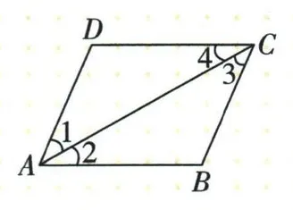

答案与解析

解析

（1）$\angle1=\angle DAC$，$\angle3=\angle ACB$。共同截线是 $AC$，另外两边属于 $AD,CB$，内错角相等给 $AD\parallel CB$。

（2）$\angle2=\angle CAB$，$\angle4=\angle DCA$。截线仍为 $AC$，另外两边改为 $AB,CD$，所以 $AB\parallel CD$。

两个条件应分别使用，不能看图像平行四边形就直接默认两组都平行。

本题结论

（1）$AD\parallel CB$；（2）$AB\parallel CD$。

</article>

### 5. 没有平行已知，三线八角只有位置关系 {#missing-parallel .pitfall-title}

使用性质前，必须指出平行来自题干还是已经证明。图画得接近平行不是条件；未给平行时，仍然可以用同一交点的对顶角和邻补角关系。

<article class="handbook-example is-pitfall" aria-labelledby="pitfall-6">

#### 辨析 06 哪些关系一定成立 知识清单例题 {#pitfall-6 .example-heading}

题目

如图, 直线 a, b 被直线 c 所截, 下列正确的是 ____.

①∠1=∠2;   
②∠1=∠3;   
③∠2=∠3;   
④ $\angle3+\angle4=180^{\circ}$ .

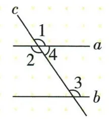

答案与解析

解析

① $\angle1$ 与 $\angle2$ 是同一交点的对顶角，必相等。

② $\angle1$ 与 $\angle3$ 同位；③ $\angle2$ 与 $\angle3$ 内错；④ $\angle3$ 与 $\angle4$ 同旁内角。题目没有给 $a\parallel b$，后三项的相等或互补均不能保证。若这些数值关系额外作为已知，才可反过来判平行。

本题结论

只有①一定成立。

</article>

