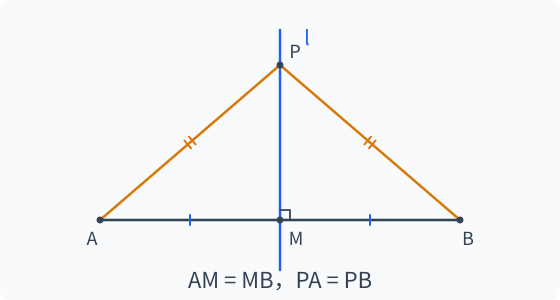
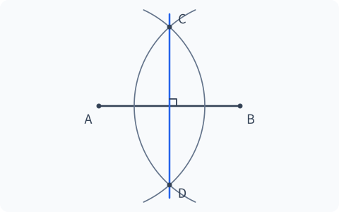
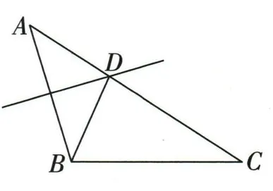
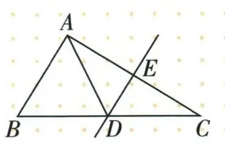
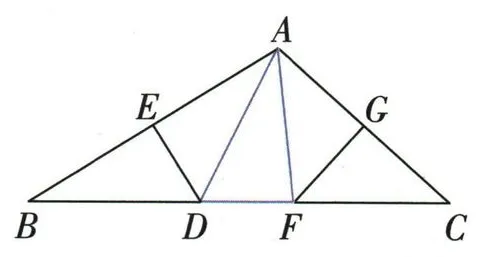
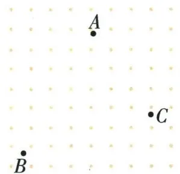
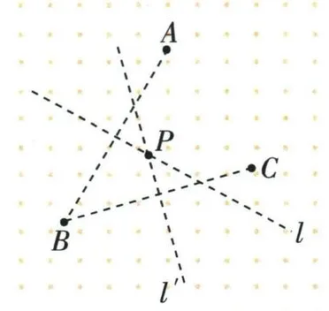
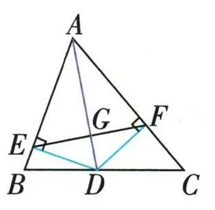
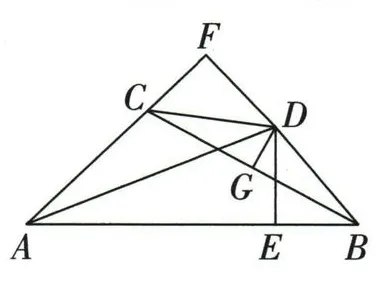

一条垂直平分线，把“点的位置”与“到两个端点的距离相等”联系起来。求长度时用它换边，证明位置时反过来用等距判断；两个方向的条件要分清。

<nav class="handbook-nav" aria-label="本章分区">
  <a class="handbook-jump is-knowledge" href="#knowledge">01 · 知识点概念、关系与适用条件</a>
  <a class="handbook-jump is-exam" href="#exam">02 · 考点题目分类和例题</a>
  <a class="handbook-jump is-pitfall" href="#pitfalls">03 · 坑点辨析错因，检查遗漏</a>
</nav>

## 【知识点】概念与依据 {#knowledge .handbook-section .is-knowledge}

### 1. 线段的垂直平分线 {#definition .knowledge-title}

经过线段中点，并且垂直于这条线段的直线，叫作==垂直平分线==，简称中垂线

图中 $AM=MB$、$l\perp AB$，所以 $l$ 是 $AB$ 的垂直平分线

### 2. 性质与判定 {#equidistance .knowledge-title}

1. 性质：中垂线上的点，到线段两端点的距离相等，即 $PA=PB$
2. 判定：到线段两端点距离相等的点，在这条线段的中垂线上

::: info 为什么两端距离相等

展开证明

$AM=BM$，$PM$ 是公共边，两个夹角都是直角，由 SAS 得 $\triangle PAM\cong\triangle PBM$，所以 $PA=PB$

:::

### 3. 尺规作中垂线 {#construction .knowledge-title}

1. 分别以 $A,B$ 为圆心，取相同且大于 $\frac12AB$ 的长度为半径作弧
2. 两侧交点为 $C,D$，作直线 $CD$
3. $CD$ 就是中垂线，与 $AB$ 的交点就是中点

### 4. 三角形的外心 {#circumcenter .knowledge-title}

三条边的垂直平分线交于一点，叫作三角形的==外心==，到三个顶点的距离相等

以外心为圆心、到一个顶点的距离为半径，就能画出经过三个顶点的外接圆

## 【考点】方法与例题 {#exam .handbook-section .is-exam}

### 1. 先换成等长线段，再按点序加减 {#length-perimeter .exam-title}

1. 看清是哪条线段的中垂线，写出到它两个端点的等距关系。
2. 若求一段长，找到整段与部分段；若求周长，先写完整三边和。
3. 用等长边替换未知边，再核对图中的共线点顺序，决定相加还是相减。

中垂线只给等距，不自动给某个点在某条边的内部。

<article class="handbook-example" aria-labelledby="example-1">

#### 例题 01 由整段与部分求另一段 2024 江苏镇江 {#example-1 .example-heading}

题目

（2024 江苏镇江）如图, $\triangle ABC$ 的边 AB 的垂直平分线交 AC 于点 D, 连接 BD. 若 AC=8, CD=5, 则 BD= \_\_\_\_.

答案与解析

解析

图中 $A,D,C$ 顺次共线，所以 $AD=AC-CD=8-5=3$。

$D$ 在 $AB$ 的中垂线上，故 $DB=DA=3$。相减来自点序，换边来自等距，两步依据不同。

本题结论

$BD=3$。

</article>

<article class="handbook-example" aria-labelledby="example-2">

#### 例题 02 已知一个小三角形的周长 知识清单例题 {#example-2 .example-heading}

题目

如图, 在 $\triangle ABC$ 中, DE 是 AC 的垂直平分线, AE = 3, $\triangle ABD$ 的周长为 13, 则 $\triangle ABC$ 的周长为 \_\_\_\_.

答案与解析

解析

$DE$ 垂直平分 $AC$，所以 $AC=2AE=6$，且 $DA=DC$。

按图中 $B,D,C$ 的顺序，

$$\begin{aligned}C_{\triangle ABC}&=AB+BD+DC+AC\\&=AB+BD+DA+AC\\&=13+6=19.\end{aligned}$$

$13$ 已经是 $AB+BD+DA$ 的整体，不必再逐边求长度。

本题结论

$\triangle ABC$ 的周长为 $19$。

</article>

<article class="handbook-example" aria-labelledby="example-3">

#### 例题 03 将三边和转到同一条底边 知识清单例题 {#example-3 .example-heading}

题目

如图, 在 $\triangle ABC$ 中, $BC=10\ \text{cm}$ , $DE$ 、 $FG$ 分别垂直平分 $AB$ 、 $AC$ , $E$ 、 $G$ 为垂足, 求 $\triangle DAF$ 的周长.

答案与解析

解析

$D$ 在 $AB$ 的中垂线上，得 $DA=DB$；$F$ 在 $AC$ 的中垂线上，得 $FA=FC$。

图中 $B,D,F,C$ 顺次共线，因此

$$DA+DF+FA=DB+DF+FC=BC=10\text{ cm}.$$

若点移到延长线上，等距仍成立，但末步不能不看点序就三项相加。

本题结论

周长为 $10\text{ cm}$。

</article>

### 2. 三点等距的位置，交两条中垂线确定 {#three-points .exam-title}

到 $A,B$ 等距，限定一条中垂线；到 $B,C$ 等距，再限定一条中垂线。交点同时满足两组条件，第三组等距由传递得到。题目若另外限制可建设区域或道路距离，还须重新核对，不能只凭几何交点就判断现实方案可行。

<article class="handbook-example" aria-labelledby="example-4">

#### 例题 04 确定三个村庄的等距位置 知识清单例题 {#example-4 .example-heading}

题目

为了解决三个村庄孩子的就近入学问题,计划新建一所小学,使学校到三个村庄的距离相等.若三个村庄A,B,C的位置如图所示,请你在图中确定小学的位置(用点P表示).

答案与解析

解析

连接 $AB,BC$，分别作其中垂线 $l,l'$，交于 $P$。

由性质 $PA=PB$、$PB=PC$，得 $PA=PB=PC$。反过来，任何合格点都必须在这两条中垂线上，所以 $P$ 唯一。原三点非共线，保证两条中垂线唯一相交。

这里采用直线距离，并未给出道路、地价或最短路程总和的要求。

本题结论

小学的位置为两条中垂线的交点 $P$。

</article>

### 3. 证明整条直线是中垂线，有两条路线 {#prove-line .exam-title}

| 路线 | 需要完成的任务 |
| --- | --- |
| 回到定义 | 证明经过中点，并证明垂直 |
| 使用等距判定 | 在待证直线上找到两个不同点，分别证明它们到两端等距 |

只找到一个等距点，只能证明这个点在中垂线上；经过它的其他直线并不都是中垂线。

<article class="handbook-example" aria-labelledby="example-5">

#### 例题 05 同一结论的两种证法 知识清单例题 {#example-5 .example-heading}

题目

如图所示,AD 平分 $\angle BAC, DE \perp AB, DF \perp AC$ , 垂足分别为 E, F, 连接 EF, EF 与 AD 交于点 G. 求证: AD 垂直平分 EF.

答案与解析

解析

$AD$ 是内部角平分线，且 $DE\perp AB$、$DF\perp AC$，所以 $DE=DF$。

在直角三角形 $AED,AFD$ 中，$AD$ 是公共斜边，$DE=DF$，由 HL 全等，得 $AE=AF$。

证法一：分别证明平分与垂直。 $AE=AF$、$\angle EAG=\angle FAG$、$AG$ 公共，由 SAS 得 $\triangle AEG\cong\triangle AFG$。所以 $EG=FG$、$\angle AGE=\angle AGF$；两角互为邻补角，故各为 $90^\circ$。于是 $AD$ 既平分 $EF$，又垂直 $EF$。

证法二：找到两个不同的等距点。 $AE=AF$ 说明 $A$ 在 $EF$ 的中垂线上，$DE=DF$ 说明 $D$ 也在这条中垂线上。$A\ne D$，两点确定一条直线，因此直线 $AD$ 就是这条中垂线。

本题结论

$AD$ 垂直平分 $EF$。

</article>

### 4. 中垂线与角平分线提供不同的距离 {#combine-distances .exam-title}

先找两个直角三角形。中垂线常提供到两个端点的等距，可能是斜边；角平分线配垂线提供到两边线的等距，可能是直角边。标清角色后，再核 HL 的三个前提。

<article class="handbook-example" aria-labelledby="example-6">

#### 例题 06 分别取得斜边与直角边 知识清单例题 {#example-6 .example-heading}

题目

如图, $\angle BAC$ 的平分线与BC的垂直平分线DG相交于点D, $DE\perp AB$ , $DF\perp AC$ ,垂足分别为E、F.连接CD、BD,求证: $\triangle CDF\cong\triangle BDE$ .

答案与解析

解析

$DG$ 垂直平分 $BC$，所以 $DC=DB$。

$AD$ 平分 $\angle BAC$，$DE\perp AB$、$DF\perp AC$，所以 $DE=DF$。

$\triangle CDF$、$\triangle BDE$ 的直角分别在 $F,E$，$CD,BD$ 是斜边，$DF,DE$ 是一对直角边，由 HL 得

$$\triangle CDF\cong\triangle BDE.$$

图中 $F$ 在 $AC$ 的延长线上，仍然是到直线 $AC$ 的垂足。

本题结论

$\triangle CDF\cong\triangle BDE$。

</article>

## 【坑点】条件与边界 {#pitfalls .handbook-section .is-pitfall}

### 1. 一个条件或一个点，都不足以证明整条线 {#one-condition .pitfall-title}

- 只证垂直： 垂足未必是中点，还缺平分条件。
- 只证平分： 经过中点的直线未必垂直原线段。
- 只证一个点等距： 该点在中垂线上，不代表经过它的任一直线都是中垂线。

应补齐定义的两项条件，或找到两个不同的等距点，不能把“点在线上”写成“整线重合”。

### 2. 外心、内心、重心各有自己的距离或作图对象 {#centers-boundary .pitfall-title}

| 名称 | 由什么相交得到 | 不能替换成什么 |
| --- | --- | --- |
| 外心 | 三边的中垂线 | 不是三条中线的交点 |
| 内心 | 三个内角的平分线 | 等距对象是三边所在直线，不是三个顶点 |
| 重心 | 三条中线 | 中垂线只是帮助取中点，还要连顶点 |

三个不同的共线点不能照搬“三点等距选址”：两相应线段的中垂线平行且不同，没有共同交点。三角形外心在外部时，钝角是哪个顶点仍要判断，不能把任意指定顶角都认作钝角。
