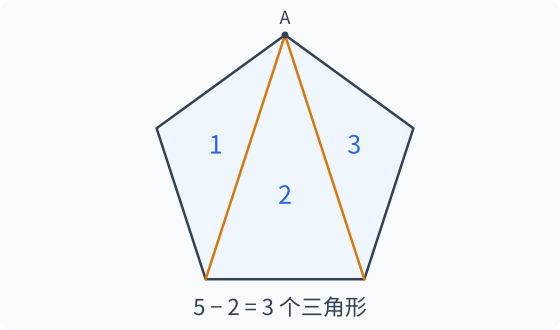
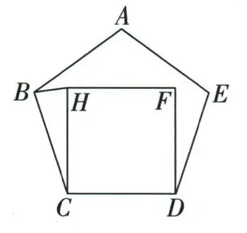
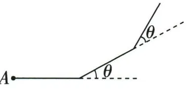
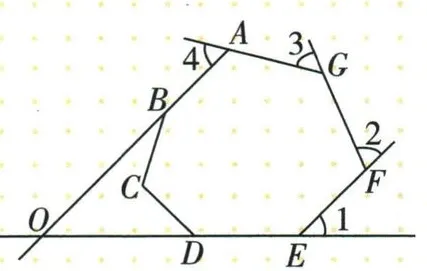
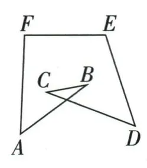

对角线、内角和、外角和都有各自的计数对象。先看图形是否简单、是否凸，再区分“一个顶点”和“全部”、“一个角”和“角的总和”。

<nav class="handbook-nav" aria-label="本章分区">
  <a class="handbook-jump is-knowledge" href="#knowledge">01 · 知识点概念、关系与适用条件</a>
  <a class="handbook-jump is-exam" href="#exam">02 · 考点题目分类和例题</a>
  <a class="handbook-jump is-pitfall" href="#pitfalls">03 · 坑点辨析错因，检查遗漏</a>
</nav>

## 【知识点】概念与依据 {#knowledge .handbook-section .is-knowledge}

### 1. 多边形与对角线 {#definition .knowledge-title}

由若干条线段首尾顺次相接组成的封闭平面图形，叫作==多边形==。本章讨论边不相交、各内角小于 $180^\circ$ 的凸多边形

连接两个不相邻顶点的线段，叫作==对角线==

### 2. 对角线的条数 {#diagonals .knowledge-title}

从 $n$ 边形的一个顶点可以引出 $n-3$ 条对角线，总条数为

$$\frac{n(n-3)}2$$

每个顶点排除自己和相邻两个顶点，得到 $n-3$；全部顶点共数了两遍，所以除以 $2$

### 3. 多边形的内角和 {#interior-sum .knowledge-title}

从一个顶点出发，$n$ 边形分成 $n-2$ 个三角形，因此

$$\text{内角和}=(n-2)\times180^\circ$$

例如五边形的内角和为 $3\times180^\circ=540^\circ$

### 4. 多边形的外角和 {#exterior-sum .knowledge-title}

沿同一方向，在每个顶点各取一个外角，外角和始终为 $360^\circ$

沿边走一圈，每到顶点转一个外角，最后正好转了一周

### 5. 正多边形 {#regular .knowledge-title}

各边相等、各角也相等的多边形，叫作==正多边形==

$$\text{每个内角}=\frac{(n-2)180^\circ}{n},\qquad\text{每个外角}=\frac{360^\circ}{n}$$

例如正六边形每个内角 $120^\circ$，每个外角 $60^\circ$

## 【考点】方法与例题 {#exam .handbook-section .is-exam}

### 1. 密铺先看局部角和，再看能否延续 {#tiling .exam-title}

用一种或几种指定的图形不留空隙、不重叠地铺满平面，叫作镶嵌，也叫密铺。在边对边的铺法中，同一汇合点周围的角必须拼成 $360^\circ$；这是必要条件，还要核边长接合及整片能否继续铺开。

若只用同一种正 $n$ 边形，顶点处汇合 $k$ 块，则

$$k\left(180^\circ-\frac{360^\circ}{n}\right)=360^\circ,
\qquad k=2+\frac4{n-2}.$$

$n\ge3$、$k\ge3$ 都是整数，故 $n-2$ 只能为1、2、4。

| 能密铺的同一种正多边形 | 一个顶点处的块数 |
| --- | --- |
| 正三角形 | 6 |
| 正方形 | 4 |
| 正六边形 | 3 |

这三类都有可以继续延伸的规则铺法。任意三角形可由两块拼成平行四边形再重复；任意凸四边形可以绕边中点半转接合，使四个不同内角在顶点周围合为一周。一般四边形的铺法不要求“每一个内角都单独整除360°”，也不能把上述三类限制搬到多种正多边形混铺上。

### 2. 计数题先圈定对象 {#counting .exam-title}

先辨从一个顶点出发，还是数全图；再辨要对角线，还是分出的三角形。求边数时，最后还须检验 $n\ge3$ 且为整数。

<article class="handbook-example" aria-labelledby="example-1">

#### 例题 01 一个顶点与整个图形 知识清单例题 {#example-1 .example-heading}

题目

(1)从六边形的一个顶点出发可以引\_\_\_\_条对角线,这些对角线将六边形分成\_\_\_\_个三角形,六边形共有\_\_\_\_条对角线.  
(2)从七边形的一个顶点出发的对角线将七边形分成\_\_\_\_个三角形.  
(3) 八边形共有 \_\_\_\_ 条对角线.

答案与解析

解析

（1）从一个顶点有 $6-3=3$ 条对角线，分成 $6-2=4$ 个三角形；全图有 $6(6-3)/2=9$ 条对角线。

（2）分成 $7-2=5$ 个三角形。

（3）全部对角线有 $8(8-3)/2=20$ 条。

本题结论

（1）3；4；9。（2）5。（3）20。

</article>

### 3. 角和与边数互相转换 {#angle-equations .exam-title}

已知总内角和，用 $(n-2)\times180^\circ$；已知同向外角总和，用 $360^\circ$。已知每个角相等，才可将总和除以每角。内角和与外角和混合时，先把“几倍”译成等式。

<article class="handbook-example" aria-labelledby="example-2">

#### 例题 02 内角和与外角和的倍数 知识清单例题 {#example-2 .example-heading}

题目

若一个多边形的内角和是该多边形的外角和的3倍,则这个多边形的边数是 ( )

A.6

B.7

C.8

D.9

答案与解析

解析

设边数为 $n$。外角和为 $360^\circ$，所以

$$(n-2)\times180^\circ=3\times360^\circ.$$

两边除以 $180^\circ$，得 $n-2=6$，故 $n=8$，选 C。

本题结论

C，8条边。

</article>

<article class="handbook-example" aria-labelledby="example-3">

#### 例题 03 已知每个内角 知识清单例题 {#example-3 .example-heading}

题目

若一个多边形的每个内角都等于 $108^{\circ}$ , 则这个多边形是 ( )

A. 四边形

B.五边形

C.六边形

D.七边形

答案与解析

解析

每个邻补外角为 $180^\circ-108^\circ=72^\circ$。设有 $n$ 个顶点，则 $72^\circ n=360^\circ$，所以 $n=5$，选 B。

题中没有各边相等的条件，结论只能是五边形，不能加上“正”字。

本题结论

B，五边形。

</article>

<article class="handbook-example" aria-labelledby="example-4">

#### 例题 04 内角总和与单个外角两种问法 知识清单例题·合组；（1）2024云南（2）2024重庆A {#example-4 .example-heading}

题目

（1）（2024云南）一个七边形的内角和等于 （）

A.540°

B. $900^{\circ}$

C. $980^{\circ}$

D.1 080°

（2）(2024 重庆 A) 如果一个多边形的每一个外角都是 $40^{\circ}$ , 那么这个多边形的边数为 \_\_\_\_.

答案与解析

解析

（1）七边形内角和为 $(7-2)\times180^\circ=900^\circ$，选 B。

（2）每个外角均为 $40^\circ$，边数为 $360^\circ\div40^\circ=9$。同样只需等角，不必另外假设等边。

本题结论

（1）B，$900^\circ$；（2）9。

</article>

### 4. 漏一个内角，先给漏角范围 {#missing-angle .exam-title}

设漏角为 $\alpha$。凸多边形满足 $0^\circ<\alpha<180^\circ$，因此真实总和严格夹在“剩余总和”和“剩余总和加180°”之间。把这个范围转成边数范围，再找整数；不能把除得的边数直接四舍五入。

<article class="handbook-example" aria-labelledby="example-5">

#### 例题 05 余下内角和已知 知识清单例题 {#example-5 .example-heading}

题目

一个多边形除去一个内角后,其余内角之和是 $2570^{\circ}$ ,求这个多边形的边数.

答案与解析

解析

设边数为 $n$，漏角为 $\alpha$。因为 $0^\circ<\alpha<180^\circ$，

$$2570^\circ<(n-2)\times180^\circ<2750^\circ,$$

于是

$$16\frac5{18}<n<17\frac5{18}.$$

唯一整数为17。回验总和 $15\times180^\circ=2700^\circ$，漏角为 $2700^\circ-2570^\circ=130^\circ$，符合凸内角范围。

本题结论

17条边；漏角为 $130^\circ$。

</article>

### 5. 规则图形相接，先找共有边和角的差 {#combined-figures .exam-title}

两个图形共用一条边时，可利用等量传递找新等腰三角形；角的加减由射线的实际位置决定。正多边形给等边、等角，正方形给等边和直角，必须说清各条件来自哪一个图形。

<article class="handbook-example" aria-labelledby="example-6">

#### 例题 06 正五边形内作正方形 知识清单例题·2024宁夏 {#example-6 .example-heading}

题目

(2024 宁夏)如图,在正五边形 ABCDE 的内部,以 CD 边为边作正方形 CDFH,连接 BH,则 $\angle BHC=$ \_\_\_\_°.

答案与解析

解析

正五边形给 $BC=CD$，且

$$\angle BCD=\frac{(5-2)\times180^\circ}{5}=108^\circ.$$

正方形给 $CH=CD$、$\angle DCH=90^\circ$。因 $CH$ 在原内角内部，$\angle BCH=108^\circ-90^\circ=18^\circ$，且 $BC=CH$。

所以 $\triangle BCH$ 为等腰三角形，两底角各为 $(180^\circ-18^\circ)/2=81^\circ$。

本题结论

$\angle BHC=81^\circ$。

</article>

### 6. 转角行走先确定闭合路线的类型 {#walking .exam-title}

若路线是简单凸多边形，走一周的同向转角和为 $360^\circ$。若题意未排除自交，要核候选角的实际闭合周期，不能仅凭“第一次回到起点”断言只绕了一周。

<article class="handbook-example" aria-labelledby="example-7">

#### 例题 07 等长线段与固定转角 知识清单例题 {#example-7 .example-heading}

题目

小磊利用最近学习的数学知识,给同伴出了这样一道题:如图,假如从点 A 出发,沿直线走 5 米后向左转 $\theta$ ,接着沿直线前进 5 米后,再向左转 $\theta$ ,……如此下去,当他第一次回到 A 点时,发现自己走了 60 米,则 $\theta$ 为 ( )

A. ${28}^{ \circ  }$

B. $30^{\circ}$

C. $33^{\circ}$

D. $36^{\circ}$

答案与解析

解析

共走 $60\div5=12$ 段。若按简单凸路线理解，12个相同外角合为一周，故 $\theta=360^\circ\div12=30^\circ$。

也可检查四个候选角：$28^\circ$ 和 $33^\circ$ 连转12次都不构成整周方向；$36^\circ$ 则10段就首次闭合，只走50米；只有 $30^\circ$ 与12段、60米符合。固定等长、固定转角的路线若允许自交，可能形成星形，不能将这种凸路线解释推广为无条件定理。

本题结论

B，$30^\circ$。

</article>

## 【坑点】辨析与边界 {#pitfalls .handbook-section .is-pitfall}

### 1. 整数边数不是近似数 {#integer-check .pitfall-title}

内角和必须对应一个整数边数。判断正数角和是否可能时，既查是否为180°的整数倍，也查推得的边数至少为3。

<article class="handbook-example is-pitfall" aria-labelledby="pitfall-1">

#### 辨析 01 哪些总角和不可能出现 知识清单例题 {#pitfall-1 .example-heading}

题目

下列各度数不是多边形的内角和的是\_\_\_\_.(填序号)

①1 800°; ②540°; ③1 700°;

④1 080°; ⑤810°.

答案与解析

解析

逐项用 $n=S/180^\circ+2$：①得12；②得5；④得8，都是合法整数。③ $1700/180$ 不是整数；⑤ $810/180=4.5$，会给出 $n=6.5$，均不可能。

本题结论

③⑤。

</article>

### 2. 标了几个字母，不等于有几个可套公式的内角 {#angle-objects .pitfall-title}

先找这些角是否组成同一个简单多边形的完整内角或外角。如果不组成，就通过对顶角、三角形内角和或辅助线，把散角换成一组有明确对象的角。

<article class="handbook-example is-pitfall" aria-labelledby="pitfall-2">

#### 辨析 02 四个外角属于哪一个多边形 知识清单例题 {#pitfall-2 .example-heading}

题目

七边形 ABCDEFG 如图所示, AB、ED 的延长线相交于点 O. 若图中 $\angle1$ 、 $\angle2$ 、 $\angle3$ 、 $\angle4$ 的度数和为 $220^{\circ}$ ，则 $\angle BOD$ 的度数为

答案与解析

解析

沿 $O,A,G,F,E$ 组成新的五边形，图中四个标角恰是其在 $A,G,F,E$ 处的外角。

在 $BO$ 的延长线上取 $M$，则 $\angle DOM$ 为剩下的外角，故

$$\angle DOM=360^\circ-220^\circ=140^\circ.$$

$\angle BOD$ 与它邻补，所以 $\angle BOD=180^\circ-140^\circ=40^\circ$。不能把四个外角当作原七边形的四个内角，从900°中扣除。

本题结论

$40^\circ$。

</article>

<article class="handbook-example is-pitfall" aria-labelledby="pitfall-3">

#### 辨析 03 交叉线段中的六个角 知识清单例题 {#pitfall-3 .example-heading}

题目

如图, 求 $\angle A + \angle B + \angle C + \angle D + \angle E + \angle F$ 的度数.

答案与解析

解析

连接 $AD$，设 $AB$ 与 $CD$ 交于 $G$。两组三角形内角和为

$$\angle B+\angle C+\angle BGC=180^\circ,$$
$$\angle BAD+\angle CDA+\angle AGD=180^\circ.$$

$\angle BGC=\angle AGD$ 为对顶角，因此 $\angle B+\angle C=\angle BAD+\angle CDA$。

把这两个替换角分别与原 $\angle BAF$、$\angle CDE$ 拼接，目标和正好变成简单四边形 $ADEF$ 的四个内角和，即 $360^\circ$。原交叉图不能直接按“六边形内角和”算成720°。

本题结论

$360^\circ$。

</article>

### 3. “截去一个角”与“只满足一项条件” {#cut-and-regular .pitfall-title}

截角后重新沿边界数顶点。正多边形的定义则须检查两项条件，不能把“等角”或“等边”单独当作充分条件。

<article class="handbook-example is-pitfall" aria-labelledby="pitfall-4">

#### 辨析 04 边数与正多边形的判断 知识清单辨析·合组改编，明确凸形与判断任务 {#pitfall-4 .example-heading}

题目

判断下列说法是否正确，并说明理由。

（1）三角形是最简单的多边形。

（2）多边形的边数、顶点数及内角个数相等。

（3）三角形没有对角线。

（4）凸多边形的任一内角与相邻的外角互为邻补角。

（5）一个 $n$ 边形截去一个角后，剩余图形一定为 $(n-1)$ 边形。

（6）每个内角都相等的多边形一定是正多边形。

（7）每条边都相等的多边形一定是正多边形。

答案与解析

解析

（1）最少3条边才能围成非退化多边形，正确。

（2）顺次封闭的一圈边，每一顶点对应一个内角，三种个数相同，正确。

（3）三角形任意两个顶点都相邻，不能构成对角线，正确。

（4）所配内外角的一边公共、另外两边反向，和为180°，正确。

（5）不一定。切线交两邻边的内部，删1个旧顶点而添2个新顶点，成为 $n+1$ 边形；过一个邻顶点，可仍为 $n$ 边形；通过两个邻顶点截去该角，且剩余仍为有效多边形时，才为 $n-1$ 边形。

（6）非正方形的矩形四角相等，却不是正多边形。

（7）非正方形的菱形四边相等，却不等角，也不是正多边形。

本题结论

（1）至（4）正确；（5）至（7）错误。

</article>

