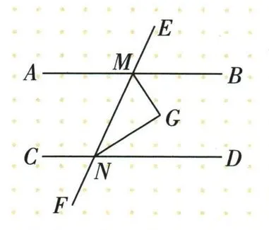
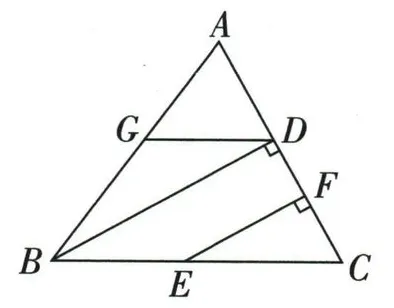
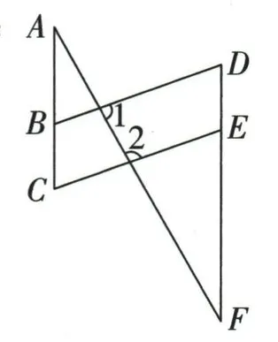

“是不是命题”“命题是真是假”“怎样证明它”是三个不同的问题。先把条件与结论分清，再决定需要一般推理，还是只要一个合格的反例。

<nav class="handbook-nav" aria-label="本章分区">
  <a class="handbook-jump is-knowledge" href="#knowledge">01 · 知识点概念、关系与适用条件</a>
  <a class="handbook-jump is-exam" href="#exam">02 · 考点题目分类和例题</a>
  <a class="handbook-jump is-pitfall" href="#pitfalls">03 · 坑点辨析错因，检查遗漏</a>
</nav>

## 【知识点】概念与依据 {#knowledge .handbook-section .is-knowledge}

### 1. 命题、题设与结论 {#propositions .knowledge-title}

判断一件事情的语句，叫作==命题==，通常可写成“如果……那么……”

“如果”后面是题设，“那么”后面是结论

### 2. 真命题、假命题与反例 {#truth-counterexample .knowledge-title}

- 题设成立时，结论总成立，叫作真命题
- 存在题设成立、结论不成立的情况，叫作假命题
- 这样的情况叫作==反例==，一个就足以说明命题是假命题

例如“两个锐角之和一定是钝角”是假命题：$20^\circ+30^\circ=50^\circ$ 就是反例

### 3. 逆命题与逆定理 {#converse .knowledge-title}

交换题设与结论，得到原命题的==逆命题==

| 原命题 | 逆命题 |
| --- | --- |
| 等腰三角形的两底角相等 | 有两个角相等的三角形是等腰三角形 |

原命题为真，逆命题还需要单独判断。一个定理的逆命题也被证明为真时，叫作它的逆定理

### 4. 基本事实、定理与证明 {#foundations .knowledge-title}

- 基本事实：作为推理起点，如“两点确定一条直线”
- 定理：经过证明的真命题
- 推论：由定理直接得到的结论
- 证明：从题设出发，根据定义、基本事实和已知定理，逐步得到结论

### 5. 常用证明方法 {#proof-methods .knowledge-title}

| 方法 | 怎样思考 |
| --- | --- |
| 分析法 | 从“要证明什么”倒推“先证明什么就够了” |
| 综合法 | 从已知出发，一步步推到结论 |
| 反证法 | 假设结论不成立，推出矛盾，从而说明原结论成立 |

## 【考点】方法先于例题 {#exam .handbook-section .is-exam}

### 1. 辅助构造与面积法 {#auxiliary-area .exam-title}

辅助线提供新对象，不提供任意新性质。 连接两点只得到连接线；取线段中点才能直接得到两段相等；过线外点作平行线，才能使用该平行关系。构造先写清楚，随后再调用定理推导其他性质。

| 构造或转化 | 可以直接获得什么 | 仍需另外证明什么 |
| --- | --- | --- |
| 连接已有两点 | 一条指定线段 | 它是否垂直、平分、等长 |
| 取一条线段的中点 | 该点在线段上，两部分等长 | 与其他线段的关系 |
| 过线外点作平行线 | 经过此点、与给定线平行 | 其他线组的平行、目标角关系 |
| 同一三角形换底、高 | 两种合法面积表达表示同一面积 | 每个底与对应高确实垂直 |
| 同底等高换三角形 | 两个三角形面积相等 | 顶点到同一底线的垂直距离相等 |

面积法可以用同一量的不同表达列式，也可以把一个图形割补成等面积图形。比如同一三角形用两组底高计算：

$$S=\frac12a h_a=\frac12b h_b.$$

底和高必须属于同一个三角形，并且成对垂直。分块相加时，各块内部不能重叠；换一块时，共同部分要保留。涉及角平分线等距离、勾股、正方形和圆的综合应用，分别放在相应性质建立后的章节中。

### 2. 开放条件题：选完条件，还要证明足够 {#open-conditions .exam-title}

有些题给出几条关系，让你选其中一部分作条件、另一部分作结论。写出的句子通顺，不等于它是真命题。

1. 固定公共背景，如原有的平行、共线和点序。
2. 把选中的关系写在“已知”，把剩下的关系写在“求证”。
3. 证明时只使用已知和合法推导，不能偷用待证关系。
4. 只证明一种选择，就只能保证这一种；若说“任意两条都可以”，必须分别核验。

寻找同一个中间量常有帮助：若确实已证明三条关系分别等价于 $x=y$、$y=z$、$x=z$，任意两条才能推出第三条。不能仅因为原句都含等号，就断言它们互相等价。

### 3. 将隐含条件与结论写完整 {#rewrite-method .exam-title}

先找讨论对象，再找作为前提的性质和声称得到的结果。补全通常省略的指代，不改变原条件；只问改写时，即使原命题是假，也不能擅自修成真命题。

<article class="handbook-example" aria-labelledby="example-1">

#### 例题 01 两点确定直线的题设和结论 知识清单例题·改编，明确两点不同 {#example-1 .example-heading}

题目

写出命题“过两个不同的点，有且只有一条直线”的题设和结论。

答案与解析

解析

可改写成：“如果给定两个不同的点，并讨论经过它们的直线，那么这样的直线存在且唯一。”

题设需要说明给定的不同点及所讨论的直线；结论含两层：“有”表示存在，“只有一条”表示唯一。若两点重合，过同一个点可以有无数条直线，不能省略不同点这一条件。

本题结论

题设：给定两个不同的点，讨论经过它们的直线。结论：这样的直线存在且唯一。

</article>

### 4. 判断真假：一般依据与合格反例分开 {#truth-method .exam-title}

判真需要对全部合格对象成立的理由；判假只需一个符合条件又违反结论的反例。涉及其他图形的性质时，要核其条件，不把特殊图形的结论推广给整类图形。

<article class="handbook-example" aria-labelledby="example-2">

#### 例题 02 三个命题分别判断 知识清单例题 {#example-2 .example-heading}

题目

判断下列命题的真假；若为假，请举出反例。

（1）锐角的余角小于它本身。

（2）等边三角形都相似。

（3）对角线相等的四边形是矩形。

答案与解析

解析

（1）假。取锐角 $30^\circ$，余角为 $60^\circ$，反而大于它本身。既满足“锐角”，又违反“小于”。

（2）真。等边三角形的三个角都是 $60^\circ$，任意两个等边三角形都有对应角相等，可按两角对应相等判定相似。边长可以不同，相似不等于全等。

（3）假。非矩形的等腰梯形也有相等的两条对角线，却没有矩形的四个直角。这一反例同时满足题设、否定结论。

本题结论

（1）假，反例为30°及其余角60°；（2）真；（3）假，反例为非矩形的等腰梯形。

</article>

<article class="handbook-example" aria-labelledby="example-3">

#### 例题 03 四个几何判断 2024 湖南 {#example-3 .example-heading}

题目

（2024 湖南）下列命题中,正确的是()

A.两点之间,线段最短

B.菱形的对角线相等

C. 正五边形的外角和为 $720^{\circ}$

D. 直角三角形是轴对称图形

答案与解析

解析

A是“两点之间，线段最短”这一基本事实，正确。

B把菱形的特殊情形当成一般性质：菱形的对角线不一定相等，只有进一步成为正方形时才相等。

C中凸正五边形按每个顶点取一个外角，转一周的外角和为 $360^\circ$，不是720°。

D把等腰直角三角形的对称性推广给所有直角三角形。两条直角边不等时，三边不同，不是轴对称图形。

本题结论

选 A。

</article>

### 5. 写逆命题时，保留共同背景 {#converse-method .exam-title}

先将原条件与结论完整列出，再交换；“在同一三角形中”“被同一截线所截”这类共同范围不交换、不删除。写完后重新核验真假，不继承原命题的真值。

<article class="handbook-example" aria-labelledby="example-4">

#### 例题 04 平行线性质的逆命题 2024 江苏宿迁 {#example-4 .example-heading}

题目

(2024 江苏宿迁) 命题“两直线平行, 同位角相等”的逆命题是 ____.

答案与解析

解析

共同背景是两条直线被同一条第三直线所截。原条件为两条被截线平行，原结论为同位角相等。

交换后：“如果两条直线被第三条直线所截，所得同位角相等，那么这两条被截线平行。”它是已学的平行线判据，因此也为真，不是仅凭原性质为真就推定它真。

本题结论

同位角相等，两直线平行。

</article>

### 6. 几何证明：写对象，列依据，走到目标 {#geometric-proof .exam-title}

先把题设译成线、角关系，写出求证。每次使用性质时核对本步前提；更换截线或角名时交代来源。最后若要证明垂直，应先得到明确的直角，再由定义得出结论。

下面第一题调用三角形内角和为180°；后两题只需平行线判定、性质和等量代换。尚未学习三角形内角和时，可先读其余两题。

<article class="handbook-example" aria-labelledby="example-5">

#### 例题 05 同旁内角的内部平分线 知识清单例题·明确内部平分线 {#example-5 .example-heading}

题目

求证：两条平行线被第三条直线所截，同旁内角的内部平分线互相垂直。

如图，$AB\parallel CD$，$EF$ 与它们分别交于 $M,N$。$MG$ 平分 $\angle BMN$，$NG$ 平分 $\angle DNM$，两平分线交于 $G$。求证 $MG\perp NG$。

答案与解析

解析

按不同依据分四步：

1. $AB\parallel CD$，所以 $\angle BMN+\angle DNM=180^\circ$，依据同旁内角互补。
2. 由内部平分线的定义，$\angle GMN=\frac12\angle BMN$，$\angle GNM=\frac12\angle DNM$。
3. 两式相加，$\angle GMN+\angle GNM=90^\circ$。由 $\triangle MNG$ 内角和，$\angle MGN=180^\circ-90^\circ=90^\circ$。
4. 由垂直的定义，$MG\perp NG$。

不能先把图画成截线垂直平行线的特殊情形，再将所得结果当作一般证明。

本题结论

$MG\perp NG$。

</article>

<article class="handbook-example" aria-labelledby="example-6">

#### 例题 06 先倒找路线，再顺写证明 知识清单例题 {#example-6 .example-heading}

题目

如图, 已知 $BD \perp AC$ , $EF \perp AC$ , $D$ 、 $F$ 为垂足, $G$ 是 $AB$ 上一点, 且 $\angle FEC = \angle GDB$ . 求证: $\angle AGD = \angle ABC$ .

答案与解析

解析

先分析。 要证明 $\angle AGD=\angle ABC$，可先证 $GD\parallel BC$；为此，可证 $\angle GDB=\angle DBC$。已知前一个角等于 $\angle FEC$，于是只需把 $\angle FEC$ 与 $\angle DBC$ 联系起来。原有共同垂线正能得到 $BD\parallel EF$，路线接上已知。

再综合顺写。

| 步骤 | 结论 | 依据 |
| --- | --- | --- |
| 1 | $BD\parallel EF$ | 两线同垂直于 $AC$ |
| 2 | $\angle FEC=\angle DBC$ | $BC$ 作截线，平行线同位角相等 |
| 3 | $\angle GDB=\angle DBC$ | 与已知等角等量代换 |
| 4 | $GD\parallel BC$ | $BD$ 作截线，内错角相等 |
| 5 | $\angle AGD=\angle ABC$ | $AB$ 作截线，同位角相等 |

倒推是在选择足够的路线，正式证明则从题设出发；不能先假定 $GD\parallel BC$ 已经成立。

本题结论

$\angle AGD=\angle ABC$。

</article>

<article class="handbook-example" aria-labelledby="example-7">

#### 例题 07 用同一个中间角衔接 知识清单例题 {#example-7 .example-heading}

题目

如图, $AC \parallel DF$ , 点 $B \text{、} E$ 分别是 $AC \text{、} DF$ 上的点, 连接 $BD \text{、} CE$ , 若 $\angle 1 = 80^{\circ}, \angle 2 = 100^{\circ}$ , 求证: $\angle C = \angle D$ .

答案与解析

解析

$\angle1+\angle2=80^\circ+100^\circ=180^\circ$。图中这两个角是 $AF$ 截 $BD,CE$ 所得的同旁内角，所以 $BD\parallel CE$。

以 $DF$ 为截线，得到 $\angle D=\angle CEF$；又由已知 $AC\parallel DF$，以 $CE$ 为截线，得到 $\angle C=\angle CEF$。两个目标角都等于同一个中间角，故 $\angle C=\angle D$。

本题结论

$\angle C=\angle D$。

</article>

### 7. 反证：准确否定，再指出矛盾的双方 {#contradiction-method .exam-title}

结论含“至少”“至多”时，先写出它的完整反面。推到矛盾后，要指出与哪个已知、定义或定理冲突，最后撤销假设，而不是直接宣布原结论显然正确。

<article class="handbook-example" aria-labelledby="example-8">

#### 例题 08 至少有一个内角不大于60° 知识清单例题·合组 {#example-8 .example-heading}

题目

证明：三角形中至少有一个内角不大于 $60^\circ$。

答案与解析

解析

保留它们是同一个三角形的三个内角，假设结论不成立，即三个内角全部大于 $60^\circ$。则

$$\angle A+\angle B+\angle C>60^\circ+60^\circ+60^\circ=180^\circ.$$

但三角形内角和定理又给出 $\angle A+\angle B+\angle C=180^\circ$。两式矛盾，故假设不成立，至少有一个内角不大于60°。

这是反证法：先否定结论，再推出矛盾。不是单纯的大小比较；也不是从目标倒找充分条件的分析法。等边三角形的三个角恰为60°，说明结论不能擅自加强为“至少一个小于60°”。

本题结论

三角形中至少有一个内角小于或等于60°，证明方法为反证法。

</article>

## 【坑点】辨析与边界 {#pitfalls .handbook-section .is-pitfall}

### 1. 假判断仍可能是命题 {#judgment-pit .pitfall-title}

先判断有没有作出断言，再判断断言对不对。命令和问句不是因为“算错”而被排除；假命题也不是没有判断。

<article class="handbook-example is-pitfall" aria-labelledby="pitfall-1">

#### 辨析 01 逐句识别 知识清单例题 {#pitfall-1 .example-heading}

题目

下列哪些语句是命题？填序号。

① 我是中国人。

② 你吃饭了吗？

③ 延长线段 $AB$。

④ 明天可能下雨。

⑤ 若 $a^2>b^2$，则 $a>b$。

⑥ 把 $a$ 提出来。

⑦ 内错角相等吗？

⑧ 若 $\angle1=50^\circ$，$\angle2=50^\circ$，则 $\angle1=\angle2$。

⑨ 直角都相等。

答案与解析

解析

①⑤⑧⑨都作出完整判断。①的真假随说话者而定，但仍有判断性；⑤虽不能保证正确，仍是命题。

②⑦是询问，③⑥是操作指令，没有断言某种关系成立。④按本题“确定判断”的初中题型口径，不作为命题；不要将这一题型约定推广为所有关于可能性的逻辑讨论。

本题结论

①⑤⑧⑨。

</article>

### 2. 改写不是替原命题补条件 {#rewrite-pit .pitfall-title}

把原句变成“如果……，那么……”只是在显露条件和结论。若加上原来没有的条件，把假命题修成真命题，就已经换题了。

<article class="handbook-example is-pitfall" aria-labelledby="pitfall-2">

#### 辨析 02 只改写，不修正 知识清单例题 {#pitfall-2 .example-heading}

题目

将下列命题改写为“如果……，那么……”：

（1）整数一定是有理数。

（2）两个锐角互余。

（3）等角的补角相等。

答案与解析

解析

（1）条件是“一个数为整数”，结论是“它是有理数”。

（2）条件仅是“两个角都是锐角”，结论是“它们互余”。原判断不一定真，但不能擅加“两角和90°”来修正它。

（3）可以比较两个相等角的各自补角，也可以把被比较的两个角直接称为“等角的补角”；两种说法须保持对应对象一致。

本题结论

（1）如果一个数是整数，那么它是有理数。

（2）如果两个角都是锐角，那么它们互余。

（3）如果两个角相等，那么它们的补角相等。也可写：如果两个角分别是两个相等角的补角，那么这两个补角相等。

</article>

### 3. 原命题真，不保证逆命题真 {#converse-pit .pitfall-title}

交换后的命题需要独立依据。找反例时，检查它是否满足交换后的新条件，而不是仍检查原条件。

<article class="handbook-example is-pitfall" aria-labelledby="pitfall-3">

#### 辨析 03 三个逆命题 知识清单例题 {#pitfall-3 .example-heading}

题目

写出下列命题的逆命题，并判断逆命题真假：

（1）在一个三角形中，等角对等边。

（2）四边相等的四边形是菱形。

（3）如果 $x=3$，那么 $x^2=9$。

答案与解析

解析

（1）共同范围“在一个三角形中”保持，交换成“等边对等角”，由等腰三角形性质，为真。

（2）交换成“菱形的四边相等”，由菱形性质，为真。

（3）交换成“如果 $x^2=9$，那么 $x=3$”，为假。方程 $x^2=9$ 有两个解 $3,-3$，其中 $-3$ 满足新题设，却不满足新结论。原命题真，逆命题却假；把二者互换，也就得到“原命题假，逆命题真”的例子。

本题结论

（1）在一个三角形中，等边对等角，真；（2）菱形的四边相等，真；（3）若 $x^2=9$，则 $x=3$，假，反例 $x=-3$。

</article>

### 4. 否定严格不等式时，别漏掉等号 {#negation-pit .pitfall-title}

反证要排除结论不成立的全部情形。只排除其中一种情况，不能保证原结论。原题设仍然保留，不能连条件一起否定。

<article class="handbook-example is-pitfall" aria-labelledby="pitfall-4">

#### 辨析 04 反证的第一步 知识清单例题 {#pitfall-4 .example-heading}

题目

用反证法证明：“在 $\triangle ABC$ 中， $\angle A$ 、 $\angle B$ 的对边分别是 $a$ 、 $b$ ，若 $\angle A > \angle B$ ，则 $a > b$ 。”第一步应假设____。

答案与解析

解析

需要否定的是结论 $a>b$，它的完整反面是 $a\le b$，包含 $a=b$ 和 $a<b$。只假设 $a<b$ 会漏掉相等情形。

原条件 $\angle A>\angle B$ 保留。题目只问第一步，不需要在这里另证整个角大边大的定理。

本题结论

假设 $a\le b$。

</article>

### 5. 观察到规律，还缺一般证明 {#pattern-pit .pitfall-title}

先根据若干实例提出猜想，再用含任意允许参数的式子证明。计算一个新例子仍然只是验证，不能自动覆盖所有正整数。

<article class="handbook-example is-pitfall" aria-labelledby="pitfall-5">

#### 辨析 05 连续奇数平方差 2023 浙江舟山 {#pitfall-5 .example-heading}

题目

观察：$3^2-1^2=8\times1$，$5^2-3^2=8\times2$，$7^2-5^2=8\times3$，$9^2-7^2=8\times4$，……

（1）写出 $19^2-17^2$ 的结果。

（2）归纳出一个一般结论，用含正整数 $n$ 的等式表示。

（3）运用有关知识，推理说明结论正确。

答案与解析

解析

（1）$19^2-17^2=(19+17)(19-17)=36\times2=72$，对应第9组。

（2）第 $n$ 组的两个奇数为 $2n+1$、$2n-1$，猜想平方差为 $8n$。

（3）对任意正整数 $n$，由平方差公式：

$$\begin{aligned}(2n+1)^2-(2n-1)^2&=[(2n+1)+(2n-1)]\,[(2n+1)-(2n-1)]\\&=4n\times2=8n.\end{aligned}$$

推导对任意允许的 $n$ 成立，这才完成一般证明。

本题结论

（1）72；（2）$(2n+1)^2-(2n-1)^2=8n$，$n$ 为正整数；（3）由平方差公式证明成立。

</article>

### 6. 合作时间短，不能直接指定某一台最快 {#efficiency-pit .pitfall-title}

相同工作量下，时间越短，总效率越高。比较含同一台机器的两组合作效率，可以消去共同的效率；不能直接相减时间，更不能从最短合作组合里随意挑一台。

<article class="handbook-example is-pitfall" aria-labelledby="pitfall-6">

#### 辨析 06 五台收割机的效率 2024 内蒙古赤峰 {#pitfall-6 .example-heading}

题目

（2024内蒙古赤峰）编号为A,B,C,D,E的五台收割机,若同时启动其中两台收割机,收割面积相同的田地所需时间如下表:

| 收割机编号 | A,B | B,C | C,D | D,E | A,E |
| --- | --- | --- | --- | --- | --- |
| 所需时间/小时 | 23 | 19 | 20 | 22 | 18 |

则收割最快的一台收割机编号是____。

答案与解析

解析

将相同田地的工作量记为1，五台效率分别为正数 $a,b,c,d,e$。合作效率是对应时间的倒数，比较如下：

| 比较的组合 | 总效率关系 | 消去共同效率 |
| --- | --- | --- |
| BC用19小时，AB用23小时 | $b+c>b+a$ | $c>a$ |
| BC用19小时，CD用20小时 | $b+c>d+c$ | $b>d$ |
| CD用20小时，DE用22小时 | $c+d>e+d$ | $c>e$ |
| AE用18小时，AB用23小时 | $a+e>a+b$ | $e>b$ |

因此 $c>e>b>d$，又有 $c>a$，C比其余四台都快。不必逐一算出每台效率。AE合作时间最短，并不意味着A或E单机最快。

本推理依赖同样工作量及合作效率相加；若田地面积不同，不能只按时间这样比较。

本题结论

收割最快的是 C。

</article>

### 7. 反例必须真正违反结论 {#counterexample-pit .pitfall-title}

“不小于”包含等于。候选例子若只是满足题设，却仍满足原结论，就不是反例；只说两个角邻补，也没有确定它们谁大谁小。

<article class="handbook-example is-pitfall" aria-labelledby="pitfall-7">

#### 辨析 07 哪个才是有效反例 知识清单例题 {#pitfall-7 .example-heading}

题目

对假命题“任何一个角的补角都不小于这个角”举反例,正确的反例是 ( )

A. $\angle \alpha = 60^{\circ}$ ， $\angle \alpha$ 的补角 $\angle \beta = 120^{\circ},\angle \beta >\angle \alpha$

B. $\angle \alpha = 90^{\circ}$ , $\angle \alpha$ 的补角 $\angle \beta = 90^{\circ}$ , $\angle \beta = \angle \alpha$

C. $\angle \alpha = 100^{\circ},\angle \alpha$ 的补角 $\angle \beta =$ $80^{\circ},\angle \beta <  \angle \alpha$

D.两个角互为邻补角

答案与解析

解析

需要同时满足 $\alpha+\beta=180^\circ$，并使 $\beta\ge\alpha$ 不成立。

A中 $120^\circ>60^\circ$，仍支持原结论；B中 $90^\circ=90^\circ$，也属于“不小于”。C中 $100^\circ+80^\circ=180^\circ$，但 $80^\circ<100^\circ$，同时满足条件、违反结论。D只给邻补关系，没有给违反大小关系的具体情形。

本题结论

选 C。

</article>

