认识直角三角形的边角关系，再用勾股定理求边长、判断直角

<nav class="handbook-nav" aria-label="本章分区">
  <a class="handbook-jump is-knowledge" href="#knowledge">01 · 知识点概念、关系与适用条件</a>
  <a class="handbook-jump is-exam" href="#exam">02 · 考点题目分类和例题</a>
  <a class="handbook-jump is-pitfall" href="#pitfalls">03 · 坑点辨析错因，检查遗漏</a>
</nav>

## 【知识点】概念与依据 {#knowledge .handbook-section .is-knowledge}

### 1. 直角边、斜边 {#definition .knowledge-title}

有一个角是直角的三角形，叫作==直角三角形==。直角所对的边叫作斜边，是直角三角形中最长的边；另外两边叫作直角边。

通常约定用 $c$ 表示斜边长，$a,b$ 分别表示两条直角边长。

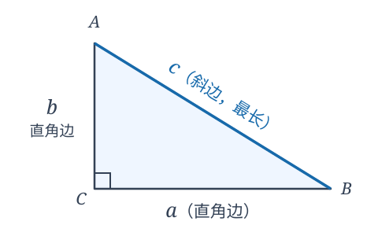

### 2. 直角三角形的性质 {#properties .knowledge-title}

1. 两个锐角互余：$\angle A+\angle B=90^\circ$
2. 两条直角边之和大于斜边：$a+b>c$
3. 斜中线定理：斜边上的中线长等于斜边的一半，即 $m=\frac c2$（$m$ 为中线长）
4. $30^\circ$ 角所对的直角边长等于斜边的一半
5. 等腰直角三角形的两个锐角都是 $45^\circ$
6. 勾股定理：$a^2+b^2=c^2$

::: info 斜中线定理的图解推导

展开：补成矩形，比较对角线

已知 $\angle ACB=90^\circ$，$M$ 是斜边 $AB$ 的中点

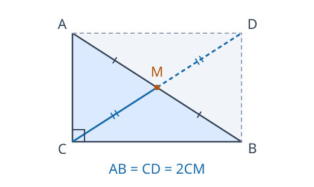

1. 延长 $CM$ 至 $D$，使 $MD=CM$
2. $AM=BM$、$CM=DM$，两条对角线互相平分，所以 $ACBD$ 是平行四边形；又有直角 $C$，因此是矩形
3. 矩形的对角线相等：$AB=CD=2CM$，所以 $CM=\frac12AB$

:::

::: info 30° 性质的图解推导

展开：翻折后拼成等边三角形

已知 $\angle ACB=90^\circ$，$\angle BAC=30^\circ$

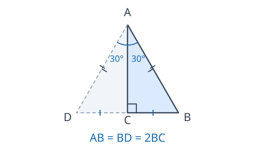

1. 沿 $AC$ 翻折，点 $B$ 落到点 $D$，得到 $AB=AD$、$BC=CD$
2. 两个 $30^\circ$ 角拼成 $\angle BAD=60^\circ$，所以 $\triangle ABD$ 是等边三角形
3. $AB=BD=BC+CD=2BC$，所以 $BC=\frac12AB$

:::

### 3. 勾股定理 {#theorem .knowledge-title}

==直角三角形两条直角边的平方和，等于斜边的平方==

$$a^2+b^2=c^2$$

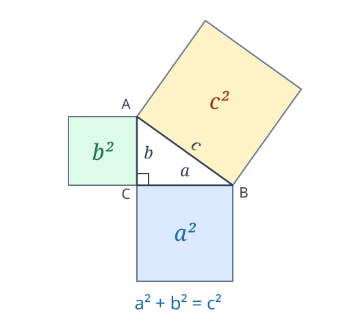

::: info 推导一：四角拼图

展开：大正方形面积减去四个三角形

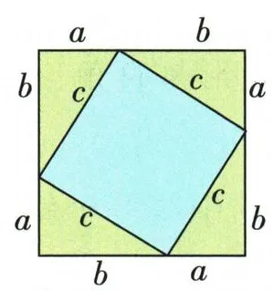

1. 把四个相同的直角三角形放在四角，外面是边长 $a+b$ 的正方形
2. 中间余下边长 $c$ 的正方形，所以 $(a+b)^2=4\times\frac12ab+c^2$
3. 展开并消去两边的 $2ab$，得到 $a^2+b^2=c^2$

:::

::: info 推导二：弦图

展开：斜边上的正方形分成五块

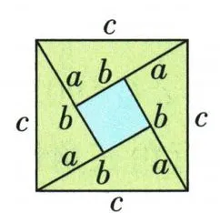

1. 外面正方形的边长为 $c$，里面放了四个相同的直角三角形
2. 中间小正方形的边长为 $\lvert b-a\rvert$，所以 $c^2=4\times\frac12ab+(b-a)^2$
3. 化简得到 $c^2=2ab+b^2-2ab+a^2=a^2+b^2$

$a=b$ 时，中间空白面积为 $0$，等式仍成立

:::

::: info 推导三：等面积双拼图

展开：减去相同的四块，余下面积相等

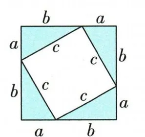

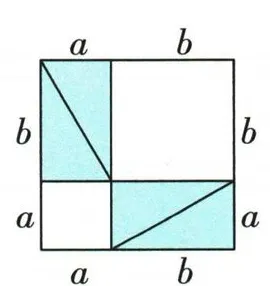

1. 两幅大正方形的边长都是 $a+b$，总面积相等
2. 各减去四个相同的直角三角形，余下面积仍相等
3. 左图余下 $c^2$，右图余下 $a^2+b^2$，因此 $a^2+b^2=c^2$

:::

::: info 推导四：青朱出入图

展开：把两个正方形割补成一个正方形

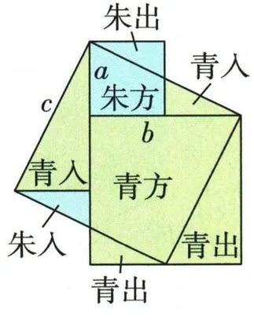

1. 两个直角边上的正方形，面积分别为 $a^2$、$b^2$
2. 沿图中标线分割，把标“出”的色块移到对应的“入”处，不改变色块大小
3. 拼成边长 $c$ 的正方形，面积不变，所以 $a^2+b^2=c^2$

:::

::: info 推导五：欧几里得的面积证明

展开：把两个小正方形的面积转移到两个矩形

本图中 $CA=a$、$CB=b$、$AB=c$

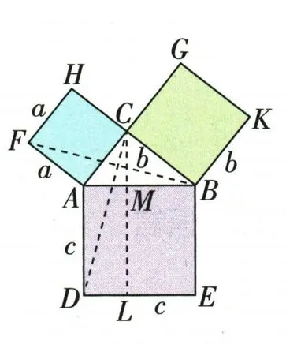

1. 在三边外侧作正方形，过 $C$ 作 $AB$ 的垂线，将斜边上的正方形分成两个矩形
2. 连接 $CD$、$FB$，由 $CA=FA$、$AD=AB$ 及夹角相等，得到 $\triangle CAD\cong\triangle FAB$
3. $\triangle CAD$ 的面积是矩形 $ADLM$ 的一半，$\triangle FAB$ 的面积是 $a^2/2$，因此矩形 $ADLM$ 的面积为 $a^2$
4. 另一矩形的面积同理为 $b^2$，两块合起来就是 $c^2$，所以 $a^2+b^2=c^2$

:::

### 4. 利用勾股定理求边长 {#calculate-sides .knowledge-title}

已知两边，先认准斜边，再代入公式

| 求哪条边 | 公式 | 例子 |
| --- | --- | --- |
| 斜边 $c$ | $c=\sqrt{a^2+b^2}$ | 两直角边长为 $3,4$，则 $c=\sqrt{3^2+4^2}=5$ |
| 直角边 $a$ | $a=\sqrt{c^2-b^2}$ | 斜边长为 $13$，另一直角边长为 $5$，则 $a=\sqrt{13^2-5^2}=12$ |
| 直角边 $b$ | $b=\sqrt{c^2-a^2}$ | 斜边长为 $10$，另一直角边长为 $6$，则 $b=\sqrt{10^2-6^2}=8$ |

### 5. 勾股定理的逆定理与推论 {#converse .knowledge-title}

在一个三角形中，如果 $a^2+b^2=c^2$，那么这个三角形是直角三角形，$c$ 是斜边。这就是勾股定理的逆定理

进一步判断三角形类型时，把最长边记为 $c$，另外两边记为 $a,b$

| 比较结果 | 三角形类型 |
| --- | --- |
| $a^2+b^2>c^2$ | 锐角三角形 |
| $a^2+b^2=c^2$ | 直角三角形 |
| $a^2+b^2<c^2$ | 钝角三角形 |

### 6. 勾股数 {#integer-triples .knowledge-title}

能作为直角三角形三边长的三个正整数，叫作==勾股数==。常见的有以下几组

| 三个正整数 | 平方检验 |
| --- | --- |
| $3,4,5$ | $9+16=25$ |
| $5,12,13$ | $25+144=169$ |
| $8,15,17$ | $64+225=289$ |
| $7,24,25$ | $49+576=625$ |
| $9,40,41$ | $81+1600=1681$ |

勾股数的正整数倍仍是勾股数，例如 $(3,4,5)$ 的 $2$ 倍是 $(6,8,10)$

## 【考点】题目分类和例题 {#exam .handbook-section .is-exam}

### 1. 斜边中点先给三段等长 {#median-method .exam-title}

先找直角，再核中点是否在斜边上。中线与两半斜边相等，可以直接倍半换长度，也可以在小三角形中制造等腰关系。直角边不自动等于半斜边，另需角度条件。

<article class="handbook-example" aria-labelledby="example-1">

#### 例题 01 同一中点条件的两问 知识清单例题 {#example-1 .example-heading}

题目

如图, 在 Rt $\triangle ABC$ 中, $\angle ACB = 90^{\circ}, D$ 是 $AB$ 的中点, $CD = 6$ .

(1) AB 的长为 ______。

(2) 若 $\angle A = 60^{\circ}$ ，则 AC 的长为 \_\_\_\_.

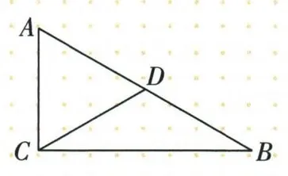

答案与解析

解析

（1）$C$ 为直角，$D$ 是斜边 $AB$ 中点，所以 $CD=AB/2$，得 $AB=12$。

（2）$\angle B=180^\circ-90^\circ-60^\circ=30^\circ$，$AC$ 是这个 $30^\circ$ 的对边，所以 $AC=AB/2=6$。第二问另用了 $30^\circ$ 条件，不能只凭中点推出。

本题结论

（1）$AB=12$；（2）$AC=6$。

</article>

<article class="handbook-example" aria-labelledby="example-2">

#### 例题 02 用三段等长转成等腰求角 知识清单例题 {#example-2 .example-heading}

题目

如图, 在 Rt△ABC 中, ∠BAC=90°, AD 是 BC 边上的中线, ED⊥BC, 交 BA 的延长线于点 E, 若 ∠E=35°, 求 ∠BDA 的度数.

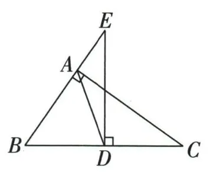

答案与解析

解析

$ED\perp BC$、$\angle E=35^\circ$，在直角三角形 $EBD$ 中得 $\angle B=55^\circ$。

$A$ 为直角，$D$ 是斜边 $BC$ 中点，所以 $AD=BD$。在 $\triangle ABD$ 中，$\angle DAB=\angle B=55^\circ$，于是 $\angle BDA=180^\circ-110^\circ=70^\circ$。

本题结论

$\angle BDA=70^\circ$。

</article>

### 2. 没有直角，先用角关系构造 {#construct-right .exam-title}

不能因为图上接近垂直就使用勾股或30°性质。先借等腰底角、中垂等距、角的加减等，证明新三角形里确有直角，再认准斜边与30°对边。

<article class="handbook-example" aria-labelledby="example-3">

#### 例题 03 连接中垂线上的点与端点 知识清单例题 {#example-3 .example-heading}

题目

如图, 已知在 $\triangle ABC$ 中, $AB = AC$ , $\angle BAC = 120^{\circ}$ , $E, F$ 分别在 $AB, BC$ 上, 且直线 $EF$ 为 $AB$ 的垂直平分线, $BF = 5 \mathrm{~cm}$ , 求 $CF$ 的长.

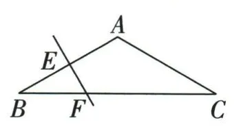

答案与解析

解析

连接 $AF$。$AB=AC$、$\angle A=120^\circ$，所以 $\angle B=\angle C=30^\circ$。

$F$ 在 $AB$ 中垂线上，故 $AF=BF=5\text{ cm}$。$\triangle ABF$ 等腰，得 $\angle BAF=30^\circ$，于是 $\angle FAC=120^\circ-30^\circ=90^\circ$。

在直角三角形 $AFC$ 中，$AF$ 对着 $30^\circ$，所以 $CF=2AF=10\text{ cm}$。

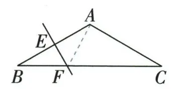

本题结论

$CF=10\text{ cm}$。

</article>

### 3. 实际长度先对应到水平、竖直与斜线 {#model-method .exam-title}

抽出直角三角形，标出水平距离、竖直距离及斜距。若所求是高度差，要先求差再按点序加减；若同一物体改变摆放，找出保持不变的长度，用两次勾股列同一个方程，并检验位置范围。

<article class="handbook-example" aria-labelledby="example-4">

#### 例题 04 先求高度差，再求身高 知识清单例题 {#example-4 .example-heading}

题目

如图,某自动感应门的正上方A处装着一个感应器,离地面的高度AB为2.5米,一名学生站在C处时,感应门自动打开了,此时这名学生离感应门的距离BC为1.2米,他的头顶离感应器的距离AD为1.5米,则这名学生的身高CD为\_\_\_\_米.

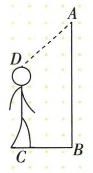

答案与解析

解析

过 $D$ 作水平线 $DE\perp AB$，则 $DE=BC=1.2\text{ m}$、$BE=CD$。在直角三角形 $ADE$ 中，

$$AE=\sqrt{1.5^2-1.2^2}=\sqrt{0.81}=0.9\text{ m}.$$

图中 $A,E,B$ 顺次排列，身高 $CD=BE=AB-AE=2.5-0.9=1.6\text{ m}$。$0.9$ 是竖直高度差，$1.5$ 是斜距，都不能直接当身高。

本题结论

身高为 $1.6\text{ m}$。

</article>

<article class="handbook-example" aria-labelledby="example-5">

#### 例题 05 底端不动，梯长不变 知识清单例题 {#example-5 .example-heading}

题目

某小区两面直立的墙壁之间为安全通道,一架梯子的底端 A 在两面墙壁的底端 B,E 之间,BE=2.2 m,当这架梯子斜靠在左墙时,梯子顶端 D 到地面的距离 DE 为 2.4 m,保持梯子底端 A 不动,将梯子斜靠在右墙上,梯子顶端 C 到地面的距离 CB 为 2 m,则梯子底端 A 到左墙的距离 AE 为 \_\_\_\_ m.

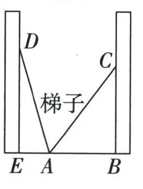

答案与解析

解析

设 $AE=x\text{ m}$，则 $AB=2.2-x$，且 $0<x<2.2$。同一架梯子长不变，所以 $AD=AC$，

$$x^2+2.4^2=(2.2-x)^2+2^2.$$

展开并消去 $x^2$，得 $5.76=8.84-4.4x$，所以 $4.4x=3.08$，$x=0.7$。回验 $AB=1.5$，两斜边平方均为 $6.25$，范围满足。

本题结论

$AE=0.7\text{ m}$。

</article>

<article class="handbook-example" aria-labelledby="example-6">

#### 例题 06 直立与拉直的长度相等 2024 四川巴中 {#example-6 .example-heading}

题目

（2024四川巴中）“今有方池一丈，葭生其中央，出水一尺，引葭赴岸，适与岸齐.问：水深几何？”这是我国数学史上的“葭生池中”问题，即 $AC = 5, DC = 1, BD = BA$ ，则 $BC =$ （ ）

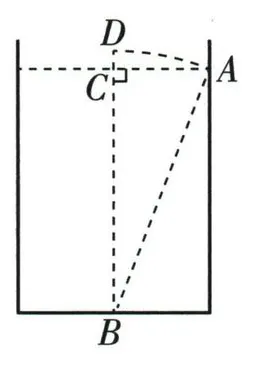

A.8

B.10

C.12

D.13

答案与解析

解析

设 $BC=x>0$，露出水面部分 $DC=1$，草全长 $BD=x+1$，拉直后 $BA=BD=x+1$。

在直角三角形 $ABC$ 中，$x^2+5^2=(x+1)^2$。展开后同减 $x^2$，得 $25=2x+1$，所以 $x=12$。回验两直角边为 $5,12$，斜边为 $13$。

本题结论

选 C，$BC=12$。

</article>

### 4. 同一面积换底，求斜边上的高 {#height-method .exam-title}

先求出两条直角边，用它们作底、高；再以斜边及其对应垂高表示同一个面积。一般地，斜边高 $h=ab/c$ 来自 $ab/2=ch/2$，不是把斜边与任一直角边直接相乘。

<article class="handbook-example" aria-labelledby="example-7">

#### 例题 07 两次面积表达 知识清单例题 {#example-7 .example-heading}

题目

如图，在 $\triangle ABC$ 中，$\angle ACB=90^\circ$，$AB=5\text{ cm}$，$BC=4\text{ cm}$，$CD\perp AB$ 于 $D$，求 $CD$ 的长。

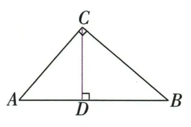

答案与解析

解析

由勾股，$AC=\sqrt{5^2-4^2}=3\text{ cm}$。

同一个三角形的两种面积表达为

$$\frac12\times3\times4=\frac12\times5\times CD.$$

两边乘2后再除5，得到 $CD=12/5\text{ cm}$。代回面积都是 $6\text{ cm}^2$，高的单位仍是厘米。

本题结论

$CD=\frac{12}{5}\text{ cm}$。

</article>

### 5. 面积拼图先认对象，再用完全平方 {#square-area .exam-title}

弦图外正方形边是斜边，中心边是两腿之差的绝对值。原外面积、中心面积、四三角形总面积、单块面积不能混。已知和平方与差平方时，常用两式相加或相减消去交叉项，无须先分别求每条边。

<article class="handbook-example" aria-labelledby="example-8">

#### 例题 08 从和平方与差平方求外面积 2024 江苏南通 {#example-8 .example-heading}

题目

（2024 江苏南通）“赵爽弦图”巧妙利用面积关系证明了勾股定理.如图所示的“赵爽弦图”是由四个全等直角三角形和中间的小正方形拼成的一个大正方形.设直角三角形的两条直角边长分别为 $m, n (m > n)$ . 若小正方形面积为5，$(m+n)^2=21$， 则大正方形面积为

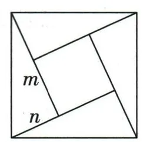

A.12

B.13

C.14

D.15

答案与解析

解析

中心正方形面积给 $(m-n)^2=5$，另有 $(m+n)^2=21$。

两式展开相加，得 $2m^2+2n^2=26$，所以 $m^2+n^2=13$。外正方形边是直角三角形的斜边，由勾股定理，其面积恰为 $m^2+n^2$。

再用两式相减检验：$4mn=16$，四三角形总面积 $2mn=8$，加中心面积5，也得到13。

本题结论

选 B，大正方形面积为 $13$。

</article>

### 6. 网格与数轴，先造准确长度 {#exact-length .exam-title}

网格中把长度的平方拆成横、纵整数格数的平方和，但三条边必须共用同一组三个端点。数轴作根式点时，先用直角三角形得到准确长度，再用圆规转移；正负坐标由所选半轴决定。

<article class="handbook-example" aria-labelledby="example-9">

#### 例题 09 三个边长同时满足的格点三角形 知识清单例题 {#example-9 .example-heading}

题目

在如图所示的正方形网格中,已知每个小正方形的边长都是1.请在网格中画出格点三角形 $ABC$ , 使 $AB = 2\sqrt{2}, BC = \sqrt{13}, AC = \sqrt{17}$ . (格点三角形的顶点均为网格线的交点)

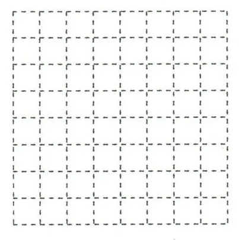

答案与解析

解析

平方分解为 $8=2^2+2^2$、$13=2^2+3^2$、$17=4^2+1^2$。

如图取 $A$，从它向右2格、向上2格取 $B$；向右4格、向下1格取 $C$。于是从 $B$ 到 $C$ 自然是向右2格、向下3格。三组勾股检验同时得到原要求，且三个点都在给定网格内。

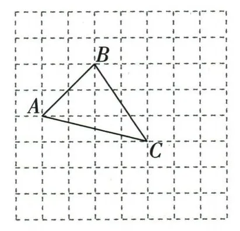

本题结论

图示三点给出一种符合要求的作法。

</article>

<article class="handbook-example" aria-labelledby="example-10">

#### 例题 10 在数轴上作出根式对应点 知识清单例题 {#example-10 .example-heading}

题目

在数轴上作出表示 $\sqrt{10}$ 的点.

答案与解析

解析

1. 在数轴正方向取 $OA=3$。
2. 过 $A$ 作数轴的垂线，取 $AB=1$。勾股给 $OB=\sqrt{3^2+1^2}=\sqrt{10}$。
3. 以 $O$ 为圆心、$OB$ 为半径作弧，交正半轴于 $C$。$OC=OB$，所以 $C$ 的坐标为 $\sqrt{10}$。

负半轴上的另一个交点坐标为 $-\sqrt{10}$，不符合本题要求；不能用小数近似量取代准确作图。

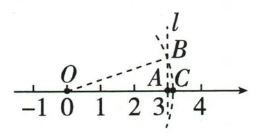

本题结论

正半轴上的交点 $C$ 表示 $\sqrt{10}$。

</article>

### 7. 连接共同边，逐块求面积 {#split-area .exam-title}

连接对角线，让两个三角形共用一条边。已有直角的先用勾股求边；未给直角的，先用逆定理确认。最后根据土地实际区域，判断两面积应相加还是相减。

<article class="handbook-example" aria-labelledby="example-11">

#### 例题 11 两块内部区域相加 知识清单例题 {#example-11 .example-heading}

题目

有一块土地,其形状如图所示, $\angle B=\angle D=90^{\circ},AB=20$ 米,BC=15米,CD=7米, 请计算这块土地的面积.

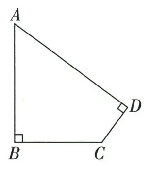

答案与解析

解析

连接 $AC$。由 $\angle B=90^\circ$，$AC=\sqrt{20^2+15^2}=25\text{ m}$。再由 $\angle D=90^\circ$，$AD=\sqrt{25^2-7^2}=24\text{ m}$。

图中对角线 $AC$ 把地块分成两块内部三角形，因此

$$S=\frac12\times20\times15+\frac12\times24\times7=150+84=234\text{ m}^2.$$

两个乘积分别使用各自互相垂直的直角边。

本题结论

土地面积为 $234\text{ m}^2$。

</article>

### 8. 表面最短路先展开，再选择合规端点 {#surface-distance .exam-title}

表面展开保持路线长度。先按“绕几周、沿哪一面”选择展开后的终点，再在允许区域中比较距离。平面中看似更近的点，可能代表没有绕圈或走入物体内部，不能作为候选。

<article class="handbook-example" aria-labelledby="example-12">

#### 例题 12 沿圆柱侧壁绕一周 知识清单例题 {#example-12 .example-heading}

题目

有一个圆柱形油罐,如图所示,计划从点 A 起环绕油罐建盘梯,正好到点 A 正上方的点 B 处.现要先沿该油罐外壁画一条指示线,再沿指示线进行建造,问指示线最短是多少米?（已知油罐的底面周长是 12 m,高 AB 是 5 m）

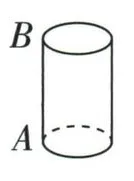

答案与解析

解析

沿母线 $AB$ 展开侧面，得到宽12米、高5米的长方形。绕一周的终点要取另一条复制边上的 $B'$，不能取同侧 $B$。

两点间线段最短，故选择 $AB'$。它在矩形内，卷回后沿侧壁连续并恰绕一周。勾股给

$$AB'=\sqrt{12^2+5^2}=13\text{ m}.$$

竖直的 $AB=5\text{ m}$ 只走零周，不符合限制；穿过内部的空间线段也不沿外壁。

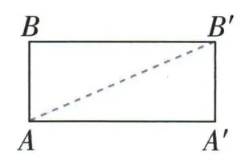

本题结论

最短指示线长为 $13\text{ m}$。

</article>

### 9. 翻折保长，直角要配到对应点 {#fold-method .exam-title}

先找折痕上的固定点和折前、折后的对应点，写出保长关系。一个直角移到哪里也要按顶点对应，不是图中任意交点都变成直角。设未知线段后，用点序表示其余段，并检验根的范围。

<article class="handbook-example" aria-labelledby="example-13">

#### 例题 13 矩形的一次翻折 知识清单例题 {#example-13 .example-heading}

题目

如图,折叠矩形 ABCD 的一边 BC,使点 B 落在 AD 边上的点 F 处,已知 AB=3,BC=5,求 EF 的长.

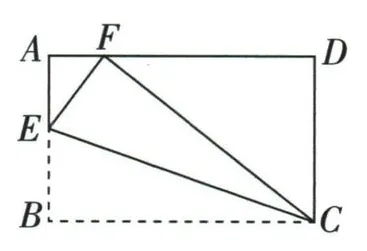

答案与解析

解析

折痕为 $EC$，$E,C$ 固定，$B$ 折到 $F$，所以 $BE=EF$、$BC=FC=5$，原 $B$ 处直角移到 $F$。

在直角三角形 $CDF$ 中，$CD=AB=3$，得 $DF=\sqrt{5^2-3^2}=4$，故 $AF=AD-DF=5-4=1$。

设 $EF=x$，则 $BE=x$、$AE=3-x$，且 $0<x<3$。在直角三角形 $AEF$ 中，

$$x^2=(3-x)^2+1^2.$$

展开消去 $x^2$，得 $6x=10$，所以 $x=5/3$。回验 $AE=4/3$、$AF=1$，平方和为 $25/9=EF^2$，且位置范围成立。

本题结论

$EF=\frac53$。

</article>

## 【坑点】条件与边界 {#pitfalls .handbook-section .is-pitfall}

### 1. 斜边未指定，不能只保留一种图形 {#unknown-hypotenuse .pitfall-title}

给两边且只说“直角三角形”，先排除较短已知边作斜边的可能，再分别考察较长已知边与未知边作斜边。额外给了直角顶点时，才可以据此删去不符的分支。

<article class="handbook-example is-pitfall" aria-labelledby="pitfall-1">

#### 辨析 01 只有两条已知边的长度 知识清单例题 {#pitfall-1 .example-heading}

题目

在 Rt△ABC 中, AC = 3, AB = 4, 则 BC 的长为 \_\_\_\_.

答案与解析

解析

$AC=3<AB=4$，所以 $AC$ 不能是斜边。

- 若 $BC$ 为斜边，$BC=\sqrt{3^2+4^2}=5$。
- 若 $AB$ 为斜边，$BC=\sqrt{4^2-3^2}=\sqrt7$。

两种均给正长度及合法三角形，题目未再限制直角位置，所以都要保留。

本题结论

$BC=5$ 或 $\sqrt7$。

</article>

### 2. 先找最长边，别让字母决定直角 {#longest-side .pitfall-title}

逆定理检验的是较小两边平方和与最长边平方。根式、分数也可以是直角三角形边长；“不是勾股数”并不等于“不是直角三角形”。

<article class="handbook-example is-pitfall" aria-labelledby="pitfall-2">

#### 辨析 02 由边长比例判断直角 知识清单例题 {#pitfall-2 .example-heading}

题目

在 $\triangle ABC$ 中, $\angle A, \angle B, \angle C$ 所对的边分别是 a, b, c, a:b:c = 9:15:12, 试判断 $\triangle ABC$ 是不是直角三角形.

答案与解析

解析

设 $a=9k$、$b=15k$、$c=12k$，其中 $k>0$。最长边是 $b$，

$$a^2+c^2=(81+144)k^2=225k^2=b^2.$$

由勾股逆定理，$b$ 所对的角 $B$ 为直角。误检 $a^2+b^2=c^2$ 得不到本题结论。

本题结论

是直角三角形，$\angle B=90^\circ$。

</article>

<article class="handbook-example is-pitfall" aria-labelledby="pitfall-3">

#### 辨析 03 逐组判断四种边长 知识清单例题 {#pitfall-3 .example-heading}

题目

判断由线段 a, b, c 组成的三角形是不是直角三角形.

(1) $a = 7, b = 24, c = 25$ .

（2） $a = \sqrt{41}, b = 4, c = 5$ .

（3） $a = \frac{5}{4}, b = 1, c = \frac{3}{4}$ .

（4） $a = 40, b = 50, c = 60$ .

答案与解析

解析

四组正边长都满足两较短边和大于最长边。分别检查：

| 小问 | 最长边 | 另两边平方和与最长边平方 | 判断 |
| --- | --- | --- | --- |
| （1） | $25$ | $7^2+24^2=625=25^2$ | 直角 |
| （2） | $\sqrt{41}$ | $4^2+5^2=41=(\sqrt{41})^2$ | 直角 |
| （3） | $5/4$ | $1^2+(3/4)^2=25/16=(5/4)^2$ | 直角 |
| （4） | $60$ | $40^2+50^2=4100>3600=60^2$ | 非直角，进一步可判锐角 |

前三组中只有第一组为正整数勾股数；第二、三组虽然不是整数勾股数，仍能构成直角三角形。第四组的锐角细分使用本页已证明的平方比较。

本题结论

（1）（2）（3）是直角三角形；（4）不是，是锐角三角形。

</article>

### 3. 面积差留下几块，要与题问一致 {#area-object .pitfall-title}

外面积减中心面积，得到的是所有剩余色块的总面积。题目问一块还是整个外方，决定还需不需要除以块数；代数中的 $2ab$ 与三角形面积 $ab/2$ 不能混为一谈。

<article class="handbook-example is-pitfall" aria-labelledby="pitfall-4">

#### 辨析 04 弦图中的单个三角形 知识清单例题·背景文字整理 {#pitfall-4 .example-heading}

题目

如图所示的“赵爽弦图”由4个全等的直角三角形和一个小正方形组成的。如图，直角三角形的直角边长为 $a, b$ ，斜边长为 $c$ ，若 $b - a = 4, c = 20$ ，则每个直角三角形的面积为 \_\_\_\_。

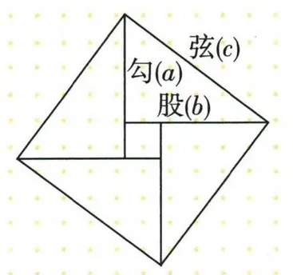

答案与解析

解析

外正方形面积为 $c^2=400$，中心面积为 $(b-a)^2=16$。剩下四个全等三角形，总面积 $400-16=384$，每个面积为 $384/4=96$。

也可由 $a^2+b^2=400$、$(b-a)^2=16$，相减得 $2ab=384$，于是 $ab=192$，单块面积 $ab/2=96$。这里 $384$ 不是单块面积。

本题结论

每个直角三角形面积为 $96$。

</article>

### 4. 凹图先确认直角，再从大区域扣除 {#concave-area .pitfall-title}

已知某个小三角形有直角，不代表整个大三角形也有直角。先求公共边，再逆判大三角形，最后按边界判断缺口面积；不能照搬凸四边形的两块相加。

<article class="handbook-example is-pitfall" aria-labelledby="pitfall-5">

#### 辨析 05 地块中的凹入部分 知识清单例题 {#pitfall-5 .example-heading}

题目

一块地如图所示, 已知 $AD = 4 \, m, CD = 3 \, m, AD \perp CD, AB = 13 \, m, BC = 12 \, m$ , 则这块地的面积为 \_\_\_\_ $m^{2}$ .

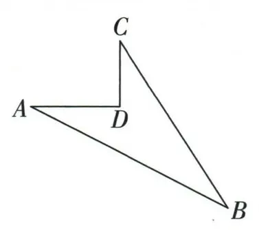

答案与解析

解析

连接 $AC$。小三角形 $ADC$ 在 $D$ 处直角，故 $AC=\sqrt{4^2+3^2}=5\text{ m}$。

大三角形中，$AC^2+BC^2=25+144=169=AB^2$，由逆定理确认 $\angle ACB=90^\circ$。其面积为 $5\times12/2=30\text{ m}^2$。

$D$ 在大三角形内部，地块是大三角形扣掉 $ADC$，所以 $S=30-4\times3/2=24\text{ m}^2$。

本题结论

地块面积为 $24\text{ m}^2$。

</article>

### 5. 角度函数也要保留几何范围 {#acute-domain .pitfall-title}

两个变量表示直角三角形的两个锐角时，先满足互余，还要各自严格在 $0^\circ$ 与 $90^\circ$ 之间。不能把一次函数的任意实数范围搬过来，端点也会使三角形退化。

<article class="handbook-example is-pitfall" aria-labelledby="pitfall-6">

#### 辨析 06 两个锐角的函数关系 2024 海南 {#pitfall-6 .example-heading}

题目

（2024 海南）设直角三角形中一个锐角为 $x$ 度，$0<x<90$，另一个锐角为 $y$ 度，则 $y$ 与 $x$ 的函数关系式为（ ）。

A. $y=180+x$

B. $y=180-x$

C. $y=90+x$

D. $y=90-x$

答案与解析

解析

内角和给 $x+y+90=180$，所以 $y=90-x$。原 $0<x<90$ 又保证 $0<y<90$。

A、C 使 $y$ 大于 $90$；B 是两角互补而非互余，且 $y>90$。只有 D 同时满足角和与锐角范围。

本题结论

选 D，$y=90-x$，$0<x<90$。

</article>

