平行四边形是共同基础，矩形多了直角，菱形多了邻边相等，正方形兼有二者。证明时先分清已有哪一类图形，再决定还缺什么条件；计算时把四边形拆成有依据的三角形。

<nav class="handbook-nav" aria-label="本章分区">
  <a class="handbook-jump is-knowledge" href="#knowledge">01 · 知识点概念、关系与适用条件</a>
  <a class="handbook-jump is-exam" href="#exam">02 · 考点题目分类和例题</a>
  <a class="handbook-jump is-pitfall" href="#pitfalls">03 · 坑点辨析错因，检查遗漏</a>
</nav>

## 【知识点】概念与依据 {#knowledge .handbook-section .is-knowledge}

### 1. 平行四边形 {#parallelogram .knowledge-title}

两组对边分别平行的四边形，叫作==平行四边形==

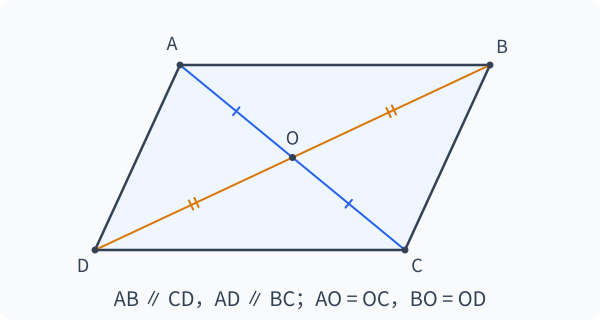

1. 对边平行且相等
2. 对角相等，邻角互补
3. 对角线互相平分
4. 对角线交点是对称中心

### 2. 平行四边形的判定 {#parallelogram-tests .knowledge-title}

满足以下任意一条，就能判定一个四边形是平行四边形

1. 两组对边分别平行
2. 两组对边分别相等
3. 同一组对边平行且相等
4. 两组对角分别相等
5. 两条对角线互相平分

### 3. 平行线间的距离 {#parallel-distance .knowledge-title}

两平行线间的垂直距离处处相等，就是平行四边形以这两条平行边为底时的高

### 4. 矩形 {#rectangle .knowledge-title}

有一个角是直角的平行四边形，叫作==矩形==

1. 具有平行四边形的全部性质
2. 四个角都是直角
3. 两条对角线相等

已知是平行四边形，再有一个直角或两条对角线相等，就能判定为矩形

### 5. 菱形 {#rhombus .knowledge-title}

有一组邻边相等的平行四边形，叫作==菱形==

1. 具有平行四边形的全部性质
2. 四条边相等
3. 对角线互相垂直，每条对角线平分一组对角

已知是平行四边形，再有邻边相等或对角线垂直，就能判定为菱形；四边相等的四边形也是菱形

### 6. 正方形 {#square .knowledge-title}

有一组邻边相等且有一个直角的平行四边形，叫作==正方形==，同时具有矩形和菱形的全部性质

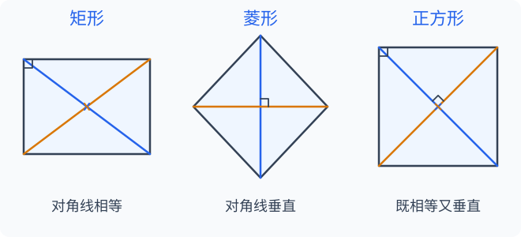

- 矩形加上邻边相等，或对角线垂直，可判定为正方形
- 菱形加上一个直角，或对角线相等，可判定为正方形

### 7. 面积 {#areas .knowledge-title}

| 图形 | 面积公式 |
| --- | --- |
| 平行四边形 | $S=bh$（底乘对应高） |
| 矩形 | $S=ab$（长乘宽） |
| 菱形 | $S=bh=\frac12d_1d_2$（两对角线乘积的一半） |
| 正方形 | $S=a^2=\frac12d^2$（$d$ 为对角线长） |

## 【考点】题目分类和例题 {#exam .handbook-section .is-exam}

### 1. 正方形三种构造的条件与依据 {#square-models .exam-title}

十字垂线：比较的是跨越对边的完整线段。 下图的两线段分别跨越两组对边，且互相垂直。

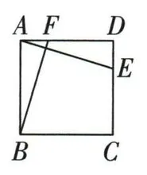

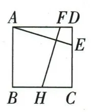

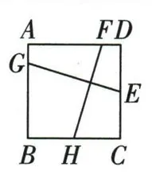

第一图比较 $\triangle ADE$ 与 $\triangle BAF$：$AD=BA$，两直角相等；$AE\perp BF$、$AD\perp BA$ 使 $\angle DAE=\angle ABF$，由 ASA 得全等，故 $AE=BF$。后两图可将跨段平行移动到从顶点出发，利用同一组平行线间同向跨段等长，再化回第一图。普通矩形两组宽度不同，任意垂直的半截线段也不符合这个结论。

45°半角：把散段接成一条。 $E,F$ 分别在 $BC,CD$ 上，且 $\angle EAF=45^\circ$。

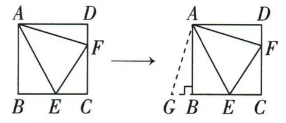

把 $\triangle ADF$ 绕 $A$ 旋转90°到 $\triangle ABG$，$G$ 在 $BC$ 经 $B$ 的反向延长线上。旋转给 $AG=AF$、$BG=DF$、$\angle BAG=\angle DAF$。原直角去掉45°后，$\angle BAE+\angle DAF=45^\circ$，故 $\angle EAG=\angle EAF$。再用公共边 $AE$ 作 SAS，得 $\triangle AEG\cong\triangle AEF$。

因此 $EF=EG=BE+DF$，两三角形面积也相等。等式中的“加”依赖 $G,B,E$ 的顺序；点在延长线上时须重读角和点序，不能直接照搬。边端的退化小三角形须另作直接核验。

中心直角：先确认等距，再割补。 $O$ 为正方形中心，$E,F$ 在相邻边 $AB,BC$ 上，且 $\angle EOF=90^\circ$。

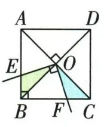

$OA=OB$，$\angle OAB=\angle OBF=45^\circ$。由 $\angle AOB=\angle EOF=90^\circ$ 同减 $\angle EOB$，得到 $\angle AOE=\angle BOF$，ASA 得 $\triangle AOE\cong\triangle BOF$。将 $BEOF$ 中的 $\triangle BOF$ 换成等面积的 $\triangle AOE$，恰拼成 $\triangle AOB$，所以面积为原正方形的四分之一。

这个模型需要中心等距、相邻有限边和完整区域条件。两正方形重叠题还要核其他两边有没有切入目标区域，不能只凭一个直角就写四分之一。原书另列的三角形迁移图如下，若不补等腰、中点或等距条件，不能作无条件推广。

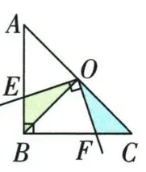

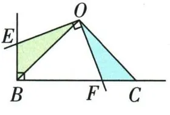

### 2. 先把边、角、对角线换成小三角形的条件 {#basic-calculation .exam-title}

已知平行四边形，先标对边相等与两对角互平分，再寻找目标三角形。矩形还能给半对角线相等，菱形还能给对角垂直与顶角平分；不要把后两类的额外性质无条件送给一般平行四边形。

<article class="handbook-example" aria-labelledby="example-1">

#### 例题 01 平行四边形中的小三角形周长 知识清单例题 {#example-1 .example-heading}

题目

如图, 已知 $\square ABCD$ 的对角线 AC, BD 交于点 O, 且 AC = 8, BD = 10, AB = 5, 则 $\triangle OCD$ 的周长为 \_\_\_\_.

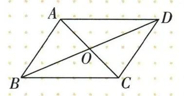

答案与解析

解析

$CD=AB=5$，$OC=AC/2=4$，$OD=BD/2=5$。因此 $\triangle OCD$ 周长为 $5+4+5=14$。两条对角线并不等长，不能取 $OC=OD$。

本题结论

14。

</article>

<article class="handbook-example" aria-labelledby="example-2">

#### 例题 02 矩形对角线的交角 知识清单例题 {#example-2 .example-heading}

题目

如图, 在矩形 ABCD 中, 对角线 AC, BD 相交于点 O, $\angle BOC = 120^{\circ}$ , AB = 6. 求对角线的长.

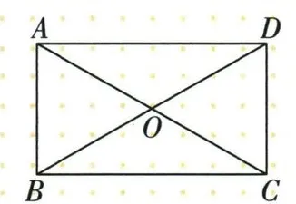

答案与解析

解析

矩形对角线相等且互平分，所以 $OA=OB$。$A,O,C$ 共线，得 $\angle AOB=180^\circ-120^\circ=60^\circ$。等腰三角形 $AOB$ 的顶角为60°，故为等边三角形，$OA=AB=6$。于是 $AC=2OA=12$，$BD=AC=12$。

本题结论

两条对角线长都为12。

</article>

<article class="handbook-example" aria-labelledby="example-3">

#### 例题 03 菱形的整角与半角 知识清单例题 {#example-3 .example-heading}

题目

如图,在菱形 ABCD 中, $\angle D=150^{\circ}$ ,则 $\angle1=$ \_\_\_\_°.

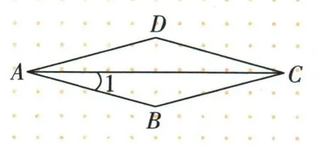

答案与解析

解析

对角相等给 $\angle B=\angle D=150^\circ$，且 $AB=BC$，所以 $\triangle ABC$ 的两底角各为 $(180^\circ-150^\circ)/2=15^\circ$。

图中角1是 $\angle BAC$，不是整个菱形在 $A$ 处的30°内角。

本题结论

$15^\circ$。

</article>

### 3. 角平分配平行，把角关系转成等腰边长 {#bisector-length .exam-title}

用平行线把一个半角移进同一个三角形，与另一个半角组成等底角，便得到等腰。求目标线段时，再按实际点序相加或相减，不把图中的重叠段漏掉。

<article class="handbook-example" aria-labelledby="example-4">

#### 例题 04 两段等腰底边的重叠 知识清单例题 {#example-4 .example-heading}

题目

如图, 在 $\square ABCD$ 中, $AB = 8$ , $AD = 5$ , $\angle DAB$ , $\angle ABC$ 的平分线 $AE$ , $BF$ 分别与直线 $CD$ 交于点 $E$ , $F$ , 求 $EF$ 的长.

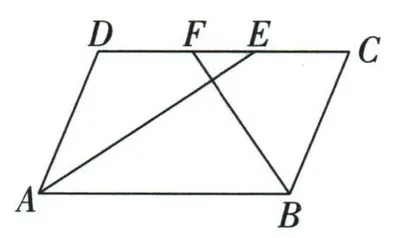

答案与解析

解析

$CD=AB=8$，$AD=BC=5$。$AE$ 平分 $\angle DAB$，且 $AB\parallel CD$，所以 $\angle DEA=\angle EAB=\angle DAE$，得 $DE=AD=5$。同理，$CF=BC=5$。

按图 $D,F,E,C$ 顺次共线，两段 $DE,CF$ 的重叠为 $EF$，故

$$EF=DE+CF-CD=5+5-8=2.$$

若换了点序，不能机械保留同一个减法式。

本题结论

$EF=2$。

</article>

<article class="handbook-example" aria-labelledby="example-5">

#### 例题 05 角平分线与外部点 知识清单例题·2024广东广州 {#example-5 .example-heading}

题目

（2024 广东广州）如图，□ABCD 中，BC=2，点 E 在 DA 的延长线上，BE=3，若 BA 平分 $\angle EBC$ ，则 DE= \_\_\_\_.

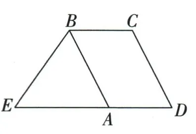

答案与解析

解析

$BC\parallel AD$，$AD=BC=2$。$BA$ 平分 $\angle EBC$，故 $\angle CBA=\angle EBA$；平行又给 $\angle CBA=\angle BAE$，从而 $AE=BE=3$。

$D,A,E$ 顺次共线，$DE=DA+AE=2+3=5$。

本题结论

$DE=5$。

</article>

<article class="handbook-example" aria-labelledby="example-6">

#### 例题 06 垂线、半角与两小三角形 知识清单例题 {#example-6 .example-heading}

题目

如图,在平行四边形 ABCD 中,对角线 AC,BD 相交于点 O,分别过点 A,C 作 $AE \perp BD, CF \perp BD$ ,垂足分别为 E,F.AC 平分 $\angle DAE$ .

(1) 若 $\angle AOE = 50^{\circ}$ ，求 $\angle ACB$ 的度数.

(2) 求证: AE = CF.

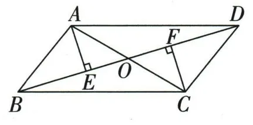

答案与解析

解析

（1）$\triangle AEO$ 在 $E$ 处为直角，$\angle EAO=90^\circ-50^\circ=40^\circ$。$AC$ 平分 $\angle DAE$，得 $\angle OAD=40^\circ$。由 $AD\parallel BC$ 得 $\angle ACB=40^\circ$。

（2）对角线互平分给 $AO=CO$；$\angle AEO=\angle CFO=90^\circ$，$\angle EOA=\angle FOC$ 为对顶角。由 AAS，$\triangle AEO\cong\triangle CFO$，故 $AE=CF$。

本题结论

（1）$40^\circ$；（2）$AE=CF$。

</article>

### 4. 先判图形，再使用它的性质 {#prove-before-use .exam-title}

把已有条件与判据逐项配对。尚未证明是平行四边形时，不能先用对边相等；尚未证明是矩形时，不能先用等对角线。开放补条件题要补尚未有的条件，而不是重复原已知。

<article class="handbook-example" aria-labelledby="example-7">

#### 例题 07 任选条件后完成证明与计算 知识清单例题·2024湖南 {#example-7 .example-heading}

题目

(2024 湖南) 如图, 在四边形 ABCD 中, $AB \parallel CD$ , 点 E 在边 AB 上, \_\_\_\_.

请从“① $\angle B=\angle AED$ ；② $AE=BE, AE=CD$ ”这两组条件中任选一组作为已知条件，填在横线上（填序号），再解决下列问题：

(1) 求证: 四边形 BCDE 为平行四边形.

(2) 若 $AD \perp AB, AD = 8, BC = 10$ , 求线段 AE 的长.

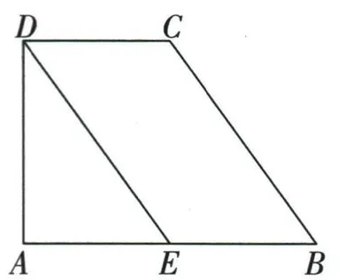

答案与解析

解析

（1）选择①：$\angle B=\angle AED$，按图中的同位角关系得 $BC\parallel DE$；又 $BE\parallel CD$，两组对边分别平行，故 $BCDE$ 为平行四边形。

选择②：由 $AE=BE$、$AE=CD$ 得 $BE=CD$；又 $BE\parallel CD$，同一组对边平行且相等，也可判定。

（2）判定后才能用 $DE=BC=10$。在直角三角形 $ADE$ 中，$AE=\sqrt{10^2-8^2}=6$。

本题结论

两组条件都可选；（1）$BCDE$ 为平行四边形；（2）$AE=6$。

</article>

<article class="handbook-example" aria-labelledby="example-8">

#### 例题 08 对边减去等长段，再证明全等 知识清单例题·2024湖北武汉 {#example-8 .example-heading}

题目

（2024 湖北武汉）如图，在□ABCD 中，点 E, F 分别在边 BC, AD 上, AF = CE.

(1) 求证: $\triangle ABE \cong \triangle CDF.$

(2) 连接 EF. 请添加一个与线段相关的条件, 使四边形 ABEF 是平行四边形。(不需要说明理由)

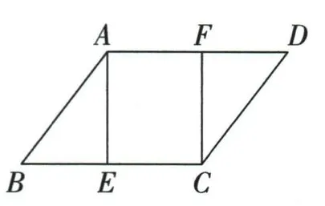

答案与解析

解析

（1）原平行四边形给 $AB=CD$、$AD=BC$、$\angle B=\angle D$。又 $AF=CE$，所以 $DF=AD-AF=BC-CE=BE$。由两边及夹角相等，$\triangle ABE\cong\triangle CDF$（SAS）。

（2）可补 $AF=BE$。原有 $AF\parallel BE$，添同一组对边相等后，即可判四边形 $ABEF$ 为平行四边形。

本题结论

（1）$\triangle ABE\cong\triangle CDF$；（2）例如 $AF=BE$。

</article>

<article class="handbook-example" aria-labelledby="example-9">

#### 例题 09 一般四边形从三个直角入手 知识清单例题 {#example-9 .example-heading}

题目

如原图，在四边形ABCD中，$AB\parallel CD$，$\angle BAD=90^\circ$，$AB=5$，$BC=12$，$AC=13$。求证：四边形ABCD是矩形。

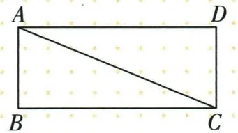

答案与解析

解析

由 $AB\parallel CD$、$\angle BAD=90^\circ$，得 $\angle ADC=90^\circ$。在 $\triangle ABC$ 中，$5^2+12^2=13^2$，由勾股定理逆定理，最长边 $AC$ 对面的 $\angle B=90^\circ$。

四边形已有三个直角，所以第四角也为90°，$ABCD$ 是矩形。不是由最初一个直角就能直接判定。

本题结论

$ABCD$ 是矩形。

</article>

<article class="handbook-example" aria-labelledby="example-10">

#### 例题 10 动点何时使图形成矩形 知识清单例题 {#example-10 .example-heading}

题目

如图, 在 $\triangle ABC$ 中, 点 $O$ 是边 $AC$ 上一动点, 过点 $O$ 作直线 $MN \parallel BC$ . 设 $MN$ 交 $\angle ACB$ 的平分线于点 $E$ , 交 $\triangle ABC$ 的外角 $\angle ACD$ 的平分线于点 $F$ .

(1) 求证: OE = OF.

(2) 当点 O 在边 AC 上运动到什么位置时, 四边形 AECF 是矩形? 并说明理由.

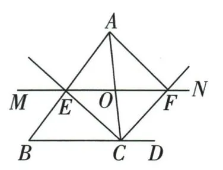

答案与解析

解析

（1）外角平分给 $\angle ACF=\angle FCD$，平行给 $\angle FCD=\angle CFO$，所以 $OF=OC$。同理，内角平分与平行给 $OE=OC$，故 $OE=OF$。

（2）当 $O$ 为 $AC$ 中点时，$AO=OC$，配合 $EO=FO$，新图的两对角线互相平分，先得平行四边形。内外角邻补，两平分线夹角为

$$\angle ECF=\tfrac12(\angle ACB+\angle ACD)=90^\circ,$$

因此成为矩形。反过来，若已是矩形，对角线必互相平分，交点 $O$ 必为 $AC$ 中点，所以这一位置也是必要的。$O=C$ 时图形退化，不能称为矩形。

本题结论

（1）$OE=OF$；（2）$O$ 为 $AC$ 中点时，且仅此时为矩形。

</article>

<article class="handbook-example" aria-labelledby="example-11">

#### 例题 11 先判矩形，再换底高求长 知识清单例题·2024甘肃兰州 {#example-11 .example-heading}

题目

（2024甘肃兰州）如图，在 $\triangle ABC$ 中， $AB=AC,D$ 是 $BC$ 的中点， $CE\parallel AD,AE\perp AD,EF\perp AC.$

(1) 求证: 四边形 ADCE 是矩形.  
(2) 若 BC=4, CE=3, 求 EF 的长.

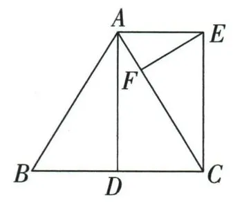

答案与解析

解析

（1）$AB=AC$ 且 $D$ 为 $BC$ 中点，三线合一给 $AD\perp BC$。结合 $CE\parallel AD$、$AE\perp AD$，得到 $\angle ADC=\angle DCE=\angle EAD=90^\circ$，故 $ADCE$ 为矩形。

（2）$CD=BC/2=2$，矩形给 $AE=CD=2$、$\angle AEC=90^\circ$，所以 $AC=\sqrt{2^2+3^2}=\sqrt{13}$。

同一个三角形 $AEC$ 用两种底高表示面积，$AC\cdot EF=AE\cdot CE=6$，因此 $EF=6/\sqrt{13}=6\sqrt{13}/13$。

本题结论

（1）$ADCE$ 为矩形；（2）$EF=6\sqrt{13}/13$。

</article>

<article class="handbook-example" aria-labelledby="example-12">

#### 例题 12 中垂线与原平行边构造菱形 知识清单例题 {#example-12 .example-heading}

题目

如图所示, □ABCD 的对角线 AC 的垂直平分线与 AD, BC, AC 分别相交于点 E, F, O, 连接 AF, EC. 四边形 AFCE 是菱形吗? 为什么?

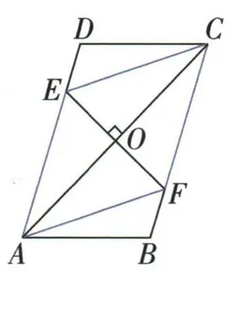

答案与解析

解析

方法一：$AD\parallel BC$，故 $\angle EAO=\angle FCO$；$AO=CO$，$\angle AOE=\angle COF=90^\circ$。ASA 得 $\triangle AOE\cong\triangle COF$，所以 $AE=CF$。结合 $AE\parallel CF$，先判 $AFCE$ 为平行四边形；其对角线 $AC\perp EF$，再判菱形。

方法二：中垂线性质给 $AE=EC$、$AF=FC$。由等腰及平行得到 $\angle ECA=\angle EAC=\angle FCA$。$\triangle ECO,\triangle FCO$ 有两个等角及共同夹边 $CO$，ASA 得 $EC=FC$。于是四边 $AE=EC=CF=FA$，直接判菱形。

本题结论

$AFCE$ 是菱形。

</article>

<article class="handbook-example" aria-labelledby="example-13">

#### 例题 13 从矩形或菱形出发补条件 知识清单例题·合组；（2）2024黑龙江龙东地区 {#example-13 .example-heading}

题目

（1）如图, 在平行四边形 ABCD 中, AC 与 BD 相交于点 O, $\angle OAB = \angle OBA$ .

(1) 证明: 平行四边形 ABCD 是矩形.  
(2) 请添加一个条件使矩形 ABCD 为正方形.

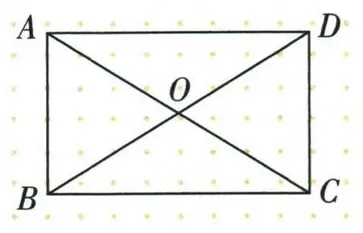

（2）(2024 黑龙江龙东地区) 如图, 在菱形 ABCD 中, 对角线 AC, BD 相交于点 O, 请添加一个条件: , 使得菱形 ABCD 为正方形.

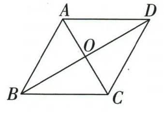

答案与解析

解析

（1）$\angle OAB=\angle OBA$，所以 $OA=OB$。原平行四边形又给 $OA=OC$、$OB=OD$，故 $AC=2OA=2OB=BD$，先判矩形。再加 $AC\perp BD$，便同时具有菱形条件，成为正方形；也可加 $AB=BC$。

（2）原图已是菱形，可加 $AC=BD$，使其又是矩形，进而为正方形；也可加一个角为90°。不能只重复菱形本有的“对角线垂直”作为新条件。

本题结论

（1）原图为矩形，再添例如 $AC\perp BD$；（2）例如 $AC=BD$。答案均不唯一。

</article>

<article class="handbook-example" aria-labelledby="example-14">

#### 例题 14 外部等距点连接两次判定 知识清单例题 {#example-14 .example-heading}

题目

如图, 在 $\square ABCD$ 中, 对角线 $AC, BD$ 交于点 $O, E$ 是 $BD$ 延长线上的点, 且 $EA = EC$ .

(1) 求证: 四边形 ABCD 是菱形.  
(2) 若 $\angle DAC = \angle EAD + \angle AED$ ，求证：四边形 ABCD 是正方形.

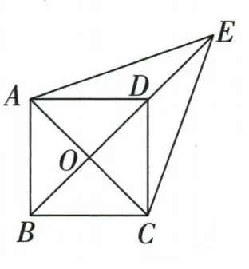

答案与解析

解析

（1）$AO=CO$，且 $EA=EC$，所以 $E$ 在 $AC$ 中垂线上。$O$ 是中点，$E\ne O$，故直线 $EO$ 就是中垂线。$E,O,B,D$ 共线，得 $AC\perp BD$，平行四边形因而是菱形。

（2）按图 $B,D,E$ 顺次共线，$\angle ADB$ 是 $\triangle ADE$ 的外角，

$$\angle ADB=\angle EAD+\angle AED=\angle DAC.$$

在 $\triangle AOD$ 中得到等底角，故 $AO=DO$。原两对角线互平分，得 $AC=2AO=2DO=BD$。菱形又有等对角线，所以是正方形。

本题结论

（1）$ABCD$ 是菱形；（2）加所给角条件后是正方形。

</article>

### 5. 长度与面积：先分半，再倍回 {#length-area .exam-title}

菱形两对角线垂直平分，先用半条对角线构成的直角三角形求长度。求整图面积时恢复完整对角线；若求高，用“对角线积半=底×高”表达同一面积。

<article class="handbook-example" aria-labelledby="example-15">

#### 例题 15 周长与一条对角线求面积 知识清单例题 {#example-15 .example-heading}

题目

如图,已知菱形 ABCD 的周长为 24,一条对角线的长为 8,求该菱形的面积.

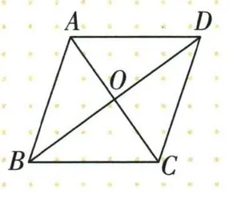

答案与解析

解析

边长 $AB=24/4=6$。不妨令 $AC=8$，则 $OA=4$。直角三角形 $AOB$ 中，$OB=\sqrt{6^2-4^2}=2\sqrt5$，所以完整对角线 $BD=2OB=4\sqrt5$。

$$S=\frac12 AC\cdot BD=\frac12\times8\times4\sqrt5=16\sqrt5.$$

两个因子一半分别来自“半条对角线”和“面积积半”，不能随意混抵。

本题结论

$16\sqrt5$。

</article>

<article class="handbook-example" aria-labelledby="example-16">

#### 例题 16 60度先产生等边三角形 知识清单例题 {#example-16 .example-heading}

题目

如图,已知某广场的菱形花坛 ABCD 的周长是 $24 \, m$ , $\angle BAD = 60^{\circ}$ , 则对角线 AC 的长为 ( )

A. $6\sqrt{3}$ m

B.6 m

C. $3\sqrt{3}$ m

D.3 m

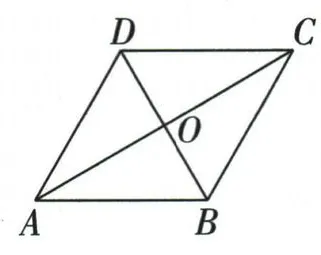

答案与解析

解析

每边为 $24/4=6\text{ m}$。$AB=AD$、$\angle BAD=60^\circ$，所以 $\triangle ABD$ 为等边三角形，$BD=6\text{ m}$、$OB=3\text{ m}$。

直角三角形 $AOB$ 中，$OA=\sqrt{6^2-3^2}=3\sqrt3\text{ m}$，故 $AC=2OA=6\sqrt3\text{ m}$，选 A。B是另一对角线，C是半条目标对角线，D是半条另一对角线。

本题结论

A，$6\sqrt3\text{ m}$。

</article>

<article class="handbook-example" aria-labelledby="example-17">

#### 例题 17 用两种面积式换算垂直高 知识清单例题 {#example-17 .example-heading}

题目

如图,四边形 ABCD 是菱形,AC=8,DB=6,DH⊥AB 于点 H.求 DH 的长.

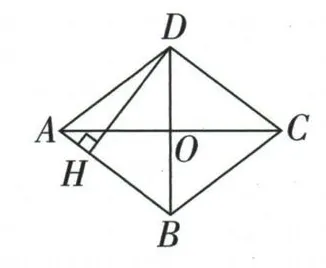

答案与解析

解析

$OA=4$、$OB=3$ 且互相垂直，所以 $AB=\sqrt{4^2+3^2}=5$。整图面积为 $8\times6/2=24$。

以 $AB$ 为底，高是 $DH$，因此 $5DH=24$，$DH=24/5$。这个高既不是半对角线，也不是菱形的边。

本题结论

$DH=24/5$。

</article>

### 6. 等对角线把动线段换成距离 {#minimum .exam-title}

目标线段若是一个小矩形的对角线，可先换成另一条对角线，再用点到直线的垂线段最短。还必须检查垂足能否取到，以及动点在端点时的小图是否退化。

<article class="handbook-example" aria-labelledby="example-18">

#### 例题 18 求两垂足之间距离的最小值 知识清单例题 {#example-18 .example-heading}

题目

如图, 在 $\triangle ABC$ 中, $\angle C = 90^{\circ}, AC = BC = 6, P$ 为边 $AB$ 上一动点, 作 $PD \perp BC$ 于点 $D$ , $PE \perp AC$ 于点 $E$ , 求 $DE$ 的最小值.

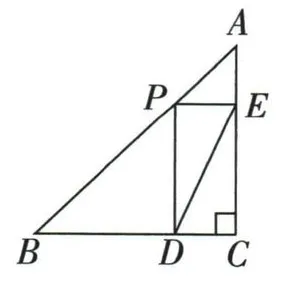

答案与解析

解析

当 $P$ 在 $AB$ 内部时，$C,D,P,E$ 处已有三个直角，故 $CDPE$ 是矩形，$DE=CP$。

于是目标转成固定点 $C$ 到边 $AB$ 上点 $P$ 的最短距离。等腰三角形的高落在底边中点，垂足在允许范围内，最小值能够取到。$AB=\sqrt{6^2+6^2}=6\sqrt2$，此时 $CP$ 同时是直角三角形的斜边中线，故 $CP=AB/2=3\sqrt2$。

若 $P=A$ 或 $P=B$，小矩形虽退化，直接计算 $DE=6$，仍大于 $3\sqrt2$。

本题结论

最小值为 $3\sqrt2$，当 $P$ 为 $AB$ 中点时取得。

</article>

### 7. 平移、翻折后，先认对应点和固定点 {#transformations .exam-title}

平移保持整个图形的对应边角，翻折保持对应点到折痕上固定点的距离。先写出哪两个点对应，再列等边，不能将旁边一条看似相近的线段当作对应段。

<article class="handbook-example" aria-labelledby="example-19">

#### 例题 19 矩形中的平移与等腰判断 知识清单例题 {#example-19 .example-heading}

题目

如图, 在矩形 ABCD 中, 连接对角线 AC、BD, 将 $\triangle ABC$ 沿 BC 方向平移, 使点 B 移到点 C 处, 得到 $\triangle DCE$ .

(1) 求证: $\triangle ACD \cong \triangle EDC.$   
(2)请探究 $\triangle BDE$ 的形状,并说明理由.

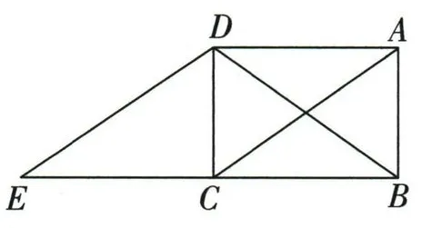

答案与解析

解析

（1）平移对应为 $A\to D$、$B\to C$、$C\to E$，所以 $CE=BC$。矩形又给 $AD=BC$，故 $AD=EC$。$CD$ 公共，$\angle ADC=\angle ECD=90^\circ$，由 SAS 得 $\triangle ACD\cong\triangle EDC$。

（2）矩形有 $AC=BD$，平移有 $DE=AC$，所以 $BD=DE$，$\triangle BDE$ 是等腰三角形。等腰不是只由“平移”两个字得来，还用了原矩形的等对角线。

本题结论

（1）$\triangle ACD\cong\triangle EDC$；（2）$\triangle BDE$ 为等腰三角形，$BD=DE$。

</article>

<article class="handbook-example" aria-labelledby="example-20">

#### 例题 20 翻折到另一边的中点 知识清单例题·2024江苏徐州 {#example-20 .example-heading}

题目

(2024 江苏徐州) 如图, 将矩形纸片 ABCD 沿边 EF 折叠, 使点 D 在边 BC 中点 M 处. 若 AB = 4, BC = 6, 则 CF = \_\_\_\_.

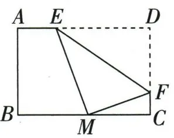

答案与解析

解析

折痕上的 $F$ 不动，原顶点 $D$ 的像为 $M$，所以 $DF=MF$。$CD=4$、$MC=3$，设 $CF=x$，则 $DF=4-x$，且 $0<x<4$。

在直角三角形 $MCF$ 中，

$$(4-x)^2=3^2+x^2.$$

展开并同减 $x^2$，得 $16-8x=9$，所以 $x=7/8$。回验 $DF=25/8$，$MF=\sqrt{9+49/64}=25/8$，且 $0<7/8<4$，位置与等距都符合。

本题结论

$CF=7/8$。

</article>

<article class="handbook-example" aria-labelledby="example-21">

#### 例题 21 折痕与跨越正方形的线段 知识清单例题 {#example-21 .example-heading}

题目

如图, 将一边长为 12 的正方形纸片 ABCD 的顶点 A 折至 DC 边上的点 E 处, 使 DE = 5, 折痕为 PQ, 则 PQ 的长为 ( )

A.12

B.13

C.14

D.15

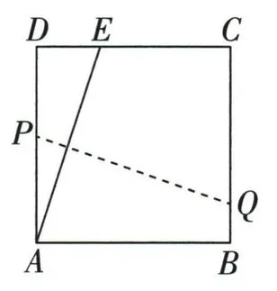

答案与解析

解析

翻折使 $PQ$ 为 $AE$ 的垂直平分线，所以 $PQ\perp AE$。作 $QF\perp AD$，则 $QF=AB=AD=12$。

$\triangle ADE$ 与 $\triangle QFP$ 的 $D,F$ 均为直角，$\angle DAE=\angle FQP$ 由两组垂直关系得到，再结合夹边 $AD=QF$，ASA 得全等。对应斜边 $PQ=AE$。

$\triangle ADE$ 在 $D$ 处为直角，故 $AE=\sqrt{12^2+5^2}=13$，选 B。12只代表正方形宽度，不是斜折痕长。

本题结论

B，$PQ=13$。

</article>

### 8. 正方形的45度与全等转换 {#square-angles .exam-title}

正方形对角线给45°；遇到相等边，再在具体三角形中形成等腰。两条边分散时，可利用正方形等边、夹直角及公共边作 SAS，将目标角或长度换到另一处。

<article class="handbook-example" aria-labelledby="example-22">

#### 例题 22 对角线上的等长点 知识清单例题 {#example-22 .example-heading}

题目

如图, 已知 P 是正方形 ABCD 对角线 BD 上一点, 且 BP = BC, 则 $\angle ACP$ 的度数是 \_\_\_\_.

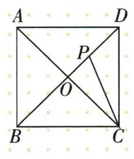

答案与解析

解析

$BD$ 平分顶角，$\angle PBC=45^\circ$。$BP=BC$，所以 $\triangle BPC$ 两底角各为 $(180^\circ-45^\circ)/2=67.5^\circ$。

$AC$ 平分 $C$ 处直角，$\angle BCA=45^\circ$。依图中射线次序，$\angle ACP=67.5^\circ-45^\circ=22.5^\circ$。$P$ 并不是对角线交点，不能擅加中点条件。

本题结论

$22.5^\circ$。

</article>

<article class="handbook-example" aria-labelledby="example-23">

#### 例题 23 全等移角后再用外角 知识清单例题 {#example-23 .example-heading}

题目

如图,在正方形 ABCD 中,E 是对角线 BD 上一点,AE 的延长线交 CD 于点 F,连接 CE.若 $\angle BAE = 56^{\circ}$ ,则 $\angle CEF =$ \_\_\_\_ $^{\circ}$ .

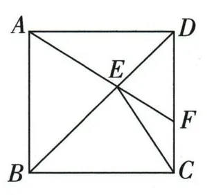

答案与解析

解析

$AB=BC$，$\angle ABE=\angle CBE=45^\circ$，$BE$ 公共，SAS 得 $\triangle ABE\cong\triangle CBE$，所以 $\angle BCE=56^\circ$。

$\angle ECF=90^\circ-56^\circ=34^\circ$。又 $AB\parallel CD$，给 $\angle EFD=56^\circ$；它是 $\triangle CEF$ 的外角，所以 $\angle CEF=56^\circ-34^\circ=22^\circ$。

本题结论

$22^\circ$。

</article>

<article class="handbook-example" aria-labelledby="example-24">

#### 例题 24 延长等长段后比较两大三角形 知识清单例题 {#example-24 .example-heading}

题目

如图,在正方形 ABCD 中,点 E 在 BC 边的延长线上,点 F 在 CD 边的延长线上,且 CE=DF,连接 AE 和 BF 相交于点 M.求证:AE=BF.

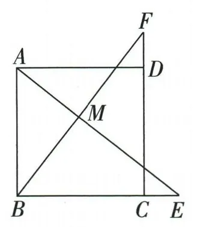

答案与解析

解析

按图 $B,C,E$ 与 $C,D,F$ 分别顺次共线。由 $BC=CD$、$CE=DF$ 得 $BE=BC+CE=CD+DF=CF$。

$AB=BC$，$\angle ABE=\angle BCF=90^\circ$，由 SAS 得 $\triangle AEB\cong\triangle BFC$，所以 $AE=BF$。交点 $M$ 不参与这一证明，不能因图形对称感就另称它为中点。

本题结论

$AE=BF$。

</article>

出现两个垂足时： 先用两组垂直形成的等角及正方形等边判直角三角形全等，把已知长度换到所求图形；再对共用同一线段的两个直角三角形分别识别斜边并写勾股式，用同一个平方量相等消去未知数的平方。设未知段前先核点序，避免把整段相加写成相减。

<article class="handbook-example" aria-labelledby="example-25">

#### 例题 25 两个垂足与面积方程 知识清单例题·2024北京 {#example-25 .example-heading}

题目

(2024 北京) 如图, 在正方形 ABCD 中, 点 E 在 AB 上, $AF \perp DE$ 于点 F, $CG \perp DE$ 于点 G. 若 AD = 5, CG = 4, 则 $\triangle AEF$ 的面积为 \_\_\_\_.

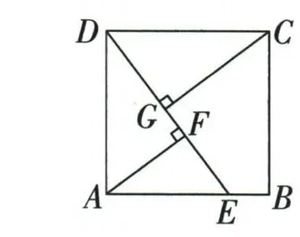

答案与解析

解析

直角三角形 $DCG$ 中，$DG=\sqrt{5^2-4^2}=3$。$\triangle ADF$ 与 $\triangle DCG$ 均为直角三角形，$AD=DC=5$，两组垂直给 $\angle DAF=\angle CDG$，由 AAS 得全等，所以 $AF=DG=3$、$DF=CG=4$。

设 $EF=x>0$。按 $D,F,E$ 的次序，$DE=4+x$。分别在 $AEF,ADE$ 中用勾股：

$$AE^2=3^2+x^2=(4+x)^2-5^2.$$

展开消去 $x^2$，得 $18=8x$，所以 $x=9/4$。因此 $S_{\triangle AEF}=AF\cdot EF/2=3\times(9/4)/2=27/8$。

本题结论

$27/8$。

</article>

### 9. 先确认区域，再作等面积替换 {#equal-area .exam-title}

替换面积的依据可以是全等，也可以是同底等高。必须明确哪一块换成哪一块、是否恰好拼成目标区域，不凭涂色或“模型名称”直接给比例。

<article class="handbook-example" aria-labelledby="example-26">

#### 例题 26 绕中心旋转后的重叠区域 知识清单例题·改编，明确重叠区域 {#example-26 .example-heading}

题目

如图,正方形ABCD的边长为4,O为正方形ABCD的对角线的交点,正方形 $A_{1}B_{1}C_{1}O$ 绕点O旋转, $A_{1}O$ 交AB于E点, $C_{1}O$ 交BC于F点,则两个正方形重叠部分的面积为\_\_\_\_.

已知图示重叠区域恰为四边形 $BEOF$，旋转正方形的另外两条边未切入这一区域。

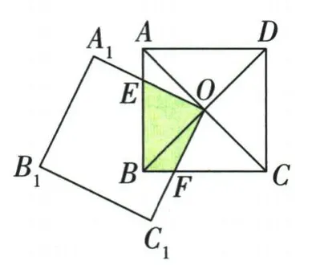

答案与解析

解析

按题图，重叠区域为 $BEOF$。$OA=OB$，$\angle OAB=\angle OBF=45^\circ$。$\angle AOB=\angle EOF=90^\circ$ 同减 $\angle EOB$，得 $\angle AOE=\angle BOF$。

所以 $\triangle AOE\cong\triangle BOF$（ASA），面积相等。将 $BEOF$ 中后一块换成 $AOE$，得到 $\triangle AOB$，面积为 $4^2/4=4$。

这里使用的是图示两条边段确实交到 $E,F$，且另两条边没有切入 $BEOF$ 的情形。改变旋转正方形的大小或位置时，应重新确认重叠区域，不无条件推广。

本题结论

重叠部分面积为4。

</article>

<article class="handbook-example" aria-labelledby="example-27">

#### 例题 27 两个大小不同的正方形换面积 知识清单例题 {#example-27 .example-heading}

题目

如图，四边形 $ABCD$ 和 $CEFG$ 都是正方形，$G$ 在 $CD$ 上，$BC=10\text{ cm}$。求四边形 $ABFD$ 的面积。

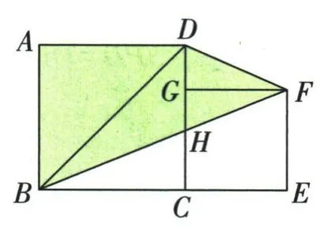

答案与解析

解析

连接 $CF$。

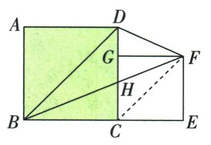

两个正方形的对角线分别与共线的 $BC,CE$ 形成45°，所以 $CF\parallel BD$。点 $F,C$ 到直线 $BD$ 的距离相等，$\triangle BDF$ 与 $\triangle BDC$ 同底等高，面积相等。

四边形 $ABFD$ 分成 $\triangle ABD$ 与 $\triangle BDF$，将后一块换成 $\triangle BDC$，便得到整个正方形 $ABCD$，面积为 $10^2=100\text{ cm}^2$。没有要求小正方形边长也为10。

本题结论

$100\text{ cm}^2$。

</article>

## 【坑点】辨析与边界 {#pitfalls .handbook-section .is-pitfall}

### 1. 判据中的对象与前提不能交换 {#wrong-condition .pitfall-title}

平行四边形的“同组平行且相等”、矩形的“等对角线”、菱形的“垂直对角线”都有具体前提。先把条件写全，再用反例或证明判断；不要把不同判据的半句话拼在一起。

<article class="handbook-example is-pitfall" aria-labelledby="pitfall-1">

#### 辨析 01 五组条件与一个判断题 知识清单例题·合组 {#pitfall-1 .example-heading}

题目

（1）如图, 四边形 ABCD 中, 对角线 AC, BD 交于点 O, 下列条件不能判定这个四边形是平行四边形的是 \_\_\_\_. (填序号)

① $AB \parallel CD, AD \parallel BC;$   
② $AB \parallel CD, AD = BC;$   
③AO=CO,BO=DO;   
④AB=CD,AD=BC;   
⑤AB∥CD,∠ABC=∠ADC.

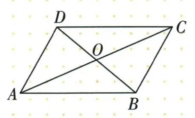

（2）如图, 在四边形 ABCD 中, 如果 $AD \parallel BC, \angle B = \angle D$ , 那么四边形 ABCD 是平行四边形吗? 请说明理由.

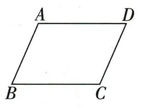

答案与解析

解析

（1）①为定义；③为对角线互平分；④为两组对边相等，都能判定。⑤由 $AB\parallel CD$ 得 $\angle A+\angle D=180^\circ$，代入 $\angle D=\angle B$，得到 $\angle A+\angle B=180^\circ$，再判 $AD\parallel BC$，也成立。只有②的平行与相等分属不同组，可为等腰梯形，不能判定。

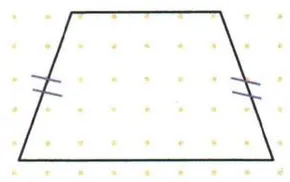

（2）可以判为平行四边形。法一：$AD\parallel BC$ 给 $\angle A+\angle B=180^\circ$，代入 $\angle B=\angle D$，再判 $AB\parallel CD$。

法二：原平行同时给 $\angle C+\angle D=180^\circ$，两式相减得到 $\angle A=\angle C$，由两组对角相等判定。

法三：连接 $AC$，用平行内错角、原 $\angle B=\angle D$ 和公共非夹边 $AC$ 作 AAS，得 $\triangle ABC\cong\triangle CDA$，于是 $BC=AD$。原有 $BC\parallel AD$，同组平行且等也能判定。

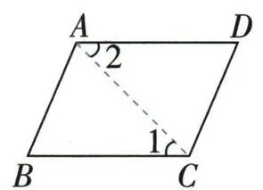

本题结论

（1）只有②不能判定；（2）是平行四边形。

</article>

<article class="handbook-example is-pitfall" aria-labelledby="pitfall-2">

#### 辨析 02 矩形性质与矩形判定不要串换 知识清单例题·合组；（1）2024四川成都（2）2024四川泸州 {#pitfall-2 .example-heading}

题目

（1）（2024四川成都）如图，在矩形ABCD中，对角线AC与BD相交于点O，则下列结论一定正确的是 （）

A.AB=AD

B. $AC \perp BD$

C. $AC = BD$

D. $\angle ACB = \angle ACD$

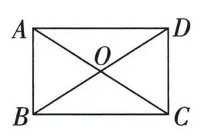

（2）（2024 四川泸州）已知四边形 ABCD 是平行四边形, 下列条件中, 不能判定 □ABCD 为矩形的是 ( )

A. $\angle A = 90^{\circ}$

B. $\angle B = \angle C$

C. $AC = BD$

D. $AC \perp BD$

答案与解析

解析

（1）选 C。矩形对角线一定相等；邻边相等、对角垂直、对角平分顶角均不是一般矩形的必有性质。

（2）选 D。已是平行四边形，A的一直角、C的等对角线均足够；B的两个邻角相等，又由平行四边形得互补，故各为90°，也足够。D的垂直对角线指向菱形，不保证矩形。

本题结论

（1）C；（2）D。

</article>

<article class="handbook-example is-pitfall" aria-labelledby="pitfall-3">

#### 辨析 03 平方关系给的是哪一个直角 知识清单例题·2024内蒙古通辽 {#pitfall-3 .example-heading}

题目

(2024 内蒙古通辽) 如图, □ABCD 的对角线 AC, BD 交于点 O, 以下条件不能证明 □ABCD 是菱形的是 ()

A. $\angle BAC = \angle BCA$

B. $\angle ABD = \angle CBD$

C. $OA^2 +OD^2 = AD^2$

D. $AD^{2} + OA^{2} = OD^{2}$

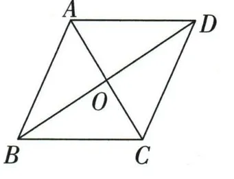

答案与解析

解析

A使 $\triangle ABC$ 的两底角相等，得 $AB=BC$，可判菱形。B配合 $AB\parallel CD$ 得 $\angle CBD=\angle BDC$，故 $BC=CD$，也可判菱形。

C由勾股定理逆定理得 $\angle AOD=90^\circ$，两对角线垂直，足够。

D却给 $\angle OAD=90^\circ$，直角在 $A$ 而非交点 $O$。菱形的对角线会平分 $A$ 处小于180°的内角，其半角不可能为90°，所以 D 不仅不能判定，在非退化情形下还排除了菱形。

本题结论

D。

</article>

### 2. 等宽是垂距相等，不是边长等于宽 {#strip-width .pitfall-title}

等宽纸条交叉，先由两组边线平行判平行四边形，再用同一面积的两种底高表达证明邻边相等。随后认清图上标的是内角还是外角，垂足可能在延长线上。

<article class="handbook-example is-pitfall" aria-labelledby="pitfall-4">

#### 辨析 04 等宽纸条的重叠部分 知识清单例题·2024广西 {#pitfall-4 .example-heading}

题目

(2024 广西) 如图, 两张宽度均为 $3 \mathrm{~cm}$ 的纸条交叉叠放在一起, 交叉形成的锐角为 $60^{\circ}$ , 则重合部分构成的四边形ABCD的周长为 \_\_\_\_ cm.

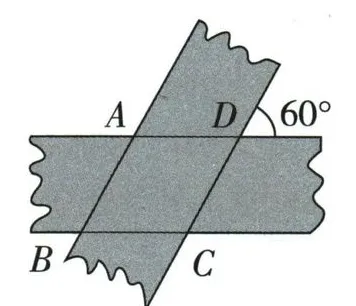

答案与解析

解析

两组边线分别平行，所以重叠图形先是平行四边形。两组高均为3 cm，同一面积既为 $3AD$ 又为 $3CD$，故 $AD=CD$，成为菱形。

原图 D 处标的是外部60°，内部 $\angle CDA=120^\circ$。过 $C$ 向直线 $AD$ 作垂线，垂足 $E$ 在越过 $D$ 的延长线上；$\angle CDE=60^\circ$、$\angle DCE=30^\circ$，所以 $DE=CD/2$。

$$3^2=CD^2-(CD/2)^2=\tfrac34 CD^2,$$

得 $CD=2\sqrt3\text{ cm}$，周长为 $8\sqrt3\text{ cm}$。宽3 cm是垂直高，不能当斜边长。

本题结论

$8\sqrt3\text{ cm}$。

</article>

### 3. 动点重合，四边形就可能退化 {#degeneracy .pitfall-title}

证明新四边形之前，先确认确有四个不同的有效顶点。对角线互平分、三个直角等判据，不能拿来把重复点构成的退化图形也判为平行四边形或正方形。

<article class="handbook-example is-pitfall" aria-labelledby="pitfall-5">

#### 辨析 05 对角线上的两个截点 依据知识清单原题改编·检查退化边界 {#pitfall-5 .example-heading}

题目

原题给出：在平行四边形 $ABCD$ 中，$E,F$ 在对角线 $AC$ 上，且 $AE=CF$，要求证明四边形 $DEBF$ 为平行四边形。

这个条件是否需要排除特殊位置？补足后怎样证明？

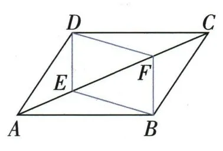

答案与解析

解析

若 $E=F=O$，其中 $O$ 为两对角线交点，则 $AE=CF$ 仍成立，但 $DEBF$ 只有三个不同点，不能称四边形。所以必须排除 $E=F$。

补充 $E\ne F$ 后，两点关于 $O$ 对称。按原图 $A,E,O,F,C$ 的次序，

$$OE=OA-AE=OC-CF=OF.$$

又 $OB=OD$，新图对角线 $EF,DB$ 在同一 $O$ 互相平分，故 $DEBF$ 为平行四边形。若 $E,F$ 交换到 $O$ 另一侧，需改写段长减法，但同样由 $AE=CF$ 得它们关于中点对称，结论不变。

本题结论

需排除 $E=F=O$；补充 $E\ne F$ 后，新四边形为平行四边形。

</article>

<article class="handbook-example is-pitfall" aria-labelledby="pitfall-6">

#### 辨析 06 角平分线上的点到两边作垂线 知识清单原题改编·补退化辨析小问 {#pitfall-6 .example-heading}

题目

如图,在四边形 ABCD 中,AB=BC,对角线 BD 平分 $\angle ABC$ ,P 是 BD 上一点,过点 P 作 $PM \perp AD$ , $PN \perp CD$ , 垂足分别为 M;N.

(1) 求证: $\angle ADB = \angle CDB$ .   
(2) 若 $\angle ADC = 90^{\circ}$ ，求证：四边形 MPND 是正方形.

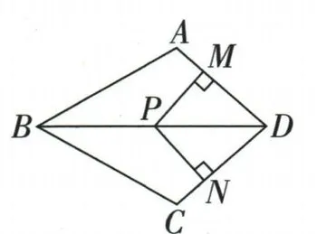

（3）若允许 $P=D$，第（2）问的结论还能成立吗？

答案与解析

解析

（1）$AB=BC$，$BD$ 公共，且 $\angle ABD=\angle CBD$，SAS 得 $\triangle ABD\cong\triangle CBD$，故 $\angle ADB=\angle CDB$。

（2）对图示 $P\ne D$ 的有效构造，$\angle ADC=90^\circ$，两垂足又给两个直角，所以 $MPND$ 先为矩形。第（1）问说明 $DP$ 在 $D$ 的角平分线上，因此到两边的距离 $PM=PN$；矩形邻边相等，便为正方形。

（3）若 $P=D$，两垂足也都变成 $D$，各线段长为0，图形退化，不能叫正方形。原“BD上一点”须在第（2）问排除此端点。

本题结论

（1）等角成立；（2）$P\ne D$ 的图示构造为正方形；（3）$P=D$ 时不成立。

</article>

### 4. 给出的长度还要能与图形位置相容 {#feasibility .pitfall-title}

从一个模型算出的面积，仍要检查所有边长、角和点序是否同时可实现。位于有限边上包含端点，与严格位于边的内部不同；原图若画成内点，不能不核条件就当作可行。

<article class="handbook-example is-pitfall" aria-labelledby="pitfall-7">

#### 辨析 07 半角条件与边上点的位置 知识清单原题改编·保原数据并增加可实现性辨析 {#pitfall-7 .example-heading}

题目

如图,已知正方形 ABCD 的边长为 8 ,点 E,F 分别在边 BC,CD 上, $\angle {EAF} = {45}^{ \circ  }$ .当 ${EF} = 8$ 时, $\bigtriangleup  {AEF}$ 的面积是 (   )

A.8

B.16

C.24

D.32

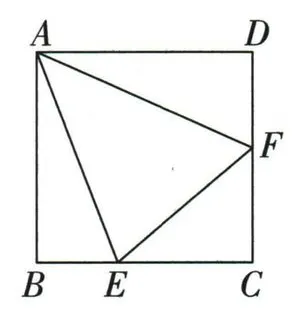

进一步辨析：当 $E,F$ 都严格位于各边内部时，这组条件能否同时成立？若允许端点，哪些位置可行？

答案与解析

解析

设 $BE=x$、$DF=y$，有限边条件给 $0\le x,y\le8$。半角模型给 $EF=x+y$，原 $EF=8$，故 $x+y=8$。

从 $E,F$ 的水平、竖直距离看，

$$EF^2=(8-x)^2+(8-y)^2=x^2+y^2,$$

最后一步用了 $x+y=8$。又 $EF^2=64=(x+y)^2$，因此 $2xy=0$。

所以两点不能同时严格位于边的内部。只有 $x=0,y=8$ 或 $x=8,y=0$：即 $E=B,F=C$，或 $E=C,F=D$。这两种端点位置都使 $\angle EAF=45^\circ$、$EF=8$，原三角形分别是 $ABC$ 或 $ACD$，面积均为 $8^2/2=32$。

原数值答案 D 在允许端点时可取，但原内点示意不能同时满足给出的全部条件。不能把仅画在内部的示意图当成另一个可行数值图。

本题结论

原选择答案为 D，32，但只能在上述两种端点位置取得；两点均严格在边内时无解。

</article>

### 5. 一般、一定、可能：别把包含关系说反 {#quantifiers .pitfall-title}

正方形属于矩形和菱形，矩形与菱形又都属于平行四边形。判断“一定”时要对所有成员成立；判断“可能”时，一个符合条件的特殊成员就足够。

<article class="handbook-example is-pitfall" aria-labelledby="pitfall-8">

#### 辨析 08 图形从属与对称性的判断 知识清单辨析·合组改编，明确量词与判断任务 {#pitfall-8 .example-heading}

题目

判断下列说法，并说明理由。

（1）平行四边形一定是轴对称图形。

（2）平行四边形的邻角互补。

（3）平行四边形的两对角线分出的四个三角形一定全等。

（4）只有正方形同时具有矩形和菱形的全部性质。

（5）平行四边形一定不是轴对称图形。

（6）正方形的中点四边形仍是正方形。

（7）矩形的两对角线可能垂直，菱形的两对角线可能相等。

（8）在平行四边形及其特殊类型中，正方形有4条对称轴，条数最多。

（9）菱形和正方形面积都为两条完整对角线乘积的一半。

（10）一组邻边相等的一般四边形一定是菱形。

（11）两对角线垂直的一般四边形不一定是菱形。

答案与解析

解析

（1）错，一般平行四边形不保证有轴；（2）对，来自平行线同旁内角互补；（3）错，四块等面积，但一般仅两两相对全等。

（4）对，兼四等边与四直角便为正方形；（5）错，矩形、菱形等特殊成员可以有轴；（6）对，原等长且垂直的对角线变成新图等长且垂直的邻边。

（7）对，两种“可能”都由正方形特例实现；（8）对，正方形有两对角线及两对边中点轴，共4条；（9）对，因为对角线互相垂直。

（10）错，缺平行四边形基础或其余等边条件；（11）对，仅垂直不保证互平分，例如非菱形的筝形。

本题结论

（1）错，（2）对，（3）错，（4）对，（5）错，（6）至（9）对，（10）错，（11）对。

</article>

