相似三角形形状相同，大小可以不同。先认识相似，再把相似比为 $1$ 的特殊情形——全等三角形联系起来。

<nav class="handbook-nav" aria-label="本章分区">
  <a class="handbook-jump is-knowledge" href="#knowledge">01 · 知识点概念、关系与适用条件</a>
  <a class="handbook-jump is-exam" href="#exam">02 · 考点题目分类和例题</a>
  <a class="handbook-jump is-pitfall" href="#pitfalls">03 · 坑点辨析错因，检查遗漏</a>
</nav>

## 【知识点】概念与依据 {#knowledge .handbook-section .is-knowledge}

### 1. 相似三角形 {#similar-figures .knowledge-title}

两个三角形对应角分别相等、对应边成比例，就称它们为==相似三角形==

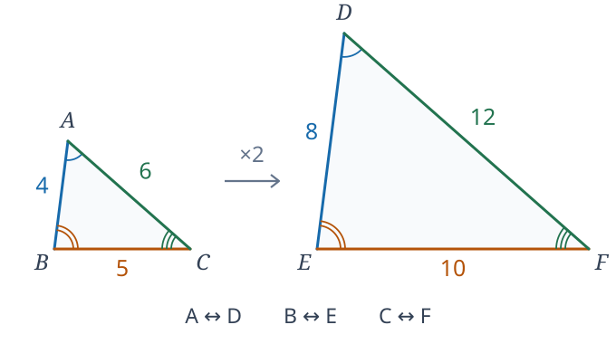

图中 $A,B,C$ 分别对应 $D,E,F$，记作 $\triangle ABC\sim\triangle DEF$

对应边的比叫作==相似比==，记为 $k$。按“前一个三角形∶后一个三角形”的顺序计算，图中

$$k=\frac{AB}{DE}=\frac{BC}{EF}=\frac{AC}{DF}=\frac12$$

相似比 $k>0$；当 $k=1$ 时，两个三角形全等

### 2. 相似三角形的判定 {#criteria .knowledge-title}

| 已知条件 | 可用判定 | 必须核实 |
| --- | --- | --- |
| 两组角分别相等 | AA | 两角属于不同顶点，并按对应顺序写相似式 |
| 两边对应成比例，夹角相等 | SAS | 相等角必须夹在这两条比例边之间 |
| 三边对应成比例 | SSS | 三个比采用同一方向 |
| 两个直角三角形的斜边与一直角边对应成比例 | 直角三角形的专门判定 | 斜边对应斜边，不能移用于一般 SSA |

直角情形为什么能用“斜边与一条直角边”？ 若这两类边分别为 $a,b$ 与 $ka,kb$，另一条直角边由勾股定理分别为 $\sqrt{a^2-b^2}$ 与 $k\sqrt{a^2-b^2}$，三边同比，故可用 SSS。没有直角，不能这样补出第三边。

### 3. 平行线截段成比例 {#parallel-ratios .knowledge-title}

如图，$DE\parallel BC$，则 $\triangle ADE\sim\triangle ABC$

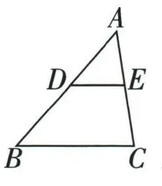

$$\frac{AD}{AB}=\frac{AE}{AC}=\frac{DE}{BC}$$

$$\frac{AD}{DB}=\frac{AE}{EC}$$

::: info 为什么截段成比例

展开面积推导

1. 连接 $BE,CD$，$\triangle BDE$ 与 $\triangle CDE$ 同底同高，面积相等
2. 同高三角形的面积比等于底边比，因此

$$\frac{AD}{DB}=\frac{S_{ADE}}{S_{BDE}}=\frac{S_{ADE}}{S_{CDE}}=\frac{AE}{EC}$$

3. 又由平行线得到两组对应角相等，$\triangle ADE\sim\triangle ABC$，便有三组对应边成比例

:::

### 4. 相似三角形的性质 {#properties .knowledge-title}

设两个相似三角形的相似比为 $k$

1. 对应角分别相等
2. 对应边、高、中线、角平分线的比都等于 $k$
3. 周长比等于 $k$
4. 面积比等于 $k^2$

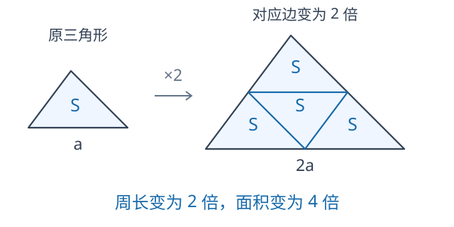

例如，相似比为 $1:2$，周长比也是 $1:2$，面积比则是 $1:4$

### 5. 常见的相似图形 {#models .knowledge-title}

先看这三种图，找出图中相似的三角形

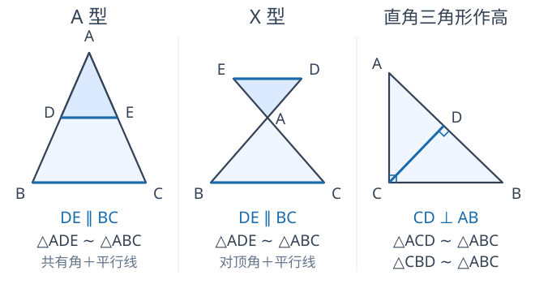

- A 型、X 型：利用平行线找到相等的角
- 从直角顶点向斜边作高：分出的两个小三角形都与原三角形相似（各有一个直角，并各与原三角形共用一个锐角）

::: info 斜边上的高还能得到什么

展开三个边长关系

右图中，$\angle ACB=90^\circ$，$CD\perp AB$

1. $\triangle ACD\sim\triangle ABC$，得到 $AC^2=AB\cdot AD$
2. $\triangle CBD\sim\triangle ABC$，得到 $BC^2=AB\cdot BD$
3. $\triangle ACD\sim\triangle CBD$，得到 $CD^2=AD\cdot BD$

:::

## 【考点】题目分类和例题 {#exam .handbook-section .is-exam}

### 1. 平行截段：先找对应层，再列和差 {#intercepts .exam-title}

圈出同一对平行线之间的两段；全段与部分段不能错配。两组平行线同时出现时，寻找共同的中间比，把两个比例串起来。

<article class="handbook-example" aria-labelledby="example-4">

#### 例题 01 两种截段结构 知识清单例题 {#example-4 .example-heading}

题目

(1)如图 1,AB 与 CD 相交于点 E,AD∥BC, $\frac{BE}{AE}=\frac{3}{5}$ ,CD=16,则 DE 的长为 ____.

(2)如图 2, $DE \parallel AB, EF \parallel BC, AF = 15, FB = 9, CD = 6$ , 则 BD 的长为 ____.

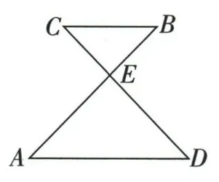

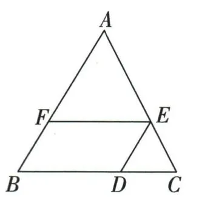

答案与解析

解析

（1）$AD\parallel BC$，得 $CE:DE=BE:AE=3:5$。按图 $C,E,D$ 依次，$CD=CE+DE=16$，所以 $DE=16\times5/(3+5)=10$。

（2）$EF\parallel BC$，得 $AE/EC=AF/FB=15/9=5/3$；再由 $DE\parallel AB$ 得 $BD/CD=AE/EC=5/3$。因此 $BD=6\times5/3=10$。

第一问用的是和为8份；第二问把同一个 $AE/EC$ 作为传递比例的桥梁。

本题结论

（1）DE=10；（2）BD=10。

</article>

<article class="handbook-example" aria-labelledby="example-5">

#### 例题 02 三条平行线之间的分段 知识清单例题·2024黑龙江哈尔滨 {#example-5 .example-heading}

题目

(2024 黑龙江哈尔滨) 如图, 在四边形 ABCD 中, $AD \parallel BC$ , 点 E 在 AB 上, $EF \parallel AD$ 交 CD 于点 F, 若 AE:BE=1:2, DF=3, 则 FC 的长为 ( )

A.6

B.3

C.5

D.9

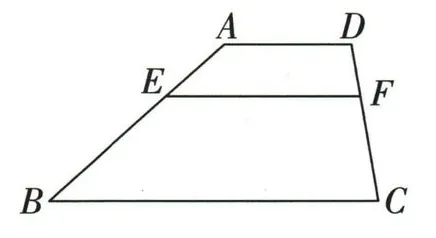

答案与解析

解析

$AD\parallel EF\parallel BC$，所以 $AE/EB=DF/FC$。代入 $1/2=3/FC$，得 $FC=6$。

B 项3把 $DF$ 当作 $FC$；D 项9是整段 $CD$，不是所问余段；C 项5不满足原比例。

本题结论

选 A，FC=6。

</article>

### 2. 没有直接比例时，作平行线搭桥 {#construct-parallel .exam-title}

若已知比在一条边上，中点在另一条线段上，可过一个已知点作平行线，让两条件都转移到同一条直线。新交点应命名，并按图核实各段的先后顺序。

<article class="handbook-example" aria-labelledby="example-6">

#### 例题 03 让中点条件与底边比相遇 知识清单例题 {#example-6 .example-heading}

题目

如图, $\triangle ABC$ 中,D 在 BC 边上,F 是 AD 的中点,连接 CF 并延长,交 AB 于点 E,已知 $\frac{CD}{BD}=\frac{3}{2}$ ,则 $\frac{AE}{BE}$ 等于 ____.

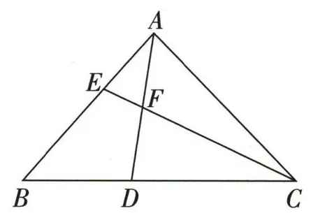

答案与解析

解析

过 $D$ 作 $DG\parallel CE$，交 $AB$ 于 $G$。在 $\triangle BCE$ 中，$BD/DC=2/3$，故 $BG/GE=2/3$。设 $BG=2x,GE=3x$，$x>0$。

又 $EF\parallel DG$，$F$ 是 $AD$ 中点，由截段比例得 $AE/EG=AF/FD=1$，所以 $AE=EG=3x$。

沿 $AB$ 的点序为 $A,E,G,B$，因此 $BE=EG+GB=5x$，所求为 $AE/BE=3/5$。

本题结论

$\frac{AE}{BE}=\frac35$。

</article>

### 3. 判断相似：角与边必须属于同一套对应 {#determine .exam-title}

多边形先核角、再核边；三角形可优先找 AA。若只有边长，先计算缺边，再选 SAS 或 SSS。题目写定相似字母顺序时，要按这个顺序补条件，不默认靠近同一顶点的边就互相对应。

<article class="handbook-example" aria-labelledby="example-8">

#### 例题 04 直角三角形补出第三边 知识清单例题 {#example-8 .example-heading}

题目

如图, 在 Rt△ACB 和 Rt△ADC 中, ∠B = ∠ACD = 90°, AD = 8, AB = 2, BC = 2√3.
求证: Rt△ACB ∼ Rt△ADC.

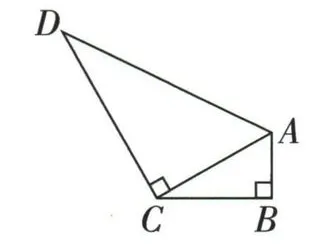

答案与解析

解析

在 $\triangle ACB$ 中，$AC=\sqrt{2^2+(2\sqrt3)^2}=4$；在 $\triangle ADC$ 中，$CD=\sqrt{8^2-4^2}=4\sqrt3$。

因此 $AC/AD=AB/AC=BC/CD=1/2$，由 SSS 得 $\triangle ACB\sim\triangle ADC$。也可直接用两个直角三角形斜边和一直角边同比的专门判定。

本题结论

$\triangle ACB\sim\triangle ADC$。

</article>

<article class="handbook-example" aria-labelledby="example-9">

#### 例题 05 给指定顺序补一个条件 知识清单例题·2024山东滨州 {#example-9 .example-heading}

题目

(2024 山东滨州) 如图, 在 $\triangle ABC$ 中, 点 $D, E$ 分别在边 $AB, AC$ 上. 添加一个条件使 $\triangle ADE \sim \triangle ACB$ , 则这个条件可以是 ____. (写出一种情况即可)

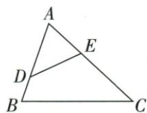

答案与解析

解析

已有 $\angle DAE=\angle CAB$，而题目要求 $D\leftrightarrow C$、$E\leftrightarrow B$。

添加 $\angle ADE=\angle C$，由 AA 即可。也可添加 $\angle AED=\angle B$，或 $AD/AC=AE/AB$ 用 SAS。

单写 $DE\parallel BC$ 通常得到 $\triangle ADE\sim\triangle ABC$，并非题目指定的交换顺序。

本题结论

例如 $\angle ADE=\angle C$；答案不唯一。

</article>

<article class="handbook-example" aria-labelledby="example-10">

#### 例题 06 正方形里的两个直角三角形 知识清单例题·2024广东广州 {#example-10 .example-heading}

题目

(2024 广东广州) 如图, 点 E, F 分别在正方形 ABCD 的边 BC, CD 上, BE = 3, EC = 6, CF = 2. 求证: $\triangle ABE \sim \triangle ECF$ .

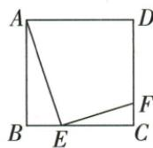

答案与解析

解析

$BC=BE+EC=3+6=9$，正方形给 $AB=BC=9$、$\angle B=\angle C=90^\circ$。

$AB/EC=9/6=3/2$，$BE/CF=3/2$，比例边正好夹着相等直角，故由 SAS 得 $\triangle ABE\sim\triangle ECF$。

本题结论

$\triangle ABE\sim\triangle ECF$。

</article>

### 4. 模型中的角关系：每一组都要有依据 {#model-problems .exam-title}

中线先转中点和中位线，平行再转等角；折叠先转保角，直线再转平角。寻找相似时每次写出两组角分别来自哪里，不因共用某个交点就认定相似。

<article class="handbook-example" aria-labelledby="example-11">

#### 例题 07 两条中线与新增等角 知识清单例题 {#example-11 .example-heading}

题目

(A型、X型)如图,在 $\triangle ABC$ 中,两条中线BE,CD相交于点O.

(1) 写出图中两对相似的三角形.  
(2) 若 $\angle BOD = \angle A$ ，写出与(1)中不同的两对相似三角形.

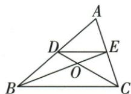

答案与解析

解析

（1）$D,E$ 分别为 $AB,AC$ 中点，故 $DE\parallel BC$。共有角 $A$ 配合平行角，得 $\triangle ABC\sim\triangle ADE$；$O$ 处对顶角配合平行角，得 $\triangle BOC\sim\triangle EOD$。

（2）新增 $\angle BOD=\angle A$，且 $\angle OBD=\angle ABE$，故 $\triangle OBD\sim\triangle ABE$。又 $\angle COE=\angle BOD=\angle A$、$\angle OCE=\angle ACD$，故 $\triangle OCE\sim\triangle ACD$。

本题结论

（1）$\triangle ABC\sim\triangle ADE$、$\triangle BOC\sim\triangle EOD$；（2）$\triangle OBD\sim\triangle ABE$、$\triangle OCE\sim\triangle ACD$。

</article>

<article class="handbook-example" aria-labelledby="example-12">

#### 例题 08 折叠后在同一直线上比较余角 知识清单例题·改编，明确图示内点 {#example-12 .example-heading}

题目

(一线三等角型)在综合与实践课上,老师组织同学们以“矩形的折叠”为主题开展数学活动.有一张矩形纸片ABCD如图所示,点N在边AD内部,现将矩形折叠,折痕为BN,点A对应的点记为点M,若点M恰好落在边DC内部,求证:△NDM∽△MCB.

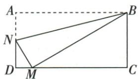

答案与解析

解析

矩形给 $\angle D=\angle C=90^\circ$，折叠给 $\angle NMB=\angle A=90^\circ$。

在 $\triangle NDM$ 中，$\angle NMD+\angle MND=90^\circ$；按图 $D,M,C$ 共线，$\angle NMD+\angle BMC=90^\circ$。所以 $\angle MND=\angle BMC$，再配 $D,C$ 的直角，由 AA 得结论。

折叠只在这里提供等角，不能据此把这两个三角形升级为全等。

本题结论

$\triangle NDM\sim\triangle MCB$。

</article>

### 5. 边积与平方：先改写成能对应的比例 {#products .exam-title}

要证两段乘积相等，可先把目标改写为比例，反找能承载这四段的两个三角形。若已知边积相等，则先除以正长度转为两边同比，再补夹角；比例不允许脱离实际对应关系任意拼接。

<article class="handbook-example" aria-labelledby="example-13">

#### 例题 09 从已知边积证明角相等 知识清单例题 {#example-13 .example-heading}

题目

如图, 在 $\triangle ABC$ 与 $\triangle ADE$ 中, 点 E 为 BC 边上一点, 且 $\angle 1 = \angle 2, AD \cdot AC = AB \cdot AE$ .

求证: $\angle2=\angle DEB.$

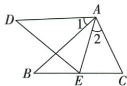

答案与解析

解析

由 $\angle1=\angle2$，同加公共的 $\angle BAE$，得 $\angle DAE=\angle BAC$。由 $AD\cdot AC=AB\cdot AE$ 得 $AD/AB=AE/AC$，故 SAS 判定 $\triangle ADE\sim\triangle ABC$，于是 $\angle AED=\angle ACB$。

$\triangle AEC$ 的内角和给 $\angle2+\angle ACB+\angle AEC=180^\circ$；直线 $BEC$ 给 $\angle DEB+\angle AED+\angle AEC=180^\circ$。同减相等的两项，得到 $\angle2=\angle DEB$。

本题结论

$\angle2=\angle DEB$。

</article>

<article class="handbook-example" aria-labelledby="example-14">

#### 例题 10 从目标平方反找相似 知识清单例题 {#example-14 .example-heading}

题目

如图,在等边三角形 ABC 的边 AC, BC 上各取一点 E, F, 连接 AF, BE, 相交于点 P, $\angle BPF = 60^{\circ}$ . 求证: $AE^{2} = BE \cdot PE$ .

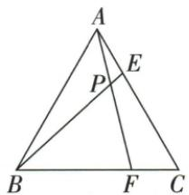

答案与解析

解析

目标可写成 $PE/AE=AE/BE$，考虑 $\triangle AEP$ 与 $\triangle BEA$。

等边三角形给 $\angle BAP+\angle EAP=60^\circ$；$\angle BPF=60^\circ$ 是 $\triangle ABP$ 的外角，故 $\angle BAP+\angle ABE=60^\circ$。两式相减得 $\angle EAP=\angle ABE$。

又 $E,P,B$ 共线且同向对应 $\angle AEP=\angle AEB$，所以 AA 得 $\triangle AEP\sim\triangle BEA$，对应比例正是 $PE/AE=AE/BE$。交叉相乘即得所求。

本题结论

$AE^2=BE\cdot PE$。

</article>

### 6. 相似性质的长度与面积计算 {#use-properties .exam-title}

由中点或延长段求出真正的对应边比，再决定是线性量还是面积。图中两次“取中点”要连续计算，不能只做一次。

<article class="handbook-example" aria-labelledby="example-15">

#### 例题 11 两个中点缩出的小三角形 知识清单例题·2024河南 {#example-15 .example-heading}

题目

(2024 河南) 如图, 在 平行四边形 $ABCD$ 中, 对角线 $AC, BD$ 相交于点 $O$ , 点 $E$ 为 $OC$ 的中点, $EF \parallel AB$ 交 $BC$ 于点 $F$ . 若 $AB = 4$ , 则 $EF$ 的长为 ( )

A. $\frac{1}{2}$

B.1

C. $\frac{4}{3}$

D.2

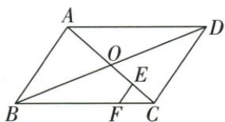

答案与解析

解析

平行四边形对角线互相平分，$OC=AC/2$；$E$ 又为 $OC$ 中点，所以 $CE=AC/4$。

$EF\parallel AB$，故 $\triangle CEF\sim\triangle CAB$，$EF/AB=CE/CA=1/4$，从而 $EF=1$。A、C不满足该比；D只考虑了一次平分。

本题结论

选 B，EF=1。

</article>

<article class="handbook-example" aria-labelledby="example-16">

#### 例题 12 延长段与中点构成的面积比 知识清单例题 {#example-16 .example-heading}

题目

如图,已知平行四边形 $ABCD$中,F为BC的中点,延长AD至E,使DE:AD=1:3,连接EF交DC于点G,则 $S_{\triangle DEG}:S_{\triangle CFG}=$ ( )

A.2:3

B.3:2

C.9:4

D.4:9

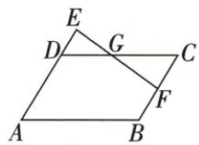

答案与解析

解析

设 $DE=x>0$，则 $AD=BC=3x$。$F$ 为 $BC$ 中点，故 $CF=3x/2$。

$DE\parallel CF$，$G$ 处对顶角相等，得 $\triangle DEG\sim\triangle CFG$。对应长度比 $DE/CF=2/3$，所以面积比为 $(2/3)^2=4/9$。

A 忘记平方；B 倒置且未平方；C 是反向的面积比。

本题结论

选 D，$S_{DEG}:S_{CFG}=4:9$。

</article>

### 7. 几何关系写成函数，退化端点另查 {#function .exam-title}

变量仍是长度，先给出几何定义域。把一个整段拆成两部分后列比例，整理得到函数。若端点使小三角形退化，不能继续引用相似，必须直接观察该位置再检验公式。

<article class="handbook-example" aria-labelledby="example-17">

#### 例题 13 矩形中的变动交点 知识清单例题 {#example-17 .example-heading}

题目

如图, 在矩形 ABCD 中, AB=6, AD=8, 点 E 在边 AD 上, CE 与 BD 相交于点 F.

(1) 若 DE=2，则 BF 的长度为 ____。

(2) 设 DE = x, BF = y，当 $0 \leqslant x \leqslant 8$ 时，y 关于 x 的函数关系式为 ____.

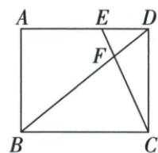

答案与解析

解析

由勾股定理 $BD=\sqrt{6^2+8^2}=10$。

（1）$DE\parallel BC$，得 $\triangle DEF\sim\triangle BCF$。设 $BF=y$，则 $DF=10-y$，有 $2/8=(10-y)/y$，解得 $y=8$。

（2）当 $0<x\le8$，同样由相似得 $x/8=(10-y)/y$，整理为 $(x+8)y=80$，故 $y=80/(x+8)$。

当 $x=0$，$E=D$、$F=D$，小三角形已退化，但直接得 $y=BD=10$，仍符合公式。$x=8$ 时 $E=A$，两对角线交点将 $BD$ 平分，$y=5$，也可回验。

本题结论

（1）$BF=8$；（2）$y=\dfrac{80}{x+8}$，$0\le x\le8$。

</article>

### 8. 利用相似三角形测高、测距 {#measure-problems .exam-title}

同一时刻，在水平地面上，竖直物体的高度比等于影长比

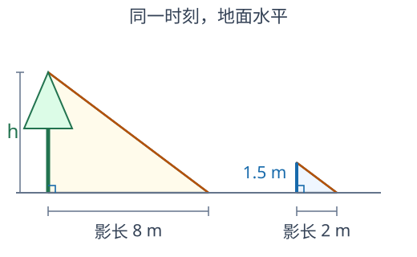

标杆高 $1.5\,\mathrm{m}$、影长 $2\,\mathrm{m}$，树的影长为 $8\,\mathrm{m}$，设树高为 $h$

$$\frac{h}{1.5}=\frac82\quad\Rightarrow\quad h=6\,\mathrm{m}$$

<article class="handbook-example" aria-labelledby="example-18">

#### 例题 14 从平面镜观察楼顶 知识清单例题 {#example-18 .example-heading}

题目

如图,小明为了测量楼房MN的高度,在离N点20 m的A处放了一个平面镜(平面镜的厚度忽略不计),小明从A处沿NA方向走到C点,正好从镜中看到楼顶M点,若AC=1.5 m,小明眼睛离地面的高度BC为1.6 m,则楼房MN的高度约为____(结果保留小数点后一位).

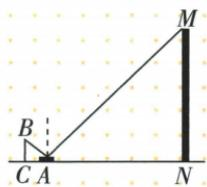

答案与解析

解析

水平镜的入射角等于反射角，两光线与地面的夹角也相等，即 $\angle BAC=\angle MAN$。$BC,MN$ 都垂直同一水平地面，故 $\triangle BCA\sim\triangle MNA$。

$$\frac{1.6}{MN}=\frac{1.5}{20},\qquad MN=\frac{64}{3}\approx21.3\text{ m}.$$

用的是眼睛离地的高度，不是任意人体全高。镜面不水平或地面有高差时，应重建模型。

本题结论

楼高约为21.3 m。

</article>

<article class="handbook-example" aria-labelledby="example-19">

#### 例题 15 两村之间的距离 知识清单例题 {#example-19 .example-heading}

题目

如图, 河两岸分别有 A, B 两村, 现测得 A, B, D 在一条直线上, A, C, E 在一条直线上, BC // DE, DE = 90 m, BC = 70 m, BD = 20 m, 则 A, B 两村之间的距离为 ____ m.

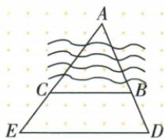

答案与解析

解析

$BC\parallel DE$，故 $\triangle ABC\sim\triangle ADE$。按图 $A,B,D$ 依次排列，$AD=AB+20$，所以

$$\frac{AB}{AB+20}=\frac{70}{90},$$

解得 $AB=70$ m。这是两村之间的距离；题目没有给出 $AB$ 垂直河岸，不能另称它就是河宽。

本题结论

两村之间距离为70 m。

</article>

<article class="handbook-example" aria-labelledby="example-20">

#### 例题 16 标杆与眼睛所在的水平线 知识清单例题 {#example-20 .example-heading}

题目

如图,直立在 B 处的标杆 AB=2.4 米,站立在 F 处的观测者从 E 处看到标杆顶端 A、树顶 C 在同一条直线上(点 F,B,D 也在同一条直线上).已知 BD =8 米,FB=2.5 米,EF=1.5 米,求树高 CD.

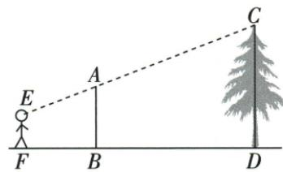

答案与解析

解析

过眼睛 $E$ 作水平线 $EH$，交标杆于 $G$、交树干于 $H$。两矩形给 $GB=DH=1.5$，$EG=2.5$，$EH=2.5+8=10.5$。

标杆超眼高为 $AG=2.4-1.5=0.9$。视线 $E,A,C$ 共线，$AG\parallel CH$，故 $\triangle AEG\sim\triangle CEH$。

$$\frac{0.9}{CH}=\frac{2.5}{10.5},\quad CH=3.78.$$

树高应为 $CD=CH+DH=3.78+1.5=5.28$ m。先减眼高建立共同基线，最后加回眼高恢复总高。

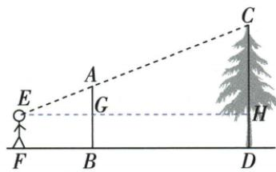

本题结论

树高为5.28 m。

</article>

<article class="handbook-example" aria-labelledby="example-21">

#### 例题 17 用交叉视线测河宽 知识清单例题 {#example-21 .example-heading}

题目

如图,为了估算河的宽度,我们可以在河对岸的岸边选定一个目标,记为点A,再在河的另一边选定点B和点C,使 $AB\perp BC$ ,BC与河岸平行,再选定点E,使 $EC\perp BC$ ,用视线确定BC和AE的交点D.此时如果测得BD=110m,CD=55m,EC=52m,求河的宽度AB.

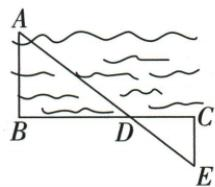

答案与解析

解析

$AB\perp BC$、$EC\perp BC$，两三角形在 $B,C$ 处均为直角；$\angle ADB=\angle EDC$ 为对顶角，故 $\triangle ABD\sim\triangle ECD$。

$$\frac{AB}{52}=\frac{110}{55}=2,$$

得 $AB=104$ m。$AB$ 垂直与河岸平行的基线，才表示河宽；$BD,CD$ 是两小三角形的底边，不能换成整段 $BC$。

本题结论

河宽AB为104 m。

</article>

<article class="handbook-example" aria-labelledby="example-22">

#### 例题 18 同一时刻的旗杆与人影 知识清单例题·2024四川自贡节选 {#example-22 .example-heading}

题目

（2024 四川自贡节选）为测量水平操场上旗杆的高度,小张采用了如图所示的测量方法.小张在测量时发现,自己在操场上的影长 EF 恰好等于自己的身高 DE.此时,小组同学测得旗杆 AB 的影长 BC 为 11.3 m,据此可得旗杆高度为 ____ m。

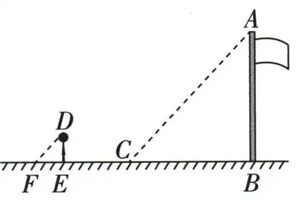

答案与解析

解析

同一时刻附近阳光近似平行，人和旗杆均竖直、操场水平，故 $\triangle ABC\sim\triangle DEF$。

$AB/DE=BC/EF$，又 $DE=EF$，因此 $AB=BC=11.3$ m。不必另假设人的具体身高。时刻改变后，不能继续沿用高度与影长相等的比例。

本题结论

旗杆高度为11.3 m。

</article>

## 【坑点】辨析与边界 {#pitfalls .handbook-section .is-pitfall}

### 1. 所求可能是整段，不是比例中的那一段 {#whole-part .pitfall-title}

解出比例中的未知段后，再回题目检查最终问的是哪一段。画出共线点序，确定是否还需加上或减去已知段。

<article class="handbook-example is-pitfall" aria-labelledby="pitfall-3">

#### 辨析 01 先求下段，再求全段 知识清单例题 {#pitfall-3 .example-heading}

题目

如图, 已知 $AB \parallel CD \parallel EF$ , $\frac{BC}{CE}=\frac{3}{4},AD=9$ , 则 AF 的长度为 ____.

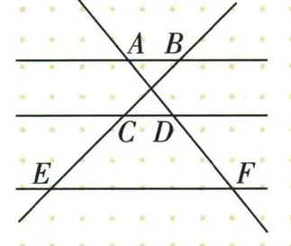

答案与解析

解析

三条平行线给 $AD/DF=BC/CE=3/4$。$AD=9$，故 $DF=12$。题问 $AF$，而 $A,D,F$ 依次排列，所以 $AF=AD+DF=9+12=21$。

直接把 $AF$ 代到 $DF$ 的比例位置，会把全段错配为下段。

本题结论

AF=21。

</article>

### 2. 没有写定相似顺序，就要检查对应分支 {#correspondence-cases .pitfall-title}

已有公共角，不一定确定其余两个顶点谁与谁对应。先把可能的相似式逐一写出，再用边所在范围、边长与角关系排除不合要求的分支。

<article class="handbook-example is-pitfall" aria-labelledby="pitfall-4">

#### 辨析 02 共有顶点之外的两种对应 知识清单例题 {#pitfall-4 .example-heading}

题目

已知 $\triangle ABC$ 中, AB=8, BC=7, AC=6, 点 D、E 分别在 AB、AC 上, 如果以 A、D、E 为顶点的三角形和以 A、B、C 为顶点的三角形相似, 且相似比为 $\frac{1}{4}$ , 试求 AD 和 AE 的长.

答案与解析

解析

原三角形三边8、7、6互不相等，各角也互不相等。小三角形与原三角形共有 $A$ 角，因而 $A$ 对应 $A$，其余两个顶点有两种配对。

若 $\triangle ADE\sim\triangle ABC$，则 $AD/8=AE/6=1/4$，得 $AD=2,AE=1.5$。

若 $\triangle AED\sim\triangle ABC$，则 $AE/8=AD/6=1/4$，得 $AD=1.5,AE=2$。

两组点都在相应边内，并且两邻边同比、共有夹角，均可由 SAS 验证，不能漏掉第二组。

本题结论

AD、AE分别为2、1.5，或1.5、2。

</article>

### 3. 面积比不是把相似比乘2 {#area-square .pitfall-title}

面积由两个长度因子相乘，比例应平方；由面积比返回长度比，则取正平方根。先后顺序与比例的幂次要分别检查。

<article class="handbook-example is-pitfall" aria-labelledby="pitfall-5">

#### 辨析 03 把长度缩到三分之一 知识清单例题·2024重庆A {#pitfall-5 .example-heading}

题目

(2024 重庆 A) 若两个相似三角形的相似比是 $1:3$ , 则这两个相似三角形的面积比是 ( )

A. $1:3$

B.1:4

C. $1:6$

D.1:9

答案与解析

解析

对应底边和高均缩为原来的 $1/3$，所以面积缩为 $(1/3)^2=1/9$。A 是长度比，C 把分母乘2而没有平方，B 与题给比例无关。

本题结论

选 D，面积比为1:9。

</article>

### 4. 判据不能使用，不等于结论一定为假 {#insufficient-test .pitfall-title}

“两边成比例”若未配等夹角，不能直接用 SAS；但这只说明当前论证不足，并不能反过来证明两个三角形不相似。选择题仍应逐项核实；需要排除时，检查所有可能的对应，而不是把判据当作否定命题。

<article class="handbook-example is-pitfall" aria-labelledby="pitfall-7">

#### 辨析 04 剪下的三角形是否相似 知识清单例题·补足排除论证 {#pitfall-7 .example-heading}

题目

如图, $\triangle ABC$ 中, $\angle A = 78^{\circ}, AB = 4, AC = 6$ . 将 $\triangle ABC$ 沿图示中的虚线剪下一部分, 剪下的阴影三角形与原三角形不相似的是 ( )

  

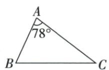

<figure class="handbook-option">

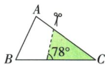

<figcaption>A</figcaption>

</figure>

<figure class="handbook-option">

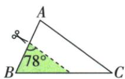

<figcaption>B</figcaption>

</figure>

<figure class="handbook-option">

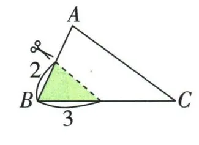

<figcaption>C</figcaption>

</figure>

<figure class="handbook-option">

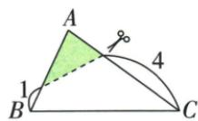

<figcaption>D</figcaption>

</figure>

答案与解析

解析

A 共享原来的 $C$ 角，图中另一个角为 $78^\circ$，由 AA 相似。B 共享原来的 $B$ 角，另一个角为 $78^\circ$，同样相似。

D 的阴影三角形在 $A$ 两侧留下的边长为 $4-1=3$ 与 $6-4=2$；它们分别对应原边6与4，比均为 $1/2$，夹角都是 $A$，由 SAS 相似。

对 C，不能只说“夹角不符，所以不相似”。 设阴影三角形在 $BA,BC$ 上的截点为 $D,E$，即 $BD=2,BE=3$，并令 $BC=a$。两三角形共有 $B$ 角；若相似，可以把相等的这个角配为对应角，其两邻边必须无序成比例，因此只有

$$\frac24=\frac3a\quad\text{或}\quad\frac2a=\frac34,$$

即 $a=6$ 或 $a=8/3$。

- 若 $a=8/3$，则 $BC<AB<AC$，由大边对大角得 $\angle A<\angle C<\angle B$。由于 $\angle A=78^\circ$，三角和必大于 $3\times78^\circ$，矛盾。
- 若 $a=6$，则 $AC=BC=6$，故 $\angle A=\angle B=78^\circ$，$\angle C=24^\circ$。这时 $AB$ 是半径6、圆心角 $24^\circ$ 的弦，比同圆 $30^\circ$ 的弦短。

计算这条 $30^\circ$ 弦可只用已学勾股：以圆心为坐标原点、其中一条半径沿横轴，另一半径与横轴成 $30^\circ$。由30°所对直角边等于斜边的一半，其端点的纵坐标为3，横坐标由勾股为 $3\sqrt3$，所以弦长平方为

$$(6-3\sqrt3)^2+3^2=72-36\sqrt3<16.$$

最后的不等式由 $\sqrt3>14/9$ 得到，平方比较 $3>196/81$ 即可。因此 $24^\circ$ 的弦更短于4，与 $AB=4$ 矛盾。

两种可能都排除，C 确实不相似。这一步说明“不符合某个判据”与“已证明不相似”的区别。

本题结论

选 C。

</article>

