把已知的边与角放进直角三角形，用勾股定理和三角函数求出未知量

<nav class="handbook-nav" aria-label="本章分区">
  <a class="handbook-jump is-knowledge" href="#knowledge">01 · 知识点概念、关系与适用条件</a>
  <a class="handbook-jump is-exam" href="#exam">02 · 考点题目分类和例题</a>
  <a class="handbook-jump is-pitfall" href="#pitfalls">03 · 坑点辨析错因，检查遗漏</a>
</nav>

## 【知识点】概念与依据 {#knowledge .handbook-section .is-knowledge}

### 1. 解直角三角形 {#solve .knowledge-title}

求直角三角形未知的边和角，叫作==解直角三角形==。除直角外，需要两个独立条件，其中至少一个是边长

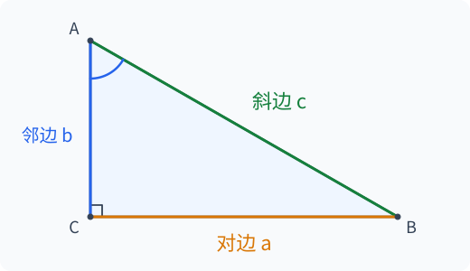

| 已知 | 可用关系 |
| --- | --- |
| 两条边 | $a^2+b^2=c^2$，求第三边 |
| 斜边 $c$ 与锐角 $A$ | $a=c\sin A$，$b=c\cos A$ |
| 邻边 $b$ 与锐角 $A$ | $a=b\tan A$，$c=\frac b{\cos A}$ |
| 对边 $a$ 与锐角 $A$ | $b=\frac a{\tan A}$，$c=\frac a{\sin A}$ |

另一个锐角始终可由 $B=90^\circ-A$ 求出

### 2. 仰角、俯角与坡度 {#applications .knowledge-title}

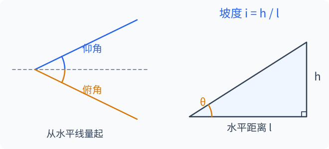

- 仰角：向上看时，视线与水平线的夹角
- 俯角：向下看时，视线与水平线的夹角
- 坡角：坡面与水平面的夹角 $\theta$
- 坡度：竖直高度与水平距离的比，$i=\frac hl=\tan\theta$

方向角按指定基准量起，如“北偏东”从正北方向向东量

## 【考点】题目分类和例题 {#exam .handbook-section .is-exam}

### 1. 六种测高模型：用共同距离或共同高度联立 {#height-models .exam-title}

先检查图中的角与高度是从哪里量的，再列式。下面的 $h,h_1,a,a_1,a_2,x$ 都以各图标记为准；不同图的同一字母不代表同一段长度。

1. 观测点在垂足两侧

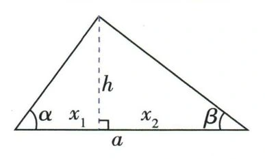

$h/\tan\alpha+h/\tan\beta=a$。两个水平距离相加。

2. 观测点在垂足同侧

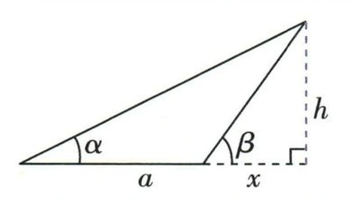

$h/\tan\alpha-h/\tan\beta=a$。远处角小、近处角大，两水平距离作差。

3. 在高处同时看顶部与底部

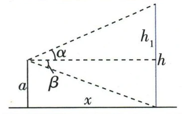

先由俯角求 $x=a/\tan\beta$，再求 $h_1=x\tan\alpha$；总高 $h=a+h_1$。

4. 两处等高观测，仪器离地

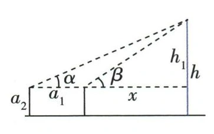

$h_1/\tan\alpha-h_1/\tan\beta=a_1$，解出相对眼高 $h_1$ 后，总高 $h=a_2+h_1$。

5. 两处不同高度看同一顶部

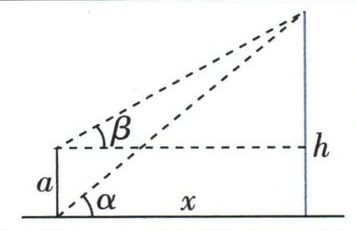

$x=h/\tan\alpha=(h-a)/\tan\beta$。两个三角形共用水平距离，竖直差为 $a$。

6. 同处看两个不同高度的目标

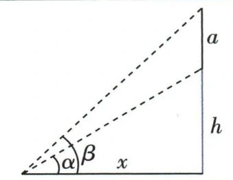

$x=h/\tan\alpha=(h+a)/\tan\beta$。上方目标较高，对应较大的仰角。

### 2. 按已知条件选择解直角三角形的入口 {#solve-cases .exam-title}

对照已知边和角，选择只含一个未知量的关系。每求出一项，就把它标回原三角形；最后同时报告所有未知边、角，而不只报告中间结果。

<article class="handbook-example" aria-labelledby="example-16">

#### 例题 01 四组独立条件 知识清单例题，原四组条件 {#example-16 .example-heading}

题目

在直角三角形 $ABC$ 中，$C=90^\circ$，$a,b,c$ 分别是 $A,B,C$ 的对边。分别求各组条件下其余的边、角：

（1）$a=8,B=60^\circ$。

（2）$c=10,B=45^\circ$。

（3）$a=2\sqrt6,b=6\sqrt2$。

（4）$c=3\sqrt{10},b=3\sqrt5$。

答案与解析

解析

（1）$A=30^\circ$。$c=a/\sin A=16$，$b=c\cos A=8\sqrt3$。

（2）$A=45^\circ$。$a=c\sin A=5\sqrt2$，$b=c\cos A=5\sqrt2$。

（3）$c=\sqrt{a^2+b^2}=\sqrt{24+72}=4\sqrt6$。$\sin A=a/c=1/2$，故 $A=30^\circ,B=60^\circ$。

（4）$a=\sqrt{c^2-b^2}=\sqrt{90-45}=3\sqrt5=b$，故 $A=B=45^\circ$。

本题结论

（1）$A=30^\circ,b=8\sqrt3,c=16$；（2）$A=45^\circ,a=b=5\sqrt2$；（3）$A=30^\circ,B=60^\circ,c=4\sqrt6$；（4）$A=B=45^\circ,a=3\sqrt5$。

</article>

### 3. 视角测高：共同水平距离与眼高 {#measurement .exam-title}

画出观测点的水平线，把每个仰角、俯角标在正确的位置。先用一个直角三角形求共同水平距离，再把另一个三角形的竖直差求出；最后按位置加减，恢复总高。用近似三角函数值时，中间结果保留足够位数，最后按题意取整。

<article class="handbook-example" aria-labelledby="example-17">

#### 例题 02 前进十米后的两次仰角 知识清单例题 {#example-17 .example-heading}

题目

某大楼外墙上有一块电子显示屏 DC, 在点 A 处测得显示屏顶端 D 的仰角为 $30^{\circ}$ , 向显示屏方向前进 10 米后, 在点 B 处测得显示屏顶端 D 的仰角为 $45^{\circ}$ , 已知点 A、B、C 离地面的高度都为 1.5 米, 求显示屏顶端 D 点距离地面的高度。(结果保留根号)

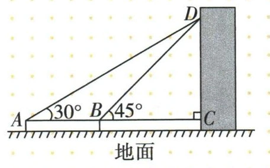

答案与解析

解析

设显示屏顶端比观测点高 $h=CD$ 米。近处仰角45°，所以 $BC=h/\tan45^\circ=h$；远处仰角30°，所以 $AC=h/\tan30^\circ=\sqrt3h$。

$AB=AC-BC=10$，于是 $(\sqrt3-1)h=10$，$h=5\sqrt3+5$。这只是顶端比 $C$ 高的部分，还须加上 $C$ 离地1.5米，所以顶端离地高为 $5\sqrt3+6.5$ 米。

本题结论

$(5\sqrt3+6.5)\ \mathrm m$。

</article>

<article class="handbook-example" aria-labelledby="example-18">

#### 例题 03 同一观测点看塔的顶部与底部 知识清单例题 {#example-18 .example-heading}

题目

如图,为测量电视塔观景台 A 处的高度,某数学兴趣小组在电视塔附近一建筑物楼顶 D 处测得 A 处的仰角为 $45^{\circ}$ , 塔底部 B 处的俯角为 $22^{\circ}$ . 已知建筑物的高 CD 约为 61 米, 请计算观景台 A 处的高度 AB. (结果精确到 1 米. 参考数据: $\sin 22^{\circ} \approx 0.37$ , $\cos 22^{\circ} \approx 0.93$ , $\tan 22^{\circ} \approx 0.40$ )

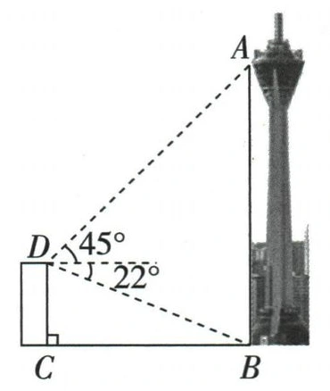

答案与解析

解析

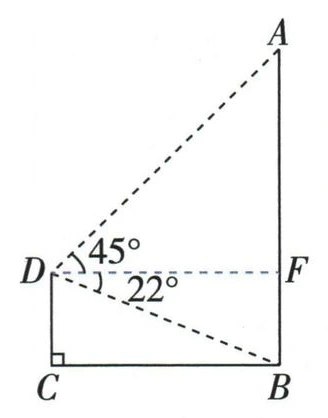

作 $DF\perp AB$，则 $BF=CD\approx61$ 米。俯角22°给出 $DF=BF/\tan22^\circ\approx61/0.40=152.5$ 米。

仰角45°给出 $AF=DF\tan45^\circ\approx152.5$ 米。因此 $AB=AF+BF\approx213.5$ 米，按题意取整为214米。

本题结论

塔高约214米。

</article>

<article class="handbook-example" aria-labelledby="example-19">

#### 例题 04 水平飞行后，观测的是另一个目标 2024山东日照；省略不参与条件判读的背景照片 {#example-19 .example-heading}

题目

（2024 山东日照）潮汐塔是万平口区域内的标志性建筑，在其塔顶可俯视景区全貌。某数学兴趣小组用无人机测量潮汐塔 AB 的高度，测量方案如图所示，无人机在距水平地面 119 m 的 M 点处测得潮汐塔顶端 A 的俯角为 $22^{\circ}$ ，再将无人机沿水平方向飞行 74 m 到达点 N，测得潮汐塔底端 B 的俯角为 $45^{\circ}$ （点 M, N, A, B 在同一平面内），则潮汐塔 AB 的高度为（）

(结果精确到 1 m, 参考数据: $\sin 22^{\circ} \approx 0.37$ , $\cos 22^{\circ} \approx 0.93$ , $\tan 22^{\circ} \approx 0.40$ )

A.41 m

B.42 m

C.48 m

D. $51 \mathrm{~m}$

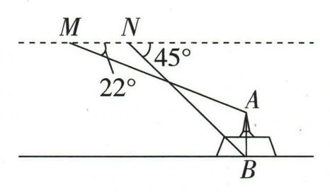

答案与解析

解析

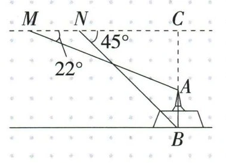

延长 $BA$ 至飞行高度上的 $C$。无人机距地119米，所以 $BC=119$。在直角 $\triangle NBC$ 中，俯角45°，故 $NC=BC=119$ 米。由于 $MN=74$ 米，$MC=MN+NC=193$ 米。

在直角 $\triangle MAC$ 中，$AC=MC\tan22^\circ\approx193\times0.40=77.2$ 米。因此塔高 $AB=BC-AC\approx41.8$ 米，取整约42米。这里 $AC$ 是无人机比塔顶高出的部分，不能直接当塔高。

本题结论

B，约42米。

</article>

### 4. 方位问题：先把方向角放进几何图形 {#bearing .exam-title}

先画各观测点的南北、东西方向线，利用平行线关系换成三角形内角；不要直接把题目里的两个方向角相加减后当成内角。沿海航行题常通过岸线的垂线，把斜向距离转成东西、南北两个分量。

<article class="handbook-example" aria-labelledby="example-20">

#### 例题 05 海岸线与两次方位观测 知识清单例题 {#example-20 .example-heading}

题目

如图,在东西方向的海岸上有两个相距6海里的码头B,D,某海岛上的观测塔A距离海岸5海里,在A处测得B位于南偏西22°方向,一艘渔船从D出发,沿正北方向航行至C处,此时在A处测得C位于南偏东67°方向,求此时观测塔A与渔船之间的距离(结果精确到0.1海里).

参考数据：$\sin22^\circ\approx3/8$，$\cos22^\circ\approx15/16$，$\tan22^\circ\approx2/5$。

$\sin67^\circ\approx12/13$，$\cos67^\circ\approx5/13$，$\tan67^\circ\approx12/5$。

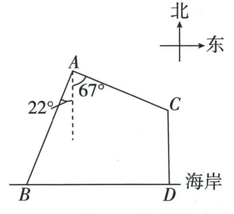

答案与解析

解析

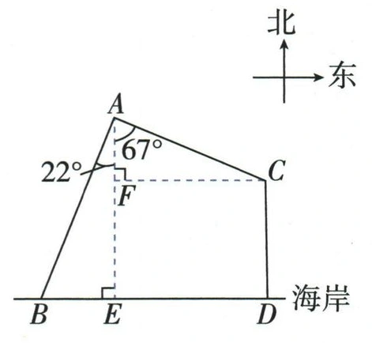

作 $AE\perp BD$，$CF\perp AE$。题给距海岸线5海里，即 $AE=5$。$B$ 在 $A$ 的南偏西22°方向，所以 $BE=AE\tan22^\circ\approx5\times2/5=2$ 海里。

$BD=6$，故 $DE=6-2=4$。船从 $D$ 正北航行至 $C$，因而 $CF=DE=4$。$C$ 在 $A$ 南偏东67°方向，在直角 $\triangle AFC$ 中 $\sin67^\circ=CF/AC$，所以 $AC\approx4/(12/13)=13/3\approx4.3$ 海里。

本题结论

观测塔与渔船相距约4.3海里。

</article>

## 【坑点】条件边界与易错辨析 {#pitfalls .handbook-section .is-pitfall}

### 1. 方向角不等于三角形的内角 {#direction-pit .pitfall-title}

从不同点出发的方向线互相平行，但指向有正、反。把“北偏西”转到另一点时，必须同时检查射线方向；缺少这一步，常会把一个钝内角误算成锐角。

<article class="handbook-example is-pitfall" aria-labelledby="pitfall-2">

#### 辨析 01 三个地点的方位与四个判断 知识清单例题 {#pitfall-2 .example-heading}

题目

已知点 C 在点 A 的北偏东 $50^{\circ}$ 方向上, 点 B 在点 C 的北偏西 $25^{\circ}$ 方向上, 点 B 在点 A 的北偏东 $20^{\circ}$ 方向上, 下列说法:

① $\triangle ABC$ 是直角三角形；

② $\angle BAC=30^{\circ}$ ; ③ $\angle ACB=75^{\circ}$ ;

④若 AC=30，则 $AB=20\sqrt{3}$ .

其中正确的有____.(填序号)

答案与解析

解析

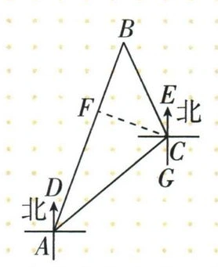

从 $A$ 出发，两条射线分别北偏东50°与北偏东20°，所以 $\angle BAC=30^\circ$，②正确。

从 $C$ 看，$CA$ 指向南偏西50°，$CB$ 指向北偏西25°，故 $\angle ACB=180^\circ-50^\circ-25^\circ=105^\circ$，③错误。于是 $\angle B=45^\circ$，三角形不是直角三角形，①错误。

若 $AC=30$，作 $CF\perp AB$。$CF=AC\sin30^\circ=15$，$AF=AC\cos30^\circ=15\sqrt3$。又因 $B=45^\circ$，$BF=CF=15$，故 $AB=AF+BF=15\sqrt3+15$，不是 $20\sqrt3$，④错误。

本题结论

只有②正确。

</article>

### 2. 近似值算出的门槛，不是精确安全边界 {#slope-boundary .pitfall-title}

当题目问“至少”“不超过”，先保留精确不等式，最后再近似。若使用给定的粗略函数值，答案也只能称该参考值下的近似结果。下面按题设的简化几何模型讨论，不把该模型当作实际工程安全判断。

<article class="handbook-example is-pitfall" aria-labelledby="pitfall-3">

#### 辨析 02 坡顶至少移动多远 知识清单例题，保留原数据并区分精确式与近似答案 {#pitfall-3 .example-heading}

题目

如图,某校教学楼后面紧邻着一个山坡,坡上面是一块平地. $BC \parallel AD$ , $BE \perp AD$ , 斜坡 $AB$ 长 $26 \mathrm{~m}$ , 斜坡 $AB$ 的坡比为 $12:5$ . 为了减缓坡面, 防止山体滑坡, 学校决定对该斜坡进行改造. 经地质人员勘测, 当坡角不超过 $50^{\circ}$ 时, 可有效预防山体滑坡. 如果改造时保持坡脚 $A$ 不动, 那么坡顶 $B$ 沿 $BC$ 方向至少向右移多远, 才能有效预防山体滑坡? (tan $50^{\circ} \approx 1.2$ )

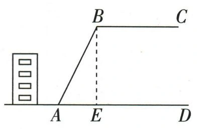

答案与解析

解析

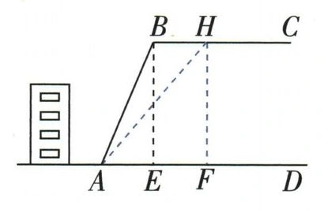

坡比 $12:5$ 是 $BE:AE$。设 $BE=12t,AE=5t$，由斜长 $AB=26$ 和勾股定理，$169t^2=676$，取 $t=2$，得 $BE=24,AE=10$ 米。

坡顶沿水平线移到 $H$ 后，高度 $HF$ 仍为24米。设新水平宽度 $AF=x>0$、坡角为 $\theta$，则 $\tan\theta=24/x$。锐角正切严格递增，所以

$$\theta\le50^\circ\iff\frac{24}{x}\le\tan50^\circ\iff x\ge\frac{24}{\tan50^\circ}.$$

又 $BH=EF=x-10$，故精确最小移动距离为 $24/\tan50^\circ-10$ 米，等号对应坡角恰为50°。

使用题给 $\tan50^\circ\approx1.2$，算得该最小值约为 $24/1.2-10=10$ 米。不能由这个近似值反推“恰移10米就一定达到精确50°边界”。坡长26米也不能放进正切的水平分母。

本题结论

精确最小值为 $(24/\tan50^\circ-10)\ \mathrm m$；按给定参考值约10米。

</article>

| 常见误用 | 正确检查 |
| --- | --- |
| 原三角形的斜边到小三角形中仍当斜边 | 每换一个直角三角形，重新认直角对边 |
| 中线只使用一半底边，却忘了恢复整边 | 先标中点关系，再决定目标比的分母 |
| 只给角度就求唯一的边长 | 检查是否至少给出一个实际边长尺度 |
| 仰角求得的高直接当物体总高 | 按观测点离地高度和目标上下位置加减 |
| 把坡比写成角度，或用坡长作正切分母 | 坡度是竖高与水平宽度的无单位比 |

