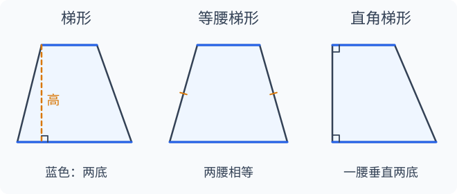
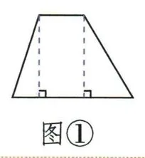
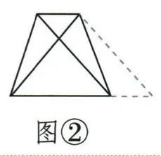
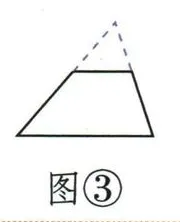
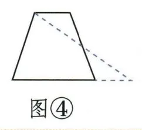
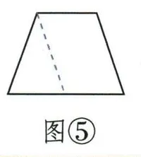
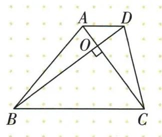
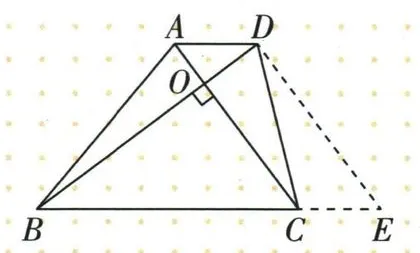

只有一组对边平行的四边形叫作梯形。求边、角或面积时，常把它转化为三角形和平行四边形

<nav class="handbook-nav" aria-label="本章分区">
  <a class="handbook-jump is-knowledge" href="#knowledge">01 · 知识点概念、关系与适用条件</a>
  <a class="handbook-jump is-exam" href="#exam">02 · 考点题目分类和例题</a>
  <a class="handbook-jump is-pitfall" href="#pitfalls">03 · 坑点辨析错因，检查遗漏</a>
</nav>

## 【知识点】概念与依据 {#knowledge .handbook-section .is-knowledge}

### 1. 梯形 {#definition .knowledge-title}

只有一组对边平行的四边形，叫作==梯形==。平行的两边叫底，另外两边叫腰，两底间的垂直距离叫高

### 2. 等腰梯形与直角梯形 {#types .knowledge-title}

- 两腰相等的梯形叫作==等腰梯形==：同一底上的两个角相等，两条对角线相等
- 有一个角是直角的梯形叫作==直角梯形==：有一条腰垂直于两底，这条腰的长就是高

等腰梯形是一种轴对称图形，对称轴经过两底的中点

### 3. 梯形的面积 {#area .knowledge-title}

上底为 $a$、下底为 $b$、高为 $h$，则

$$S=\frac{(a+b)h}{2}$$

也就是“上底加下底，乘高除以二”

## 【考点】题目分类和例题 {#exam .handbook-section .is-exam}

### 1. 梯形：让分散的边进入同一个三角形 {#trapezoid .exam-title}

本资料的梯形指恰有一组对边平行、另一组不平行的四边形。平行的两边叫底，另两边叫腰。梯形可以有对称轴，但没有对称中心；若半转后重合，就会迫使两组对边都平行。

| 辅助线 | 希望得到的结构 |
| --- | --- |
| 从上底两端作高 | 将两腰放入直角三角形 |
| 平移一条对角线 | 把两条原对角线转到同一个三角形中 |
| 延长两腰 | 得到有公共顶角的两三角形，后续可比较形状 |
| 连接一腰端点与另一腰中点并延长 | 借半腰相等与平行角构造全等，转移等面积块 |
| 平移一腰 | 分出一个平行四边形和一个三角形，将两底差集中 |

辅助线不是越多越好，先看目标是长度、角还是面积，再选择要搬动的对象。延长两腰仅给公共角，并不自动使两三角形全等。

### 2. 平移对角线求长度 {#diagonal-translation .exam-title}

<article class="handbook-example" aria-labelledby="example-28">

#### 例题 01 平移对角线求梯形两底和 知识清单例题 {#example-28 .example-heading}

题目

如图,在梯形 ABCD 中, $AD \parallel BC, AC \perp BD$ . 若 $AC = 6 \, cm, BD = 8 \, cm$ , 求梯形 ABCD 的上、下底之和.

答案与解析

解析

过 $D$ 作 $DE\parallel AC$，交 $BC$ 延长线于 $E$。

$AC\parallel DE$、$AD\parallel CE$，故 $ACED$ 为平行四边形，$DE=AC=6\text{ cm}$、$CE=AD$。原 $AC\perp BD$，所以 $DE\perp BD$，直角三角形 $BDE$ 给

$$BE=\sqrt{8^2+6^2}=10\text{ cm}.$$

$B,C,E$ 顺次共线，$BC+AD=BC+CE=BE=10\text{ cm}$。梯形对角线不一般互平分，不能将原6和8先擅自减半。

本题结论

上、下底之和为 $10\text{ cm}$。

</article>

## 【坑点】辨析与边界 {#pitfalls .handbook-section .is-pitfall}

### 1. 看清底、高与对角线 {#pitfall .pitfall-title}

- 高是两底之间的垂直距离，斜腰不一定是高
- 梯形的对角线一般不互相平分
- 两腰延长后有公共角，还需其他条件才能判断三角形相似

