同一幅图里的线段，可能是一个三角形的高，却不是另一个三角形的高。学习这一章，先认清所研究的三角形，再把边、角、面积的关系写出来。

<nav class="handbook-nav" aria-label="本章分区">
  <a class="handbook-jump is-knowledge" href="#knowledge">01 · 知识点概念、关系与适用条件</a>
  <a class="handbook-jump is-exam" href="#exam">02 · 考点先归纳方法，再看例题</a>
  <a class="handbook-jump is-pitfall" href="#pitfalls">03 · 坑点辨析错因，检查遗漏</a>
</nav>

## 【知识点】概念与依据 {#knowledge .handbook-section .is-knowledge}

### 1. 顶点、对边、对角、夹角、内角、外角 {#definition .knowledge-title}

由不在同一直线上的三条线段首尾顺次相接所组成的图形，叫作三角形，记作 $\triangle ABC$。三个顶点必须不同且不共线，三点共线的“扁三角形”不在讨论范围内。

| 名称 | 怎样识别 |
| --- | --- |
| 顶点、边 | 相邻两边的公共端点；连接两顶点的线段 |
| 内角 | 两条相邻边在三角形内部所夹的角 |
| 对边、对角 | 与顶点不相接的边；与一条边不相接的顶点处内角 |
| 夹边、夹角 | 连接两个指定角顶点的边；两条指定边之间的角 |
| 外角 | 一边与另一边的反向延长线所成的角，与相邻内角互补 |

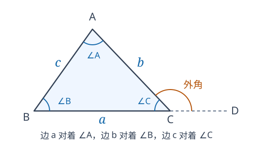

常约定 $\angle A,\angle B,\angle C$ 的对边分别记为 $a,b,c$。

### 2. 三角形的分类 {#classification .knowledge-title}

| 分类标准 | 类别 | 判断依据 |
| --- | --- | --- |
| 按角分类 | 锐角、直角、钝角三角形 | 最大内角分别小于、等于、大于 $90^\circ$ |
| 按边分类 | 三边不等的三角形、等腰三角形 | 是否至少有两边相等 |
| 等腰的特殊情形 | 等边三角形 | 三边都相等，包含在等腰三角形之内 |

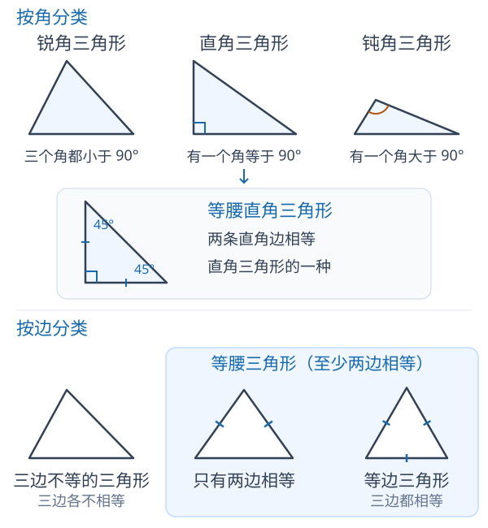

“等腰”与“直角”不是互相排斥的分类。前者看边，后者看角。

### 3. 角平分线、中线、高 {#three-lines .knowledge-title}

三种线段都从顶点出发，但另一端的要求不同。

| 线段 | 另一端在哪里 | 对应关系 | 不能自行推断 |
| --- | --- | --- | --- |
| 角平分线 | 对边上 | 两个半角相等 | 不一定平分对边 |
| 中线 | 对边中点 | 对边分成两等长线段 | 不一定垂直，也不一定平分角 |
| 高 | 对边所在直线上的垂足 | 与对边所在直线垂直 | 垂足不一定在线段内部 |

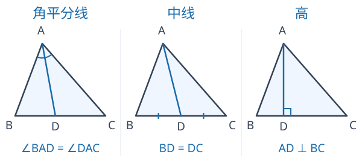

| 三角形 | 三条高的位置 |
| --- | --- |
| 锐角 | 三条都在内部 |
| 直角 | 两条与直角边重合，另一条在内部 |
| 钝角 | 一条在内部，两条在外部 |

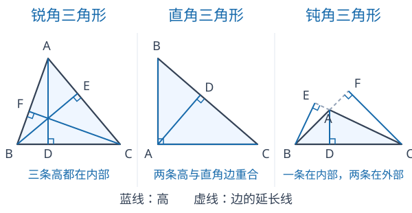

### 4. 三角形的垂心、重心 {#centers .knowledge-title}

| 名称 | 怎样确定 |
| --- | --- |
| ==垂心== $H$ | 三条高所在直线的交点 |
| ==重心== $G$ | 三条中线的交点 |

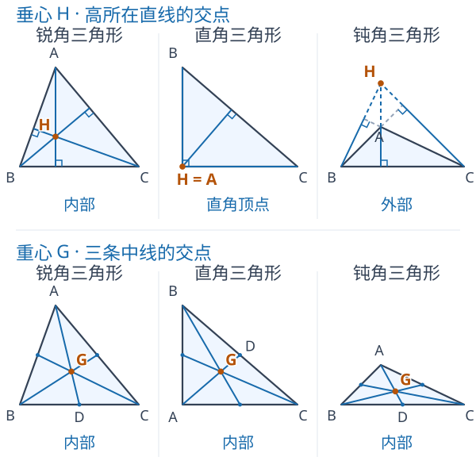

### 5. 三角形的面积 {#area-centroid .knowledge-title}

三角形的面积：底乘高除以二。

$$S=\frac12bh.$$

$b$ 是底边长，$h$ 是这条底边对应的高。

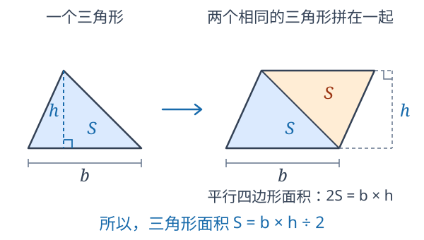

### 6. 三角形的性质 {#properties .knowledge-title}

1. 任意两边之和大于第三边：$a+b>c$
2. 任意两边之差小于第三边：$\lvert a-b\rvert<c$
3. 三个内角的和为 $180^\circ$：$\angle A+\angle B+\angle C=180^\circ$

## 【考点】题目分类和例题 {#exam .handbook-section .is-exam}

### 1. 利用三角形的性质求角与判边 {#classification-method .exam-title}

<article class="handbook-example" aria-labelledby="example-1">

#### 例题 01 由两直线的夹角求角 {#example-1 .example-heading}

题目

如图，平面上直线 $a$、$b$ 分别过线段 $AB$ 的两端点（数据如图），$a$、$b$ 相交所成的锐角是 $15^\circ$，则图中 $\angle 1$ 的度数为 ____

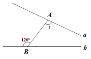

答案与解析

解析

设直线 $a$、$b$ 的交点为 $C$，则 $\angle ABC=180^\circ-120^\circ=60^\circ$，$\angle ACB=15^\circ$

由三角形内角和，$\angle 1=180^\circ-60^\circ-15^\circ=105^\circ$

本题结论

$105^\circ$

</article>

<article class="handbook-example" aria-labelledby="example-2">

#### 例题 02 判断池塘两点间的距离 {#example-2 .example-heading}

题目

如图，为了估计一池塘岸边两点 $A$、$B$ 之间的距离，小丽同学在池塘一侧选取了一点 $P$，测得 $PA=5\,\mathrm{m}$，$PB=4\,\mathrm{m}$，那么点 $A$ 与点 $B$ 之间的距离不可能是（　　）

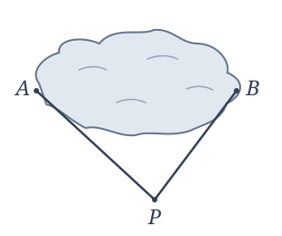

A. $8\,\mathrm{m}$

B. $7\,\mathrm{m}$

C. $6\,\mathrm{m}$

D. $9\,\mathrm{m}$

答案与解析

解析

由三角形两边之差小于第三边、两边之和大于第三边，得 $5-4\lt AB\lt 5+4$，即 $1\,\mathrm{m}\lt AB\lt 9\,\mathrm{m}$

$9\,\mathrm{m}$ 不在范围内

本题结论

D

</article>

### 2. 先列严格范围，再验候选边 {#range-method .exam-title}

先写“差小于第三边，第三边小于和”，再逐项代入。若给等腰三角形的两种边长，还要枚举哪种是腰；列出候选并不意味着候选一定存在。

<article class="handbook-example" aria-labelledby="example-3">

#### 例题 03 第三边的两个选择题 知识清单例题合组；（2）2024 江苏淮安 {#example-3 .example-heading}

题目

（1）若长度分别为 2,7,x 的三条线段能组成一个三角形,则 x 的值可以是 ( )

A. 4

B. 5

C. 6

D. 9

（2）（2024 江苏淮安）用一根小木棒与两根长度分别为 3 cm、5 cm 的小木棒组成三角形,则这根小木棒的长度可以是 ( )

A. 9 cm

B. 7 cm

C. 2 cm

D. 1 cm

答案与解析

解析

（1）$7-2<x<7+2$，即 $5<x<9$。A 的 $4$ 太短；B 的 $5$ 和 D 的 $9$ 恰在端点，均退化；C 的 $6$ 合格。

（2）设第三根木棒长为 $x\,\mathrm{cm}$，则 $2<x<8$。A 的 $9$ 太长，C 的 $2$ 退化，D 的 $1$ 太短；只有 B 的 $7$ 落在严格范围内。

本题结论

（1）C；（2）B。

</article>

### 3. 中点条件怎样用于周长、面积 {#median-method .exam-title}

周长问题把三条边完整列出，再用公共边、中点等长消项；面积问题先写清每条中线属于哪个三角形，再判断目标由哪几块组成。“面积减半”不能直接换成“周长减半”。

<article class="handbook-example" aria-labelledby="example-4">

#### 例题 04 中点与周长差 知识清单例题 {#example-4 .example-heading}

题目

如图, 点 D 是边 AB 的中点, $\triangle BCD$ 的周长比 $\triangle ACD$ 的周长大 3 cm, BC = 8 cm, 则边 AC 的长为 ____ cm.

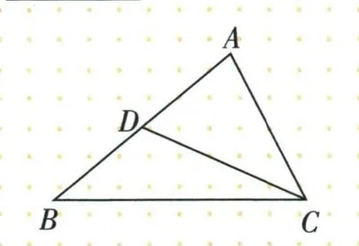

答案与解析

解析

$D$ 是 $AB$ 中点，故 $AD=BD$；$CD$ 是公共边。按“大 $3\,\mathrm{cm}$”的方向相减：

$$P_{BCD}-P_{ACD}=(BC+BD+CD)-(AC+AD+CD)=BC-AC=3.$$

于是 $8-AC=3$，得 $AC=5\,\mathrm{cm}$。

本题结论

$AC=5\,\mathrm{cm}$。

</article>

<article class="handbook-example" aria-labelledby="example-5">

#### 例题 05 连续两条中线，目标是哪一块 知识清单例题 {#example-5 .example-heading}

题目

如图所示, 在 $\triangle ABC$ 中, $AD, CE$ 分别是 $\triangle ABC$ , $\triangle ACD$ 的中线, 若 $\triangle ABC$ 的面积是 $4 \mathrm{~cm}^{2}$ , 则 $\triangle BEC$ 的面积是 ____.

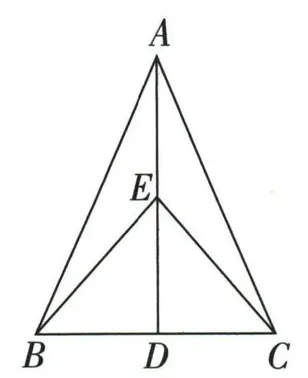

答案与解析

解析

$AD$ 是 $\triangle ABC$ 的中线，所以 $S_{ABD}=S_{ACD}=2\,\mathrm{cm}^2$。

$CE$ 是 $\triangle ACD$ 的中线，故 $E$ 是 $AD$ 中点；$BE$ 也就是 $\triangle ABD$ 的中线。于是 $S_{BDE}=S_{CDE}=1\,\mathrm{cm}^2$。

目标 $\triangle BEC$ 包含这两个小三角形，所以面积是 $1+1=2\,\mathrm{cm}^2$，不是第二次减半所得的一小块。

本题结论

$S_{BEC}=2\,\mathrm{cm}^2$。

</article>

<article class="handbook-example" aria-labelledby="example-6">

#### 例题 06 换底后，高也要随之改变 知识清单例题 {#example-6 .example-heading}

题目

如图所示,AD,CE是△ABC的两条高,AB=4,BC=8,CE=6,求AD的长.

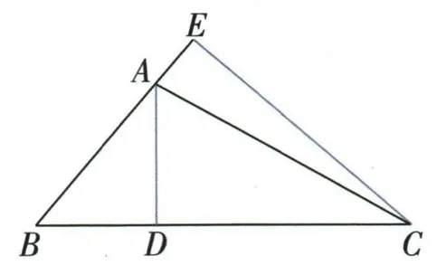

答案与解析

解析

$CE\perp AB$，$AD\perp BC$，同一个三角形的面积写成两种形式：

$$\frac12AB\cdot CE=\frac12BC\cdot AD.$$

代入得 $4\times6=8AD$，所以 $AD=3$。$E$ 虽在 $AB$ 延长线上，$CE$ 仍是 $AB$ 对应的高。

本题结论

$AD=3$。

</article>

### 4. 找重心，先找中线而不是其他交点 {#centroid-method .exam-title}

重心是两条中线的交点。尺规作图中的等半径弧先用来找边的中点，再连接相对顶点；弧的交点、中垂线的交点不是重心。求面积时，先确认题目给的是三等份中的一块，还是六等份中的一块。

取线段中点的基本尺规作法在这里使用，其等距离依据将在尺规作图专题中说明。

<article class="handbook-example" aria-labelledby="example-7">

#### 例题 07 作重心并由小三角形求整体面积 2024 黑龙江绥化 {#example-7 .example-heading}

题目

(2024 黑龙江绥化)已知: $\triangle ABC$ .

(1)尺规作图:画出 $\triangle ABC$ 的重心G.(保留作图痕迹,不要求写作法和证明)

(2)在(1)的条件下,连接 AG,BG. 已知 $\triangle ABG$ 的面积等于 $5 \, cm^{2}$ , 则 $\triangle ABC$ 的面积是 ____ $cm^{2}$ .

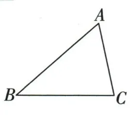

答案与解析

解析

（1）分别以 $B,C$ 为圆心，用同一个大于 $BC/2$ 的半径在两侧画弧，连两弧交点，得到 $BC$ 的中点 $M$。对 $AC$ 同法取中点 $N$，连接 $AM,BN$，交点即 $G$，保留作图痕迹。

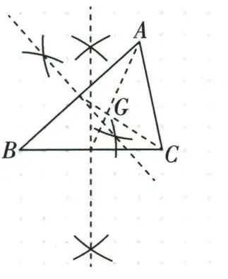

（2）$S_{ABM}=S_{ACM}$，又 $S_{BGM}=S_{CGM}$，相减得到 $S_{ABG}=S_{ACG}$。利用另一条中线同理得到 $S_{ACG}=S_{BCG}$。三块组成整体，每块都是 $5\,\mathrm{cm}^2$，所以整体为 $15\,\mathrm{cm}^2$。

本题结论

（1）两条中线的交点 $G$，作图见上；（2）$15\,\mathrm{cm}^2$。

</article>

### 5. 沿直角、半角与平行关系追踪角 {#angle-method .exam-title}

1. 高给出直角，先在相应小三角形内求角。
2. 平分线给出半角，先弄清被平分的是哪个整角。
3. 平行线移角时，指出截线与角对。
4. 最后回到目标顶点，用角和或角差；中途算出的数不一定就是答案。

<article class="handbook-example" aria-labelledby="example-8">

#### 例题 08 高与角平分线的两种应用 知识清单例题合组；（2）2024 四川凉山州 {#example-8 .example-heading}

题目

（1）如图, 在 $\triangle ABC$ 中, $\angle ABC=66^{\circ}$ , $\angle ACB=54^{\circ}$ , $BE$ 是边 $AC$ 上的高, 则 $\angle ABE$ 的度数为\_.

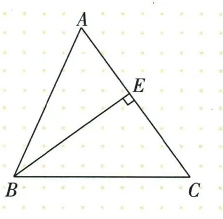

（2）(2024 四川凉山州) 如图, $\triangle ABC$ 中, $\angle BCD = 30^{\circ}$ , $\angle ACB = 80^{\circ}$ , $CD$ 是边 $AB$ 上的高, $AE$ 是 $\angle CAB$ 的平分线, 则 $\angle AEB$ 的度数是 ____.

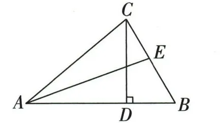

答案与解析

解析

（1）大三角形中 $\angle A=180^\circ-66^\circ-54^\circ=60^\circ$。$BE\perp AC$，所以直角三角形 $ABE$ 中 $\angle ABE=90^\circ-60^\circ=30^\circ$。

（2）$\angle ACD=80^\circ-30^\circ=50^\circ$，由 $CD\perp AB$ 得 $\angle CAB=40^\circ$。$AE$ 平分这个角，所以 $\angle BAE=20^\circ$。另一个直角三角形 $BCD$ 中 $\angle B=60^\circ$，因此 $\angle AEB=180^\circ-20^\circ-60^\circ=100^\circ$。

本题结论

（1）$30^\circ$；（2）$100^\circ$。

</article>

<article class="handbook-example" aria-labelledby="example-9">

#### 例题 09 平行线把半角移到另一顶点 知识清单例题 {#example-9 .example-heading}

题目

如图, $DE \parallel BC$ , $CD$ 是 $\triangle ACB$ 的角平分线, $\angle B = 60^{\circ}$ , $\angle ACB = 40^{\circ}$ , 求 $\angle EDC$ 与 $\angle BDC$ 的度数.

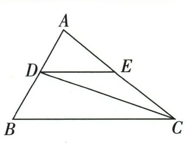

答案与解析

解析

$CD$ 平分 $40^\circ$，所以 $\angle DCB=20^\circ$。$DE\parallel BC$，以 $DC$ 为截线，内错角给出 $\angle EDC=20^\circ$。

再以 $AB$ 为截线，$\angle BDE+\angle B=180^\circ$，所以 $\angle BDE=120^\circ$。$DC$ 在这个角内部，故 $\angle BDC=120^\circ-20^\circ=100^\circ$。

本题结论

$\angle EDC=20^\circ$，$\angle BDC=100^\circ$。

</article>

<article class="handbook-example" aria-labelledby="example-10">

#### 例题 10 从作图信息读出角平分线 2024 江苏宿迁 {#example-10 .example-heading}

题目

(2024 江苏宿迁) 如图, 在 $\triangle ABC$ 中, $\angle B = 50^{\circ}$ , $\angle C = 30^{\circ}$ , $AD$ 是高, 以点 $A$ 为圆心, $AB$ 长为半径画弧, 交 $AC$ 于点 $E$ , 再分别以 $B, E$ 为圆心, 大于 $\frac{1}{2} BE$ 的长为半径画弧, 两弧在 $\angle BAC$ 的内部交于点 $F$ , 作射线 $AF$ , 则 $\angle DAF =$ ____°.

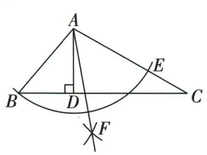

答案与解析

解析

第一步作弧使 $AB=AE$；第二步同半径作弧使 $BF=EF$，又有公共边 $AF$，因此这个基本作图得到 $\angle BAC$ 的平分射线。其严格依据是后续全等专题的三边判定，而不是靠量角。

$\angle BAC=180^\circ-50^\circ-30^\circ=100^\circ$，故 $\angle BAF=50^\circ$。$AD$ 是高，在 $\triangle ABD$ 中 $\angle BAD=90^\circ-50^\circ=40^\circ$。

图中射线 $AD$ 在 $\angle BAF$ 内，故 $\angle DAF=50^\circ-40^\circ=10^\circ$。$F$ 可以在三角形外，但仍在角 $BAC$ 的内部。

本题结论

$\angle DAF=10^\circ$。

</article>

### 6. 外角、凹形与交叉图还原为三角形 {#exterior-method .exam-title}

一个外角属于哪个三角形，就加那个三角形的两个不相邻内角。复杂图先找共线、对顶、邻补，再选小三角形，不能见到两个已知角就相加。

凹形图。 下图的 $\angle BPC$ 指凹口的小角，不是反射内角。连 $AP$，两个三角形内角和相加，得到

$$\angle A+\angle B+\angle C+(360^\circ-\angle BPC)=360^\circ,$$

所以 $\angle BPC=\angle A+\angle B+\angle C$。

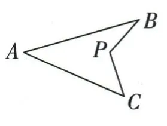

交叉图。 设两线交于 $O$，两个三角形的交点角是对顶角，相等；分别用 $180^\circ$ 减去它们，便得到 $\angle A+\angle B=\angle C+\angle D$。这个关系依赖图中的两组反向共线，不能只凭外形像“8”字。

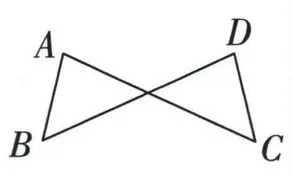

<article class="handbook-example" aria-labelledby="example-11">

#### 例题 11 先对顶角，再外角 知识清单例题 {#example-11 .example-heading}

题目

如图, 点 D 在 BC 的延长线上, $DE \perp AB$ 于点 E, 交 AC 于点 F. 若 $\angle A = 35^{\circ}$ , $\angle D = 15^{\circ}$ , 则 $\angle ACB$ 的度数为 ____.

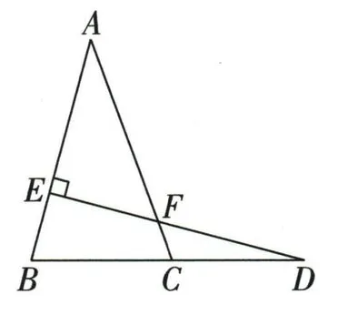

答案与解析

解析

$DE\perp AB$，$\angle A=35^\circ$，所以 $\angle AFE=55^\circ$。$\angle CFD$ 与它是对顶角，也等于 $55^\circ$。

$\angle ACB$ 是 $\triangle CFD$ 在 $C$ 处的外角，故

$$\angle ACB=\angle CFD+\angle D=55^\circ+15^\circ=70^\circ.$$

本题结论

$\angle ACB=70^\circ$。

</article>

<article class="handbook-example" aria-labelledby="example-12">

#### 例题 12 凹形中的两次内角和 知识清单例题 {#example-12 .example-heading}

题目

如图, $\triangle ABC$ 中, $\angle A = 30^{\circ}$ , $D$ 是 $CB$ 延长线上的一点, $\angle AED = 90^{\circ}, \angle D = 40^{\circ}$ , 则 $\angle C$ 的度数为

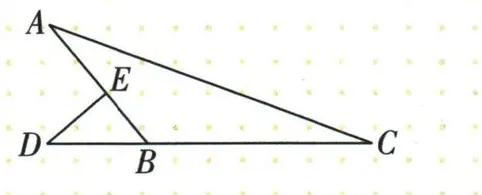

答案与解析

解析

$A,E,B$ 共线，$\angle AED=90^\circ$，所以 $\angle DEB=90^\circ$。在 $\triangle DEB$ 中，$\angle DBE=180^\circ-90^\circ-40^\circ=50^\circ$。

$D,B,C$ 共线，$\angle ABC=180^\circ-50^\circ=130^\circ$，所以

$$\angle C=180^\circ-30^\circ-130^\circ=20^\circ.$$

合并这两次计算，也就是 $\angle AED=\angle A+\angle D+\angle C$。

本题结论

$\angle C=20^\circ$。

</article>

### 7. 内外角平分线与重复分角 {#bisector-models .exam-title}

比较三种图时，始终研究 $\triangle BCP$ 的三个内角。这里 $A,B,C$ 表示原三角形内角，$\angle P$ 表示图中 $\angle BPC$，不是其邻补角。

| 图形 | $\triangle BCP$ 在 $B,C$ 处的内角 | 得到的 $\angle P$ |
| --- | --- | --- |
| 两条内角平分线 | $B/2,C/2$ | $180^\circ-(B+C)/2=90^\circ+A/2$ |
| 一内一外 | $B/2,90^\circ+C/2$ | $180^\circ-B/2-(90^\circ+C/2)=A/2$ |
| 两条外角平分线 | $90^\circ-B/2,90^\circ-C/2$ | $(B+C)/2=90^\circ-A/2$ |

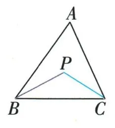

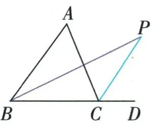

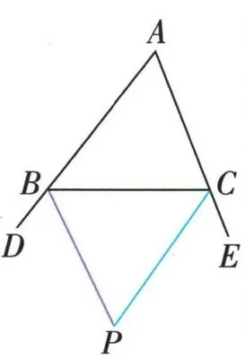

不能一看到“平分线交点”就套同一个式子。一内一外时，$C$ 处用的是外半角的补角，不是外半角本身。若改成三等分，要从外角差重新建立关系，而不是把公式里的 $2$ 一律换成 $3$。

<article class="handbook-example" aria-labelledby="example-13">

#### 例题 13 指定三等分线的逐层交角 2024 四川达州 {#example-13 .example-heading}

题目

（2024 四川达州）如图, 在 $\triangle ABC$ 中, $AE_{1}$ , $BE_{1}$ 分别是内角 $\angle CAB$ , 外角 $\angle CBD$ 的三等分线, 且 $\angle E_{1}AD = \frac{1}{3} \angle CAB$ , $\angle E_{1}BD = \frac{1}{3} \angle CBD$ , 在

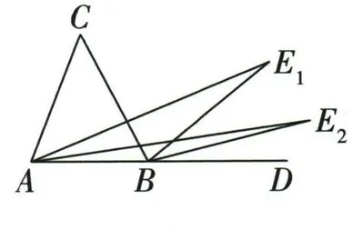

$\triangle ABE_{1}$ 中, $AE_{2}, BE_{2}$ 分别是内角 $\angle E_{1}AB$ , 外角 $\angle E_{1}BD$ 的三等分线, 且 $\angle E_{2}AD = \frac{1}{3} \angle E_{1}AB, \angle E_{2}BD = \frac{1}{3} \angle E_{1}BD, \cdots$ , 以此规律作下去, 若 $\angle C = m^{\circ}$ , 则 $\angle E_{n} =$ ____度.

答案与解析

解析

原图 $A,B,D$ 共线，$BD$ 是 $BA$ 的反向延长射线，所以 $\angle CBD$ 是 $\triangle ABC$ 在 $B$ 处的外角：

$$\angle C=\angle CBD-\angle CAB.$$

对 $\triangle ABE_1$，同样用外角差，且 $AD$ 与 $AB$ 同向：

$$\angle E_1=\angle E_1BD-\angle E_1AD
=\frac13(\angle CBD-\angle CAB)=\frac13\angle C.$$

第二层仍沿题中指定的靠基准射线的三等分线，得到 $\angle E_2=\frac13\angle E_1$。重复 $n$ 次：

$$\angle E_n=\left(\frac13\right)^n\angle C=\frac{m}{3^n}\text{度},\qquad n\in\mathbb Z_{>0}.$$

$n=1,2$ 分别对应 $m/3,m/9$，可检查指数没有少一层。

本题结论

$\displaystyle\angle E_n=\frac{m}{3^n}$ 度。

</article>

## 【坑点】看错因，也看边界 {#pitfalls .handbook-section .is-pitfall}

### 1. 方向对了，线段的端点也要对 {#endpoint-pit .pitfall-title}

常见错法： 线段经过中点，就把整条长线段叫中线；方向平分角，就忽略它是否止于所问三角形的对边。

检查顺序： 先圈出题目指定的三角形，再检查起点、终点以及等角、等长或垂直条件。换一个小三角形，身份就可能改变。

<article class="handbook-example is-pitfall" aria-labelledby="pitfall-1">

#### 辨析 01 同一图中逐条辨认重要线段 知识清单例题 {#pitfall-1 .example-heading}

题目

如图, 在 $\triangle ABC$ 中, $\angle BAD=\angle CAD$ , $G$ 为 $AD$ 的中点, $BG$ 的延长线交 $AC$ 于点 $E$ , $F$ 为 $AB$ 上的一点, $CF$ 与 $AD$ 垂直, 交 $AD$ 于点 $H$ , 则下面结论: ① $AD$ 是 $\triangle ABE$ 的角平分线; ② $BE$ 是 $\triangle ABD$ 的边 $AD$ 上的中线; ③ $CH$ 是 $\triangle ACD$ 的边 $AD$ 上的高; ④ $AH$ 是 $\triangle ACF$ 的角平分线和高. 其中正确的有____.(填序号)

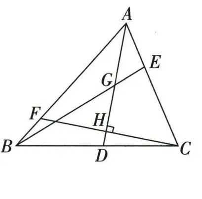

答案与解析

解析

① 在 $\triangle ABE$ 中，应从 $A$ 止于 $BE$ 上的 $G$，所以角平分线是 $AG$，不是更长的 $AD$。

② 在 $\triangle ABD$ 中，$AD$ 中点为 $G$，从 $B$ 到 $G$ 的 $BG$ 才是中线，不是 $BE$。

③ $C$ 是 $\triangle ACD$ 的顶点，$H$ 在 $AD$ 所在直线上，且 $CH\perp AD$，所以是高。

④ $F$ 在 $AB$ 上，$H$ 在 $CF$ 上，$AH$ 平分 $\angle FAC$ 且垂直 $CF$，所以同时是角平分线和高。

本题结论

①错，②错，③对，④对；正确的是③④。

</article>

### 2. 没有限定垂足，就不能只画内部高 {#height-pit .pitfall-title}

“边 $BC$ 上的高”是向 $BC$ 所在直线作高。题目没给图或没限定点序时，应检查内部、外部两种位置；但也不是机械增加不符合角度条件的情况。

<article class="handbook-example is-pitfall" aria-labelledby="pitfall-2">

#### 辨析 02 高的两种位置 知识清单例题 {#pitfall-2 .example-heading}

题目

在 $\triangle ABC$ 中, AD 为边 BC 上的高, $\angle ABC = 30^{\circ}$ , $\angle CAD = 20^{\circ}$ , 则 $\angle BAC = \_\_\_{}^\circ$ .

答案与解析

解析

$\angle B=30^\circ$ 是锐角，垂足 $D$ 在从 $B$ 沿 $BC$ 的方向，不会在 $B$ 的反向一侧。直角三角形 $ABD$ 中始终有 $\angle BAD=60^\circ$。

- $D$ 在 $B,C$ 之间：$AD$ 在 $\angle BAC$ 内，$\angle BAC=60^\circ+20^\circ=80^\circ$。
- $D$ 在 $C$ 外侧：$AC$ 在 $\angle BAD$ 内，$\angle BAC=60^\circ-20^\circ=40^\circ$。

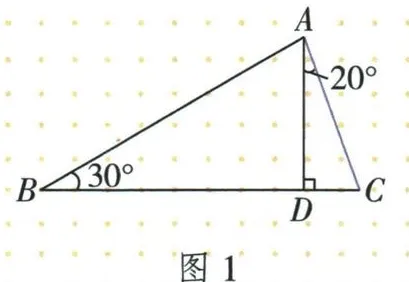

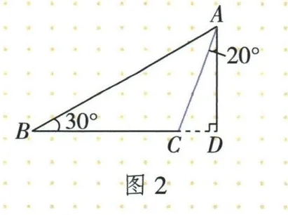

两种情况下 $\angle C$ 分别是 $70^\circ,110^\circ$，都能构成三角形。

本题结论

$\angle BAC=40^\circ$ 或 $80^\circ$。

</article>

### 3. 等腰分类之后仍要检验能否成形 {#existence-pit .pitfall-title}

给两种边长，没有指定腰和底时，应分两种候选；但只有通过三边严格不等式的候选才能进入答案。两边之和等于第三边也要排除。

<article class="handbook-example is-pitfall" aria-labelledby="pitfall-3">

#### 辨析 03 两种给定边长怎样分配 知识清单例题 {#pitfall-3 .example-heading}

题目

若一个等腰三角形的两边长分别是 4 cm 和 9 cm, 则这个三角形的周长为 ____ cm.

答案与解析

解析

| 候选 | 三边 | 检查 | 是否保留 |
| --- | --- | --- | --- |
| 腰长为 $4$ | $4,4,9$ | $4+4<9$，不能组成三角形 | 不保留 |
| 腰长为 $9$ | $9,9,4$ | 两短边之和 $4+9>9$ | 保留 |

因此周长为 $9+9+4=22\,\mathrm{cm}$。不能把不存在的第一种情形的周长也列入结果。

本题结论

$22\,\mathrm{cm}$。

</article>

### 4. 外角的结论不能省掉限制语 {#exterior-pit .pitfall-title}

外角比较和求和针对的是“不相邻的内角”。另外，补角与余角分别以 $180^\circ,90^\circ$ 为总量，不能互换。

<article class="handbook-example is-pitfall" aria-labelledby="pitfall-4">

#### 辨析 04 逐句检查外角结论 知识清单辨析 {#pitfall-4 .example-heading}

题目

判断下列说法是否正确。

1. 一个三角形的外角大于它的内角。
2. 三角形的一个外角等于它的两个内角之和。
3. 三角形的一个内角小于和它不相邻的外角。
4. 若三角形的一个外角是 $90^\circ$，则与这个外角不相邻的两个内角的补角之和为 $90^\circ$。

答案与解析

解析

① 缺少“不相邻”的限定。外角不保证大于相邻内角。

② 不是任意两个内角之和，应为两个不相邻内角之和。

③ 正是“外角大于每一个不相邻内角”的另一种表述，正确。

④ 设两个不相邻内角为 $B,C$，则 $B+C=90^\circ$。它们的补角和是

$$(180^\circ-B)+(180^\circ-C)=360^\circ-90^\circ=270^\circ,$$

不是 $90^\circ$。

本题结论

①错，②错，③对，④错。

</article>

