正弦、余弦、正切描述锐角与边长比的关系。先找直角和目标角，再分清对边、邻边与斜边

<nav class="handbook-nav" aria-label="本章分区">
  <a class="handbook-jump is-knowledge" href="#knowledge">01 · 知识点概念、关系与适用条件</a>
  <a class="handbook-jump is-exam" href="#exam">02 · 考点题目分类和例题</a>
  <a class="handbook-jump is-pitfall" href="#pitfalls">03 · 坑点辨析错因，检查遗漏</a>
</nav>

## 【知识点】概念与依据 {#knowledge .handbook-section .is-knowledge}

### 1. 正弦、余弦、正切 {#definition .knowledge-title}

在直角三角形中，先选定锐角 $A$，再找它的对边、邻边和斜边

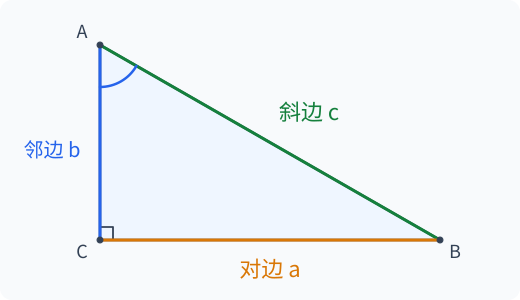

$$\sin A=\frac{a}{c}=\frac{\text{对边}}{\text{斜边}}$$

$$\cos A=\frac{b}{c}=\frac{\text{邻边}}{\text{斜边}}$$

$$\tan A=\frac{a}{b}=\frac{\text{对边}}{\text{邻边}}$$

换一个锐角，对边与邻边会互换，斜边始终是直角所对的边

::: info 为什么只由角的大小决定

展开说明

两个直角三角形有一个锐角相等，就由 AA 判定相似，对应边的比相同。因此放大或缩小三角形，不改变同一锐角的三角函数值

:::

### 2. 范围与增减 {#range .knowledge-title}

对锐角 $0^\circ<A<90^\circ$

| 函数 | 值的范围 | $A$ 增大时 |
| --- | --- | --- |
| $\sin A$ | $0<\sin A<1$ | 增大 |
| $\cos A$ | $0<\cos A<1$ | 减小 |
| $\tan A$ | $\tan A>0$ | 增大 |

### 3. 同角与互余关系 {#relations .knowledge-title}

$$\sin^2A+\cos^2A=1,\qquad\tan A=\frac{\sin A}{\cos A}$$

若 $A+B=90^\circ$，则 $\sin A=\cos B$、$\cos A=\sin B$、$\tan A\tan B=1$

### 4. 特殊角的函数值 {#special-values .knowledge-title}

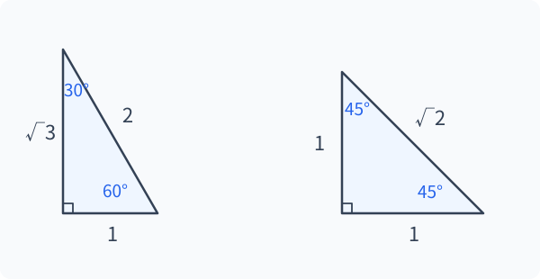

| 函数 | $30^\circ$ | $45^\circ$ | $60^\circ$ |
| --- | --- | --- | --- |
| $\sin$ | $\frac12$ | $\frac{\sqrt2}2$ | $\frac{\sqrt3}2$ |
| $\cos$ | $\frac{\sqrt3}2$ | $\frac{\sqrt2}2$ | $\frac12$ |
| $\tan$ | $\frac{\sqrt3}3$ | $1$ | $\sqrt3$ |

## 【考点】题目分类和例题 {#exam .handbook-section .is-exam}

### 1. 直接求值与特殊角计算 {#direct .exam-title}

计算边比时先写“在某直角三角形中”，再对应边长；特殊角表达式先逐项代值，保留括号，最后合并。看到平方与绝对值之和为0，应先利用每项非负分别令其为0，再识别锐角。

<article class="handbook-example" aria-labelledby="example-1">

#### 例题 01 已知两直角边 知识清单例题 {#example-1 .example-heading}

题目

已知在 Rt△ABC 中, ∠A, ∠B, ∠C 的对边分别为 a, b, c, ∠C = 90°, $a = \sqrt{2}$ , $b = \sqrt{3}$ , 求 ∠A 的正弦、余弦、正切的值.

答案与解析

解析

由勾股定理，$c=\sqrt{a^2+b^2}=\sqrt5$。对角 $A$ 的对边为 $a$，邻直角边为 $b$，所以

$$\sin A=\frac{\sqrt2}{\sqrt5}=\frac{\sqrt{10}}5,\quad\cos A=\frac{\sqrt3}{\sqrt5}=\frac{\sqrt{15}}5,\quad\tan A=\frac{\sqrt2}{\sqrt3}=\frac{\sqrt6}3.$$

本题结论

$\sin A=\sqrt{10}/5$，$\cos A=\sqrt{15}/5$，$\tan A=\sqrt6/3$。

</article>

<article class="handbook-example" aria-labelledby="example-2">

#### 例题 02 直角顶点改变后的边比 2024云南 {#example-2 .example-heading}

题目

（2024云南）如图，在 $\triangle ABC$ 中，若 $\angle B=90^{\circ},AB=3,BC=4$ ，则 $\tan A=$ （ ）

A. $\frac{4}{5}$

B. $\frac{3}{5}$

C. $\frac{4}{3}$

D. $\frac{3}{4}$

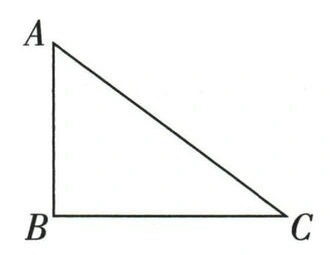

答案与解析

解析

这里直角在 $B$，斜边是 $AC$。对锐角 $A$ 而言，$BC$ 是对边、$AB$ 是邻直角边，所以 $\tan A=BC/AB=4/3$。不必先求斜边。

本题结论

C。

</article>

<article class="handbook-example" aria-labelledby="example-3">

#### 例题 03 把函数值代入表达式 知识清单例题与2024天津题合组，保留原选择项 {#example-3 .example-heading}

题目

计算：

（1）$2\sin30^\circ+3\cos60^\circ-4\tan45^\circ$。

（2）$\tan60^\circ-(4-\pi)^0+2\cos30^\circ+(1/4)^{-1}$。

（3）（2024天津）$\sqrt2\cos45^\circ-1$ 的值为（　）。

A. $0$

B. $1$

C. $\sqrt2/2-1$

D. $\sqrt2-1$

答案与解析

解析

（1）$2\times\frac12+3\times\frac12-4\times1=-\frac32$。

（2）$4-\pi\ne0$，故零次幂为1；$(1/4)^{-1}=4$。原式 $=\sqrt3-1+\sqrt3+4=2\sqrt3+3$。

（3）$\sqrt2\times\frac{\sqrt2}2-1=0$，选A。B漏减1，C把乘积的根号2误漏，D把 $\cos45^\circ$ 误作1。

本题结论

（1）$-3/2$；（2）$2\sqrt3+3$；（3）A，0。

</article>

<article class="handbook-example" aria-labelledby="example-4">

#### 例题 04 非负式确定三角形的角 知识清单例题 {#example-4 .example-heading}

题目

若 $(3\tan A-\sqrt{3})^{2}+|2\sin B-\sqrt{3}|=0$ ，则以锐角A、B为内角的△ABC的形状是____。

答案与解析

解析

两个非负项之和为0，必须各自为0：$3\tan A-\sqrt3=0$，$2\sin B-\sqrt3=0$。因此 $\tan A=\sqrt3/3$、$\sin B=\sqrt3/2$。由 $A,B$ 都是锐角及函数的严格增减性，得到 $A=30^\circ,B=60^\circ$，所以 $C=90^\circ$。

本题结论

直角三角形，∠C=90°。

</article>

### 2. 已知一个比，把有关边设为共同倍数 {#common-scale .exam-title}

例如 $\sin A=3/5$ 表示对边与斜边同比，不表示两边就是3和5。可设为 $3t,5t$，由勾股定理求出另一腿 $4t$，再利用中点、已知长度等恢复目标比。

<article class="handbook-example" aria-labelledby="example-5">

#### 例题 05 中线提供了哪一倍长度 知识清单例题 {#example-5 .example-heading}

题目

如图, 在 Rt△ABC 中, ∠C=90°, AM 是 BC 边上的中线, $\sin\angle CAM=\frac{3}{5}$ , 求 tan B 的值.

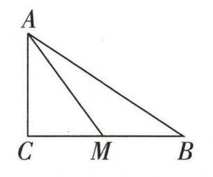

答案与解析

解析

在直角 $\triangle ACM$ 中，设 $CM=3t,AM=5t$，其中 $t>0$。勾股定理给出 $AC=4t$。因为 $AM$ 是 $BC$ 边上的中线，$BC=2CM=6t$。回到直角 $\triangle ABC$，$\tan B=AC/BC=4t/(6t)=2/3$。

本题结论

$2/3$。

</article>

### 3. 搬角：等角或互余，把目标放进好算的三角形 {#transfer-angle .exam-title}

斜边上的高常产生与原锐角相等的角，圆中可用同弧所对圆周角相等。先证明角关系，再改写函数；每次换三角形后重新认斜边，不能沿用前一个三角形的边名角色。

<article class="handbook-example" aria-labelledby="example-6">

#### 例题 06 斜边高中的共同锐角 知识清单例题 {#example-6 .example-heading}

题目

如图所示, 在 Rt△ABC 中, $\angle ACB = 90^{\circ}, CD \perp AB$ 于点 D, $\sin A=\frac{3}{5}, BD=4$ , 则 BC 的长为 ____.

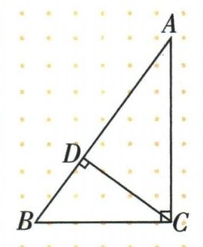

答案与解析

解析

原三角形中 $A+B=90^\circ$，所以 $\cos B=\sin A=3/5$。在直角 $\triangle BCD$ 中，$BC$ 是斜边，$\cos B=BD/BC$，因此 $4/BC=3/5$，得 $BC=20/3$。

也可由斜边高的射影关系 $BC^2=AB\cdot BD$，结合 $BC/AB=3/5$，得到 $BC=(3/5)^{-1}BD=20/3$。两法都须分清原形与小形的斜边。

本题结论

$BC=20/3$。

</article>

<article class="handbook-example" aria-labelledby="example-7">

#### 例题 07 高分出的角与原来的角 知识清单例题 {#example-7 .example-heading}

题目

如图所示,在直角三角形 ABC 中, $\angle ACB=90^{\circ},CD\perp AB$ 于 D,已知 $AC=\sqrt{5},AB=3$ ,那么 $\sin\angle ACD$ 的值为 ____.

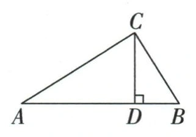

答案与解析

解析

$\angle ACD+\angle BCD=90^\circ$，而 $\angle B+\angle BCD=90^\circ$，相减得 $\angle ACD=\angle B$。于是 $\sin\angle ACD=\sin B=AC/AB=\sqrt5/3$。

本题结论

$\sqrt5/3$。

</article>

<article class="handbook-example" aria-labelledby="example-8">

#### 例题 08 借直径得到直角 知识清单例题 {#example-8 .example-heading}

题目

如图, $\odot O$ 是 $\triangle ABC$ 的外接圆, $AD$ 是 $\odot O$ 的直径, $\odot O$ 的半径为 $\frac{3}{2}, AC = 2$ , 求 $\sin B$ 的值.

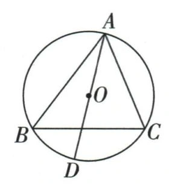

答案与解析

解析

连接 $CD$。$AD$ 是直径，故 $\angle ACD=90^\circ$，且 $AD=2R=3$。按图，$B,D$ 在弦 $AC$ 同侧的圆弧上，同弦所对圆周角相等，$\angle ABC=\angle ADC$。因此 $\sin B=\sin\angle ADC=AC/AD=2/3$。

本题结论

$2/3$。

</article>

### 4. 目标角不在直角三角形中，先作高 {#construct-perpendicular .exam-title}

从目标角另一边上的已知点向一边作垂线，把目标放进一个直角三角形。网格题也可找垂足，再用小格的勾股关系求边；若另有角相等、平行或中点条件，先把它们转成可计算的长度。

<article class="handbook-example" aria-labelledby="example-9">

#### 例题 09 斜放网格中的正切 知识清单例题 {#example-9 .example-heading}

题目

如图, 在 $5 \times 5$ 的正方形网格中, 每个小正方形的边长为 $1, \triangle ABC$ 的三个顶点 $A, B, C$ 均在格点上, 则 $\tan A$ 的值为 ____.

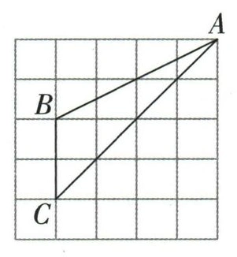

答案与解析

解析

过 $B$ 作 $BD\perp AC$。由网格，$AC$ 沿方格对角方向；垂线方向对应横纵各1格，故 $BD=\sqrt2$。从 $A$ 到垂足 $D$ 横纵各3格，故 $AD=3\sqrt2$。于是 $\tan A=BD/AD=1/3$。

本题结论

$1/3$。

</article>

<article class="handbook-example" aria-labelledby="example-10">

#### 例题 10 角BAD的邻边先补出来 知识清单例题 {#example-10 .example-heading}

题目

如图, 在 Rt△ABC 中, ∠C=90°, sin B=3/5, 点 D 在 BC 边上, 且 ∠ADC=45°, DC=6, 求 ∠BAD 的正切值.

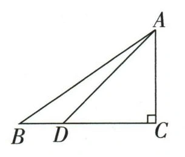

答案与解析

解析

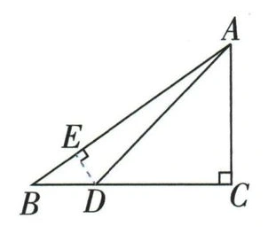

$\angle ADC=45^\circ$ 且 $C$ 为直角，所以 $AC=DC=6$。由 $\sin B=AC/AB=3/5$ 得 $AB=10$，再由勾股定理得 $BC=8$，故 $BD=2$。

作 $DE\perp AB$。在直角 $\triangle BDE$ 中，$DE=BD\sin B=6/5$；$\cos B=BC/AB=4/5$，故 $BE=BD\cos B=8/5$。于是 $AE=AB-BE=42/5$，所求 $\tan\angle BAD=DE/AE=1/7$。

本题结论

$1/7$。

</article>

<article class="handbook-example" aria-labelledby="example-11">

#### 例题 11 七巧板中的对角线交点 2024江西 {#example-11 .example-heading}

题目

(2024 江西) 将图 1 所示的七巧板, 拼成图 2 所示的四边形 ABCD, 连接 AC, 则 $\tan \angle CAB =$ ____ .

  

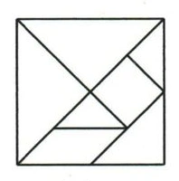

图1：原正方形七巧板。

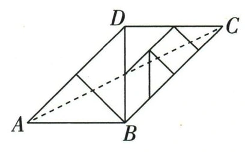

图2：拼成的四边形ABCD。

答案与解析

解析

由七巧板拼法，$\triangle ABD,\triangle BCD$ 是全等的等腰直角三角形，$AB=BD=CD$，且 $AB\perp BD,CD\perp BD$。所以 $AB\parallel CD$ 且 $AB=CD$，四边形是平行四边形。

设对角线交于 $O$，则 $BO=BD/2=AB/2$。在直角 $\triangle ABO$ 中，$\angle BAO=\angle CAB$，故 $\tan\angle CAB=BO/AB=1/2$。不能把整条 $BD$ 当作该小三角形的对边。

本题结论

$1/2$。

</article>

<article class="handbook-example" aria-labelledby="example-12">

#### 例题 12 锐角三角形先分成两个直角三角形 知识清单例题 {#example-12 .example-heading}

题目

在锐角三角形 $ABC$ 中, $\angle C = 45^{\circ}, AC = \sqrt{6}, AB = 2$ , 求这个三角形未知边的边长和未知角的度数.

答案与解析

解析

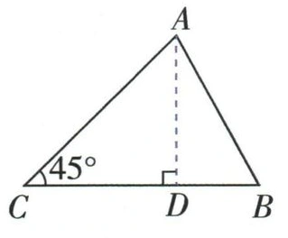

因为原三角形是锐角三角形，作 $AD\perp BC$ 时垂足在 $BC$ 内。由 $C=45^\circ$、$AC=\sqrt6$ 得 $AD=CD=\sqrt6\sin45^\circ=\sqrt3$。

在直角 $\triangle ABD$ 中，$AB=2$，所以 $BD=\sqrt{4-3}=1$，$\sin B=AD/AB=\sqrt3/2$，故 $B=60^\circ$。于是 $A=180^\circ-45^\circ-60^\circ=75^\circ$，$BC=CD+BD=\sqrt3+1$。

本题结论

$\angle A=75^\circ$，$\angle B=60^\circ$，$BC=\sqrt3+1$。

</article>

<article class="handbook-example" aria-labelledby="example-13">

#### 例题 13 两腰相等时，高也是中线 2024甘肃临夏 {#example-13 .example-heading}

题目

（2024甘肃临夏州）如图，在 $\triangle ABC$ 中， $AB=AC=5, \sin B=\frac{4}{5}$ ，则BC的长是 （）

A.3

B.6

C.8

D.9

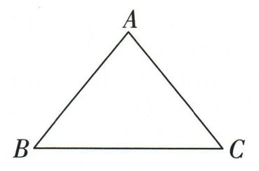

答案与解析

解析

作 $AD\perp BC$。等腰三角形的三线合一给出 $BD=DC$。在直角 $\triangle ABD$ 中，$AD=AB\sin B=5\times4/5=4$，故 $BD=\sqrt{25-16}=3$，$BC=2BD=6$。

本题结论

B，BC=6。

</article>

### 5. 两个直角三角形，用公共边传递长度 {#shared-edge .exam-title}

先在信息充分的小三角形求公共边，再用线段和差进入大三角形。圆中的半径、弦中点，或由垂线得到的邻边，都是常见的连接量。不要在尚未证明直角的三角形内直接写三角函数边比。

<article class="handbook-example" aria-labelledby="example-14">

#### 例题 14 由小三角形的正切求大三角形的余弦 知识清单例题 {#example-14 .example-heading}

题目

如图, 在 Rt△ABC 中, ∠C=90°, 点 D 是 AC 边上一点, $\tan\angle DBC=\frac{4}{3}$ , 且 BC=6, AD=4. 求 $\cos A$ 的值.

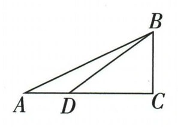

答案与解析

解析

在直角 $\triangle DBC$ 中，$CD=BC\tan\angle DBC=6\times4/3=8$。所以 $AC=AD+DC=12$，$AB=\sqrt{12^2+6^2}=6\sqrt5$。在直角 $\triangle ABC$ 中，$\cos A=AC/AB=2\sqrt5/5$。

本题结论

$2\sqrt5/5$。

</article>

<article class="handbook-example" aria-labelledby="example-15">

#### 例题 15 弦长、半径与另一个正切 知识清单例题 {#example-15 .example-heading}

题目

如图, 在 $\odot O$ 中, 弦 $AB$ 的长为 8 , 点 $C$ 在 $BO$ 的延长线上, 且 $\cos \angle ABC = \frac{4}{5}, OC = \frac{1}{2} OB$ .

(1) 求 $\odot O$ 的半径.

(2) 求 $\angle BAC$ 的正切值.

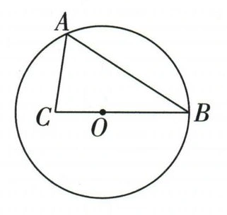

答案与解析

解析

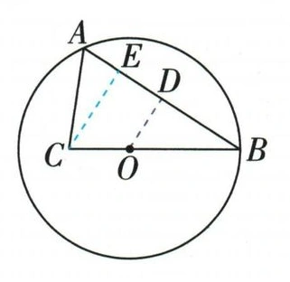

（1）作 $OD\perp AB$。垂径定理给出 $BD=AB/2=4$。因为 $B,O,C$ 依次共线，$\cos\angle ABC=BD/BO=4/5$，所以半径 $BO=5$。

（2）$OC=OB/2=5/2$，故 $BC=15/2$。作 $CE\perp AB$，则 $BE=BC\cos B=(15/2)(4/5)=6$。在直角 $\triangle BCE$ 中，$CE=\sqrt{(15/2)^2-6^2}=9/2$。按图 $AE=AB-BE=2$，因此 $\tan\angle BAC=CE/AE=9/4$。

本题结论

（1）半径5；（2）$\tan\angle BAC=9/4$。

</article>

## 【坑点】条件边界与易错辨析 {#pitfalls .handbook-section .is-pitfall}

### 1. 三个比的使用条件不能省 {#definition-pit .pitfall-title}

正切可以大于1；一般三角形的两边比不一定是某角的正切；三角函数也不满足“角相加，函数值相加”。先核直角，再核边与角的对应。

<article class="handbook-example is-pitfall" aria-labelledby="pitfall-1">

#### 辨析 01 判断三个说法 知识清单例题 {#pitfall-1 .example-heading}

题目

下列说法: ①若 $\alpha$ 为锐角, 则 $0 < \tan \alpha < 1$ ; ②在 $\triangle ABC$ 中, 已知 BC = 3, AC = 4, 则 $\tan A = \frac{3}{4}$ ; ③ $\tan 60^{\circ} = \tan (30^{\circ} + 30^{\circ}) = \tan 30^{\circ} + \tan 30^{\circ} = \frac{\sqrt{3}}{3} + \frac{\sqrt{3}}{3} = \frac{2\sqrt{3}}{3}$ . 其中正确说法的个数是 ____.

答案与解析

解析

①错误。$\tan60^\circ=\sqrt3>1$。

②错误。未给 $\angle C=90^\circ$，不能把 $BC/AC$ 当作 $\tan A$。例如保持这两条边长却改变夹角，目标角也会改变。

③错误。$\tan60^\circ=\sqrt3$，而 $\tan30^\circ+\tan30^\circ=2\sqrt3/3$，两者不等。角的和可以代入函数，但不能拆成两个函数值之和。

本题结论

正确说法0个。

</article>

