镜像不是只看轮廓相似。找到真正对应的点，确认折痕垂直平分它们的连线，才能把折叠中的长度、角度和最短路线一项项转化。

<nav class="handbook-nav" aria-label="本章分区">
  <a class="handbook-jump is-knowledge" href="#knowledge">01 · 知识点概念、关系与适用条件</a>
  <a class="handbook-jump is-exam" href="#exam">02 · 考点题目分类和例题</a>
  <a class="handbook-jump is-pitfall" href="#pitfalls">03 · 坑点辨析错因，检查遗漏</a>
</nav>

## 【知识点】概念与依据 {#knowledge .handbook-section .is-knowledge}

### 1. 轴对称 {#definition .knowledge-title}

沿一条直线翻折，一个图形与另一个完全重合，叫作两个图形关于这条直线==成轴对称==，这条直线叫对称轴

若翻折后与自身重合，这个图形就是==轴对称图形==

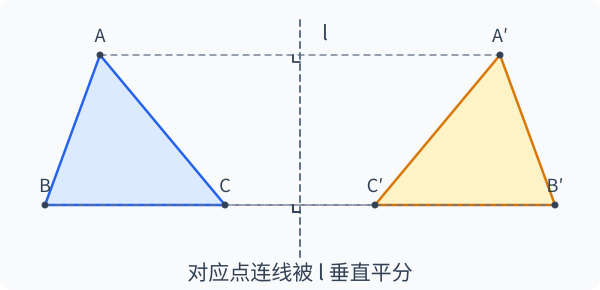

### 2. 对应点的关系 {#point-reflection .knowledge-title}

1. 对称轴垂直平分对应点的连线
2. 对应点到对称轴的距离相等
3. 对称轴上的点位置不变

### 3. 轴对称的性质 {#properties .knowledge-title}

对应边相等，对应角相等；两个图形全等，周长、面积相等

### 4. 常见图形的对称轴 {#axis-count .knowledge-title}

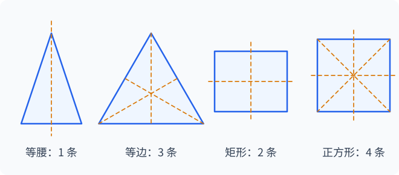

| 图形 | 对称轴条数 |
| --- | --- |
| 非等边的等腰三角形 | $1$ |
| 等边三角形 | $3$ |
| 非正方形的矩形、非正方形的菱形 | $2$ |
| 正方形 | $4$ |
| 正 $n$ 边形 | $n$ |
| 圆 | 无数条 |

### 5. 作轴对称图形 {#construction .knowledge-title}

过各顶点作对称轴的垂线，在另一侧截取相等距离，得到对应点，再按原顺序连线

### 6. 坐标中的轴对称 {#coordinates .knowledge-title}

| 对称轴 | $(x,y)$ 的对应点 |
| --- | --- |
| $x$ 轴 | $(x,-y)$ |
| $y$ 轴 | $(-x,y)$ |
| $y=x$ | $(y,x)$ |
| $y=-x$ | $(-y,-x)$ |

关于 $x=h$ 对称时横坐标变为 $2h-x$；关于 $y=k$ 对称时纵坐标变为 $2k-y$

## 【考点】先方法，后例题 {#exam .handbook-section .is-exam}

### 1. 最短折路：下界与取到下界 {#shortest-principle .exam-title}

点 $P$ 必须在直线 $l$ 上时，把固定点 $A$ 反射为 $A'$，对每个合法 $P$ 都有 $PA=PA'$，因而

$$PA+PB=PA'+PB\ge A'B.$$

这只证明了下界。要成为最小值，还须找到合法 $P$，使 $A',P,B$ 共线且 $P$ 在两端之间。若直线交点在线段允许范围外，或者多次经过道路的先后顺序不符，便不能取等。

最小值证明要同时回答：任何路线为什么不更短？哪一条允许的路线恰好达到这个长度？

### 2. 识别整图与核对对应量 {#recognition .exam-title}

先分清是一个图自身对称，还是两个图互为镜像。看清内线及阴影；给出字母配对时，把边的两个端点、角的顶点和两条边一起对应，再判断结论。

<article class="handbook-example" aria-labelledby="example-1">

#### 例题 01 仪器示意图的对称性 知识清单例题 {#example-1 .example-heading}

题目

（2024 重庆 A）下列四种化学仪器的示意图中，哪一幅是轴对称图形？

<figure class="handbook-option">

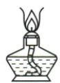

<figcaption>A</figcaption>

</figure>

<figure class="handbook-option">

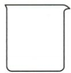

<figcaption>B</figcaption>

</figure>

<figure class="handbook-option">

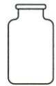

<figcaption>C</figcaption>

</figure>

<figure class="handbook-option">

<figcaption>D</figcaption>

</figure>

答案与解析

解析

A 的灯芯等内线偏向一侧；B 的杯嘴只在一侧；D 的导管弯向一侧，均不能整图翻折重合。C 沿中央竖直线翻折，全部线条成对重合。判断的是所给示意图，而不是所有同名实物。

本题结论

选 C。

</article>

<article class="handbook-example" aria-labelledby="example-2">

#### 例题 02 由配对检验四个结论 知识清单例题 {#example-2 .example-heading}

题目

如图, $\triangle ABC$ 与 $\triangle A^{\prime}B^{\prime}C^{\prime}$ 关于直线MN对称, $BB^{\prime}$ 交MN于点O,则下列说法中一定正确的有\_\_\_\_.

① $AC=A'C'$ ; ② $AB\parallel B'C'$ ;   
③ $BB'\perp MN$ ; ④BO= $B'O$ .

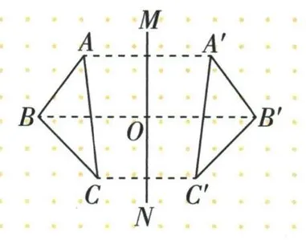

答案与解析

解析

① $AC$ 对应 $A'C'$，正确。② $AB$ 对应 $A'B'$，不是 $B'C'$，给出的平行关系不能保证。③④由轴 $MN$ 垂直平分 $BB'$ 同时得到。

本题结论

一定正确的是①③④。

</article>

### 3. 坐标反射与含参条件 {#parameter .exam-title}

先确定轴，再写“哪一个坐标相等、哪两个坐标相加为零”。含参题由这些几何关系列方程组；独立小问分别重列，不能沿用前一问的参数值。

<article class="handbook-example" aria-labelledby="example-3">

#### 例题 03 同一对点的两种对称条件 知识清单例题 {#example-3 .example-heading}

题目

已知点 $M(2a-b,5+a)$ , $N(2b-1,-a+b)$ .

(1) 若 M、N 关于 x 轴对称, 求 a, b 的值.  
(2) 若 M、N 关于 y 轴对称, 求 $(b+2a)^{2025}$ 的值.

答案与解析

解析

（1）关于 $x$ 轴对称：

$$\begin{cases}2a-b=2b-1,\\(5+a)+(-a+b)=0.\end{cases}$$

第二式给 $b=-5$，代入第一式得 $2a=-16$，故 $a=-8$。回代两点为 $(-11,-3)$、$(-11,3)$。

（2）关于 $y$ 轴对称：

$$\begin{cases}(2a-b)+(2b-1)=0,\\5+a=-a+b.\end{cases}$$

即 $2a+b=1$、$2a-b=-5$，相加得 $a=-1$，再得 $b=3$。所以 $(b+2a)^{2025}=1^{2025}=1$。

本题结论

（1）$a=-8,b=-5$；（2）所求值为 $1$。

</article>

### 4. 折叠求角：固定折痕，找原角的像 {#fold-angles .exam-title}

折痕上的点不动，被折点移到像点。先标明原角对应到哪个顶点，再结合图中共线点序，用内角和、外角或邻补角继续求解。折后角相等并不意味着所有相邻小角都相等。

<article class="handbook-example" aria-labelledby="example-4">

#### 例题 04 沿折痕翻折后的角 知识清单例题 {#example-4 .example-heading}

题目

如图, 在 $\triangle ABC$ 中, $\angle ACB = 90^{\circ}$ , 沿 $CD$ 折叠 $\triangle CBD$ , 使点 $B$ 恰好落在 $AC$ 边上的点 $E$ 处. 若 $\angle A = 28^{\circ}$ , 求 $\angle ADE$ 的度数.

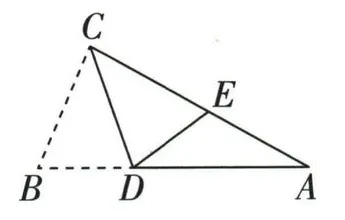

答案与解析

解析

原三角形中 $\angle B=180^\circ-90^\circ-28^\circ=62^\circ$。折痕上的 $C,D$ 固定，$B$ 对应 $E$，故 $\angle DEC=\angle DBC=62^\circ$。

$A,E,C$ 按序共线，$\angle DEC$ 是 $\triangle ADE$ 的外角，所以 $\angle DEC=\angle DAE+\angle ADE$。由 $\angle DAE=28^\circ$，得 $\angle ADE=34^\circ$。

本题结论

$\angle ADE=34^\circ$。

</article>

### 5. 折叠求长与周长 {#fold-length .exam-title}

求线段时，用折叠对应等长把未知量转到原边，再找直角三角形列勾股方程，最后检查根是否符合点的位置。

求周长时，先沿所求区域的边界走一圈列出各段，再用对应等长替换。内部折痕不算周长，面积相等也不能推出周长相等。

<article class="handbook-example" aria-labelledby="example-5">

#### 例题 05 折点落在三角形内部的斜线上 知识清单例题 {#example-5 .example-heading}

题目

(2024 江苏常州) 如图, 在 Rt△ABC 中, ∠ACB=90°, AC=6, BC=4, D 是边 AC 的中点, E 是边 BC 上一点, 连接 BD、DE. 将 △CDE 沿 DE 翻折, 点 C 落在 BD 上的点 F 处, 则 CE= \_\_\_\_.

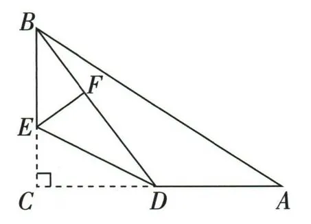

答案与解析

解析

$D$ 为中点，$CD=3$；直角 $\triangle BCD$ 中 $BD=\sqrt{3^2+4^2}=5$。折叠使 $DF=DC=3$、$EF=EC$，于是 $BF=5-3=2$。

设 $CE=x$，则 $EF=x$，$BE=4-x$，并且 $0<x<4$。原 $C$ 处的直角对应到 $F$；$B,F,D$ 共线，故 $\triangle BFE$ 为直角三角形：

$$x^2+2^2=(4-x)^2.$$

两侧同减 $x^2$，得 $4=16-8x$，所以 $x=\frac32$。回验 $1.5^2+2^2=2.5^2$ 且 $0<1.5<4$，与位置相符。

本题结论

$CE=\dfrac32$。

</article>

<article class="handbook-example" aria-labelledby="example-6">

#### 例题 06 阴影边界中的等长替换 知识清单例题 {#example-6 .example-heading}

题目

如图,等边 $\triangle ABC$ 的边长为1 cm,D,E分别是AB,AC上的点,将 $\triangle ADE$ 沿直线DE折叠,点A落在点 $A'$ 处,且点 $A'$ 在 $\triangle ABC$ 外部,求阴影部分的周长.

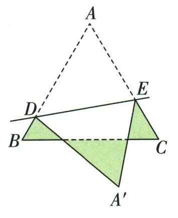

答案与解析

解析

按图，阴影外边界各段为 $BC,BD,DA',A'E,EC$；$DE$ 在内部，不计入。

折叠给 $DA'=DA$、$A'E=AE$。因为 $D$ 在线段 $AB$ 上、$E$ 在线段 $AC$ 上，

$$\begin{aligned}L&=BC+BD+DA'+A'E+EC\\&=BC+(BD+DA)+(AE+EC)\\&=BC+AB+AC=3\text{ cm}.\end{aligned}$$

这里是沿题图边界替换长度，并不是认为阴影整体与原三角形全等。

本题结论

阴影部分的周长为 3 cm。

</article>

### 6. 一条轴上的最短路线 {#one-axis .exam-title}

把一个固定端点反射到轴另一侧，连接像点与另一个端点。先用三角不等式证明下界，再检查交点位于题目允许的直线、射线或线段上。

<article class="handbook-example" aria-labelledby="example-7">

#### 例题 07 经过水平直线的路线 知识清单例题 {#example-7 .example-heading}

题目

（2024四川成都）如图，在平面直角坐标系 $xOy$ 中，已知 $A(3,0)$ ， $B(0,2)$ ，过点 $B$ 作 $y$ 轴的垂线 $l, P$ 为直线 $l$ 上一动点，连接 $PO, PA$ ，则 $PO + PA$ 的最小值为 \_\_\_\_.

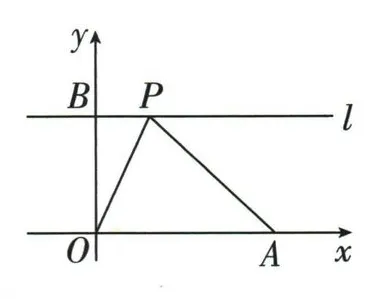

答案与解析

解析

$l$ 为 $y=2$。把 $O$ 关于 $l$ 反射为 $O'(0,4)$，任意 $P\in l$ 有 $PO=PO'$，因此 $PO+PA\ge O'A$。

$O'A=\sqrt{3^2+4^2}=5$。线段 $O'A$ 与 $y=2$ 交于 $P(\frac32,2)$，该点在两个端点之间，能取等号。

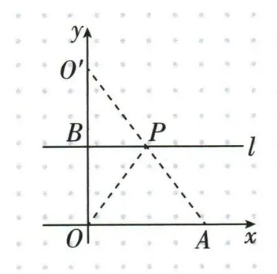

本题结论

最小值为 $5$，在 $P(\frac32,2)$ 处取得。

</article>

<article class="handbook-example" aria-labelledby="example-8">

#### 例题 08 动点限制在线段上 知识清单例题 {#example-8 .example-heading}

题目

如图,等边 $\triangle ABC$ 中,D为 $AC$ 的中点,点 $P\text{、}Q$ 分别为线段 $AB\text{、}AD$ 上的点,且 $BP=AQ=4,QD=3$ ,在 $BD$ 上有一动点 $E$ ,则 $PE+QE$ 的最小值为\_\_\_\_.

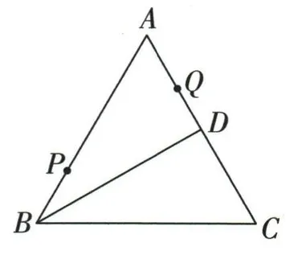

答案与解析

解析

等边三角形中，底边中线 $BD$ 也是对称轴。$AD=AQ+QD=7$，所以 $AC=AB=14$，$AP=14-4=10$。

把 $Q$ 关于 $BD$ 反射为 $Q'$。$Q'$ 在线段 $DC$ 上，$DQ'=3$，故 $AQ'=7+3=10$。$AP=AQ'=10$ 且夹角 $60^\circ$，所以 $\triangle APQ'$ 等边，$PQ'=10$。

对线段 $BD$ 上任意 $E$，$PE+QE=PE+Q'E\ge PQ'=10$。$P$ 在 $AB$ 内部，$Q'$ 在 $DC$ 内部，位于 $BD$ 两侧；三角形的凸性保证线段 $PQ'$ 与 $BD$ 的交点仍在 $BD$ 内，能取等号。

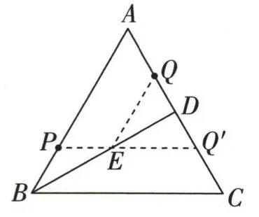

本题结论

最小值为 $10$。

</article>

### 7. 两条轴与固定边的最短路线 {#two-axes .exam-title}

分别反射起点和终点，把必须依次经过两条直线的三段折路展开。候选连接线必须按实际路线顺序穿过两轴，才可取等。

| 模型 | 反射与下界 | 取等检查 |
| --- | --- | --- |
| $A\to C\to D\to B$，$C\in l_1,D\in l_2$ | $A$ 关于 $l_1$ 反射为 $A'$，$B$ 关于 $l_2$ 反射为 $B'$；总长 $\ge A'B'$ | $A',C,D,B'$ 同线同向排列 |
| $\triangle PMN$，$M\in l_1,N\in l_2$ | $P$ 分别反射为 $P',P''$；周长 $\ge P'P''$ | $P',M,N,P''$ 同线同向排列，且三角形非退化 |
| 四边形 $PMNQ$，$P,Q$ 固定 | 分别反射 $P,Q$ 得 $P',Q'$；周长 $\ge P'Q'+PQ$ | $P',M,N,Q'$ 同线同向，四边形符合原位置要求 |

最后一行的 $PQ$ 是固定边，不能漏加。若只给射线或有限路段，还须另查交点范围；若候选退化或顺序不符，表中只是下界，不能宣布求到最小值。

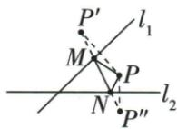

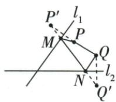

<article class="handbook-example" aria-labelledby="example-9">

#### 例题 09 依次到达两条公路 知识清单例题 {#example-9 .example-heading}

题目

如图,为了做好某市运动会期间的交通安全工作,某交警执勤小队从 A 处出发,先到公路 $l_{1}$ 上设卡检查,再到公路 $l_{2}$ 上设卡检查,最后到 B 地执行任务,他们如何走才能使总路程最短?

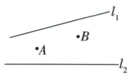

答案与解析

解析

作 $A$ 关于 $l_1$ 的像 $A'$，作 $B$ 关于 $l_2$ 的像 $B'$。对任意允许的检查点 $C,D$，

$$AC+CD+DB=A'C+CD+DB'\ge A'B'.$$

按题图位置，线段 $A'B'$ 依次交 $l_1,l_2$ 于 $C,D$，顺序为 $A',C,D,B'$，因此达到下界。实际仍走 $A\to C\to D\to B$，不经过虚拟反射点。

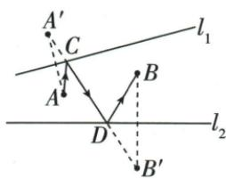

本题结论

取 $A'B'$ 与两公路的顺序交点 $C,D$，走 $A\to C\to D\to B$。

</article>

## 【坑点】辨析与边界 {#pitfalls .handbook-section .is-pitfall}

### 1. 直线、射线与特殊图形不要混用 {#axis-boundary .pitfall-title}

说“轴有几条”先分清轴是直线，并核查所给图形是否包含特殊情形。某类图至少有一条轴，不等于这类每个图恰有一条轴。

<article class="handbook-example is-pitfall" aria-labelledby="pitfall-1">

#### 辨析 01 六句话中的对象与范围 知识清单辨析 {#pitfall-1 .example-heading}

题目

判断正误并说明理由：

① 角的平分线是这个角的对称轴。

② 一个轴对称图形不一定只有一条对称轴。

③ 等腰三角形至少有一条对称轴。

④ 圆的直径是其对称轴。

⑤ 圆心在圆的每条对称轴上。

⑥ 正 $n$ 边形有 $n$ 条对称轴。

答案与解析

解析

①错：角平分线是射线，轴是其所在直线。②对：正方形等图有多条轴。③对：非等边等腰三角形有一条，等边有三条。④错：直径是线段，轴是其所在直线。⑤对：反射必须保持圆心，否则不是同一个圆。⑥对：正多边形的等距顶点成对反射，奇数边时轴过一顶点和对边中点，偶数边时分别过对顶点或对边中点，总数均为 $n$。

本题结论

①错，②对，③对，④错，⑤对，⑥对。

</article>

### 2. 必要条件不能少，也不能倒用 {#necessary .pitfall-title}

轴对称能推出全等，反过来不一定。对不同对应点，只作连线的垂线也不够，还必须经过中点。

<article class="handbook-example is-pitfall" aria-labelledby="pitfall-2">

#### 辨析 02 四种关于轴对称的说法 知识清单辨析·改编，明确不同对应点 {#pitfall-2 .example-heading}

题目

判断：

① 两图全等，就一定成轴对称。

② 两个成轴对称的图形面积相等。

③ 轴对称图形的对称轴把图形两侧部分互相对应为全等图形。

④ 连接一对不同对应点，任作其连线的垂线就是对称轴。

答案与解析

解析

①错，平移或旋转也可得到全等图形，未必是一条轴的反射。②对，反射保持全等及面积。③对，沿轴翻折两侧完整互换；复杂图形每侧可以由几块组成。④错，垂线还须经过对应点连线的中点，不能任意取位置。

本题结论

①错，②对，③对，④错。

</article>

<article class="handbook-example is-pitfall" aria-labelledby="pitfall-3">

#### 辨析 03 镜像直线是否一定垂直 知识清单例题 {#pitfall-3 .example-heading}

题目

（2024 河北）如图, AD 与 BC 交于点 O, $\triangle ABO$ 和 $\triangle CDO$ 关于直线 PQ 对称, 点 A, B 的对称点分别是点 C, D. 下列不一定正确的是（）

A. $AD \perp BC$

B. $AC \perp PQ$

C. $\triangle ABO \cong \triangle CDO$

D. $AC \parallel BD$

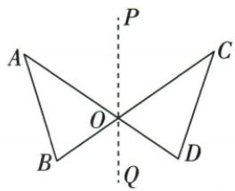

答案与解析

解析

由 $A\leftrightarrow C$、$B\leftrightarrow D$，得 $AC\perp PQ$、$BD\perp PQ$，所以图中两条不同直线 $AC\parallel BD$；反射还保证两三角形全等。B、C、D 三项必然成立。

$AD$ 与 $BC$ 虽是镜像直线，其夹角仍随位置改变，不一定为90°。例如以竖直线为轴，一条斜率为2的直线反射后斜率为−2，两线并不垂直。

本题结论

不一定正确的是 A。

</article>

### 3. 只改该改的坐标 {#coordinate-pitfall .pitfall-title}

反射规则来自轴的位置，不是见“对称”就把两个坐标都变号。两坐标同时变号是关于原点的半转，不是关于某一坐标轴的反射。

<article class="handbook-example is-pitfall" aria-labelledby="pitfall-4">

#### 辨析 04 横轴上的反射规则 知识清单例题 {#pitfall-4 .example-heading}

题目

在平面直角坐标系中， $\triangle ABC$ 与 $\triangle A'B'C'$ 关于 $x$ 轴对称，点 $A$ 的坐标是(2,1)，则点 $A$ 的对应点 $A'$ 的坐标是

答案与解析

解析

关于 $x$ 轴，横向位置保持为2，纵向的有向距离由1变成−1。因此像点为 $(2,-1)$；只改变横坐标是关于 $y$ 轴的反射，两个都变号则是关于原点的中心对称。

本题结论

$A'(2,-1)$。

</article>

