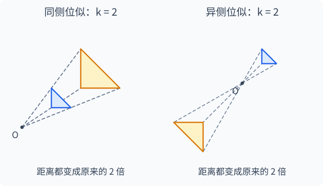
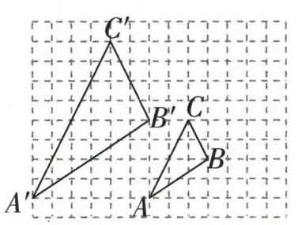
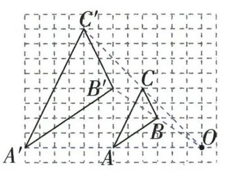
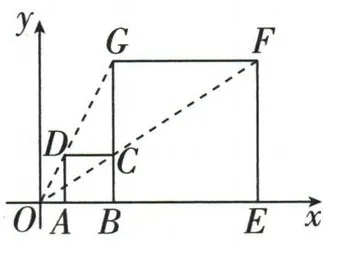
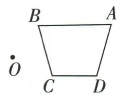
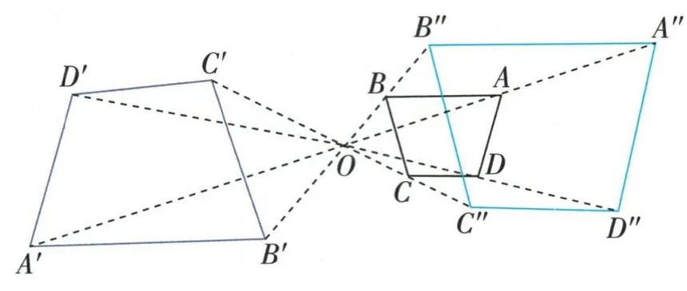
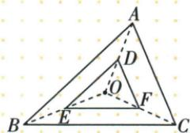
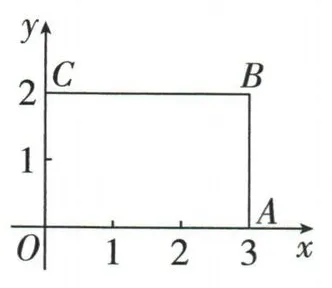

位似不是把每个点随意拉远，而是围绕同一个中心、沿统一方向按同一倍数缩放。先分清长度比与有向倍数，再处理作图、坐标和面积。

<nav class="handbook-nav" aria-label="本章分区">
  <a class="handbook-jump is-knowledge" href="#knowledge">01 · 知识点概念、关系与适用条件</a>
  <a class="handbook-jump is-exam" href="#exam">02 · 考点题目分类和例题</a>
  <a class="handbook-jump is-pitfall" href="#pitfalls">03 · 坑点辨析错因，检查遗漏</a>
</nav>

## 【知识点】概念与依据 {#knowledge .handbook-section .is-knowledge}

### 1. 位似与位似中心 {#definition .knowledge-title}

以一个点 $O$ 为中心，把图形各点到 $O$ 的距离按同一倍数放大或缩小，得到的两个图形叫作==位似图形==，$O$ 叫位似中心

各对应点与 $O$ 共线，并统一在同侧或统一在异侧，长度的倍数就是相似比 $k$

### 2. 位似的性质 {#properties .knowledge-title}

1. 位似图形一定相似，对应角相等
2. 对应边平行或共线，长度比为 $k$
3. 周长比为 $k$，面积比为 $k^2$

### 3. 放大与缩小 {#scale .knowledge-title}

- $k>1$：放大
- $0<k<1$：缩小
- $k=1$：大小不变；异侧时就是关于中心的中心对称

### 4. 以原点为中心的位似坐标 {#coordinates .knowledge-title}

| 位置 | 点 $(x,y)$ 变为 |
| --- | --- |
| 与原点同侧，相似比 $k$ | $(kx,ky)$ |
| 与原点异侧，相似比 $k$ | $(-kx,-ky)$ |

例如相似比为 $2$，$(1,3)$ 的对应点为 $(2,6)$ 或 $(-2,-6)$，由同侧、异侧条件确定

## 【考点】先方法，后例题 {#exam .handbook-section .is-exam}

### 1. 识别位似：先对应，再找中心和统一倍数 {#identify .exam-title}

1. 用边长、角或网格确认对应顶点，不能只看外形。
2. 连接两组不同的对应点，寻找可能的中心 $O$。
3. 检查其余对应点是否也与 $O$ 共线。
4. 核实所有径向长度比一致，且同侧、异侧选择统一。

网格中可直接比较每个顶点相对中心的横向与纵向格数；只检查三边同比，至多证明相似。

<article class="handbook-example" aria-labelledby="example-1">

#### 例题 01 网格里的两个三角形 知识清单例题 {#example-1 .example-heading}

题目

如图, 图中的小方格都是边长为 1 的正方形, $\triangle ABC$ 与 $\triangle A'B'C'$ 的顶点都在格点上. $\triangle A'B'C'$ 与 $\triangle ABC$ 是位似图形吗? 如果是, 在图上画出位似中心并求出相似比; 如果不是, 请说明理由.

答案与解析

解析

由格数与勾股定理，原三角形的三边分别是

$$AB=\sqrt{13},\quad BC=\sqrt5,\quad AC=2\sqrt5.$$

像三角形的对应边分别是 $2\sqrt{13}$、$2\sqrt5$、$4\sqrt5$，三边同比为2，故两三角形相似。

再连接并延长 $AA'$、$BB'$、$CC'$，交于图示 $O$。逐点数格可见，像点相对 $O$ 的横纵位移均是原来的点的2倍，三组点同侧且统一使用 $t=2$，故是位似。

本题结论

是位似图形，中心为解析图中的 O，像图与原图的相似比为2。

</article>

### 2. 用径向比例联立共线段的和差 {#lengths .exam-title}

先按“像点对应谁”列径向比，再根据图中点序，把整段写成已知段与未知段的和差。某点同时属于两个图形时，不要把图形的对应关系与邻接关系混为一谈。

<article class="handbook-example" aria-labelledby="example-2">

#### 例题 02 相接的两个正方形 知识清单例题 {#example-2 .example-heading}

题目

如图,在平面直角坐标系中,正方形 ABCD 与正方形 BEFG 是以点 O 为位似中心的位似图形,且相似比为 $\frac{1}{3}$ ,两个正方形在点 O 的同侧,点 A、B、E 在 x 轴上,其余顶点在第一象限内,若正方形 BEFG 的边长为 6,则点 C 的坐标为 ____.

答案与解析

解析

小正方形与大正方形边长比为 $1/3$，所以 $BC=6/3=2$。对应顶点为 $B\leftrightarrow E$，同侧位似给

$$\frac{OB}{OE}=\frac13.$$

按图 $O,A,B,E$ 依次排列，$OE=OB+BE=OB+6$，故 $OB/(OB+6)=1/3$，解得 $OB=3$。

$C$ 在 $B$ 正上方2个单位，横坐标为3、纵坐标为2。小正方形边长2不等于 $OB$。

本题结论

$C(3,2)$。

</article>

### 3. 作位似图：方向、距离、连接顺序都要统一 {#construction .exam-title}

先确定中心和同侧或异侧；从中心向每个顶点作对应射线；按同一倍数截取距离；最后依原顺序连接顶点。边上的附加点、内部线段也要按同一变换处理。

“沿 $AO$ 方向”意味着从 $A$ 朝 $O$ 继续，放到越过 $O$ 的一侧；“沿 $OA$ 方向”意味着从 $O$ 朝 $A$ 的一侧。题目明确了方向，便不再多画另一种作为同一问的答案。

<article class="handbook-example" aria-labelledby="example-3">

#### 例题 03 同侧与异侧的二倍放大 知识清单例题 {#example-3 .example-heading}

题目

如图,分别按下列要求作出四边形 ABCD 以 O 点为位似中心的位似四边形.

(1) 沿 AO 方向, 相似比为 2, 把四边形 ABCD 放大.

(2) 沿 OA 方向, 相似比为 2, 把四边形 ABCD 放大.

答案与解析

解析

（1）分别沿 $AO,BO,CO,DO$ 越过 $O$ 延长，取 $A',B',C',D'$，使 $OA'=2OA$、$OB'=2OB$、$OC'=2OC$、$OD'=2OD$。依次连接，得到异侧二倍像。

（2）分别沿 $OA,OB,OC,OD$ 延长，取 $A'',B'',C'',D''$，使每个径向距离为原来的2倍，再依原顺序连接，得到同侧二倍像。

本题结论

（1）取异侧的 A′B′C′D′；（2）取同侧的 A″B″C″D″，两图见解析。

</article>

### 4. 长度比转面积比 {#area .exam-title}

先确认题问哪两个图形、前后顺序是什么，再求长度比，最后平方。若反过来由面积比求长度比，应取正平方根，不能把负的有向倍数当作负长度比。

<article class="handbook-example" aria-labelledby="example-4">

#### 例题 04 三个径向中点 知识清单例题 {#example-4 .example-heading}

题目

如图, $\triangle DEF$ 与 $\triangle ABC$ 是位似图形, 点 O 是位似中心, D、E、F 分别是 OA、OB、OC 的中点, 则 $\triangle DEF$ 与 $\triangle ABC$ 的面积比是 ____.

答案与解析

解析

$OD/OA=OE/OB=OF/OC=1/2$，故 $\triangle DEF$ 与 $\triangle ABC$ 的相似比为 $1/2$。面积比为

$$\frac{S_{DEF}}{S_{ABC}}=\left(\frac12\right)^2=\frac14.$$

中点给出的是一次长度比，不是直接给面积比。

本题结论

面积比为 $1:4$。

</article>

### 5. 坐标先定倍数的符号，再逐点运算 {#coordinate-problems .exam-title}

以原点为中心时，横纵坐标必须乘同一个数。若题目给象限或同侧、异侧条件，先用它选定符号；不能把横坐标放大而纵坐标缩小。

<article class="handbook-example" aria-labelledby="example-5">

#### 例题 05 第一象限内的像点 知识清单例题·2024黑龙江绥化 {#example-5 .example-heading}

题目

（2024黑龙江绥化）如图，矩形OABC各顶点的坐标分别为 $O(0,0)$ ， $A(3,0)$ ， $B(3,2)$ ， $C(0,2)$ ，以原点O为位似中心，将这个矩形按相似比 $\frac{1}{3}$ 缩小，则顶点B在第一象限对应点的坐标是()

A.(9,4)

B.(4,9)

C. $\left(1,\frac{3}{2}\right)$

D. $\left(1,\frac{2}{3}\right)$

答案与解析

解析

相似比为 $1/3$，可能的有向倍数原本有 $1/3$ 与 $-1/3$。但题目指定像点在第一象限，只能取正倍数。

$$B'=\left(\tfrac13\times3,\tfrac13\times2\right)=\left(1,\tfrac23\right).$$

A、B 两项的横纵倍数不统一，也不是缩小；C 的纵坐标没有乘 $1/3$。

本题结论

选 D，像点为 $(1,\frac23)$。

</article>

## 【坑点】辨析与边界 {#pitfalls .handbook-section .is-pitfall}

### 1. 长度比不告诉你像点在哪一侧 {#sign .pitfall-title}

只给正的相似比，未必给定有向倍数。检查题目有没有方向、同侧、异侧或象限限制，再决定是一组坐标还是两组。

<article class="handbook-example is-pitfall" aria-labelledby="pitfall-1">

#### 辨析 01 没有限定同侧或异侧 知识清单例题 {#pitfall-1 .example-heading}

题目

在平面直角坐标系中,已知点 $E(-4,2)$ , $F(-2,-2)$ , 以原点 O 为位似中心, 相似比为 2, 把 $\triangle EFO$ 放大, 则点 E 的对应点的坐标是 ____.

答案与解析

解析

同侧取 $t=2$，$E'=(-8,4)$；异侧取 $t=-2$，$E''=(8,-4)$。两种情况下 $F$ 也必须采用同一倍数，不能只让 $E$ 反向。题目没有其他限制，两支均保留。

本题结论

$(-8,4)$ 或 $(8,-4)$。

</article>

### 2. 相似、位似和比例方向是三个问题 {#converse .pitfall-title}

先判断位置关系，再判断量的比例。位似蕴含相似，不能把这一方向倒过来；周长比虽等于长度比，前后顺序仍必须一致。

<article class="handbook-example is-pitfall" aria-labelledby="pitfall-2">

#### 辨析 02 三句话分别核查 知识清单例题 {#pitfall-2 .example-heading}

题目

下列说法: ① 若 $\triangle ABC \sim \triangle A'B'C'$ , 则 $\triangle ABC$ 与 $\triangle A'B'C'$ 是位似图形; ② 若四边形 $ABCD$ 与四边形 $A'B'C'D'$ 是位似图形, 则二者必定相似; ③ 若多边形 $A$ 与多边形 $B$ 是位似图形, 且前后两者的相似比为 $\frac{7}{4}$ , 则多边形 $B$ 与多边形 $A$ 的周长之比为 $\frac{7}{4}$ . 其中正确的是 ____。

答案与解析

解析

①错。相似图形可以有平移、旋转等位置关系，不一定具有统一的位似中心和倍数。

②对。位似的每个对应角相等、对应边统一成比例，因此必相似。

③错。已知 $A:B=7:4$，则周长也为 $A:B=7:4$；题目反过来问 $B:A$，应为 $4:7$。

本题结论

只有②正确。

</article>

