影子由光、物体与投影面共同决定；三视图则用三个固定方向表达立体。先分清光线模型和观察方向，再用相似、尺寸对应及遮挡关系求解。

<nav class="handbook-nav" aria-label="本章分区">
  <a class="handbook-jump is-knowledge" href="#knowledge">01 · 知识点概念、关系与适用条件</a>
  <a class="handbook-jump is-exam" href="#exam">02 · 考点题目分类和例题</a>
  <a class="handbook-jump is-pitfall" href="#pitfalls">03 · 坑点辨析错因，检查遗漏</a>
</nav>

## 【知识点】概念、模型与依据 {#knowledge .handbook-section .is-knowledge}

### 1. 投影 {#projection .knowledge-title}

光线照射物体，在平面上形成的影，叫作==投影==

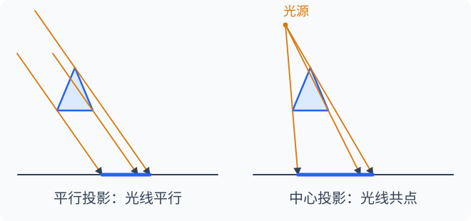

| 类型 | 光线的特点 | 例子 |
| --- | --- | --- |
| 平行投影 | 投影线互相平行 | 太阳光形成的影子 |
| 中心投影 | 投影线交于同一点 | 灯光形成的影子 |

### 2. 正投影 {#orthogonal .knowledge-title}

投影线垂直于投影面时，得到==正投影==，是平行投影的一种

- 线段平行于投影面：投影与原线段等长
- 线段倾斜于投影面：投影缩短
- 线段垂直于投影面：投影成为一个点

### 3. 三视图 {#three-views .knowledge-title}

从前面、上面、左面看到的正投影，分别叫主视图、俯视图、左视图

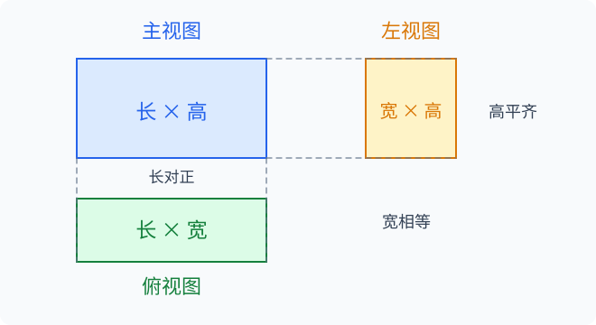

| 视图 | 观察方向 | 保留的尺寸 |
| --- | --- | --- |
| 主视图 | 从前向后 | 长、高 |
| 俯视图 | 从上向下 | 长、宽 |
| 左视图 | 从左向右 | 宽、高 |

三视图要做到：长对正，高平齐，宽相等

### 4. 常见几何体的三视图 {#basic-solids .knowledge-title}

下表按圆柱、圆锥竖直放置时观察

| 几何体 | 主视图 | 左视图 | 俯视图 |
| --- | --- | --- | --- |
| 正方体 | 正方形 | 正方形 | 正方形 |
| 长方体 | 长方形 | 长方形 | 长方形 |
| 圆柱 | 长方形 | 长方形 | 圆 |
| 圆锥 | 等腰三角形 | 等腰三角形 | 带顶点投影的圆 |
| 球 | 圆 | 圆 | 圆 |

### 5. 实线与虚线 {#visibility .knowledge-title}

看得见的轮廓和棱画实线，被遮挡但需要表示的棱画虚线

## 【考点】先方法，再看例题 {#exam .handbook-section .is-exam}

### 1. 平行光：共同倾角给出高影比 {#parallel .exam-title}

同地同刻、同一水平地面上的竖直物体，其顶端光线互相平行，形成两个锐角相等的直角三角形，由 AA 相似：

$$\frac{\text{物高}_1}{\text{水平影长}_1}=\frac{\text{物高}_2}{\text{水平影长}_2}.$$

若太阳光与地面的锐角为 $\alpha$，物高为 $h$、水平影长为 $s$，则 $h/s=\tan\alpha$。同高时，太阳高度角越大，影越短；影向与太阳的地面方向相反。影向和日内变化还受地点、日期影响，不能给整个北半球套一条固定方位序列，也不能把钟表12点无条件当作当地太阳正午。

同一光向下，平行于地面的水平线段投影等长，因为各点沿同方向、跨同高度落到地面，相当于统一平移。物体转向、升降或投影面改变时，须重新判断。

若影落到墙上，墙上的竖段不是水平影。应过墙上影端作水平线，先求物顶至这条线的高度差，再按点序补回或减去剩余高度。

### 2. 中心投影：竖杆与水平纸板的变化不同 {#central .exam-title}

固定灯高 $H$，竖杆高 $h$，灯脚到杆脚的水平距离 $x$，且 $0<h<H$。设地面影长为 $s$，两相似直角三角形给出

$$\frac hH=\frac{s}{x+s}\quad\Longrightarrow\quad hx=(H-h)s\quad\Longrightarrow\quad s=\frac{hx}{H-h}.$$

大三角形的底是“脚距加影长”，不是单独的 $x$。固定灯高和杆高后，影长与到灯脚的距离成正比，跨过灯脚时应分两侧看距离。若把人体简化为竖直线段，在灯正下方线段影可缩成点；真实人体有宽度，影不会因此完全消失。

若改为离地 $h$、平行于地面的水平纸板，各投影线从同一中心出发，平行截形使所有边有统一的放大率

$$k=\frac H{H-h},\qquad \frac{S_{\text{影}}}{S_{\text{原}}}=k^2.$$

因此同高水平平移纸板，影的位置会变，但边长与面积不变；升高、倾斜或移动灯则不同。$h=H$ 时上述分母为0，不能套有限影的公式，必须重新画光线。

### 3. 视点与盲区：先说明看的是哪个面 {#blind-region .exam-title}

眼睛所在位置叫视点，由视点表示观察方向的线叫视线，两条视线的夹角叫视角。障碍物遮挡后看不到的范围叫盲区。视线是几何辅助线，不是太阳或灯实际发出的光线。

连接视点与障碍物的顶端或侧缘，延长至指定观测面，得到可见与不可见的边界。地面上的盲段长度、被遮挡的面积和视角范围是不同的量，不能混称“盲区大小”。

在水平地面模型中，固定眼高 $H$、障碍高 $h$，$H>h>0$，眼到障碍的水平距离为 $d$。设障碍后方的地面盲段长为 $l$，相似给出

$$\frac{H-h}{d}=\frac h l\quad\Longrightarrow\quad l=\frac{hd}{H-h}.$$

所以固定两种高度时，靠近障碍使 $d$ 减小，这段后方地面盲段反而缩短。若眼不高于障碍，或改看另一面、改变眼高，就要重画临界线；“越近盲区必越大”不是可直接使用的通则。

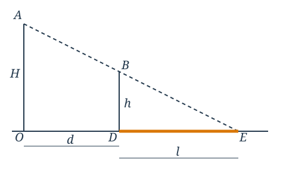

图中 AO=H，BD=h，OD=d，DE=l；橙色段表示这里讨论的地面盲段。

### 4. 堆方块：俯视记占位，侧视记最高 {#cube-columns .exam-title}

对于从地面逐层堆成、各柱没有空洞或悬空的小正方体模型，在俯视每格标该柱高度：空格0，非空格为正整数。

| 信息 | 限制什么 |
| --- | --- |
| 俯视图 | 哪些位置非空，不直接给总块数 |
| 主视图 | 每个左右列中，最高柱的高度 |
| 左视图 | 每个前后排中，最高柱的高度 |
| 总块数 | 所有柱高之和 |

投影使不同深度的方块重叠，所以外顶轮廓由最高柱控制。求最多时，先给每格上界，再构造同时满足所有视图的摆法；没有给出的第三视图不能擅自补上。即使有三个视图，也不保证任意复杂堆形都唯一，必须实际检验约束。

### 5. 识别光线模型：连真实对应点 {#identify .exam-title}

先找物顶与它对应的影端，再连至少两条独立投影线。平行或共点必须能解释全部已给物影，不能只凭影长、影大小猜光源；生活题则按题目约定的理想光线模型归类。

<article class="handbook-example" aria-labelledby="example-1">

#### 例题 01 七种生活中的影 知识清单例题 {#example-1 .example-heading}

题目

下列现象中,属于中心投影的是

①太阳光下窗户的影子；②台灯下书本的影子；③手电筒照射下纸片的影子；④晚上路灯下人的影子；⑤阳光下旗杆的影子；⑥皮影戏中的影子；⑦日晷的晷针在晷面上形成的影子.

答案与解析

解析

①⑤⑦使用同地同刻太阳平行光模型。②③④⑥在本题中把灯光近似为从一点发出的光线，属于中心投影。实际灯具有尺寸，手电筒也有光学结构；这里判断的是题目采用的模型，不是对所有实际光束无条件分类。

本题结论

②③④⑥。

</article>

<article class="handbook-example" aria-labelledby="example-2">

#### 例题 02 桌面与地面的对应边界 知识清单例题 {#example-2 .example-heading}

题目

如图,AB 表示一圆形桌面,MN 表示该桌面在某光源下的影子,则 MN 属于____投影.(填“平行”或“中心”)

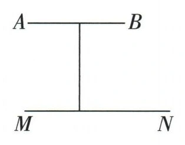

答案与解析

解析

连接 $MA,NB$ 并反向延长，两线相交于同一点，能作为点光源的位置，所以属于中心投影。

桌面与地面平行，若是平行光，各点只沿统一方向跨相同高度移动，桌面投影不会像图中那样放大。这里应以对应线共点为主要依据，不把任何“影变大”都当成充分判据。

本题结论

中心投影。

</article>

### 6. 画影：平行光复制方向，点光先找中心 {#draw-shadow .exam-title}

太阳光题由一组已知物影确定方向，过新物顶作平行线；点光源题先用两组对应点确定光源，再让光线经过新物顶。交点须在指定投影面上，最后标的是物脚至影端的影段，不是整条光线。

<article class="handbook-example" aria-labelledby="example-3">

#### 例题 03 同一时刻的另一根立柱 知识清单例题 {#example-3 .example-heading}

题目

如图, 已知 AB 和 DE 是直立在地面上的两根立柱, AB = 50 cm, 某一时刻 AB 在阳光下的投影 BC = 30 cm, 请在图中画出此时 DE 在阳光下的投影.

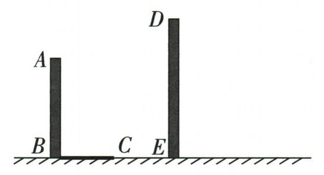

答案与解析

解析

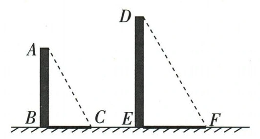

连接 $AC$，得到太阳光线的方向。过 $D$ 作 $AC$ 的平行线，交地面于 $F$，则 $EF$ 是 $DE$ 的影。

原题未给 $DE$ 长度，要求是作图，不需也不能自补其影长。已知 $AB/BC=50/30=5/3$ 只用于核对共同高影比。

本题结论

所作线与地面交于F，影为线段EF。

</article>

<article class="handbook-example" aria-labelledby="example-4">

#### 例题 04 先定位路灯，再画第三根标杆的影 知识清单例题 {#example-4 .example-heading}

题目

如图,电线杆上方有一盏路灯 O,电线杆与三个等高的标杆整齐地排列在马路的一侧,AB、CD、EF 是三个标杆,BM、DN 分别是标杆 AB、CD 在路灯下的影子.

(1)请画出路灯 O 的位置。(2)画出标杆 EF 在路灯下的影子 FH.

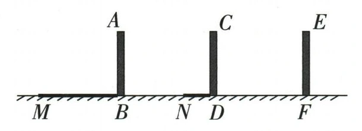

答案与解析

解析

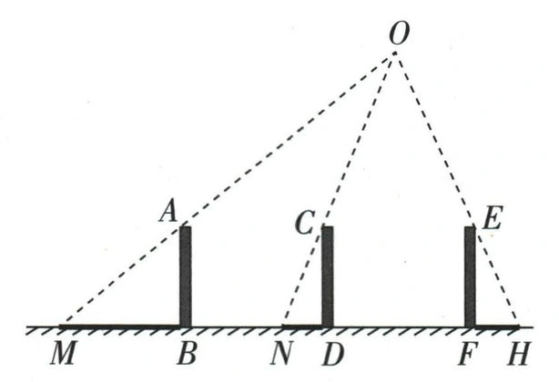

（1）连接 $MA,NC$，从影端经过物顶向上反向延长，两线的交点就是 $O$。

（2）连接 $OE$ 并按光传播方向延长，与地面交于 $H$，则 $FH$ 为第三根标杆的影。$O,E,H$ 共线用于确定影端，但影长不是 $OH$。只有一组对应点时通常不能唯一定位灯，需要两条独立相交的线。

本题结论

（1）两反向延长线交点O；（2）影为FH。

</article>

### 7. 地影接墙影：求的是高度差还是全高 {#wall-shadow .exam-title}

过墙上影端作水平线，找到与已知水平距离配对的竖直落差，再用共同高影比。最后明确题目求物体全高还是墙上剩余影高：前者常要加，后者常要从全高减去。

<article class="handbook-example" aria-labelledby="example-5">

#### 例题 05 旗杆的影分落地面和墙面 知识清单例题 {#example-5 .example-heading}

题目

如图,某一时刻在旗杆旁测得1米长的竹竿竖直放置时影长为1.5米,在同一时刻测量旗杆的影长时,因旗杆靠近一幢楼,影子有一部分落在墙上,测得落在地面上的影长为21米,落在墙上的影长为2米,则旗杆的高度为____米.

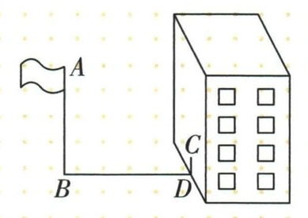

答案与解析

解析

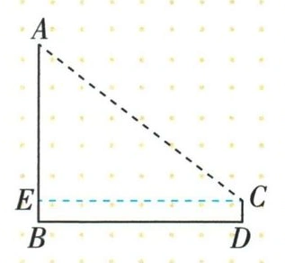

过 $C$ 作 $CE\parallel BD$，交旗杆于 $E$。由矩形关系，$CE=BD=21$ 米，$EB=CD=2$ 米。

共同光线倾角给出 $AE/CE=1/1.5$，所以 $AE=21/1.5=14$ 米。所求全高 $AB=AE+EB=14+2=16$ 米。不能先把地影21和墙影2加成23，再把折线长度当作水平影。

本题结论

16米。

</article>

<article class="handbook-example" aria-labelledby="example-6">

#### 例题 06 从楼高减去光线下降的高度 知识清单例题 {#example-6 .example-heading}

题目

如图,甲楼 AB 高 18 米,乙楼 CD 坐落在甲楼的正北面,两楼相距 20 米,已知当地某天中午 12:00 时,物高与影长的比是 $1:\sqrt{2}$ ,求甲楼的影子落在乙楼上的高度.(结果保留根号)

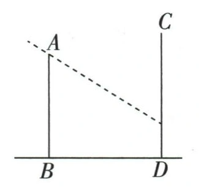

答案与解析

解析

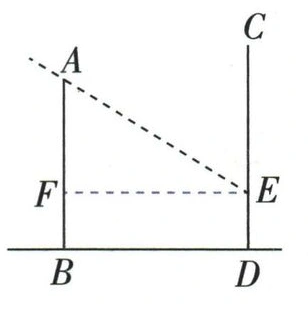

按题图，甲楼顶部 $A$ 的影落在乙墙 $E$。作 $EF\perp AB$，则 $EF=20$ 米。共同高影比给出 $AF/EF=1/\sqrt2$，所以 $AF=10\sqrt2$ 米。

墙影高 $DE=FB=AB-AF=18-10\sqrt2$ 米，为正且小于甲楼高度。题目已给当天的影向与高影比，不单凭“12:00”自行推断太阳方位；结论还依图示乙墙包含交点 $E$。

本题结论

$(18-10\sqrt2)$ 米。

</article>

### 8. 同一盏灯的两个位置，消去同一个灯高 {#two-positions .exam-title}

每个位置分别写“小高/大高=小影/从灯脚到影端的总距”。两次灯高、身高相同，可令两个比相等。特别注意第二次脚距已经改变，分母还要再加第二次影长。

<article class="handbook-example" aria-labelledby="example-7">

#### 例题 07 走远五米后的影长 知识清单例题 {#example-7 .example-heading}

题目

如图,有一路灯 AB,在灯光下,大华在 D 点处的影长 DE=3 米,沿 BD 方向走到 G 点, DG=5 米,这时大华的影长 GH=5 米.如果大华的身高为 2 米,求路灯 AB 的高度.

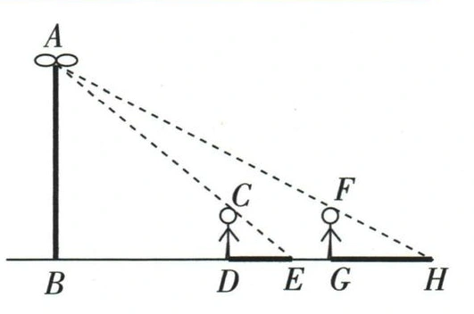

答案与解析

解析

设 $AB=H$ 米、$BD=x>0$ 米。由两组相似三角形，

$$\frac2H=\frac3{x+3},\qquad \frac2H=\frac5{x+5+5}.$$

因此 $3(x+10)=5(x+3)$，解得 $x=7.5$。代入 $2/H=3/10.5$，得 $H=7$。

检验：灯高7大于身高2，脚距均为正；第二位置满足 $2/7=5/17.5$，与原影长一致。

本题结论

路灯高7米。

</article>

### 9. 平行平面上的中心投影，统一比较对应总距 {#plane-scale .exam-title}

平行纸板与投影面形成位似。先把“光源到原物体上对应点”与“光源到影点”的总距对应起来，再求边倍率；面积倍率是边倍率的平方。同高平移时倍率不变，只能推出影的大小不变，不能推出影的位置不变。

<article class="handbook-example" aria-labelledby="example-8">

#### 例题 08 相邻两段的比不是对应总距比 2024四川凉山州 {#example-8 .example-heading}

题目

（2024四川凉山州）如图，一块面积为 $60~\mathrm{cm}^2$ 的三角形硬纸板（记为 $\triangle ABC$ )平行于投影面时，在点光源 $O$ 的照射下形成的投影是 $\triangle A_{1}B_{1}C_{1}$ ，若 $OB:BB_{1} = 2:3$ ，则 $\triangle A_{1}B_{1}C_{1}$ 的面积是 （）

A. $90 \mathrm{~cm}^{2}$

B. $135 \mathrm{~cm}^{2}$

C. $150 \mathrm{~cm}^{2}$

D. $375 \mathrm{~cm}^{2}$

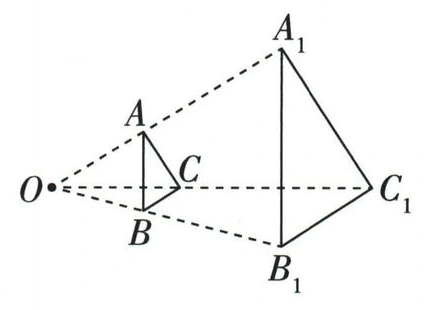

答案与解析

解析

按图 $O,B,B_1$ 依次共线，$OB:BB_1=2:3$，故 $OB:OB_1=2:(2+3)=2:5$。两图位似，影与原图的边比为 $5/2$，面积比为 $25/4$，所以影面积 $60\times25/4=375$ 平方厘米。

A把分段比直接当面积比；B把错误的分段边比平方；C用了正确边比却漏平方。只有D符合面积关系。

本题结论

D，$375\ \mathrm{cm}^2$。

</article>

<article class="handbook-example" aria-labelledby="example-9">

#### 例题 09 同高平移铅笔，影长为什么不变 2023江苏南京节选 {#example-9 .example-heading}

题目

(2023 江苏南京节选) 如图, 玻璃桌面与地面平行, 桌面上有一盏台灯和一支铅笔, 点光源 O 与铅笔 AB 所确定的平面垂直于桌面. 在灯光照射下, AB 在地面上形成的影子为 CD (不计折射), $AB \parallel CD$ . 在桌面上沿着 AB 方向平移铅笔, 试说明 CD 的长度不变.

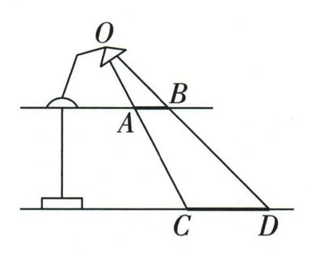

答案与解析

解析

设铅笔平移至 $EF$，影为 $MN$。两组相似关系给出

$$\frac{AB}{CD}=\frac{OB}{OD},\qquad \frac{EF}{MN}=\frac{OE}{OM}.$$

桌面与地面平行且高度固定，所以从同一光源出发的各射线截得的对应总距比相同，$OB/OD=OE/OM$。于是 $AB/CD=EF/MN$。平移保持 $EF=AB>0$，约去这一共同长度，得 $MN=CD$。

证明的是影的长度不变，端点位置通常会移动；若升高、倾斜铅笔或移动灯，固定比例的前提不再成立。

本题结论

平移前后影长相等。

</article>

### 10. 选视图：方向、轮廓、虚实逐项检查 {#identify-view .exam-title}

先锁定题问的主、俯、左视方向，再看外轮廓，最后逐条检查内部棱是否可见。选择题要用同一组标准排除每个选项，不能只看某个外形相似就停下。

<article class="handbook-example" aria-labelledby="example-10">

#### 例题 10 杯口平行于投影面 知识清单例题 {#example-10 .example-heading}

题目

如图所示,水杯的杯口与投影面平行,太阳光线的方向如箭头所示,它的正投影是（）

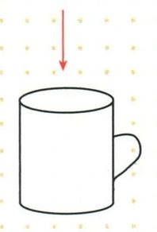

<figure class="handbook-option">

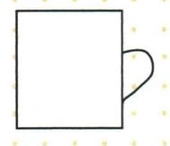

<figcaption>A</figcaption>

</figure>

<figure class="handbook-option">

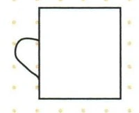

<figcaption>B</figcaption>

</figure>

<figure class="handbook-option">

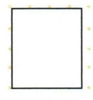

<figcaption>C</figcaption>

</figure>

<figure class="handbook-option">

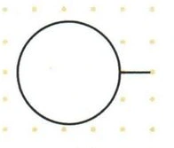

<figcaption>D</figcaption>

</figure>

答案与解析

解析

杯口平行于投影面，而光线垂直投影面，相当于从杯口正上方看。圆口保持为圆，右侧杯把投影为外侧短线，选D。

A、B是矩形侧面轮廓，分别把杯把画在右、左；C不是圆口且漏杯把。

本题结论

D。

</article>

<article class="handbook-example" aria-labelledby="example-11">

#### 例题 11 顶部封闭的机器零件 知识清单例题 {#example-11 .example-heading}

题目

一个机器零件如图水平放置,它的俯视图是

( )

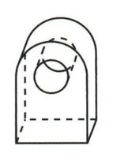

<figure class="handbook-option">

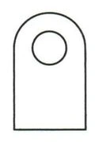

<figcaption>A</figcaption>

</figure>

<figure class="handbook-option">

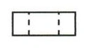

<figcaption>B</figcaption>

</figure>

<figure class="handbook-option">

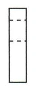

<figcaption>C</figcaption>

</figure>

<figure class="handbook-option">

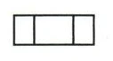

<figcaption>D</figcaption>

</figure>

答案与解析

解析

从上往下，外轮廓为横向矩形。孔边被顶部实体遮挡，对应两条纵向虚线，所以B正确。

A为带孔的正面轮廓；C将外轮廓和孔线旋转了方向；D把隐藏孔边画成实线。

本题结论

B。

</article>

<article class="handbook-example" aria-labelledby="example-12">

#### 例题 12 包装盒的主视图 2024河南 {#example-12 .example-heading}

题目

（2024 河南）信阳毛尖是中国十大名茶之一.如图是信阳毛尖茶叶的包装盒,它的主视图为()

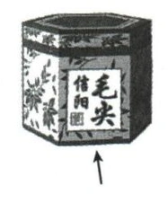

<figure class="handbook-option">

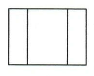

<figcaption>A</figcaption>

</figure>

<figure class="handbook-option">

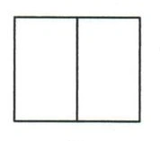

<figcaption>B</figcaption>

</figure>

<figure class="handbook-option">

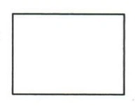

<figcaption>C</figcaption>

</figure>

<figure class="handbook-option">

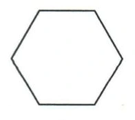

<figcaption>D</figcaption>

</figure>

答案与解析

解析

按箭头从正面观察，能看到中间与两侧共三个矩形面，投影中应保留两个内部棱的分界，选A。

B仅有两段，漏一条分界；C仅画外矩形，漏内部棱；D为底面六边形，是俯视方向。包装文字和颜色不作为几何棱投影。

本题结论

A。

</article>

### 11. 由三视图反推组合体，再核共同尺寸 {#restore .exam-title}

先按轮廓把组合体拆成上、下或前、后部件，再用另两图检查猜想。圆直径是否等于底座宽、上下是否同宽，都是判断条件。只能在给定条件或选项范围内认定，不能把任意三视图都当作唯一还原复杂实体的保证。

<article class="handbook-example" aria-labelledby="example-13">

#### 例题 13 圆与矩形组成的三个视图 知识清单例题 {#example-13 .example-heading}

题目

下图是某几何体的三视图,则这个几何体是

( )

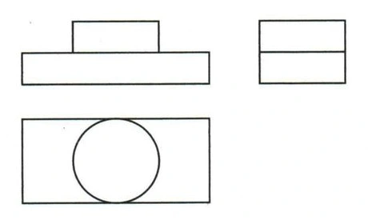

<figure class="handbook-option">

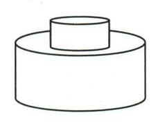

<figcaption>A</figcaption>

</figure>

<figure class="handbook-option">

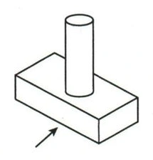

<figcaption>B</figcaption>

</figure>

<figure class="handbook-option">

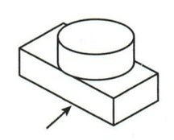

<figcaption>C</figcaption>

</figure>

<figure class="handbook-option">

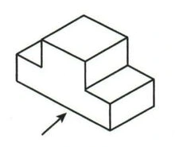

<figcaption>D</figcaption>

</figure>

答案与解析

解析

俯视外轮廓是矩形，内部为圆；结合主视，可把下部还原为长方体、上部还原为圆柱。左视上下同宽，说明圆柱底面直径等于长方体的宽，C同时符合三图。

A的底座也是圆柱，俯视应为同心圆而非外矩形；B的圆柱太细，左视上部应较窄；D的上部是棱柱，俯视没有圆。

本题结论

C。

</article>

### 12. 画三视图：先统一尺度，再逐棱判遮挡 {#draw-views .exam-title}

先画主视图确定长、高，再在下方画俯视图保持长对正，在右方画左视图保持高平齐，最后核俯、左宽相等。沿每个方向逐条核对棱：可见画实线，被遮挡画虚线。作图后反推一下，检查是否漏掉台阶、槽底或分层。

<article class="handbook-example" aria-labelledby="example-14">

#### 例题 14 中部凸起物体的三视图 知识清单例题，原正确图与错图均保留 {#example-14 .example-heading}

题目

如图,画出该物体的三视图.

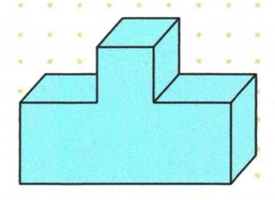

答案与解析

解析

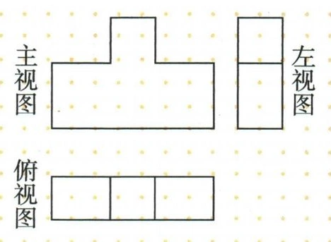

主视轮廓中间高、两侧低；左视为矩形，底层与凸块之间有可见的水平分界；俯视外轮廓为矩形，中部凸块左右两条边从上方可见，应画实线。

下面是常见错误图：左视漏分层，俯视把可见台阶边误画成虚线。

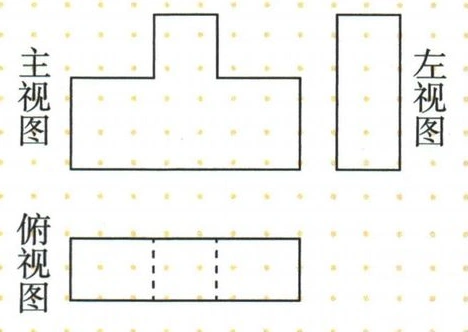

本题结论

正确三视图如解析首图；可见分层及台阶边均用实线。

</article>

<article class="handbook-example" aria-labelledby="example-15">

#### 例题 15 槽形物体的三视图 知识清单例题 {#example-15 .example-heading}

题目

如图,画出该物体的三视图.

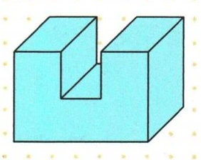

答案与解析

解析

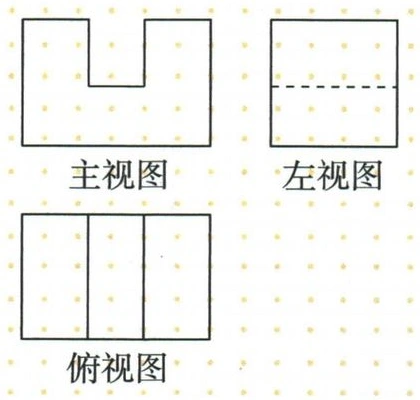

按前方观察，主视为U形；左视看到外侧壁的矩形，槽底横边被侧壁遮住，画虚线；俯视外矩形中的两条槽口边可见，画实线。

主、俯左右长度一致；主、左高度一致；俯、左前后宽度一致，槽宽和侧壁厚度也须在对应图中一致，不能任意拉伸。

本题结论

三视图如解析图，左视槽底为虚线，俯视槽口边为实线。

</article>

### 13. 堆块计数：把视图约束落到每个格子 {#count-cubes .exam-title}

先在俯视图非空格填至少1，再用主视的列最高和左视的排最高约束柱高。若问最多，给出上界后还要摆出达到上界的方案；若三图恰好确定唯一布局，要说明哪个格能加块、哪个格不能。

<article class="handbook-example" aria-labelledby="example-16">

#### 例题 16 三个视图共同确定块数 知识清单例题 {#example-16 .example-heading}

题目

由若干个相同的小正方体搭成一个几何体,从不同角度观察该几何体所得到的平面图形如图所示,求搭成这个几何体所用小正方体的个数.

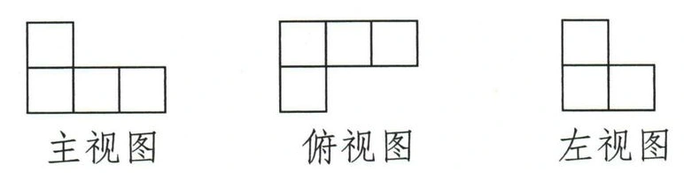

答案与解析

解析

俯视给出四个非空位置，各先有1块。主视要求左列最高2，其余列最高1；左视要求后排最高2、前排最高1。

只有后排左格能够加第2块：前排左格受左视限制不能加，另两列受主视限制不能加。四柱高度依次为2、1、1、1，总块数为5。重投三个方向均符合原图。

本题结论

5个。

</article>

<article class="handbook-example" aria-labelledby="example-17">

#### 例题 17 只给两个视图，求最多块数 知识清单例题 {#example-17 .example-heading}

题目

一个几何体由若干个大小相同的小正方体组成,它的俯视图和左视图如图所示,则组成该几何体所需小正方体的个数最多为____.

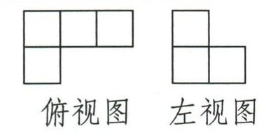

答案与解析

解析

后排有三柱，由左视可知各柱不超过2；前排一柱不超过1，因此总数至多 $3\times2+1=7$。

取后排各高2、前排高1，俯视仍是原四格，左视仍是后2前1，所以上界能够达到。俯视标数如下，空白处没有方块：

| 2 | 2 | 2 |
| --- | --- | --- |
| 1 |  |  |

这里没有主视图，不能额外限制某个左右列只能高1。7是最大值，不是说全部合法堆形都恰有7块。后排三柱中至少一柱高2，其余非空柱至少高1，加上前排的1块，最少为5块。后排恰有一、二、三柱高2时，总数分别为5、6、7，三种块数都能实现。

本题结论

最多7个。

</article>

### 14. 从视图求体积，分清面内的高与立体的高 {#volume .exam-title}

先还原基本体，再把图上的每个尺寸放回实际对象。棱柱体积等于底面积乘两平行底面之间的距离；三角形底面自身的高不是棱柱的高，两者不能混用。

<article class="handbook-example" aria-labelledby="example-18">

#### 例题 18 三个视图中的两个“高” 知识清单例题 {#example-18 .example-heading}

题目

如图所示的是一个几何体的三视图,求该几何体的体积.

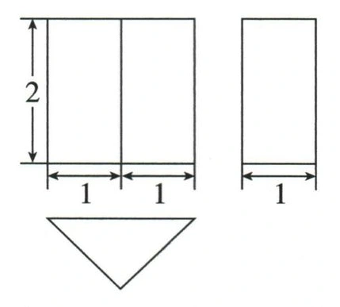

答案与解析

解析

俯视给出等腰三角形底面，其底边为 $1+1=2$，对应高为1，所以底面积为 $2\times1/2=1$。

主、左视的共同竖高2是棱柱两底面间距，故体积 $V=1\times2=2$。它是三棱柱，不是三棱锥，不乘 $1/3$。体积用相应的立方长度单位表示。

本题结论

2立方长度单位。

</article>

## 【坑点】辨析条件与遮挡 {#pitfalls .handbook-section .is-pitfall}

### 1. 等影长与距离变化，不能只看一段 {#shadow-pit .pitfall-title}

先画物顶与影端的对应线，再判光源；移动题检查是否跨过灯脚，不能把前半段的变化当成全程。点光源下影长和影向要一起看。

<article class="handbook-example is-pitfall" aria-labelledby="pitfall-1">

#### 辨析 01 四组人影属于哪种投影 知识清单例题 {#pitfall-1 .example-heading}

题目

下列投影中,是中心投影的是____.

<figure class="handbook-option">

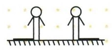

<figcaption>①</figcaption>

</figure>

<figure class="handbook-option">

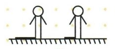

<figcaption>②</figcaption>

</figure>

<figure class="handbook-option">

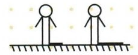

<figcaption>③</figcaption>

</figure>

<figure class="handbook-option">

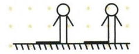

<figcaption>④</figcaption>

</figure>

答案与解析

解析

①②③中，把各人的顶端与对应影端连线，反向延长后可交于同一点，属于中心投影。③虽影长相等，但人物位于灯脚两侧等距离处，影向不同，仍可来自同一点光源。

④的对应投影线同向平行，为平行投影。影长相等不能单独作为排除中心投影的依据。

本题结论

①②③。

</article>

<article class="handbook-example is-pitfall" aria-labelledby="pitfall-2">

#### 辨析 02 从路灯一侧走到另一侧 知识清单例题 {#pitfall-2 .example-heading}

题目

如图,晚上小亮在路灯下散步,在小亮由 A 处径直走到 B 处的这一过程中,他在地上的影子的变化情况是 ( )

A.逐渐变短

B.先变短后变长

C. 先变长后变短

D.逐渐变长

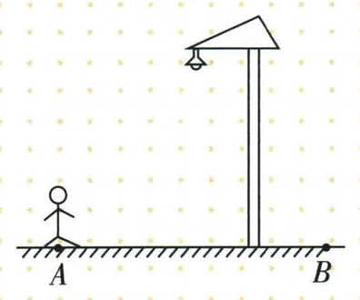

答案与解析

解析

从A接近灯脚，距离减小，影长减小；越过灯脚再到B，距离增大，影长增大，故选B。

A只描述前半程，D只描述后半程，C把先后顺序颠倒。简化为竖直线段的人在灯脚处影长为0，不能据此说真实人体的影完全消失。

本题结论

B，先变短后变长。

</article>

### 2. “正投影不增长”有自己的适用条件 {#orthogonal-pit .pitfall-title}

先检查投影线是否垂直于面。纸板倾斜后可变形，垂直侧立可退化；平行边在非退化投影下仍平行。不能把一个只对正投影成立的长度结论推广到全部阳光斜投影。

<article class="handbook-example is-pitfall" aria-labelledby="pitfall-3">

#### 辨析 03 四条关于纸板的说法 依据知识清单四条辨析改编，明确投影条件与梯形定义 {#pitfall-3 .example-heading}

题目

在平行光模型下，判断前三条说法；第（4）条先判断正投影条件下能否成立，再说明仅给阳光投影时能否直接使用正投影的不增长判据。

（1）矩形纸板的投影可能是一条线段。

（2）等边三角形木框的投影可能是腰与底边不相等的等腰三角形。

（3）平行四边形纸板的投影不可能是只有一组对边平行的等腰梯形。

（4）边长8的正方形纸板投影可能为长10、宽6的矩形。

答案与解析

解析

（1）正确。纸板侧立、其所在平面包含投影方向时，可以退化成线段。

（2）正确。保留底边方向，沿对称轴压缩高度，可保持左右对称而改变腰与底的关系。

（3）正确。非退化平行投影保持两组对边分别平行，不会变成只有一组对边平行的梯形；退化时不再是梯形。

（4）在正投影条件下不可能，因为原边长8，投影边不能增长到10。若只给“阳光投影”，未明确光线垂直投影面，就不能引用这一长度判据。这一判据要求正投影条件，不能当作所有斜投影的通用结论。

本题结论

（1）正确；（2）正确；（3）正确；（4）在正投影前提下错误，仅给阳光投影不能直接套“不增长”判据。

</article>

### 3. 槽口边与槽底边，不一定同为实线 {#hidden-edges-pit .pitfall-title}

开槽并不意味着槽内每条棱都能从上方看见。逐条比较上口、下口的位置，判断哪条棱被实体遮挡；先看空间位置，再决定实线或虚线。

<article class="handbook-example is-pitfall" aria-labelledby="pitfall-4">

#### 辨析 04 斜侧壁槽的俯视图 知识清单例题 {#pitfall-4 .example-heading}

题目

如图所示的几何体,其俯视
图是 ( )

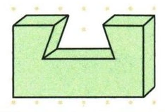

<figure class="handbook-option">

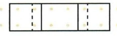

<figcaption>A</figcaption>

</figure>

<figure class="handbook-option">

<figcaption>B</figcaption>

</figure>

<figure class="handbook-option">

<figcaption>C</figcaption>

</figure>

<figure class="handbook-option">

<figcaption>D</figcaption>

</figure>

答案与解析

解析

从上方看，外轮廓是横矩形。上口较窄，两条上沿靠中间且可见，画实线；槽底向两外侧扩张，两条底边被上方实体遮住，画在外侧的虚线，A正确。

B把上口与底边的内外位置颠倒；C只有一侧正确；D漏掉两条隐藏底边。

本题结论

A。

</article>

### 4. 移动一块，不等于三个方向都改变 {#movement-pit .pitfall-title}

分别检查三个方向保留的信息：俯视非空位置是否变化，主、左视各列或各排的最高柱是否变化。总块数不变，并不能自动说明某个视图不变；必须按原布局逐向核对。

<article class="handbook-example is-pitfall" aria-labelledby="pitfall-5">

#### 辨析 05 把A放在B的正上方 2024山东日照 {#pitfall-5 .example-heading}

题目

（2024 山东日照）如图是由 5 个完全相同的小正方体搭成的几何体, 如果将小正方体 A 放置到小正方体 B 的正上方, 则它的三视图变化情况是 ( )

A. 主视图会发生改变

B. 左视图会发生改变

C.俯视图会发生改变

D.三种视图都会发生改变

答案与解析

解析

主视原来下层三格、上层位于中列；移动后下层不变，上层移到右列，主视改变，A正确。

从左看，各前后排的最高位置和高度不变，所以B错误。原A下方仍有底块，B原来所在位置也非空，俯视占位不变，所以C错误；D“三图都变”也错误。

本题结论

A，只有主视图发生改变。

</article>

