旋转要同时确定中心、方向和角度。先用等半径与共同转角寻找对应关系，再处理角度、长度和作图；180°半转另有“共同中点”这一简洁判据。

<nav class="handbook-nav" aria-label="本章分区">
  <a class="handbook-jump is-knowledge" href="#knowledge">01 · 知识点概念、关系与适用条件</a>
  <a class="handbook-jump is-exam" href="#exam">02 · 考点题目分类和例题</a>
  <a class="handbook-jump is-pitfall" href="#pitfalls">03 · 坑点辨析错因，检查遗漏</a>
</nav>

## 【知识点】概念与依据 {#knowledge .handbook-section .is-knowledge}

### 1. 旋转 {#definition .knowledge-title}

把图形绕一个固定点，按同一方向转过相同角度，叫作==旋转==。要说清旋转中心、方向和角度

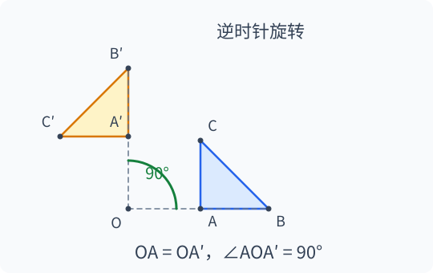

### 2. 旋转的性质 {#properties .knowledge-title}

1. 对应点到旋转中心的距离相等，如 $OA=OA'$
2. 各组对应点与中心所成的旋转角相同，如 $\angle AOA'=90^\circ$
3. 旋转前后图形全等，周长、面积不变

### 3. 旋转的轨迹 {#radius-chord-arc .knowledge-title}

一个点绕中心旋转，经过的路径是一段圆弧，半径为它到旋转中心的距离

转过 $n^\circ$，路程为 $l=\frac{n\pi r}{180}$；起点到终点的直线距离是弦长，与圆弧路程不同

### 4. 作旋转图形 {#construction-center .knowledge-title}

对每个顶点：连接中心 → 按指定方向转过指定角度 → 在新射线上截取相同距离 → 按原顺序连线

已知两图寻找旋转中心时，可以作两组对应点连线的中垂线，交点是候选中心，再核对转角

### 5. 绕原点旋转 90° {#quarter-turn .knowledge-title}

| 方向 | 点 $(x,y)$ 变为 |
| --- | --- |
| 逆时针 $90^\circ$ | $(-y,x)$ |
| 顺时针 $90^\circ$ | $(y,-x)$ |

### 6. 中心对称 {#central-symmetry .knowledge-title}

一个图形绕点 $O$ 旋转 $180^\circ$，与另一个图形重合，两图就关于 $O$==成中心对称==

若与自身重合，这个图形就是中心对称图形，如平行四边形、圆

### 7. 中心对称的坐标 {#half-turn-coordinates .knowledge-title}

对称中心是对应点连线的中点

- 关于原点：$(x,y)\to(-x,-y)$
- 关于 $C(h,k)$：$(x,y)\to(2h-x,2k-y)$

### 8. 三种变换的比较 {#compare .knowledge-title}

| 变换 | 确定什么 | 对应点的关系 |
| --- | --- | --- |
| 平移 | 方向、距离 | 沿同一方向移动相同距离 |
| 轴对称 | 对称轴 | 连线被对称轴垂直平分 |
| 旋转 | 中心、方向、角度 | 到中心等距，转过相同角度 |

## 【考点】先方法，后例题 {#exam .handbook-section .is-exam}

### 1. 过对称中心的直线为什么平分面积 {#bisect-area .exam-title}

中心对称图形绕中心半转后不变；任何过中心的直线半转后仍是它自身，却把两侧互换。半转保全等及面积，所以两侧总面积相等。

两侧可能各有几块，不一定各是一块三角形。只有“图形中心对称”和“截线经过同一中心”同时成立才有这个保证；面积相等也不能反推截线必过中心。

一般平行四边形的中心是两条对角线交点；等边三角形虽然有旋转对称，却不能180°重合，不是中心对称图形。

### 2. 认清图案中的对应部件 {#pattern .exam-title}

先明确哪一部分变成哪一部分，再看对应点的移动规律。整体可能同时具有多种对称，不能因为两个部件全等就随意指定变换。

<article class="handbook-example" aria-labelledby="example-1">

#### 例题 01 三种变换分别出现在哪里 知识清单例题 {#example-1 .example-heading}

题目

甲骨文是我国古代的一种文字,下列甲骨文中,能看作用其中一部分进行平移变换得到的是\_\_\_\_;能看作用其中一部分进行旋转变换得到的是\_\_\_\_;能看作用其中一部分进行轴对称变换得到的是\_\_\_\_.

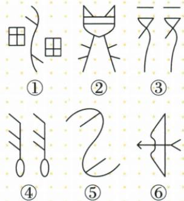

答案与解析

解析

③④的对应部件保持朝向，各点同向同距移动，可看作平移。①⑤的部件围绕共同位置转动，可用同中心同有向角对应。②⑥的部件沿一条轴翻折重合，可看作轴反射。这里依题图指定部件分类，并非说整个字形只能出现一种变换。

本题结论

平移：③④；旋转：①⑤；轴对称：②⑥。

</article>

### 3. 中心与转角明确后逐点作图 {#rotation-drawing .exam-title}

按“连中心、转方向、截等长、连像点”处理各顶点。核查一个顶点后，还要检查其余点同角度；不能把原三角形的角与转动角混在一起。

<article class="handbook-example" aria-labelledby="example-2">

#### 例题 02 绕O转动60° 知识清单例题 {#example-2 .example-heading}

题目

如图, 把 $\triangle AOB$ 绕点 O 按逆时针方向旋转 $60^{\circ}$ , 画出旋转后的图形 $\triangle A'OB'$ .

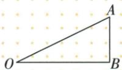

答案与解析

解析

$O$ 不动。从 $OA$ 逆时针作60°射线，取 $OA'=OA$；从 $OB$ 也逆时针作60°射线，取 $OB'=OB$，连接 $A'B'$。

应满足 $\angle AOA'=\angle BOB'=60^\circ$，不是要求 $\angle AOB'=60^\circ$。

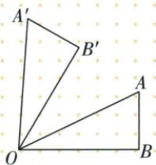

本题结论

旋转像为解析图中的三角形 A′OB′。

</article>

<article class="handbook-example" aria-labelledby="example-3">

#### 例题 03 在网格中找旋转中心 知识清单例题 {#example-3 .example-heading}

题目

如图,在 $4 \times 4$ 的正方形网格中, $\triangle MNP$ 绕某点旋转一定的角度后, 得到 $\triangle M_{1}N_{1}P_{1}$ , 则其旋转中心一定是 ( )

A.点 $E$

B.点 $F$

C. 点 $G$

D. 点 H

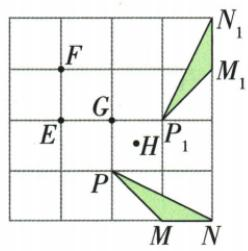

答案与解析

解析

按 $P\leftrightarrow P_1$、$M\leftrightarrow M_1$、$N\leftrightarrow N_1$ 配对。可作 $PP_1$ 与 $NN_1$ 的中垂线，交于 $G$。

复核 $GP=GP_1=1$ 格，$GP$ 逆时针90°到 $GP_1$，其他两对也同向转90°。候选 $E$ 到 $P,P_1$ 分别为 $\sqrt2,2$，不等；$F$ 到 $N,N_1$ 为 $\sqrt{18},\sqrt{10}$，不等；$H$ 到这两点的距离平方为4.5和8.5，也不等。

本题结论

选 C，旋转中心是 G。

</article>

### 4. 旋转求角：转角加等腰，再查射线顺序 {#angle-method .exam-title}

一对对应半径确定转角，另一对半径等长常形成等腰三角形。随后先标出各角顶点和射线所在位置，再决定相加、相减或用三角形内角和。

<article class="handbook-example" aria-labelledby="example-4">

#### 例题 04 点落在原边上时的角度 知识清单例题·合组，第（2）问为2024江苏无锡 {#example-4 .example-heading}

题目

（1）如图, 在 $\triangle ABC$ 中, $\angle ACB = 90^{\circ}$ , $\angle ABC = 40^{\circ}$ . 将 $\triangle ABC$ 绕点 $B$ 逆时针旋转得到 $\triangle A'BC'$ , 点 $C$ 的对应点 $C'$ 恰好落在边 $AB$ 上, 则 $\angle CAA'$ 的度数是 \_\_\_\_.

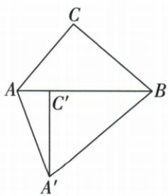

（2）（2024 江苏无锡）如图，在 $\triangle ABC$ 中， $\angle B = 80^{\circ}$ ， $\angle C = 65^{\circ}$ ，将 $\triangle ABC$ 绕点 A 逆时针旋转得到 $\triangle AB'C'$ 。当 $AB'$ 落在 AC 上时， $\angle BAC'$ 的度数为（）

A. $65^{\circ}$

B. $70^{\circ}$

C. $80^{\circ}$

D. $85^{\circ}$

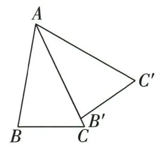

答案与解析

解析

（1）原 $\angle CAB=50^\circ$。$C'$ 在 $AB$ 上，故绕 $B$ 转40°；$BA=BA'$，所以 $\triangle BAA'$ 底角为70°。按图 $AC$ 与 $AA'$ 在 $AB$ 两侧，$\angle CAA'=50^\circ+70^\circ=120^\circ$。

（2）原 $\angle BAC=180^\circ-80^\circ-65^\circ=35^\circ$。$AB'$ 落在 $AC$ 上，转角35°，旋后顶角 $\angle B'AC'=35^\circ$。按图射线次序，$\angle BAC'=35^\circ+35^\circ=70^\circ$，选 B。

本题结论

（1）$120^\circ$；（2）$70^\circ$，选 B。

</article>

<article class="handbook-example" aria-labelledby="example-5">

#### 例题 05 利用转角确定垂直关系 知识清单例题 {#example-5 .example-heading}

题目

（2024天津）如图， $\triangle ABC$ 中， $\angle B = 30^{\circ}$ ，将 $\triangle ABC$ 绕点 $C$ 顺时针旋转 $60^{\circ}$ 得到 $\triangle DEC$ ，点 $A, B$ 的对应点分别为 $D, E$ ，延长 $BA$ 交 $DE$ 于点 $F$ ，下列结论一定正确的是 （）

A. $\angle ACB = \angle ACD$

B. $AC \parallel DE$

C.AB = EF

D. $BF \perp CE$

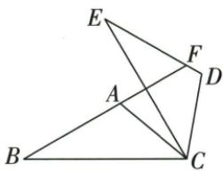

答案与解析

解析

设 $BF$ 与 $CE$ 交于 $O$。转动使 $\angle BCE=60^\circ$，又 $O$ 在图中 $BF,CE$ 的交点位置，$\triangle BCO$ 的另两角为30°和60°，所以 $\angle BOC=90^\circ$，即 $BF\perp CE$。

A项的 $\angle ACD$ 是60°转角，原 $\angle ACB$ 并未必为60°；B项没有足够角条件保证平行；C项真正保长的是 $AB=DE$，$F$ 不是 $B$ 的像，不能推出 $AB=EF$。

本题结论

一定正确的是 D。

</article>

### 5. 坐标旋转与连续变换 {#coordinate-method .exam-title}

绕原点时按方向交换变号；绕其他点时，先减中心、转相对位置、再加回中心。连续变换使用上一步的新点；若是互相独立的小问，应回到该问指定的原图。

<article class="handbook-example" aria-labelledby="example-6">

#### 例题 06 绕原点逆时针作像 知识清单例题 {#example-6 .example-heading}

题目

如图,在平面直角坐标系中,已知 $\triangle ABC$ 三个顶点的坐标分别是 $A(1,1),B(4,1),C(3,3)$ ,将 $\triangle ABC$ 绕原点 $O$ 逆时针旋转 $90^{\circ}$ 后得到 $\triangle A_{1}B_{1}C_{1}$ ,请画出 $\triangle A_{1}B_{1}C_{1}$ .

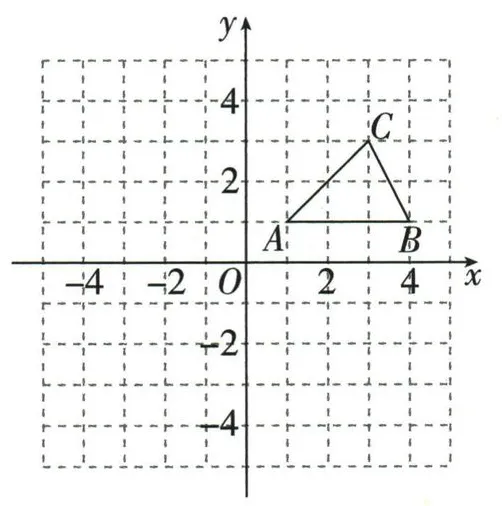

答案与解析

解析

逆时针90°使用 $(x,y)\mapsto(-y,x)$：

- $A(1,1)\to A_1(-1,1)$；
- $B(4,1)\to B_1(-1,4)$；
- $C(3,3)\to C_1(-3,3)$。

在网格中标点并依次连接，距离保持且方向一致。

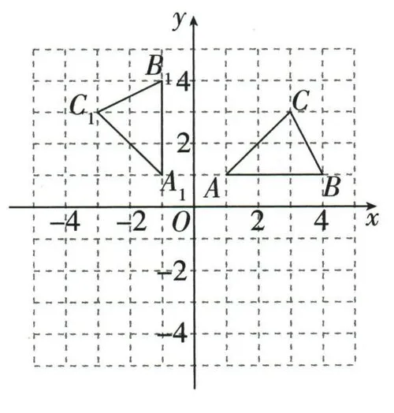

本题结论

像点为 $A_1(-1,1)$、$B_1(-1,4)$、$C_1(-3,3)$，作图见解析。

</article>

<article class="handbook-example" aria-labelledby="example-7">

#### 例题 07 先平移，再绕新顶点转动 知识清单例题 {#example-7 .example-heading}

题目

(2024 山东济宁) 如图, $\triangle ABC$ 三个顶点的坐标分别是 $A(1,3)$ ,

$B(3,4), C(1,4).$

(1) 将 $\triangle ABC$ 向下平移 2 个单位长度得 $\triangle A_{1}B_{1}C_{1}$ ，画出平移后的图形，并直接写出点 $B_{1}$ 的坐标.

(2) 将 $\triangle A_{1}B_{1}C_{1}$ 绕点 $B_{1}$ 逆时针旋转 $90^{\circ}$ 得 $\triangle A_{2}B_{1}C_{2}$ ，画出旋转后的图形，并求点 $C_{1}$ 运动到点 $C_{2}$ 所经过的路径长.

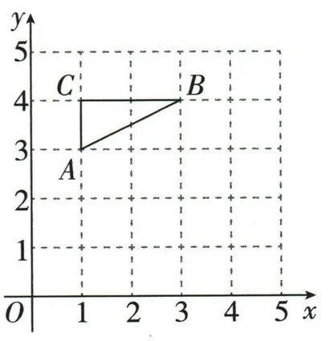

答案与解析

解析

（1）纵坐标减2：$A_1(1,1)$、$B_1(3,2)$、$C_1(1,2)$。

（2）以 $B_1(3,2)$ 为中心。$A_1$ 的相对坐标 $(-2,-1)$ 逆转后为 $(1,-2)$，加回中心得 $A_2(4,0)$。$C_1$ 的相对坐标 $(-2,0)$ 逆转后为 $(0,-2)$，得 $C_2(3,0)$；中心 $B_1$ 不动。

$C_1$ 到中心的距离是2，实际转90°，路径是四分之一圆弧，长为 $\frac{90\pi\times2}{180}=\pi$。

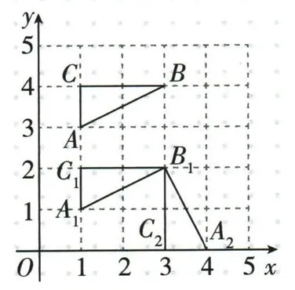

本题结论

（1）$B_1(3,2)$，平移图如解析；（2）旋转图如解析，$A_2(4,0)$、$C_2(3,0)$，所求路径长为 $\pi$。

</article>

### 6. 借旋转把分散的线段放进同一三角形 {#transfer .exam-title}

等边或特殊等腰给出自然转角。把一条分散的线段随图旋转到目标位置，利用 SAS 证明对应，再通过额外角条件形成直角，或把两段拼接为一条线段。保长不能代替角和点序的证明。

<article class="handbook-example" aria-labelledby="example-8">

#### 例题 08 等边三角形内的60°旋转 知识清单例题 {#example-8 .example-heading}

题目

如图,在等边三角形 ABC 中有一点 P, 连接 PA、PB、PC, 将 BP 绕点 B 逆时针旋转 $60^{\circ}$ 得到 BD, 连接 PD、AD, 有下列结论: ① $\triangle BPC \cong \triangle BDA$ ; ② $\triangle BDP$ 是等边三角形; ③ 如果 $\angle BPC = 150^{\circ}$ , 那么 $PA^{2} = PB^{2} + PC^{2}$ . 其中正确的有 ( )

A.①②

B.①③

C.②③

D.①②③

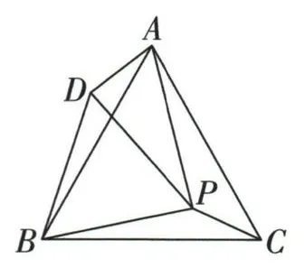

答案与解析

解析

旋转给 $BP=BD$、$\angle PBD=60^\circ$，所以 $\triangle BPD$ 等边，②正确。

$BC=BA$，且 $\angle PBC=\angle DBA$：两角均为原60°减去 $\angle PBA$。由 SAS 得 $\triangle BPC\cong\triangle BDA$，①正确，并得 $AD=PC$、$\angle BDA=\angle BPC$。

在本问另加 $\angle BPC=150^\circ$ 的条件下，用图中射线次序得 $\angle PDA=150^\circ-60^\circ=90^\circ$。于是

$$PA^2=PD^2+AD^2=PB^2+PC^2,$$

③也正确。没有150°条件，不能对任意内部点直接使用这个平方和。

本题结论

①②③都正确，选 D。

</article>

<article class="handbook-example" aria-labelledby="example-9">

#### 例题 09 旋转后拼接两段长度 知识清单例题·改编，明确图示点序 {#example-9 .example-heading}

题目

如图，$\triangle ABC$ 为等边三角形。$D$ 在直线 $BC$ 的另一侧，与 $A$ 异侧，$BD=CD$，$\angle BDC=120^\circ$。以 $D$ 为顶点作60°角，两边分别交线段 $AB,AC$ 的内部于 $M,N$。猜想 $BM,MN,NC$ 的关系，并证明。

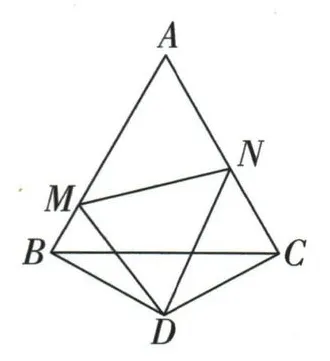

答案与解析

解析

由等腰和等边，$\angle DBC=\angle DCB=30^\circ$，所以 $\angle DBM=\angle DCN=90^\circ$。

将 $\triangle DBM$ 绕 $D$ 顺时针120°到 $\triangle DCE$，得 $CE=BM$、$DE=DM$、$\angle DCE=90^\circ$。按旋转后的方向，$N,C,E$ 依次共线。

$\angle MDE=120^\circ$，$DN$ 在其中且 $\angle MDN=60^\circ$，故 $\angle NDE=60^\circ$。由 $DM=DE$、$DN$ 公共及夹角相等，SAS 得 $\triangle DMN\cong\triangle DEN$。所以

$$MN=EN=NC+CE=NC+BM.$$

这依赖 $D$ 的外侧位置、$M,N$ 在线段内部；位置改变时须重新判断角和点序。

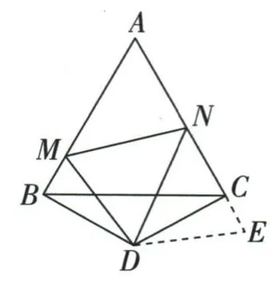

本题结论

$MN=BM+NC$。

</article>

### 7. 半转作图与找共同中点 {#half-turn-drawing .exam-title}

已知中心时，把原来的点与中心连接并越过中心，截取相等距离作像；求中心时先按字母顺序找对应点，取中点并复核其他对应点，不随意更换配对。

<article class="handbook-example" aria-labelledby="example-10">

#### 例题 10 作半转像与定位中心 知识清单例题·合组 {#example-10 .example-heading}

题目

（1）如图, 已知 $\triangle ABC$ 和 $\triangle ABC$ 外一点 O, 作 $\triangle A'B'C'$ , 使其与 $\triangle ABC$ 关于点 O 成中心对称.

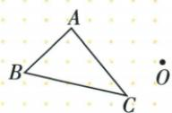

（2）如图所示,已知 $\triangle ABC$ 和与其成中心对称的图形 $\triangle EFD$ ,请画图确定对称中心.

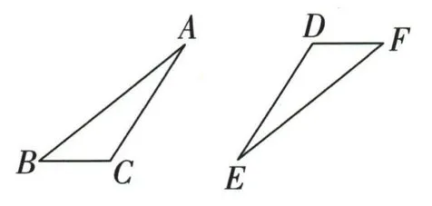

答案与解析

解析

（1）连 $AO$ 并越过 $O$ 延长，取 $OA'=OA$；$B,C$ 同法作 $B',C'$，按原顺序连接。每对点连线都被 $O$ 平分。

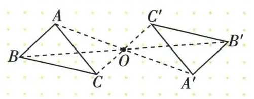

（2）对应关系为 $A\leftrightarrow E$、$B\leftrightarrow F$、$C\leftrightarrow D$。连 $AE,CD$，本图两线交于 $O$，再核 $O$ 平分两线段及 $BF$。也可先取 $AE$ 中点再复核。若对应连线重合，应使用中点，不能任取交点。

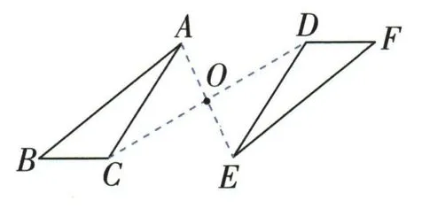

本题结论

（1）三角形 A′B′C′ 如解析图；（2）共同中点 O 为对称中心。

</article>

### 8. 中心坐标与综合作图 {#half-turn-method .exam-title}

由中心是对应点中点，分别列横纵坐标和。面积与角平分线等后续小问仍应各自指出几何依据，不能只凭网格看起来像。

<article class="handbook-example" aria-labelledby="example-11">

#### 例题 11 原点对称的参数与选择 知识清单例题·合组 {#example-11 .example-heading}

题目

（1）若 $P(2,n)$ 与 $Q(m,-3)$ 关于坐标原点对称，求 $m+n$。

（2）（2024 四川成都）$P(1,-4)$ 关于坐标原点对称的点是哪一个？

A. $(-1,-4)$

B. $(-1,4)$

C. $(1,4)$

D. $(1,-4)$

答案与解析

解析

（1）对应坐标互为相反数，$m=-2$、$n=3$，和为1。

（2）两坐标同时变号，得到 $(-1,4)$，选B。A只改横坐标，是 $y$ 轴反射；C只改纵坐标，是 $x$ 轴反射；D未改变非中心点，不是本次半转。

本题结论

（1）1；（2）B。

</article>

<article class="handbook-example" aria-labelledby="example-12">

#### 例题 12 分别完成两种旋转 知识清单例题 {#example-12 .example-heading}

题目

在如图所示的正方形网格中有 Rt△ABC, ∠C=90°, AC=4, BC=3.

(1)试在图中作出将 $\triangle ABC$ 以点A为旋转中心,沿顺时针方向旋转90°后的图形 $\triangle AB_{1}C_{1}$ .  
(2) 若点 B 的坐标为 $(-4, 4)$ ，试在图中作出平面直角坐标系，并标出 A、C 两点的坐标.  
(3)根据(2)中的平面直角坐标系作出与 $\triangle ABC$ 关于原点对称的图形 $\triangle A_{2}B_{2}C_{2}$ , 并标出 $B_{2}, C_{2}$ 两点的坐标.

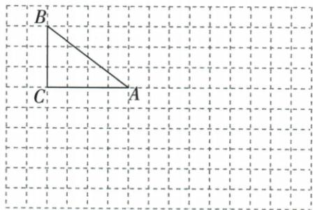

答案与解析

解析

（1）以 $A$ 为固定中心，$AB,AC$ 同时顺时针转90°并截等长，得到解析图 $AB_1C_1$。

（2）由 $B(-4,4)$，沿格线向右4、向下4定位坐标原点，画出坐标轴。$C$ 在 $B$ 下方3格，故 $C(-4,1)$；$A$ 在 $C$ 右方4格，故 $A(0,1)$。

用坐标复核（1）：$B$ 相对 $A$ 为 $(-4,3)$，顺转后为 $(3,4)$，得 $B_1(3,5)$；$C$ 相对 $A$ 为 $(-4,0)$，得 $C_1(0,5)$。

（3）此问从原三角形出发，关于原点半转：$A_2(0,-1)$、$B_2(4,-4)$、$C_2(4,-1)$，并依次连接。不是再对第（1）问的新三角形继续转动。

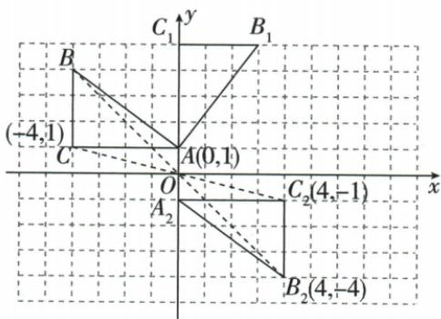

本题结论

（1）$AB_1C_1$ 如图；（2）$A(0,1)$、$C(-4,1)$；（3）$B_2(4,-4)$、$C_2(4,-1)$，完整像如图。

</article>

<article class="handbook-example" aria-labelledby="example-13">

#### 例题 13 非原点中心、面积与角平分线 知识清单例题 {#example-13 .example-heading}

题目

（2024 安徽）如图，在由边长为 1 个单位长度的小正方形组成的网格中建立平面直角坐标系 $xOy$ ，格点（网格线的交点） $A, B, C, D$ 的坐标分别为 $(7,8), (2,8), (10,4), (5,4)$ .

(1)以点 D 为旋转中心, 将 $\triangle ABC$ 旋转 $180^{\circ}$ 得到 $\triangle A_{1}B_{1}C_{1}$ , 画出 $\triangle A_{1}B_{1}C_{1}$ .  
(2) 直接写出以 $B, C_{1}, B_{1}, C$ 为顶点的四边形的面积.  
(3)在所给的网格图中确定一个格点 E, 使得射线 AE 平分 $\angle BAC$ , 写出点 E 的坐标.

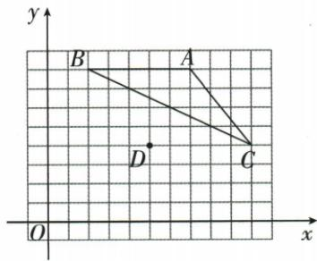

答案与解析

解析

（1）中心 $D(5,4)$，对应坐标和分别为10与8，因此 $A_1(3,0)$、$B_1(8,0)$、$C_1(0,4)$。

（2）四边形按 $B,C_1,B_1,C$ 顺序连接。水平对角线 $C_1C$ 长10，$B,B_1$ 到其所在直线 $y=4$ 的距离各4，两三角形面积和为 $\frac12\times10\times4\times2=40$。

（3）$AB=AC=BD=CD=5$，故四边形 $ABDC$ 是菱形，对角线 $AD$ 平分 $\angle BAC$。可取格点 $E=D(5,4)$，也可取射线 $AD$ 上的 $(6,6)$、$(4,2)$、$(3,0)$。点 $E$ 不能取 $A$ 自身。

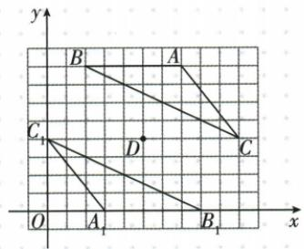

本题结论

（1）像点 $(3,0)$、$(8,0)$、$(0,4)$，作图如解析；（2）面积 $40$；（3）例如 $E(5,4)$。

</article>

### 9. 过对称中心截线的等长与等积 {#central-cut .exam-title}

先证明截线经过图形的对称中心。半转把对应边和交点一同交换，线段等长来自保距离，两块等积来自整个区域重合；不能用等面积倒推线段等长。

<article class="handbook-example" aria-labelledby="example-14">

#### 例题 14 平行四边形中的截段与面积 知识清单例题 {#example-14 .example-heading}

题目

如图, 直线 EF 经过平行四边形 ABCD 的对角线的交点, 若 AE = 3, 四边形 AEFB 的面积为 15, 则 CF = \_\_\_\_, 四边形 EDCF 的面积为 \_\_\_\_, 平行四边形 ABCD 的面积为 \_\_\_\_.

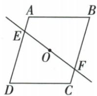

答案与解析

解析

平行四边形关于对角线交点 $O$ 中心对称，半转时 $A\leftrightarrow C$、$B\leftrightarrow D$。过 $O$ 的直线 $EF$ 仍为自身，因此 $E\leftrightarrow F$，$AE$ 对应 $CF$，得 $CF=3$。

四边形 $AEFB$ 与 $EDCF$ 半转后重合，面积同为15。两块恰拼成原平行四边形，总面积30。

本题结论

$CF=3$；四边形 $EDCF$ 面积 $15$；平行四边形面积 $30$。

</article>

## 【坑点】辨析与边界 {#pitfalls .handbook-section .is-pitfall}

### 1. 半径与弦弧不能混算 {#radius-pitfall .pitfall-title}

先看题目问到中心的距离、前后点的直线距离，还是运动路径。三者对象不同，不能只因都与旋转有关就使用同一个数。

<article class="handbook-example is-pitfall" aria-labelledby="pitfall-1">

#### 辨析 01 转动后的两点相距多少 知识清单例题 {#pitfall-1 .example-heading}

题目

如图, $\triangle ABC$ 是等腰直角三角形,BC是斜边,P是 $\triangle ABC$ 内一点.将 $\triangle ABP$ 绕点A逆时针旋转得到 $\triangle ACP'$ ,若 $AP'=3$ ,则 $PP'$ 的长为\_\_\_\_.

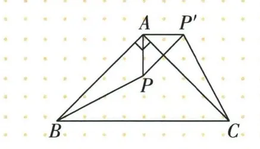

答案与解析

解析

$BC$ 是等腰直角三角形的斜边，故 $\angle BAC=90^\circ$，$B\to C$ 确定逆时针90°。$AP=AP'=3$，所以在直角 $\triangle PAP'$ 中，$PP'=\sqrt{3^2+3^2}=3\sqrt2$。

3是半径；6是两半径组成的折线长；若问本次轨迹才是四分之一圆周 $3\pi/2$，都不是本题弦长。

本题结论

$PP'=3\sqrt2$。

</article>

### 2. 坐标变换不能只看保距 {#direction-pitfall .pitfall-title}

几种反射和旋转都可能保持到原点的距离。只有明确方向及实际中心，才能选择正确的新坐标。绕非原点转动时，先计算相对坐标。

<article class="handbook-example is-pitfall" aria-labelledby="pitfall-2">

#### 辨析 02 顺时针还是逆时针 知识清单例题 {#pitfall-2 .example-heading}

题目

(2024 湖北) 如图, 点 A 的坐标是 $(-4, 6)$ , 将线段 OA 绕点 O 顺时针旋转 $90^{\circ}$ , 点 A 的对应点的坐标是 ()

A.(4,6)

B.(6,4)

C. $(-6,-4)$

D. $(-4,-6)$

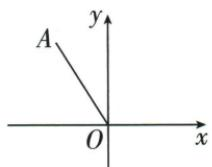

答案与解析

解析

顺时针90°为 $(x,y)\mapsto(y,-x)$，所以 $(-4,6)\mapsto(6,4)$，选B。A是 $y$ 轴反射，C是逆时针90°，D是 $x$ 轴反射。到原点距离相同不能排除这些错误，必须再核转动方向。

本题结论

选 B，像点为 (6,4)。

</article>

### 3. 全等不保证关于指定点半转重合 {#specified-center .pitfall-title}

确定对应关系后，要检验同一个点是否平分全部对应点连线。只是两个图全等，或看上去分居某点两侧，都不够。

<article class="handbook-example is-pitfall" aria-labelledby="pitfall-3">

#### 辨析 03 两组图中的中心对称 知识清单例题·合组 {#pitfall-3 .example-heading}

题目

（1）下列两图关系中，成中心对称的是哪一幅？

<figure class="handbook-option">

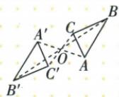

<figcaption>A</figcaption>

</figure>

<figure class="handbook-option">

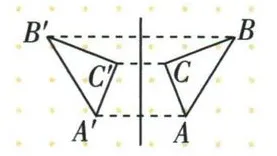

<figcaption>B</figcaption>

</figure>

<figure class="handbook-option">

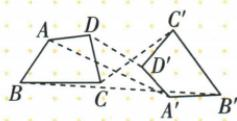

<figcaption>C</figcaption>

</figure>

<figure class="handbook-option">

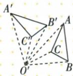

<figcaption>D</figcaption>

</figure>

（2）（2024 广东广州）$O$ 为正方形中心，各图阴影两三角形全等。哪一图的阴影三角形关于 $O$ 对称？

<figure class="handbook-option">

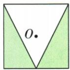

<figcaption>A</figcaption>

</figure>

<figure class="handbook-option">

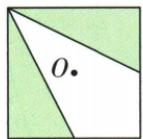

<figcaption>B</figcaption>

</figure>

<figure class="handbook-option">

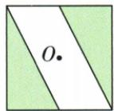

<figcaption>C</figcaption>

</figure>

<figure class="handbook-option">

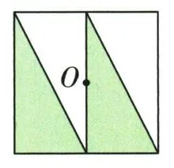

<figcaption>D</figcaption>

</figure>

答案与解析

解析

（1）A中每对对应点的连线都被 $O$ 平分，半转重合。B呈镜像而非半转，C、D的对应点不能全部以同一中点作180°对应。

（2）C的左下与右上三角形逐点半转重合。A、B不能把一个阴影三角形的三个顶点同时转到另一个的顶点；D虽两三角形全等，左下角的阴影顶点半转到右上角，而右上角不是另一个阴影三角形的顶点，不能因外框为正方形就判阴影也关于其中心对称。

本题结论

（1）A；（2）C。

</article>

<article class="handbook-example is-pitfall" aria-labelledby="pitfall-4">

#### 辨析 04 对应边与点到像点的距离 知识清单例题 {#pitfall-4 .example-heading}

题目

如图, 已知 $\triangle ABC$ 和 $\triangle A_{1}B_{1}C_{1}$ 关于点 O 中心对称, 点 A, B, C 的对称点分别为点 $A_{1}, B_{1}, C_{1}$ . 下列结论: ① $\angle ABC = \angle A_{1}B_{1}C_{1}$ ; ② $AB=AA_1$; ③ $OA=OA_1$;

④ $AC \parallel A_{1}C_{1}$ ; ⑤ $\triangle BOC \cong \triangle B_{1}OC_{1}$ . 其中正确的有 \_\_\_\_. (填序号)

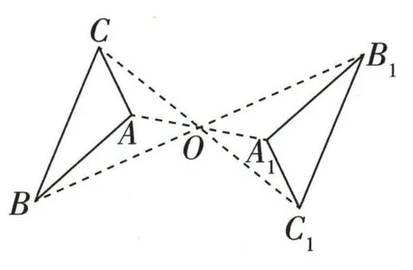

答案与解析

解析

①对应角相等，正确。② $AB$ 对应 $A_1B_1$，$AA_1$ 却是同一点前后的连接线，二者不保证相等。③ $O$ 是 $AA_1$ 中点，正确。④按图 $AC$ 不经过 $O$，半转后的对应直线与它不同且平行，正确；一般位置也可能重合。⑤ $OB=OB_1$、$OC=OC_1$，两中心夹角相等，由 SAS 得全等。

本题结论

正确的是①③④⑤。

</article>

### 4. 一种对称不替代另一种对称 {#two-symmetries .pitfall-title}

对整图分别做翻折和半转检验。内线和阴影也必须重合；对某一类图形说“必有”时，不能只选其特殊成员作为依据。

<article class="handbook-example is-pitfall" aria-labelledby="pitfall-5">

#### 辨析 05 哪些图形必有两种对称 知识清单例题·改编，明确必有性质 {#pitfall-5 .example-heading}

题目

下列图形中，既必有轴对称性，又必有中心对称性的是哪些？

① 线段；② 等边三角形；③ 平行四边形；④ 菱形。

答案与解析

解析

①线段有所在直线及中垂线两条轴，也关于中点半转重合。②等边三角形有三条轴，但180°不重合。③一般平行四边形中心对称，却不一定轴对称，矩形或菱形等特例不能代表所有成员。④菱形有两条对角线所在轴，也关于对角交点中心对称。

本题结论

①④。

</article>

<article class="handbook-example is-pitfall" aria-labelledby="pitfall-6">

#### 辨析 06 外圆对称，内部图案也对称吗 知识清单例题 {#pitfall-6 .example-heading}

题目

（2024 湖南长沙）下列完整图形中，既是轴对称图形又是中心对称图形的是哪一个？

<figure class="handbook-option">

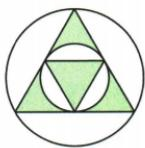

<figcaption>A</figcaption>

</figure>

<figure class="handbook-option">

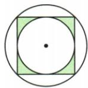

<figcaption>B</figcaption>

</figure>

<figure class="handbook-option">

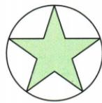

<figcaption>C</figcaption>

</figure>

<figure class="handbook-option">

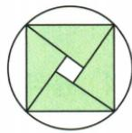

<figcaption>D</figcaption>

</figure>

答案与解析

解析

A的内部三角图案有轴，但半转不重合；B同心圆与正方形组成的完整图案同时具备两种对称；C五角星有轴，180°却把尖角转向空隙；D旋臂图案能半转重合，镜像却改变旋臂朝向。因此选B。外圆的对称性不能代替整个图案的检验。

本题结论

选 B。

</article>

<article class="handbook-example is-pitfall" aria-labelledby="pitfall-7">

#### 辨析 07 数字名称能决定严格对称吗 知识清单原题改编·字体条件辨析 {#pitfall-7 .example-heading}

题目

有人说：“6 和9是两个不同的数字，所以把任何字体的6旋转180°，都能与同字体的9完全重合。”这句话是否正确？它与“某个字形本身是中心对称图形”有什么区别？

答案与解析

解析

不正确。按某些特定设计的字形，6与9可以互为180°像，但不同字体的弯钩、笔画和衬线不一定完全对应，数字名称本身不能保证几何重合。

两个不同字形互为像，是两图之间的中心对称关系；一个字形半转后与自身重合，才是该图自身中心对称。即使某种0或8字形自身对称，也不是“两个不同数字”的答案。

本题结论

必须以具体字形核验；两图互相对应与单图自身不变是不同判断。

</article>

