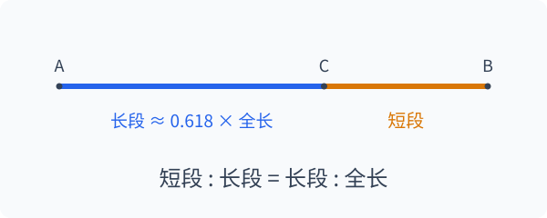
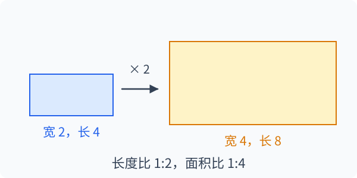
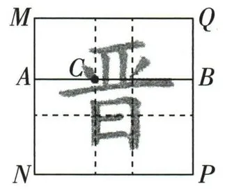
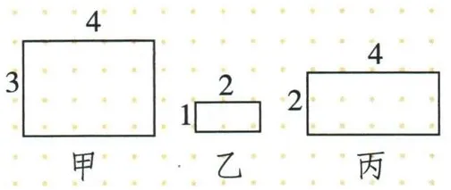
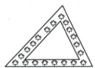
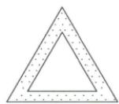
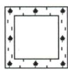
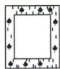

相似图形形状相同，大小可以不同。这里整理相似图形与比例的基础知识；三角形的判定和应用见[相似三角形](../../04-geometry/similar-triangles/index.md)。

<nav class="handbook-nav" aria-label="本章分区">
  <a class="handbook-jump is-knowledge" href="#knowledge">01 · 知识点概念、关系与适用条件</a>
  <a class="handbook-jump is-exam" href="#exam">02 · 考点题目分类和例题</a>
  <a class="handbook-jump is-pitfall" href="#pitfalls">03 · 坑点辨析错因，检查遗漏</a>
</nav>

## 【知识点】概念与依据 {#knowledge .handbook-section .is-knowledge}

### 1. 线段的比与比例线段 {#ratios .knowledge-title}

统一单位后，两条线段长度相除，得到线段的比。例如 $2$ 厘米与 $6$ 厘米的比为 $1:3$

若 $\frac ab=\frac cd$，就说四条线段 $a,b,c,d$ 成比例，并有 $ad=bc$

$a:b=b:c$ 时，$b$ 叫作 $a,c$ 的比例中项，有 $b^2=ac$

### 2. 黄金分割 {#golden .knowledge-title}

若“短段∶长段＝长段∶全长”，就叫作==黄金分割==

$$\frac{\text{长段}}{\text{全长}}=\frac{\sqrt5-1}{2}\approx0.618$$

一条线段有两个黄金分割点，要看题目指定哪一段是长段

### 3. 相似图形与相似多边形 {#similar-figures .knowledge-title}

形状相同的图形，叫作==相似图形==，大小可以不同

两个多边形相似，要求对应角分别相等、对应边成比例。任意两个圆相似，边数相同的正多边形相似

### 4. 相似图形的性质 {#properties .knowledge-title}

相似比为 $k>0$ 时

1. 对应角分别相等
2. 对应线段与周长的比为 $k$
3. 面积比为 $k^2$

## 【考点】题目分类和例题 {#exam .handbook-section .is-exam}

### 1. 比例计算：统一单位，必要时设公倍数 {#ratio-calculation .exam-title}

先写出四个量的顺序，再把单位统一。若已知代数比，可把两个量表示为固定整数乘同一个 $k$，约分前检查 $k$ 与新分母是否非零。

<article class="handbook-example" aria-labelledby="example-1">

#### 例题 01 按次序求第四条线段 知识清单例题 {#example-1 .example-heading}

题目

已知线段 a、b、c、d 成比例，且 $a=6\ cm, b=3\ dm, d=\frac{3}{2}\ dm$ ，则线段 c 的长度为 ____.

答案与解析

解析

$b=30$ cm，$d=15$ cm。依题给顺序 $a:b=c:d$，所以 $6/30=c/15$，解得 $c=3$ cm。回验 $6:30=3:15=1:5$。

本题结论

$c=3\text{ cm}$。

</article>

<article class="handbook-example" aria-labelledby="example-2">

#### 例题 02 用同一个公倍数化简 知识清单例题 {#example-2 .example-heading}

题目

已知 $2a=3b(a\neq0,b\neq0)$ ，求下列各式的值：(1) $\frac{a+b}{b}$ .(2) $\frac{2a+b}{a-2b}$ .

答案与解析

解析

由 $2a=3b$，设 $a=3k,b=2k$，其中 $k\ne0$。

（1）$\dfrac{a+b}{b}=\dfrac{3k+2k}{2k}=\dfrac52$。

（2）$\dfrac{2a+b}{a-2b}=\dfrac{6k+2k}{3k-4k}=-8$。

两个分母分别为 $2k$、$-k$，均非零；第二问的负号不能丢掉。

本题结论

（1）$\frac52$；（2）$-8$。

</article>

### 2. 黄金分割：先确定哪段较长 {#golden-problems .exam-title}

若题目已给某段与全长之比为黄金分割数，就已指定长段；若只给黄金分割点，则要分别考虑所求段为长段、短段。含图形背景时，先由几何条件求全长，不靠视觉比例。

<article class="handbook-example" aria-labelledby="example-3">

#### 例题 03 习字格中的分割线 知识清单例题·2024山西·背景文字整理 {#example-3 .example-heading}

题目

(2024 山西) 借助如图的正方形习字格书写的汉字“晋”端庄稳重、舒展美观. 已知一条分割线的端点 $A, B$ 分别在习字格的边 $MN, PQ$ 上, 且 $AB \parallel NP$ , “晋”字的笔画“丶”的位置在 $AB$ 的黄金分割点 $C$ 处, 且 $\frac{BC}{AB} = \frac{\sqrt{5} - 1}{2}$ . 若 $NP = 2 \mathrm{~cm}$ , 则 $BC$ 的长为 ____ cm (结果保留根号).

答案与解析

解析

正方形给 $MN\parallel PQ$，又 $AB\parallel NP$，所以 $ANPB$ 为矩形，$AB=NP=2$ cm。

题目已明确 $BC/AB=(\sqrt5-1)/2$，故 $BC=\sqrt5-1$ cm，不必再列短段一支。结论依赖题给比例，不把字体背景当作所有汉字都满足黄金分割的断言。

本题结论

$BC=(\sqrt5-1)\text{ cm}$。

</article>

### 3. 判断相似图形 {#determine .exam-title}

核对对应角和对应边的比例。

<article class="handbook-example" aria-labelledby="example-7">

#### 例题 04 三个矩形的形状 知识清单例题 {#example-7 .example-heading}

题目

如图所示的三个矩形中,相似的是____与____.

答案与解析

解析

三矩形四角都为直角，但还需边同比。长边与短边之比分别为：甲 $4/3$，乙 $2/1=2$，丙 $4/2=2$。只有乙、丙的对应角和边比同时满足要求。

本题结论

乙与丙相似。

</article>

## 【坑点】辨析与边界 {#pitfalls .handbook-section .is-pitfall}

### 1. 比例尺必须同单位、同顺序 {#units .pitfall-title}

图上长度与实际长度先统一单位；比例尺写图上∶实际。计算出的长度要带单位，但比值本身不写“厘米”。

<article class="handbook-example is-pitfall" aria-labelledby="pitfall-1">

#### 辨析 01 图上8厘米代表什么 知识清单例题 {#pitfall-1 .example-heading}

题目

甲、乙两地相距 1600 米，在地图上，表示这两地的点之间的距离是 8 厘米，则这幅地图的比例尺是（）

A.1:200

B.1:20 000

C.200:1

D.20 000:1

答案与解析

解析

$1600$ m $=160000$ cm，故比例尺为 $8:160000=1:20000$。

A 直接拿不同单位的数值相比，少了100倍换算；C 同时有单位与顺序错误；D 把正确比例倒置。

本题结论

选 B，比例尺为1:20000。

</article>

### 2. 黄金分割点未指定长短时不能漏解 {#golden-cases .pitfall-title}

已给“黄金分割点”不等于已给“所求段是长段”。两种位置都要列出，再检查长度为正且小于全长。

<article class="handbook-example is-pitfall" aria-labelledby="pitfall-2">

#### 辨析 02 分割点的两种位置 知识清单例题 {#pitfall-2 .example-heading}

题目

已知线段 AB=2，点 C 是线段 AB 的黄金分割点，则 AC 的长度为 ____.

答案与解析

解析

若 $AC$ 为长段，$AC=2\times(\sqrt5-1)/2=\sqrt5-1$；若 $AC$ 为短段，则 $BC=\sqrt5-1$，$AC=2-BC=3-\sqrt5$。两值均在0与2之间，分别对应两个黄金分割点。

本题结论

$AC=\sqrt5-1$ 或 $3-\sqrt5$。

</article>

### 3. 多边形不能只套三角形的AA {#polygon-conditions .pitfall-title}

三角形两角相等就固定了形状；多边形还要核对应边。任意同边数正多边形相似，但任意矩形未必相似。只给六边形边同比，或只给五边形对应角相等，也不足以保证相似。

<article class="handbook-example is-pitfall" aria-labelledby="pitfall-6">

#### 辨析 03 等宽花边的内外轮廓 知识清单例题 {#pitfall-6 .example-heading}

题目

手工制作课上,小红将一些花布的边角料剪裁后装饰手工画,下面四个图案是她剪裁出的空心不等边三角形、等边三角形、正方形、矩形花边,其中,每个图案花边的宽度都相等,那么,每个图案中花边的内、外边缘所围成的几何图形不一定相似的是()

  

<figure class="handbook-option">

<figcaption>A</figcaption>

</figure>

<figure class="handbook-option">

<figcaption>B</figcaption>

</figure>

<figure class="handbook-option">

<figcaption>C</figcaption>

</figure>

<figure class="handbook-option">

<figcaption>D</figcaption>

</figure>

答案与解析

解析

A、B 的内外三角形对应边平行，角对应相等，由 AA 相似。C 的内外图形都为正方形，各角和边比均满足相似条件。

D 虽内外均为矩形，但等宽花边使长、宽都减少相同的两倍边框宽度，并不是按同一倍数缩小。非正方形时长宽比会改变，因此不一定相似。

本题结论

选 D。

</article>

