平移只改变位置，每一点都按同一方向移动同一距离。作图时统一位移，计算时找准对应点，遇到重叠面积与组合周长则先重新分清区域和边界。

<nav class="handbook-nav" aria-label="本章分区">
  <a class="handbook-jump is-knowledge" href="#knowledge">01 · 知识点概念、关系与适用条件</a>
  <a class="handbook-jump is-exam" href="#exam">02 · 考点题目分类和例题</a>
  <a class="handbook-jump is-pitfall" href="#pitfalls">03 · 坑点辨析错因，检查遗漏</a>
</nav>

## 【知识点】概念与依据 {#knowledge .handbook-section .is-knowledge}

### 1. 平移 {#definition .knowledge-title}

把图形的所有点沿同一方向移动相同距离，叫作==平移==

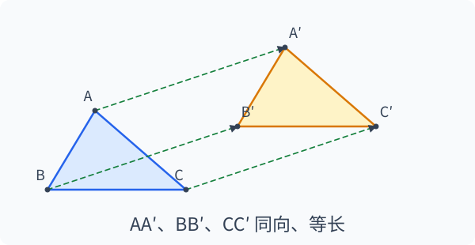

### 2. 平移的性质与距离 {#distance .knowledge-title}

1. 对应点的连线平行或共线，长度相等，这个长度就是平移距离
2. 对应边平行或共线，对应边相等，对应角相等
3. 形状和大小不变，周长、面积不变

图中平移距离是 $AA'=BB'=CC'$，看的是对应点之间的距离

### 3. 坐标的平移 {#coordinates .knowledge-title}

| 方向（$a,b>0$） | 点 $(x,y)$ 变为 |
| --- | --- |
| 右移 $a$、左移 $a$ | $(x+a,y)$、$(x-a,y)$ |
| 上移 $b$、下移 $b$ | $(x,y+b)$、$(x,y-b)$ |

例如 $(2,3)$ 右移 $4$、下移 $1$，得到 $(6,2)$

### 4. 作平移图形 {#construction .knowledge-title}

确定方向和距离 → 移动各个顶点 → 按原顺序连接对应点

## 【考点】先方法，后例题 {#exam .handbook-section .is-exam}

### 1. 平移割补的守恒 {#invariants .exam-title}

面积： 分块移动不会改变每块面积。重新拼成简单图形时，须确认没有重叠或遗漏。两全等图形重叠后，分别减去同一块公共区域，剩下的两块面积相等。

折线长度： 同方向的水平段可以平移拼接，竖直段也可拼接；若路径存在折返，不能仅用首尾水平差代替各水平段总长。台阶贴面还包括每段立面，首尾斜线不是贴面路径。

组合周长： 平移前后的单个图形周长相同，不代表两个图形组成的新外边界也有相同周长。应沿所求边界逐段列式。

### 2. 由一对对应点完成网格作图 {#grid .exam-title}

从原来的点到像点分别数横向格数和竖向格数，再把同样的两步应用于所有顶点。作图题不仅要画像，还要完成题目额外指定的连线。

<article class="handbook-example" aria-labelledby="example-1">

#### 例题 01 小船的统一位移 知识清单例题 {#example-1 .example-heading}

题目

如图,经过平移,小船上的点A到了点B.

(1)请画出平移后的小船.   
(2)该小船向\_\_\_\_平移了\_\_\_\_格,向\_\_\_\_平移了\_\_\_\_格.

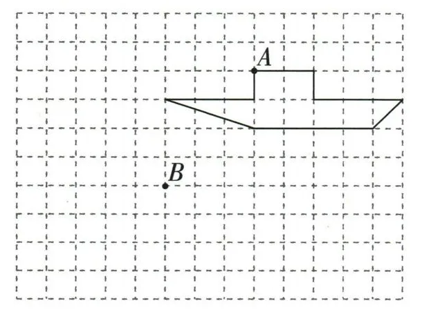

答案与解析

解析

从 $A$ 到 $B$ 是向左3格、向下4格。把船的每个折点都左移3格、下移4格，按原顺序连接，船头朝向和内部线段关系不变。

左3格、下4格是两个位移分量；若每格边长为1，对应点直线距离为 $\sqrt{3^2+4^2}=5$，不是7。

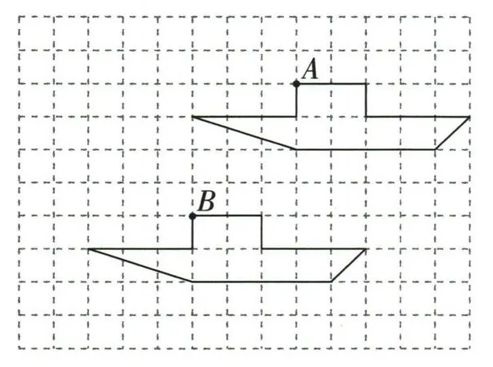

本题结论

（1）作图如解析图；（2）向左3格、向下4格，或先向下4格再向左3格。

</article>

<article class="handbook-example" aria-labelledby="example-2">

#### 例题 02 平移线段并补画指定连接 知识清单例题 {#example-2 .example-heading}

题目

(2024 黑龙江哈尔滨节选) 如图, 方格纸中每个小正方形的边长

均为1个单位长度,线段AB的端点均在小正方形的顶点上.在方格纸中将线段AB先向右平移4个单位长度,再向上平移1个单位长度后得到线段CD(点A的对应点为点C,点B的对应点为点D),画出线段CD,AD,BC.

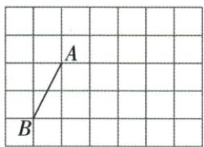

答案与解析

解析

从 $A$ 向右4格、向上1格得到 $C$；从 $B$ 用同样位移得到 $D$。先连接 $CD$ 得像线段，再连接题目指定的 $AD$、$BC$。

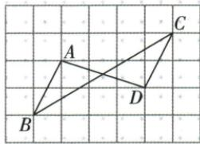

本题结论

作出 C、D 后，三条待画线段 CD、AD、BC 均须保留。

</article>

### 3. 平移后的对应角、对应边与距离 {#correspondence .exam-title}

先写字母配对，再找所求量。已知空隙或某段截长时，要按共线点的实际顺序补足对应点之间的距离，不能把最近的两点直接当成对应点。

<article class="handbook-example" aria-labelledby="example-3">

#### 例题 03 沿底边移动的三角形 知识清单例题 {#example-3 .example-heading}

题目

如图, 将面积为 3 的三角形 ABC 沿 BC 方向平移到三角形 DEF 的位置, CE = 5, EF = 2, $\angle B = 40^{\circ}$ .

(1) BC 的长度是 \_\_\_\_， $\angle DEF=$ \_\_\_\_°.  
(2)平移的距离是\_\_\_\_，三角形DEF的面积是\_\_\_\_。

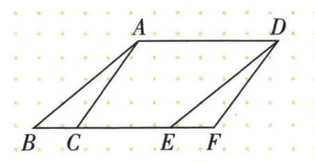

答案与解析

解析

对应关系为 $A\to D$、$B\to E$、$C\to F$。因此 $BC=EF=2$，$\angle DEF=\angle B=40^\circ$，面积仍为3。

按图 $B,C,E,F$ 依次排列，$BE=BC+CE=2+5=7$。$B$ 的像是 $E$，所以平移距离为7。$CE=5$ 只是两图之间的空隙。

本题结论

（1）$BC=2$，$\angle DEF=40^\circ$；（2）平移距离为 $7$，面积为 $3$。

</article>

### 4. 重叠面积：同时减去公共部分 {#overlap .exam-title}

先由平移得到两个原图面积相等，再指出同一个重叠区域。两边同时减去公共面积后，剩余区域等积，便可把难算的一块换成容易计算的一块。

<article class="handbook-example" aria-labelledby="example-4">

#### 例题 04 把阴影换成梯形 知识清单例题 {#example-4 .example-heading}

题目

如图, 将 Rt△ABC 沿 BC 方向平移得到△DEF, DE 与 AC 交于点 O, AB = 12, DO = 4, 平移距离为 6, 则阴影部分的面积为 \_\_\_\_.

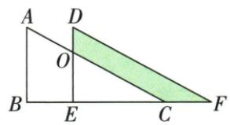

答案与解析

解析

$DE=AB=12$，图中 $D,O,E$ 按序，故 $OE=DE-DO=8$。对应点 $B,E$ 的间距 $BE=6$。

两三角形面积相等，同时减去重叠的 $\triangle OEC$，得阴影面积等于梯形 $ABEO$ 的面积。其平行两底为 $AB=12$、$OE=8$，高为 $BE=6$，所以

$$S=\frac{12+8}{2}\times6=60.$$

$DO=4$ 是上部截段，不是梯形的另一条底。

本题结论

阴影面积为 $60$。

</article>

### 5. 组合图形周长：按边界替换 {#perimeter .exam-title}

先沿所求四边形的边界列和式，再用平移对应等长替换；若出现整条共线段，用点序决定相加还是相减。不要把“原三角形周长不变”直接当作组合图形的周长。

<article class="handbook-example" aria-labelledby="example-5">

#### 例题 05 外边界比原周长多了哪些段 知识清单例题 {#example-5 .example-heading}

题目

(2024 山东东营) 如图, 将 $\triangle DEF$ 沿 $FE$ 方向平移 $3 \mathrm{~cm}$ 得到 $\triangle ABC$ , 若 $\triangle DEF$ 的周长为 $24 \mathrm{~cm}$ , 则四边形ABFD的周长为 ____ $\mathrm{cm}$ .

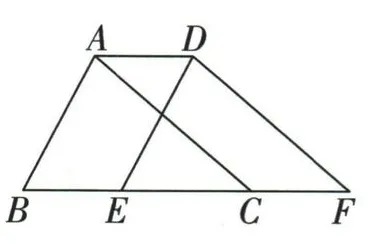

答案与解析

解析

$D\to A$、$E\to B$，所以 $AD=BE=3$，$AB=DE$。按图 $B,E,C,F$ 共线且依次，$BF=BE+EF$。

$$\begin{aligned}L_{ABFD}&=AB+BF+FD+DA\\&=DE+(BE+EF)+FD+DA\\&=24+3+3=30\text{ cm}.\end{aligned}$$

两端各有一段3 cm进入外边界，只加一次会漏段。

本题结论

四边形 ABFD 的周长为 30 cm。

</article>

### 6. 平移割补与实际用量 {#cut-and-paste .exam-title}

面积问题把零散绿地拼为完整矩形，逐边核实新长和新宽；贴面问题把同向小段拼为总长，再乘真实宽度。移动保持的是面积或分段长度，不是随意改变几何尺寸。

<article class="handbook-example" aria-labelledby="example-6">

#### 例题 06 十字道路之外的绿地 知识清单例题 {#example-6 .example-heading}

题目

如图,在宽为 $20 \, m$ , 长为 $30 \, m$ 的长方形花园中, 修建两条宽度为 $1 \, m$ 的长方形道路, 余下部分进行绿化, 求绿化部分的面积.

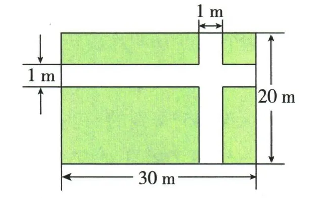

答案与解析

解析

把四块绿地平移拼接，横向总长为 $30-1=29$ m，纵向总宽为 $20-1=19$ m，面积

$$S=29\times19=551\text{ m}^2.$$

也可由总面积扣道路：$600-20-30+1=551$。最后加回的1是路口面积，因为它已被扣了两次。本题两条路分别贯通长和宽，且互相垂直。

本题结论

绿化面积为 $551\text{ m}^2$。

</article>

<article class="handbook-example" aria-labelledby="example-7">

#### 例题 07 台阶地毯的用量 知识清单例题 {#example-7 .example-heading}

题目

某宾馆重新装修后,准备在大厅主楼梯上铺设某种红色地毯,已知这种地毯每平方米售价30元,主楼梯宽2米,其侧面如图所示,则该宾馆购买地毯至少需要多少元?

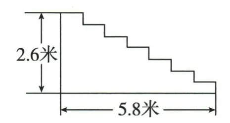

答案与解析

解析

地毯紧贴踏面及立面，所需侧面长度为所有水平段和竖直段之和：$5.8+2.6=8.4$ m。

宽为2 m，面积 $8.4\times2=16.8\text{ m}^2$；所需费用 $16.8\times30=504$ 元。这里按题设不另计接缝、裁切损耗，不把真实购买的包装规格带入模型。

本题结论

按题设用量，至少需要 504 元。

</article>

## 【坑点】辨析与边界 {#pitfalls .handbook-section .is-pitfall}

### 1. 全等不等于统一位移 {#orientation .pitfall-title}

平移不翻转边的朝向。把一个顶点移到指定位置后，若其余顶点不能使用完全相同的位移，两图就不是这一次平移得到的。

<article class="handbook-example is-pitfall" aria-labelledby="pitfall-1">

#### 辨析 01 四幅作图是否符合平移 知识清单例题 {#pitfall-1 .example-heading}

题目

下列平移作图中，错误的是哪一幅？

<figure class="handbook-option">

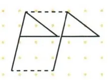

<figcaption>①</figcaption>

</figure>

<figure class="handbook-option">

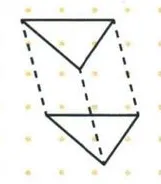

<figcaption>②</figcaption>

</figure>

<figure class="handbook-option">

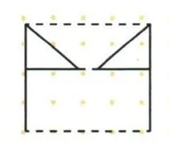

<figcaption>③</figcaption>

</figure>

<figure class="handbook-option">

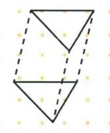

<figcaption>④</figcaption>

</figure>

答案与解析

解析

①②④中，各对应顶点可用同向、等长的位移连接。③斜边朝向翻转，两个三角形呈镜像；即使大小相同，也无法用一次统一位移让所有对应顶点到位。

本题结论

错误的是③。

</article>

### 2. 下笔计算前先认清所求量 {#quantity .pitfall-title}

| 易错做法 | 为什么不成立 | 正确检查 |
| --- | --- | --- |
| 把两图之间的空隙当平移距离 | 空隙端点可能不是对应点 | 先写字母配对，再连接原来的点和像点 |
| 组合周长只增加一次位移 | 所求外边界可能在两端各增加一段 | 沿边界列全，再替换对应边 |
| 扣完两条路不加回交叉区 | 同一块路口被扣了两次 | 用集合面积或拼矩形复核 |
| 地毯长度取首尾斜线距离 | 斜线离开台阶表面，不能覆盖立面和踏面 | 累加全部贴面水平段、竖直段 |
| 水平与竖直位移相加求平移距离 | 得到的是折线路程，不是对应点直线距离 | 直线距离用勾股，两分量分别保留方向 |

这些问题使用同一个“平移”概念，所求量却不同。先问清是位移、路线、面积还是外周长，再决定哪种守恒关系可以使用。
